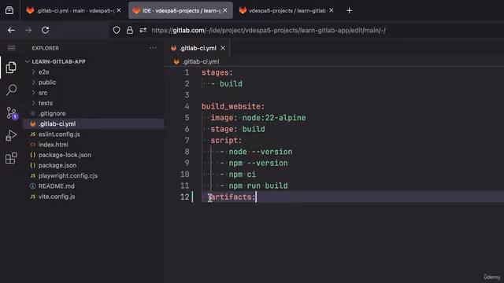
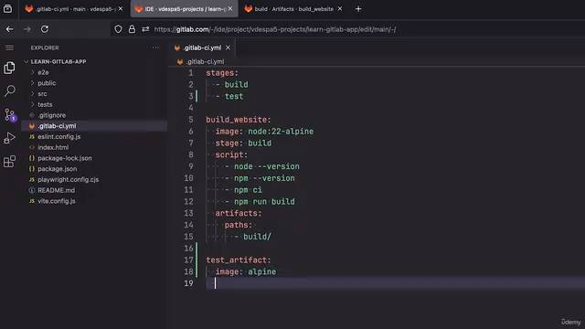
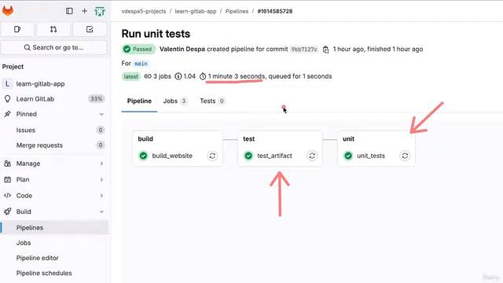
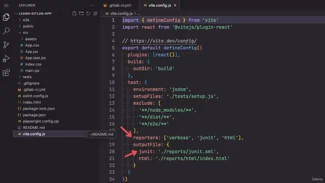
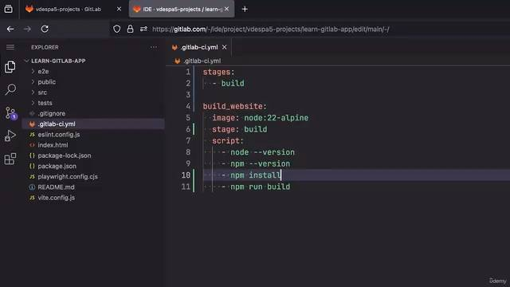
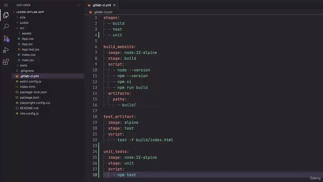

# GitLab CI/CD 实战：从构建、产物到测试与报告（P26–P35）

> 读者定位：前端转 AI 应用工程师。本文所有命令、配置、路径均可直接照抄复现。涉及并发/隔离概念时，会补一句「在 JS/Node 里对应什么」。

---

## 1. 这一节做什么

这一节把一条「只会打印版本号」的空壳流水线，逐步长成一条**真正能用的 CI 流水线**。整节内容按讲师视频的 P26–P35 顺序推进，每一步都在上一步的基础上加一点东西，最终得到一个能构建、能上传产物、能跑测试、能在页面上看测试报告的完整配置。下面按顺序把每一步的目标、动作和验收标准说清楚：

1. **P26**：把 `build` 阶段写实——用 `npm ci` 装依赖、`npm run build` 构建，并用 `ls -la` 在构建前后对比文件，验证构建确实产出了 `build/` 目录。这一步的核心是「让 build job 真的干活」，而不是只打印一行版本号。讲师在这一步还顺带演示了 `node -v`、`npm -v` 的诊断价值：日后构建挂了，先看日志里 Node 版本有没有变。
2. **P27–P28**：把 `build/` 目录声明为 **artifacts（产物）**，让它在 job 结束后被上传、可在 GitLab 页面浏览。这一步的关键不是「写对 YAML」，而是理解「为什么必须显式声明」——因为下一个 job 是全新的容器，看不到上一个 job 的文件系统。讲师在 P28 反复强调缩进：`artifacts` 与 `script` 必须严格同级，否则 GitLab 根本不会识别这个产物。
3. **P29**：讲清楚「每个 job 起一个 Docker 容器、跑完即销毁」的架构，解释为什么产物必须显式上传而不能靠容器残留。这一节是纯概念课，但它是后面所有「为什么 test artifact 能拿到 build 目录」的前提。讲师原话：「Understanding that with every job, a Docker container is started and terminated, is key in understanding how a pipeline works and what is possible or not.」
4. **P30–P31**：新增 `test` 阶段和 `test artifact` job，用 `test -f build/index.html` 自动校验产物存在——把「人肉点开日志看目录」变成脚本。这一步的动机很朴素：产物上传了，但你怎么知道上传的是对的？靠人眼看日志不可靠，写个 `test -f` 让流水线自己判断。讲师在 P31 还做了一个反证实验：把 artifacts 声明删掉，这个 test 立刻失败，因为两个 job 之间没有信息传递。
5. **P32**：引入单元测试（Vitest），新增 `unit test` job 跑 `npm test`。这一步的坑在于：`unit test` 是一个新容器，里面没有 `node_modules`，所以必须先 `npm ci` 再 `npm test`，否则 `vitest` 这个可执行文件根本不存在。讲师鼓励学员「Remove it, try it out」，亲手验证这个失败。
6. **P33**：把 `test artifact` 和 `unit test` 合并到同一 stage 实现**并行执行**，缩短流水线时间。讲师实测从 1 分多降到约 50 秒。这一步的隐含前提是：这两个 job 互不依赖（`unit test` 自己 `npm ci`，不依赖 `build website` 的产物），所以才能并行。
7. **P34**：揭示 GitLab 内置的默认 stage（`.pre`、`build`、`test`、`deploy`、`.post`），说明 `stages:` 可以省略。但讲师建议保留 `stages:`，因为团队里不是每个人都熟 GitLab，显式写出来可读性更好。
8. **P35**：把 Vitest 生成的 **JUnit 报告**作为特殊 artifact 发布，让 GitLab 页面直接渲染测试结果。这一步的关键是 `artifacts:reports:junit` 这个特殊结构——GitLab 认识它，会解析 XML 并在 pipeline 页面生成 **Tests** 标签页。讲师还澄清了一个常见误解：`reports` 默认就是 always 上传，`when: always` 只对普通 `paths` 有意义。

最终产物：一个包含 `build` 与 `test` 两个 stage、三个 job（`build website`、`test artifact`、`unit test`）、带产物上传与测试报告渲染的 `.gitlab-ci.yml`。这份配置可以直接复制到任何 Vite + Vitest 项目里用（只需按项目实际调整 `build/` 或 `dist/` 路径）。

---

## 2. 讲师原话（带出处）

> "在 CI 服务器中，我们通常不希望使用 npm install 命令。相反，我们希望使用 npm CI 命令，这是专为 CI 服务器设计的命令。"
> —— p026 [01:23]

> "由于我们每次都在一个新容器中运行这个作业，所以每次构建项目时也需要安装依赖。"
> —— p026 [00:57]

> "目标是将构建目录定义为产物。"
> —— p027 [00:26]

> "你会看到这里有一行把 script 和 artifacts 连接起来，而且这里正好是两个空格的缩进。否则，产物就不会被检测到。"
> —— p028 [00:29]

> "理解每个作业都会启动并终止一个 Docker 容器，是理解流水线如何工作以及哪些可行、哪些不可行的关键。"
> —— p029 [02:14]

> "我们只想检查 index.html 文件是否存在，而这就是你需要编写的一项测试。"
> —— p030 [00:29]

> "我们将传入 -F 标志，用来测试它是否为普通文件。"
> —— p031 [00:29]

> "如果我们没有在这里定义 artifacts，整个测试都会失败，因为两个作业之间没有传递信息。"
> —— p031 [01:56]

> "如果我们不运行 npm install 或 npm CI，这个依赖就不会存在，因此测试无法执行。"
> —— p032 [03:18]

> "我们可以通过并行运行这两个作业来加速流水线执行。"
> —— p033 [00:28]

> "默认情况下，GitLab 已经定义了一些阶段。GitLab 定义的阶段是 build、test 和 deploy。"
> —— p034 [00:29]

> "还定义了两个额外的阶段。其中一个阶段名为 .pre，它开头确实有一个点……此外还有一个 .post 阶段。"
> —— p034 [00:58]

> "我们将把这个 JUnit 报告定义为产物……在 artifacts 下，我们将有一个名为 reports 的属性。而在 reports 下，我们将有另一个名为 JUnit 的属性。"
> —— p035 [02:41]

> "通过 artifacts reports 配置创建的产物，无论作业成功还是失败，始终都会上传。"
> —— p035 [06:02]

---

## 3. 从零复现

### 3.1 前置条件

- 一个 GitLab 项目（GitLab.com 或自建均可），仓库里已有一个可构建的 Node 项目（本课用的是 Vite + React 的示例项目，含 `package.json`、`package-lock.json`、`vite.config.js`）。
- 一个已注册的 GitLab Runner，executor 为 **docker**（P29 明确说「the agent needs to be configured to use Docker as an executor」）。如果你用的是 GitLab.com 的共享 Runner，默认就是 docker executor，无需自己装。如果你用的是自建 Runner 且 executor 是 shell，那么 P29 讲的「容器隔离」前提就不成立，artifacts 的行为虽然一样，但你理解「为什么需要 artifacts」的直觉会弱一些——建议先切到 docker executor 再跟课。
- 项目根目录有 `.gitlab-ci.yml`（初始内容可以是 P26 之前那版只打印版本的配置）。如果你是从零开始，可以先建一个只有 `build website` job、`script` 里只写 `node -v` 的最小版本，然后按下面的步骤一步步加。
- 本地能跑通 `npm ci && npm run build` 和 `npm test`，确保项目本身没问题，再上 CI 排查。**先本地后 CI** 是排障的基本顺序：本地能过 CI 不过，问题在环境；本地就不过，问题在代码。

### 3.2 步骤一：写实 build 阶段（对应 P26）

打开 `.gitlab-ci.yml`，把 `build` 阶段补全。关键点：

- `image: node:22`（讲师用的是 Node 22 主版本号，不是精确版本，方便日志里对比）。这里有个细节：`node:22` 是浮动 tag，Docker Hub 上会随 22.x 小版本更新而变。如果你希望完全可复现，可以锁 `node:22.11.0` 这种精确版本；但讲师故意用主版本号，是为了演示「日志里能看到版本变化」这个排障手法。
- 先 `node -v && npm -v` 打印版本，便于日后排查「是不是 Node 版本变了导致构建挂了」。讲师在 P26 [04:06] 说这些命令只是演示排障手法，实际项目里可以删——但建议保留，因为 CI 日志是事后排障的唯一线索。
- 用 `npm ci` 而不是 `npm install`（CI 专用，严格按 `package-lock.json` 装，可复现、更快）。`npm ci` 的行为差异：它会先删掉 `node_modules/` 再装，保证干净；它不会修改 `package-lock.json`；它在 lock 文件和 `package.json` 不一致时直接报错，而不是静默修复。这三点在 CI 里都是优点。
- 构建前后各跑一次 `ls -la`，对比文件变化，确认 `node_modules/` 和 `build/` 是构建过程产生的。`-l` 是长格式（显示权限、大小、时间），`-a` 是含隐藏文件（比如 `.gitignore`、`.env`）。讲师在 P26 [03:11] 演示：构建前目录里只有源码文件，构建后多出 `node_modules/` 和 `build/`，这就是「构建确实干活了」的证据。

### 3.3 步骤二：把 build 目录声明为 artifact（对应 P27–P28）

在 `build website` job 里加 `artifacts:` 块。**缩进是硬要求**：`artifacts` 与 `script` 同级（2 空格），`paths` 是 `artifacts` 的子属性（4 空格），列表项再缩进。讲师原话：「this is exactly two spaces. Intentation. Otherwise, artifact is not going to be detected.」YAML 对缩进敏感，多一个空格少一个空格都会导致解析结果完全不同——这是新手最常踩的坑，没有之一。

`paths` 里写 `build/`，末尾带斜杠表示这是目录（不带也能跑，但带斜杠语义更清晰）。如果你写 `build` 不带斜杠，GitLab 也能识别为目录，但某些版本下行为可能有细微差异，建议统一带斜杠。

提交后，在 GitLab 页面 job 详情右侧会出现 **Job artifacts** 区块，点 **Browse** 能看到 `build/index.html` 等文件。日志里会看到 `Uploading artifacts for successful job` 和 `201 Created`——`201` 是 GitLab 对象存储返回的 HTTP 状态码，表示上传成功。如果看到 `WARNING: ... no matching files`，说明 `paths` 写错了或构建没产出该目录。



### 3.4 步骤三：新增 test 阶段与 test artifact job（对应 P30–P31）

- 在 `stages:` 里加 `test`。注意：一旦你写了 `stages:`，就**只**有列出的这些 stage 可用，GitLab 内置的 `deploy` 等会被覆盖掉。所以只列你真在用的。
- 新增 job `test artifact`，`image: alpine`（不需要 Node，只要一个能跑 `test` 命令的轻量镜像）。`alpine` 镜像只有几 MB，启动比 `node:22` 快得多——这也是为什么这个 job 不用 Node 镜像：它不需要 npm，只需要一个 shell。
- `script` 只有一行：`test -f build/index.html`。`-f` 表示「是普通文件则成功」，文件不存在则命令返回非零，job 失败。`test` 是 POSIX shell 内建命令，几乎所有镜像都有，所以 `alpine` 足够。
- 这个 job **没有** `artifacts` 声明，但它能访问 `build/`，因为 GitLab 会自动把上游 job 的 artifacts 下载到当前 job 的工作目录。日志里会出现 `Downloading artifacts for build website ...`。这个「自动下载」是 GitLab 的默认行为，前提是上游 job 声明了 `artifacts:paths` 且当前 job 没有用 `dependencies:` 显式限制。



### 3.5 步骤四：新增 unit test job（对应 P32）

- 新增 job `unit test`，`image` 复用 `node:22`。
- `script` 里必须先 `npm ci` 再 `npm test`——因为 Vitest 是 `package.json` 里的依赖，不装就没有 `vitest` 可执行文件。讲师原话：「if we do not run npm install or npm CI, this dependency is not gonna be present.」他还鼓励学员做反证实验：把 `npm ci` 删掉再跑，看 `vitest: not found` 的报错。
- 本地可先跑 `npm test` 验证：应看到 1 个测试文件、3 个测试全部通过。本地过了再上 CI，能省掉很多「到底是代码问题还是环境问题」的纠结。

### 3.6 步骤五：合并 stage 实现并行（对应 P33）

把 `unit test` 的 `stage` 从 `unit` 改成 `test`，并删掉 `stages:` 里的 `unit`。这样 `test artifact` 和 `unit test` 同属 `test` stage，GitLab 会**并行**执行它们。讲师实测执行时间从 1 分多降到约 50 秒。

这里有个隐含前提：两个 job 必须互不依赖才能并行。`unit test` 自己 `npm ci`，不依赖 `build website` 的产物，所以能并行；如果 `unit test` 需要 `build/` 里的东西，就必须串行（放不同 stage）或显式 `needs:`。并行不是免费的——它要求你理清 job 之间的依赖关系。



### 3.7 步骤六：理解默认 stage（对应 P34）

删掉整个 `stages:` 块，流水线依然按 `build` → `test` 跑，因为 GitLab 内置了 `.pre`、`build`、`test`、`deploy`、`.post` 五个 stage。`.pre` 和 `.post` 带点前缀，是特殊 stage：`.pre` 永远最先跑，`.post` 永远最后跑，适合放「流水线开始前的准备」和「流水线结束后的清理」。

讲师建议**保留** `stages:` 以便团队里非 GitLab 专家也能看懂顺序，所以最终配置里保留 `build` 和 `test` 两行。这是一个可读性 vs 简洁性的取舍：省略 `stages:` 少写几行，但新人看到 job 里的 `stage: build` 会疑惑「build 是哪来的」；显式写出来一目了然。

### 3.8 步骤七：发布 JUnit 报告（对应 P35）

- 项目里 `vite.config.js` 已配置 Vitest 输出 JUnit 报告到 `reports/junit.xml`（讲师原话：「it's actually here in byte.config.js」，即 `vite.config.js`）。
- 在 `unit test` job 里加：

```yaml
artifacts:
  reports:
    junit: reports/junit.xml
```

- 注意：`reports:` 下**不写 `paths`**，这是「特殊 artifact」，GitLab 认识它并会在 pipeline 页面渲染测试列表。`reports` 和 `paths` 是 `artifacts` 下的两个平级 key，可以同时写（既渲染报告又允许手动下载），但课里只演示了 `reports`。
- 讲师先加了 `when: always`，随后又说明：**`artifacts:reports` 默认就是 always 上传**，`when: always` 只对普通 `artifacts:paths` 有意义，所以最终可以删掉。这个细节很容易搞混：普通 `paths` 默认 `on_success`（job 失败不上传），而 `reports` 默认 `always`（job 失败也上传，因为失败的测试报告恰恰最需要看）。



提交后刷新 pipeline 页面，会出现 **Tests** 标签页，列出每个测试用例、所属文件、通过/失败状态。点进去还能看到失败用例的堆栈信息——这比翻 CI 日志找 `FAIL` 快得多。

---

## 4. 完整代码

下面是本节结束时的 `.gitlab-ci.yml` 完整内容，可直接保存到项目根目录：

```yaml
# .gitlab-ci.yml
# GitLab CI/CD 配置 —— 覆盖 P26–P35 全部内容
# 项目：Vite + React 示例（含 Vitest 单元测试）

stages:
  - build
  - test

# ---------- 构建阶段 ----------
build website:
  image: node:22
  stage: build
  script:
    - node -v
    - npm -v
    - ls -la
    - npm ci
    - npm run build
    - ls -la
  artifacts:
    paths:
      - build/

# ---------- 测试阶段（两个 job 并行） ----------
test artifact:
  image: alpine
  stage: test
  script:
    - test -f build/index.html

unit test:
  image: node:22
  stage: test
  script:
    - npm ci
    - npm test
  artifacts:
    reports:
      junit: reports/junit.xml
```

配套的 `vite.config.js`（讲师提到 JUnit 报告在这里配置；若你的项目没有，需要补上 `test.reporters` 配置）：

```js
// vite.config.js
import { defineConfig } from 'vite'
import react from '@vitejs/plugin-react'

export default defineConfig({
  plugins: [react()],
  test: {
    // 让 Vitest 同时输出 CLI 报告和 JUnit XML 报告
    reporters: ['default', 'junit'],
    outputFile: {
      junit: './reports/junit.xml',
    },
  },
})
```

> 说明：上面 `vite.config.js` 的 `test` 字段是 Vitest 的配置入口。讲师在 P35 只说「配置在 vite.config.js 里、有 JUnit reporter」，**没有逐字念出字段名**。若你的项目用的是 `vitest.config.js` 或 `package.json` 里的 `vitest` 字段，请以你项目实际文件为准；字段名以 Vitest 官方文档为准。

`package.json` 里需要有 `test` 脚本（讲师在 P32 用 `npm test` 触发）：

```json
{
  "scripts": {
    "dev": "vite",
    "build": "vite build",
    "test": "vitest run"
  }
}
```

> 说明：`"test": "vitest run"` 是让 Vitest 跑一次就退出（CI 场景必须这样，否则会进 watch 模式卡住）。讲师没逐字念 `package.json` 的 scripts 内容，此处按 Vitest 常规用法给出；若你项目里是 `vitest`（不带 `run`），CI 里会挂起，需要改成 `vitest run`。

---

## 5. 逐行解释

**`stages: [build, test]`**
显式声明两个 stage。P34 讲过：不写也能跑（GitLab 内置 `.pre/build/test/deploy/.post`），但写出来是为了让团队里不熟 GitLab 的人一眼看懂顺序。**注意**：一旦你写了 `stages:`，就**只**有列出的这些 stage 可用，内置的 `deploy` 等会被覆盖掉——所以只列你真在用的。如果你以后想加 `deploy` stage，必须显式写进 `stages:` 列表，否则 job 里写 `stage: deploy` 会报「stage does not exist」。

**`build website:` / `image: node:22`**
job 名。`image` 指定 docker executor 拉哪个镜像起容器。`node:22` 是主版本 tag，不是 `22.x.y` 精确版——讲师故意这样，方便日后日志里对比「是不是 Node 大版本升级导致构建挂了」。如果你需要完全可复现的构建，可以锁精确版本；但代价是每次升级 Node 都要手动改配置，且安全补丁不会自动进来。这是一个可复现性 vs 维护成本的取舍。

**`stage: build`**
把这个 job 归到 `build` stage。同一 stage 的 job 并行，不同 stage 串行。这是 GitLab 流水线的基本调度模型：stage 是串行单位，job 是并行单位。

**`script:` 下的 `node -v` / `npm -v`**
纯诊断用。讲师原话：「in case our build doesn't work anymore at one point in time, we can compare the different versions from the logs」。CI 日志是事后排障的唯一线索，多打几行版本号成本极低，收益是「构建突然挂了」时能第一时间排除「Node 版本变了」这个常见原因。

**`ls -la`（构建前）**
`-l` 长格式、`-a` 含隐藏文件。目的是记录「构建前仓库里有什么」，和构建后对比。讲师在 P26 [04:06] 说这些命令只是演示排障手法，实际项目里可以删。但如果你删了，构建失败时就少了一个「产物到底有没有生成」的直接证据——建议至少保留构建后那次 `ls -la`。

**`npm ci`**
CI 专用安装命令。和 `npm install` 的区别：严格按 `package-lock.json` 装、不改 lock 文件、跳过部分面向开发者的计算（如依赖树），因此更快、可复现。讲师原话：「install dependencies using the exact versions we have in the package lock.json without making any changes」。

> 在 JS/Node 里对应什么：`npm ci` 相当于「按 lock 文件精确还原」，类似前端项目里 `pnpm install --frozen-lockfile` 的语义。它不会像 `npm install` 那样偷偷升级次版本。如果你从 pnpm 或 yarn 迁移过来，`npm ci` 就是那个「CI 里应该用、但本地开发不一定要用」的命令。

**`npm run build`**
跑 `package.json` 里的 `build` 脚本（Vite 项目即 `vite build`），产物默认输出到 `build/`（Vite 默认是 `dist/`，本课项目配置成了 `build/`，以你项目 `vite.config.js` 的 `build.outDir` 为准）。如果你照抄配置但项目没改 `build.outDir`，`test -f build/index.html` 会失败——这是新手最常见的「配置对但跑不通」原因之一。

**`ls -la`（构建后）**
对比用。讲师在 P26 [03:11] 演示：构建后多出 `node_modules/` 和 `build/`，证明构建成功。如果构建后 `build/` 不存在，说明 `npm run build` 没产出预期目录，先查 `vite.config.js` 的 `build.outDir`。

**`artifacts: paths: [build/]`**
把 `build/` 目录打包上传到 GitLab。**缩进**：`artifacts` 与 `script` 同级（2 空格），`paths` 缩进 4 空格，列表项缩进 6 空格。讲师在 P28 [00:29] 特别强调「exactly two spaces」。末尾斜杠表示目录，语义更清晰。上传成功后，job 详情页右侧会出现 **Job artifacts** 区块，点 **Browse** 能在线浏览文件——这是「产物确实上传了」的最直接证据。

**`test artifact:` / `image: alpine`**
新 job。用 `alpine` 是因为只需要 `test` 这个 shell 内建命令，不需要 Node 环境，镜像越小启动越快。`alpine` 镜像只有几 MB，`node:22` 有几百 MB——在并行 job 里，镜像拉取时间会直接影响流水线总时长。

**`test -f build/index.html`**
`test -f` 判断「是普通文件」。文件存在返回 0（成功），不存在返回非零（job 失败）。讲师原话：「provide the dash F flag, which is going to test for a regular file」。`-f` 和 `-e` 的区别：`-e` 只判断「存在」（目录也算），`-f` 判断「存在且是普通文件」——用 `-f` 更严格，能排除「`build/index.html` 是个目录」这种异常情况。

**为什么 `test artifact` 能访问 `build/`？**
因为 `build website` 声明了 `artifacts:paths:build/`，GitLab 会在 `test artifact` 启动时自动把上游 artifacts 下载到工作目录。日志里会看到 `Downloading artifacts for build website ...`。讲师在 P31 [01:56] 强调：**如果没声明 artifacts，这个 test 必然失败**，因为两个 job 之间没有信息传递。这个「自动下载」是 GitLab 的默认行为，前提是上游 job 声明了 `artifacts:paths` 且当前 job 没有用 `dependencies:` 显式限制。

**`unit test:` / `image: node:22`**
复用 Node 镜像，因为要跑 npm。这里不能像 `test artifact` 那样用 `alpine`，因为 `alpine` 里没有 Node 和 npm。

**`npm ci` + `npm test`**
必须先 `npm ci`。Vitest 是 `package.json` 的 devDependency，不装就没有 `vitest` 可执行文件。讲师在 P32 [03:18] 说：「if we do not run npm install or npm CI, this dependency is not gonna be present. So the test cannot be executed.」他还鼓励实验：「Remove it, try it out, see if it works without it.」这个实验值得做一次，亲眼看到 `vitest: not found` 的报错，比读十遍文档印象深。

**`artifacts: reports: junit: reports/junit.xml`**
特殊 artifact。`reports:` 下不写 `paths`，GitLab 认识 `junit` 这个 key，会把 XML 解析成 pipeline 页面的 **Tests** 标签页。讲师原话：「using this particular structure helps GitLab understand, oh, what I'm providing here is a JUnit report」。这个 XML 的格式是 JUnit 标准（很多测试框架都支持），GitLab 只负责解析和渲染，不关心你用什么框架生成。

**关于 `when: always`**
讲师先加了，随后在 P35 [06:02] 说明：`artifacts:reports` **默认就是 always 上传**（无论 job 成功失败），`when: always` 只对普通 `artifacts:paths` 有意义（普通 artifacts 默认只在 job 成功时上传）。所以最终配置里删掉了 `when: always`。这个细节很容易搞混：普通 `paths` 默认 `on_success`，`reports` 默认 `always`——因为失败的测试报告恰恰最需要看。

**并行执行**
`test artifact` 和 `unit test` 同属 `test` stage，GitLab 会同时起两个容器跑。讲师实测从 1 分多降到约 50 秒。**注意**：并行意味着两个 job 互不依赖，`unit test` 不依赖 `build website` 的产物（它自己 `npm ci`），所以能并行；如果 `unit test` 需要 `build/`，就必须串行或显式 `needs:`。并行不是免费的——它要求你理清 job 之间的依赖关系。

---

## 6. 复现检查清单

逐项打勾，全过说明复现成功。每条都附了「怎么验证」，避免「看起来对但实际没生效」：

- [ ] `.gitlab-ci.yml` 里 `stages:` 只有 `build` 和 `test` 两项。**验证**：打开文件，确认没有 `unit`、`deploy` 等多余项。
- [ ] `build website` job 的 `script` 包含 `node -v`、`npm -v`、`npm ci`、`npm run build`。**验证**：日志里能搜到 `v22.x.x` 和 `10.x.x` 这样的版本输出。
- [ ] `build website` 的 `artifacts:paths` 是 `build/`，且缩进正确（`artifacts` 与 `script` 同级）。**验证**：用 YAML 校验器（如 `yamllint`）或 GitLab 的 CI Lint 工具检查，缩进错会直接报错。
- [ ] 提交后，`build website` job 详情右侧出现 **Job artifacts** 区块，点 **Browse** 能看到 `index.html`。**验证**：点 Browse，确认文件列表里有 `index.html` 和 `assets/` 目录。
- [ ] `build website` 日志里出现 `Uploading artifacts for successful job` 和 `201 Created`（讲师在 P28 [02:24] 提到）。**验证**：搜日志关键词 `Uploading artifacts`，确认后面跟的是 `201 Created` 而不是 `WARNING`。
- [ ] `test artifact` job 用 `alpine` 镜像，`script` 只有 `test -f build/index.html`。**验证**：日志开头能看到 `Using docker image ... alpine`。
- [ ] `test artifact` 日志里出现 `Downloading artifacts for build website ...`。**验证**：搜日志关键词 `Downloading artifacts`，确认下载的是 `build website` 的产物。
- [ ] `unit test` job 的 `script` 是 `npm ci` 然后 `npm test`，日志里能看到 Vitest 输出「1 test file passed, 3 tests passed」。**验证**：搜日志关键词 `Test Files` 和 `Tests`，确认数字对得上。
- [ ] `test artifact` 和 `unit test` 在 pipeline 图里**并排**显示（同 stage 并行）。**验证**：打开 pipeline 页面，看 `test` stage 下两个 job 是左右并排还是上下串行。
- [ ] `unit test` 的 `artifacts:reports:junit` 指向 `reports/junit.xml`。**验证**：打开 `.gitlab-ci.yml`，确认 `reports` 下是 `junit` 而不是 `paths`。
- [ ] pipeline 页面出现 **Tests** 标签页，能看到 3 个测试用例及通过状态。**验证**：点 **Tests** 标签，确认列出每个用例名和绿色对勾。
- [ ] 故意删掉 `build website` 的 `artifacts` 块再提交，`test artifact` 应失败（验证 artifacts 传递机制）。**验证**：删掉后提交，`test artifact` 日志里应出现 `test: build/index.html: No such file or directory`。
- [ ] 故意把 `test -f build/index.html` 改成 `test -f build/nonexistent.html`，job 应失败（验证 test 命令语义）。**验证**：改完提交，`test artifact` 应红叉，日志里 `test` 命令返回非零。

---

## 7. 课里没讲但你会撞上的

| 现象 | 原因 | 怎么办 |
| --- | --- | --- |
| `test artifact` 报 `build/index.html: No such file or directory`，但 `build website` 明明成功了 | Vite 默认输出 `dist/`，不是 `build/`；本课项目配置成了 `build/`，你项目可能没改 | 查 `vite.config.js` 的 `build.outDir`，把配置里的 `build/` 全改成 `dist/`，或反过来改项目配置 |
| `unit test` 在 CI 里挂起，一直不结束，最后超时 | `package.json` 的 `test` 脚本是 `vitest`（不带 `run`），Vitest 进 watch 模式 | 改成 `"test": "vitest run"`，让 Vitest 跑一次就退出 |
| `unit test` 报 `reports/junit.xml: No such file or directory` 或静默不生成 | Vitest 的 `outputFile` 不会自动创建父目录（取决于版本） | 在 `unit test` 的 `script` 里加 `mkdir -p reports`，或在 `vite.config.js` 里确认 Vitest 版本行为 |
| 想同时渲染报告和允许手动下载 XML，但不知道怎么写 | `reports` 和 `paths` 是 `artifacts` 下的两个平级 key，可以同时写 | 同时写 `paths: [reports/]` 和 `reports: {junit: reports/junit.xml}`；课里 P35 [05:32] 提到过这个可能性，但没给完整示例 |
| 两个 test job 没并行，还是排队 | 共享 Runner 并发数不够（`concurrent` 值太小），job 会排队而非真并行 | 检查 Runner 的 `config.toml` 里 `concurrent` 值，调大；或加更多 Runner |
| 首次跑卡在 `Pulling docker image` 几十秒 | 首次拉镜像没缓存，`node:22` 几百 MB | 正常现象，第二次起有缓存；急的话可以预拉镜像到 Runner 机器 |
| 给普通 `artifacts:paths` 加了 `when: always`，job 失败时也上传，占存储 | `when: always` 让普通 artifacts 在 job 失败时也上传 | 排障时有用（上传失败日志），但平时建议去掉，只在需要时加 |
| 流水线变长后想跨 stage 并行，但不知道用什么关键字 | 课里只讲了「同 stage 并行」，没提 `needs:` | 用 `needs:` 实现 DAG 模式，让跨 stage 的 job 也并行；这是更细粒度的控制，等流水线变长会需要 |
| 不理解「为什么 job A 装的东西 job B 用不了」 | 每个 job 一个容器、跑完销毁，没有共享内存、没有残留状态 | 把 GitLab job 想成 Node 里的独立 worker：每次请求起一个、用完即弃，产物传递必须走 artifacts（类似通过消息队列/文件系统显式传数据），不能靠「容器还在」 |

**在 JS/Node 里对应什么（并发/隔离）**：GitLab 每个 job 一个容器、跑完销毁，等价于 Node 里「每次请求起一个独立 worker、用完即弃」——没有共享内存、没有残留状态。所以你不能指望 job A 里 `npm install` 的东西被 job B 复用，就像你不能指望两个 Node worker 共享模块实例。产物传递必须走 artifacts（类似 Node 里通过消息队列/文件系统显式传数据），不能靠「容器还在」。理解这一点，后面所有「为什么需要 artifacts」「为什么 unit test 要自己 npm ci」的疑问都会迎刃而解。

---

**参考截图索引**（本文已插入 4 张，另附 2 张备查）：



