# GitLab CI/CD 实战：测试你的管道、保护 main 分支、用 Merge Request 交付（P036–P041）

> 本文覆盖 BV182JX6nEjh 的 P036–P041。读者对象是前端出身、正在转向 AI 应用工程的同学。整篇文档的目标只有一个：**你照着做，能把这套「分支 → 管道 → Merge Request → 评审 → 合并」的流程在自己的 GitLab 仓库里跑起来，并且亲眼看到管道在你故意搞坏代码时会失败。**
>
> 关于「完整性」的一句实话：讲师这一段的项目（React 应用 + 构建产物 + 单元测试 + 一个 Playwright/Testing Library 风格的 E2E 断言）在课里是**已经存在**的，讲师没有从头创建它。所以本文第 4 节的 `App.js` / `App.test.js` / `package.json` 是**按讲师描述还原的最小可运行版本**，`.gitlab-ci.yml` 里只有 ESLint 那个 job 是讲师在 P041 里逐字展示的，其余 job 的名字（`build website`、`test artifact`、`unit test`）来自 P036 的管道界面，命令体是按讲师描述还原的。凡属还原的地方我都明确标注了，不把还原内容冒充成讲师原话。

---

## 1. 这一节做什么

这六节课（P036–P041）不是讲语法，是把一条**产品级的 GitLab CI/CD 工作流**装到你的仓库上。做完之后，你的仓库会有下面这些行为：

| # | 做完之后的仓库行为 | 对应课程 |
|---|---|---|
| 1 | 你**故意**把构建目录改错、把 UI 里一个元素删掉，管道必须失败；如果它没失败，说明你的测试形同虚设 | P036 |
| 2 | `main` 分支被保护，任何人都不能直接 push，只能走分支 | P038 |
| 3 | 每次 push 到 feature 分支会自动跑管道，管道不过就合不进去 | P037 / P039 |
| 4 | 所有改动必须经过 Merge Request + 代码评审 + 讨论串全部解决 | P039 / P040 |
| 5 | 合并时 squash 成一个 commit、源分支自动删除、合并后 `main` 上再跑一遍管道 | P040 |
| 6 | 管道里加一个 ESLint job，把结果输出成 GitLab 能吃的 code quality 报告，有未使用变量这类问题就直接阻塞合并 | P041 |

**这一节真正的产出物**是一个「会挡人的 main 分支」和一条「会自己报警的管道」。看起来只是几个开关，但这几个开关决定了后面所有 CI/CD 工作的可信度。

---

## 2. 讲师原话

> "我们常常会有一次很不错的测试性拍摄，为此花了大量时间。但只有它们在应当失败时真的失败了，这次测试才有价值。这就像在家里装了烟雾报警器，却不定期测试它。"
> —— p036 [00:00]

讲师用一个比喻把 P036 的动机说透了：烟雾报警器装了但从不测试，你不知道里面有没有电池。测试也一样——**只有它在该失败的时候失败，它才有价值。**

> "主分支损坏，差不多等同于工厂生产停摆。这对业务不利：什么都生产不出来，工厂里也没有任何产出。"
> —— p037 [01:58]

> "我们就是不会把未经测试的工作推送到主分支。我们想彻底摆脱那句臭名昭著的话：‘在我机器上是好的。’"
> —— p037 [02:24]

> "对于每个新功能、缺陷修复、想法、实验、改动，无论我们做什么，哪怕只加一个点，我们都会新建一个分支。"
> —— p037 [03:20]

这三句是整段的骨架：**main 必须永远可交付 → 所以不往 main 直接推未经测试的代码 → 所以每个改动都开分支。**

> "我使用并推荐的设置是快进合并选项……使用这个选项可以避免产生合并提交，并让历史记录干净得多。"
> —— p038 [00:26]

> "不要选择‘允许’，我建议选择‘鼓励’。"
> —— p038 [01:07]

> "我们希望在合并任何更改之前确保流水线成功……我还建议你启用这个选项（所有讨论串都必须已解决），以确保所有反对意见都记录在已解决并关闭的讨论串中。"
> —— p038 [01:37]

> "目前它被设置为维护者，而我们将选择‘没有人’。因此，没有人可以在这个分支上推送和合并，这意味着我们不能再直接修改这个分支了。"
> —— p038 [03:19]

> "它显示没有文件可上传，但这不会阻止任务成功。"
> —— p036 [02:40]

这条是 P036 里最值钱的一句「反直觉发现」：**artifact 路径没找到文件，GitLab 只打一行提示，job 照样绿。** 如果你的产物流失是靠 artifact 保证的，那这个「绿」是假的。

> "正确配置 JUnit 测试报告器，会让浏览失败的测试变得舒服得多。"
> —— p036 [04:06]

> "这里还有一份代码质量报告。所以这个会自动与 GitLab 集成。"
> —— p041 [03:04]

> "因此，重要的是再次运行流水线，即使我们已经在分支上执行过它，也要确保构建和测试阶段正常工作，并且没有集成问题。"
> —— p040 [07:48]

---

## 3. 从零复现

### 3.0 前置条件

你需要：

- 一个 GitLab 项目（课里用的是 fork 出来的项目，所以后面会专门处理 `target project` 这个设置）。
- 本地 Node 环境，能 `npm ci`、`npm run build`、`npm run test`、`npm run lint` 四条命令跑通。
- 一个已经能跑起来的 `.gitlab-ci.yml`（有 build 和 test 两个 stage）。如果你还没有，用第 4 节给的文件。

课里的项目构建产物默认输出到 `build` 目录，测试里有一句断言在找 `alt` 文本为 `GitLab logo` 的图片元素 —— 这两点是 P036 实验的抓手，你必须先确认自己的项目也是这个形状，否则后面的「故意失败」对不上。

### 3.1 第一步：测试你的测试（P036）

这是整段最该动手做的一步，别跳过。

**改动 A：把构建目录挪走。** 打开 `.gitlab-ci.yml`，找到设置构建目录的那一行（课里是 `build`），改成 `build-tmp`。

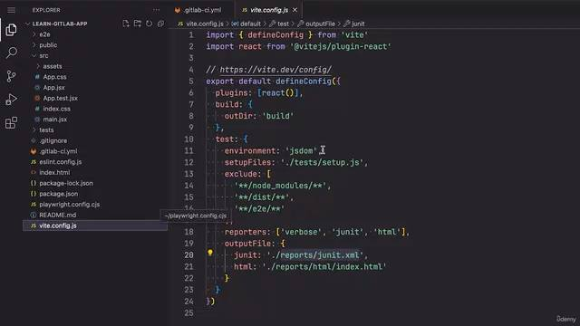

**改动 B：删掉 UI 里的 GitLab logo。** 打开 `src/App.js`，把那个 `` 删掉。对应地，那个「shows the GitLab logo」的测试应该失败。

**改动 C：commit 并 push。**

接下来盯管道，你应该看到三种**不同性质**的失败/不失败：

**① `build website` job 成功了 —— 这是陷阱。**
构建真的跑完了，产物真的在 `build-tmp/` 里。但发布 artifact 那一步会报 `no files to upload`，因为 artifact 的路径还写死在 `build`。

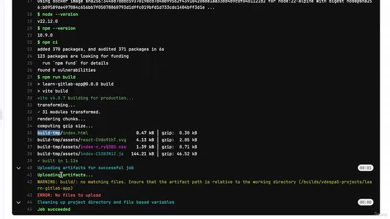

**这是你必须记住的一条：artifact 找不到文件 ≠ job 失败。** 想让它失败，得自己加断言。

**② `test artifact` job 失败了 —— 这是好的失败。**
它去检查那个文件在不在，找不到就报错。这正是「烟雾报警器响了」。

**③ `unit test` job 失败了 —— 这次失败读起来很费劲。**
原始输出会很长，你要往下翻才能看出是哪个测试挂了、为什么挂。

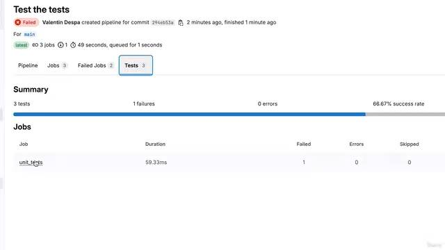

配好 JUnit reporter 之后，管道页面上能直接点进那个失败的测试，看到类似 `unable to find an element with the alternate text GitLab logo` 这样的技术细节。讲师的原话是这个配置让排查「much, much nicer」。

**收尾：revert。** 讲师是在 GitLab 网页上做的：

1. 左侧 **Code → Commits**，找到那条叫 `test the tests` 的 commit；
2. 点 **Options → Revert**；
3. 目标分支选 `main`，**不要**勾「start a new merge request」；
4. 点 Revert，这会生成一条新的 revert commit，并触发新管道；
5. 回到 Web IDE **刷新一次**，确认 `App.js` 里 logo 回来了、`.gitlab-ci.yml` 里构建目录改回 `build` 了。

### 3.2 第二步：配置 Merge Request 行为（P038）

进入 **Settings → Merge requests**，逐项改：

| 设置项 | 改成 | 为什么 |
|---|---|---|
| Merge method | **Fast-forward merge** | 不产生 merge commit，历史是一条直线 |
| Squash commits when merging | **Encourage**（不是 Allow） | 分支上一堆「wip」「fix typo」会被压成一个 commit |
| Merge checks：Pipelines must succeed | **勾上** | 管道红着就合不进去 |
| Merge checks：All threads must be resolved | **勾上** | 没人能无视评审意见硬合 |
| Target project | 从 **upstream project** 改成**本项目** | 你是 fork 出来的，MR 必须提到自己仓库 |

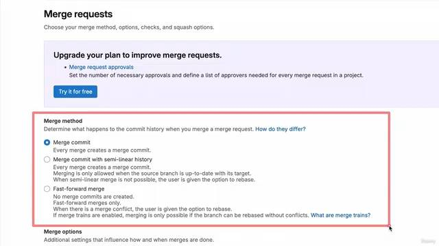

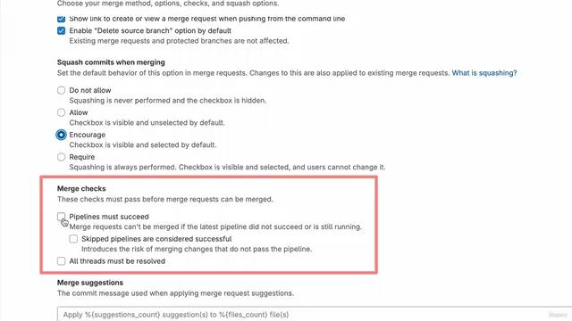

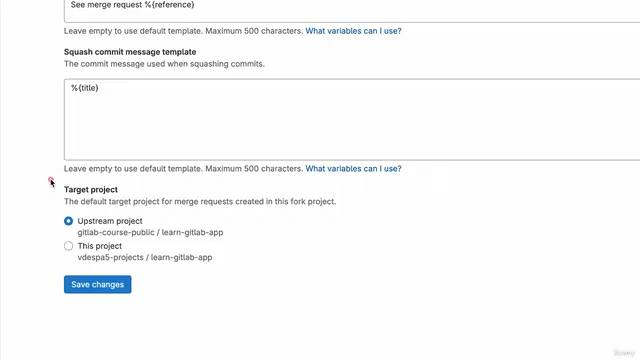

> `target project` 这一项只对 fork 出来的仓库有意义。如果你是在自己新建的仓库里做，页面上可能压根没有这个选项 —— 课里没讲这种情况，遇到就按实际界面走。

### 3.3 第三步：保护 main 分支（P038 后半）

**Settings → Repository → 展开 Protected branches**，找到 `main` 那一行：

- `Allowed to merge` 保持 **Maintainers**；
- `Allowed to push and merge`（课里讲师说的是把 `Allow to push and merge` 这一项）从 **Maintainers** 改成 **No one**。

改完会自动保存。从这一刻起，**任何人**直接往 `main` push 都会被拒。

这一步在概念上等于给你的主干加了一把写锁。**用 JS/Node 类比**：就像你在 Node 里用一个全局 flag 拦住所有写操作 —— 只不过 GitLab 是在服务端拦，客户端绕不过去，比你在本地写个 pre-commit hook 靠谱得多（hook 是可以 `--no-verify` 跳过的，课里没提这一点，但这是你必须知道的差别）。

### 3.4 第四步：开你的第一个 Merge Request（P039）

1. 打开 **Web IDE**，改 `README.md`，比如加一行说明。
2. 点 **Commit and push**。
3. **你会看到报错**：不允许 push 到这个分支。

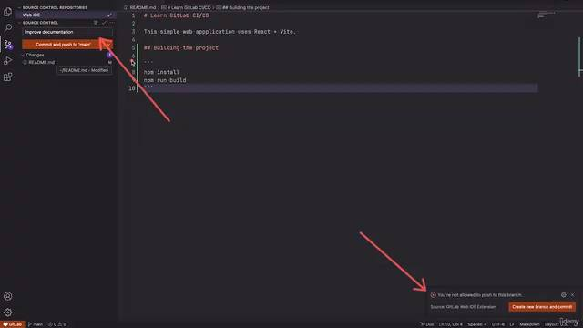

4. 选择 **Create a new branch and commit**，弹出的输入框可能出现在页面**顶部**（讲师特意提醒过这个 UI 会跑）。

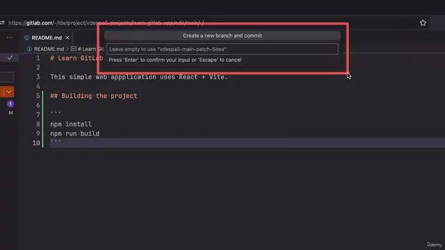

5. 分支名用 `feature/improve-docs`。**从 `main` 切出来**，这样你拿到的是最新的、已经集成过的代码。命名规则：加 `feature/` 或 `bugfix/` 前缀，**不要空格**，用短横线。
6. 分支创建后，Web IDE 底部会显示当前分支名。点它可以切回 `main` 或再开新分支。
7. 回到项目首页，顶部会出现 **Create merge request** 的黄色提示条。点它。

   如果没看到提示条，左侧 **Code → Merge requests** → **New merge request**，源分支选 `feature/improve-docs`，目标分支 `main`。

8. 填标题和描述。讲师强调：**标题要让人一眼看懂这条 MR 在干什么**，因为同时打开的 MR 会很多；描述里简短说明改动内容和目的，必要时贴截图。
9. 往下滚，勾上 **Delete source branch**（合并后自动删分支），squash 选项按需勾。
10. 点 **Create merge request**。

创建完之后你会在 MR 页面里看到：**这条分支的 pipeline 已经跑过并且通过了**，测试也过了。

这时候别急着合 —— 讲师的原话是「this is ready for merge, **but not so fast**」。

### 3.5 第五步：走一遍代码评审（P040）

评审的入口在左侧 **Merge requests**，括号里的数字就是待处理的条数。默认它可能是被「pin」住的，取消 pin 后会掉到 **Code → Merge requests** 下面。

进入 MR 后：

1. 先读标题和描述，再点 **Changes** 看 diff（绿色是新增行）。
2. 在具体某一行上留言，比如问一句「why not explain how to run tests as well?」。

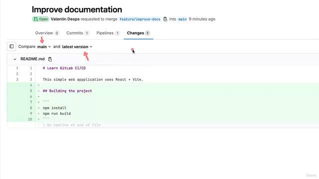

3. 点 **Add comment now** → 评论**立即发布**，对方马上收到通知。
4. 点 **Start a review** → 评论被**暂存**，等你在 **Finish review** 时统一发布。讲师解释了为什么要分这两种：长评审里你写到一半可能发现「哎这段其实没问题」，如果已经发出去了，别人可能已经开始回复你，白折腾。

5. 评论发出去后，MR 概览会显示 **one unresolved thread**。因为你在 3.2 打开了「All threads must be resolved」，这条不解决就合不了。

6. 回到 Web IDE，在 README 里补一段「如何跑测试」，commit and push 到**同一分支**。

7. 回到 MR，刷新：

   - 有一条**新的 pipeline** 在跑（push 触发的）；
   - Changes 里能看到你新加的那段；
   - 那条讨论可以点 **Resolve**；
   - MR 现在包含 2 个 commit、跑过 2 条 pipeline。

8. 关于 **Approve**：讲师明确说了，**免费版上它只是个形式**，不是强制项，点问号可以看到说明。团队实践中更常用 👍 / 👎 表态：出现 👎 就意味着「还有话没说完，别合」。

9. 一切就绪后，在 **Ready to merge** 区域确认：
   - **Delete source branch** 已勾（`feature/improve-docs` 会被删）；
   - **Squash commits** 已勾（2 个 commit 压成 1 个）；
   - 把 squash 后的 commit message 改成准确的描述（讲师在这步把消息改成了「improved documentation」之类）。

10. 点 **Merge**。

11. **合并后去 Pipelines 看一眼**：`main` 分支上有一条新管道在跑。讲师强调这一步**不是多余的** —— 分支上跑过不代表 `main` 上没问题，集成后可能出问题。

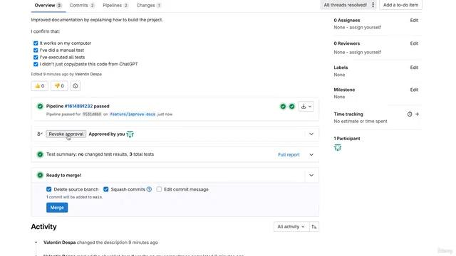

12. 最后：源分支已经被删了，**Web IDE 里如果还开着那个分支，切回 `main` 或者直接重开 Web IDE**，否则会报错。

### 3.6 第六步：接入 ESLint 代码质量报告（P041）

先理解动机：多个人写一个项目，风格必须统一，否则读代码和维护都是灾难。**Linter 就是干这个的** —— 它**只报告问题，不自动修**。

课里的项目已经装了 ESLint（JavaScript 项目最常见的那个），并且额外装了一个「为 GitLab 输出格式」的 formatter，能把 ESLint 结果写成 GitLab 认识的 code quality JSON。

操作步骤：

1. 先在 Web IDE 里**切回 `main`**（因为上一条分支被删了），再从 `main` 开新分支 `feature/add-lint`。
2. 打开 `.gitlab-ci.yml`。
3. 从那个 GitLab formatter 的官方文档里复制它给的配置片段，粘进来，按项目情况改三处：
   - **镜像**：换成和项目其它 job 一致的 node 镜像；
   - **安装命令**：保留 `npm ci`；
   - **执行命令**：把文档里的示例命令换成 `npm run lint`。
4. 确认 `artifacts` 里用的是 **`reports: codequality:`**，不是普通的 `paths`。
5. commit and push → 开 Merge Request（标题用默认的就行，其它默认）。

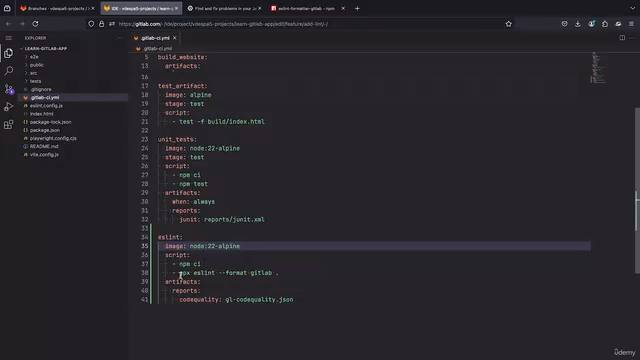

因为没指定 `stage`，这个 job 会落到默认的 `test` stage，和单元测试并列。

管道跑完之后，MR 页面上会出现 **Code quality** 区块。**注意**：一开始它可能是空的（因为没有问题），也可能因为 GitLab 前端刷新滞后而没显示 —— 讲师说直接按浏览器刷新，UI 就会更新。

### 3.7 第七步：故意制造一个 lint 错误，验证门禁真的会挡

1. 回到 Web IDE，打开 `src/App.test.js`。
2. 加一行：`let who;` —— 声明了但从没用过。
3. commit and push。
4. 回 MR 刷新。你应该看到：
   - `eslint` job **失败**（红色）；
   - 失败原因写的是「声明了变量但从未使用」；
   - **Code quality** 区块出现「found 1 new finding」，展开能看到这是 **major** 级别、定位到具体文件和行；
   - MR 被阻塞，**Merge 按钮点不了**。

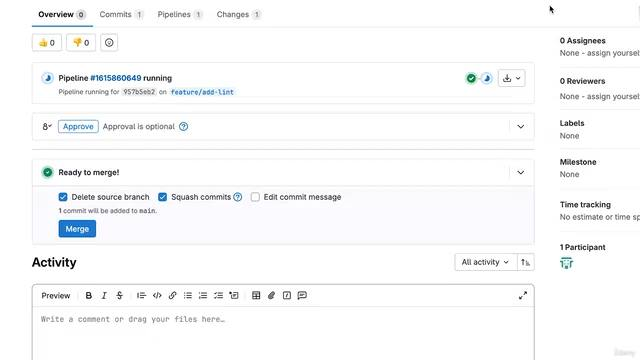

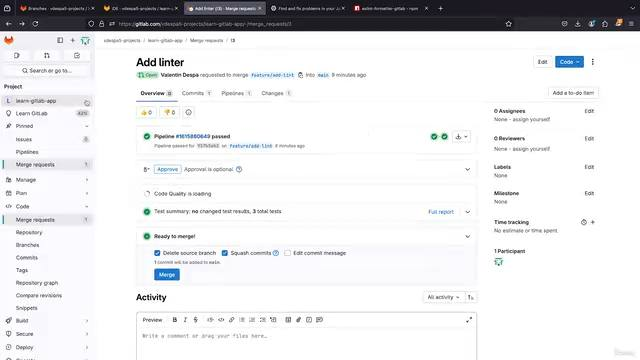

5. 验证完，讲师的做法是**直接把这条 MR 关掉**（Close），因为他只是演示。你也可以关掉，或者删掉那行再合。

---

## 4. 完整代码

### 4.1 目录结构

```
gitlab-ci-demo/
├── .gitlab-ci.yml
├── package.json
├── package-lock.json
├── .eslintrc.cjs
├── public/
│   └── index.html
└── src/
    ├── index.js
    ├── App.js
    └── App.test.js

# 下面两个文件由管道生成，不要提交到仓库
# ├── junit.xml
# └── gl-code-quality-report.json
```

### 4.2 `.gitlab-ci.yml`（完整文件）

> **标注**：`eslint` 这个 job 的结构（镜像 + `npm ci` + `npm run lint` + `reports: codequality`）来自 P041 讲师展示的配置。`build website` / `test artifact` / `unit test` 三个 job 的**名字**来自 P036 管道界面；命令体是按讲师描述（构建目录可配、artifact 找固定路径、单测产出 JUnit 报告）还原的。你的项目如果已经有能跑的版本，**以你的为准**，只把 `eslint` 那段加进去。

```yaml
# .gitlab-ci.yml
stages:
  - build
  - test

variables:
  # 构建产物输出目录。P036 的实验就是把这个值改成 build-tmp
  BUILD_DIR: "build"
  # 与项目其它 job 保持一致的 node 镜像，具体 tag 请换成你项目在用的那个
  NODE_IMAGE: "node:20"

default:
  image: $NODE_IMAGE
  cache:
    key:
      files:
        - package-lock.json
    paths:
      - node_modules/
      - .npm/

# ---------- build stage ----------
build website:
  stage: build
  script:
    - npm ci --cache .npm --prefer-offline
    # BUILD_PATH 是构建工具读取输出目录的环境变量，课里只说了"改构建目录"，没讲这个变量名
    - BUILD_PATH="$BUILD_DIR" npm run build
  artifacts:
    # 注意：这里写死 build/，不是 $BUILD_DIR —— P036 的实验正是靠这个不一致来演示
    # "no files to upload" 但 job 仍然成功
    paths:
      - build/
    expire_in: 1 week

# ---------- test stage ----------
test artifact:
  stage: test
  needs: ["build website"]
  script:
    # 找不到构建产物就主动失败，不依赖 artifact 的隐式行为
    - test -d "$BUILD_DIR"
    - echo "build output found in $BUILD_DIR"

unit test:
  stage: test
  needs: ["build website"]
  script:
    - npm ci --cache .npm --prefer-offline
    - npm run test -- --ci --reporters=default --reporters=jest-junit
  artifacts:
    when: always
    reports:
      # JUnit 报告让失败测试在 MR 页面里可点、可读
      junit:
        - junit.xml
    paths:
      - junit.xml

# 下面这个 job 来自 P041
eslint:
  stage: test
  needs: []
  image: $NODE_IMAGE
  script:
    - npm ci --cache .npm --prefer-offline
    - npm run lint
  artifacts:
    when: always
    reports:
      # 关键：用 codequality 报告类型，GitLab 才会渲染 Code quality 区块
      codequality: gl-code-quality-report.json
    paths:
      - gl-code-quality-report.json
```

### 4.3 `package.json`（关键片段）

> 标注：课里只说了「`npm run lint` 对应 `package.json` 里 scripts 定义的命令」以及「项目已经装了一个面向 GitLab 的 formatter」。下面是这两条描述的还原写法，你的 `lint` 脚本实际长什么样，以项目为准。

```json
{
  "name": "gitlab-ci-demo",
  "version": "1.0.0",
  "private": true,
  "scripts": {
    "build": "react-scripts build",
    "test": "react-scripts test",
    "lint": "eslint . --ext .js,.jsx --format gitlab --output-file gl-code-quality-report.json"
  },
  "devDependencies": {
    "@testing-library/jest-dom": "^6.4.0",
    "@testing-library/react": "^14.2.0",
    "eslint": "^8.57.0",
    "eslint-formatter-gitlab": "^5.1.0",
    "jest-junit": "^16.0.0",
    "react": "^18.2.0",
    "react-dom": "^18.2.0",
    "react-scripts": "5.0.1"
  }
}
```

### 4.4 `src/App.js`

```jsx
import logo from "./logo.svg";

function App() {
  return (
    <div className="App">
      <header className="App-header">
        {/* P036 的实验就是删掉这一行，让下面那个测试失败 */}
        
        <h1>GitLab CI/CD Demo</h1>
      </header>
    </div>
  );
}

export default App;
```

### 4.5 `src/App.test.js`

```jsx
import { render, screen } from "@testing-library/react";
import App from "./App";

// 这个测试名对应 P036 管道里失败的那一条
test("shows the GitLab logo", () => {
  render(<App />);
  const logo = screen.getByAltText("GitLab logo");
  expect(logo).toBeInTheDocument();
});
```

### 4.6 `.eslintrc.cjs`

```js
module.exports = {
  env: { browser: true, es2021: true, jest: true },
  extends: ["eslint:recommended", "react-app"],
  parserOptions: { ecmaVersion: "latest", sourceType: "module" },
  rules: {
    // 默认就是 error 级别，P041 里 "声明了但没用" 正好命中这条
    "no-unused-vars": "error"
  }
};
```

---

## 5. 逐行解释

### 5.1 `.gitlab-ci.yml`

**`stages: [build, test]`**
只声明两个阶段。`build website` 在 build，其余三个在 test。**阶段的顺序即依赖顺序**：build 全过了才会开始 test。P041 里讲师特意说 ESLint 没写 stage，所以「it's going to be part of the test stage」—— 这就是 GitLab 的默认行为（不写 `stage` 默认是 `test`）。

**`variables: BUILD_DIR`**
把构建目录抽成变量，是为了让 P036 那个实验只改一行。**如果写成硬编码，你得改好几处，实验就不干净了。**

**`default: image: $NODE_IMAGE`**
所有 job 的默认镜像。P041 里讲师特别强调「we're going to change here the node image. So this is something that we definitely want to have in sync with the rest of the project」—— **镜像版本不一致是 CI 里最常见的「在我机器上能跑」复现器**。你的 build job 用 node 20、lint job 用 node 16，同样是 `npm run lint`，结果可能不同。

**`cache: key: files: [package-lock.json]`**
缓存按 lock 文件内容做 key。lock 文件一变，缓存自动失效重建。**用 JS/Node 类比**：`node_modules` 就是你的「编译产物」，每次从零 `npm ci` 是几十秒到几分钟，缓存能把它压到几秒。

**`build website` 里的 `npm ci`**
`ci` 不是 `install`。`npm ci` 严格按 `package-lock.json` 装，不会顺手升级任何东西，也不会改 lock 文件。管道里必须用 `ci`，否则你装出来的依赖和你本地的可能不是同一套 —— 那就又回到「在我机器上能跑」了。

**`BUILD_PATH="$BUILD_DIR" npm run build`**
把变量传进构建命令。P036 的实验就是改 `BUILD_DIR` 的值，让产物落到别处。

**`artifacts: paths: build/` —— 写死，不跟着变量走**
这是**故意的**。因为 artifact 路径固定，一旦构建目录改了，artifact 就找不到文件，于是出现 P036 那个经典现象：报 `no files to upload`，**但 job 依然是绿的**。讲师的原话是「if you expected that if there's no artifacts found, somehow GitLab is gonna explode. No, the job still succeeds」。

**这条要刻进脑子里：artifact 发布失败 ≠ job 失败。** 所以下面 `test artifact` 里我加了一句 `test -d "$BUILD_DIR"` —— 显式的、会真的退出非零码的检查，取代对 artifact 隐式行为的依赖。

**`test artifact` 的 `needs: ["build website"]`**
显式声明依赖，让这个 job 能直接拿到 build stage 的产物，不必等整个 build stage 里所有 job 都结束。**用 JS 类比**：相当于 `await buildPromise` 之后再跑，而不是等整个 stage 的 `Promise.all`。

**`unit test` 的 `artifacts: reports: junit:`**
这就是讲师说的「JUnit test reporter properly configured」。加上之后，管道页面会把 JUnit XML 解析成结构化的测试列表，失败的测试点进去就能看到断言失败信息。没有它，你只能翻一大坨终端输出 —— 讲师说这时「it's sometimes a bit harder to go through this test and understand exactly what has happened」。

**`when: always`**
即使 job 失败也要上传报告。这条至关重要：**如果只在成功时上传，测试全挂的时候你恰恰什么报告都看不到。**

**`eslint` job**
- `needs: []`：不依赖 build，可以跟 build 并行起跑，省时间。
- `npm run lint`：讲师说明过，`npm run` 后面的名字对应 `package.json` 的 `scripts` 里那一条，所以真正执行的是那条脚本里的完整命令。
- `reports: codequality`：这是 GitLab 会**解析并渲染**的报告类型。如果写成普通的 `paths`，文件上传了，但 MR 页面上不会有 Code quality 区块，也不会阻塞合并。

### 5.2 GitLab 设置项的逐条解释

**Fast-forward merge**
勾上之后，合并时不产生「merge commit」，历史是一条直线。讲师说「为了历史更干净」。**不这样会怎样**：每合一次就多一个「Merge branch X into main」的节点，历史图上分叉越来越多，`git log` 读起来像迷宫。

**Squash: Encourage（而不是 Allow）**
`Allow` 是「可以做但默认不做」，`Encourage` 是「默认勾上但你能取消」。讲师的取舍是：习惯用默认值。**不这样会怎样**：分支上五个「fix typo」「wip」全进 main 的历史，回滚的时候你根本找不到哪个 commit 是那段功能的完整实现。

**Pipelines must succeed**
管道红着，Merge 按钮锁死。这是整段里**最关键的一个开关**，没有它，前面所有测试都是摆设。**用 JS/Node 类比**：这相当于给「合并」这个写操作加了一个前置 assert，assert 不过就抛异常。GitLab 在服务端做这件事，本地 `git push` 绕不过去。

**All threads must be resolved**
讨论串没点 Resolve 就合不了。讲师的理由是：「ensures that there's no comment that is ignored and the merge request is merged anyway」。**不这样会怎样**：有人在 diff 上留了「这里可能有内存泄漏风险」，作者改别的去了，MR 被合并，那条评论永远沉底。

**Target project 从 upstream 改成本项目**
只影响 fork 场景。你 fork 了别人的项目，默认 MR 目标是**上游**仓库 —— 但你没有上游的写权限，MR 会指向一个你根本合不了的地方。

**Protected branch：Allowed to push and merge = No one**
这是**唯一一个真正物理上阻止直接 push 的设置**。前面那些（管道必须成功、讨论必须解决）都是**合并**时的检查；只有这一条是在 **push** 时就拒绝。讲师演示时 Web IDE 报错「you are not allowed to push to this branch」，就是这个开关生效了。

**并发/顺序的说明**：多个 MR 同时存在时，谁的管道先过后合，`main` 的代码就变一次；后合的那条要基于新的 `main` 重新对齐。GitLab 对目标分支的合并是串行处理的，但**冲突检测和 rebase 的具体行为课里没讲**，遇到冲突请按你团队约定的方式处理（通常是本地 rebase 到最新 main 再推）。在 JS/Node 世界里，这有点像对同一个共享状态做「读-改-写」，不加锁就会互相覆盖 —— Git 的处理方式是让你手动解决冲突，而不是自动加锁。

---

## 6. 复现检查清单

做完一条勾一条：

**P036 · 测试你的测试**
- [ ] 我把 `.gitlab-ci.yml` 里的构建目录从 `build` 改成了 `build-tmp`
- [ ] 我把 `src/App.js` 里的 `` 删掉了
- [ ] 推送后，`build website` job **成功**了
- [ ] 该 job 日志里出现了 `no files to upload` 之类的提示
- [ ] `test artifact` job **失败**了，且报错指向找不到文件
- [ ] `unit test` job **失败**了，报错里能找到「找不到 alt 为 GitLab logo 的元素」这类信息
- [ ] 我能从 JUnit 报告里点进那条失败测试，看到结构化细节，而不是翻终端输出
- [ ] 我已经 revert 了这次改动，`main` 上的管道重新变绿
- [ ] 我在 Web IDE 里刷新过，确认文件内容真的回滚了

**P038 · 设置**
- [ ] Merge method = Fast-forward merge，已保存
- [ ] Squash commits = Encourage
- [ ] Pipelines must succeed = 已勾选
- [ ] All threads must be resolved = 已勾选
- [ ] Target project 已从 upstream 改成本项目（fork 场景）
- [ ] `main` 的 Allowed to push and merge 已改成 **No one**
- [ ] 我尝试直接往 `main` push，**被拒绝了**

**P039 · 第一个 MR**
- [ ] 我从 `main` 切出了 `feature/improve-docs`
- [ ] 分支名没有空格、有 `feature/` 前缀
- [ ] 分支上触发了独立管道，并且跑完了
- [ ] 我创建了 MR，标题能让人一眼看懂
- [ ] 描述里写了改了什么、为什么
- [ ] 我勾了 Delete source branch

**P040 · 评审与合并**
- [ ] 我在 diff 的某一行留了评论
- [ ] 我试过「Add comment now」（立即发布）和「Start a review」（暂存到 Finish review 再发布）两种方式
- [ ] MR 概览显示有未解决的讨论串
- [ ] 我在同一分支补了改动并 push，触发了**第二条**管道
- [ ] 我点掉了 Resolve，讨论串清零
- [ ] squash 后的 commit message 是准确的描述
- [ ] 合并成功，MR 从 Open 变成 Merged
- [ ] `main` 上有一条**新的**管道在跑，并且通过
- [ ] 源分支已被删除
- [ ] 我在 Web IDE 里切回了 `main`（或重开了 IDE）

**P041 · ESLint 门禁**
- [ ] 我从 `main` 切出了 `feature/add-lint`
- [ ] `.gitlab-ci.yml` 里的 ESLint job 镜像和项目其它 job 一致
- [ ] 用的是 `npm ci`，不是 `npm install`
- [ ] 命令是 `npm run lint`
- [ ] `artifacts` 用的是 `reports: codequality`
- [ ] MR 页面上出现了 Code quality 区块
- [ ] 我加了 `let who;` 之后，`eslint` job **失败**了
- [ ] Code quality 显示「1 个新发现」，能定位到具体行
- [ ] Merge 按钮**点不了**
- [ ] 我把这行删掉后，job 变绿、MR 可以合了（或我已关掉演示 MR）

---

## 7. 课里没讲但你会撞上的

**① `no files to upload` 之外，artifact 还有别的坑。**
课里只演示了「路径下没文件」。实际还会遇到：文件生成了但 `.gitignore` 把它排除了（artifact 上传**不看** `.gitignore`，但打包器可能已经把它清理掉）、`expire_in` 过期后下游 job 拿不到、多 job 同名 artifact 互相覆盖。这些课里都没讲，遇到请以实际 pipeline 日志为准。

**② Node 镜像的具体 tag 课里没给。**
讲师只说「要和项目其它 job 保持同步」，没说他用的是哪个 tag。我上面写的 `node:20` 是个占位，**请换成你项目实际在用的那个**。镜像 tag 不一致是「本地能跑、CI 挂了」的头号原因。

**③ `BUILD_PATH` 这个变量名课里没出现。**
讲师只说了「把构建目录从 build 改成 build-tmp」。具体怎么让构建工具认这个目录，取决于你用的构建器（CRA / Vite / 自己写的脚本都不同）。上面用的是 CRA 的机制，用别的构建器请查对应文档。

**④ Code Quality 面板在免费版上是否可用，课里没讲。**
讲师只说了「this is something that will automatically integrate with GitLab」。如果你按步骤配好了、日志里也看到 JSON 生成成功，但 MR 页面上死活没有 Code quality 区块，先确认你那套 GitLab 的**版本和套餐**支不支持这个功能 —— 别怀疑自己的 YAML。

**⑤ 免费版的 Approve 只是形式。**
讲师明确说了同意是「optional」、免费版的 approval 「doesn't do much」。所以别指望「必须有 2 个人 approve 才能合」这种硬门禁 —— 免费版做不到。团队实践里靠 👎 和讨论串达成共识，但这**不是技术强制**，只能靠人。

**⑥ GitLab 前端 UI 会滞后。**
讲师至少三次提到「用户界面更新不及时，刷新一下」。P041 里他甚至先刷新了一次才看到 Code quality 加载出来。**看到管道已经跑完但页面还显示运行中，先按 F5，别去改 YAML。**

**⑦ 分支删了之后 Web IDE 会发呆。**
讲师原话：「In your Web IDE, make sure you switch to the main branch or just reopen the Web IDE once again to avoid issues.」如果合并后你在 IDE 里提交报奇怪的错，先看左下角当前在哪个分支。

**⑧ 多个 MR 同时待合时的冲突。**
课里只演示了单条 MR 的顺畅路径。真实项目里两条 MR 同时改了同一个文件，后合的那条会冲突。**课里没讲怎么解**，标准做法是本地 `git fetch && git rebase origin/main`，解完冲突再推，管道会重跑一轮。

**⑨ revert 也走管道。**
P036 里讲师是在 GitLab 网页上直接 revert 的，这会生成一条新 commit 并触发新管道。如果你在本地 `git revert`，记得推上去 —— 而且因为 `main` 被保护了，**你推不上去**，得走 MR。讲师演示时没勾「start a new merge request」是因为他在 `main` 上直接操作的（那个时候他可能还没开保护，或者用的是维护者账号）—— 这个细节课里没讲清楚，你自己做的时候如果被拒，就走 MR。

**⑩ Linter 不会帮你改代码。**
讲师专门强调过：「a linter doesn't automatically fix anything for us, it just reports the issues found.」想自动修，得另外跑 `eslint --fix`（课里没讲这个参数，这里只是提示它存在），而且 `--fix` 之后仍然要人看一眼 diff，别闭眼合。