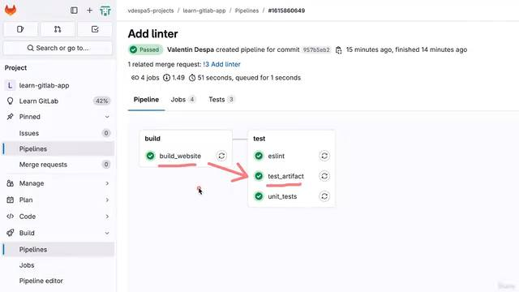
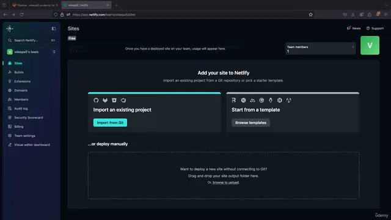
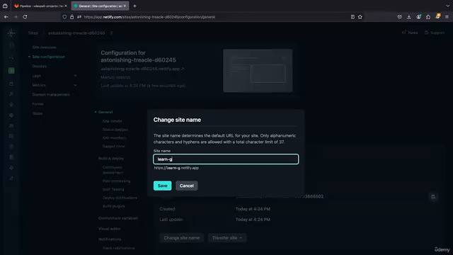
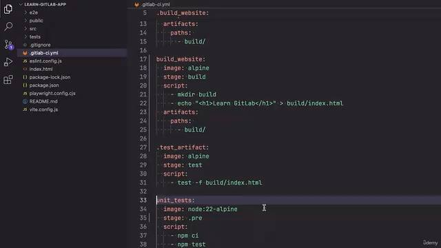
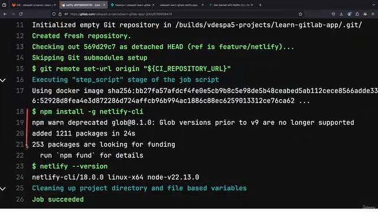

# GitLab CI/CD 实战（P042–P050）：把构建流水线推进到「可部署」

这份文档覆盖 P042–P050。读完后你手上应该有三样东西：

1. 一条能在 13 秒左右跑完的简化流水线（只有一个 `build` job）；
2. 一个放在 `.pre` 阶段、专门验证 Netlify CLI 能否安装成功的 job；
3. Netlify 侧已经建好的站点 + GitLab 侧已经存好的两个变量，随时可以接上真正的部署 job。

P044 只是讲师的休息提醒，没有技术内容；P045 是部署章节的预告和 Netlify 注册指引。真正的动手操作集中在 P043、P046、P047、P048、P049、P050。

---

## 1. 这一节做什么

前一阶段（P001–P041）你已经有一条「构建 + 测试」的 CI 流水线，并且给 `main` 开了合并请求保护。这一节要把它往 CD 推一步：让 GitLab 里的 job 能通过命令行工具（Netlify CLI）操作一个云平台上的静态站点。

具体产出：

| 产出 | 在哪里 | 用途 |
|---|---|---|
| 一个手动上传到 Netlify 的站点 | Netlify 控制台 | 先证明「网站能上线」，排除平台问题 |
| 简化后的 `.gitlab-ci.yml` | 仓库根目录 | 把测试 job 禁用、把 build 缩成写一个 `index.html`，让后续实验不用等 |
| `Netlify` job（`.pre` 阶段） | `.gitlab-ci.yml` | 在流水线最前面安装并验证 Netlify CLI |
| job 级变量 `NETLIFY_SITE_ID` | `Netlify` job 的 `variables` | 告诉 CLI 要操作哪个站点 |
| 项目级 CI/CD 变量（token） | GitLab Settings → CI/CD → Variables | 给 CLI 提供认证凭据，且不在日志里泄露 |
| 一组环境变量练习 | 终端或 job 的 `script` | 学会判断变量是否定义、双引号/单引号/花括号的区别 |

这一节结束时**还没有真正执行部署命令**。P047 的原话是「Netlify is there, so we can start using it for deployment. And this was the goal of this lecture.」——CLI 装好、站点 ID 配好、token 存好，就是这一节的终点。真正的 `netlify deploy` 不在 P042–P050 的逐字稿里，文档不会替你编一个。

这一节还夹着两条流水线设计原则，虽然不产生代码，但会直接影响你怎么排 job：

- **job dependencies（依赖关系）**：能并行的尽早并行，有产物流转的必须分 stage。课里原话是「the only job that has a dependency is test artifact. The rest of the jobs, which are unit tests and the linter, they can be executed even earlier on.」——只有「测试构建产物」这个 job 依赖 build；单元测试和 linter 其实可以更早跑。
- **fail fast（尽早失败）**：把最常导致失败、又跑得快的检查放前面。课里举的例子是 lint 只要 30 秒，而某些 job 要几分钟；如果 lint 放最后，你要等几分钟才知道拼写错了。

这两条原则在本节的具体体现，就是后面把 Netlify CLI 验证 job 放进 `.pre`，让它先跑、先报错。

---

## 2. 讲师原话

下面引用的英文是逐字稿原文，时间戳对应该段话开始的位置。

> "一般来说，流水线的执行时间是关键关注点。所以目前，整条流水线的执行时间不到一分钟。"
> —— p042 [00:00]
> 流水线总时长是核心指标；当时整条流水线不到一分钟。

> "首先是作业依赖。作业依赖在某种程度上是没得商量的，你需要理解各个作业之间的依赖关系。"
> —— p042 [00:27]
> 第一原则是 job 依赖，这个没得商量，必须先搞清楚谁依赖谁。

> "在这种情况下，我们有 build 阶段和 test 阶段。这里我们假设 test 阶段里的所有内容都依赖 build。但实际上，唯一有依赖的作业是 test artifact。其余作业，也就是单元测试和代码检查工具，甚至可以更早执行。"
> —— p042 [00:56]
> 不要想当然地把整个 test stage 都当成依赖 build；真正依赖的只有「测试构建产物」那个 job。

> "我们不想让流水线跑了 10 分钟，结果最后某个代码检查工具失败了。"
> —— p042 [02:17]
> 不要等十分钟才看到最后一个 linter 失败。

> "运行代码检查可能只需要 30 秒，相比把它放进一个整体阶段、而该阶段里其他作业可能要执行几分钟，这样更节省我们的时间。"
> —— p042 [02:47]
> 把 30 秒的 lint 提前跑，比把它塞进几分钟的 stage 里更划算。

> "通常你会希望把执行时间相近的作业并行执行。如果一个作业只需要 15 秒，另一个作业却需要五分钟，那你真得三思，是否要把它们放在同一个阶段里。"
> —— p042 [03:16]
> 同一 stage 里并行的 job，执行时长最好接近；15 秒和 5 分钟放一起要三思。

> "test artifact 和单元测试不再执行，因为它们已被禁用。我们不需要对阶段本身做任何改动。"
> —— p043 [00:55]
> 在 job 名前加点就能禁用 job，`stages` 列表本身不用改。

> "所以现在这条非常简单的流水线执行只需要 13 秒，因为我们只有一个作业，而且这个作业非常快。"
> —— p043 [01:54]
> 简化后只有一个 job，整条流水线 13 秒。

> "你只需把它加到 .pre 阶段。确保该作业已启用。然后这个作业就会最先执行。"
> —— p043 [02:50]
> 想让实验 job 先跑，放进 `.pre` 阶段即可。

> "像 GitLab 这样的自动化工具不会打开应用程序，不会打开浏览器，更不会点击按钮或选择文件。自动化领域通常不是这样工作的。我们始终需要使用命令行工具，才能复现我们执行的任何手动步骤。"
> —— p047 [00:29]
> 自动化工具不会替你开浏览器、点按钮；必须找到能复现手动步骤的 CLI。

> "Netlify 实际上有一个名为 Netlify CLI 的命令行工具。"
> —— p047 [00:54]

> "它要求 Node.js 至少为 18 版本，至少根据我这里看到的文档是这样。"
> —— p047 [01:21]
> Netlify CLI 要求 Node.js 至少 18；讲师选的镜像是 Node 22。

> "所以这个作业花了 46 秒。我们已经知道，一般来说，仅仅启动我们过去用过的这个 Docker 镜像就要花大约 15 秒。……NPM 安装过程告诉我们，安装花了 24 秒。所以从整体来看，在流水线执行期间安装这些 NPM 包之一，会让我们多花 24 秒。"
> —— p047 [04:12]–[04:41]
> 一个 job 46 秒 = 镜像启动约 15 秒 + npm 安装约 24 秒 + 其他开销。每次流水线都重装 CLI 是有成本的。

> "我们需要告诉 Netlify CLI 要部署哪个站点。这是通过配置环境变量来完成的。"
> —— p048 [00:00]

> "其思路是，Netlify CLI 在部署项目时会自动查找这些环境变量。因此，重要的是这些环境变量要在我们的 GitLab 流水线中定义，并且使用你在屏幕上看到的准确名称。否则就找不到它们。"
> —— p048 [01:24]
> 变量名必须和 CLI 期望的完全一致，否则 CLI 找不到。

> "如果我们在这里使用单引号，那么单引号里的内容都会被当作字符串。所以这里的这个变量不会被替换。"
> —— p048 [05:56]
> 单引号内的 `$变量` 不会被替换，会原样输出。

> "我们没有得到任何返回结果，这说明这个变量尚未定义。"
> —— p049 [00:26]
> `echo $version` 什么都没输出，就说明这个变量没定义。

> "我要在这里使用 export 命令。我要写 version。我要把版本指定为 1.2.3。"
> —— p049 [01:42]
> 用 `export` 定义变量，值是 `1.2.3`（带点）。

> "这会失败，因为 build 目录不存在。"
> —— p049 [03:37]
> 直接重定向到 `build/info.txt` 会报 `No such file or directory`，因为目录还不存在。

> "即使我们已经安装了 Netlify CLI，即使我们已经配置了这个站点 ID，也不意味着 GitLab 有权部署应用。为什么？因为我们还没有提供任何凭据。"
> —— p050 [00:00]
> 装了 CLI、配了 site ID，不等于有权限部署；还缺凭据。

> "身份验证语境中的令牌，类似于你在游戏厅里可能使用的代币。就像游戏厅代币让你可以玩游戏一样，身份验证令牌让你可以执行特定操作。"
> —— p050 [00:50]

> "屏蔽和隐藏意味着，一旦我们在这里保存这个值，其他任何人都无法访问它。所以我们在这里看不到它，也无法编辑它。"
> —— p050 [04:31]
> 选 Masked and Hidden：存进去之后界面上看不到、也编辑不了。

> "如果我们保持这个标志处于启用状态，并在这里定义一个变量，那么这个变量在合并请求中将不可用。这个变量在我们创建任何其他分支时也不可用。"
> —— p050 [05:25]
> 勾了 Protect variable，变量只在受保护分支可用，MR 和其他分支拿不到。

---

## 3. 从零复现

### 3.0 前置

- 一个 GitLab 账号和项目，`main` 已开启保护（前一段课程已完成）。
- 项目里已有一条能跑的 `.gitlab-ci.yml`，至少包含 `build` 和 `test` 两个 stage。
- 本地能 clone 仓库；如果你用 Web IDE，可以跳过本地 clone。
- 一个 Netlify 免费账号（P045 讲注册）。
- CI 里会拉 `node:22` 和 `alpine` 镜像，runner 需要能访问 Docker Hub 和 npm registry。

### 3.1 注册 Netlify（P045）

打开 netlify.com，用 GitLab 账号登录，或者邮箱 + 密码注册。验证邮箱后会让你回答几个问题；问到「部署第一个项目」时选 **Skip this step for now**。看到控制台首页即可。

课里提醒：GitLab 的界面经常改版，你看到的按钮位置可能和截图不同，按语义找对应入口即可。

### 3.2 手动部署一次（P046）

这一步的目的不是「学会拖拽」，而是先拿到一个真实可访问的站点，并确定它的 Site ID。

1. 下载课程资源里的 zip，解压，得到一个 `build` 目录。
   - 课里没有展示 zip 内部结构；如果你没有这个资源，可以先用 3.3 的流水线生成 `build/index.html`，再拿这个目录来上传。这是变通做法，课里没讲。
2. 在 Netlify 首页找到虚线拖拽区，把整个 `build` 目录拖进去；或者点 **Browse to Upload**，选择整个目录。
3. 上传后 Netlify 会自动开始部署，并分配一个自动生成的域名。
4. 进入 **Site Configuration**，点 **Change Site Name**，删掉原来的名字，改成 `<你的 GitLab 用户名>-learn-gitlab`。
   - 课里明确要求加用户名前缀，否则所有人用同一个名字会冲突。
5. 保存后打开站点链接，看到页面就说明手动部署成功。

### 3.3 简化流水线（P043）

课里给了一个很实用的技巧：实验期间先把耗时的 test job 禁用，只留一个极快的 build。

1. 在 GitLab 里新建分支，名字 `feature/simple-pipeline`（课里口述为 "feature/simple-pipeline"）。
2. 打开 `.gitlab-ci.yml`。
3. 把 `test` stage 相关的两个 job（课里叫 `test artifact` 和 `unit tests`）的 job 名前面各加一个点。例如 `test artifact:` 改成 `.test artifact:`。
   - 点号前缀是 GitLab 的「隐藏 job」写法：job 定义还在，但不会进流水线。
   - `stages:` 列表不需要改。课里原话是「We don't need to make any changes here to the stages themselves.」。隐藏的是 job，不是 stage；去改 `stages:` 属于没必要的改动。

## 5. 逐行解释

说明：所给材料中没有「4. 完整代码」的正文，因此无法逐文件、逐行复述完整代码；下面只解释材料中能确认的配置片段、脚本片段和设计决策，未出现的文件或行写「课里没讲」。

### 5.1 `.gitlab-ci.yml` 中可确认的配置片段

- `.test artifact:` / `.unit tests:` 的 job 名前加点  
  这么写是因为 GitLab 会忽略点号开头的隐藏 job：定义还在，但不会进入流水线。P043 原话是「The test artifact and the unit tests are no longer being executed because they are disabled.」。不这么写，实验期间每次都会先跑耗时的 test job，等流水线的时间会变长。  
  课里还明确说 `stages:` 本身不需要改：隐藏的是 job，不是 stage。若去改 `stages:`，属于没必要的改动，课里没讲要改。

- 简化后的 `build` job 保留 `stage: build`  
  这么写是因为它仍然属于构建阶段，只是把构建内容缩到最小。P043 说「I'm going to keep the stage to build.」。不保留原 stage 或乱挪阶段，会改变流水线图，课里没讲需要这么做。

- `image` 改成 `alpine`  
  这么写是为了让 job 极快：P043 说「We're going to change the image to only alpine.」，之后整条简化流水线约 13 秒。不这么写，继续用原来的重型镜像，会多等镜像启动和无关工具的时间。课里没有逐秒拆解 alpine 的启动时间。

- 删除原来 build 里的命令，只保留生成 `build` 目录和 `index.html`  
  这么写是因为本节只需要一个能证明流水线可跑的极简构建。P043 说「Let's remove all these commands that we have here.」以及「we still need the build directory」。不删旧命令，会继续执行耗时的真实构建，违背简化实验配置的目的。

- `mkdir build` 或等价地先创建 `build` 目录  
  这么写是因为后面的重定向要求目录已存在。P049 明确演示过：直接写 `build/info.txt` 会报 `No such file or directory`，因为 `build` 目录不存在；先 `mkdir build` 再重定向才成功。不先建目录，`echo ... > build/index.html` 会失败。  
  具体第 4 节里写的是 `mkdir` 还是 `mkdir -p`，材料未给出，课里没讲。

- `echo '<h1>Learn GitLab</h1>' > build/index.html` 这一类命令  
  这么写是为了不依赖真实项目，直接用 shell 生成一个最小 HTML：P043 说在 `h1` 标签之间写 `learn GitLab`，并把文本重定向到 `build/index.html`。不生成这个文件，简化 build 就没有产物可谈。  
  第 4 节完整代码中 HTML 外层到底是单引号、双引号还是其他写法，材料未给出，课里没讲；但 shell 里若不给包含 `<`、`>` 的整段 HTML 加引号，shell 可能把 `<`、`>` 当重定向/操作符处理，这是补充说明，课里没讲。

- `build` job 是否保留 `artifacts`  
  课里没讲。P043 只讲复制/改写 build job、保留 build 目录并生成 `index.html`，没有说明是否保留或删除 `artifacts`。不要在文档里替它补一个 `artifacts` 配置。

- `Netlify` job 使用 `stage: .pre`  
  这么写是因为本节只是验证 Netlify CLI 能不能装、能不能跑，不依赖 build；放到 `.pre` 可以最先执行、最早失败。P047 说「we're going to use the dot-free stage because at this step in time, we don't rely on the build」以及「if it doesn't work, we want to be informed early on in the pipeline」。不这么写，放到 build 后面，就要等前面的 job 跑完才知道 CLI 安装失败。  
  注意逐字稿字幕里的「dot-free stage」是口音/转写问题，上下文和 P043 都指向 `.pre` 阶段。

- `Netlify` job 使用 `node:22` 镜像  
  这么写是因为 Netlify CLI 要求 Node.js 至少 18，P047 说「It requires to have Node.js in at least version 18」，讲师选的镜像是 Node 22。用更老的 Node 可能导致 CLI 不兼容；具体会报什么错，课里没讲。

- `Netlify` job 里不执行 `npm ci`  
  这么写是因为这个 job 不跟项目依赖交互，只安装一个全局 CLI。P047 说「Do we need to run NPMCI? Well, no, we don't because we don't interact with the project itself.」不这么写而加 `npm ci`，会多装项目依赖、增加流水线时间，且本节没有这个需要。

- `npm install -g netlify-cli`  
  这么写是按 Netlify 文档安装 CLI，并用 `-g` 作为全局依赖安装，保证后续能直接执行 `netlify` 命令。P047 说「this flag here at the end, dash G. This ensures that this is installed as a global dependency.」。不加 `-g` 或用错安装方式，`netlify` 命令未必能直接找到；具体替代命令课里没讲。

- `netlify --version`  
  这么写是用来验证安装是否成功。P047 说「how do we check if Netlify has been properly installed? It's best to run the command Netlify, space dash dash version.」如果命令没有报错并返回版本号，就说明安装成功。不验证安装，只执行 `npm install`，失败可能要到后续部署时才暴露。  
  P047 展示该 job 约 46 秒：镜像启动约 15 秒，npm 安装约 24 秒。这是本 job 的成本，不是错误。

- `variables:` 下写 `NETLIFY_SITE_ID: "站点 ID"`  
  这么写是因为 Netlify CLI 会自动查找名为 `NETLIFY_SITE_ID` 的环境变量，名字必须完全一致。P048 说「it is important that these environment variables are defined in our GitLab pipeline and that they use the exact name that you see on the screen. Otherwise, they won't be found.」。  
  这里的变量写在 job 内部，所以只对这个 job 生效；P048 说 job 级变量「scope only for this job」。不要写成列表，也不要写成等号形式；YAML 里应是变量名加冒号再加值。具体 YAML 格式错误 GitLab 会怎么报，课里没讲。

- `echo "deploying to site ID: $NETLIFY_SITE_ID"`  
  这么写是为了在日志里确认 job 能读到变量，并看到它的值。P048 演示了在 `script` 中用 `echo` 加双引号，再用 `$` 引用变量，日志会打印出 site ID。用双引号时变量会被替换；用单引号时不会替换，P048 说「whatever we have here within the single quotes is going to be treated as a string」。  
  也可以写成 `${NETLIFY_SITE_ID}`。P048 说花括号写法能确保变量被正确展开、避免问题。不这么写不一定错，但在变量名后紧跟其他字符时更容易出歧义。

- Netlify token 不写进 `.gitlab-ci.yml`  
  这么写是因为 token 是凭据，必须存到 GitLab 项目级 CI/CD 变量里，而不是提交到仓库。P050 说装了 CLI、配了 site ID，也不等于 GitLab 有权限部署，因为「we haven't provided any credentials.」。  
  在 GitLab 侧应选 Masked and Hidden；P050 说这样存进去后界面上看不到，也不能编辑。若选 Visible，日志或界面可能暴露 secret；若只选 Masked，日志里看不到，但变量界面仍可能看到值。  
  Protect variable 在本节开发分支场景下要禁用：P050 说勾了它，变量不会在 merge request 和其他分支可用。Expand variable 也禁用：P050 说不想有任何干扰。  
  token 的 key 要按 Netlify CLI 文档要求的精确名称填写，P050 说「we need to save this token under this particular name. Otherwise, Netlify CLI is not gonna be able to find it.」。逐字稿文字中没有明确给出这个 key 的拼写，课里没讲具体拼写；只能按课程屏幕/CLI 文档原样复制，不能自行改大小写，也不能带空格或换行。

### 5.2 环境变量练习片段（终端或 job 的 `script`）

- `echo $version`  
  这么写是检查变量是否定义。P049 说如果变量已定义就会看到值；什么都没输出，就说明这个变量没有定义，或者使用时是空值。不先检查就直接使用，后面可能得到空字符串。

- `env`  
  这么写是列出当前环境所有变量。P049 说可以用它查看有哪些环境变量可用，以及它们的当前值；真实 CI 流水线里会看到很长的列表。不用 `env` 而只看单个变量，排查不到还有哪些变量可用。

- `export version=1.2.3`  
  这么写是定义并导出变量，值是带点的 `1.2.3`。P049 说用 `export` 定义后，`env` 和 `echo` 都能看到。  
  补充：`export` 只影响当前 shell 进程；新开终端或另一个 job 不会自动继承。这条课里没讲。

- `echo "building version $version"`  
  这么写能得到 `building version 1.2.3` 这类替换后的结果。P049 说要用双引号；如果用单引号，变量不会被替换，会原样输出 `$version`。不区分引号，就会误以为变量没定义。

- `echo "build version ${version}" > build/info.txt`  
  这么写是把带变量替换的文本写入文件。P049 说可以复用前面能工作的 echo 命令，再加 `>` 重定向；花括号能明确变量边界。不用重定向，就只在终端打印，不会生成文件。  
  如果 `build` 目录不存在，这一步会失败；P049 明确说「This is going to fail because the build directory doesn't exist.」。

- `mkdir build`  
  这么写是补上目录。P049 说先创建 `build` 目录，再重跑上一条命令即可成功。不建目录直接重定向，就会看到 `No such file or directory`。

- `cat build/info.txt`  
  这么写是检查文件内容。P049 说用 `cat` 检查内容是否符合预期。不检查文件内容，只能知道命令没报错，不能确认写入内容正确。

### 5.3 P042 等处的设计决策

- 流水线执行时间是核心指标。P042 说当前整条流水线不到一分钟，stage 和 job 的排序会影响总时长。  
- job 依赖是硬约束。P042 说只有 `test artifact` 真正依赖 build；`unit tests` 和 linter 可以更早执行。不按依赖拆 stage，可能把本来能并行的 job 拖到后面。  
- build 产物和测试产物必须分 stage：不能测试还没生成的产物。P042 说「You cannot test the build artifact before the artifact has been created.」。  
- fail fast：最常导致失败且跑得快的检查要前置。P042 举例 lint 可能只要 30 秒，若放到最后，要等几分钟才知道拼写错误。  
- 并行 job 的时长最好接近。P042 说 15 秒和 5 分钟的 job 放同一 stage 要三思。  
- 实验时可以把测试 job 用点号隐藏，只留极快 build；需要先跑的验证 job 放 `.pre`。P043 明确说 `.pre` 中的 job 会 first in line。  
- 自动化工具不打开浏览器、不点按钮，必须用 CLI 复现手动步骤。P047 说「We always need to work with a CLI tool」。  
- token 是凭据，不是用户名密码；要生成后安全存 GitLab，不能明文放在 YAML 或可见变量里。P050 用游戏厅 token 类比说明它可以授权执行操作。

## 6. 复现检查清单

- [ ] 检查手动部署是否成功：打开 Netlify 站点链接；应看到页面内容，说明 P046 的手动上传成功。
- [ ] 检查 Netlify 站点名是否避免冲突：进入 Site Configuration 看站点名；应含你的 GitLab 用户名前缀，例如 `<用户名>-learn-gitlab`。
- [ ] 检查手动上传时是否选了整个目录：重新看 Netlify Deploys 或上传入口；应上传的是整个 `build` 目录，不是单个文件。
- [ ] 检查实验分支是否正确：GitLab 分支名应为类似 `feature/simple-pipeline` / `feature/netlify` 的分支；提交后流水线应跑在该分支上。
- [ ] 检查 test job 是否被隐藏：打开流水线图；应看不到 `test artifact` 和 `unit tests`，只看到保留的 job。若仍看到，检查 job 名前是否真的加了点。
- [ ] 检查 `stages:` 是否没有被无必要修改：对比原配置；课里说只隐藏 job 即可，`stages` 不需要改。验证方式是看最终 YAML 中 stage 列表是否仍支持现有 job。
- [ ] 检查简化 build 是否真的变快：提交后看整条流水线耗时；按课程应约为 13 秒级别。若仍很久，检查是否还有旧 build 命令或 test job 在跑。
- [ ] 检查 build 目录是否先创建：看 build job 日志；不应出现 `No such file or directory`。若出现，确认 script 中先执行了创建 `build` 目录的命令。
- [ ] 检查 `build/index.html` 的生成命令是否成功：看 build job 日志；`mkdir` 和 `echo ... > build/index.html` 应无报错。若需要确认内容，可在 script 临时加 `cat build/index.html`，应看到 `<h1>Learn GitLab</h1>`；临时加 `cat` 是补充验证，课里没讲。
- [ ] 检查 Netlify job 是否在 `.pre`：打开流水线图；Netlify job 应最先执行，不等待 build。若不在最前，检查 `stage` 是否写成 `.pre`、job 名是否被点号隐藏。
- [ ] 检查 Netlify job 的 Node 版本：看 job 使用的镜像；应为 Node 22 或至少不低于 18。若用低版本，CLI 可能不兼容。
- [ ] 检查 Netlify job 是否没有多余 `npm ci`：看 job 日志；不应执行项目依赖安装，只应安装 Netlify CLI。若看到 `npm ci`，删除它。
- [ ] 检查 Netlify CLI 是否安装成功：看 `netlify --version` 的输出；应打印版本号且无错误。若 `command not found`，检查 `npm install -g netlify-cli` 是否成功。
- [ ] 检查 Netlify job 耗时是否在课程量级：看 job Duration；应约为 46 秒左右，其中镜像启动约 15 秒、npm 安装约 24 秒。若明显更久，先看网络和 npm 日志。
- [ ] 检查 `NETLIFY_SITE_ID` 是否定义在该 Netlify job 内：看 job 日志中的 `echo "正在部署到站点 ID：$NETLIFY_SITE_ID"`；应打印出你自己的 site ID，而不是空行或字面 `$NETLIFY_SITE_ID`。
- [ ] 检查 site ID 是否用错：回到 Netlify 的 Site Configuration 对照；日志中的 ID 应与你当前站点一致，不能复制讲师或其他站点的 ID。
- [ ] 检查双引号变量替换：日志里 `deploying to site ID: ...` 应出现实际值；若出现字面 `$NETLIFY_SITE_ID`，把脚本里的单引号改成双引号或 `${NETLIFY_SITE_ID}`。
- [ ] 检查 `echo $version` 的初始结果：在未定义时执行；应没有任何输出，按 P049 这表示变量未定义。
- [ ] 检查 `env` 是否能列出变量：执行 `env`；应看到当前环境变量列表，真实 CI 中列表会很长。
- [ ] 检查 `export version=1.2.3` 是否生效：同一 shell 中执行 `echo $version`；应输出 `1.2.3`。
- [ ] 检查双引号消息：执行 `echo "正在构建版本 $version"`；应输出 `building version 1.2.3`。
- [ ] 检查单引号不替换：执行 `echo 'building version $version'`；应原样输出 `$version`，这证明单引号内变量不会被替换。
- [ ] 检查直接写 `build/info.txt` 的失败现象：在 `build` 目录不存在时执行重定向；应看到 `No such file or directory`，对应 P049 的演示。
- [ ] 检查 `mkdir build` 后重定向成功：先 `mkdir build`，再写 `build/info.txt`；应无报错。
- [ ] 检查文件内容：执行 `cat build/info.txt`；应看到包含变量替换后的版本文本。
- [ ] 检查 GitLab 项目级 CI/CD 变量是否添加：进入 Settings → CI/CD → Variables；应看到 token 变量。
- [ ] 检查 token 可见性：变量应显示为 Masked and Hidden；点 Edit 时不应能查看/编辑值。若能看到值，说明可见性选错，需要删除重建。
- [ ] 检查 Protect variable 是否禁用：本节在开发分支上跑，变量应能在该分支/MR 使用；若分支上取不到 token，检查是否误勾了 Protect variable。
- [ ] 检查 Expand variable 是否禁用：看变量设置；应处于禁用状态，避免变量嵌套展开干扰。
- [ ] 检查 token key 是否精确：对照 Netlify CLI 文档/课程屏幕；key 不能有多余空格、换行或大小写变化。若 CLI 找不到 token，优先重建该变量。
- [ ] 检查 token 是否过期：看 Netlify 个人访问令牌的过期时间；默认 7 天，过期后需重新生成并更新 GitLab 变量。课程建议可选 30 或 60 天。
- [ ] 检查是否还没有执行真正的部署：本节终点是 CLI 安装、site ID 配置、token 存储；流水线中不应凭空出现 `netlify deploy`。若你自行加了部署命令，那是课里没讲。

## 7. 课里没讲但你会撞上的

| 现象 | 原因 | 怎么办 |
|---|---|---|
| 流水线里看不到 `test artifact` / `unit tests` | job 名前加了点，GitLab 把 job 隐藏了 | 这是预期行为；要恢复就把 job 名前点删掉，`stages` 不需要动。 |
| 改了 `.gitlab-ci.yml` 但流水线仍跑旧 job | 提交到了错误分支，或没有提交成功 | 确认流水线对应分支和 commit；在 GitLab 的 CI/CD → Pipelines 里核对 ref 和 commit。 |
| 简化 build 仍然很慢 | 旧的 build 命令没删干净，或 test job 没有被真正隐藏 | 看最终生效的 YAML 和 job 日志；删除旧命令，确认 test job 名开头有点。P043 讲过同一配置重复定义时后定义会覆盖前面的内容。 |
| `build/index.html: No such file or directory` | `build` 目录还没创建就重定向 | 先创建目录再写文件；课里在 P049 用 `mkdir build` 演示过。补充：`mkdir -p build` 也能避免目录已存在时报错，课里没讲。 |
| echo 写 HTML 时报重定向/语法异常 | HTML 里的 `<`、`>` 没被当成普通字符串 | 用引号把整段 HTML 包起来再重定向；具体第 4 节用的引号形式课里没讲清楚，这是补充提醒。 |
| Netlify job 没有最先执行 | `stage` 没写 `.pre`，或 job 名前误加了点导致 job 被隐藏 | 把 stage 改成 `.pre`，并确保 `Netlify` job 名前没有点。P043/P047 讲过 `.pre` 会先执行。 |
| `netlify: command not found` | npm 安装失败，或没有用 `-g` 全局安装，或 PATH 中没有 | 看 npm 安装日志；确认执行的是 `npm install -g netlify-cli`；确认网络能访问 npm registry。 |
| Netlify job 耗时约 46 秒，感觉太慢 | 镜像启动约 15 秒，npm 安装约 24 秒 | 这是 P047 展示的正常成本；本节不优化。补充：缓存 npm、预构建镜像等优化课里没讲。 |
| `echo` 打印出的 site ID 是空行 | 变量没定义、变量名拼错、变量不是定义在这个 job 内 | 把 `NETLIFY_SITE_ID` 放在该 job 的 `variables` 下，名字完全按 CLI 要求；用 `echo` 检查。P048 讲过 job 级变量只对该 job 生效。 |
| 日志原样打印 `$NETLIFY_SITE_ID` | 用了单引号，shell 不替换变量 | 改成双引号，或使用 `${NETLIFY_SITE_ID}`。P048 明确说单引号内按字符串处理。 |
| YAML 校验失败或变量没生效 | 变量写成了列表、用了等号，或大小写/空格不对 | 写成 `NETLIFY_SITE_ID: "你的站点ID"` 这类映射形式；不要加等号，不要有不可见空格。YAML 具体报错课里没讲。 |
| 存了 token 后在 GitLab 界面看不到也编辑不了 | 选了 Masked and Hidden | 这是 P050 推荐的预期行为；不能查看/编辑，只能删除后重新添加。 |
| 开发分支或 MR 中拿不到 token | 勾了 Protect variable | 把 Protect variable 禁用；P050 说勾了它变量不会在 MR 和其他分支可用。 |
| token 过几天后失效 | Netlify 个人访问令牌默认 7 天过期 | 重新生成 token 并更新 GitLab 变量；课程建议可选 30 或 60 天。 |
| Netlify CLI 找不到 token | key 不是 CLI 要求的精确名称，或前后有空格/换行 | 按课程屏幕/CLI 文档精确复制 key，删除重建变量；P050 说 key 没有太多灵活性。 |
| site ID 打印出来不是自己的站点 | 复制了讲师或其他站点的 ID | 回到自己 Netlify 的 Site Configuration 复制 site ID；P048 明确提醒每个人 ID 不同。 |
| 手动部署时站点名冲突 | Netlify 自动域名全局唯一 | 给站点名加 GitLab 用户名前缀，例如 `<用户名>-learn-gitlab`。P046 讲过。 |
| 手动上传后页面不对 | 没有选择整个 `build` 目录，或目录结构不对 | 在 Netlify 用 Browse to Upload 重新选择整个目录；不要只选单个文件。 |
| `build/info.txt` 写入失败 | `build` 目录不存在 | 先 `mkdir build` 再重跑重定向命令；P049 明确演示过这个失败。 |
| `echo $version` 什么都没输出 | 变量未定义，或当前 shell 没导出 | 用 `env` 查看，用 `export version=1.2.3` 定义；空输出就是未定义。 |
| 单引号打印 `building version $version` | 单引号阻止变量替换 | 换双引号：`echo "正在构建版本 $version"`。P049 讲过。 |
| `export` 后新终端或另一个 job 里没有该变量 | `export` 只影响当前 shell/进程 | 在同一 shell 内验证；跨 job 要用 GitLab 变量。补充：这条课里没讲。 |
| `env` 输出特别长 | CI 环境本身会注入大量变量
