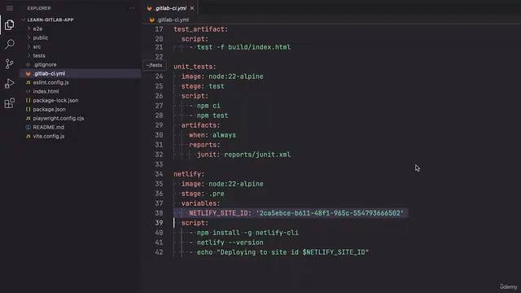
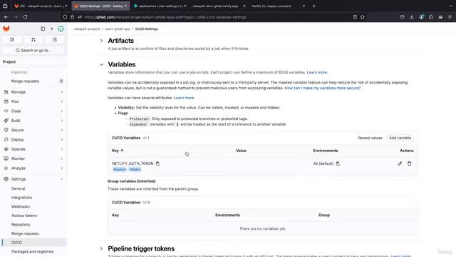
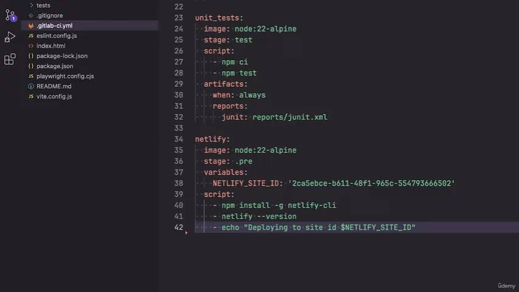
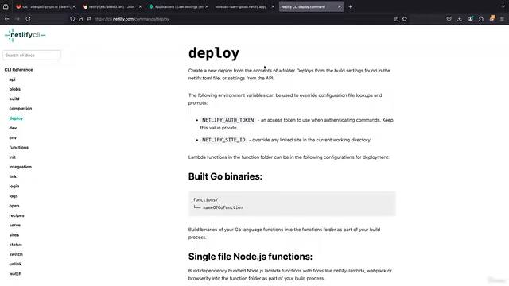
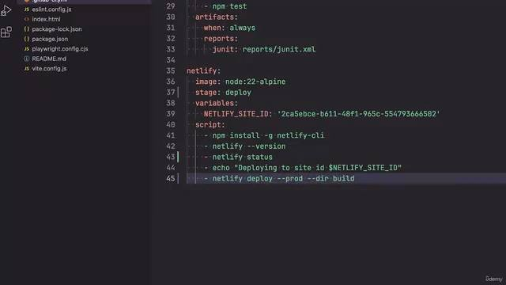
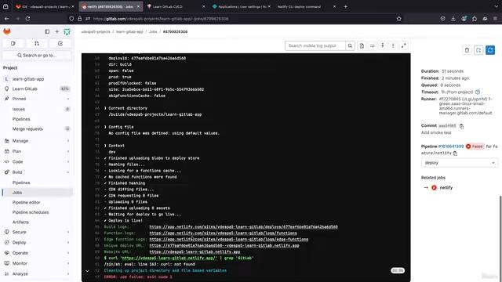
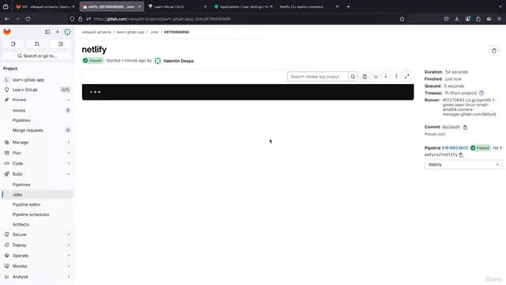
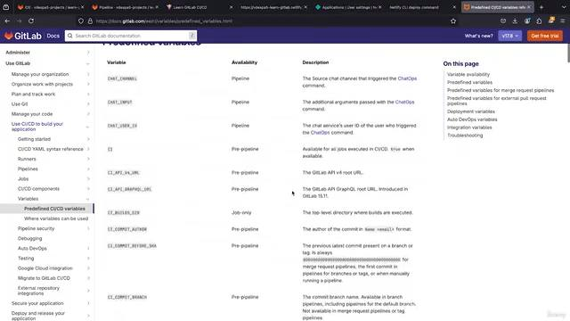
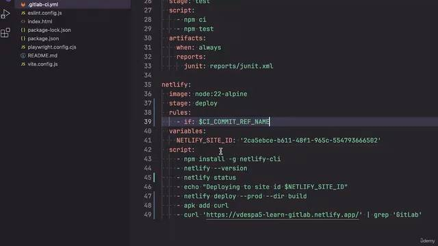
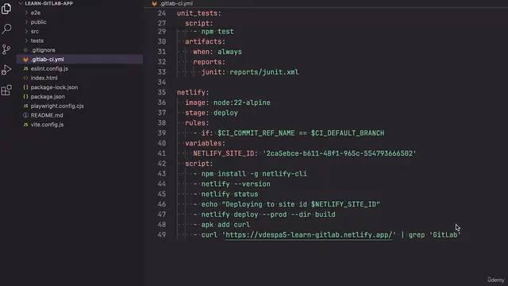

# GitLab CI/CD 实战：从构建、测试到 Netlify 部署与冒烟测试（P51–P57）

> 读者定位：前端转 AI 应用工程师。本文档按「能照着跑起来」的标准写。凡是逐字稿没讲的，一律标注「课里没讲」，不替讲师补设定。

---

## 1. 这一节做什么

这一段（P51–P57）承接前面的 build / test 两个 stage，把一条 GitLab CI/CD 流水线补成**能真正上线**的形态，具体做四件事：

1. **把 Netlify 的认证 token 从 `.gitlab-ci.yml` 里挪进 GitLab 的变量存储（CI/CD Variables）**，并解释为什么必须这么做（P51）。
2. **新增 `deploy` stage，用 Netlify CLI 把 `build` 目录部署到生产环境**，先用 `netlify status` 验证凭据是否被正确读取（P52）。
3. **部署后加一条 `curl | grep` 冒烟测试（smoke test）**，解决「部署完还得人肉点开浏览器看一眼」的问题；顺带踩一个坑：alpine 镜像里没有 curl，要用 `apk add curl` 装（P53）。
4. **用 `rules` + 预定义变量限制 deploy 只在默认分支执行**，避免从任意分支/合并请求直接部署到生产（P55）；再用 `before_script` / `after_script` 整理脚本结构（P56）；最后讲环境分层（dev / QA / staging / production / review apps）的概念（P57）。

P54 是一个**独立小实验**：在本地终端把 `curl`、`grep`、`-s`、`-q`、`$?` 这几个零件拆开练一遍——它是 P53 那条冒烟测试命令的「零件课」，所以本文档把它放在第 5 节逐行解释里一起讲。

最终产物：一条 `build → test → deploy` 的流水线，deploy 只在 main 分支跑，跑完自动做一次最基本的可用性检查。

---

## 2. 讲师原话（带出处）

关于为什么不能把 token 写进配置文件：

> "将凭据直接存储在代码中会有泄露风险，尤其是当未经授权的人员访问代码库时。像 GitLab 提供的安全存储可以保护这类敏感信息。"
> —— p051 [00:25]

> "当我们将凭据单独存储时，如果需要更新令牌或密码，可以通过用户界面进行修改，而无需实际改动代码本身。"
> —— p051 [01:02]（原话在 00:52–01:21 段落内）

关于 masked 变量的实际效果（讲师当场做了泄漏实验）：

> "当我们实际打印这个环境变量时，会看到 GitLab 不会回显这项信息。这就是被掩码的含义。"
> —— p051 [03:44]

关于 deploy 命令：

> "我们将使用的命令是 netlify deploy。除此之外，还需要指定构建目录。"
> —— p052 [01:54]

> "我们将再添加一个名为 --prod 的标志，它表示我们要创建生产环境。"
> —— p052 [02:23]

关于冒烟测试的定位：

> "它并不能确保网站外观美观，也没有做任何复杂的事情。所以我才说这是一个非常基础的测试。但即便如此，也比什么都不做要好。"
> —— p053 [05:12]

关于 alpine 里没有 curl：

> "这意味着我们使用的这个 Alpine 镜像中不包含 curl。因此需要在执行过程中安装它。"
> —— p053 [02:19]

> "我们将使用另一个命令 apk，它代表 Alpine 包管理器。"
> —— p053 [02:48]

关于为什么不能从分支部署生产：

> "在合并请求经过评审、批准并真正合并到主开发分支之前就部署到生产环境，这样做合理吗？答案是否定的，绝对不合理。"
> —— p055 [00:28]

关于 rules 里用的变量：

> "这个变量保存流水线执行时的分支名称。"
> —— p055 [03:19]（指 `CI_COMMIT_REF_NAME`）

> "相反，我们将改用另一个名为 CI_DEFAULT_BRANCH 的变量。"
> —— p055 [04:43]

关于 before_script / after_script：

> "before_script 和 script 会被合并，因此二者没有任何区别。这样做只是为了更好地管理 script 块。"
> —— p056 [00:58]

> "after_script 中指定的任何脚本都会在新的命令行环境中执行。"
> —— p056 [01:52]

---

## 3. 从零复现

### 3.1 前置条件

- 一个 GitLab 项目，仓库里已有可构建的前端项目（讲师用的是前面课程里那个含 "学习 GitLab CI/CD" 标题的站点）。
- 一个 Netlify 账号，以及一个已创建的 Netlify site。
- 本地能 push 到该 GitLab 仓库。

课里没讲 Netlify site 是怎么创建的（那是更早的课），这里只要求你手上已经有 **Site ID** 和 **Personal Access Token** 两个值。

### 3.2 步骤一：把凭据放进 GitLab CI/CD Variables（P51）

进入 GitLab 项目 → **Settings → CI/CD → Variables**，新增两个变量：

| Key | Value | 建议勾选 |
|---|---|---|
| `NETLIFY_AUTH_TOKEN` | 你的 Netlify Personal Access Token | **Masked**（必须）、Protected（按需） |
| `NETLIFY_SITE_ID` | 你的 Netlify Site ID | 按需 |

讲师在 P51 里明确演示了 **Masked** 的效果：他在 job 里 `echo` 这个变量，日志里显示的不是值，而是类似 "受 GitLab 保护" 的占位提示；而同一份日志里未被 mask 的 site ID 则原样打印出来。





> 注意：Masked 变量对值有格式要求（长度、字符集），课里没讲具体要求，设置时以 GitLab 界面报错提示为准。

### 3.3 步骤二：先用 `netlify status` 验证凭据（P52）

在 `.gitlab-ci.yml` 的 deploy job 里，**第一步不要直接 deploy**，先跑：

```bash
netlify status
```

讲师的原话是这条命令 "这仅用于信息说明。它与部署本身无关，但能确保 Netlify 正确获取我们提供的凭据和信息。"（p052 [00:28]）

日志里应当能看到当前用户信息和 site 信息。看到这两块，才说明 token 和 site ID 都被正确读取。



### 3.4 步骤三：把 job 挪到 deploy stage 并执行部署（P52）

讲师指出：deploy 依赖 build 的产物，所以**不能再放在 `build` 或自由 stage 里**，要单独建 `deploy` stage，stage 顺序变成 `build → test → deploy`。

部署命令（讲师原话给的三个要素）：

```bash
netlify deploy --dir build --prod
```

- `--dir build`：build job 把站点产物放在 `build` 目录并作为 artifact 传下来，这里要显式告诉 Netlify 部署哪个目录。讲师提到 `--dir=build` 这种等号写法也可以。
- `--prod`：声明这是生产环境部署。





### 3.5 步骤四：加冒烟测试，并踩 alpine 没有 curl 的坑（P53）

在 deploy 命令之后追加：

```bash
curl -s 'https://<你的站点地址>' | grep GitLab
```

讲师**故意先不加 `apk add curl`** 跑了一次，让流水线失败，好让你认识这个报错：日志里会显示 curl 找不到（"未找到 curl"）。原因是 job 用的 alpine 镜像不带 curl。

修复方式：在脚本里先装：

```bash
apk add curl
```

`apk` 是 alpine 的包管理器（Alpine Package Manager），安装子命令是 `add`。





### 3.6 步骤五：用 rules 限制 deploy 只在默认分支跑（P55）

在 deploy job 里加：

```yaml
rules:
  - if: '$CI_COMMIT_REF_NAME == $CI_DEFAULT_BRANCH'
```

讲师特意**不写死 `main`**，而是用 `CI_DEFAULT_BRANCH`，理由是「以后默认分支改名了不用改流水线」。他还提到复杂表达式建议整体用单引号包起来。

验证方法（讲师当场做了）：
- 在分支上 push → 流水线只有 build、test 两个 stage，没有 deploy。
- 合并进 main 后 → 新流水线出现 build、test、deploy 三个 stage。





### 3.7 步骤六：用 before_script 整理脚本（P56）

把「装工具」和「跑业务命令」分开：

```yaml
before_script:
  - apk add curl
  - npm install -g netlify-cli
script:
  - netlify status
  - netlify deploy --dir build --prod
  - curl -s 'https://<站点地址>' | grep GitLab
```

讲师强调：执行时 before_script 和 script 是**合并**的，功能上没区别，纯粹是可读性。另外 `before_script` 也可以放在顶层 `default:` 下变成全局的，会合并进所有 job——但讲师说「我们这条流水线完全不需要」。

`after_script` 讲师只讲了概念（在主 script 结束后、**在新 shell 里**执行，适合清理），并明确说这条流水线没有合适例子，所以**没有写**。

### 3.8 步骤七：理解环境分层（P57，纯概念）

讲师列出的典型环境：**dev → testing/QA → staging → production**，外加 merge request 用的 **preview environment / review apps**（临时隔离环境）。核心思想：一个 build 逐级晋升，某一级挂了不影响生产。本项目只保留 **production + staging** 两个。

课里没讲 staging 环境在 `.gitlab-ci.yml` 里具体怎么配（`environment:` 关键字、staging 的 deploy job 都没写），这一段是概念铺垫。

---

## 4. 完整代码

下面是**整合 P51–P56 全部改动后**的 `.gitlab-ci.yml` 完整文件。放在仓库根目录。

> 说明：`image`、`stages`、`cache`、build job、test job 的具体内容属于更早的课程，逐字稿里没有完整重述。下面 build / test 两个 job 是按逐字稿里提到的信息（build 产出 `build` 目录 artifact、test 检查 artifact 并跑单测）写的**最小可用版本**，标注为「课里未完整给出，此处为可运行的最小补全」。deploy job 及 rules / before_script 是 P52–P56 逐字稿明确讲过的。

```yaml
# .gitlab-ci.yml
# 说明：build / test 两个 job 的细节课里未完整重述，以下为可运行的最小补全；
#      deploy job、rules、before_script 为 P52–P56 逐字稿明确内容。

image: node:20-alpine

stages:
  - build
  - test
  - deploy

cache:
  key: "$CI_COMMIT_REF_SLUG"
  paths:
    - node_modules/

# ---------- build ----------
build:
  stage: build
  script:
    - npm ci
    - npm run build
  artifacts:
    paths:
      - build/
    expire_in: 1 week

# ---------- test ----------
test:
  stage: test
  dependencies:
    - build
  script:
    - npm ci
    - npm test

# ---------- deploy ----------
deploy:
  stage: deploy
  dependencies:
    - build
  rules:
    - if: '$CI_COMMIT_REF_NAME == $CI_DEFAULT_BRANCH'
  before_script:
    - apk add curl
    - npm install -g netlify-cli
  script:
    - netlify status
    - netlify deploy --dir build --prod
    - curl -s 'https://YOUR-SITE-NAME.netlify.app' | grep GitLab
```

配套的 `package.json`（如果项目还没有，最小可用）：

```json
{
  "name": "gitlab-ci-demo",
  "version": "1.0.0",
  "private": true,
  "scripts": {
    "build": "mkdir -p build && cp -r public/* build/",
    "test": "echo \"no tests yet\" && exit 0"
  }
}
```

目录结构：

```
your-repo/
├── .gitlab-ci.yml
├── package.json
└── public/
    └── index.html      # 页面里要包含 "GitLab" 字样，冒烟测试靠它命中
```

GitLab 里需要预先配置的变量（Settings → CI/CD → Variables）：

```
NETLIFY_AUTH_TOKEN   = <你的 token>      # 勾 Masked
NETLIFY_SITE_ID      = <你的 site id>
```

---

## 5. 逐行解释

### 5.1 deploy job 部分

```yaml
deploy:
  stage: deploy
```
讲师在 P52 明确说：因为 deploy 依赖 build 的产物，**不能再放在自由 stage**，必须单独建 `deploy` stage。stage 顺序在顶层 `stages:` 里已经排好 `build → test → deploy`。

```yaml
  dependencies:
    - build
```
让 GitLab 把 build job 产出的 `build/` artifact 下载到这个 job 的工作目录。没有这一行，`netlify deploy --dir build` 会找不到目录。课里讲师说「build job 会把网站放进 build 目录作为 artifact，我们在部署时需要它」，`dependencies` 这个关键字本身课里没逐字念出来，但语义就是它。

```yaml
  rules:
    - if: '$CI_COMMIT_REF_NAME == $CI_DEFAULT_BRANCH'
```
- `CI_COMMIT_REF_NAME`：讲师原话「this variable holds the name of the branch when the pipeline is being executed」（p055 [03:19]）。
- `CI_DEFAULT_BRANCH`：讲师原话「this is going to tell us what is the name of the default branch」（p055 [04:43]）。用它而不是写死 `main`，是为了默认分支改名时不用动流水线。
- 单引号包整条表达式：讲师说复杂表达式建议这么写（p055 [05:09]）。
- 效果：分支 / MR 上跑流水线时，这个 job 被排除，只剩 build + test；main 上跑才出现 deploy。讲师当场验证过两次。

```yaml
  before_script:
    - apk add curl
    - npm install -g netlify-cli
```
- `apk add curl`：P53 的坑。alpine 镜像不带 curl，不装的话 `curl` 那行会报 "未找到 curl"，整个 job 失败。`apk` 是 alpine 包管理器，子命令 `add`。
- `npm install -g netlify-cli`：让 `netlify` 命令可用。课里没细讲这条的写法，只说「我们已经在安装两个额外工具：curl 和 Netlify CLI」（p056 [00:29]）。
- 讲师强调 before_script 和 script 执行时是**合并**的，拆开纯粹为了可读性（p056 [00:58]）。

```yaml
  script:
    - netlify status
```
P52 的验证步骤。讲师原话：这条命令「just for information purposes only」，作用是确认凭据被正确读取——日志里应出现当前用户和 site 信息。**它不是部署的一部分**，但强烈建议保留，出问题时能一眼区分「凭据问题」还是「部署问题」。

```yaml
    - netlify deploy --dir build --prod
```
- `--dir build`：告诉 Netlify 部署哪个目录。讲师说 `--dir=build` 等号写法也行。
- `--prod`：声明这是生产环境部署。讲师原话「this indicates that we want to create a production environment」。
- 成功时日志里会出现 "job succeeded" 和 "deploy is live"，以及网站 URL（p052 [03:48] 附近）。

```yaml
    - curl -s 'https://YOUR-SITE-NAME.netlify.app' | grep GitLab
```
这就是 P53 的冒烟测试，也是 P54 那个实验的成品形态。拆开看：

| 零件 | 作用 | 出处 |
|---|---|---|
| `curl` | 抓取网页**源码**（不是渲染后的页面） | p053 [00:55]、p054 [00:29] |
| `-s` | silent / quiet 模式，不打印下载进度等杂讯 | p054 [03:23] |
| `'...'` 单引号包 URL | 防止 shell 解释特殊字符 | p053 [01:24] |
| `\|` 管道 | 把 curl 的输出喂给下一个命令 | p053 [01:24] |
| `grep GitLab` | 在响应文本里搜 "GitLab" 这个词 | p053 [01:24] |

**为什么这样就算通过**：讲师原话——如果响应里能找到 "GitLab" 这个词，「we're happy we know that we have the GitLab word somewhere here on the page, so it should work without any issues」（p053 [01:51]）。他反复强调这是**极基础**的测试：不检查页面好不好看，只检查「页面能访问 + 关键内容在」。

**为什么失败会让 job 挂**：P54 里讲师讲 `echo $?` 时点明了 CI 的机制——「In the CI-CD system, this is not needed because if the exit code is not zero, the entire job is going to fail」（p054 [02:25]）。`grep` 找不到匹配时退出码非 0，所以整条 job 失败。这就是冒烟测试能「报警」的原理。

**P54 实验里另外两个知识点**（本文档命令没用到，但你调试时会撞上）：
- `grep -q`：quiet，不打印匹配到的行，只用退出码表示结果。讲师演示：搜 `Valentino` 得 `$? = 0`，搜 `foo` 得 `$? = 1`（p054 [04:52]）。
- `curl -s` 的风险：讲师警告「if you're making a mistake here... we're not going to see an error」，域名写错也静默无输出，**排障时先把 `-s` 去掉**（p054 [03:52]）。
- 常见错误：把 `https` 写成 `http`，拿到的响应完全不同，断言会莫名失败（p054 [00:58]）。

### 5.2 为什么 token 一定要放 CI/CD Variables（P51 的论证）

讲师给了四条理由，逐条对应到工程实践：

1. **安全**：写进代码库有泄漏风险，公开仓库每天都在泄漏凭据；即使是私有仓库，也不是每个协作者都该看到所有 secret。
2. **可维护**：换 token 只需在 UI 改，不用改代码、不用走 MR。
3. **多环境**：变量界面顶部有 `environment` 选项，可以定义只对某环境生效的变量（讲师说当前项目还没有 environment，默认 all）。这样 dev / test / prod 用不同凭据，流水线配置一行不改。
4. **合规**：企业常被要求用安全存储，且这类存储通常带访问审计。

讲师还当场做了泄漏实验：在 job 里 `echo` 那个 masked 变量，日志里显示的不是值而是 "受 GitLab 保护" 之类的占位；同一份日志里未 mask 的 site ID 则明文打印。**这就是 Masked 的实际效果**。

> 给前端的一句话类比：这相当于把 `.env` 从仓库里拿掉、改放到部署平台的 Environment Variables 面板里——你在 Vercel / Netlify 上早就这么干了，GitLab 的 CI/CD Variables 是同一类东西。

---

## 6. 复现检查清单

按顺序打勾，任何一项不过就别往下走：

- [ ] GitLab 项目 Settings → CI/CD → Variables 里已有 `NETLIFY_AUTH_TOKEN`（Masked）和 `NETLIFY_SITE_ID`
- [ ] `.gitlab-ci.yml` 顶层 `stages` 是 `build → test → deploy` 三段
- [ ] build job 的 `artifacts.paths` 包含 `build/`
- [ ] deploy job 有 `dependencies: [build]`
- [ ] deploy job 的 `before_script` 里有 `apk add curl`（否则一定挂在 curl not found）
- [ ] deploy job 的 `before_script` 里有 `npm install -g netlify-cli`
- [ ] `netlify status` 在日志里打印出了当前用户和 site 信息
- [ ] `netlify deploy --dir build --prod` 日志里出现 "deploy is live" 和网站 URL
- [ ] 手动打开那个 URL，页面正常
- [ ] `curl -s '<URL>' | grep GitLab` 在本地终端能命中（先本地验证，再信流水线）
- [ ] 在**分支**上 push，流水线只有 build + test，**没有** deploy
- [ ] 合并进 main 后，新流水线有 build + test + deploy 三段
- [ ] 故意把页面里的 "GitLab" 字样删掉再跑一次，确认 deploy job 会**失败**（验证冒烟测试真的在起作用，而不是永远绿）

---

## 7. 课里没讲但你会撞上的

1. **Masked 变量的格式限制**。不是任意字符串都能勾 Masked，GitLab 对长度和字符集有要求，不合格时保存会报错。课里没讲具体规则，以界面提示为准。

2. **`netlify-cli` 的版本与 Node 版本匹配**。`npm install -g netlify-cli` 装的是最新版，某天它可能要求更高的 Node。课里用的 `node:20-alpine` 是本文档补的（逐字稿没念 image 行），如果装 CLI 报 engine 不兼容，把 image 升到更高版本或给 CLI 钉版本号。

3. **`curl -s` 静默吞错**。P54 讲师专门警告过：域名写错、`https` 写成 `http`，`-s` 下你什么都看不到。**排障第一步永远是去掉 `-s` 重跑**，或者把命令拆成 `curl ... > out.html` 再 `grep` 两步。

4. **`grep` 命中的是页面源码，不是渲染后的 DOM**。P54 讲师明确说「we're not going to see all the content that appears here on the page, because what we're getting here is static」。如果你的关键文案是 JS 运行时才注入的，`curl | grep` 永远搜不到——这时冒烟测试要么改成断言一个静态存在的 `<title>`，要么换成能跑 JS 的工具（课里没讲这类工具）。

5. **`after_script` 在新 shell 里跑**。P56 讲师特意强调这点。意味着你在 `script` 里 `cd` 到某目录、`export` 的变量，`after_script` 里**都没有**。课里没给例子，但这是最容易踩的坑。

6. **`rules` 与 `only/except` 不能混用**。课里只讲了 `rules`。如果你从旧教程抄了 `only: [main]` 又加了 `rules`，GitLab 会报错。统一用 `rules`。

7. **`CI_DEFAULT_BRANCH` 在 MR 流水线里的取值**。它始终是项目默认分支名（如 `main`），不是当前 MR 的源分支——这正是 P55 那个 `rules` 能生效的原因。但如果你以后想「MR 里也跑 deploy 到 preview 环境」，条件要换成 `$CI_PIPELINE_SOURCE == "merge_request_event"` 之类，课里没讲，属于 P57 提到的 review apps 的落地方式。

8. **staging 环境怎么配，课里没讲**。P57 只讲了概念（dev / QA / staging / production / review apps 各自定位），没有给出 staging 的 deploy job 写法，也没提 `environment:` 关键字。想落地 staging，需要自己查 GitLab 文档。

9. **artifact 过期**。本文档给 build artifact 写了 `expire_in: 1 week`（课里没讲这个字段），如果不设，GitLab 用项目默认值，可能导致你回头想手动 retry 旧 pipeline 时 artifact 已经没了。

10. **`npm ci` vs `npm install`**。本文档用 `npm ci`（要求有 `package-lock.json`）。课里没讲 build/test job 的具体安装命令，如果你仓库没有 lock 文件，`npm ci` 会直接失败，改用 `npm install`。

---

**参考截图补充**（P56 / P57 概念页，帮助对照）：



