# GitLab CI/CD 实战：Staging 环境、手动审批、Review 环境与 Workflow 规则（P58–P63）

> 读者定位：前端转 AI 应用工程师。本文所有命令与配置均可直接复制运行。涉及并发/锁等后端概念处会补一句「在 JS/Node 里对应什么」。
>
> 课程环境：GitLab + Netlify + Alpine 容器（`apk` 包管理器）。若你本地是 macOS/Linux，把 `apk add` 换成 `brew install` / `apt-get install` 即可，逻辑不变。

---

## 1. 这一节做什么

这 6 集（P58–P63）是在一条已经能跑通的 GitLab CI/CD 流水线（build → test → deploy）上做**四次增量改造**，每一次都对应一个真实工程需求：

| 集数 | 需求 | 产物 |
|---|---|---|
| P58 | 上线前先在「预发环境」验证，别直接怼生产 | 新增 `deploy_staging` 阶段 + `netlify staging` job |
| P59 | 生产部署前要人工点一下确认 | `deploy prod` job 加 `when: manual` |
| P60 | （纯讲解）为什么要有手动审批、continuous delivery vs continuous deployment 的区别 | 概念，无代码 |
| P61 | MR 阶段就要能预览效果，别等合并后才发现问题 | 新增 `deploy_review` 阶段 + `netlify review` job |
| P62 | review 环境不该在 main 分支跑，但一加规则就冒出「双流水线」 | `workflow:` 顶层规则，彻底解决双流水线 |
| P63 | review 环境的 URL 是随机生成的，没法写死做 smoke test | `--json` + `jq` + 命令替换，动态取 URL 再 `curl` |

最终你会得到一条这样的流水线：

```
MR 分支：  build → test → deploy_review
main 分支：build → test → deploy_staging → deploy_prod(手动)
```

**关键认知**：P62 是整门课最难的一集，讲师自己都说「这是课程里最难理解的部分」。它不是教你写新功能，而是教你**理解 GitLab 的两种流水线（branch pipeline / merge request pipeline）为什么会同时出现**，以及用 `workflow:` 一次性关掉其中一种。看不懂 P62 不影响你把前面跑起来，但一定要读。

---

## 2. 讲师原话（带出处）

> "本讲中，我们将扩展流水线，并引入预发布环境。预发布环境是非生产环境，通常也不对外公开，但与实际生产环境非常相似。"
> —— p058 [00:00]

> "我们会把它拆成两个部署阶段。一个可以叫 `deploy prod`……同时还会有一个可以叫 `deploy staging` 的阶段。"
> —— p058 [00:28]

> "我们需要从这里移除 `--prod` 标志，因为显然已经不再部署到生产环境。取而代之，我们会提供一个别名。这里要用 `--alias`，别名名称设为 `staging`。"
> —— p058 [01:52]

> "如果 `deploy staging` 这里出问题，也就是这个作业失败，流水线会在这里停止，生产环境不受影响。"
> —— p058 [04:14]

> "我们现在拥有的是所谓的持续部署流水线。这意味着，我们通过合并请求做出的每一项变更……最终都会进入生产环境。"
> —— p059 [00:00]

> "我们可以添加一个条件。在这里，我们会修改部署到生产环境的配置。条件通过 `when` 设置，这里要写 `manual`。"
> —— p059 [00:55]

> "有了这个手动步骤之后，我们实际上得到的就是所谓的持续交付流水线。在部署到生产环境之前，总是需要人工干预。"
> —— p059 [02:15]

> "评审环境通过为每个合并请求自动创建临时环境来解决这个问题。"
> —— p061 [00:29]

> "我们会移除这些别名。这样基本上就是让 Netlify 为我们创建这个环境，因为我们不再指定别名……遗憾的是，目前我们还需要移除这条 `curl` 命令，因为不知道这个环境的地址。这个地址是由 Netlify 随机生成的。"
> —— p061 [01:52]

> "我们有两个流水线同时运行……对于第一条流水线，这里有这个标签，写着合并请求。很有意思的是，这条流水线只有一个阶段。"
> —— p062 [02:22]

> "之所以会创建合并请求流水线，是因为任何带规则的作业都没有一项配置能将该作业排除在合并请求流水线之外。"
> —— p062 [05:05]

> "我们实际要做的是定义一个工作流。因此，从本质上讲，我们想通过该工作流配置的是：除非当前是主分支，否则就禁用分支流水线。"
> —— p062 [07:26]

> "我们可以让 Netlify 以名为 JSON 的结构化格式提供这个答案。"
> —— p063 [00:56]

> "有一个非常流行的工具可以帮助我们处理这段 JSON，它的名字是 JQ。"
> —— p063 [04:16]

> "命令替换的语法是美元符号加一对圆括号，它允许我们执行一条命令，并把命令的输出用作变量的值。"
> —— p063 [07:04]

---

## 3. 从零复现

下面按「从空仓库到最终流水线」的顺序走。每一步都给出**要改的文件、要执行的命令、要观察的现象**。

### 3.0 前置条件

- 一个 GitLab 项目，已接入 Netlify（有 `NETLIFY_AUTH_TOKEN` 和 `NETLIFY_SITE_ID` 两个 CI/CD 变量，在 GitLab 项目 Settings → CI/CD → Variables 里配好）
- 仓库里已有 `.gitlab-ci.yml`，且已能跑通 build / test / deploy 三段
- 默认分支是 `main`

如果你是从零开始，先把最小可跑的 `.gitlab-ci.yml` 建起来（下面第 4 节给完整文件）。

### 3.1 P58：加 staging 环境

**目标**：把原来单一的 `deploy` 阶段拆成 `deploy_staging` 和 `deploy_prod`，让 staging 先跑、prod 后跑。

**步骤**：

1. 在 `.gitlab-ci.yml` 的 `stages:` 里，把 `deploy` 改成 `deploy_staging` 和 `deploy_prod` 两个。
2. 把原来的 `netlify` job 改名为 `netlify prod`，`stage` 设为 `deploy_prod`。
3. 复制整个 `netlify prod` job，粘贴到它上面，改名为 `netlify staging`，`stage` 设为 `deploy_staging`。
4. 在 `netlify staging` 的 `script` 里：
   - 去掉 `--prod` 标志
   - 加上 `--alias staging`
   - 把 `curl` 的地址从 `https://<站点>.netlify.app` 改成 `https://staging--<站点>.netlify.app`
5. 把 `NETLIFY_SITE_ID` 这个变量从 job 级别提到顶层 `variables:`，避免两个 job 重复声明。

**观察**：提交到一个新分支 → 开 MR → 等 MR 流水线通过 → 自动合并 → 看 main 分支流水线，应该多出 `deploy_staging` 阶段，且 `deploy_prod` 在 staging 成功后才执行。

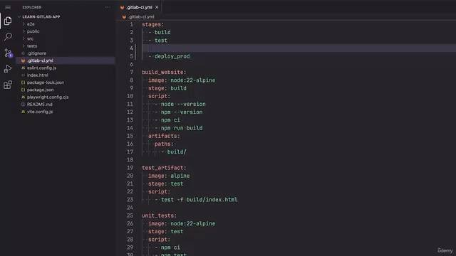

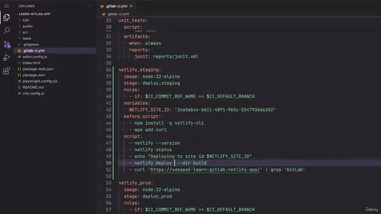

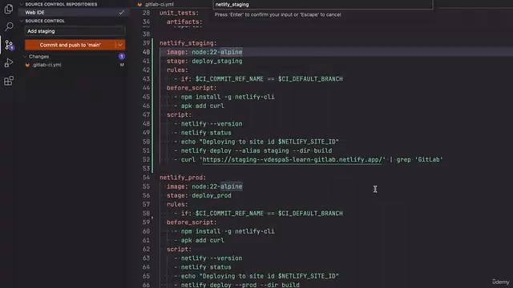

### 3.2 P59：给 prod 加手动审批

**目标**：staging 通过后，prod 不自动跑，等人点按钮。

**步骤**：

1. 新建分支 `feature/protect-production`。
2. 在 `netlify prod` job 里加一行 `when: manual`。
3. 提交 → 开 MR → 合并 → 看 main 分支流水线。

**观察**：`deploy_prod` 那个 job 会显示成一个「暂停/可点击」的按钮，而不是自动执行。点它才会跑。这就是 continuous delivery（vs 之前的 continuous deployment）。

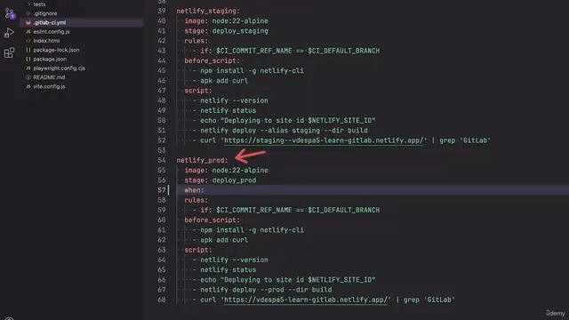

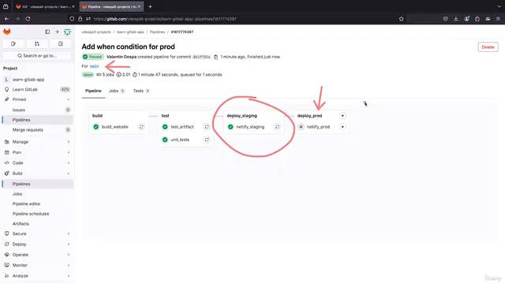

### 3.3 P60：理解为什么要有手动审批（纯讲解，无代码）

这一集没有代码改动。讲师列了 4 个真实场景里需要人工审批的理由：

1. **质量保证**：自动化测试覆盖不到视觉、文案、业务含义，需要在 staging 上人眼过一遍。
2. **风险管理**：生产部署出问题会影响收入与声誉，审批是一个 checkpoint。
3. **合规/审计**：某些行业要求变更被记录、被批准。
4. **干系人签字**：重大业务变更需要相关方知情并确认。

并给出两个术语的精确区别：

- **Continuous Delivery（持续交付）**：流水线始终产出一个「可部署到生产」的构建，但**最后一步要人点**。P59 之后你处于这个状态。
- **Continuous Deployment（持续部署）**：连最后一步也不要人点，每次通过检查就自动上生产。P58 结束时你处于这个状态。

讲师还提醒：从 CD（deployment）退回 CD（delivery）在代码上只是一行 `when: manual`，但在组织层面是「放权/收权」的问题，大厂（Amazon/Google/Microsoft）一天部署多次是因为他们的测试与回滚机制足够硬。

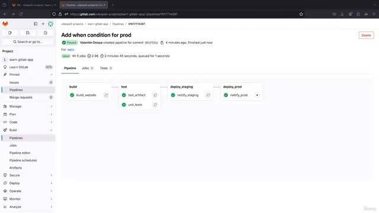

### 3.4 P61：加 review 环境

**目标**：每个 MR 自动生成一个临时预览环境，URL 随机，合并后即弃。

**步骤**：

1. 新建分支。
2. 在 `stages:` 里加 `deploy_review`（放在 `deploy_staging` 之前）。
3. 复制 `netlify staging` job，粘贴到 `netlify staging` 上面，改名 `netlify review`，`stage: deploy_review`。
4. **删掉** `rules:`（因为要让它跑在分支上，而不是只在 main 上跑）。
5. 保留 `before_script` 和大部分 `script`，但：
   - **删掉** `--alias staging`
   - **删掉** 末尾的 `curl` 命令（因为 URL 还不知道）
6. 提交 → 开 MR → 看 MR 流水线。

**观察**：MR 流水线里多出 `deploy_review` 阶段，job 日志里会出现一个 `website draft URL`，形如 `https://<随机串>--<站点>.netlify.app`。点开就是这次 MR 的预览。

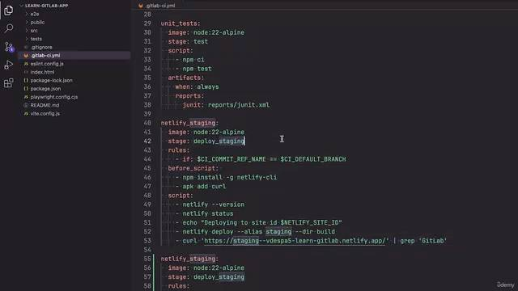

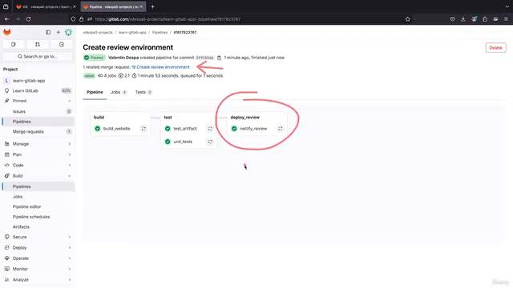

### 3.5 P62：用 workflow 干掉双流水线（最难的一集）

**现象**：P61 合并进 main 后，你会发现 main 分支的流水线里**也**跑了 `deploy_review`——这不对，review 只该在 MR 上跑。

**第一次尝试（会踩坑）**：给 `netlify review` 加一条规则，反转 staging 那条「不在分支上跑」的规则：

```yaml
rules:
  - if: '$CI_COMMIT_BRANCH != $CI_DEFAULT_BRANCH'
```

意思是「当前分支不是默认分支时才跑」。提交后开 MR，你会看到**两条流水线同时跑**：

- 一条带 `merge request` 标签，**只有 `deploy_review` 一个阶段**（因为它拿不到 build 产物，必然失败）
- 一条是普通 branch pipeline，有 build / test / deploy_review

**原因**（讲师原话 p062 [05:05]）：任何带 `rules` 的 job，如果没有显式排除「merge request pipeline」，GitLab 就会为它单独创建一条 MR 流水线。你加的这条规则**覆盖掉了原本「不要在 MR 流水线里跑」的默认配置**。

**正确解法**：在 `.gitlab-ci.yml` **最顶层**加 `workflow:`，一次性决定「什么时候创建流水线」：

```yaml
workflow:
  rules:
    - if: '$CI_PIPELINE_SOURCE == "merge_request_event"'
    - if: '$CI_COMMIT_BRANCH == $CI_DEFAULT_BRANCH'
```

含义：
- 如果是 MR 事件 → 建 MR 流水线（跑 build/test/deploy_review）
- 如果当前分支是默认分支（main）→ 建 branch 流水线（跑 build/test/deploy_staging/deploy_prod）
- 其他情况（往普通 feature 分支 push 但还没开 MR）→ **不建流水线**

**观察**：提交后，MR 流水线只有一条，包含 build / test / deploy_review 三个阶段。合并进 main 后，main 流水线只有一条，包含 build / test / deploy_staging / deploy_prod，**没有 deploy_review**。

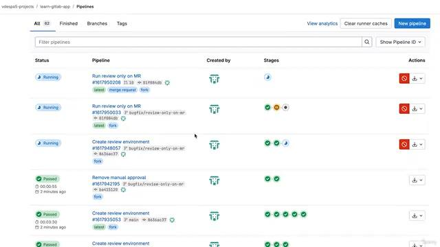

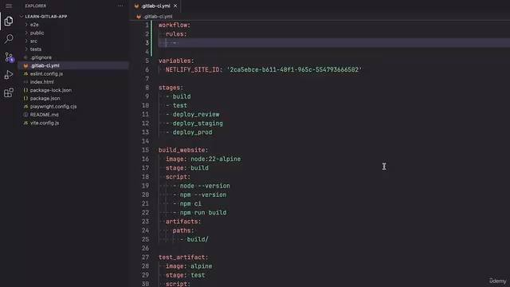

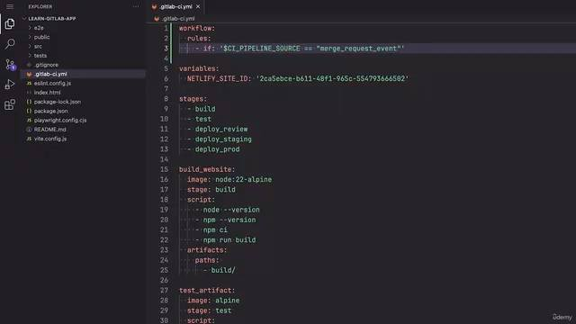

> ⚠️ 讲师特别强调：`$CI_PIPELINE_SOURCE == "merge_request_event"` 这一整行的引号、空格、双等号必须一字不差，否则行为会很怪。见 p062 [09:21]。

### 3.6 P63：动态取 review URL 做 smoke test

**目标**：review 环境的 URL 是 Netlify 随机生成的，没法写死。要让 job 自己从 Netlify 的 JSON 输出里抠出 URL，再 `curl` 它做冒烟测试。

**步骤**：

1. 新建分支。
2. 把 `netlify review` 挪到 `stages:` 的**最前面**（`pre` 阶段之前也行，讲师说「move this review job to the pre-stage」），确保它先跑。
3. 在 `script` 里加一步，造一个最小可部署产物：
   ```sh
   mkdir build && echo test > build/index.html
   ```
4. 给 `netlify deploy` 加 `--json` 标志，让输出变成 JSON。
5. 把 JSON 输出重定向到文件，并 `cat` 出来确认：
   ```sh
   netlify deploy --dir=build --json > deploy-result.json
   cat deploy-result.json
   ```
6. 安装 `jq`（Alpine 用 `apk`）：
   ```sh
   apk add --no-cache curl jq
   ```
7. 用 `jq -r '.deploy_url'` 从文件里抠出 URL：
   ```sh
   jq -r '.deploy_url' deploy-result.json
   ```
8. 用命令替换把 URL 存进变量：
   ```sh
   REVIEW_URL=$(jq -r '.deploy_url' deploy-result.json)
   ```
9. 用变量跑 `curl`：
   ```sh
   curl -s "$REVIEW_URL" | grep -q "GitLab"
   ```
10. 最后优化：把 `> deploy-result.json` + `cat` 两步合并成 `| tee deploy-result.json`（`tee` 同时写文件 + 打印到控制台）。

**观察**：job 日志里能看到 `tee` 打印出的 JSON、`jq` 抠出的 URL、`curl` 的结果。`grep -q "GitLab"` 找不到会返回非 0，job 失败——这是**预期**的，因为你的页面里没写 GitLab 这个词。把它换成你页面里真实存在的字符串即可。

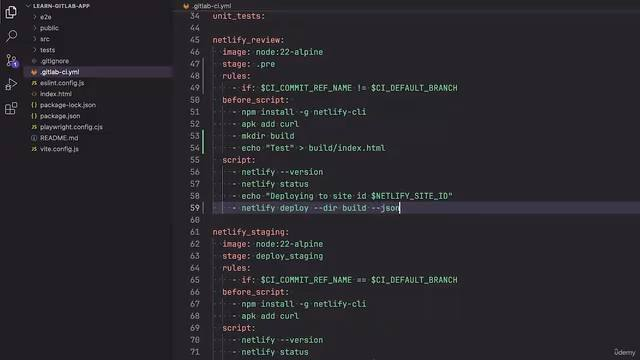

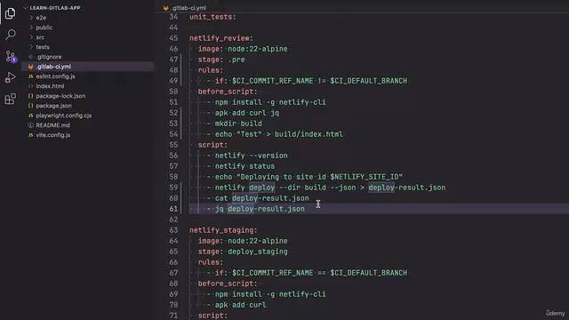

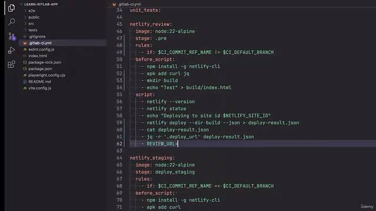

---

## 4. 完整代码

下面是 P63 结束时的 `.gitlab-ci.yml` 完整文件。**直接保存到仓库根目录即可运行**（前提是 `NETLIFY_AUTH_TOKEN` / `NETLIFY_SITE_ID` 已在 GitLab 变量里配好）。

```yaml
# .gitlab-ci.yml
# 课程 BV182JX6nEjh P58–P63 最终形态

# ---------- 顶层 workflow：决定「什么时候创建流水线」 ----------
# P62 引入。没有这段，加 rules 的 job 会额外触发一条 MR 流水线，造成双流水线。
workflow:
  rules:
    - if: '$CI_PIPELINE_SOURCE == "merge_request_event"'
    - if: '$CI_COMMIT_BRANCH == $CI_DEFAULT_BRANCH'

# ---------- 全局变量：两个 job 共用，避免重复声明 ----------
variables:
  NETLIFY_SITE_ID: $NETLIFY_SITE_ID

# ---------- 阶段顺序 ----------
# deploy_review 放最前，因为 review 环境要在 MR 里尽早给出预览
stages:
  - deploy_review
  - build
  - test
  - deploy_staging
  - deploy_prod

# ---------- 默认镜像与缓存 ----------
default:
  image: node:20-alpine
  cache:
    key: ${CI_COMMIT_REF_SLUG}
    paths:
      - node_modules/

# ---------- 构建 ----------
build:
  stage: build
  script:
    - npm ci
    - npm run build
  artifacts:
    paths:
      - build/
    expire_in: 1 week

# ---------- 测试 ----------
test:
  stage: test
  script:
    - npm ci
    - npm test

# ---------- Review 环境（每个 MR 一个临时环境） ----------
netlify review:
  stage: deploy_review
  # 注意：这里没有 rules，靠顶层 workflow 控制只在 MR 流水线里跑
  before_script:
    - npm install -g netlify-cli
  script:
    # 造一个最小可部署产物（真实项目里应使用 build 阶段的 artifacts）
    - mkdir -p build && echo test > build/index.html
    # 装 jq（Alpine 用 apk）
    - apk add --no-cache curl jq
    # --json 让 Netlify 输出结构化 JSON；tee 同时写文件 + 打印
    - netlify deploy --dir=build --json | tee deploy-result.json
    # 用 jq 抠出 deploy_url，存进变量
    - REVIEW_URL=$(jq -r '.deploy_url' deploy-result.json)
    # 打印出来方便排查
    - echo "Review URL is $REVIEW_URL"
    # 冒烟测试：把 "GitLab" 换成你页面里真实存在的字符串
    - curl -s "$REVIEW_URL" | grep -q "GitLab"

# ---------- Staging 环境（main 分支，非生产） ----------
netlify staging:
  stage: deploy_staging
  rules:
    - if: '$CI_COMMIT_BRANCH == $CI_DEFAULT_BRANCH'
  before_script:
    - npm install -g netlify-cli
  script:
    - netlify deploy --dir=build --alias staging
    - curl -s "https://staging--$NETLIFY_SITE_ID.netlify.app" | grep -q "GitLab"

# ---------- Production 环境（main 分支，手动审批） ----------
netlify prod:
  stage: deploy_prod
  rules:
    - if: '$CI_COMMIT_BRANCH == $CI_DEFAULT_BRANCH'
  when: manual
  before_script:
    - npm install -g netlify-cli
  script:
    - netlify deploy --dir=build --prod
    - curl -s "https://$NETLIFY_SITE_ID.netlify.app" | grep -q "GitLab"
```

**配套的最小项目文件**（如果你没有现成项目，用这三个文件就能跑通 build/test）：

`package.json`：
```json
{
  "name": "gitlab-ci-demo",
  "version": "1.0.0",
  "scripts": {
    "build": "mkdir -p build && echo '<html><body>GitLab demo</body></html>' > build/index.html",
    "test": "echo 'no tests yet' && exit 0"
  }
}
```

`build/index.html`（build 脚本会生成，这里只是示意内容）：
```html
<html><body>GitLab demo</body></html>
```

`.gitignore`：
```
node_modules/
deploy-result.json
build/
```

> 注意：`netlify review` 里我用了 `mkdir -p build && echo test > build/index.html`，这是讲师 P63 的做法（自己造产物）。真实项目里应该改成 `dependencies: [build]` 拿 build 阶段的 artifacts，但**课里没讲**这一步，属于你自己要补的。

---

## 5. 逐行解释

### 5.1 `workflow:` 段（P62 的核心）

```yaml
workflow:
  rules:
    - if: '$CI_PIPELINE_SOURCE == "merge_request_event"'
    - if: '$CI_COMMIT_BRANCH == $CI_DEFAULT_BRANCH'
```

- `workflow:` 是**顶层关键字**，作用域是「整条流水线要不要被创建」，不是「某个 job 要不要跑」。这是它和 job 级 `rules:` 最本质的区别。
- 第一条：`$CI_PIPELINE_SOURCE` 是 GitLab 内置变量，表示「这条流水线是被什么事件触发的」。`merge_request_event` 表示「有人在 MR 上点了创建/更新」。命中就建 MR 流水线。
- 第二条：`$CI_COMMIT_BRANCH == $CI_DEFAULT_BRANCH` 表示「当前提交所在分支就是默认分支（main）」。命中就建 branch 流水线。
- 两条都不命中（比如往 feature 分支 push 但还没开 MR）→ **不建流水线**。这是 P62 之后的新行为：以前 push 分支就会跑，现在必须先开 MR。
- **为什么这样就解决了双流水线**：因为 `workflow:` 是「总开关」，它先决定「建哪条流水线」，job 级 `rules:` 只在被选中的那条流水线里决定「这个 job 跑不跑」。总开关一旦只放行 MR 流水线或 main 分支流水线，就不会两条同时出现。
- **在 JS/Node 里对应什么**：可以类比 Express 的 middleware——`workflow:` 是全局 middleware，决定请求要不要进路由；job 级 `rules:` 是路由内的 `if` 判断。全局 middleware 先拦，拦住了后面就不执行。

### 5.2 `stages:` 顺序

```yaml
stages:
  - deploy_review
  - build
  - test
  - deploy_staging
  - deploy_prod
```

- `deploy_review` 放最前，是 P63 讲师明确要求的（「move this review job to the pre-stage」）。原因：review 环境要在 MR 里**尽早**给出预览，让 reviewer 一边看代码一边看效果。
- `deploy_staging` 在 `deploy_prod` 之前，是 P58 的核心：staging 失败 → 流水线停在这 → prod 不受影响。
- 注意：`deploy_review` 在 `build` 之前，意味着 review job **拿不到 build 阶段的 artifacts**。这就是为什么 P63 里要自己 `mkdir build && echo test > build/index.html` 造产物。真实项目里要么把 review 挪到 build 之后，要么在 review job 里自己跑一次 build——**课里没讲**这个取舍，你自己决定。

### 5.3 `netlify review` 的 script

```yaml
- mkdir -p build && echo test > build/index.html
```
造一个最小 HTML 给 Netlify 部署。`-p` 表示目录已存在也不报错。

```yaml
- apk add --no-cache curl jq
```
Alpine 的包管理器。`--no-cache` 不保留索引缓存，减小镜像层。`curl` 后面要用，`jq` 用来解析 JSON。

```yaml
- netlify deploy --dir=build --json | tee deploy-result.json
```
- `--json`：让 Netlify 输出结构化 JSON 而不是人类可读日志（P63 关键改动）。
- `| tee deploy-result.json`：管道把 stdout 同时送到「文件」和「终端」。等价于 `> deploy-result.json` + `cat deploy-result.json` 两步合一。讲师在 P63 [09:01] 明确说这是「last-minute optimization」。

```yaml
- REVIEW_URL=$(jq -r '.deploy_url' deploy-result.json)
```
- `$(...)` 是 **命令替换**（command substitution）：先执行括号里的命令，把 stdout 当作值赋给变量。讲师 P63 [07:04] 专门解释了这个语法。
- `jq -r '.deploy_url'`：`-r` 表示 raw output（去掉 JSON 字符串的引号）；`.deploy_url` 是 JSON 里的字段路径。**注意**：字段名 `deploy_url` 是讲师在 P63 日志里亲眼看到的，你的 Netlify 版本如果字段名不同，以实际输出为准。
- **等号两边不能有空格**，否则 shell 会把 `REVIEW_URL` 当成命令名。讲师 P63 [06:34] 特别强调。

```yaml
- echo "Review URL is $REVIEW_URL"
```
调试用。讲师 P63 [08:31] 说「如果不确定变量有没有解析对，就 echo 出来看看」。

```yaml
- curl -s "$REVIEW_URL" | grep -q "GitLab"
```
- `curl -s`：静默模式，不打印进度条。
- `grep -q`：quiet，找到就返回 0，找不到返回 1。返回 1 会让 job 失败——这就是「冒烟测试」：页面里没有预期字符串 = 部署有问题。
- **把 `"GitLab"` 换成你页面里真实存在的字符串**，否则这条永远失败。讲师 P63 [07:33] 明确说「it's OK if it fails」。

### 5.4 `netlify staging` 的 script

```yaml
- netlify deploy --dir=build --alias staging
```
- `--alias staging`：给这次部署起一个固定别名 `staging`，URL 变成 `https://staging--<站点>.netlify.app`。这是 P58 的核心改动（把 `--prod` 换成 `--alias staging`）。
- 不加 `--prod` 意味着**不影响生产**。讲师 P58 [04:42] 在日志里看到 `prod` flag 为 `false`，就是这个意思。

```yaml
- curl -s "https://staging--$NETLIFY_SITE_ID.netlify.app" | grep -q "GitLab"
```
- 用固定别名 URL 做冒烟测试。因为 staging 的 URL 是确定的（不是随机），所以可以写死。
- 注意 `staging--` 这个前缀是 Netlify 的 alias 语法，不是 GitLab 的。**课里没讲**这个 URL 格式的官方文档，但讲师 P58 [02:19] 说「check this against the logs」，意思是让你对照日志里的 `website draft URL` 确认格式。

### 5.5 `netlify prod` 的 `when: manual`

```yaml
when: manual
```
- 让这个 job 不自动跑，等人点按钮。P59 的核心改动。
- 效果：流水线跑到这里会「暂停」，UI 上出现一个可点击的按钮。点了才继续。
- 这就是 continuous delivery 和 continuous deployment 的分界线（P60 讲的概念）。
- **在 JS/Node 里对应什么**：类似 `await new Promise(resolve => button.onclick = resolve)`——流水线在这里 await 一个人工 resolve。

### 5.6 `rules:` 在 staging/prod 上

```yaml
rules:
  - if: '$CI_COMMIT_BRANCH == $CI_DEFAULT_BRANCH'
```
- 只在 main 分支跑。feature 分支不跑 staging/prod。
- 注意：这条规则**没有** `when: never` 的兜底，所以不命中时 job 默认不跑（GitLab 的 rules 语义：没有匹配的规则 = 不跑）。
- 和 `workflow:` 的关系：`workflow:` 先决定「建不建流水线」，`rules:` 再决定「这条流水线里这个 job 跑不跑」。两层过滤。

---

## 6. 复现检查清单

按顺序打勾，任何一项不过就别往下走：

- [ ] GitLab 项目里 `NETLIFY_AUTH_TOKEN` 和 `NETLIFY_SITE_ID` 两个变量已配好（Settings → CI/CD → Variables，勾选 Protected 或 Masked 按需）
- [ ] 默认分支是 `main`（Settings → Repository → Default branch）
- [ ] `.gitlab-ci.yml` 里 `stages:` 有 5 个：`deploy_review / build / test / deploy_staging / deploy_prod`
- [ ] 顶层有 `workflow:`，且两条 `if` 的引号、双等号一字不差
- [ ] `netlify review` job **没有** `rules:`（靠 workflow 控制）
- [ ] `netlify staging` 和 `netlify prod` **有** `rules: if: '$CI_COMMIT_BRANCH == $CI_DEFAULT_BRANCH'`
- [ ] `netlify prod` 有 `when: manual`
- [ ] `netlify review` 的 script 里有 `--json`、`tee`、`jq -r '.deploy_url'`、`REVIEW_URL=$(...)`、`curl -s "$REVIEW_URL"`
- [ ] `grep -q "GitLab"` 里的 `"GitLab"` 已换成你页面里真实存在的字符串
- [ ] 开一个 MR：只看到**一条** MR 流水线，含 build / test / deploy_review 三个阶段
- [ ] MR 合并进 main：只看到**一条** main 流水线，含 build / test / deploy_staging / deploy_prod，**没有** deploy_review
- [ ] main 流水线里 `deploy_prod` 显示为手动按钮，不自动跑
- [ ] 点 `deploy_prod` 按钮后，job 正常执行并 `curl` 成功
- [ ] 往 feature 分支 push 但**不开 MR**：**不**产生任何流水线（这是 workflow 的预期行为）

---

## 7. 课里没讲但你会撞上的

以下是逐字稿里**没有**出现、但你照着做大概率会遇到的坑。写在这里是为了让你少走弯路，不是讲师的观点。

1. **`netlify review` 拿不到 build artifacts**。因为 `deploy_review` 阶段在 `build` 之前。讲师 P63 用 `mkdir build && echo test > build/index.html` 绕过去了，但真实项目里你的页面需要真实构建产物。解法：把 `deploy_review` 挪到 `build` 之后，或在 review job 里加 `dependencies: [build]`。**课里没讲**这个取舍。

2. **`NETLIFY_SITE_ID` 的写法**。讲师 P58 把变量提到顶层 `variables:`，但顶层 `variables:` 里写 `NETLIFY_SITE_ID: $NETLIFY_SITE_ID` 是「变量引用变量」，GitLab 支持，但如果你在 UI 里配的是 Masked 变量，某些版本会报错。稳妥写法是直接在 job 里用 `$NETLIFY_SITE_ID`，不经过顶层中转。**课里没讲**这个细节。

3. **`jq` 字段名可能不是 `deploy_url`**。讲师 P63 日志里看到的是 `deploy_url`，但 Netlify CLI 不同版本字段名可能变（比如 `deploy_url` vs `url`）。**以你实际 `tee` 出来的 JSON 为准**，不要照抄。课里没讲版本兼容。

4. **`grep -q "GitLab"` 的字符串**。讲师 P63 用 `"GitLab"` 是因为他的 demo 页面里恰好有这个词。你的页面里如果没有，这条永远失败。**必须换成你页面里真实存在的字符串**。课里没讲这个「必须换」。

5. **`when: manual` 的 job 超时**。GitLab 默认手动 job 不会超时，但如果你配了 `timeout:`，手动 job 也会被计时。**课里没讲** timeout 配置。

6. **`workflow:` 之后 push 分支不跑流水线**。P62 之后，往 feature 分支 push 但没开 MR，**不会**有任何流水线。这是预期行为，不是 bug。很多人第一次遇到会以为配置坏了。课里 P62 [11:16] 提了一句「even if we push a branch, no pipeline will be created」，但没展开讲这对日常开发流程的影响。

7. **`apk add` 在非 Alpine 镜像里不存在**。讲师用的是 Alpine（`node:20-alpine` 之类）。如果你用 `node:20`（Debian），要换成 `apt-get update && apt-get install -y curl jq`。**课里没讲**镜像差异。

8. **Netlify CLI 的 `--alias` 和 `--prod` 互斥**。P58 里讲师把 `--prod` 换成 `--alias staging`，这两个不能同时用。如果你同时写，Netlify 会报错。**课里没讲**这个约束，但从「remove this prod flag」这句话能推出来。

9. **`tee` 的退出码**。`cmd | tee file` 的退出码默认是 `tee` 的退出码，不是 `cmd` 的。如果 `netlify deploy` 失败但 `tee` 成功，job 会误判为成功。解法：`set -o pipefail`。**课里没讲**，但这是 shell 管道的经典坑。

10. **MR 流水线和 branch 流水线的 artifacts 不共享**。P62 之后，MR 流水线跑 build 产出的 artifacts，合并进 main 后 main 流水线要**重新**跑 build。这是 GitLab 的设计，不是 bug。**课里没讲**，但你会看到 main 流水线又跑了一遍 build，别以为配错了。

---

**最后一句**：P62 那一集如果第一遍没看懂，正常。讲师自己都说「I also need it when I first encountered this a bit of time to fully understand what's going on」（p062 [03:40]）。建议做法：先把第 4 节的完整 `.gitlab-ci.yml` 抄进去跑通，再回头逐行读第 5.1 节，最后对照第 6 节检查清单验证行为。跑通比看懂优先。