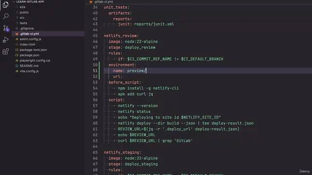
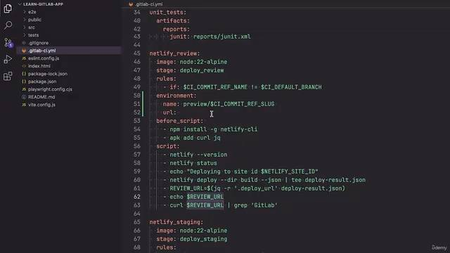
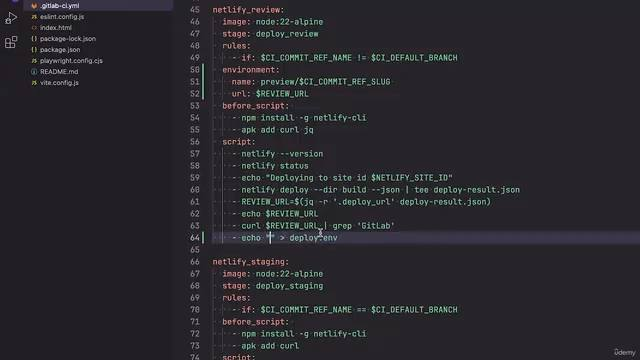
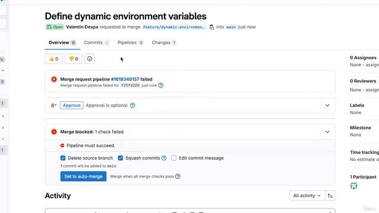
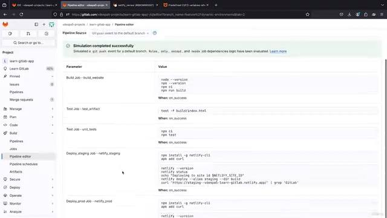
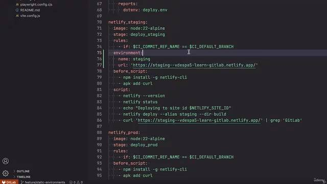
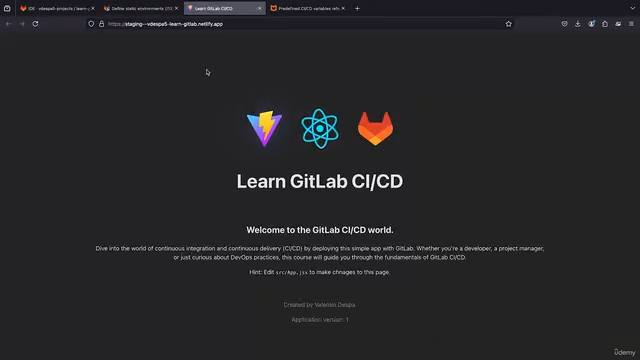
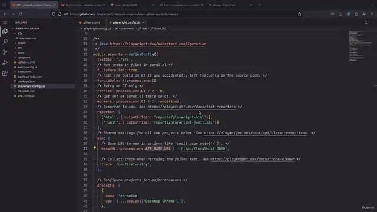
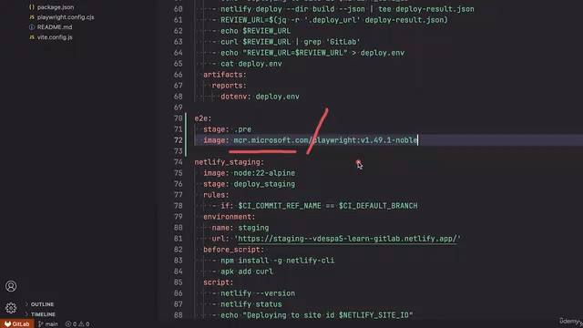
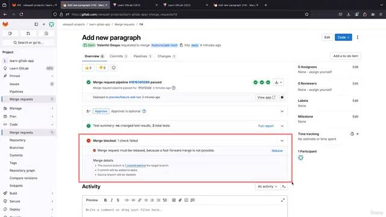

# GitLab CI/CD 实战：动态预览环境、Environment 集成与 Playwright 端到端测试（P64–P68）

## 1. 这一节做什么

前面几十节课已经把一条能跑的流水线搭出来了：提交代码 → 装依赖 → 构建 → 测试 → 用 curl 调 Netlify 部署 API → 把部署出来的 URL 从响应里抠出来。但它有一个很尴尬的问题——**URL 只活在日志里**。产品经理要看新功能，你得让他打开 pipeline、翻 job 日志、在一坨 JSON 里找一个链接。这门课到这里要解决的就是“最后一公里”的人机接口问题。

具体拆成四件事：

第一，给 review 部署（每个 MR 一个的预览站）挂上 GitLab 的 **Environment**，让 MR 页面直接冒出一个 `View app` 按钮。这里的技术难点不在 Environment 本身，而在于**部署 URL 是运行时才产生的**，必须通过 `artifacts:reports:dotenv` 把它从 shell 变量“透传”回 GitLab，否则 `environment.url` 永远是空的。

第二，给 staging 和 production 也挂 Environment，并且演示两种完全不同的配置路径：一种在 YAML 里写死 URL，一种在 YAML 里只写环境名、URL 事后在 GitLab UI 里补。后者在真实项目里很常见，因为生产域名经常不由写 pipeline 的人管。

第三，加一个 Playwright 的 end-to-end job，把“人工点开网站看看对不对”换成三条自动断言。

第四，虽然不写代码但必须知道：环境作用域变量（同一个变量名，production 和 staging 各用各的 token），以及多 MR 并行时必然遇到的 rebase。

这一节的产出物不是一个新项目，而是**对已有 `.gitlab-ci.yml` 的三处改造 + 一个新 job**。所以下面所有代码都是“在你现有文件上增删”，不是从零新建。

---

## 2. 讲师原话

先把讲师在这一段里最关键的几句原话摆出来，后面所有实现都是从这几句推出来的。

关于 Environment 的定位：

> "我们可以使用环境（environments），这是一种把 GitLab 与我们的基础设施关联起来的方式。换句话说，我们可以告诉 GitLab，这个 URL 就是我们的评审环境，然后直接提供这个链接即可。"
> —— p064 [00:26]

这句是整个 P64 的题眼：Environment 不是部署工具，它是**GitLab 和你的基础设施之间的一条元数据链接**。它不改你的部署行为，只让 GitLab 知道“这个 URL 是我某个环境的入口”。

关于配置项：

> "我们需要添加以下配置……使用关键字 `environment`。`environment` 有两个属性：一个是 `name`，另一个是 `URL`。"
> —— p064 [00:56] / p064 [01:26]

关于为什么环境名要动态：

> "CI commit ref slug。这个名字听起来很奇怪，但它实际上是另一个环境变量 `CI_COMMIT_REF_NAME` 的 URL 安全版本，后者基本上就是分支名……而它是缩短后的版本，不包含空格之类的内容。"
> —— p064 [01:53] / p064 [02:20]

关于为什么光写 `$REVIEW_URL` 不够：

> "这不会自动生效，所以我们还需要做几步操作……我们实际上要用到 GitLab 中另一个重要的概念，就是通过 `.env` 报告来传递一些信息。"
> —— p064 [02:47] / p064 [03:17]

关于那个经典的手滑报错：

> "我们的 YAML 无效了。报错信息是：`Jobs, Netlify, review, artifacts, reports, config` 包含未知键。你大概能看出来，我这里写错了，不应该是 `done`，而应该是 `dot`。"
> —— p064 [06:29]

关于最终效果：

> "这里不再是一个普通的按钮，而是 `view app`，点击它就能看到应用。所以这是通过我们在 job 中配置的内容自动关联起来的。"
> —— p064 [08:53]

关于 staging 的两种做法，以及那个省掉重复的预定义变量：

> "在 GitLab 提供的预定义环境变量列表中，有环境名称，这里还有环境 URL……我们可以直接用 `curl` 加上美元符号来使用这个环境变量。"
> —— p065 [01:25] / p065 [01:55]

关于 production 走 UI 那条路：

> "我们不打算定义 URL，而是通过 UI 界面来定义 URL。"
> —— p065 [02:52]

关于只给真正部署的 job 挂环境：

> "我们只为那些真正部署到特定环境的 job 指定环境，而不是为其他可能只做些测试的 job 指定。"
> —— p065 [07:35]

关于环境作用域变量（提了但没用）：

> "你可以定义相同的变量名，然后选择正确的环境。这样该变量就只在该环境中可用。"
> —— p066 [00:58]

关于 rebase：

> "源分支比目标分支落后一个提交……我们在这里点击 `rebase`。这是 GitLab 提供的一个非常方便的功能，因为我们不需要回到代码里去操作。"
> —— p067 [05:37] / p067 [06:33]

关于 Playwright 镜像：

> "Playwright 项目已经有现成的 Docker 镜像可以直接使用。这个镜像已经包含了多个浏览器，肯定比我们的 Node.js 镜像好得多。"
> —— p068 [03:49]

> "当我们使用非默认的 Docker 容器镜像仓库（默认的是 Docker Hub）时，这是必需的。因此，我们需要指定完整路径。而这是微软的容器镜像仓库。"
> —— p068 [04:43]

---

## 3. 从零复现

### 3.0 前置状态检查

动手之前先确认你手上已经有这些（都是前面课时的产物，本节不重建）：

- 一个 GitLab 仓库，根目录有 `.gitlab-ci.yml`，里面已经定义了若干 stage。
- 一个 `netlify:review` job，它能跑 `npm ci`、`npm run build`，然后调 Netlify 的部署接口，并且**已经**从响应里把部署 URL 提取到了 shell 变量 `REVIEW_URL`。这一步的具体 curl 参数在更早的课时里，本节的逐字稿没有重放，你保留自己那一行即可。
- 一个 `netlify:staging` 和 `netlify:production` job（或者至少知道它们长什么样）。
- 项目里有 `source/` 目录放页面主文件，有 `package.json`。
- 一个 Playwright 端到端测试已经写在项目里（课里放在 `end-to-end` 目录），`package.json` 里有一个 `e2e` 脚本，另有一个 Playwright 的配置文件。

如果你缺最后一项，本节第 3.5 步之前需要先把 Playwright 项目跑起来；但本节**不涉及修改测试文件本身**，只涉及在 CI 里调用它。

### 3.1 给 review job 加 environment 块

在 Web IDE 里新建一个分支，打开 `.gitlab-ci.yml`，定位到 `netlify:review`。



在 job 下面、和 `script` **同一层级**，加：

```yaml
  environment:
    name: preview-$CI_COMMIT_REF_SLUG
    url: $REVIEW_URL
```

两个细节：

1. `name` 前面加 `preview-` 前缀，是因为同时可能有多个 MR 开着，GitLab 会把所有以 `preview-` 开头的环境归到一个折叠分组里，UI 上清爽很多。讲师在 P65 讲“stopped”环境时回头解释了这一点。
2. 用 `CI_COMMIT_REF_SLUG` 而不是 `CI_COMMIT_REF_NAME`。分支名如果叫 `feature/dynamic-environments`，里面那个 `/` 放进 URL 路径或者环境名里会出问题；`SLUG` 版本已经把它压成了 URL 安全的形式（讲师原话是 “contains no spaces and other things”）。

此时如果你直接提交，pipeline 不会报错，但 MR 页面上**不会**出现链接。因为 `$REVIEW_URL` 是 `script` 里 `export` 出来的 shell 变量，而 `environment.url` 是在 job 结束后由 GitLab Runner 单独求值的，两者不在同一个上下文里。这就是下一步要解决的问题。



### 3.2 用 dotenv artifact 把 URL 传出去

回到 `script` 块。在**那条已经成功执行、并且 `REVIEW_URL` 已经有值**的部署命令之后，追加两行：

```bash
- echo "REVIEW_URL=$REVIEW_URL" > deploy.env
- cat deploy.env
```

第一行生成一个极简的键值文件。第二行是纯粹为了排错——讲师特意说了 “because we're learning and we want to understand everything that we do in our pipeline step by step”。`cat` 出来的内容应该就是一行 `REVIEW_URL=https://xxxx.netlify.app`。

然后在 job 层级加 `artifacts`：

```yaml
  artifacts:
    reports:
      dotenv: deploy.env
```

注意层级：`artifacts` 和 `script` 同级，`reports` 在 `artifacts` 下面，`dotenv` 在 `reports` 下面。



### 3.3 踩一次坑：donenv 与 .env

讲师在这一步手滑了，把 `dotenv` 打成了 `done` / `donenv` 之类的东西，Pipeline 直接失败，报错大意是 `artifacts:reports` 下面有个未知的键。这是个很好的教学时刻——GitLab 的 YAML 校验错误通常指向很精确。

修法有两个入口：

- 直接改文件重新提交；
- 或者用 **Pipeline Editor**（Build → Pipeline editor），它会在你打字的时候实时提示 “pipeline syntax is correct”，还能点 Visualize 看整条流水线的结构，点 Validate 看每个 job 会执行哪些命令。



改对之后提交，MR 的 pipeline 应该全绿。刷新 MR 页面，在 pipeline 状态下方会出现类似 `deploy to preview` 的一行，后面跟着 `feature-dynamic-environments` 这个环境名，以及一个 **View app** 按钮。点它直接打开预览站。



到这里 P64 的核心目标就达成了。

### 3.4 给 staging 和 production 挂环境（两种方式）

新建一个分支。先处理 staging，走 **YAML 写死 URL** 的路子：

```yaml
  environment:
    name: staging
    url: https://你的-staging-域名
```

然后为了不在两处重复写这个地址，把 `script` 里用到该地址的地方改成引用 GitLab 的预定义变量 `$CI_ENVIRONMENT_URL`。同时留一行 `echo $CI_ENVIRONMENT_URL`，方便出问题时确认变量到底有没有被注入。



再处理 production，走 **UI 补 URL** 的路子：YAML 里只写

```yaml
  environment:
    name: production
```

不写 `url`。提交 → 合并 → 主分支 pipeline 跑起来。**staging 会成功，production 会失败**，因为脚本里那个 `curl $CI_ENVIRONMENT_URL` 拿到的变量是空的。这是预期行为，不是 bug。

去 Operate → Environments，点进 production 环境，点 Edit，把生产域名填进 URL 字段，Save。然后回到失败的 pipeline，只对 `netlify:production` 这个 job 点 **Retry**。重跑成功，说明环境变量已经被注入进去了。



顺带一个观察：此时 Environments 列表里 staging 和 production 都在，每个环境点开能看到当前版本、上次部署时间、历史部署记录。而所有 `preview-` 开头的环境会归到一个叫 `preview` 的分组下，MR 关掉之后它们显示为 `stopped` 而不是消失——讲师说明了原因是 Netlify 那边不让真删环境。

### 3.5 加 Playwright 端到端 job

先确认测试怎么知道该打开哪个 URL。课里的做法是：测试文件里写的是相对路径 `/`，真正的 base URL 从 Playwright 配置文件的 `process.env.APP_BASE_URL` 读，读不到就 fallback 到 localhost（本地开发用）。所以 CI 里必须把 `APP_BASE_URL` 注进去。

本节**不修改** Playwright 配置和测试文件，只在 `.gitlab-ci.yml` 里加一个新 job：

```yaml
e2e:
  stage: pre
  image: mcr.microsoft.com/playwright:v1.49.1-noble
  variables:
    APP_BASE_URL: https://你的-production-域名
  script:
    - npm ci
    - npm run e2e
```

三个要点：

- **镜像不能用 Node 镜像**。Playwright 的测试是真的要开浏览器的，Node 镜像里没有浏览器二进制。微软官方的 `mcr.microsoft.com/playwright` 镜像里预装了多个浏览器。镜像名里 `playwright` 是仓库名，`v1.49.1-noble` 是 tag（1.49.1 版本 + noble 这个 Ubuntu 发行版代号）。
- **`mcr.microsoft.com/` 这个前缀不能省**。Docker 默认从 Docker Hub 拉镜像，这里的镜像不在 Docker Hub 上，必须写完整路径。
- **放在 `pre` stage**，让它最先跑、尽早失败，不要排在构建后面白等几分钟。



提交后看 pipeline，`e2e` job 日志里应该能看到 3 条测试全部通过。



### 3.6 用两个并行 MR 验证整条链路

这一步是“项目模拟”，目的是把前面配好的东西放到真实节奏下跑一遍，验证它真的有用。

1. 从 main 开分支 A，在 `source/` 的主页面文件里加一段文字，提交，开 MR。
2. 切回 main，开分支 B，从页面里删掉两个 logo，保留 GitLab 那个，提交，开 MR。
3. 两个 MR 的 pipeline 各自跑。分别点 View app，能看到 A 的预览里只有那段新文字，B 的预览里少了 logo，而**生产环境上两个改动都不存在**。这是 preview 环境最核心的价值：隔离。
4. 先合 B（删 logo 的）。主分支 pipeline 跑完，去 Operate → Environments 看 production，确认 logo 已经没了。
5. 回 MR A，会发现它变成 `merge blocked`。展开原因，写的是 “merge request must be rebased because a fast forward merge is not possible”，以及更直白的一句：源分支比目标分支落后一个 commit。
6. 点 **Rebase** 按钮。GitLab 把 main 上那个删 logo 的 commit 合进你的分支，然后**自动重跑整条 pipeline**。
7. 跑完后刷新 MR，点 View app，这次的预览里**既有删掉 logo 的效果，也有你新加的文字**。这时候才能合。



这个流程解释了一件事：为什么讲师从第一节课就在强调 pipeline 要快。因为每 rebase 一次就得重跑一遍，慢 pipeline 会把这个等待时间乘上 MR 的数量。

---

## 4. 完整代码

下面是本节涉及的所有配置。**这不是一份能独立跑的新项目**，是叠加在你现有 `.gitlab-ci.yml` 上的改动。`stages` 列表沿用你前面的定义；如果你的 `stages` 里还没有 `pre`，加一行。

```yaml
# ============================================================
# .gitlab-ci.yml —— P64~P68 相关部分
# 说明：npm ci / npm run build / 部署命令的完整参数来自前面的课时，
#       本节逐字稿没有重放，下面保留注释位，请替换成你自己的命令。
# ============================================================

# ---------- P64：review 环境（动态命名 + dotenv 透传 URL） ----------
netlify:review:
  stage: deploy review
  script:
    - npm ci
    - npm run build
    # ↓↓↓ 这一行换成你前面课时里的 Netlify 部署命令，
    #     它的职责是：调部署接口，并把部署出来的 URL 存进 REVIEW_URL 变量。
    #     本节不重放它的参数。
    # - <你的 Netlify 部署 + 提取 REVIEW_URL 的命令>
    - echo "REVIEW_URL=$REVIEW_URL" > deploy.env
    - cat deploy.env
  environment:
    name: preview-$CI_COMMIT_REF_SLUG
    url: $REVIEW_URL
  artifacts:
    reports:
      dotenv: deploy.env


# ---------- P65 方式 A：staging，URL 写在 YAML 里 ----------
netlify:staging:
  stage: deploy staging
  script:
    - npm ci
    - npm run build
    # ↓↓↓ 同样替换成你的 staging 部署命令
    # - <你的 Netlify 部署命令>
    - echo $CI_ENVIRONMENT_URL
    - curl $CI_ENVIRONMENT_URL
  environment:
    name: staging
    url: https://staging.example.com   # ← 换成你自己的 staging 地址


# ---------- P65 方式 B：production，URL 在 GitLab UI 里补 ----------
netlify:production:
  stage: deploy production
  script:
    - npm ci
    - npm run build
    # ↓↓↓ 同样替换成你的 production 部署命令
    # - <你的 Netlify 部署命令>
    - echo $CI_ENVIRONMENT_URL
    - curl $CI_ENVIRONMENT_URL
  environment:
    name: production
    # 注意：这里故意不写 url。
    # 第一次跑会失败，去 Operate → Environments → production → Edit 填 URL，
    # 然后回 pipeline 点 Retry。


# ---------- P68：Playwright 端到端测试 ----------
e2e:
  stage: pre
  image: mcr.microsoft.com/playwright:v1.49.1-noble
  variables:
    APP_BASE_URL: https://production.example.com   # ← 换成你自己的生产地址
  script:
    - npm ci
    - npm run e2e
```

以下是**不需要改动、但你需要确认存在**的两个文件。它们来自课程已有的 Playwright 项目，本节只是从外部注入环境变量，不修改它们：

```jsonc
// package.json（片段）—— e2e 脚本必须存在，job 里执行的就是它
{
  "scripts": {
    // 逐字稿里讲师展示了这个 script 的内容但没有念出来，
    // Playwright 项目的常规写法是 playwright test，请以你项目里实际那行为准
    "e2e": "playwright test"
  }
}
```

```ts
// playwright.config.ts（片段）—— 课里明确说了：
//   - 用环境变量 APP_BASE_URL
//   - 没设置时 fallback 到 localhost（本地开发用）
// 具体端口和写法以你项目里实际的文件为准，本节不修改它。
export default defineConfig({
  use: {
    baseURL: process.env.APP_BASE_URL || 'http://localhost:3000',
  },
});
```

---

## 5. 逐行解释

**`environment:` 和 `script:` 同级**

`environment` 是 job 的一个关键字，不是 script 里的一条命令。写成 `script` 下面的一行会被当成 shell 命令执行然后失败。讲师特意强调 “at the same level as with the script”。

**`name: preview-$CI_COMMIT_REF_SLUG`**

`$CI_COMMIT_REF_SLUG` 由 GitLab 预定义，值是当前分支名经过 URL 安全化处理后的结果：小写、非字母数字字符换成连字符、截断到 63 字符。分支 `feature/dynamic-environments` 会变成 `feature-dynamic-environments`。**为什么不能用 `CI_COMMIT_REF_NAME`**：那个是原始分支名，带着 `/`，放进环境名里会让 GitLab 把 `feature` 当成分组名、`dynamic-environments` 当成环境名，语义就错了。这是讲师在 P64 [01:53] 那段话的实质。

**`url: $REVIEW_URL`**

这里写的是一个变量引用，GitLab 会在 job 结束之后去解析它。如果解析出来是空字符串，Environment 会被创建出来但没有链接，MR 页面上不会出现按钮。所以下一步必须保证这个变量**在 GitLab 的视角里存在**，而不只是在 shell 里存在。

**`echo "REVIEW_URL=$REVIEW_URL" > deploy.env`**

一个纯文本文件，每行 `KEY=VALUE`。等号右边的 `$REVIEW_URL` 由 shell 在写文件时展开成真实 URL，所以文件里存的是字面量，不是变量引用。键名和值名相同只是巧合（都叫 `REVIEW_URL`），讲师原话是 “a variable which is called review URL. And we're going to assign it the value of review URL”。

**`cat deploy.env`**

不是必需，是为了在 job 日志里能一眼看到文件到底写成了什么。写在 `>` 重定向之后、`artifacts` 声明之前，顺序很重要——如果 `cat` 在写文件之前，什么也看不到。

**`artifacts: reports: dotenv: deploy.env`**

三个层级各有含义。`artifacts` 是“job 产物”，默认会被上传保留；`reports` 是产物里的一个特殊子类，GitLab 会对它做**额外解析**；`dotenv` 是 reports 下的一种类型，意思是“这个文件里的 KEY=VALUE 请当成 CI 变量注入到后续上下文”。所以它不是简单的文件存档——如果用 `artifacts: paths:` 存 `deploy.env`，文件会被保留但变量不会被解析，`environment.url` 依然是空的。

**环境作用域变量（P66）**

Settings → CI/CD → Variables → Add Variable，表单里有一个 `Environments` 字段，下拉框里会列出你所有已存在的环境（staging、production、以及一堆 preview-xxx）。同一个变量名可以建多条，各自绑定不同环境。这样 production 的 token 和 staging 的 token 就不需要在名字上加 `_PROD` / `_STAGING` 后缀来区分了。讲师明确说了 “We're not going to use it in the course”，本节也没用到，但这是 Environments 这一套东西最实用的延伸。

**`$CI_ENVIRONMENT_URL`**

GitLab 的预定义变量。只要 job 里声明了 `environment.url`，这个变量就会被注入到 script 环境里。所以 staging 那个 job 里可以删掉硬编码的地址，改成 `curl $CI_ENVIRONMENT_URL`，URL 只在一处维护。讲师同时建议留一行 `echo $CI_ENVIRONMENT_URL` 做排错——如果这个变量是空的，说明 `environment.url` 没生效，curl 会打到一个空地址上，报错信息会非常难懂。

**production 不写 url**

这不是偷懒，是演示另一种真实场景：写 pipeline 的人不一定有生产域名的管理权。做法是先把环境建出来（哪怕它是 failed 状态），再去 UI 里补。补完之后 retry 单个 job 而不是重跑整条 pipeline，这是 GitLab 提供的一个很实用的省时功能。

**`image: mcr.microsoft.com/playwright:v1.49.1-noble`**

三段结构：`mcr.microsoft.com` 是 registry 地址（微软的容器仓库），`playwright` 是镜像仓库名，`v1.49.1-noble` 是 tag。**为什么不能省前缀**：Docker 的默认 registry 是 Docker Hub，省略前缀就变成去 Docker Hub 找 `playwright` 这个镜像，找不到。**为什么不能用 Node 镜像**：Playwright 要启动真实浏览器进程，Node 官方镜像里没有任何浏览器二进制。

**`stage: pre`**

把 e2e 放在流水线最前面。理由是这类测试最容易因为环境问题（域名挂了、证书过期）失败，越早暴露越好。逐字稿说的是 `pre`，如果你的 `stages` 列表里没有这个阶段，需要自己加；GitLab 也有一个保留阶段叫 `.pre`，语义相近但行为不同（`.pre` 里的 job 不参与 stage 顺序）。

**`npm ci` + `npm run e2e`**

`npm ci` 是必须的，因为 Playwright 本身是项目的 devDependency，镜像里只有浏览器，没有你项目的 `node_modules`。`npm run e2e` 会去 `package.json` 里找 `e2e` 这个 script 并执行。讲师提了一个实用建议：如果你不确定某条命令是否真的需要，就先删掉跑一次流水线看还过不过——他就是用这个方法验证 `npm ci` 到底是不是必需的。

**rebase 那一段**

Git 的 `fast-forward merge` 要求目标分支是源分支的直接祖先。MR A 基于旧的 main 开出，期间 MR B 合了进去，main 往前走了一个 commit，此时 A 没法 fast-forward，GitLab 就拦下来要求 rebase。**在 Node 世界里这是什么**：可以类比成乐观并发控制——你基于 `package-lock.json` 的旧版本改，同事先提交了新版，你再提交时就得先把对方的改动合进来重放一遍，否则 lockfile 会冲突。GitLab 的 Rebase 按钮相当于把“本地 merge main + push”这个动作搬到网页上做了，对 95% 不冲突的场景非常省事。

---

## 6. 复现检查清单

配置类：

- [ ] `netlify:review` 里有 `environment` 块，`name` 用了 `preview-$CI_COMMIT_REF_SLUG`
- [ ] `environment.url` 的值是 `$REVIEW_URL`，不是硬编码地址
- [ ] `script` 里在部署命令**之后**有 `echo "REVIEW_URL=$REVIEW_URL" > deploy.env`
- [ ] 有 `cat deploy.env`，且日志里能看到一行正确的 `REVIEW_URL=https://...`
- [ ] `artifacts.reports.dotenv` 指向 `deploy.env`，拼写不是 `donenv`
- [ ] `artifacts` 与 `script` 同级，不是嵌在 script 里面
- [ ] `netlify:staging` 有 `environment.name: staging` 和一个 `url`
- [ ] staging 的 script 里用的是 `$CI_ENVIRONMENT_URL`，没有重复硬编码
- [ ] `netlify:production` 只有 `environment.name: production`，**没有** `url`
- [ ] `e2e` job 的 `image` 是 `mcr.microsoft.com/playwright:v1.49.1-noble`（带 registry 前缀）
- [ ] `e2e` job 的 `stage` 是 pre 类阶段，且该阶段在 `stages` 列表里存在
- [ ] `e2e` 的 `variables` 里 `APP_BASE_URL` 有值

验证类：

- [ ] 开一个 MR，pipeline 绿了之后 MR 页面出现 **View app** 按钮
- [ ] 点 View app 打开的确实是本次 MR 的预览站，不是生产站
- [ ] Operate → Environments 里能看到 `preview` 分组，展开后是若干 `preview-xxx` 环境
- [ ] staging 环境点开后能看到 URL、当前版本、部署时间
- [ ] production 第一次跑失败 → UI 填 URL → Retry 单 job → 成功
- [ ] 关掉一个 MR 后，对应的 preview 环境状态变成 `stopped`（不是消失）
- [ ] e2e job 日志里能看到测试数量（课里是 3 条）且全部通过
- [ ] 两个 MR 并行时，先合一个，另一个出现 `merge blocked` + “source branch is one commit behind”
- [ ] 点 Rebase 后 pipeline 自动重跑，重跑完预览里两个改动同时可见

---

## 7. 课里没讲但你会撞上的

**`pre` 还是 `.pre`。** 逐字稿说的是 “stage pre”，讲师口述就是这个。但 GitLab 有一对保留阶段叫 `.pre` 和 `.post`，写 `.pre` 的 job 会排到所有 stage 之前且不受 `stages` 列表约束。如果你在 `stages:` 里没定义 `pre` 而 job 里写了 `stage: pre`，pipeline 会直接报错说找不到这个 stage。课里没讲这个区别，撞上了别慌，看你的 `stages` 列表里有没有这一行。

**dotenv 文件不必叫 `.env`。** 讲师用的是 `deploy.env`，`artifacts.reports.dotenv` 里写的也是 `deploy.env`，两边名字对上就行。别被 `dotenv` 这个词误导成“文件名必须是 .env”。

**`environment.url` 里的变量求值时机。** 它是在 job 完成后求值的，用的是 GitLab 侧的变量表，不是 shell 环境。所以你在 script 里 `export FOO=bar`，`environment.url: $FOO` 是拿不到的——除非你把 `FOO` 写进 dotenv artifact。这正是 P64 折腾半天的根本原因，课里是通过“你先试试，发现不行，再加”的方式演示的，没有正面讲这个机制。

**Playwright 镜像很大。** 几个 GB 级别，第一次拉取会明显拖慢 pipeline。课里没提缓存或预拉取，实际项目里通常会配一个自建 runner 或者用 `image.pull_policy` 之类的策略。

**Playwright 在容器里跑 Chromium 可能需要额外参数。** 官方镜像已经把大部分依赖装好了，但如果你的测试里需要 `--no-sandbox` 之类的启动参数，那是在 Playwright 配置里加，不是在 CI 里加。课里没讲，因为课里的三条测试都是最基础的 DOM 断言，不需要。

**devDependency 与 `npm ci` 的关系。** 讲师在 P68 [06:06] 提了一句“不确定某条命令是否必需就先删掉试试”，这个建议背后的机制是：Playwright 装在 devDependencies 里，`npm ci` 默认会装 devDependencies（除非设了 `NODE_ENV=production` 或 `--omit=dev`），所以 `npm ci` 是必需的。这个判断逻辑值得记住。

**环境作用域变量的下拉框是“事后”的。** P66 里那个 Environments 下拉框只列出**已经存在**的环境。所以如果你还没跑过一次 pipeline，production 这个选项不会出现在列表里。顺序是：先让 pipeline 建出环境，再去配作用域变量。

**MR pipeline 和 branch pipeline 是两套。** 同一个 commit，在 MR 上下文里跑的叫 merge request pipeline，合进 main 之后跑的叫 branch pipeline。两者的 job 集合可能不同（取决于 `rules`），Environment 的归属也可能不同。课里在 P67 反复强调“rebase 之后 pipeline 会重跑”，重跑的是 MR pipeline，不是 branch pipeline。

**`stopped` 环境不是被删掉了。** 讲师在 P65 [05:12] 说明了：Netlify 不允许删除环境，所以 MR 关闭后 GitLab 把它们标成 `stopped`。这些残留环境会一直占着 Environments 列表，项目跑久了会积一大堆。课里没讲怎么清理，实际项目里通常靠定期手动删或者用 API 批量 stop。

**rebase 冲突了怎么办。** 课里的例子刻意选了“改不同文件”的场景，所以不会冲突。真冲突了，GitLab 网页端的 Rebase 按钮会失败，必须回本地 `git fetch && git rebase origin/main`，手动解冲突再 push。这条路课里没走。