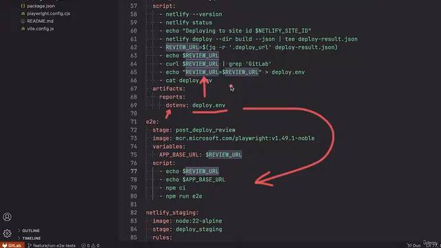
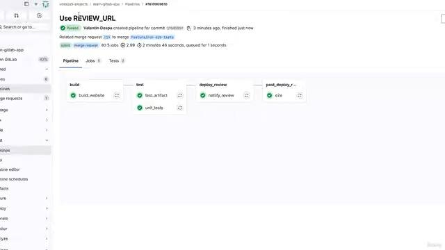
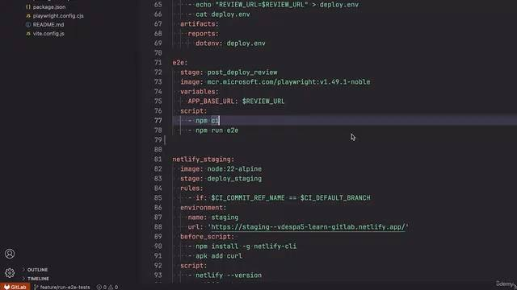
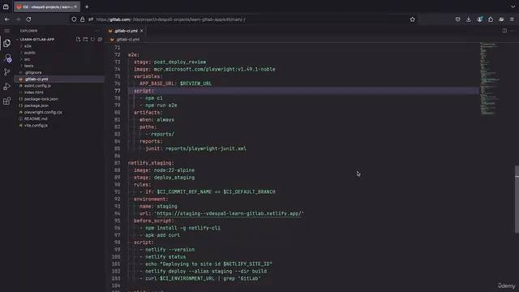
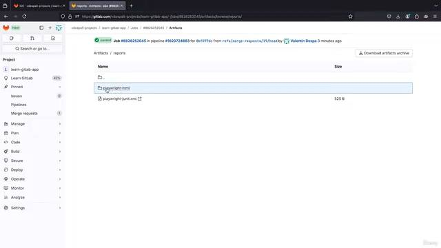
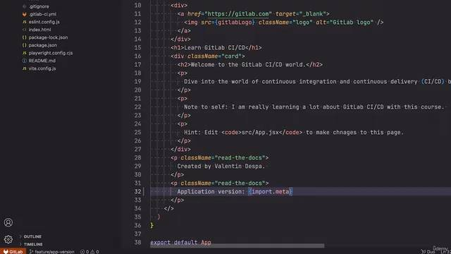
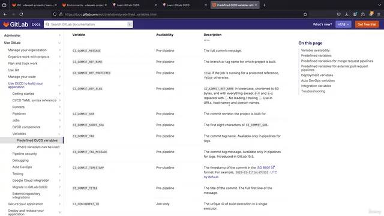

# GitLab CI/CD 实战：跨 Job 变量传递、测试报告发布与构建版本注入（P69–P76）

> 本文覆盖 BV182JX6nEjh 的第 69–76 集。读完后你应当得到一条完整链路：Netlify Review 部署产出的预览地址 → 通过 dotenv artifact 传给端到端测试 Job → 发布 JUnit/HTML 报告 → 把 commit short SHA 注入构建产物作为应用版本 → 用 E2E 反查部署是否真的生效。

---

## 1. 这一节做什么

前面几十集已经把一条能跑的流水线搭起来了：构建、单元测试、Netlify 部署到 Review/Staging/Production、手动审批、secrets 管理。这一节不再从零搭骨架，而是解决四个「流水线跑起来了但还不够用」的具体问题：

1. **Job 之间的变量传递**。`deploy_review` 部署完成后拿到一个预览 URL，但 `e2e_review` 里这个 URL 是写死的。要把它改成从上一个 Job 动态取。
2. **测试报告落盘位置与发布**。Playwright 生成了 JUnit 报告，但没人知道它在哪。要先用「笨办法」和「聪明办法」两种方式定位，再通过 `artifacts:reports:junit` 发布到 Merge Request 页面。
3. **HTML 报告的发布与局限**。HTML 报告能发，但 GitLab 不会把它集成进 UI，只能进 artifacts 浏览，而且复杂报告会遇到 CSRF 报错。
4. **构建版本注入**。把 `CI_COMMIT_SHORT_SHA` 在构建时写进前端产物，页脚显示版本号，E2E 再断言这个版本号确实出现在页面上——这样就不只是「相信 GitLab 说部署成功了」，而是应用自己证明部署的是哪个 commit。

最后 P74–P76 是复盘与理念：流水线执行时间花在哪、哪些配置该抽成变量、哪些 echo 该保留、为什么 CI/CD 值得做。这部分没有新代码，但会直接影响你后面怎么改这条流水线。

---

## 2. 讲师原话

> "这种做法本质上是为了让各作业之间更好地通信，并减少可能重复的配置。"
> —— p069 [00:00]

> "在部署审查之后，我们会增加一个阶段，可以称为部署后审查。这些端到端测试会在审查环境上的部署完成后执行。"
> —— p069 [00:54]

> "这个 deploy.env 文件被定义为制品下的报告，类型为 .env；正是这一点让该文件中的变量在后续作业中可用。GitLab 会自动完成这件事。"
> —— p069 [03:41]

> "如果我们再次定义一个同名环境，就等于向 GitLab 表示我们实际上是从这个端到端作业进行部署，而不是从这里部署。因此，在端到端作业中定义这个环境关键字完全没有意义。"
> —— p069 [02:15]

> "我们知道这个命令应该会生成报告。既然如此，我们只需要在命令执行前列出所有文件；当然，在命令执行后再列出一次，然后比较这两个列表即可。"
> —— p071 [00:00]

> "我们知道 Playwright 有这个配置文件；在这里会看到 JUnit 报告器，而它有一个特定的输出文件。"
> —— p071 [01:22]

> "它没有与 GitLab UI 集成。但如果出现问题，而 HTML 报告非常详细、能帮助我们排查问题，我认为这是值得的。"
> —— p072 [01:54]

> "试图通过这种方式发布更高级的 HTML 报告，可能会导致报告几乎无法使用甚至损坏；有更好的做法，那就是通过 GitLab Pages 来实现。"
> —— p072 [02:22]

> "我们希望在构建时提供这个环境变量。当应用被构建时，该环境变量会被插入到这里，并成为应用本身的一部分。它会被硬编码进去。"
> —— p073 [01:54]

> "CI_COMMIT_SHORT_SHA 是提交 ID 的短版本，而且它始终是唯一的。"
> —— p073 [02:50]

> "在运行时安装依赖非常昂贵；在这种情况下，它几乎会让执行时间翻倍。"
> —— p074 [01:24]

---

## 3. 从零复现

### 3.0 前置条件

- 一个已经能跑通「构建 → 单元测试 → Netlify Review 部署 → Staging/Production」的 GitLab 项目。
- Runner 使用 Docker executor，能拉取 `node:20` 和 `mcr.microsoft.com/playwright` 镜像。
- 项目根目录有 `package.json`，`npm run build` 能产出 `dist/`。
- 已在 GitLab 的 **Settings → CI/CD → Variables** 中配置好 `NETLIFY_AUTH_TOKEN`（前序课时完成）。
- 前端使用 Vite（因为本节要用的 `import.meta.env.VITE_*` 是 Vite 的语法）。

课程项目里这一步的目录结构大致如下，本节只改带 `*` 的文件：

```
.
├── .gitlab-ci.yml              *
├── package.json
├── playwright.config.ts        *
├── src/
│   └── App.tsx                 *
├── e2e/
│   └── app.spec.ts             *
└── dist/                       （构建产物，不提交）
```

### 3.1 在 stages 里插入 `post_deploy_review`

打开 `.gitlab-ci.yml`，找到 `stages` 列表，在 `deploy_review` 之后、`deploy_staging` 之前插入一个新阶段：

```yaml
stages:
  - build
  - test
  - deploy_review
  - post_deploy_review   # 本节新增
  - deploy_staging
  - deploy_production
```

讲师的原话是「after deploy review, we're going to add a stage we can call post deploy review」。顺序很重要：E2E 必须等 Review 环境真正部署完才能跑，否则会打到旧版本上。



### 3.2 确认 `deploy_review` 产出 `deploy.env`

P69 开头讲师说「most of the work has already been done」，指的就是 `deploy.env` 这个文件在前序课时已经写好了。它的形态是：部署完成后，把 Netlify 返回的预览地址写进一个 `.env` 格式的文件，并把这个文件登记为 dotenv 类型的 artifact report。

如果你是从头跟到这里，`deploy_review` 里应该有类似下面这几行（具体命令以你前序课时的文件为准）：

```yaml
    - echo "REVIEW_URL=$REVIEW_URL" > deploy.env
  artifacts:
    reports:
      dotenv: deploy.env
```

关键点是三件事同时成立：文件名任意（讲师明确说「you can name it also otherwise」）、内容是 `KEY=VALUE` 且等号两边不能有空格、在 `artifacts.reports.dotenv` 里登记。三者缺一，后续 Job 就拿不到变量。



### 3.3 在 `e2e_review` 里消费变量

新建（或修改）`e2e_review` Job：

```yaml
e2e_review:
  stage: post_deploy_review
  image: mcr.microsoft.com/playwright:v1.44.0-jammy
  script:
    - npm ci
    - echo "REVIEW_URL=$REVIEW_URL"
    - env | sort
    - BASE_URL=$REVIEW_URL npx playwright test
  artifacts:
    when: always
    paths:
      - reports/
    reports:
      junit: reports/junit.xml
  rules:
    - if: $CI_PIPELINE_SOURCE == "merge_request_event"
```

这里有两个动作。第一，把 `REVIEW_URL` 重命名为 `BASE_URL` 再传给 Playwright——讲师原话是「we are pretty much renaming this variable so that we can configure our testing framework」。第二，**不要**在这个 Job 里写 `environment:` 关键字。讲师在 p069 [02:15] 解释得很清楚：写了同名的 environment，GitLab 会认为这个 Job 也在往那个环境部署，但它实际上只是跑测试，语义就错了。

### 3.4 定位 Playwright 生成的 JUnit 报告

这是 P70 留下的挑战，P71 给了两条路。

**笨办法**：在跑测试的命令前后各加一次 `ls`，对比多出来了什么。

```yaml
    - ls -la
    - npx playwright test || true
    - ls -la
```

从日志里能看到多出一个 `reports` 目录。讲师说「the only difference in this case is that the report directory appears」。

**聪明办法**：直接看 `playwright.config.ts`。里面 reporter 的配置写了 `outputFile`，路径是显式声明的，根本不用猜。



找到路径后，把它登记到 artifacts 的 `reports.junit` 下。讲师强调要用 `when: always`，否则测试失败时报告不会上传，而失败时恰恰最需要报告。



### 3.5 发布 HTML 报告

Playwright 同时配了 HTML reporter，输出到 `reports/playwright-html`。发布方式很简单：`artifacts.paths` 里写 `reports/`，把整个目录都传上去。

跑完流水线后，进入 `post_deploy_review` 阶段的 `e2e_review` Job，点 **Browse**，进入 `reports/playwright-html/`，点 `index.html`。



讲师在这一段特别提醒：这条路能走通，但 GitLab UI 里没有原生入口，要点好几层；而且更复杂的框架生成的 HTML 报告可能因为 CSRF 之类的安全策略直接白屏，控制台会报错。真要正经发布 HTML 报告，应该用 GitLab Pages，这是课程另一节的内容。

### 3.6 把 E2E 从主流水线排除

`e2e_review` 如果只写了 `stage` 没写 `rules`，那么 MR 流水线和 main 分支流水线都会跑它。但 Review 环境只在 MR 里存在，main 分支上跑 E2E 没有意义，还会拖慢主流水线。做法是把 `deploy_review` 的 `rules` 原样复制过来：

```yaml
  rules:
    - if: $CI_PIPELINE_SOURCE == "merge_request_event"
```

讲师的说法是「copy the rules that we have for the Netlify review job」。

### 3.7 注入构建版本号

打开 `src/App.tsx`，找到页脚里写死的版本号：

```tsx
<footer>Application version: 1</footer>
```

改成：

```tsx
<footer>Application version: {import.meta.env.VITE_APP_VERSION}</footer>
```

注意拼写：`import.meta.env` 后面跟变量名，变量名必须以 `VITE_` 开头，这是 Vite 的硬性约定，不然构建时不会被替换。

然后进入 GitLab **Settings → CI/CD → Variables**，新增一个变量：

- Key：`VITE_APP_VERSION`
- Value：`$CI_COMMIT_SHORT_SHA`
- Environment scope：`*`（所有环境）

放到全局变量而不是只放在 build Job 里，原因是：E2E 测试也要用这个值来断言页面上的版本号，而 E2E 在另一个阶段。讲师在 p073 [03:46] 专门解释了这一点。





### 3.8 验证

提交后开 MR，等流水线跑完：

1. MR 页面出现 **Test summary**，展开后能看到 unit test 和 end-to-end test 两组，点 **View full report** 能看到每个用例。
2. 点 MR 里的 environment 链接打开预览站点，页脚显示的是 7 位左右的 commit short SHA。
3. 拿这个 SHA 去 commits 列表里比对，确认就是当前分支最新 commit。
4. 回 main 分支看流水线，确认 `e2e_review` 没有跑。

---

## 4. 完整代码

> 说明：P69–P76 的逐字稿没有逐字贴出完整文件，讲师是边讲边改。下面给出的是按讲师描述重建的完整可运行版本。凡是逐字稿没有明确念出的字段（例如 Netlify `--json` 输出里的具体键名、JUnit 的 `outputFile` 具体路径），都在注释里标了「以你项目实际配置为准」。

### 4.1 `.gitlab-ci.yml`

```yaml
# 本节完整流水线配置
# Job 名沿用课程项目命名；如果你前序课时用的是别的名字，保持一致即可

image: node:20

stages:
  - build
  - test
  - deploy_review
  - post_deploy_review
  - deploy_staging
  - deploy_production

# 全局变量：build 和 e2e 都要用，所以不能只放在 build job 里
variables:
  VITE_APP_VERSION: $CI_COMMIT_SHORT_SHA

# ---------- 构建 ----------
build_app:
  stage: build
  script:
    - npm ci
    - npm run build
  artifacts:
    paths:
      - dist/
    expire_in: 1 week

# ---------- 单元测试 ----------
unit_test:
  stage: test
  script:
    - npm ci
    - npm run test:unit -- --reporter=junit --outputFile=reports/junit.xml
  artifacts:
    when: always
    paths:
      - reports/
    reports:
      junit: reports/junit.xml

# ---------- Review 部署 ----------
# 这段在前序课时已经建好，本节未改动，只是把 deploy.env 的产出贴全
deploy_review:
  stage: deploy_review
  script:
    - npm ci
    # 安装运行时依赖：讲师在 P74 指出这一步很慢，后续应改为自定义镜像
    - apt-get update && apt-get install -y curl jq
    - npm install -g netlify-cli
    - netlify deploy --dir=dist --alias=$CI_COMMIT_REF_SLUG --json > netlify-output.json
    # .deploy_url 以 Netlify CLI --json 实际输出为准；如果你前序课时用的是 .url，请保持一致
    - REVIEW_URL=$(jq -r '.deploy_url' netlify-output.json)
    - echo "REVIEW_URL=$REVIEW_URL" > deploy.env
    - cat deploy.env
  artifacts:
    reports:
      dotenv: deploy.env
    paths:
      - netlify-output.json
  environment:
    name: review/$CI_COMMIT_REF_SLUG
    url: $REVIEW_URL
  rules:
    - if: $CI_PIPELINE_SOURCE == "merge_request_event"

# ---------- E2E ----------
e2e_review:
  stage: post_deploy_review
  image: mcr.microsoft.com/playwright:v1.44.0-jammy
  script:
    - npm ci
    # 排障用：确认变量确实注入了，稳定后可删
    - echo "REVIEW_URL=$REVIEW_URL"
    - env | sort
    # 把 REVIEW_URL 重命名为测试框架认识的 BASE_URL
    - BASE_URL=$REVIEW_URL npx playwright test
  artifacts:
    when: always
    paths:
      - reports/
    reports:
      junit: reports/junit.xml
  rules:
    # 与 deploy_review 保持一致，避免在主流水线里重复跑
    - if: $CI_PIPELINE_SOURCE == "merge_request_event"

# ---------- Staging ----------
deploy_staging:
  stage: deploy_staging
  script:
    - npm ci
    - apt-get update && apt-get install -y curl jq
    - npm install -g netlify-cli
    - netlify deploy --dir=dist --alias=staging
  environment:
    name: staging
  rules:
    - if: $CI_COMMIT_BRANCH == $CI_DEFAULT_BRANCH
      when: manual

# ---------- Production ----------
deploy_production:
  stage: deploy_production
  script:
    - npm ci
    - apt-get update && apt-get install -y curl jq
    - npm install -g netlify-cli
    - netlify deploy --dir=dist --prod
  environment:
    name: production
  rules:
    - if: $CI_COMMIT_BRANCH == $CI_DEFAULT_BRANCH
      when: manual
```

### 4.2 `playwright.config.ts`

```ts
import { defineConfig, devices } from '@playwright/test';

export default defineConfig({
  testDir: './e2e',
  fullyParallel: true,
  forbidOnly: !!process.env.CI,
  retries: process.env.CI ? 2 : 0,
  workers: process.env.CI ? 1 : undefined,

  // JUnit 给 GitLab 的 Test summary 用；HTML 给人工排障用
  // outputFile / outputFolder 的具体路径以你项目实际配置为准
  reporter: [
    ['list'],
    ['junit', { outputFile: 'reports/junit.xml' }],
    ['html', { outputFolder: 'reports/playwright-html', open: 'never' }],
  ],

  use: {
    // 由 CI 里的 BASE_URL=$REVIEW_URL 注入
    baseURL: process.env.BASE_URL,
    trace: 'on-first-retry',
  },

  projects: [
    { name: 'chromium', use: { ...devices['Desktop Chrome'] } },
  ],
});
```

### 4.3 `src/App.tsx`（页脚部分）

```tsx
export default function App() {
  return (
    <div className="app">
      <main>
        <h1>Demo Application</h1>
      </main>

      <footer>
        Application version: {import.meta.env.VITE_APP_VERSION}
      </footer>
    </div>
  );
}
```

### 4.4 `e2e/app.spec.ts`

```ts
import { test, expect } from '@playwright/test';

test('页面底部显示的是本次部署的 commit 版本', async ({ page }) => {
  await page.goto('/');

  const expected = process.env.VITE_APP_VERSION;
  expect(expected, 'VITE_APP_VERSION 未注入').toBeTruthy();

  await expect(
    page.getByText(`Application version: ${expected}`)
  ).toBeVisible();
});
```

### 4.5 `deploy.env`（运行时生成，不要提交）

```dotenv
REVIEW_URL=https://<your-branch-alias>--<site-name>.netlify.app
```

等号两边不能有空格，值不要加引号，否则 GitLab 解析 dotenv 时会把引号当成值的一部分。

---

## 5. 逐行解释

**`stages` 里 `post_deploy_review` 的位置。** 它必须排在 `deploy_review` 之后。GitLab 的 stage 是严格串行的：前一个 stage 全部成功，后一个才开始。放到前面会导致 E2E 打到还没更新的旧环境上，测试通过但毫无意义。

**`echo "REVIEW_URL=$REVIEW_URL" > deploy.env`。** 等号两边不能有空格，这是 dotenv 格式的硬要求。讲师在 p069 [04:07] 特意强调「without any spaces equal」。如果你写成 `REVIEW_URL = $REVIEW_URL`，GitLab 解析出来的 key 会带空格，后续 Job 里 `$REVIEW_URL` 就是空。

**`artifacts.reports.dotenv: deploy.env`。** 这一行是整条链路的开关。没有它，`deploy.env` 只是一个普通文件，躺在 artifacts 里没人读；有了它，GitLab 会在后续 Job 启动时把这个文件里的键值对注入成环境变量。讲师原话：「this is what makes the variables that are in this file available in the upcoming jobs」。

**`BASE_URL=$REVIEW_URL npx playwright test`。** 这里做的是「重命名」。Playwright 的 `use.baseURL` 读的是 `process.env.BASE_URL`，而 GitLab 注入的变量叫 `REVIEW_URL`。在命令前加前缀赋值，只对当前这条命令生效，不会污染其他步骤。在 Node 里这等价于 `process.env.BASE_URL = process.env.REVIEW_URL` 后再启动子进程。

**`e2e_review` 里不写 `environment:`。** 这是 P69 最容易踩的坑。GitLab 的 `environment` 关键字语义是「这个 Job 在往某环境部署」。E2E 只是验证，写了会让环境页面上出现一次假的部署记录，还会影响 environment 的 last deploy 信息。讲师明确说「it makes absolutely no sense to define this environment keyword in the end-to-end job」。

**`when: always` 配合 `reports.junit`。** 默认 artifacts 只在 Job 成功时上传。测试失败时最需要看报告，所以必须显式写 `when: always`。讲师在 p071 [00:56] 说「we're gonna use when always to ensure that this report is always published」。

**`rules: - if: $CI_PIPELINE_SOURCE == "merge_request_event"`。** 只让 MR 流水线跑。main 分支上没有 Review 环境，跑了也是打到一个不存在的 URL。讲师的做法是直接复制 `deploy_review` 的 rules，保证两个 Job 的触发条件永远一致。

**`VITE_APP_VERSION: $CI_COMMIT_SHORT_SHA` 放在全局 `variables`。** 两个原因。第一，build 和 e2e 分处两个 stage，只有全局变量两边都能读到。第二，`CI_COMMIT_SHORT_SHA` 是 GitLab 预定义变量，值是当前 commit 的短 SHA，天然唯一，不需要自己维护版本号自增。

**`{import.meta.env.VITE_APP_VERSION}` 是构建时替换，不是运行时读取。** 讲师在 p073 [01:54] 说得很清楚：「it's no longer going to be a variable. It's something that's going to be replaced during the build time」。`npm run build` 执行时，Vite 会把这一整段替换成字符串字面量，最终 `dist/` 里的 JS 就是 `Application version: "a1b2c3d"`。所以部署到 Netlify 的是静态文件，页面上永远显示构建时那个 commit，不会随访问时间变化。这也意味着：**改了变量值必须重新构建**，只重新部署旧产物是没用的。

**E2E 里的 `process.env.VITE_APP_VERSION`。** 这里读的是 CI 运行时环境变量，和页面上那个「构建时写死的字符串」做比对。只有构建时注入的值和当前流水线的 commit 一致，断言才会通过。讲师说这是「the only way this can happen is by the deployment to have been successful」——如果 Netlify 上还是旧版本，页面上的字符串就对不上。

**`apt-get install -y curl jq` 和 `npm install -g netlify-cli`。** P74 讲师专门分析了这两行的代价：`deploy_review` 耗时 57 秒，其中很大一部分是运行时装依赖，正常情况下这个 Job 可以压到 30 秒以内。这不是让你删掉它们（部署确实需要），而是提示你后面应该换成预装好这些工具的自定义 Docker 镜像。

---

## 6. 复现检查清单

- [ ] `stages` 中 `post_deploy_review` 位于 `deploy_review` 之后。
- [ ] `deploy_review` 的 `artifacts.reports.dotenv` 指向 `deploy.env`。
- [ ] `deploy.env` 内容形如 `REVIEW_URL=https://...`，等号两边无空格、值无引号。
- [ ] `e2e_review` 的日志里 `echo "REVIEW_URL=$REVIEW_URL"` 打印出了真实地址（不是空行）。
- [ ] `e2e_review` 的日志里 `env | sort` 能看到 `REVIEW_URL` 和 `VITE_APP_VERSION`。
- [ ] `e2e_review` 没有写 `environment:` 关键字。
- [ ] `playwright.config.ts` 里 junit reporter 的 `outputFile` 与 artifacts 里登记的路径完全一致。
- [ ] `artifacts` 配了 `when: always`。
- [ ] `e2e_review` 和 `deploy_review` 的 `rules` 完全一致。
- [ ] MR 页面 Test summary 里同时出现 unit test 和 end-to-end test。
- [ ] Job artifacts 的 Browse 里能点到 `reports/playwright-html/index.html`。
- [ ] GitLab CI/CD Variables 里有 `VITE_APP_VERSION = $CI_COMMIT_SHORT_SHA`，scope 为 `*`。
- [ ] 预览站点页脚显示的 SHA 与当前分支最新 commit 一致。
- [ ] main 分支流水线里没有 `e2e_review`。

---

## 7. 课里没讲但你会撞上的

**dotenv 变量只在「后续 Job」生效，同 Job 内拿不到。** 这是最容易误解的一点。`deploy_review` 里 `export REVIEW_URL=...` 之后，同一个 Job 的 `environment:url: $REVIEW_URL` 不一定能展开，因为 GitLab 是在 Job 结束后才解析 dotenv artifact 的。如果你的环境链接显示为空，不要怀疑 dotenv 配置写错了，先确认 `environment:url` 用的是不是前序课时那套写法。这个细节课程没有展开。

**dotenv artifact 有大小限制。** GitLab 对 dotenv 文件有体积上限（默认几 KB 量级，具体以你的 GitLab 版本为准），超了会直接报错。只放 URL、token 这类短值，不要把整个 `.env` 或 JSON 塞进去。

**`VITE_` 前缀不是可选项。** Vite 只会把 `VITE_` 开头的变量暴露给客户端代码，其他变量在 `import.meta.env` 上是 `undefined`。如果你写成 `APP_VERSION`，构建不会报错，页面上会显示空白，排查起来很费时间。另外，构建时注入意味着**变量值会出现在最终 JS 里**，所以千万不要把 token 这类东西做成 `VITE_` 变量。

**改了 CI/CD 变量要重新跑一遍 build。** 因为版本号是构建时写死的，只重跑 `deploy_review` 部署的是旧 `dist/`，页面不会变。讲师没有强调这一点，但这是 Vite 构建模型的必然结果。

**HTML 报告白屏通常是 CSRF 或相对路径问题。** 讲师在 p072 [02:22] 提到「typically something related to CSRF」，但没有给修复方案。实际遇到时，先打开浏览器控制台看具体报错；Playwright 自带的 HTML 报告比较简单，一般不会出问题，复杂框架（比如某些覆盖率报告）才容易踩。

**`rules` 和 `when: always` 是两个维度。** `rules` 决定 Job 跑不跑，`when: always` 决定 artifacts 传不传。两者互不影响。有人会误以为加了 `rules` 就不用 `when: always`，结果测试一失败报告就丢了。

**Playwright 镜像版本要和 `@playwright/test` 版本对齐。** 上面写的是 `v1.44.0-jammy`，你项目 `package.json` 里是多少就改成多少，否则会出现浏览器版本不匹配的报错。这个课程没有讲，但实际一定会遇到。

**本地跑 E2E 需要自己提供 `BASE_URL`。** CI 里有 `BASE_URL=$REVIEW_URL`，本地没有。可以在 `package.json` 里加一个 `test:e2e` 脚本，用 `cross-env BASE_URL=http://localhost:5173 playwright test`，或者干脆在 `playwright.config.ts` 里给 `baseURL` 一个 fallback。