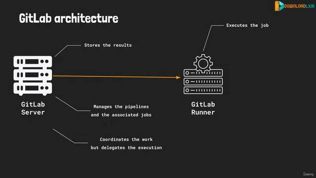
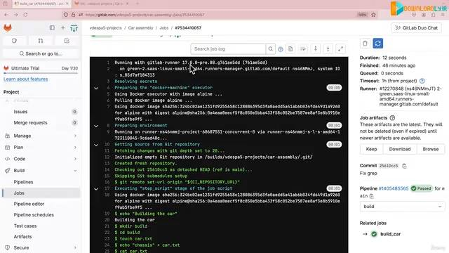
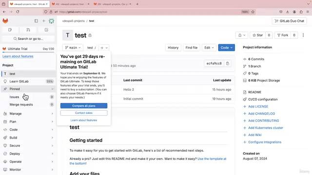
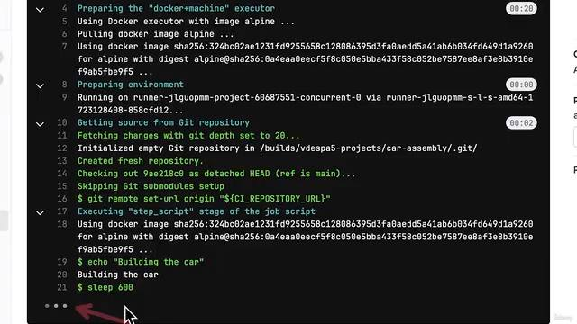
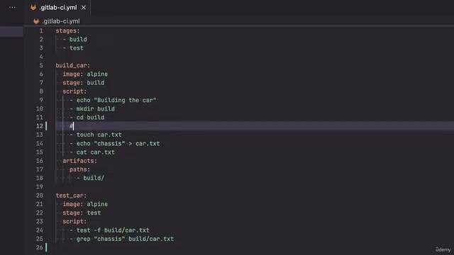
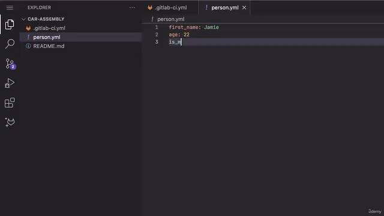
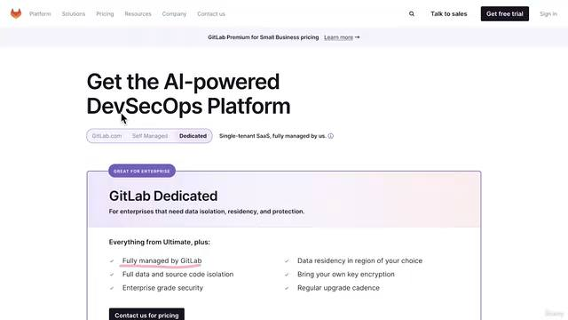

# GitLab CI/CD 最小可复现流水线：Docker Executor、Artifacts、取消任务与 YAML 基础

## 1. 这一节做什么

这一节要复现的是一个**最小但完整的 GitLab CI/CD 项目**：仓库里只有 `.gitlab-ci.yml` 和一个用于理解 YAML 的 `person.yaml`，提交后由 GitLab Runner 执行 `build_car` 与 `test_car` 两个 job。`build_car` 使用 Alpine Docker 镜像，在容器内创建 `build/car.txt`，并把它作为 artifact 上传；`test_car` 在后续 stage 中重新启动自己的执行环境，下载前一个 job 的 artifact，然后检查并读取 `build/car.txt`。课程还演示了：为什么 job 日志分成“准备段”和“执行段”、Docker 容器在 job 结束后会被销毁、artifact 为什么还能在 GitLab 页面看到、如何用 `sleep 600` 制造一个卡住的任务并在 UI 里取消、以及 YAML 的注释、缩进、列表和对象写法。

对前端转 AI 应用工程师来说，可以把一个 CI job 理解成“在一个全新 Node 进程/容器里跑一段脚本”：job 之间不共享内存里的全局变量，想传文件就靠 artifact；Docker 镜像类似锁定 Node 版本和系统依赖，避免“我本地能跑、CI 跑不了”。这一节不涉及后端锁和事务，但涉及**并发隔离**：多个 job 可以同时运行，彼此不共享容器内文件。



## 2. 讲师原话（带「—— pNNN [MM:SS]」）

课程对 GitLab CI/CD 架构的核心描述是：

> "GitLab CI/CD 架构至少包含 GitLab 服务器和一个 GitLab runner。GitLab 服务器负责管理流水线的执行并保存结果……服务器知道需要做什么，但并不亲自执行。"
> —— p007 [00:29]

> "GitLab runner 是一个负责执行作业的程序。"
> —— p007 [00:59]

> "每个作业都是独立执行的。"
> —— p007 [01:27]

课程把 job 日志拆成两段：

> "这里有两个主要部分……GitLab 为运行我们定义的命令所做的准备工作，然后是我们定义的命令的实际执行。"
> —— p007 [01:55]

artifact 上传与容器销毁：

> "为成功的作业上传产物"
> —— p007 [05:38]

> "作业完成后，我们会销毁这个 Docker 容器。"
> —— p007 [06:37]

后续 job 会下载 artifact：

> "它还会在这里下载产物。"
> —— p007 [07:34]

默认镜像问题：

> "即使我们不指定 Docker 镜像，由于这是由 GitLab runner 默认执行的，而它带有 Docker executor……它会直接使用一个默认镜像，这个默认镜像是为每个 runner 配置的。通常默认情况下就是某个 Ruby 镜像……"
> —— p008 [01:25]

课程里看到的 test job 实际镜像：

> "我们仍然在使用 Docker Machine Executor……这次我们选用的是 Ruby 3.1 版本的镜像。"
> —— p008 [00:58]

隔离与并发：

> "这种隔离也意味着我们可以同时运行多个作业，而这些作业之间不会相互影响。"
> —— p008 [05:15]

免费计划额度：

> "目前使用免费计划，我们有 400 个计算分钟……如果你的流水线运行 30 秒，会扣除一分钟……"
> —— p009 [00:56]

Linux 命令与顺序：

> "在我们的 GitLab 流水线配置中，我们把它们放在了 script 块里。"
> —— p010 [00:00]

> "这些命令会按照我们在这里指定的顺序执行……顺序非常重要。"
> —— p010 [01:52]

YAML 注释：

> "写注释只需要……使用井号或磅号即可。"
> —— p011 [00:27]

> "YAML 不支持块注释或多行注释。"
> —— p011 [01:15]

取消任务：

> "这会取消作业……它会发送中断信号来停止进程……被终止，脚本通过 UI 或 API 从外部取消。作业会被标记为失败，原因为已取消。"
> —— p012 [02:26]

YAML 缩进：

> "YAML 使用空格进行缩进，不使用任何制表符。"
> —— p013 [00:15]

> "如果我们写的 YAML 不合法，GitLab 将无法运行流水线。"
> —— p013 [00:27]

## 3. 从零复现

### 3.1 前置条件与目录

你需要：

- 一个 GitLab 账号；课程使用 gitlab.com 的免费计划作为 managed 版本。
- 一个启用了 Docker executor 的 GitLab Runner。课程没有讲如何注册 Runner，只讲了 Runner 负责执行 job；如果项目没有可用 Runner，pipeline 会停在等待状态。
- 本地安装 Git。不需要本地安装 GitLab。
- 本节不需要任何环境变量。不要为了复现创建 `.env`；课程里日志中的 `resolving secrets` 是 Runner 的通用准备步骤，当前没有 secrets。

本地目录结构如下：

```text
gitlab-ci-demo/
├── .gitlab-ci.yml
└── person.yaml
```

`person.yaml` 不参与 CI，只用于跟着课程理解 YAML 的 key、value、list、object 和缩进。真正触发流水线的是 `.gitlab-ci.yml`。

### 3.2 创建项目并推送第一版

在 GitLab 上新建一个 blank project，项目名可用 `gitlab-ci-demo`。然后在本地执行；把 `<你的命名空间>` 换成你的 GitLab 用户名或组名：

```bash
mkdir gitlab-ci-demo
cd gitlab-ci-demo
git init
git remote add origin https://gitlab.com/<你的命名空间>/gitlab-ci-demo.git
```

把第 4 节的 `.gitlab-ci.yml` 和 `person.yaml` 保存到当前目录。然后提交并推送：

```bash
git add .gitlab-ci.yml person.yaml
git commit -m "ci: add minimal build and test pipeline"
git push -u origin main
```

如果你的默认分支叫 `master`，把最后一行改成 `git push -u origin master`。本项目没有本地服务启动命令；**触发命令就是 `git push`**。课程里也明确说，仓库发生新变更时 pipeline 会被触发。

### 3.3 观察 pipeline

推送后进入项目的 **Build > Pipelines**，点击这次 pipeline 的 ID，进入 pipeline 详情页。你会看到 `build` 和 `test` 两个 stage，以及 `build_car`、`test_car` 两个 job。先点 `build_car` 查看日志。

日志不要从第一行机械读到最后一行，而是按课程的方法分两段看：

1. **准备段**：Runner 接收 job、准备 executor、识别 Docker executor、拉取 `alpine` 镜像、准备环境、克隆仓库。课程里还提到会先处理 secrets；当前没有 secrets。
2. **执行段**：真正执行 `script` 里的 `echo`、`mkdir`、`cd`、`touch`、`echo >`、`cat`。
3. **收尾段**：上传 artifacts，容器销毁。



### 3.4 查看 artifact

`build_car` 成功后，在 job 页面找到 **Job artifacts**，点击 **Browse**，应能看到 `build/` 目录和 `car.txt`。课程里明确演示了 Browse 和下载文件。注意：这个文件不在 Git 仓库里，也没有被 commit；它是在容器运行期间生成的，容器销毁后文件本来会消失，是 GitLab 把 artifact 保存了下来。

然后再点 `test_car`。它的日志里应出现下载 `build_car` artifacts 的动作，然后才执行 `test -f build/car.txt` 和 `cat build/car.txt`。这是 `test_car` 与 `build_car` 最大的区别：`test_car` 会先拿到前一个 job 的产物。

### 3.5 复现“test job 不指定 image”

课程里 `test` job 没有写 `image`，但日志仍然显示 Docker executor，并且使用了 Ruby 3.1 镜像。原因是：Runner 本身配置了 Docker executor，也配置了默认镜像。你不指定镜像时，不代表“没有容器”，而是使用 Runner 的默认镜像。课程提醒不要依赖这个默认镜像，但要知道它可能发生。



本复现保留这个课程形态：`build_car` 显式写 `image: alpine`，`test_car` 不写 `image`。如果你的 Runner 默认镜像不是 Ruby 3.1，日志会不同；这属于 Runner 配置差异，不是 YAML 写错。

### 3.6 复现取消一个卡住的任务

课程用 `sleep 600` 模拟“命令卡住”。做法是：把 `build_car` 的 `script` 改成第 4 节的“取消实验版”，也就是在 `echo "打造汽车"` 后面加一行 `sleep 600`。提交后 pipeline 会正常开始，但 `build_car` 会在打印第一行后停住。进入 job 日志，看到 `sleep 600` 后面一直转圈，就说明它在占用时间。

此时点击 job 页面上的取消按钮。课程里的结果是：发送中断信号，`sleep` 被停止，日志出现类似 `Terminated, script canceled externally through the UI or the API` 的信息，job 被标记为 failed，reason 为 canceled，pipeline 也显示 canceled。



### 3.7 复现 YAML 注释与无效 YAML

在 `.gitlab-ci.yml` 里用 `#` 写注释，例如在 `touch` 上方写 `# 创建一个空文件`。课程说明 YAML 不支持块注释或多行注释；要多行注释，就每一行都以 `#` 开头。编辑器里 `#` 后面的内容通常会变色，这是编辑器在提示“这是注释”。



再故意破坏一次缩进：例如把 `stages` 下的列表项缩进改错，或者去掉 `- build` 中 `-` 后面的空格。提交后 pipeline 不会执行，页面会显示 YAML invalid error。课程里出现过 `line 5 column 10` 这样的行号提示，也出现过 `stages config should be an array of strings or nested array of strings up to 10 levels deep` 这类错误。错误行号不一定指向你改动的行，所以要回到 YAML 结构本身检查空格、冒号和短横线。



## 4. 完整代码

### 4.1 常规版 `.gitlab-ci.yml`

保存为项目根目录的 `.gitlab-ci.yml`。这是完整文件，可直接运行：

```yaml
# 这是 YAML 注释：解释 build_car 会创建一个 car.txt 文件
build_car:
  image: alpine
  stage: build
  script:
    - echo "Building the car"
    - mkdir -p build
    - cd build
    - touch car.txt
    - echo "This file was created by the build_car job." > car.txt
    - cat car.txt
  artifacts:
    paths:
      - build/

test_car:
  stage: test
  script:
    - echo "Testing the car"
    - test -f build/car.txt
    - cat build/car.txt

stages:
  - build
  - test
```

说明：课程里只逐字念了 `artifacts` 会保存产物，没有逐字念出 `paths` 这个键名；上面代码块里的 `paths` 是让 artifacts 指向 `build/` 目录的必需配置写法。不同 GitLab 版本的细节以实际页面和官方语法为准。

### 4.2 取消实验版 `.gitlab-ci.yml`

做取消任务实验时，用下面内容覆盖原 `.gitlab-ci.yml`。它与常规版只差 `sleep 600` 一行：

```yaml
# 这是取消实验版：build_car 会故意卡住 600 秒
build_car:
  image: alpine
  stage: build
  script:
    - echo "Building the car"
    - sleep 600
    - mkdir -p build
    - cd build
    - touch car.txt
    - echo "This file was created by the build_car job." > car.txt
    - cat car.txt
  artifacts:
    paths:
      - build/

test_car:
  stage: test
  script:
    - echo "Testing the car"
    - test -f build/car.txt
    - cat build/car.txt

stages:
  - build
  - test
```

实验完成后，记得把 `sleep 600` 删掉，恢复常规版。

### 4.3 `person.yaml`

这个文件用于理解 YAML，不参与 CI。课程里 Priya 的年龄数值没有明确念出，下面写 `21` 只是为了保持文件完整，可以自行改：

```yaml
person:
  firstName: Jamie
  age: 22
  isMarried: false
  hobbies:
    - Netflix
    - mountain biking
  friends:
    - firstName: Jane
      age: 21
    - firstName: Priya
      age: 21 # 课程未明确 Priya 年龄，这里仅为示例
```

### 4.4 定价估算表（按课程口径）

课程说免费计划当前有 400 compute minutes，并按“30 秒也扣 1 分钟”的粒度扣减。下面只是按课程口径做的学习用估算，不是 GitLab 官方报价：

| 场景 | 单次 pipeline 估算 | 400 分钟大约可跑 |
|---|---:|---:|
| 2 个 job，每个约 30 秒 | 每个 job 扣 1 分钟，共 2 分钟 | 约 200 次 pipeline |
| 2 个 job，每个约 1 分钟 | 共 2 分钟 | 约 200 次 pipeline |
| 2 个 job，每个约 5 分钟 | 共 10 分钟 | 约 40 次 pipeline |
| 1 个 job 卡住 1 小时 | 约 60 分钟 | 很快耗尽 |



## 5. 逐行解释

### 5.1 `.gitlab-ci.yml` 逐行解释

- `# 这是 YAML 注释...`：YAML 注释以 `#` 开头。课程明确说 YAML 不支持块注释，多行注释要每行都写 `#`。
- `build_car:`：job 名。课程口语里读作 build car；YAML 里用下划线组成一个 job 标识。job 名下面的属性必须缩进，才能属于这个 job。
- `image: alpine`：指定该 job 使用 Alpine 镜像。课程里日志会显示 Docker executor 拉取 Alpine 镜像。课程没有固定 Alpine 的 tag，所以这里沿用 `alpine` 浮动 tag。
- `stage: build`：把 `build_car` 放进 `build` stage。stage 决定执行顺序，`test` stage 在 `build` 之后。
- `script:`：真正执行的命令列表。课程说这些命令按书写顺序执行，顺序很重要。
- `- echo "Building the car"`：打印一行，便于在日志里确认执行到了这里。
- `- mkdir -p build`：创建 `build` 目录。课程里念了 `mkdir`；加 `-p` 是复现时的稳健性补全，表示目录存在也不报错。
- `- cd build`：进入 `build` 目录。后续文件都创建在这里，artifact 也抓这个目录。
- `- touch car.txt`：创建空文件。课程里专门用 `touch` 举例说明注释的意义。
- `- echo "..." > car.txt`：把文本写入 `car.txt`。`>` 是 shell 重定向；课程里没有展开讲重定向语法，但脚本里用到了写文件。
- `- cat car.txt`：把文件内容打印到日志，方便人工确认。
- `artifacts:`：声明该 job 要保存产物。课程说 Job artifacts 里可以 Browse 和下载。
- `paths:`：指定 artifact 路径。课程没有逐字念出这个键名；这里写 `build/`，让整个目录被保存。
- `- build/`：把 `build` 目录作为产物。`test_car` 默认会下载前面 stage 的 artifacts。
- `test_car:`：第二个 job。课程里它没有指定 `image`，因此使用 Runner 默认镜像；课程观察到默认镜像是 Ruby 3.1。
- `stage: test`：放在 test stage，等 build stage 完成后执行。
- `script:`：test job 的命令。
- `echo "Testing the car"`：打印测试开始。
- `test -f build/car.txt`：检查文件是否存在。不存在则命令返回非 0，job 失败。课程里提到过 `test` 命令。
- `cat build/car.txt`：读取 artifact 中的文件，证明前一个 job 的产物已下载。
- `stages:`：定义 stage 顺序。课程里提到 stages 是列表；如果这里写成字符串而不是列表，会出现课程里那种 `stages config should be an array of strings...` 错误。
- `- build`、`- test`：YAML 列表项。短横线后面必须有空格；课程里演示过去掉空格导致 YAML invalid。

### 5.2 `person.yaml` 逐行解释

- `person:`：一个对象/映射。它下面的属性都属于 person。
- `firstName: Jamie`：键值对。冒号后面要有空格；课程里强调 YAML 用冒号代替编程里的等号。
- `age: 22`：数字值。YAML 会把它识别为 number。
- `isMarried: false`：布尔值。课程里用 false 举例。
- `hobbies:`：一个列表属性。列表项要换行、缩进两个空格、写 `- `。
- `- Netflix`、`- mountain biking`：列表项。短横线后必须有空格。
- `friends:`：对象列表。每个 `-` 开始一个对象。
- `- firstName: Jane`：列表中的对象第一个属性。
- `age: 21`：同一对象的第二个属性。它要和 `firstName` 对齐，不能写成新的列表项。
- `- firstName: Priya`：第二个对象。通过缩进显示它仍属于 `friends` 列表。

课程最后强调：缩进、空格、冒号都非常重要；`artifacts` 不能随便提到与 `build_car` 同层，否则它就不再属于这个 job。


## 6. 复现检查清单

- [ ] 项目里 `.gitlab-ci.yml` 位于仓库根目录，文件名没有拼错。
- [ ] `person.yaml` 也已提交；它不参与 pipeline，但可用于对照 YAML 结构。
- [ ] push 后 **Build > Pipelines** 出现新的 pipeline，而不是一直等待 Runner。
- [ ] `build_car` 日志里能看到 Docker executor、拉取 Alpine、准备环境、克隆仓库等准备段。
- [ ] `build_car` 执行段按顺序出现 `Building the car`、`mkdir`、`cd`、`touch`、`cat` 的结果。
- [ ] `build_car` 成功后出现类似 `uploading artifacts for a successful job` 的信息。
- [ ] Job artifacts 的 Browse 中能看到 `build/` 和 `car.txt`。
- [ ] `test_car` 日志里出现下载 `build_car` artifacts 的动作，然后才执行 `test -f` 和 `cat`。
- [ ] `test_car` 没有写 `image`；日志里显示的镜像由 Runner 默认配置决定，课程观察到的是 Ruby 3.1。
- [ ] 取消实验版中，`build_car` 卡在 `sleep 600`；点击取消后 job 被标记为 failed，reason 为 canceled。
- [ ] 故意破坏 YAML 缩进后，pipeline 显示 YAML invalid error，而不是执行 job。
- [ ] 用 `#` 写的注释在编辑器里变色，且不影响 YAML 解析。
- [ ] 恢复常规版，删掉 `sleep 600`，再 push 一次确认流水线正常。

## 7. 课里没讲但你会撞上

1. **默认镜像不是固定的。** 课程里 `test_car` 不写 `image`，日志显示 Ruby 3.1；但默认镜像由 Runner 配置决定。换一个 GitLab 实例，可能是别的镜像，甚至缺少你脚本依赖的命令。最稳妥是显式写 `image`；课程没有要求这样做，这里只是排错建议。
2. **Alpine 没有钉版本。** 课程只说了 Alpine，没有说 `alpine:3.x`。浮动 tag 可能今天拉到的和录制时不同。公司项目应钉版本，但课程没有展开。
3. **artifact 存在哪里由 GitLab 管理员决定。** 课程明确说不能指定 Dropbox 之类的外部存储；你只能声明 artifacts，存放位置是平台实现细节。
4. **免费计划的 400 minutes 是课程录制时的政策。** 计费粒度和额度可能变化；以你账号页面为准。课程里还提到可以购买 compute minutes、使用自建 Runner 做 hybrid、或 self-managed，但没有讲自建 Runner 的注册步骤。
5. **`sleep 600` 会消耗分钟数。** 在 managed Runner 上，卡住的任务会按分钟扣减；发现任务异常要尽快取消。课程演示的 1 小时 timeout 是当时观察到的限制，课里没有讲如何修改。
6. **取消不是“删除容器”那么简单。** 课程说会发送 interrupt signal；如果脚本里的进程不响应信号，取消可能不会立刻完成。课里没有讲信号处理细节。
7. **YAML 报错行号可能误导。** 课程里改动 `stages` 后，错误提示指向 `line 5 column 10`，但真正问题可能是缩进或短横线后的空格。排错时先看结构，不要只盯行号。
8. **并发 job 不共享容器。** 课程说多个 job 可同时运行且互不影响。对应到 Node 世界：不要指望 job A 里改的模块级变量能被 job B 读到；跨 job 传文件用 artifacts，跨 job 传配置用 GitLab 变量/secret 机制，但本节没有讲变量配置。
9. **`test_car` 依赖 artifact 下载。** 如果 artifact 没上传成功，或者路径写错，`test -f build/car.txt` 会失败。课程里只展示了成功路径，没有专门演示 artifact 丢失的报错。
10. **GitLab UI 菜单可能变。** 课程里的 Build > Pipelines、Job artifacts、Browse 等位置在不同版本可能略有差异；以你实际页面为准。