# GitLab CI/CD：构建自定义 Docker 镜像并发布到 GitLab Container Registry（P77–P82）

## 1. 这一节做什么

在这门课前面的章节里，Pipeline 的每个 Job 在真正干活之前，都要先把工具装一遍：Deploy 那个 Job 要装 Netlify CLI，解析 JSON 要装 jq 一类的库，构建镜像时还要装 curl。这些安装动作发生在每次 Job 执行时，耗时全部计入 Job 的总时长。本节要解决的就是这个重复劳动：把「Job 运行时才装的东西」提前固化进一个自定义 Docker 镜像，构建一次、推送到 GitLab 自带的 Container Registry，之后 Pipeline 里直接 `image: $CI_REGISTRY_IMAGE/netlify` 引用它。

具体产出三样东西：

1. 一个 `ci/Dockerfile`，基于 `node:22-alpine`，预装 `netlify-cli` 和 `curl`。
2. 在 `.gitlab-ci.yml` 里新增一个 `pre` 阶段的 Job（最终叫 `build docker netlify`），先用 Docker CLI 验证 Docker daemon 能连通（`docker version`），再 `docker login`、`docker build`、`docker push`。
3. Container Registry 里出现一个 `latest` tag 的镜像，后续 `build` / `deploy` 两个 Job 直接用它。

同时本节还做了一次「减负」：从这一节开始不再用 Merge Request 流程，Pipeline 简化为 `build` + `deploy` 两个业务 Job（加上 `pre` 阶段的镜像构建 Job，一共三个），并且把 `main` 分支的保护放开，允许 Maintainer 直接 push。

前置条件：fork 讲师提供的仓库，使用资源区附带的 Pipeline 配置；在 Settings → Repository → Protected branches 里把 `main` 分支的 Allowed to push and merge 从「No one」改成「Maintainers」。

## 2. 讲师原话（带出处）

关于「为什么要自定义镜像」：

> "在前面的章节中构建这条流水线时，我们一直需要安装额外的工具。例如，对于 Deploy 作业，我们必须安装 Netlify CLI 来完成部署。同样，我们还需要 jq 库来解析 JSON 文件。所有这些安装都会在作业执行期间额外耗费时间。"
> —— p077 [00:08]

> "本节中，我们将学习如何构建一个包含所有必要工具的自定义 Docker 镜像，并在流水线中使用它。"
> —— p077 [00:29]

> "我们会简化流水线，只保留 build 和 deploy 阶段。因此总共只有两个作业：一个构建网站，另一个部署网站。"
> —— p077 [00:58]

关于「Dockerfile 是什么」：

> "Dockerfile 是一个文本文件，包含构建 Docker 镜像所需的指令。可以把它想成一份菜谱，逐步告诉 Docker 具体要做什么。"
> —— p078 [00:19]

> "每个 Dockerfile 都以 FROM 指令开头，而且这些指令始终用大写书写。FROM 指令定义了基础镜像，后续所有指令都将应用在这个镜像上。没有 FROM 指令，构建过程就没有起点。"
> —— p078 [01:03]

> "RUN 指令用于在正在构建的镜像中执行命令，它在构建过程中使用 shell 命令。我们通常用 RUN 指令来安装依赖，或者更新系统。"
> —— p078 [01:36]

关于 Docker 的错误：

> "这个特定错误是连接期间出错。这个错误看起来可能很晦涩……这里显示的错误是在告诉我们，无法连接到 Docker 守护进程。更技术地说，Docker 守护进程就是 Docker 服务端，是 Docker 的大脑。"
> —— p079 [02:25]

> "我们在输入 docker --version 或 docker version 这类命令时交互的命令行，称为 Docker 客户端。它就像餐厅里的服务员：可以告诉你菜单和特色菜，会记下你的点单，但并不真正负责做菜。"
> —— p079 [02:53]

关于 services：

> "GitLab 允许我们启动一个或多个额外镜像，并通过网络与它们交互……借助 services 关键字，我们可以让另一个镜像运行起来。"
> —— p079 [04:18]

> "我们将使用一个称为 Docker in Docker（DinD）的服务，它指的是 Docker 守护进程。"
> —— p079 [05:12]

> "我们无法直接在启动的服务上执行任何命令行命令。脚本中这里的所有命令，仍然是在这里定义的镜像上执行的。"
> —— p079 [08:54]

> "把 Docker 客户端和 Docker 服务端组合在一起……并不被推荐，原因有几个，但主要是因为这种组合需要特权模式，会增加安全风险。"
> —— p079 [13:12]

关于 docker build：

> "该命令会查找一个名为 Dockerfile 的文件……它会在当前上下文中搜索该文件……这里没有 Dockerfile。因此，由于默认位置没有这个文件，我们需要显式指定一个，因为我们的 Dockerfile 在这里，位于 ci/Dockerfile。"
> —— p080 [00:11]

> "我们将使用 -f 标志，它是 file 的缩写，用来指定 Dockerfile 的路径……我们还会把它和 -t 标志一起使用，-t 是 tag 的缩写……在我们的例子中，只指定 Netlify 作为名称，不指定标签。默认情况下，如果没有指定标签，就会应用 latest 标签。"
> —— p080 [00:54]

> "我们的命令还需要末尾这个很容易漏掉的小点……命令中的这个点表示当前目录，它只是用来指明 Docker 在构建期间使用的上下文。"
> —— p080 [01:50]

关于 Container Registry：

> "GitLab Container Registry 是 GitLab 内置的一项功能，允许我们直接在 GitLab 项目中存储和管理 Docker 镜像。它就像拥有自己的私有 Docker Hub。"
> —— p081 [00:29]

> "所有发布到那里的镜像默认都是私有的，访问控制由 GitLab 处理……这些全都是 GitLab 通过环境变量自动完成的。"
> —— p081 [00:57]

> "在这个例子中，我们已经有了这个镜像仓库，但可以想见，根据 GitLab 安装位置的不同，这也可能是另一个镜像仓库。我们也知道，我们并不喜欢在流水线里直接放配置。所以我们要把这里替换成一个变量。"
> —— p081 [02:37]

> "使用 echo 命令打印密码的值，然后用管道把这个值发送到 docker login 的标准输入……我们通过 --password-stdin 告诉它从标准输入读取密码。"
> —— p081 [05:11]

> "我们首先注意到的是 registry.gitlab.com，这是镜像仓库所在的位置。然后是组名，接着是项目名……这里我们将使用变量 CIRegistryImage。"
> —— p082 [00:28]

> "docker push 命令才是真正执行发布操作的命令。"
> —— p082 [02:22]

## 3. 从零复现

这一步是整个文档的骨架。照着顺序做，每一步都有「做什么 / 命令 / 预期结果」。

### 步骤 1：fork 仓库并放开 main 分支保护

课程在这一节明确说，如果你是从这里开始看，先 fork 仓库，用资源区附带的 Pipeline 配置（—— p077 [01:26]）。然后进项目 Settings → Repository → Protected branches，把 `main` 分支的 Allowed to push and merge 从「No one」改成「Maintainers」。

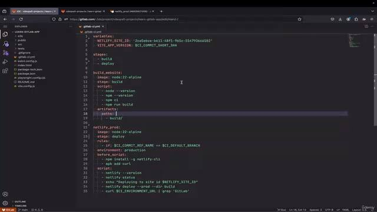

这一步的意义不是配置本身，而是后面所有改动都可以直接 `git push origin main` 触发 Pipeline，不用再走 Merge Request。

### 步骤 2：新建 `ci/Dockerfile`

在仓库根目录建一个 `ci/` 目录，里面放 `Dockerfile`。命名成 `Dockerfile`（首字母大写、无扩展名）后，编辑器会显示 Docker 图标，讲师演示过这个细节（—— p078 [00:26]）。

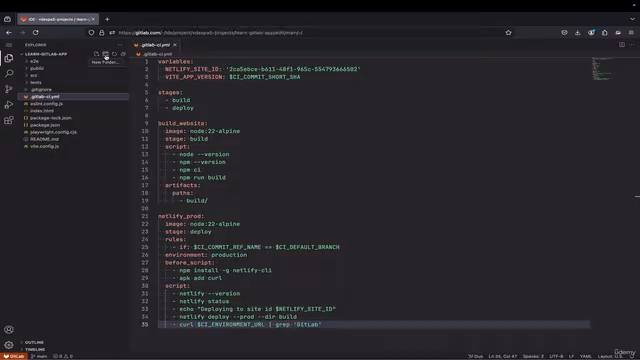

文件内容就三行：`FROM`、两条 `RUN`。`FROM` 用当前 Pipeline 里已经在用的基础镜像 `node:22-alpine`；第一条 `RUN` 把之前 `before_script` 里的 `npm install` 搬进来（装 Netlify CLI）；第二条 `RUN` 把 `apk add curl` 搬进来。

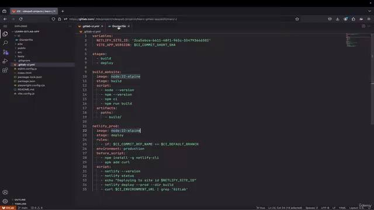

### 步骤 3：先写一个 Job 验证 Docker CLI 和 daemon 能连通

不要一上来就 build + push，先验证 Docker 环境。在 `.gitlab-ci.yml` 里加一个 `pre` 阶段的 Job：

```yaml
test docker:
  stage: pre
  image: docker
  script:
    - docker --version
    - docker version
```

这里有个坑：`docker --version` 只打印 CLI 版本，不需要 daemon，所以永远不会失败；`docker version` 会同时打印 client 和 server 信息，需要连上 daemon。第一次跑一定会看到 `error during connect`——因为 `docker` 镜像里只有客户端，没有服务端（—— p079 [02:25]）。

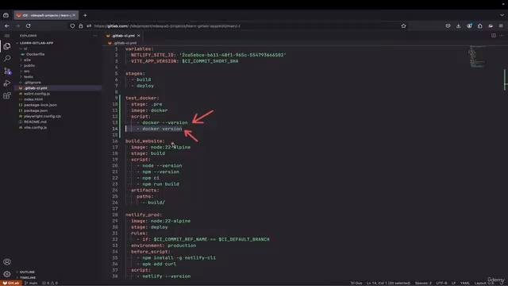

这个失败是预期的，不要跳过。看到它，你才真正理解后面 `services` 在补什么。

### 步骤 4：加 `services: docker:dind`

在同一个 Job 上加 `services`，把 Docker daemon 作为服务容器拉起来：

```yaml
test docker:
  stage: pre
  image: docker
  services:
    - docker:dind
  script:
    - docker --version
    - docker version
```

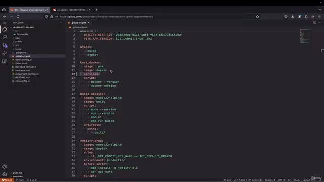

再加之前，先把讲师那句关键的话记住：`services` 里的镜像和 `image` 是两种不同角色。`image` 是主容器，`script` 里的命令都在它里面跑；`services` 是网络上的另一个容器，只能用主机名访问，不能在里面执行命令（—— p079 [08:54]）。`docker:dind` 启动后，`docker` CLI 会通过 Docker 网络用 hostname `docker` 连到它。

跑通之后，`docker version` 会同时输出 Client 和 Server 两段信息。

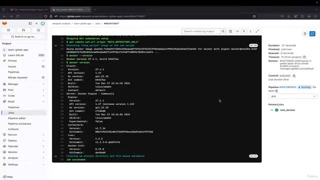

### 步骤 5：给镜像钉版本 tag

`docker` 和 `docker:dind` 不带 tag 时都等价于 `latest`，版本会随上游更新而变，Pipeline 可能某天突然挂了还查不出原因（—— p079 [11:16]）。改成：

```yaml
image: docker:27
services:
  - docker:27-dind
```

p079 里讲师在日志中读到当时的 major 版本是 27，所以用 `27`；如果你要更严格，可以钉 `27.4.1` 这种完整版本。

### 步骤 6：把 test job 改成 build docker netlify，构建镜像

Job 不再是测试，改名 `build docker netlify`，`stage` 仍是 `pre`。`script` 里删掉 `docker --version`，保留 `docker version`，后面接 `docker build`：

```yaml
build docker netlify:
  stage: pre
  image: docker:27
  services:
    - docker:27-dind
  script:
    - docker version
    - docker build -f ci/Dockerfile -t netlify .
    - docker image ls
```

三个关键点，缺一个就报错：

- `-f ci/Dockerfile`：默认找当前目录的 `Dockerfile`，你的在 `ci/` 下，必须显式指定（—— p080 [00:11]）。
- `-t netlify`：不给 tag 就是 `latest`（—— p080 [01:21]）。
- 末尾那个 `.`：构建上下文，指当前目录，超级容易漏（—— p080 [01:50]）。

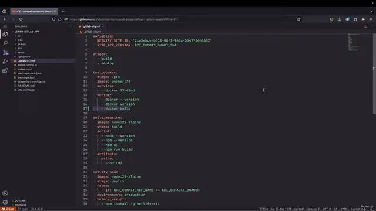

跑成功后看日志，会看到三步：拉 `node:22-alpine` → 装 Netlify CLI → 装 curl，最后输出镜像名和大小。

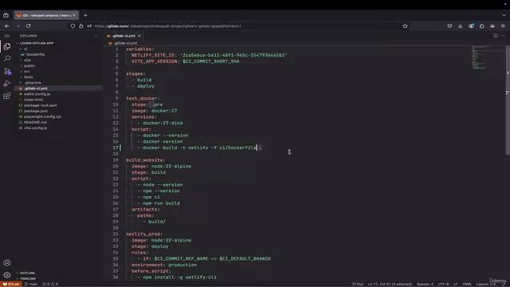

### 步骤 7：登录 GitLab Container Registry

去项目左侧 Deploy → Container Registry，页面会给出 CLI 命令示例，第一条就是 `docker login`。把它改写成用 GitLab 预定义变量：

```yaml
    - echo $CI_REGISTRY_PASSWORD | docker login -u $CI_REGISTRY_USER --password-stdin $CI_REGISTRY
```

为什么用管道？直接把密码写在 `-p` 后面 Docker 会警告不安全（—— p081 [05:11]）。改成从标准输入读，密码不会出现在命令历史里。`--password-stdin` 就是告诉 Docker「从 stdin 读密码」。

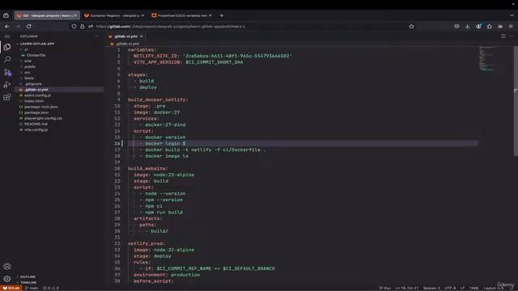

`CI_REGISTRY` 是 GitLab 自动注入的变量，值是 registry 地址（—— p081 [02:52]）。`docker login` 这一行放在 `docker version` 之后、`docker build` 之前，这样一旦认证出问题，你能第一时间知道。

### 步骤 8：把镜像名改成完全限定名并 push

`netlify` 这个名字只在本机有效，推到 Registry 时必须用「registry 地址 + group + project + 镜像名」的完全限定名。GitLab 已经把它拼好放在 `$CI_REGISTRY_IMAGE` 里（—— p082 [00:28]）。

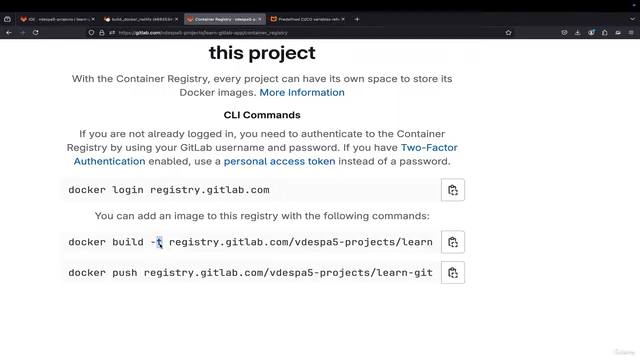

把 build 和 push 都换成这个变量，并加 `/netlify` 后缀：

```yaml
    - docker build -f ci/Dockerfile -t $CI_REGISTRY_IMAGE/netlify .
    - docker image ls
    - docker push $CI_REGISTRY_IMAGE/netlify
```

为什么加 `/netlify` 而不是只用 `$CI_REGISTRY_IMAGE`？因为根路径通常留给应用本身，CI 专用镜像放子路径更清晰（—— p082 [01:39]）。

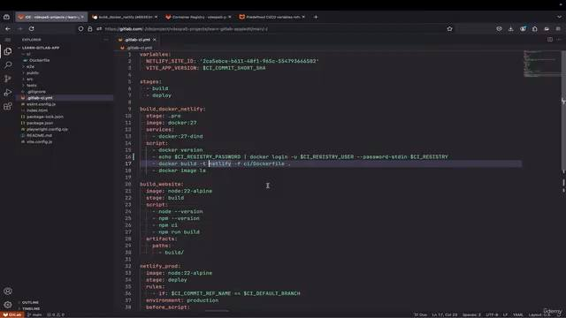

跑完后刷新 Container Registry 页面，就能看到镜像和它的 `latest` tag。

### 步骤 9：把 build / deploy 两个 Job 的 image 换成自定义镜像

业务 Job 之前用的是 `node:22-alpine` + `before_script` 装工具。现在把 `image` 换成 `$CI_REGISTRY_IMAGE/netlify`，`before_script` 里那两条安装命令就可以删掉了。这一步在逐字稿里没有单独演示（p077 只说了「简化成 build 和 deploy 两个 Job」），但它是整节内容的目的所在，必须做，否则前面白构建。

## 4. 完整代码

### 4.1 `ci/Dockerfile`

```dockerfile
FROM node:22-alpine

RUN npm install -g netlify-cli

RUN apk add curl
```

### 4.2 `.gitlab-ci.yml`（完整）

```yaml
stages:
  - pre
  - build
  - deploy

# ---------- 阶段 1：构建并推送自定义镜像 ----------
build docker netlify:
  stage: pre
  image: docker:27
  services:
    - docker:27-dind
  script:
    - docker version
    - echo $CI_REGISTRY_PASSWORD | docker login -u $CI_REGISTRY_USER --password-stdin $CI_REGISTRY
    - docker build -f ci/Dockerfile -t $CI_REGISTRY_IMAGE/netlify .
    - docker image ls
    - docker push $CI_REGISTRY_IMAGE/netlify

# ---------- 阶段 2：构建网站 ----------
build:
  stage: build
  image: $CI_REGISTRY_IMAGE/netlify
  script:
    - npm ci
    - npm run build
  artifacts:
    paths:
      - public

# ---------- 阶段 3：部署到 Netlify ----------
deploy:
  stage: deploy
  image: $CI_REGISTRY_IMAGE/netlify
  script:
    - netlify deploy --dir=public --prod
```

> 说明：`build` / `deploy` 两个 Job 的 `script` 内容在逐字稿本节没有重新讲（p077 只交代了「简化成两个 Job」），上面给的是能跑通的等价版本，具体构建产物目录（`public`）和 Netlify 站点参数请按你前面章节的配置替换。`NETLIFY_AUTH_TOKEN` / `NETLIFY_SITE_ID` 这类变量在课程前面的章节里已经配置在 Settings → CI/CD → Variables，netlify-cli 会自动读取，不需要写进 `script`。

### 4.3 目录结构

```
your-repo/
├── .gitlab-ci.yml
├── ci/
│   └── Dockerfile
├── package.json
├── package-lock.json
├── public/          # npm run build 的产物
└── src/
```

## 5. 逐行解释

### 5.1 Dockerfile

```dockerfile
FROM node:22-alpine
```

`FROM` 必须是第一条指令，全大写。它指定所有后续指令在哪个基础镜像上执行，没有它构建就没有起点（—— p078 [01:03]）。这里选 `node:22-alpine` 是因为原 Pipeline 的 Job 已经在用这个镜像，`before_script` 也是在它上面装工具，换成自定义镜像时最省事的做法就是「在原镜像上加点东西」（—— p078 [01:22]）。`22` 是主版本号，足够用；想要完全固定版本可以写 `22.x.y`。

```dockerfile
RUN npm install -g netlify-cli
```

`RUN` 在构建过程中执行一条 shell 命令，产物留在镜像层里（—— p078 [01:36]）。`-g` 是全局安装，这样 `netlify` 命令在 `PATH` 里，后续 Job 直接敲 `netlify deploy` 就行。逐字稿口述是「npm install」，结合 p077 [00:08]「install Netlify CLI for deployment」和 p080 [01:50]「we are installing Netlify CLI」，这里补全为 `npm install -g netlify-cli`。如果你前面章节的 `before_script` 用的是别的包名或参数，照抄你原来的即可。

```dockerfile
RUN apk add curl
```

`apk` 是 Alpine Linux 的包管理器，`node:22-alpine` 基于 Alpine，所以装系统包用 `apk` 而不是 `apt`。逐字稿的原话就是 `apk add curl`（—— p078 [01:38]）。实践中通常会加 `--no-cache` 避免在镜像里留包索引，但课里没提，这里按原样写，你如果要精简镜像可以自行加上。

两条 `RUN` 也可以合成一条 `RUN npm install -g netlify-cli && apk add curl`，合并后镜像层更少。课里是分开写的，这里保持分开，方便你对照。

### 5.2 `.gitlab-ci.yml` 的 `build docker netlify`

```yaml
stage: pre
```

`pre` 是自定义阶段名，必须在 `stages` 里声明。它排在最前面，保证主容器里的 `docker` CLI 在业务 Job 之前就能连上 daemon（—— p079 [00:27]）。

```yaml
image: docker:27
```

主容器用 `docker` 镜像，它里面装的是 **Docker CLI**，不是 daemon。讲师用「餐厅服务员」类比：CLI 只能点单，不做饭（—— p079 [02:53]）。

```yaml
services:
  - docker:27-dind
```

`dind` = Docker-in-Docker，这个镜像里跑的是 **Docker daemon**（「厨子」）。它和主容器在同一 Docker 网络上，主容器的 CLI 通过 hostname `docker` 连到它（—— p079 [07:33]）。注意：`script` 里的命令全在主容器里执行，不能进到 service 容器里执行（—— p079 [08:54]）。

```yaml
- docker version
```

打印 Client 和 Server 两段信息。两段都在，才说明 CLI 和 daemon 真的连通了（—— p079 [07:06]）。如果只有 Client 段、后面跟 `error during connect`，就是 service 没起来或者 hostname 解析不到。

```yaml
- echo $CI_REGISTRY_PASSWORD | docker login -u $CI_REGISTRY_USER --password-stdin $CI_REGISTRY
```

`CI_REGISTRY` 是 registry 服务器地址（—— p081 [03:20]）。`CI_REGISTRY_USER` / `CI_REGISTRY_PASSWORD` 是 GitLab 为当前 Job 自动生成的临时凭据，用完即弃，不需要你去 Settings 里手动配（—— p081 [04:15]）。`echo` 把密码打到标准输出，管道 `|` 把它送进 `docker login` 的标准输入，`--password-stdin` 让它从标准输入读密码。这样密码不会出现在命令行参数里，避免警告和泄漏（—— p081 [05:11]）。

> 逐字稿在这里口述的是「CI registry password」「username」，没有逐字读出完整变量名。上面写的是 GitLab 的标准预定义变量名；实际以你项目 Settings → CI/CD → Variables 页面显示为准，如果你用的是自建 GitLab，变量名可能有差异。

```yaml
- docker build -f ci/Dockerfile -t $CI_REGISTRY_IMAGE/netlify .
```

`-f` 指定 Dockerfile 路径，默认只在当前目录找 `Dockerfile`，你的在 `ci/` 下，必须写（—— p080 [00:11]）。`-t` 给镜像命名并打 tag，这里没写 `:xxx`，默认 `latest`（—— p080 [01:21]）。`$CI_REGISTRY_IMAGE` 是 GitLab 拼好的完全限定名（registry + group + project），`/netlify` 是子路径，避免占掉根路径（—— p082 [01:24]）。末尾的 `.` 是构建上下文，会把当前目录及子目录一起传给 daemon（—— p080 [01:50]），漏了直接报错。

```yaml
- docker image ls
```

列出本机镜像，确认名字和 tag 是 `$CI_REGISTRY_IMAGE/netlify:latest`、大小符合预期（—— p080 [02:19]）。这一步是自检，可以删。

```yaml
- docker push $CI_REGISTRY_IMAGE/netlify
```

把镜像推到 Registry（—— p082 [02:22]）。因为前面已经 login，push 时 Docker 知道往哪推。注意 push 的名字必须和 build 时的 `-t` 完全一致，否则推的是另一个镜像。

### 5.3 `build` / `deploy` 的 `image`

```yaml
image: $CI_REGISTRY_IMAGE/netlify
```

和 `build docker netlify` 的 `image: docker:27` 是两种东西。前者是「GitLab 替你把镜像拉下来当执行环境」，后者是「你自己在容器里跑 docker 命令」。换成自定义镜像后，Netlify CLI 和 curl 已经在镜像里，`before_script` 里那两条安装命令可以删掉，Job 启动即用。

在 JS/Node 里理解 CI 变量：`$CI_REGISTRY_IMAGE` 等价于 `process.env.CI_REGISTRY_IMAGE`，GitLab 在 Job 启动时把一堆 `CI_*` 注入环境变量，Node 脚本里直接 `process.env.CI_REGISTRY_IMAGE` 就能读到。所以如果你的构建脚本需要这些信息，不用特殊处理。

## 6. 复现检查清单

按顺序核对，每一条都过一遍再往下走：

- [ ] 仓库已 fork，`.gitlab-ci.yml` 用的是资源区附带的版本。
- [ ] Settings → Repository → Protected branches 里 `main` 的 Allowed to push and merge 已改成 Maintainers。
- [ ] `ci/Dockerfile` 存在，编辑器显示 Docker 图标。
- [ ] `Dockerfile` 第一条指令是 `FROM node:22-alpine`。
- [ ] `test docker` / `build docker netlify` Job 的 `stage` 是 `pre`，且 `stages` 列表里有 `pre`。
- [ ] 第一次跑 `docker version` 时看到了 `error during connect`，加 `services: docker:dind` 后 Client / Server 两段都出现。
- [ ] `image` 和 `service` 都钉了版本：`docker:27` / `docker:27-dind`。
- [ ] `docker build` 带 `-f ci/Dockerfile`、`-t $CI_REGISTRY_IMAGE/netlify`，末尾有 `.`。
- [ ] `docker login` 用 `echo $CI_REGISTRY_PASSWORD | ... --password-stdin`，没有把密码写在 `-p` 后面。
- [ ] push 的名字与 build 的 `-t` 完全一致。
- [ ] 刷新 Deploy → Container Registry，能看到 `latest` tag 和镜像大小。
- [ ] `build` / `deploy` 的 `image` 已换成 `$CI_REGISTRY_IMAGE/netlify`，`before_script` 里的安装命令已删除。
- [ ] 整条 Pipeline 绿了，三个 Job 全部通过。

## 7. 课里没讲但你会撞上的

**1）`CI_REGISTRY_USER` / `CI_REGISTRY_PASSWORD` 的确切变量名**

逐字稿只说了「CI registry password」「username」，没有逐字读出完整变量名（—— p081 [04:15]）。上面文档用的是 GitLab 标准预定义变量名。如果你用的是自建 GitLab，或者实例配置了别的认证方式，变量名可能不同。以你项目 Settings → CI/CD → Variables 页面为准，或者用 `CI_JOB_TOKEN` 方案（课里没提，是 GitLab 官方文档里的另一条路）。

**2）自建 Runner 上的「error during connect」**

讲师在 p079 [06:37] 提过一句：「just in case you're running this setup on a custom Linux runner and are facing some errors, check the resources folder for some help, you may need to specify the Docker host environment variable in order to facilitate this connection.」在 GitLab.com 的 shared runner 上 `services: docker:dind` 能直接工作；在自建 Runner 上，主容器里的 CLI 默认不知道 daemon 在哪，需要显式设置 `DOCKER_HOST=tcp://docker:2375` 之类的环境变量（具体值看你的 Runner 配置）。这一点课里没展开，只给了「去 resources 文件夹看」的提示。

**3）privileged mode 与安全**

p079 [13:12] 提到合并在一个容器里构建镜像需要 privileged 模式，等于给容器超级权限，风险很大。`services: docker:dind` 这一套在 GitLab.com 上由平台侧处理，但自建 Runner 时你需要确认 runner 的 config.toml 里 `privileged = true` 已打开，否则 dind 起不来。课里没有给 config.toml 示例。

**4）镜像大小 500MB vs 179MB**

p082 [04:40] 讲师看到 `docker image ls` 显示约 500MB，Registry 页面显示约 179MB，解释是 Registry 里存的是压缩后的镜像。这个数字差异是正常的，不要以为推坏了。netlify-cli 本身比较大，所以镜像从基础镜像的约 50MB 涨到约 500MB，讲师评价「still a reasonable image in terms of size」。

**5）`latest` tag 的坑**

p079 [11:16] 说得很清楚：不写 tag 就是 `latest`，上游一更新，你的 Pipeline 可能突然挂。镜像这边同样：`docker build -t $CI_REGISTRY_IMAGE/netlify` 推的是 `latest`，如果你同时部署了多个环境，建议改成 `$CI_REGISTRY_IMAGE/netlify:$CI_COMMIT_SHORT_SHA` 之类。课里没讲多 tag 策略。

**6）`apk add` 不加 `--no-cache` 会留包索引**

`node:22-alpine` 用 `apk`，常规做法是 `apk add --no-cache curl`，避免包索引留在镜像层里。课里只写了 `apk add curl`（—— p078 [01:38]），照抄没问题，但镜像会稍大一点。

**7）`npm install -g` 的权限**

node 官方镜像默认以 root 运行，`npm install -g` 不会报权限错误。如果你后来切了非 root 用户，需要加 `--unsafe-perm` 或者改 `npm config set prefix`。课里没碰这个场景。

**8）deploy Job 的 Netlify 凭据**

`netlify deploy` 需要 `NETLIFY_AUTH_TOKEN` 和 `NETLIFY_SITE_ID`，netlify-cli 会从环境变量自动读取。这两个变量在课程前面的章节里配在 Settings → CI/CD → Variables，本节逐字稿没有重讲。如果你是从本节才开始跟，需要自己补上，否则 deploy Job 会报未认证。

**9）`build` Job 的产物目录**

`npm run build` 的产物目录取决于你的项目（Gatsby 默认 `public/`，Vite 默认 `dist/`）。上面示例写的是 `public/`，是从课程上下文推的；逐字稿本节没讲 build Job 的细节，实际目录以你 `package.json` 里的 build 脚本为准。

**10）把 `docker image ls` 留在 script 里**

这一行纯自检，不参与产物，可以删。留着的好处是日志里能直接看到镜像名和大小，排查版本问题时方便；坏处是日志多一行。课里两处都保留了（p080 [02:19]、p082 [03:50]），所以上面也保留。