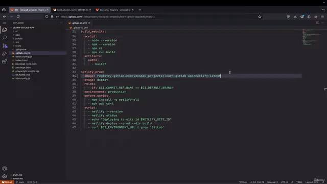
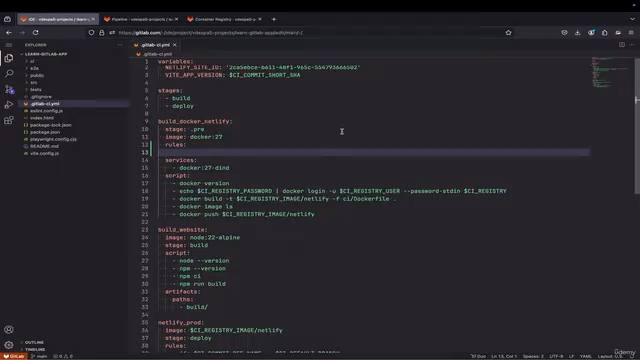
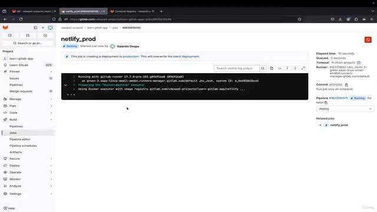
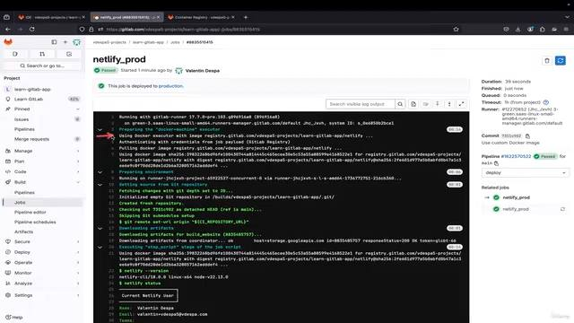
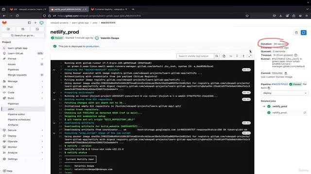
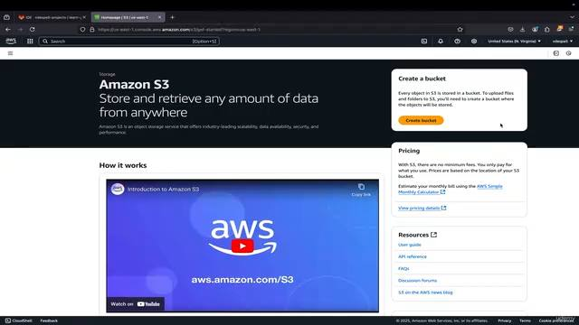
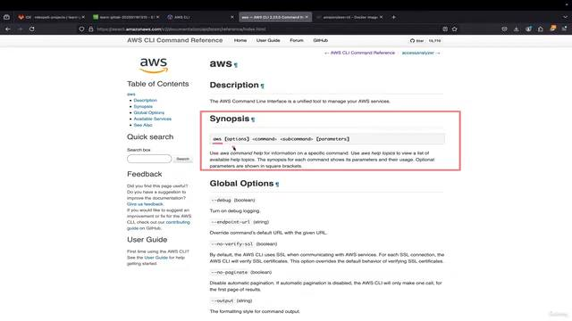
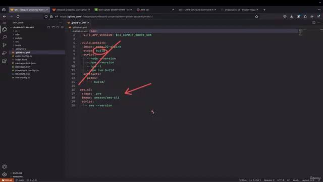
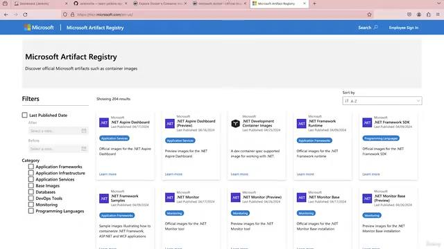

# GitLab CI/CD：自定义镜像、定时构建与 AWS CLI 落地

## 1. 这一节做什么

这一节的主线不是“再讲一遍 GitLab CI 语法”，而是把前面已经能跑的 pipeline 推进到可维护状态：先做一个带 Netlify CLI 的自定义 Docker 镜像，让 deploy job 直接用这个镜像，从而去掉重复安装依赖的 `before_script`；然后发现“每次 pipeline 都重新构建镜像”并不划算，于是把构建镜像的 job 从日常 pipeline 中拿出去，改成 GitLab 的 **pipeline schedule** 定时构建；最后补上 AWS 侧的准备工作：S3 bucket、AWS CLI 官方镜像，以及在 GitLab 中覆盖镜像 `entrypoint` 让 `aws --version` 真正执行。

这条线里有两个很容易被忽略、但实际会反复踩的点：

1. **版本必须固定**。讲师在 p083 明确提醒：Dockerfile 里安装 Netlify CLI 时如果一直拉 latest，某天 upstream 发 breaking change，你的 pipeline 会突然坏掉。Node 至少固定 major 22，Netlify CLI 固定到 18.0.0，镜像 tag 也要固定。
2. **带 ENTRYPOINT 的官方镜像在 CI 里不能直接当普通镜像用**。p089 里执行 `aws --version` 得到 `exit code 252` 和 `invalid choice`，不是命令写错，而是 `amazon/aws-cli` 镜像启动时已经执行了 `aws`，GitLab Runner 传进去的脚本被当成 `aws` 的参数。解决方式是把 `image` 拆成 `name` + `entrypoint: [""]`。

p085 还补充了 Microsoft 镜像的来源：.NET 镜像并不按普通方式放在 Docker Hub，而是走 `mcr.microsoft.com`，使用时必须写全限定路径。p086–p088 则是 AWS 前置：创建账号或使用 60 分钟 lab、创建全局唯一的 S3 bucket。p089 把 AWS CLI 放进 GitLab pipeline，先只打印版本，把“能跑”验证出来。



## 2. 讲师原话（带「—— pNNN [MM:SS]」）

下面只摘与本篇复现直接相关的原话，保留英文原句，后面用中文说明它在项目里对应什么动作。

> “We have now built a custom Docker image, but we are still not done. Ideally, we want to use this image that we have built inside our pipeline.”
—— p083 [00:00]

对应动作：镜像构建出来只是第一步，下一步是把 deploy job 的 `image` 换成这个自定义镜像。

> “We also have here latest. So we're telling we want a latest tag and not anything else. And when we're doing this, the before script here is obsolete. We no longer need that.”
—— p083 [00:28]

对应动作：deploy job 不再在 `before_script` 里安装 Netlify CLI，因为依赖已经在镜像里。

> “whenever we are installing your Netlify CLI, we are always pulling the latest version... typically what we want to have inside a Docker file is a hard-coded version.”
—— p083 [02:50]

对应动作：Dockerfile 里写 `netlify-cli@18.0.0`，不要写 `netlify-cli` 或 `netlify-cli@latest`。

> “we're going to actually create a scheduled pipeline. So what it means is that we may want to build this image maybe once per day or once per week, ideally during the night.”
—— p084 [00:29]

对应动作：把 `build_image` job 从日常 pipeline 移出，用 Pipeline schedules 定时跑。

> “we need to only run this job when the pipeline source is a schedule.”
—— p084 [01:26]

对应动作：`rules: - if: '$CI_PIPELINE_SOURCE == "schedule"'`，普通 commit 触发的 pipeline 里这个 job 消失。

> “Microsoft has its own container registry... mcr.microsoft.com”
—— p085 [00:58]

对应动作：使用非 Docker Hub 的官方镜像时写全限定路径，例如 `mcr.microsoft.com/...`。课里没有给出具体 .NET tag，实际 tag 以 MCR 页面为准。

> “S3 stands for Simple Storage Service... files are stored in buckets”
—— p088 [00:00]

对应动作：静态站点文件放 S3 bucket，bucket 名称要全局唯一，讲师建议加年月日时间后缀避免冲突。

> “this behavior occurs because this particular Docker image has an entry point configured.”
—— p089 [07:20]

对应动作：`amazon/aws-cli` 镜像自带 `ENTRYPOINT`，CI 里要覆盖成空 entrypoint。

> “we can override this in GitLab and the configuration is not hard at all.”
—— p089 [08:20]

对应动作：`image: { name: amazon/aws-cli:2.23.0, entrypoint: [""] }`。

> “we should use a fixed version for our image.”
—— p089 [10:05]

对应动作：AWS CLI 镜像不要用 `latest`，固定到 `2.23.0`。

## 3. 从零复现

下面按“先做镜像、再定时构建、再使用镜像、最后接 AWS CLI”的顺序复现。课里没有逐行展示完整的 `.gitlab-ci.yml`，尤其没有展示 Docker-in-Docker 构建镜像的完整 Runner 配置；本篇会把讲师演示的片段补成可保存运行的完整文件，但会明确标注哪些是课里没讲的补充。

### 3.1 准备项目目录

在 GitLab 项目根目录准备以下结构：

```text
.
├── .gitlab-ci.yml
├── docker
│   └── netlify
│       └── Dockerfile
└── public
    └── index.html
```

`public/index.html` 只是为了让 Netlify deploy 有东西可部署。真实项目里换成你的构建输出目录即可；课里没有讲 Netlify 部署目录的具体约定，下面用 `public` 作为示意。

### 3.2 写 Dockerfile：固定 Node 与 Netlify CLI 版本

讲师在 p083 的建议是：Node 至少固定 major 版本 22，Netlify CLI 固定到 18.0.0。Dockerfile 只做一件事：基于 Node 22 安装固定版本的 Netlify CLI。

```dockerfile
FROM node:22
RUN npm install -g netlify-cli@18.0.0
```

注意：`node:22` 仍然不是“完全固定”，只是固定了 major。讲师原话是 “at least a major version set to 22, which is not perfect, but definitely decent”。如果你要更严格，可以进一步固定到 `node:22.x.y` 或 digest；课里没有展开讲 digest。

### 3.3 写 `.gitlab-ci.yml`：三个 job 各司其职

完整 YAML 见第 4 节。这里先说设计：

- `aws_s3`：放在 `.pre` stage，只做 `aws --version`，验证 AWS CLI 镜像能在 GitLab 里跑起来。
- `build_image`：只在 schedule pipeline 中运行，构建并推送 `netlify:18.0.0` 镜像。
- `deploy_netlify`：普通 commit pipeline 中运行，使用上一步推送到 GitLab Container Registry 的自定义镜像部署 Netlify。

`build_image` 的 Docker-in-Docker 配置是课里没讲的。讲师只演示了“构建镜像”这个 job 的存在和 schedule 规则，没有逐行讲 `docker:dind`、`DOCKER_TLS_CERTDIR`、`docker login`。下面给的是常见可运行写法，但你的 GitLab Runner 必须允许 Docker 相关能力，否则这一 job 会失败。

### 3.4 先创建 schedule，并点 play 立即构建镜像

p084 的操作顺序是：进入 GitLab 项目的 **Build > Pipeline schedules**，新建 schedule，选择每周或自定义，讲师演示的是每周五 4:15，时区选择 Berlin，描述写 `build Docker image`。然后点 schedule 旁边的播放按钮立即测试一次。

如果你手写 cron，周五 4:15 对应 `15 4 * * 5`。课里没有逐字写出这个 cron 字符串，只演示了 UI 选择；实际以 GitLab schedule 页面为准。



schedule 第一次 play 后，`build_image` 会构建并推送镜像。等它成功，再走普通 commit pipeline，否则 `deploy_netlify` 拉不到 `netlify:18.0.0`。

### 3.5 普通 pipeline 中确认构建 job 消失

普通 commit 触发 pipeline 后，按 p084 的预期，`build_image` 应该从 pipeline 中消失，但镜像仍然在 Container Registry 里，`deploy_netlify` 仍然可以引用它。讲师的原话是：“building the Docker image is no longer part of the pipeline... the Docker image is still available in the container registry”。



### 3.6 验证 deploy job 确实用了自定义镜像

deploy job 日志里应该能看到类似 `Using Docker executor with image ...` 的输出，后面跟着你的自定义 Netlify 镜像路径。p083 里讲师特别指出，日志会显示 “using Docker executor with image”，并且部署时间和之前安装依赖的方式相比，从大约 60 秒降到大约 40 秒。





### 3.7 AWS 侧：账号或 lab、区域、S3 bucket

如果你没有 lab，按 p086 创建个人 AWS 账户，选择 personal account，绑定卡，选择 free basic support，进入 AWS Management Console 后选择区域。讲师演示选择的是 US East 1, North Virginia；你可以选别的，但记住区域，后面会用到。讲师还建议在账户资料里启用 multi-factor authentication。

如果你有 lab，按 p087：点 Open workspace 进入临时 AWS 控制台，环境通常 60 分钟自动终止；需要 AWS 凭证时点 CLI credentials，会得到三个值：AWS access key ID、secret access key、session token。临时凭证通常以 `ASIA` 前缀开头，长期 IAM user 凭证通常以 `AKIA` 开头。课里强调：使用临时凭证时三个值都要提供，不是只提供两个。

S3 部分按 p088：在 AWS Console 搜索 S3，创建 bucket。bucket 名称必须全局唯一，讲师建议在 `learn-gitlab` 后面加年月日和时间后缀，例如 `learn-gitlab-202506151030`。其他设置保持默认即可，最后点 Create Bucket。



### 3.8 AWS CLI job：先打印版本，再处理 entrypoint

p089 的做法是：先建一个很简单的 job，叫 `aws_s3`，放到 pre-stage，使用 `amazon/aws-cli` 镜像，`script` 里先写 `aws --version`。第一次运行会失败，得到 `exit code 252`，日志里会出现 `invalid choice` 之类的错误。原因是镜像自带 entrypoint，容器启动时已经执行了 `aws`，GitLab 传进去的脚本没有被当成独立命令执行。

解决方式是把 `image` 从字符串改成 map：

```yaml
image:
  name: amazon/aws-cli:2.23.0
  entrypoint: [""]
```

`entrypoint: [""]` 是空 entrypoint，覆盖镜像默认入口。改完后 `aws --version` 才能正常执行，输出当前 AWS CLI 版本。p089 里看到的版本是 `2.23.0`；如果不写 tag，默认会拿 latest，今天和明天可能不一样，所以最后要固定到 `2.23.0`。





### 3.9 Microsoft 镜像的补充：全限定路径

p085 的内容不影响上面的 Netlify 主线，但如果你用 .NET/Playwright 等 Microsoft 发布的镜像，要注意它们可能在 `mcr.microsoft.com`，而不是 Docker Hub。课里说 “everything that is not on Docker Hub needs to have this fully qualified path”。也就是说，镜像名要写成 `mcr.microsoft.com/...` 这种完整路径。课里没有给出具体 .NET 镜像 tag，实际 tag 以 Microsoft Artifact Registry 页面为准。



## 4. 完整代码

### 4.1 目录结构

```text
.
├── .gitlab-ci.yml
├── docker
│   └── netlify
│       └── Dockerfile
└── public
    └── index.html
```

### 4.2 `docker/netlify/Dockerfile`

```dockerfile
FROM node:22
RUN npm install -g netlify-cli@18.0.0
```

### 4.3 `.gitlab-ci.yml`

```yaml
stages:
  - build
  - deploy

variables:
  NETLIFY_CLI_VERSION: "18.0.0"
  NETLIFY_IMAGE: "$CI_REGISTRY_IMAGE/netlify:18.0.0"

aws_s3:
  stage: .pre
  image:
    name: amazon/aws-cli:2.23.0
    entrypoint: [""]
  script:
    - aws --version
  rules:
    - if: '$CI_PIPELINE_SOURCE != "schedule"'

build_image:
  stage: build
  image: docker:27
  services:
    - name: docker:27-dind
  variables:
    DOCKER_TLS_CERTDIR: "/certs"
  before_script:
    - echo "$CI_REGISTRY_PASSWORD" | docker login -u "$CI_REGISTRY_USER" --password-stdin "$CI_REGISTRY"
  script:
    - docker build -t "$NETLIFY_IMAGE" -f docker/netlify/Dockerfile .
    - docker push "$NETLIFY_IMAGE"
  rules:
    - if: '$CI_PIPELINE_SOURCE == "schedule"'

deploy_netlify:
  stage: deploy
  image:
    name: "$NETLIFY_IMAGE"
    entrypoint: [""]
  script:
    - netlify --version
    - netlify deploy --prod --dir=public
  rules:
    - if: '$CI_PIPELINE_SOURCE != "schedule"'
```

说明：`build_image` 里的 `docker:27`、`docker:27-dind`、`DOCKER_TLS_CERTDIR`、`docker login` 是课里没有逐行讲的部分，属于为了让文件可运行而补的示意配置。`NETLIFY_AUTH_TOKEN`、`NETLIFY_SITE_ID` 也没有在代码里显式写出，Netlify CLI 会从环境变量读取；这两个变量名是复现时常用的命名，课里没有逐字展示，需在 GitLab 项目 Settings > CI/CD > Variables 中配置。

### 4.4 `public/index.html`

```html
<!doctype html>
<html lang="zh-CN">
  <head>
    <meta charset="utf-8" />
    <meta name="viewport" content="width=device-width, initial-scale=1" />
    <title>GitLab CI/CD Demo</title>
  </head>
  <body>
    <h1>GitLab CI/CD Netlify Demo</h1>
    <p>This file is deployed by the custom Netlify image.</p>
  </body>
</html>
```

### 4.5 需要配置的变量

在 GitLab 项目 **Settings > CI/CD > Variables** 中配置：

| 变量名 | 用途 | 课里是否讲过 |
|---|---|---|
| `NETLIFY_AUTH_TOKEN` | Netlify CLI 认证 | 课里没有逐字讲变量名 |
| `NETLIFY_SITE_ID` | 指定 Netlify site | 课里没有逐字讲变量名 |
| `AWS_ACCESS_KEY_ID` | AWS CLI 访问密钥 | p087 讲了三个凭证值，未逐字讲 GitLab 变量名 |
| `AWS_SECRET_ACCESS_KEY` | AWS CLI secret | 同上 |
| `AWS_SESSION_TOKEN` | 临时凭证 session token | p087 明确说临时凭证需要第三个值，未逐字讲变量名 |
| `S3_BUCKET` | 你的 bucket 名，如 `learn-gitlab-202506151030` | p088 讲了 bucket 命名规则，未要求放进变量 |

`CI_REGISTRY_IMAGE`、`CI_REGISTRY_USER`、`CI_REGISTRY_PASSWORD`、`CI_REGISTRY` 是 GitLab 预定义变量，课里没有逐个念出来；复现时直接用即可。

### 4.6 触发命令

```bash
git add .
git commit -m "ci: use custom netlify image and scheduled build"
git push origin main
```

普通 push 触发普通 pipeline；schedule 在 GitLab UI 中创建后点播放按钮立即测试。

## 5. 逐行解释

### 5.1 Dockerfile

```dockerfile
FROM node:22
```

指定基础镜像。讲师说 Node 至少固定 major 22，虽然不完美，但比完全不固定好。这里没有写 `node:latest`，避免 Node 大版本漂移。

```dockerfile
RUN npm install -g netlify-cli@18.0.0
```

全局安装 Netlify CLI，并固定到 18.0.0。讲师在 p083 反复强调不要拉 latest，否则 breaking change 会直接进入 pipeline。这里把版本写死在 Dockerfile 里，构建出的镜像每次都是同一个 Netlify CLI 版本。

### 5.2 `.gitlab-ci.yml` 的 `variables`

```yaml
variables:
  NETLIFY_CLI_VERSION: "18.0.0"
  NETLIFY_IMAGE: "$CI_REGISTRY_IMAGE/netlify:18.0.0"
```

`NETLIFY_CLI_VERSION` 是给人看的版本记录，实际安装版本在 Dockerfile 里。`NETLIFY_IMAGE` 把镜像路径集中到一处，build job 推这个 tag，deploy job 拉这个 tag。这样不会出现 build 推 `latest`、deploy 拉 `18.0.0` 的错位。

### 5.3 `aws_s3` job

```yaml
aws_s3:
  stage: .pre
```

`.pre` 是 GitLab 的特殊 stage，会在所有普通 stage 之前运行。p089 里讲师把实验 job 放到 pre-stage，是为了让它第一个跑、快速验证。注意 p089 还演示了一个坑：如果 pipeline 里只有 `.pre` 或 `.post` 的 job，GitLab 不会创建 pipeline。所以复现文件里必须保留 `build_image` 或 `deploy_netlify` 这类普通 stage job。

```yaml
  image:
    name: amazon/aws-cli:2.23.0
    entrypoint: [""]
```

`name` 指定 AWS CLI 官方镜像，并固定到 2.23.0。`entrypoint: [""]` 是空 entrypoint，覆盖镜像默认的 `aws` 入口。没有这一行，GitLab 传给容器的脚本会被当成 `aws` 的参数，出现 p089 里的 `invalid choice` 和 `exit code 252`。

```yaml
  script:
    - aws --version
```

先只打印版本，不碰 S3 上传。这是 p089

## 6. 复现检查清单

- [ ] **schedule 已创建且能手动触发**：验证 GitLab **Build > Pipeline schedules** 中是否存在描述为 `build Docker image` 的 schedule；点播放按钮后应看到 schedule pipeline 被创建，且 `build_image` 运行成功。
- [ ] **普通 commit pipeline 中不再出现 build_image**：验证 push 一次普通 commit 后进入 Pipelines 页面看 job 列表；应看到 `build_image` 消失，而按当前代码规则仍能看到 `aws_s3` 和 `deploy_netlify`。
- [ ] **镜像已推送到 Container Registry，tag 与 deploy 引用一致**：验证 `build_image` 日志中的 `docker push` 成功，并在项目 Container Registry 中看到 `netlify:18.0.0`；应看到 `build_image` 推送的 tag 与 `deploy_netlify` 使用的 `NETLIFY_IMAGE` 完全一致，不是 `latest`。
- [ ] **deploy job 确实使用了自定义 Netlify 镜像**：验证 `deploy_netlify` 日志开头出现 `Using Docker executor with image` 及你的自定义 Netlify 镜像路径；应看到后面的 Netlify 命令正常执行，且没有重新安装 Netlify CLI 的步骤。
- [ ] **部署耗时相比旧方式有下降**：验证同一条 deploy job 的执行时间；课程演示中安装依赖方式约 60 秒，自定义镜像方式约 40 秒。应看到不再有依赖安装阶段，耗时下降（实际秒数会随环境变化）。
- [ ] **AWS CLI 不再出现 entrypoint 错误**：验证 `aws_s3` job 日志和状态；应看到 `aws --version` 作为命令被执行，输出 AWS CLI `2.23.0`，没有 `invalid choice` 或 `exit code 252`。
- [ ] **AWS CLI 镜像 tag 固定且 entrypoint 已覆盖**：验证 `.gitlab-ci.yml` 中该 job 使用 `amazon/aws-cli:2.23.0`，且写成 `image.name` + `entrypoint: [""]`；应看到日志无 latest 版本漂移迹象，版本与 `2.23.0` 对应。
- [ ] **pipeline 不会被仅有 `.pre` job 的情况吞掉**：验证当前配置至少保留了普通 stage job（如 `deploy_netlify`）后运行 pipeline；应看到 Pipelines 页面确实生成了 pipeline，`aws_s3` 在 `.pre` 先执行。若临时禁用所有普通 stage job，则应看到 GitLab 不创建 pipeline。
- [ ] **S3 bucket 已创建且名称/区域正确**：进入 AWS Console 的 S3 页面；应看到你的全局唯一 bucket（例如 `learn-gitlab-202506151030`）存在于所选区域。
- [ ] **当前代码只验证 AWS CLI，不会上传文件到 S3**：验证 `aws_s3` 的 `script` 只有 `aws --version`；运行成功后 S3 bucket 中应仍没有由该 pipeline 新增的对象。若期望产生对象，需要后续另加上传命令，课里没有给出这一步。

## 7. 课里没讲但你会撞上的

| 现象 | 原因 | 怎么办 |
|---|---|---|
| `build_image` 失败，日志出现无法连接 Docker daemon、登录失败或 push 被拒绝 | 补充：课里没讲完整的 Docker-in-Docker 与 Runner 配置；当前 `docker:27-dind`、`DOCKER_TLS_CERTDIR`、`docker login` 是为了可运行而补的示意配置，Runner 不一定允许 Docker 相关能力 | 检查 Runner 是否支持 Docker 相关能力，确认 `docker:27-dind` service、TLS 配置和 `CI_REGISTRY_*` 登录变量；根据日志区分是 daemon 问题还是 registry 登录/push 问题 |
| 普通 pipeline 中 `deploy_netlify` 拉不到 `netlify:18.0.0`，提示镜像不存在或 manifest 找不到 | 课里讲了 build 移到 schedule，但没把这种拉取失败作为排错项；可能 schedule 还没 play、构建失败，或 build 与 deploy 使用的 tag/路径不一致 | 先在 schedule 上 play 并确认 `build_image` 成功，再去 Container Registry 查 `netlify:18.0.0` 是否存在；核对 `NETLIFY_IMAGE` 在 build 和 deploy 中是否完全一致 |
| `deploy_netlify` 认证失败或找不到 Netlify site | 补充：课里没讲 Netlify 变量名的逐字配置；缺少 `NETLIFY_AUTH_TOKEN` 或 `NETLIFY_SITE_ID` 时 Netlify CLI 无法完成部署 | 在 GitLab 项目 **Settings > CI/CD > Variables** 中配置这两个变量后重跑 deploy job |
| `deploy_netlify` 报没有可部署文件，或找不到 `public` 目录 | 补充：课里没讲 Netlify 部署目录的具体约定；`--dir=public` 是文档里的示意，实际构建输出目录可能不同 | 确认仓库中存在 `public/index.html`，或把 `netlify deploy --dir=...` 改成项目真实的构建输出目录 |
| 改了 `NETLIFY_CLI_VERSION`，但镜像里的 Netlify CLI 版本没有变 | 补充：课里没把这个变量设计成 Docker build arg；实际安装版本写死在 Dockerfile 的 `netlify-cli@18.0.0` 中 | 同时修改 Dockerfile 中的安装版本、镜像 tag 和 `NETLIFY_IMAGE` 的 tag，然后重新触发 schedule 构建镜像 |
| `aws_s3` 显示成功，但 S3 bucket 里仍没有上传任何文件 | 补充：本节的 `aws_s3` 只执行 `aws --version`，课里只做到验证 AWS CLI 能在 pipeline 中运行，并未写 S3 上传命令 | 不要把“`aws --version` 成功”当成“上传成功”；若要上传，需要另加 AWS CLI 的 S3 命令并配置 AWS 凭证，课里没有给出这一步的具体命令 |
