# GitLab CI/CD × AWS CLI × S3 静态站点部署（P090–P095）

> 本节可复现的最终产物：一条 GitLab CI job，在容器里用 AWS CLI 把 `index.html` 上传到 S3 bucket，bucket 打开静态网站托管后，用浏览器通过一个公网地址看到 `Hello S3`。
> 需要的账号/权限：一个 AWS 账号（能进控制台）+ 一个 GitLab 项目（有自己的 Runner，能跑 Docker 镜像）。

---

## 1. 这一节做什么

这六集不是讲 GitLab CI 语法，而是讲**「流水线要跟外部云服务打交道时，你怎么从零把它接通」**。整条链路是：

1. 在 CI job 里执行一条 AWS CLI 命令（`aws s3 ls`），先撞墙——报「找不到凭据」（P090）。这一步是故意的：它把「认证」这个真问题逼出来。
2. 不在代码里写死用户名密码，而是去 AWS IAM 建一个**只干 S3 这件事**的机器用户，并给它一对 access key（P091）。
3. 把这对 key 存进 **GitLab 项目的 CI/CD Variables**，让 AWS CLI 通过环境变量读到（P092 作业 → P093 解答）。
4. 用 `aws s3 cp` 把一个文件真正传上去，先把「传一个文件」跑通，再把写死的 bucket 名抽成变量（P094）。
5. 最后在 S3 侧做三件事：开静态网站托管、解除公共访问阻断、写 bucket policy，让这个 bucket 变成一个能打开的网页（P095）。

对前端转 AI 应用工程师来说，这一节的价值不是 S3，而是**「CI 里的密钥怎么管、云上最小权限怎么给、命令跑挂了怎么从日志反推原因」**——这三件事换成 OpenAI API Key、Vercel Token、Hugging Face Token 都是同一套肌肉记忆。

---

## 2. 讲师原话

以下引号内为讲师原话的中文转述，英文术语保留原样。

**关于「读文档的方法」**——讲师反复强调不要怕官方文档：

> 「我带你一步一步走这个过程，是为了让你以后需要用 AWS 别的部分时，知道怎么自己解决这个问题。」—— p090 [00:29]

> 「看文档的时候，先看 examples，不要先看那一大堆参数。先把最基本的东西跑起来，再回头去看那些高级选项。」—— p094 [02:20]

他在 P090 找到了 S3 的 `ls` 子命令：

> 「列出文件可以用 LS 命令，写法就是 `aws s3` 然后 `ls`。它列出的是一个 prefix 下的 S3 对象和 common prefixes，或者所有 bucket。」—— p090 [01:29]

然后命令跑挂了：

> 「它说 unable to locate credentials，还很贴心地告诉你，你可以跑某条命令去配置凭据。这个错误是预期之内的——AWS CLI 凭什么知道我们是谁？如果它 magically 就能工作，那意味着任何人都能访问我们的账号和 bucket。」—— p090 [02:19]

**关于为什么不能直接用控制台账号**：

> 「用 AWS CLI 的时候，不能用你登录 AWS Management Console 的用户名和密码。而且我们也不需要 root 凭据能提供的所有服务，我们只是想跟 S3 交互。所以从设计上讲，这件事做不到反而是好事。」—— p091 [00:27]

> 「思路是：当我们使用某个服务时，只应该给完成这件事所必需的最小权限。这叫 principle of least privilege。」—— p091 [00:56]

**关于建用户和 access key**：

> 「我要把用户命名为 GitLab，并且确保**不勾选**『Provide user access to the AWS Management Console』。我们不是在建一个会登录控制台的用户。」—— p091 [02:22]

> 「你可以把 policy 想成一组规则，定义了这个用户能对不同 AWS 资源执行什么动作。我们搜 S3，会看到一条叫 Amazon S3 full access 的策略。」—— p091 [03:21]

> 「AWS 里的 access key 就像用户名和密码，但它是给程序和工具用的，比如 AWS CLI。它包含两部分：access key ID 是标识符，像用户名；secret access key 是秘密，像密码。它们永远成对出现。」—— p091 [04:47] / [06:14]

讲师自己也承认这条策略给大了：

> 「老实说，我们用的这条 Amazon S3 full access 相当强，并没有真正遵守最小权限原则，作用域还可以缩到单个 bucket 甚至单个 action 列表。但把它做对会更复杂，我不想让课程跑偏。想学正确做法，看 resources 文件夹。」—— p091 [07:11]

> 「如果丢了或者忘了 secret access key，你是找不回来的。你只能重新创建一对，然后把旧的删掉或停用。」—— p091 [08:34]

**关于作业**：

> 「你的任务是把 access key（access key ID + secret access key）安全地存进 GitLab。关键词：安全地。你需要花点时间看 AWS CLI 官方文档，搞清楚要定义哪些环境变量，AWS CLI 才能找到它们。」—— p092 [00:00]

**关于变量怎么填**：

> 「配置值可以来自不同来源，其中之一就是环境变量——这就确认了我们可以用环境变量配置 AWS CLI。」—— p093 [00:00]

> 「回到项目，进 Settings、CI/CD，展开 variables。现在我们有一个 Netlify 变量，暂时不需要它。」—— p093 [01:00]

> 「这是 access key ID，它像用户名，本身不是秘密，所以 visible 就够了。我不建议用 hidden，因为以后轮换凭据时你就不知道自己手上是哪个 ID 了。」—— p093 [03:17]

> 「protect 这个变量的意思是，它只在 protected 分支上暴露。main 是 protected 分支，所以保持开启，只有 main 才能用这些变量。」—— p093 [03:45]

> 「secret access key 这个，理想情况下我们要 mask 和 hidden，这样即使别人能打开这个界面，也看不到值。」—— p093 [05:40]

> 「还要禁用变量引用（expand），因为万一 value 里有美元符号，可能会被展开成别的东西，这绝对不行。」—— p093 [06:09]

> 「我们没改代码，所以不会自动触发流水线。进到失败的那个 job，右边有个 Retry 按钮，点它。」—— p093 [07:06]

**关于上传**：

> 「`cp` 就是 copy，可以把本地文件复制到 S3，也可以反过来。但光看文档真的很晕，参数太多。往下翻，翻到最后有个 examples 区。」—— p094 [00:53] / [02:20]

> 「用 echo 生成一个 `index.html`，里面放一个 h1 标签，写上 hello s3。」—— p094 [02:49]

> 「日志说：`upload: ./index.html to s3://<bucket>/index.html`。说明文件上去了。」—— p094 [04:15]

> 「硬编码在命令里的配置是我们非常非常不喜欢的东西。用环境变量替掉它。」—— p094 [05:39]

> 「如果我故意把变量名改错，你会在日志里看到三个连续的斜杠——环境变量找不到时会被替换成空，就长这样。然后报 invalid bucket name，引号中间什么都没有。」—— p094 [07:09]

**关于静态托管**：

> 「这是一个三步的过程。第一步 properties，滚到底，Static website hosting，现在是 Disabled。AWS 其实不建议用 S3 做静态网站托管，我展示它只是因为它是个很简单的例子。」—— p095 [00:27]

> 「Index document 填 `index.html`，意思是别人打开这个网站时看到哪个文件。」—— p095 [01:22]

> 「现在报错，因为 bucket 默认不是公开的。去 permissions 看，block public access 是开着的。」—— p095 [02:21]

> 「第三步，要建立对象访问策略。现在 bucket policy 是空的。」—— p095 [03:44]

> 「Principal 指的是被允许或被拒绝访问的实体。我们把它替换成星号，加上双引号——这是 JSON，字符串必须带引号。意思是对任何用户生效。」—— p095 [05:08]

> 「Resource 里把占位符替换成 bucket 名，object 名替换成星号，星号代表任何对象。」—— p095 [06:06]

> 「最后要提醒，这不是一个很好的服务，你看访问是走 HTTP 而不是 HTTPS，浏览器会告诉你连接不安全。」—— p095 [08:00]

---

## 3. 从零复现

> 前提：**课里没讲怎么创建 S3 bucket**。讲师一开始就已经有一个名叫 `Learn GitLab` 的 bucket（P092 [00:26] 提到「你应该能看到 Learn GitLab 这个 bucket」）。你需要自己在 S3 控制台建一个 bucket，名字全球唯一。

### Step 0：准备环境

需要三样东西：

| 东西 | 说明 | 课里有没有讲 |
|---|---|---|
| AWS 账号 + 一个已存在的 S3 bucket | bucket 名后面要填到变量里 | 创建 bucket 的过程**课里没讲** |
| GitLab 项目 | 已有 `.gitlab-ci.yml` 和至少一个 job | 项目搭建**课里没讲**，属于前面集数的内容 |
| 能跑 Docker 镜像的 Runner | P094 [04:15] 讲师说「启动这个 Docker 容器并上传文件一共 22 秒」，说明 job 跑在容器里 | 镜像具体用哪个**课里没讲** |

### Step 1：先用最裸的命令撞墙，确认问题在哪

在 `.gitlab-ci.yml` 里把 job 的 script 暂时改成一条命令：

```yaml
# 临时版本：只用来复现 p090 的错误
deploy-to-s3:
  script:
    - aws s3 ls
```

提交后看 job 日志，你会看到和讲师一模一样的报错：

```
Unable to locate credentials
```

（完整文案里还会建议你去运行配置命令，具体文案请以你实际输出为准。）

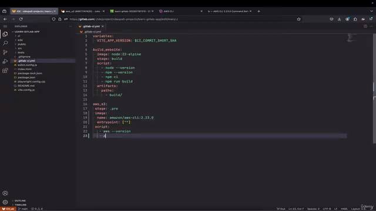

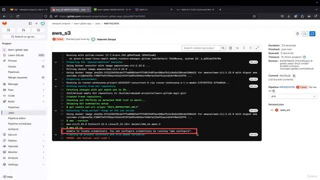

**这一步不要跳过。** 讲师特意先跑一条必然失败的命令，就是为了让你知道「错的不是命令语法，是身份」。后面所有排错都靠这个基线。

### Step 2：在 AWS IAM 建一个只能干 S3 的机器用户

1. 控制台搜索 `IAM`，进入 Identity and Access Management。
2. 左侧菜单 → **Users** → **Create user**。
3. 用户名填 `GitLab`。
4. **不要勾**「Provide user access to the AWS Management Console」（P091 [02:22]）。这个用户不会登录控制台。
5. Next → 权限页 → 搜索 `S3` → 勾选 **Amazon S3 full access**。
6. Next → Create user。

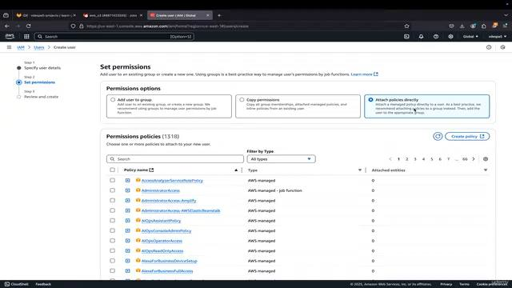

7. 点进这个用户 → **Create access key**（也可以走 Security credentials → Access Keys 区域，两个入口都行）。
8. 使用场景选 **Command Line Interface (CLI)**，接受它的提示（讲师说这些替代方案建议不适用于我们的场景）。
9. 描述填 `access key for GitLab`（P091 [05:44]）——这个描述是以后判断「这把 key 是干嘛的、能不能删」的唯一线索。
10. Create access key。

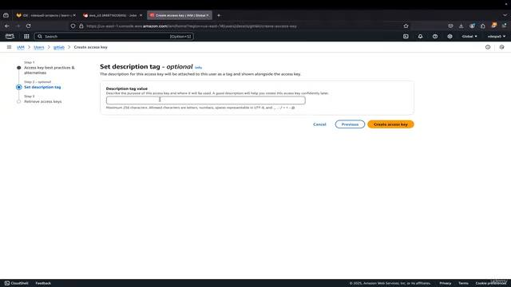

**这一页关掉就再也看不到了。** 讲师在这一页停留很久，就是因为 secret access key 无法再次获取。

### Step 3：把 key 存进 GitLab CI/CD Variables

**先查变量名。** 去 AWS CLI 官方文档，找 Configuration / Environment variables 那一节，有一条表格列出「凭据用哪些环境变量名」。讲师的做法就是直接从这个表里复制：

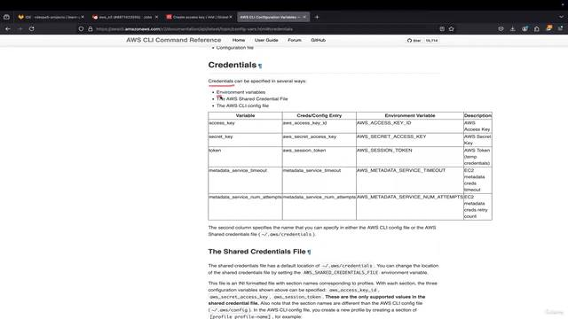

> 逐字稿里讲师说的是「access key ID 的环境变量」和「secret access key 的环境变量」，并说「从这一列直接复制粘贴过来」。**这两个环境变量的确切拼写请以你打开的那一版 AWS CLI 文档表格为准**，本文档后面代码块里使用的是 AWS CLI 官方文档中的标准命名 `AWS_ACCESS_KEY_ID` / `AWS_SECRET_ACCESS_KEY`。

**再进 GitLab 填。** 项目 → **Settings** → **CI/CD** → 展开 **Variables** → **Add variable**。

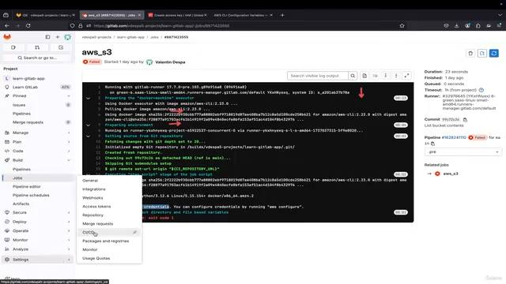

变量 1：

| 字段 | 值 |
|---|---|
| Key | `AWS_ACCESS_KEY_ID` |
| Value | 刚才那页的 Access key ID |
| Visibility | **Visible** |
| Protect variable | **勾选** |
| Expand variable reference | **不勾** |
| Description | 例如「GitLab CI 访问 S3 用的 access key ID」 |

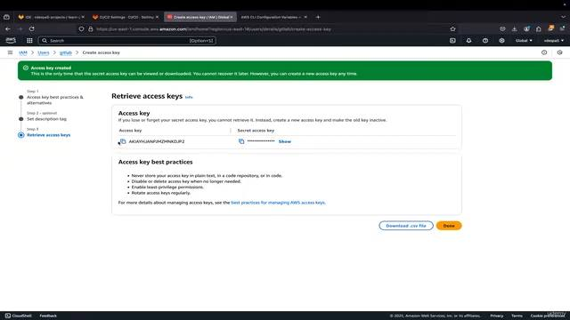

变量 2：

| 字段 | 值 |
|---|---|
| Key | `AWS_SECRET_ACCESS_KEY` |
| Value | 刚才那页的 Secret access key |
| Visibility | **Masked and hidden** |
| Protect variable | **勾选** |
| Expand variable reference | **不勾** |

讲师对这两个变量的取舍理由（P093 [03:17]–[06:09]）：
- access key ID 用 Visible：它是「用户名」，不是秘密；用 Hidden 的话，将来轮换凭据时你自己都不知道手上是哪个 ID。
- secret 用 Masked + Hidden：Masked 让它在日志里变成 `[MASKED]`，Hidden 让它保存后连界面都读不出来。
- 两个都 Protect：只有 protected 分支（比如 `main`）才能拿到这两个变量。
- 两个都关掉 Expand：值里如果出现 `$`，开着 expand 会被当成变量引用去展开，secret 就被改坏了。

### Step 4：Retry 那个失败的 job

因为没改代码，push 不会触发流水线。进 **CI/CD → Pipelines**（或 job 详情页），点右上角 **Retry**（P093 [07:06]）。

这次 `aws s3 ls` 会成功，日志里会打印你账号下的 bucket 列表，其中包括你建的那个 bucket。讲师说：**这一条命令成功，就证明凭据配对了。**

### Step 5：上传一个文件

把 script 改成两行——先造一个文件，再上传：

```yaml
script:
  - echo "<h1>Hello S3</h1>" > index.html
  - aws s3 cp ./index.html s3://<你的bucket名>/index.html
```

> `cp` 子命令和它的用法来自 P094 [00:53]；`echo ... > index.html` 来自 P094 [02:49]；bucket 名先写死是这一步的临时状态，下一步就抽走。

提交后日志里会出现类似：

```
upload: ./index.html to s3://<你的bucket名>/index.html
```

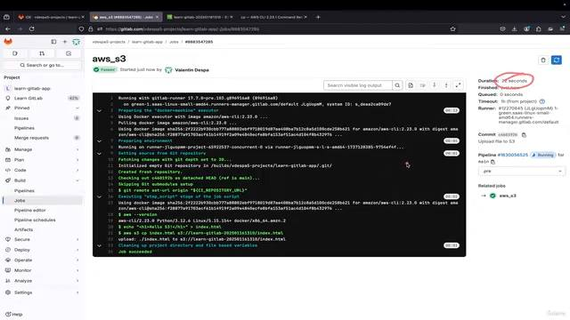

> 上面这行 `upload:` 开头的日志，讲师在 P094 [04:15] 逐字读了一遍（「upload: ./index.html to s3://bucket/index.html」）。**前缀字段的确切写法以你实际输出为准。**

到 S3 控制台刷新 bucket 对象列表，能看到 `index.html`。

### Step 6：把 bucket 名抽成变量

项目 → Settings → CI/CD → Variables → Add variable：

| 字段 | 值 |
|---|---|
| Key | `AWS_S3_BUCKET` |
| Value | 你的 bucket 名 |
| Visibility | **Visible** |
| Protect variable | **不勾**（讲师：bucket 名不是秘密，不需要 protect，P094 [05:43]） |
| Expand variable reference | **不勾** |

> 注意这个变量名是**讲师自己起的**，AWS CLI 不认识它，是我们自己在脚本里 `$AWS_S3_BUCKET` 引用的。讲师说：「这是个我们自己定义的变量，你想怎么命名都行，我只是想跟其他变量保持一致的风格。」（P094 [06:10]）

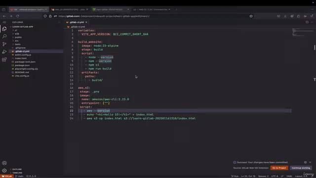

然后改 script：`s3://$AWS_S3_BUCKET/index.html`。再跑一次，日志里这条命令会被替换成真实 bucket 名。

**顺便做个反向实验（强烈建议做一次）：** 把这个变量名末尾加个 `X`，再跑 job。你会看到日志里出现三个连续斜杠：

```
s3:///index.html
```

以及 `invalid bucket name` 之类的报错，引号中间是空的。原因：**环境变量找不到时会被替换成空字符串，不会报「变量未定义」**（P094 [07:09]）。以后在 CI 日志里看到三个斜杠，第一反应就是「变量没注入」。

### Step 7：把 bucket 变成能访问的网站（三步）

1. **开静态托管**：bucket → Properties → 滚到底 → Static website hosting → Edit → 选 **Enable** → Hosting type 选 **Host a static website** → Index document 填 `index.html` → Save changes。（P095 [00:27]–[01:22]）
2. **关掉公共访问阻断**：bucket → Permissions → Block public access → Edit → 取消阻断 → 在确认框里输入确认。（P095 [02:21]–[03:16]）
3. **写 bucket policy**：bucket → Permissions → Bucket policy → Edit，按第 4 节的 JSON 填。**注意：AWS 的 policy 编辑器有可视化模式，讲师就是用可视化控件加出来的**（先加 S3 服务 → 加 `GetObject` 这个 read 级别 action → Principal 改成 `"*"` → 加 resource，把 bucket 占位符换成真实 bucket 名、object 名换成 `*`），保存后编辑器会把可视化结果翻成 JSON。

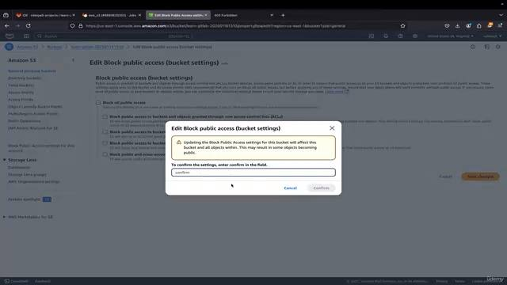

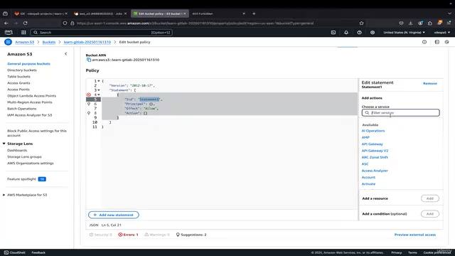

回到 Properties，滚到底能看到那个静态托管地址，打开就是 `Hello S3`。

---

## 4. 完整代码

### 4.1 最终版 `.gitlab-ci.yml`

**来源标注（很重要）：**
- `script` 里的 `echo` + `aws s3 cp`、以及三个变量名：**来自逐字稿 P093 / P094**。
- `image`、`stage`、`rules`：**课里没讲**，是本文档为了让文件能整份保存并跑起来补的最小骨架，请按你自己项目的镜像/阶段替换。

```yaml
# .gitlab-ci.yml
# 保存到仓库根目录，和 index.html 同级（index.html 由 job 自己生成，所以不用提交）

stages:
  - deploy

deploy-to-s3:
  stage: deploy

  # 课里没讲用哪个镜像。这里需要一个装了 AWS CLI 的镜像。
  # amazon/aws-cli 的 ENTRYPOINT 就是 aws，个别环境下命令会被吞，
  # 遇到时可以打开下面这行把 entrypoint 清空：
  image: amazon/aws-cli:latest
  # entrypoint: [""]

  # 只让 main 分支跑：因为 AWS_ACCESS_KEY_ID / AWS_SECRET_ACCESS_KEY
  # 勾了 Protect，只在 protected 分支注入（见 P093 [03:45]）
  rules:
    - if: '$CI_COMMIT_BRANCH == "main"'

  script:
    # 1) 先造一个要上传的文件（P094 [02:49]）
    - echo "<h1>Hello S3</h1>" > index.html

    # 2) 上传到 S3（命令来自 P094 [00:53]；bucket 名走变量，P094 [05:39]）
    - aws s3 cp ./index.html s3://$AWS_S3_BUCKET/index.html
```

### 4.2 中途版本：只验证凭据

如果你只想先确认凭据通了（对应 P090 / P093 的 retry 那一步），把 script 换成一行：

```yaml
  script:
    - aws s3 ls
```

### 4.3 Bucket policy（S3 静态托管第三步）

```json
{
  "Version": "2012-10-17",
  "Statement": [
    {
      "Sid": "PublicReadGetObject",
      "Effect": "Allow",
      "Principal": "*",
      "Action": "s3:GetObject",
      "Resource": "arn:aws:s3:::YOUR_BUCKET_NAME/*"
    }
  ]
}
```

**填写说明与不确定性声明：**
- `Effect: Allow`、`Principal: "*"`、`Action: s3:GetObject`、resource 里的「bucket 名 + `*`」——这四项讲师在 P095 [05:08]–[06:34] 逐项讲过。
- `Version` 和 `Sid` 是 AWS 编辑器生成的默认结构，**讲师没有逐字解释**；`Sid` 这个名字也可以换成任何你喜欢的标识。
- `Resource` 那一整串 ARN，是你在编辑器里填 bucket 名和 `*` 之后由 AWS 自动拼出来的，**课里没有逐字念出这个字符串**，请以你控制台生成的结果为准。
- 把 `YOUR_BUCKET_NAME` 换成你的真实 bucket 名，**不要带 `s3://` 前缀**。

### 4.4 变量清单（最终形态）

| Key | 谁定义的 | Value | Visibility | Protect | Expand |
|---|---|---|---|---|---|
| `AWS_ACCESS_KEY_ID` | AWS CLI 识别的标准名 | IAM access key ID | Visible | ✔ | ✘ |
| `AWS_SECRET_ACCESS_KEY` | AWS CLI 识别的标准名 | IAM secret access key | Masked and hidden | ✔ | ✘ |
| `AWS_S3_BUCKET` | 我们自己起的名 | bucket 名 | Visible | ✘ | ✘ |

### 4.5 目录结构

```
your-gitlab-project/
├── .gitlab-ci.yml        # 上面 4.1 的完整内容
├── （你的前端构建产物目录）
└── index.html            # 不需要提交！job 里 echo 生成；真实项目里应来自 build
```

---

## 5. 逐行解释

### 5.1 `.gitlab-ci.yml`

```yaml
image: amazon/aws-cli:latest
```
这个 job 要跑 `aws` 命令，所以运行环境里必须有 AWS CLI。讲师在 P094 [04:15] 提到「启动这个 Docker 容器…一共 22 秒」，说明执行环境是容器。**具体用哪个镜像课里没讲**；`latest` 只是能跑起来，生产上应该钉死一个版本号，否则哪天镜像更新了你的流水线会莫名其妙挂掉。

```yaml
rules:
  - if: '$CI_COMMIT_BRANCH == "main"'
```
这一行不是抄来的，是从 P093 [03:45] 的一条规则推导出来的：两个 AWS 变量勾了 **Protect**，意味着**它们只在 protected 分支注入**。如果你在 feature 分支跑这个 job，变量是空的，`s3://$AWS_S3_BUCKET/index.html` 就会退化成 `s3:///index.html`——正好复现 P094 [07:09] 那个三斜杠错误。所以 job 本身也应该限制在 `main` 上跑，让「谁能跑」和「谁能拿到密钥」对齐。

```yaml
- echo "<h1>Hello S3</h1>" > index.html
```
用 shell 重定向造一个最小 HTML 文件，避免为了测试上传而去改仓库。`>` 是覆盖写，`>>` 是追加——这里必须是覆盖。**注意：真实项目里这一行应该删掉**，`index.html` 应该来自构建步骤（讲师也说最终目标是上传整个 build 目录，但构建步骤本身不在 P090–P095 范围内）。

```yaml
- aws s3 cp ./index.html s3://$AWS_S3_BUCKET/index.html
```
- `cp`：copy，双向的——本地→S3 或 S3→本地（P094 [00:53]）。
- `./index.html`：源，job 工作目录下的文件。
- `s3://` 前缀：告诉 CLI 目标是 S3 而不是本地路径。
- `$AWS_S3_BUCKET`：GitLab CI 在执行前把变量注入成环境变量，shell 展开后再交给 aws 命令。**在 JS/Node 里这就是 `process.env.AWS_S3_BUCKET`**——同一套机制，只是 CI 帮你注入了。
- 为什么必须抽变量：讲师原话「硬编码在命令里的配置是我们非常非常不喜欢的东西」（P094 [05:39]）。写死的话，换一个 bucket、开一套 test 环境就得改代码。

### 5.2 三个变量的开关

**Visibility = Visible（access key ID）**
日志里会原样打印。讲师的理由：它是标识符不是密钥，而且轮换时你需要知道当前用的是哪个 ID（P093 [03:17]）。

**Visibility = Masked and hidden（secret）**
- Masked：日志里出现该值时替换成 `[MASKED]`。**前提是值本身满足 GitLab 对可 mask 字符串的格式要求**（长度、字符集），不满足时 GitLab 会存不进去——这个限制讲师没讲，以你使用版本的 GitLab 文档为准。
- Hidden：保存后连拥有项目权限的人在界面上也读不出来，只能覆盖不能查看。代价是**你将永远无法从 GitLab 取回这个值**，这跟 P091 [08:34]「secret access key 丢了就找不回来」是同一个心理准备。

**Protect = ✔**
只在 protected 分支/tag 上注入。它不加密任何东西，只是**限制注入范围**：非保护分支的 job 拿不到，所以即使有人在分支上乱改 `.gitlab-ci.yml` 想把密钥 echo 出来，也拿不到值。

**Expand = ✘**
关掉「变量引用展开」。如果开着，值里出现 `$` 会被当成变量名去解析，secret 就被改写了。讲师说过「万一 value 里有美元符号，可能会被展开成别的东西，这绝对不行」（P093 [06:09]）。

```text
JS/Node 对照：
  GitLab CI Variables  ≈  process.env / .env 文件
  Masked               ≈  日志脱敏（类似 pino 的 redact 配置）
  Protect              ≈  只在 production 环境注入 secret
  轮换 access key      ≈  rotate 一个 JWT signing secret / API key
```

### 5.3 Bucket policy 每个字段

```json
"Effect": "Allow"
```
允许而不是拒绝。S3 policy 里 Explicit Deny 优先级最高，这里不需要。

```json
"Principal": "*"
```
`Principal` 是「谁」。讲师解释：「它指定被允许或拒绝访问的用户、账号、服务，总的来说是实体」（P095 [05:08]）。换成 `"*"` 并加上双引号，表示「任何人，包括匿名公网访问者」。**注意必须带引号**——讲师在这里专门演示了不加引号时编辑器立刻报错，因为这是 JSON，字符串必须有引号。

```json
"Action": "s3:GetObject"
```
只给读，不给写、不给删、不给 list。这就是这节课唯一一次真正做到了最小权限——IAM 那边用的是 full access（讲师自己承认超标了），但 bucket policy 这边精确到单个 action。

```json
"Resource": "arn:aws:s3:::YOUR_BUCKET_NAME/*"
```
- 结尾的 `/*` 代表 bucket 里的**所有对象**。讲师说：「星号代表任何对象，我们不想指定某个具体对象，我们要指定所有对象。」（P095 [06:34]）
- 没有这个 `/*` 的话，策略作用在 bucket 本身而不是对象上，`GetObject` 不会生效。
- 三个冒号后面直接跟 bucket 名，不带 `s3://`，这是 ARN 的格式。

**这三步必须全做，缺一不可**：只开静态托管 → 403；开了托管 + 解了公共访问阻断但没 policy → 还是 403（讲师在 P095 [03:44] 就是在这一步卡住的，因为「现在 bucket policy 是空的」）。

### 5.4 三个错误信息怎么读

| 日志里看到 | 真实原因 | 对应时间点 |
|---|---|---|
| `Unable to locate credentials` | 环境里没有 access key，CLI 不知道你是谁 | p090 [02:19] |
| `s3:///index.html` + `invalid bucket name`，引号中间空 | 变量名拼错/变量没注入（Protect + 非保护分支也会这样） | p094 [07:09] |
| 网站 403 | 三步没做全：托管没开 / 公共访问被阻断 / 没有 bucket policy | p095 [02:21] |

第二条最值得记住：**shell 遇到不存在的变量不会报错，只会展开成空字符串**。所以在 CI 里排查「配置没生效」，先看命令回显里有没有连续斜杠、有没有空引号——这比猜快得多。

---

## 6. 复现检查清单

- [ ] AWS 账号能登录控制台，S3 里有一个自己建的 bucket（名字全球唯一）
- [ ] IAM → Users 里有 `GitLab` 用户，**没有**勾选 Management Console 访问
- [ ] 该用户挂了 `Amazon S3 full access` 策略（知道它超标了，是为了跟着课程走）
- [ ] 创建了 access key，描述写的是 `access key for GitLab`
- [ ] GitLab 项目 Settings → CI/CD → Variables 里有 3 个变量，Key 拼写逐字符核对过
- [ ] `AWS_ACCESS_KEY_ID`：Visible / Protect ✔ / Expand ✘
- [ ] `AWS_SECRET_ACCESS_KEY`：Masked and hidden / Protect ✔ / Expand ✘
- [ ] `AWS_S3_BUCKET`：Visible / Protect ✘ / Expand ✘
- [ ] `AWS_SECRET_ACCESS_KEY` 保存后，再点编辑，**值已经读不出来了**（说明 hidden 生效）
- [ ] 先跑 `aws s3 ls` 成功，日志里能看到自己的 bucket
- [ ] 再跑 `aws s3 cp`，日志里出现 `upload: ./index.html to s3://...`
- [ ] S3 控制台能看到 `index.html` 对象
- [ ] 故意把 `AWS_S3_BUCKET` 改名复现过一次三斜杠报错，然后改回来
- [ ] Properties → Static website hosting = Enabled，Index document = `index.html`
- [ ] Permissions → Block public access = Off
- [ ] Permissions → Bucket policy 里有 `s3:GetObject` + `Principal "*"` + `Resource .../*`
- [ ] 打开静态托管地址，看到 `Hello S3`
- [ ] 收尾：如果只是练习，把 access key 停用/删除（P091 [07:11]）

---

## 7. 课里没讲但你会撞上的

**1）bucket 名是全局唯一的。** 全世界所有 AWS 账号共享一个命名空间，`test`、`my-bucket` 这类名字早就被占了。起名带上账号后缀或随机串。

**2）创建 bucket 的过程课里没讲。** 讲师一上来就有 `Learn GitLab` 这个 bucket。你在控制台建的时候会遇到「Region 选哪个」「Object Ownership 怎么选」这些问题，P090–P095 都没有覆盖。

**3）Region 相关的环境变量课里没讲。** 讲师没说要在 GitLab 里加 `AWS_DEFAULT_REGION`。`s3 ls` / `s3 cp` 这类命令通常不需要，但一旦你换成别的服务或别的子命令，可能就会遇到「no region specified」。到时候要自己加一个变量。

**4）上传整个 build 目录，课里没讲也没演示。** 讲师在 P094 [00:26] 明确说最终目标是「上传整个网站文件」，但为了讲清楚，他只做了「传一个文件」。批量同步 S3 的那个子命令，**课里从头到尾没出现过**，需要你自己去 AWS CLI 文档的 examples 区找（讲师在 P094 [02:20] 教的方法正好用得上）。

**5）MIME type / Content-Type 课里没讲。** `aws s3 cp` 会按文件扩展名猜 Content-Type，但如果你传的是无扩展名文件或构建产物，浏览器可能把它当 `application/octet-stream` 下载而不是渲染。遇到「网页变成下载文件」时就是这个原因。

**6）缓存，课里没讲。** 你更新了 `index.html` 重新部署，浏览器可能还是显示旧页面。S3 静态托管默认不带 cache-control 策略，刷新用强制刷新（Ctrl+Shift+R）先排除本地缓存，再考虑给对象加缓存头。

**7）HTTPS，课里讲了但只讲了一句。** 讲师在 P095 [08:00] 说：「访问是走 HTTP 而不是 HTTPS，浏览器会告诉你连接不安全。」S3 静态托管的 endpoint 只有 HTTP，要 HTTPS 得挂 CloudFront + 证书——**这部分课里没讲**。

**8）AWS 自己也建议别用 S3 做静态托管。** 讲师在 P095 [00:27] 原话：「AWS 不建议用 S3 做静态网站托管，我展示它只是因为它是个很简单的例子，不是因为这是 AWS 的最佳用法。」把它当学习用的跳板，别当生产方案。

**9）`Amazon S3 full access` 是真超标。** 讲师自己承认了（P091 [07:11]），并说「正确做法在 resources 文件夹里，但那超出课程范围」。如果这个 job 只需要往一个 bucket 写，policy 至少应该收窄到那个 bucket 的 `s3:PutObject`。**收窄的具体配置课里没讲**。

**10）长期 access key 本身就有风险。** 它可以被无限期使用，除非你手动轮换（讲师在 P091 [07:11] 和 [08:34] 都强调要定期轮换、不用了就删）。业界更常见的做法是让 CI 用短期凭据/OIDC 直接换临时凭证——**这个方案课里完全没提**，属于本节之外的补充知识，但值得你知道有这么条路。

**11）`Protected` 变量 + 非保护分支 = 静默失败。** 讲师只在 P093 [03:45] 说了一句「其他分支拿不到这些变量」，但真撞上时非常难查：job 会正常启动，命令也照常执行，只是变量展开成空。这就是为什么你在第 3 节要**故意做一次三斜杠实验**——把它变成一次「可控的失败」，比在生产环境第一次遇到强。

**12）关于并发。** 这一节完全没有锁和事务的概念：两个 job 同时往同一个 S3 key 写，最后完成的那次覆盖前一次，中间没有冲突检测。**课里没讲任何并发处理**。如果你的流水线会并行部署同一个 bucket，需要自己加 `resource_group` 之类的串行化机制——这是 GitLab CI 的概念，不在 P090–P095 的范围内。