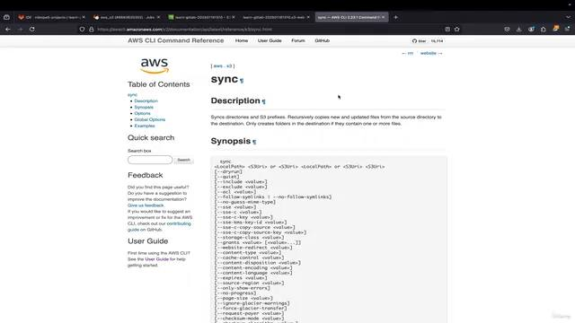
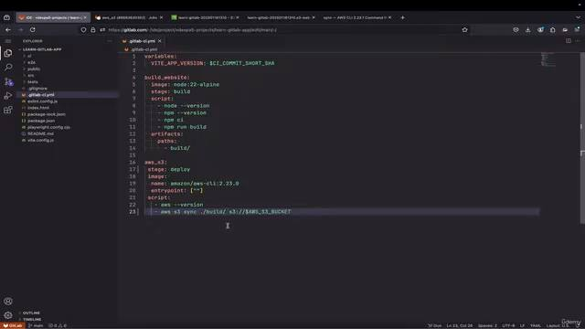
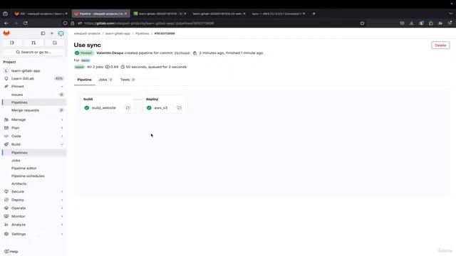
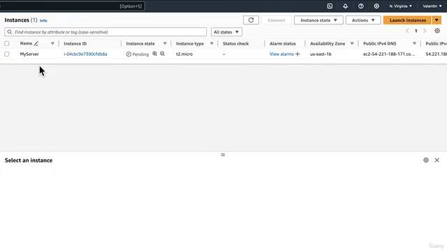
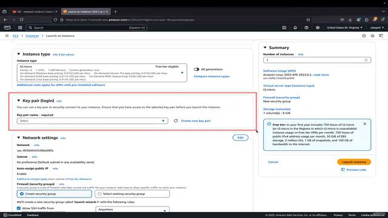
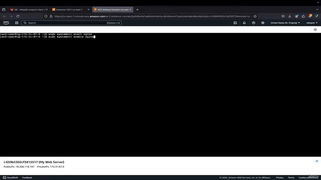
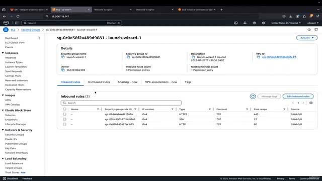

# GitLab CI/CD 实战：用 `aws s3 sync` 发布静态站点，并手工搭一台 EC2 Web 服务器

---

## 1. 这一节做什么

前面几个小节里，流水线已经能把站点部署到 AWS 了，但部署方式很原始——只把一个 `index.html` 文件 `cp` 上去。这一节（P096–P100）要解决三个连在一起的问题：

1. **把"单文件部署"升级成"目录部署"**。构建产物是一个目录（`build/`），里面有一堆文件，逐个 `cp` 不现实；同时多次部署会在桶里留下上一版的垃圾文件。讲师引入 `aws s3 sync` 来一次性同步整个目录，并把部署作业从 pre-stage 挪到 `deploy` 阶段，保证它跑在 build 之后、能拿到 `build/` 产物。
2. **补两块 AWS 基础认知**（P097 总结 + P098 EC2 入门）。S3 做文件存储、IAM 做访问控制、S3 静态网站托管只是"够用"的示例方案；EC2 是"可以租的云上虚拟计算机"，是很多 AWS 服务的地基。这一段讲师明确说了**课程后续不会直接用 EC2**，属于扩展知识。
3. **手工起一台真正能访问的 Web 服务器**（P099），并**学会在自动化之前先手工验证连通性**（P100）。用 `netcat` 从本机探 22 端口，再通过改安全组的入站规则亲自制造一次"连不上"，理解端口、安全组、超时三者的关系——这一步是下一节写自动化脚本前的"体检"。

一句话概括产出物：**一条会 `sync` 目录的 `deploy` 作业 + 一台装了 nginx 的 Amazon Linux 实例 + 一套端口连通性验证手法**。

---

## 2. 讲师原话（带出处）

> "我们已经成功把文件上传到了 S3。但实际上，构建过程的一部分会生成一整个包含多个文件的目录。而处理目录并不像你想的那么容易。"
> —— p096 [00:00]

> "当然，如果我们要多次部署，S3 存储桶里可能会留下一些不再需要的旧文件。这意味着我们得先删除存储桶中的所有内容，然后再上传文件。……不过，S3 提供了一种更聪明的做法，叫作 sync。"
> —— p096 [00:24]

> "我们不再希望这个作业属于预构建阶段，而是希望它属于部署阶段。我们要在构建作业完成后执行它，这样才能访问构建目录。"
> —— p096 [01:20]

> "如果愿意，我们可以保留那个点，写成 ./，意思是上传当前目录下的 build/ 目录。……那么现在会发生的是，build 目录中的内容会被上传到这个 S3 存储桶。"
> —— p096 [02:43]

> "把这个作业放进部署阶段其实很有意思。……这个命令同样会输出很多信息，会明确告诉我们它要上传什么。以 index.html 为例，它会显示：正在把 build/index.html 上传到这个存储桶的 index.html。"
> —— p096 [03:11]

> "一般来说，S3 存储桶并不是为静态网站托管而设计的。它确实能实现这一点，但我们在这里只是把它当作示例来说明这些原则。"
> —— p097 [00:53]

> "EC2 就像一台可以在云端租用的虚拟计算机。……许多其他 AWS 服务都以 EC2 为基础。它就像一栋建筑的地基，支撑着许多其他 AWS 服务。"
> —— p098 [00:52]

> "尽管本课程不会直接使用 EC2，但我认为了解一些关于它的知识仍然很重要。"
> —— p098 [01:21]

> "如果停止实例，这和你关闭自己的计算机很像。……不过，系统仍会为关联资源计费，例如挂载的 EBS 卷（它本质上就是硬盘）以及关联的 Elastic IP 地址。"
> —— p098 [15:01]

> "终止实例意味着我们彻底删除这个实例，同时也会删除与该实例关联的所有硬盘。"
> —— p098 [16:26]

> "我们不用密码，而是使用 SSH 密钥连接这台虚拟服务器。[…] SSH 密钥的工作方式类似锁和钥匙系统：服务器持有公钥，你保留私钥。"
> —— p099 [01:25]

> "这里的思路是安装 nginx，为此我们要使用这个名为 DNF 的包管理器。DNF 是面向 Amazon Linux、Fedora 或 CentOS 等 Linux 发行版的现代包管理器。它是较旧的 YUM 包管理器的后继。"
> —— p099 [05:44]

> "仅仅因为已经安装，并不意味着它实际上正在运行。[…] 下面的命令会把 nginx 配置为服务，并让它在系统启动时自动启动。"
> —— p099 [06:40]

> "我们在这里想看到的是这一部分显示为 active running。这说明 nginx 现在很可能已经在正常工作。"
> —— p099 [07:10]

> "NCAT 是一个命令行工具，我们用它来与网络套接字交互；IP 地址与端口的一种典型组合就被视为一个套接字。[…] 我们只是想检查网站服务器上的 22 端口是否可访问。"
> —— p100 [00:27]

> "其中一个标志是 Z 标志，表示零输入输出。[…] 第二个选项会让 Netcat 输出得啰嗦一些，因此我们会得到更详细的输出，它会告诉我们连接是成功还是失败。"
> —— p100 [00:54]

> "当我们运行这条命令后看到没有任何反应，我们就知道，好吧，那个端口没有开放；或者至少从我们这台机器上无法访问那台特定的服务器。"
> —— p100 [03:18]

---

## 3. 从零复现

下面按"先改流水线、再手工搭服务器、最后验证连通性"的顺序走。每一步都给了**你能照着敲的东西**和**你应该看到的输出形态**。

### 步骤 0：前置条件（在本节之前的小节里已经完成）

本节逐字稿**没有**重新演示这些，但你必须有：

- 一个 AWS 账号，已经在 S3 里建好一个存放站点的桶，并且开启了静态网站托管；
- 一个用于 CI 的 IAM 用户，具备对上述桶的 `s3:PutObject` / `s3:ListBucket` 等权限；
- 这几个值已经作为 GitLab 项目的 CI/CD Variables 配置好：`AWS_ACCESS_KEY_ID`、`AWS_SECRET_ACCESS_KEY`、`AWS_DEFAULT_REGION`（**具体变量名以你前面小节实际定义的名字为准**，本节讲师只说"用这个环境变量替换我的存储桶。"，没有逐个念变量名）；
- 一条能跑通的 `build` 作业，产物输出到 `build/` 目录（里面至少有 `index.html`）。

> ⚠️ 如果你是从这一节直接跳进来的，请先回到前面小节把 S3 桶、静态网站托管、IAM 用户和 CI 变量配好，否则后面 `sync` 一定失败。

### 步骤 1：打开 AWS CLI 的 `s3 sync` 文档，确认用法

讲师在 p096 [00:52] 打开 AWS CLI 命令参考，找到 `sync`，然后跳到 examples 段落，挑中"将所有本地对象同步到指定的存储桶。"这一条示例。



这一步的意义是：**`sync` 是"目录 ↔ S3 前缀"的同步命令**，不是"上传一个文件"。这就是你要替换掉旧 `cp` 命令的原因。

### 步骤 2：改 `.gitlab-ci.yml` 的部署作业

按顺序做四件事（顺序就是讲师在 p096 [01:20]–[02:43] 的操作顺序）：

1. **删掉旧的单文件拷贝行**。讲师原话是"我们已经没有 index.html 文件了。我这就把这个删掉。"——也就是原来那行形如 `aws s3 cp ./build/index.html s3://.../index.html` 的命令整行删掉。
2. **把作业从 pre-stage 挪到 `deploy` stage**。原因讲师讲得很直白：要跑在 `build` 之后，才能拿到 `build/` 目录。
3. **把硬编码的桶名换成环境变量**。讲师原话"我要用这个环境变量替换我的存储桶。"。
4. **把源路径写成 `./build/`**。这是本节最容易写错的一行，见下面第 5 节的逐行解释。

改完之后，部署作业的关键行长这样：

```yaml
  script:
    - aws s3 sync ./build/ s3://$S3_BUCKET/
```

### 步骤 3：提交并观察流水线

提交后进 CI/CD → Pipelines，点进这次流水线。你应该看到 `build` 先绿，然后是 `deploy` 绿。



点开 `deploy` 作业的日志，`aws s3 sync` 会**逐条打印它上传了什么**。讲师原话："这个命令同样很啰嗦，会明确告诉我们它准备上传哪些内容。"日志里会出现类似这样的行（这里的字段就是命令原始输出，逐字稿里讲师正是拿 `index.html` 举例说明的）：

```
upload: build/index.html to s3://<你的桶名>/index.html
```

注意两边的路径：**本地是 `build/index.html`，远端是桶根下的 `index.html`**——也就是说 `build/` 这一层被"吃掉"了，目录里的内容直接铺到桶根。



### 步骤 4：去 S3 控制台和浏览器验收

打开 S3 控制台进入你的桶，应该能看到 `index.html` 就在根目录（不是在某个 `build/` 子目录下）。然后用静态网站托管的 endpoint 打开，站点应该正常显示。

讲师在 p096 [04:05] 就是点了一下刷新，然后说"这就是我们漂亮的网站。"。到这一步，本节的主线任务就完成了。

### 步骤 5（可选实验 A）：起一台 Ubuntu 实例，熟悉 EC2 控制台

P098 是一节纯入门的 EC2 演示，讲师自己强调"如果你赶时间……你就不需要这门课程，也不需要我在这节课上教的内容。"。想跟着做的话：

1. 控制台搜索框输入 `EC2`，进 EC2 Dashboard，找到 **Launch instance**。
2. Name 填 `my server`。
3. AMI 选 **Ubuntu Server 24.04**（讲师特意提醒："确保在这里选择相同的 Amazon 机器镜像，也就是 AMI。"，因为版本会随时间变化）。确认它标着 free tier eligible。
4. Instance type 选 **t2.micro**（free tier eligible，免费额度是 750 小时/月）。
5. Key pair 这一步讲师**故意不创建**——"这不会允许任何远程连接，但我们仍可以从这个 Amazon 界面连接到该实例。"也就是说你可以用浏览器里的 EC2 Instance Connect 登进去，但不能从自己电脑 SSH。
6. 网络设置保持默认；存储 8 GB 保持默认。
7. 点 Launch instance。

回到 Instances 列表，你会看到实例。等 status check 变成 **2/2 checks passed**，state 变成 **running**。



### 步骤 6（可选实验 A 续）：连进去敲几条命令

选中实例 → 顶部 **Connect** → 选 **EC2 Instance Connect** → 用户名会自动填 `ubuntu` → Connect。浏览器新标签页里出现一个终端。

在这个终端里依次敲（这就是讲师在 p098 [09:46]–[11:14] 演示的那几条）：

```bash
whoami
pwd
echo "hello ubuntu" > hello.txt
ls
cat hello.txt
```

- `whoami` 返回 `ubuntu`（逐字稿里讲师口述成"who am I"，实际命令拼写是 `whoami`）；
- `pwd` 返回 `/home/ubuntu`；
- `ls` 能看到刚创建的 `hello.txt`；
- `cat` 打印出 `hello ubuntu`。

讲师还演示了 `sudo apt update` 之后 `sudo apt install cmatrix`，然后 `cmatrix -s` 玩了一下"黑客屏保"。这一步没有实用价值，纯娱乐，但他顺带说明了一个真实问题：**包管理器报"无法定位软件包。"时，通常是因为包索引过期，先 `sudo apt update`**。这条经验后面在 Amazon Linux 上会以 `dnf` 的形式再出现一次。

### 步骤 7（可选实验 A 续）：理解 stop 和 terminate 的区别

这是本节最值钱的一条运维常识：

- **Stop instance** ≈ 关机。不 running 了，不再收 CPU/流量费用，但**挂着的 EBS 卷（就是硬盘）和弹性 IP 仍然在计费**。之后可以从 Instance state → Start instance 再开起来。
- **Terminate instance** ≈ 把机器连同硬盘一起销毁。实例从此不存在，过一会儿会从列表里消失。

讲师在 p098 [17:24] 特意补了一句：**terminate 之后一定要去 Network & Security → Elastic IPs 里检查，确认没有残留的弹性 IP**，因为"你正在从 AWS 租用一个 IP。"，闲置的弹性 IP 也是要花钱的。

### 步骤 8：起一台 Amazon Linux 实例，准备当 Web 服务器

P099 换了一台新实例，配置和上面不同，注意这几个差异点：

1. Name 填 `my web server`。
2. AMI 选 **Amazon Linux 2023**（注意，不是 Ubuntu 了）。
3. Instance type 仍是 **t2.micro**。
4. **Key pair 这次必须创建**。点 Create new key pair，名字填 `GitLab`（讲师起的名字，方便记住它是给这门课用的），格式选 **PEM**（"它可以与 OpenSSH 很好地配合。"），创建后私钥文件会自动下载到你电脑。



5. Network settings 里要确认三条：
   - 允许 **SSH** 流量（默认就是 anywhere）；
   - 勾上 **HTTPS** 和 **HTTP** 来自互联网的流量（因为要当 Web 服务器）；
   - **Auto-assign public IP** 必须是 **Enabled**。如果显示 Disabled，点 Edit 改过来。没有公网 IP 就访问不到。
6. Launch instance，等 2/2 checks passed。

### 步骤 9：装 nginx 并让它开机自启

选中 `my web server` → Connect → EC2 Instance Connect → 用户名是 `ec2-user`（Amazon Linux 的默认用户，讲师原话是"这是我们将在此连接中使用的用户名。"）→ Connect。

然后在终端里按顺序执行（讲师把它们整理成了一个 TXT 附件挂在课时资源里，这里给出等价内容）：

```bash
sudo dnf install -y nginx
sudo systemctl start nginx
sudo systemctl enable nginx
sudo systemctl status nginx
```

四条命令各管一件事，**顺序不能乱**：

- 第 1 条：装。`sudo` 提权到 root，`-y` 把所有交互式提问自动答 yes，避免安装被卡住。
- 第 2 条：本次启动。
- 第 3 条：注册成开机自启。讲师强调："不能因为它已经启动就认为没问题；很可能下次我们重启服务器时，这个服务就无法工作了。"
- 第 4 条：验证。**你要找的关键字是 `active (running)`**。



### 步骤 10：用浏览器验证网站

回到 Instances → 点实例 ID 进详情 → 复制 **Public IPv4 address**（或点 Open address）。

**关键坑：浏览器会默认帮你补 `https://`，然后连不上**。讲师原话："我的浏览器默认尝试使用 HTTPS 访问这个网站……目前尚未配置 HTTPS。因此，连接失败了。"

手动把地址栏里的 `https://` 改成 `http://`，回车。你会看到 **Welcome to nginx!** 默认页。浏览器会显示"不安全"的提示，讲师说这没关系，因为本来就是个公开的静态页，也没配证书。

这两个地址（公网 IP 和 Amazon 生成的 DNS 名）都要能开，把标签页留着，下一步要用。

### 步骤 11：在本机用 netcat 探 22 端口

P100 的思路是：**自动化之前，先手工确认链路通**。讲师用的工具是 `netcat`，命令名 `nc`（macOS/Linux 一般自带；Windows 没有，讲师说安装方法放在课时资源的 resources 文件夹里，**具体步骤课里没讲**）。

命令结构：

```bash
nc -zv <你的实例公网IP> 22
```

- `-z`：zero I/O，只探测端口开不开，不发送也不接收数据。讲师："检查那个特定端口是否开放的最快方法。"
- `-v`：chatty，输出详细信息。
- `22`：SSH 端口。

端口开着的时候，**响应是瞬时的（不到 1 秒）**，会打印类似 `succeeded` 的成功信息。


### 步骤 12：故意断开安全组，看清"连不上"长什么样

这是本节最值得动手的一步，因为它训练的是**判断力**而不是记忆。

1. 回 EC2 → Instances → 选中实例 → 下方 **Security** 标签 → 点进绑定的那个安全组。
2. 看 **Inbound rules**，能看到有一条放行 SSH、来源是 anywhere（`0.0.0.0/0`）。
3. 点 Edit inbound rules → 把这条 SSH 规则**删掉** → Save rules。生效是**立刻的**。
4. 回本地终端重新跑 `nc -zv <IP> 22`。



这次的表现是：**命令敲下去，什么都没发生**。光标就那么停着。讲师说得很清楚：

> "对我们来说，一旦运行这条命令后看到没有任何反应，我们就知道，好吧，这个端口没有开放，或者至少从我们这台机器上无法访问那台特定的服务器。"

它会一直卡到超时（讲师提到超时大约 30 秒到 1 分钟），最后打印类似 `operation timed out` 的信息。**你根本不用等**——按 `Ctrl+C` 发一个中断信号，2–3 秒没回应就足以判定不通。

5. 回安全组，Edit inbound rules → Add rule → Type 选 **SSH** → Source 选 Anywhere → IP 版本选 IPv4 → Save rules。
6. 再跑一次 `nc -zv <IP> 22`，这次又是瞬间成功。

这一来一回，你就把"端口不通"和"超时"这两件事绑在了一起。**下一节写 CI 自动化的时候，第一步就是拿这条 `nc` 做前置检查**。

---

## 4. 完整代码

下面两段都是可以直接落盘使用的完整文件。

### 4.1 `.gitlab-ci.yml`（项目根目录）

> 说明：`build` 作业、`image`、以及 `AWS_ACCESS_KEY_ID` / `AWS_SECRET_ACCESS_KEY` / `AWS_DEFAULT_REGION` 这几个 CI 变量，是**本节之前的小节**建立起来的，本节逐字稿没有重演。本节真正动的是 `deploy to s3` 这个作业：stage 改成 `deploy`、删掉单文件 `cp`、命令换成 `s3 sync`、桶名改成变量、源路径改成 `./build/`。下面的 `image` 只是让 `aws` 命令可用的一种做法，**以你前面小节实际用的镜像为准**。

```yaml
stages:
  - build
  - deploy

variables:
  # 桶名。建议在 GitLab 项目 Settings → CI/CD → Variables 里定义，
  # 这里只是给一个可读的占位默认值，请替换成你自己的桶名。
  S3_BUCKET: "your-bucket-name"

# ---------- 构建：产出 build/ 目录 ----------
build website:
  stage: build
  image: node:20-alpine
  script:
    - npm ci
    - npm run build
  artifacts:
    paths:
      - build/
    expire_in: 1 week

# ---------- 部署：把 build/ 整个目录同步到 S3 ----------
deploy to s3:
  stage: deploy
  image:
    name: amazon/aws-cli:latest
    entrypoint: [""]
  script:
    # 本节的核心改动：目录级同步，而不是单个文件拷贝
    - aws s3 sync ./build/ s3://$S3_BUCKET/
  rules:
    - if: '$CI_COMMIT_BRANCH == "main"'
```

### 4.2 `scripts/setup-web-server.sh`（EC2 上的初始化脚本）

> 说明：这不是讲师给的现成文件——讲师是在终端里一条一条敲的，并说会把命令整理成 TXT 附件。下面这份是把 p099 里那四条命令**原样**收拢成一个脚本，方便你一次性粘贴到 EC2 Instance Connect 的终端里（也可以 `scp` 上去再执行）。

```bash
#!/usr/bin/env bash
# 在 Amazon Linux 2023 上安装并启动 nginx
# 用法：把本文件内容直接粘进 EC2 Instance Connect 终端，或 scp 上去后 bash setup-web-server.sh

set -euo pipefail

# 1) 安装 nginx（dnf 是 Amazon Linux / Fedora / CentOS 的包管理器，yum 的后继者）
sudo dnf install -y nginx

# 2) 立刻启动
sudo systemctl start nginx

# 3) 注册开机自启（否则重启实例后 Web 服务不会自动起来）
sudo systemctl enable nginx

# 4) 验证：要看到 active (running)
sudo systemctl status nginx
```

### 4.3 `scripts/check-port.sh`（本地端口连通性检查）

> 说明：同样是把讲师在 P100 手工敲的命令整理成脚本，逻辑一字未改。

```bash
#!/usr/bin/env bash
# 检查目标主机的 22 端口是否可达
# 用法：./check-port.sh <公网IP>

set -euo pipefail

HOST="${1:?用法: ./check-port.sh <公网IP>}"
PORT="${2:-22}"

echo "正在检查 ${HOST}:${PORT} ..."
# -z: zero I/O，只探测不传数据
# -v: verbose，输出详细信息
nc -zv "${HOST}" "${PORT}"

echo "端口 ${PORT} 可达"
```

---

## 5. 逐行解释

### 5.1 `aws s3 sync ./build/ s3://$S3_BUCKET/` 这一行

这一行是整个 P096 的落点，四个部分各有讲究：

**`aws s3`** —— 走 AWS CLI 的 S3 子命令。讲师在 p097 [01:23] 反复强调 AWS CLI 值得单独花时间看命令参考："花时间通读命令参考有多重要，我再怎么强调都不为过。"

**`sync`** —— 目录级同步。讲师的原话是"它会同步目录和 S3 前缀。"。你给它的不是"一个文件"，而是"一个目录"和"一个远端前缀"，中间差多少补多少。

**`./build/` —— 这里最容易翻车。**
讲师在 p096 [02:14] 专门解释过为什么不能简单写一个 `.`：

> "如果保持现在的样子，`.` 就表示执行这条命令时所在的当前目录。这个当前目录会包含你在这里看到的所有这些文件，以及在执行过程中新增的所有内容。"

也就是说，如果你的命令是在**仓库根目录**执行的（GitLab Runner 里通常就是这样），`.` 指的是整个仓库根目录——里面除了 `build/`，还有 `node_modules/`、`src/`、`.git/`、`.gitlab-ci.yml`……**全都会被推到 S3 桶里**。这是本节最重要的一句提醒。

所以讲师把源路径写成 `./build/`（原文表述是"如果愿意，我们可以保留这个点，写成 ./。"）。**结尾那个斜杠也很关键**：它的语义是"`build` 目录**里面的内容**"，而不是"`build` 这个目录本身"。所以 `build/index.html` 到桶里就变成了根目录下的 `index.html`，而不是 `build/index.html`。这正好对应 p096 [03:37] 讲师念的日志："把 `build/index.html` 上传到这个存储桶，命名为 `/index.html`"。

**`s3://$S3_BUCKET/`** —— 目标桶。讲师把硬编码的桶名换成 CI 变量，一是避免桶名泄露在仓库里，二是同一个 `.gitlab-ci.yml` 能在不同环境复用。**结尾的斜杠同样表示"桶根目录"**。

### 5.2 为什么 stage 必须改成 `deploy`

讲师的原话："我们希望它在构建任务完成后执行，以便能够访问构建目录。"

在 GitLab CI 里，`stages` 的先后顺序就是执行顺序，而且**默认情况下每个作业只能拿到它上游 `artifacts` 声明过的文件**。你的 `build` 作业声明了 `artifacts: paths: [build/]`，所以只有排在它后面的 `deploy` 作业，才能在自己的工作目录里看到 `build/` 这个文件夹。如果部署作业还留在原来的 pre-stage 位置，它跑的时候 `build/` 根本不存在，`sync` 会失败或同步出一个空目录。

### 5.3 `image: amazon/aws-cli:latest` + `entrypoint: [""]`

> ⚠️ 这两行是**补充**的，讲师在这一节的逐字稿里没有展开讲镜像选择。你前面小节用的什么镜像，就沿用那个。

一旦部署作业的镜像换成了专用镜像，`aws` 命令才有得跑。加 `entrypoint: [""]` 是因为这类镜像默认把 entrypoint 设成了 `aws` 本身，GitLab Runner 用它拼命令时会出现"`aws aws s3 sync`"这种荒谬的组合。把 entrypoint 清空，Runner 才会用 shell 正常执行 `script` 里的每一行。

### 5.4 `rules: - if: '$CI_COMMIT_BRANCH == "main"'`

把部署限定在 `main` 分支。**这一行不在讲师这一节的演示范围里**，是给你的加固建议：不然任何一个 feature 分支一 push 就会覆盖线上站点。

### 5.5 `sudo dnf install -y nginx`

拆成四段：

- **`sudo`** —— 讲师："确保该命令以超级用户 root 执行。这对于安装系统软件包是必要的。"（对照到前端：相当于 `npm i -g` 需要写全局目录权限，只是 Linux 用 root 解决。）
- **`dnf`** —— 讲师特意解释了："DNF 是面向 Amazon Linux、Fedora 或 CentOS 等 Linux 发行版的现代软件包管理器。它是较旧的 YUM 软件包管理器的后继者。"（口述的"YAM"是 **YUM** 的发音。）**注意它和 Ubuntu 的 `apt` 不是一套东西**——所以 P098 那台 Ubuntu 用 `apt`，P099 这台 Amazon Linux 用 `dnf`，命令不能混用。
- **`install`** —— 子命令，装包。
- **`-y`** —— 讲师："确保安装过程中出现的所有提问都会以 yes 回答，这样我们就不会中断安装过程。"在 CI 场景里这一条是**必须**的，因为没人坐在终端前面点 y。

### 5.6 `start` / `enable` / `status` 三连

这三条命令看起来很像，但职责完全不同，混淆了会出真事故：

| 命令 | 干什么 | 不做的后果 |
|---|---|---|
| `systemctl start nginx` | **这一次**把进程拉起来 | 现在访问不了 |
| `systemctl enable nginx` | 注册成**开机自启** | 今天能访问，明天重启实例后 502 |
| `systemctl status nginx` | 看当前状态 | 你不知道前两条到底成没成 |

讲师对第二条的说明特别准确："不能因为它已经启动就认为没问题；很可能下次我们重启服务器时，这个服务就无法工作了。"

`status` 要看的关键字就是 **`active (running)`**。

### 5.7 `nc -zv <IP> 22`

- **`nc`** —— netcat 的命令名。讲师的定义："我们用来与网络套接字交互的 CLI 工具；IP 地址和端口的典型组合被视为一个套接字。"
- **`-z`** —— zero I/O。讲师："netcat 不会发送或获取任何数据，只是在检查端口是否开放。"
- **`-v`** —— verbose。讲师："它会告诉我们连接是成功还是失败。"
- **`<IP>`** —— EC2 实例详情页里的 Public IPv4 address，讲师提醒"你应该使用自己的 IP 地址。"。
- **`22`** —— SSH 端口。

**怎么读结果**：秒回 = 通；卡住不动 = 不通（按 `Ctrl+C` 中断，别等）。这两种表现的差别比任何日志都直观。

### 5.8 安全组为什么能"立刻"让端口失效

安全组本质上是**实例级别的虚拟防火墙**，Inbound rules 就是一张"允许谁访问哪个端口"的白名单。删掉 SSH 那条规则，等于把 22 端口从白名单里拿掉了，**所有**来源的 22 端口流量在到达实例之前就被丢弃。

关键词是"丢弃"而不是"拒绝"——所以你看到的不是"连接被拒绝。"（立刻报错），而是**没有任何回应，一直等到超时**。讲师在 p100 [03:18] 描述的正是这个现象："大概需要一分钟，NC 才会返回并提示：嘿，我已经试过了。"

> 前端类比：这就像服务端前面挂了一层只放行特定 path 的网关——请求不是返回 403，而是压根没到你的 handler，然后客户端一直等到 timeout。

### 5.9 S3 到底适不适合做静态站点托管

讲师在 p097 [00:53] 给了一个很中肯的判断，值得原样记住：

> "一般来说，S3 存储桶其实并不是为了用作静态网站托管而设计的。它当然可行。但我们在这里只是把它当作一个示例来说明这些原则。"

也就是说：**能跑，但别当成标准方案**。这门课用它，是因为它便宜、简单、能在一节课里把"构建 → 制品 → 上传 → 浏览器可见"这条链路完整走通。

---

## 6. 复现检查清单

按顺序打勾，任何一项没通过都不要往下走。

**A. 流水线部分（P096）**

- [ ] `.gitlab-ci.yml` 里部署作业的 `stage` 是 `deploy`，不是原来的 pre-stage
- [ ] 旧的 `aws s3 cp ... index.html ...` 那一行已经删掉
- [ ] 命令是 `aws s3 sync ./build/ s3://$S3_BUCKET/`，源路径**带 `./` 和结尾斜杠**
- [ ] 目标路径**带结尾斜杠**
- [ ] `$S3_BUCKET` 这个变量在 GitLab 项目里确实有值（Settings → CI/CD → Variables）
- [ ] `build` 作业的 `artifacts` 里包含 `build/`
- [ ] 流水线两条 stage 都是绿的
- [ ] deploy 作业日志里能看到逐条的 `upload: build/xxx to s3://.../xxx`
- [ ] S3 控制台的桶**根目录**下能看到 `index.html`（不是 `build/index.html`）
- [ ] 桶里**没有**出现 `node_modules/`、`src/`、`.git/` 这类不该上传的东西
- [ ] 用静态网站托管 endpoint 打开，页面正常显示

**B. EC2 部分（P098 / P099）**

- [ ] 实例 state 是 `running`，status check 是 `2/2 checks passed`
- [ ] **Auto-assign public IP** 是 Enabled，详情页能看到 Public IPv4 address
- [ ] 用 EC2 Instance Connect 能登进终端（Ubuntu 那台用户名 `ubuntu`，Amazon Linux 那台 `ec2-user`）
- [ ] 在 Ubuntu 那台：`whoami` / `pwd` / `echo ... > hello.txt` / `ls` / `cat hello.txt` 全部符合预期
- [ ] 在 Amazon Linux 那台：`sudo dnf install -y nginx` 无报错
- [ ] `sudo systemctl start nginx` 后能访问，`sudo systemctl enable nginx` 已执行
- [ ] `sudo systemctl status nginx` 显示 **`active (running)`**
- [ ] 浏览器用 **`http://`**（不是 `https://`）能打开 Welcome to nginx 页面
- [ ] 公网 IP 和 Amazon 生成的 DNS 名**两个地址**都能打开
- [ ] 做完实验后：Ubuntu 那台已经 terminate，且 **Elastic IPs 列表为空**

**C. 连通性验证部分（P100）**

- [ ] 本地有 `nc`（macOS/Linux 自带；Windows 需自行安装，安装方法课里没讲）
- [ ] `nc -zv <IP> 22` 在端口开放时**秒回**成功
- [ ] 删除安全组的 SSH 入站规则后，同一个命令**卡住不动**
- [ ] 知道这种情况下按 `Ctrl+C` 中断，不必等超时
- [ ] 恢复 SSH 规则（Anywhere / IPv4）后，命令**再次秒回**成功
- [ ] 理解了"删规则不需要重启实例，立刻生效"

---

## 7. 课里没讲但你会撞上的

**1. `sync` 默认不删旧文件。**
讲师在 p096 [00:24] 提出问题："S3 存储桶中可能有一些我们不再需要的旧文件。这意味着我们必须先删除存储桶中的所有内容，然后才能上传文件。"——但他给出的解法是 `sync`，而**没有提 `--delete` 参数**。`aws s3 sync` 的默认行为是"补齐/覆盖"，**不会**删除目标端多出来的文件。如果你删掉了源码里的某个页面，旧文件会永远留在桶里。真要做到"桶和本地完全一致"，需要手动加 `--delete`。这一点**课里没讲**，但上线前必须想清楚。

**2. CI 里的 AWS 凭证是怎么注入的，这一节没重演。**
本节只说了"把桶名换成环境变量"，关于 `AWS_ACCESS_KEY_ID` / `AWS_SECRET_ACCESS_KEY` / `AWS_DEFAULT_REGION` 是怎么配进 GitLab 的、`aws configure` 在 `before_script` 里写过什么，都在前面小节。细节请回看你自己的 `.gitlab-ci.yml` 历史版本。

**3. `amazon/aws-cli` 镜像的 entrypoint 坑。**
如果你的部署作业报"找不到 `aws` 命令"或者报"`aws aws s3 sync`"，就是 entrypoint 没清空。加 `entrypoint: [""]`。

**4. `latest` 标签会漂移。**
`amazon/aws-cli:latest` 什么时候变不知道。想稳定复现的话，去 Docker Hub 查一下当前版本号，把它钉死成具体 tag。

**5. S3 静态网站托管的两个隐藏依赖。**
一是桶策略必须允许 `s3:GetObject` 给所有人（否则浏览器拿到的是 403，不是页面）；二是桶里必须有 `index.html` 作为 Index document（讲师在本课里是用 `sync` 把 `build/index.html` 正好放在了根目录，所以天然满足）。这两项配置在 S3 控制台的 Properties 里，**本节逐字稿没有演示**。

**6. HTTPS 报错不是配置错误。**
浏览器看到 `http://` 会标"不安全"，用 `https://` 会直接连不上。这不是你 nginx 装坏了，是根本没配证书。讲师 p099 [08:08] 说得很直白："不使用 HTTPS 并不是问题，只是浏览器会对此发出警告。"想真上 HTTPS，得配 ALB + ACM 证书或者 Let's Encrypt，**这条路课里没走**。

**7. 免费额度不是"无限免费"。**
讲师提到 free tier 是 750 小时/月的 t2.micro。但有两个坑他没细讲，只说了一句"它仍然会为关联资源进行构建。"：一是 **Stop 之后 EBS 卷和弹性 IP 继续计费**，二是**闲置的弹性 IP 单独收费**。所以做完实验的正确收尾顺序是：Terminate 实例 → 去 Elastic IPs 确认已释放 → 去 EBS 确认卷已删除。

**8. Amazon Linux 没有 `apt`，Ubuntu 没有 `dnf`。**
这两台机器在课里前后脚出现，很容易敲串。记法：`apt` 认 Debian 系（Ubuntu），`dnf` 认 Red Hat 系（Amazon Linux / Fedora / CentOS）。

**9. Windows 上没有 `nc`。**
讲师说安装方法在课时资源的 resources 文件夹里，**具体步骤课里没讲**。替代方案：用 PowerShell 的 `Test-NetConnection -ComputerName <IP> -Port 22`，或者装个 WSL 用 Linux 版的 `nc`。

**10. EC2 那部分对后续流程不是必需的。**
讲师明确说了"本课程中我们不会直接使用 EC2。"。P099 起的那台 nginx 服务器，是为了后面讲"从 CI 部署到自建服务器"做铺垫的实物，但你如果只想把静态站发到 S3，P098–P099 完全可以跳过，直接做 P100 的端口验证练习即可。

**11. 安全组改动的生效速度值得记住。**
p100 [02:50] 讲师说"它们几乎立即就生效了。"这个"立刻生效"的特性，在排查线上故障时非常有用：如果改完规则还是不通，说明问题不在安全组，往网络 ACL、路由表、进程监听（`ss -tlnp`）、应用本身去找。**这个排查顺序，课里没系统讲**，是需要你自己补的。