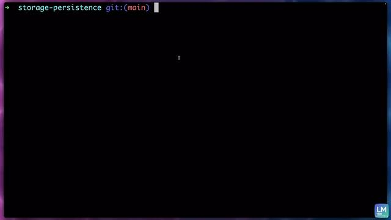
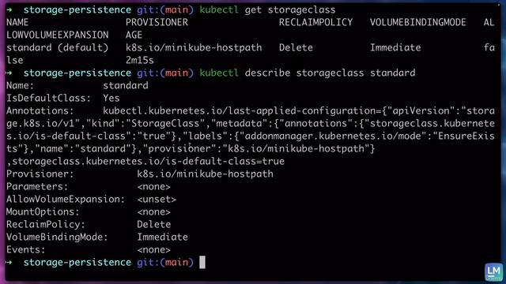
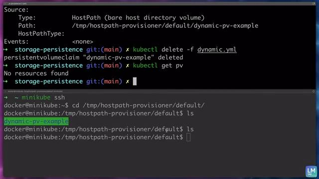
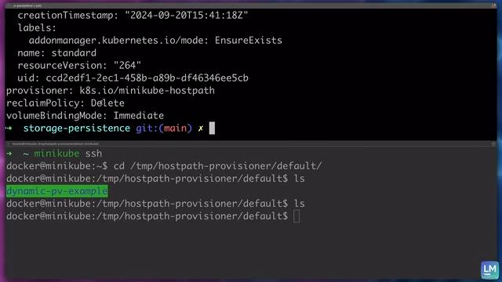
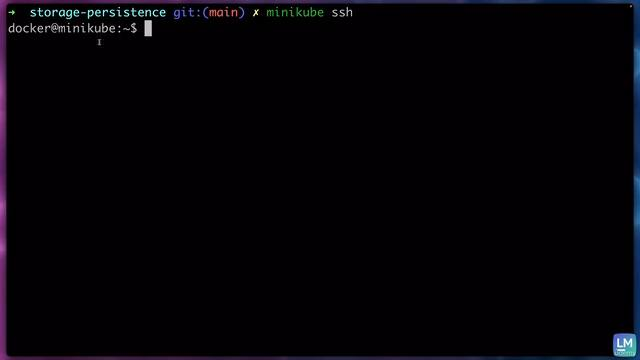
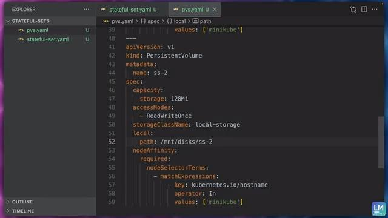
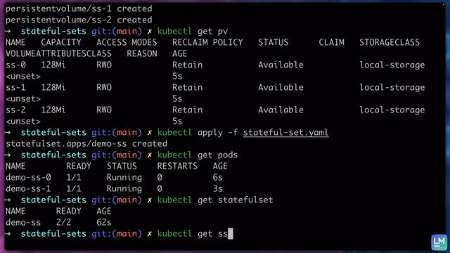
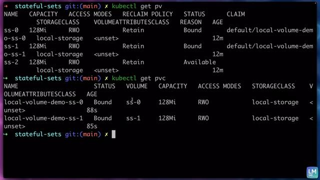
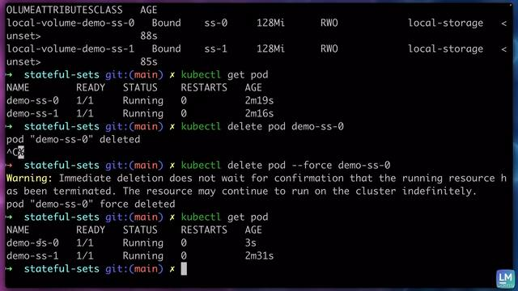

# Docker & Kubernetes Zero to Hero — P1–P4 复现文档

> 覆盖课程：P001（动态供给 PersistentVolume）、P002（StatefulSet 概念）、P003（StatefulSet 前置准备：PV 与目录）、P004（StatefulSet 实战：稳定身份与稳定存储）
> 读者定位：前端转 AI 应用工程师。涉及「持久化 / 绑定 / 顺序」这类概念时，会补一句在 Node/JS 里对应什么。

---

## 1. 这一节做什么

这四节课是一条完整的动手链路，最终目标只有一个：**在 Minikube 里跑起一个 StatefulSet，让每个 Pod 拥有稳定名字、稳定 DNS、稳定存储，并且 Pod 被删掉重建后还能读回自己原来的数据。**

拆成四步，正好对应四个 P：

1. **P001 — 动态供给（Dynamic Provisioning）**：不手写 PersistentVolume（PV），只写 PersistentVolumeClaim（PVC），让 Minikube 自带的 `standard` StorageClass 在背后自动创建 PV。同时观察「回收策略 reclaim policy = Delete」带来的破坏性后果。
2. **P002 — StatefulSet 概念**：讲清楚 StatefulSet 相比 Deployment 多给了什么保证（稳定网络身份、稳定存储、有序创建/删除）。
3. **P003 — 准备三个 PV 和三个宿主机目录**：SSH 进 Minikube 节点，建 `ss0/ss1/ss2` 三个目录，再写 `pvs.yaml` 定义三个 local 类型的 PV。
4. **P004 — 写 StatefulSet 并验证**：用 `volumeClaimTemplates` 让 Kubernetes 自动为每个副本生成 PVC，验证 Pod 名是 `demo-stateful-set-0` / `-1` 这种稳定序号，验证删 Pod 后数据还在。

产出物（照着做就能得到）：

- 一个 `dynamic.yaml`（P001 用，验证动态供给，做完即删）
- 一个 `pvs.yaml`（三个 PV）
- 一个 `statefulset.yaml`（StatefulSet + volumeClaimTemplates）
- 一个跑起来的 Minikube 集群，里面有两个 `demo-stateful-set-*` Pod，各自挂着自己独立的存储

这一节的学习方式建议是「先跑通、再观察、最后解释」。不要一上来死抠 YAML 每个字段，先按第 3 节把对象创建出来，用 `kubectl get`、`kubectl describe`、`kubectl exec` 去观察状态变化，再回到第 5 节逐行理解。对前端来说，可以把它类比成：Deployment 更像无状态的前端静态资源副本，谁处理请求都行；StatefulSet 更像「每个实例都带自己的本地缓存/会话目录」，实例编号和目录必须一一对应，不能随便换。

---

## 2. 讲师原话（带出处）

> "Minikube 还提供了一个非常简单的存储驱动和一个存储类，让我们可以动态供应持久卷。"
> —— p001 [00:00]

> "Minikube 默认在这里创建的存储类就是名为 standard 的这个存储类。随后 Minikube 会使用这个存储类来创建或动态供应由主机路径支持的卷。"
> —— p001 [00:29]

> "主机路径其实并不是最佳选择，Kubernetes 建议使用本地卷而不是主机路径。不过，本地卷不提供动态供应，而主机路径可以。"
> —— p001 [00:54]

> "每当我们创建一个未指定存储类的持久卷申领时，它都会默认使用这里的这个存储类。"
> —— p001 [01:41]

> "回收策略被设置为 Delete。这意味着每当我们删除持久卷申领时，持久卷本身也会被删除。"
> —— p001 [05:05]

> "对于动态供应的持久卷，默认策略是 Delete。这很合理，因为如果不删除这些卷，我们就会面临创建大量卷、并且之后有大量存储未被使用的风险。"
> —— p001 [06:20]

> "如果你确实想删除某个持久卷，并不需要先删除绑定到它的持久卷申领，然后才能删除该卷。"
> —— p001 [09:21]（注意：讲师此处口误，实际演示是**必须先删 PVC 才能删 PV**，见第 6 节检查清单）

> "StatefulSet 会为每个 Pod 维护稳定的身份，确保即使 Pod 被重启，它也会保留其唯一身份以及与持久存储的连接。"
> —— p002 [00:29]

> "StatefulSet 中的每个副本都会拥有自己的持久卷申领，因此数据不会在不同副本之间共享。"
> —— p002 [01:25]

> "当副本或 Pod 被删除时，持久卷不会被自动删除。"
> —— p002 [02:15]

> "Pod 名称及其网络身份也是稳定的，并且会遵循以下模式。也就是这里的 StatefulSet 名称，然后是一个短横线和一个递增的序号索引。"
> —— p002 [02:15]

> "我们还可以使用所谓的无头服务，通过更稳定的域名来暴露 Pod。"
> —— p002 [02:42]

> "最终没有任何机制能保证 SS2 会连接到 StatefulSet 中的第三个 Pod……持久卷申领会寻找可用的持久卷，但这并不意味着它们会按这里的顺序得到满足。"
> —— p003 [05:35]

> "使用 StatefulSet 时，我们不需要做那件事[指定 volumes 部分]。Kubernetes 会在后台管理，并在我们的 Pod 中创建必要的卷定义，而且它们会匹配这个元数据，也就是元数据这里的这个名称。"
> —— p004 [06:19]

> "它们末尾并不是一个随机字符串，而是具有非常稳定的 ID。因此这里有 ID0、ID1。"
> —— p004 [08:01]

> "持久卷申领没有被删除。每当我们删除 Pod 时，它们都会被保留下来。随后当 Pod 被重新创建时，Kubernetes 足够智能地识别出这个申领实际上应该连接到我们的 SS0。"
> —— p004 [13:00]

读这些原话时，建议把注意力放在三个关键词上：**动态供给、稳定身份、稳定存储**。P001 解决「盘从哪里来」，P002 解释「为什么需要 StatefulSet」，P003 和 P004 则把「盘、目录、PVC、Pod 序号」这几件事真正串起来。下面第 3 节按操作顺序展开，遇到命令时不要只看结果，也要看 `kubectl get` 输出里的 `STATUS`、`AGE`、`CLAIM` 这些列。

---

## 3. 从零复现

### 3.0 前置条件

- 已安装 `minikube`、`kubectl`、`docker`（或等价容器运行时）
- 已执行 `minikube start`，`kubectl get nodes` 能看到一个 Ready 节点
- 一个编辑器（VS Code 即可）

验证环境：

```bash
minikube status
kubectl get nodes
kubectl get storageclass
```

`kubectl get storageclass` 应该能看到一个名为 `standard` 的 StorageClass，且名字后面带 `(default)` 标记。这就是 P001 里讲师一开始就展示的那个对象。



**命令解释与排查**：`minikube status` 用来确认 Minikube 的 `host`、`kubelet`、`apiserver` 等组件是否正常；`kubectl get nodes` 用来确认集群里至少有一个节点处于 `Ready`；`kubectl get storageclass` 用来确认默认 StorageClass 存在。如果 `kubectl` 报 `The connection to the server ... was refused`，通常说明 Minikube 没启动或 kubeconfig 没指向当前集群，先执行 `minikube start`，再执行 `kubectl config current-context` 看上下文是否是 `minikube`。如果 `storageclass` 里没有 `standard`，先不要继续写 PVC，因为 P001 的动态供给依赖这个默认 StorageClass。

### 3.1 第一步：观察默认 StorageClass（P001）

```bash
kubectl describe storageclass standard
```

讲师在 p001 [01:18] 演示了这条命令，重点看三处：

- `IsDefaultClass: Yes`（来自 annotation `storageclass.kubernetes.io/is-default-class: "true"`）
- `Provisioner:` 字段——Minikube 用的是它自带的 host path provisioner
- `ReclaimPolicy: Delete`



> 在 Node/JS 里类比：StorageClass 就像是一个「工厂函数」，你只声明「我要一块 128Mi 的盘」（PVC），工厂自动给你造一块（PV）。你不需要自己 `new` 一块盘。

**常见错误与排查**：如果 `kubectl describe storageclass standard` 报 `storageclasses.storage.k8s.io "standard" not found`，说明当前集群没有这个默认 StorageClass，可能是 Minikube 版本或启动参数不同。此时不要硬改 YAML 里的 `storageClassName` 去猜，先用 `kubectl get storageclass` 看实际名字，再决定是否显式写 `storageClassName`。如果 `Provisioner` 不是 Minikube 自带的 host path provisioner，也先停下来确认环境，因为后续 P001 的观察结果会不一致。

### 3.2 第二步：写一个不指定 storageClassName 的 PVC（P001）

建目录并写文件：

```bash
mkdir -p ~/k8s-lab/storage-persistence
cd ~/k8s-lab/storage-persistence
```

创建 `dynamic.yaml`（完整内容见第 4 节）。关键点：**故意不写 `storageClassName`**，让默认 StorageClass 接管。

```bash
kubectl apply -f dynamic.yaml
kubectl get pvc
```

讲师在 p001 [03:46] 强调：以前静态供给时 PVC 会卡在 `Pending` 直到匹配到 PV；这次会直接 `Bound`，因为 PV 是被动态造出来的。



**命令解释与排查**：`kubectl apply -f dynamic.yaml` 是声明式创建，重复执行是幂等的；`kubectl get pvc` 重点看 `STATUS` 列。如果看到 `Pending`，先执行 `kubectl describe pvc dynamic-pv-example` 看事件。常见原因是默认 StorageClass 不存在、`storageClassName` 写错、或 provisioner Pod 没跑起来。如果看到 `Bound`，再执行 `kubectl get pv` 确认是否自动生成了 PV。对前端来说，这类似你只写了一个 `new Blob()` 的请求，底层由运行时分配实际内存；PVC 是请求，PV 是实际分配出来的资源。

### 3.3 第三步：查看被自动创建的 PV 与宿主机路径（P001）

```bash
kubectl get pv
kubectl describe pv <上一步输出的 PV 名字>
```

讲师在 p001 [04:15] 指出：`describe` 输出里能看到 provisioner 是 Minikube 的 host path provisioner，以及它在宿主机上挂的具体路径。

然后 SSH 进 Minikube 节点看这个目录真实存在：

```bash
minikube ssh
# 进入节点后
cd /tmp/hostpath-provisioner/default
ls
```

讲师在 p001 [04:39] 演示了这一步：能看到以 PVC 名字命名的目录。



**命令解释与排查**：`kubectl get pv` 看 PV 的 `STATUS` 和 `CLAIM` 列，`kubectl describe pv` 看 `Claim`、`StorageClass`、`Source` 等字段。`minikube ssh` 进入的是 Minikube 节点内部，不是宿主机当前目录；`cd /tmp/hostpath-provisioner/default` 是 Minikube host path provisioner 的默认落盘位置。如果 `ls` 看不到目录，先确认 PVC 是否真的 `Bound`，再确认 provisioner 的路径是否被改过。不要在这个目录里手动改文件来「验证」，因为这一步只是观察动态供给的结果。

### 3.4 第四步：验证 Delete 回收策略的破坏性（P001）

```bash
kubectl delete -f dynamic.yaml
kubectl get pv
```

讲师在 p001 [05:32] 演示：PVC 一删，PV 也没了，宿主机目录里的数据也没了。这就是 `ReclaimPolicy: Delete` 的含义。

> 讲师在 p001 [07:13] 说：想改成保留，得改 StorageClass 定义里的 `reclaimPolicy` 为 `Retain`。但他**没有实际改**，因为 `standard` 是 Minikube 自带的、不归我们管。所以本课程后续走的是「静态 PV + local」路线，而不是继续用动态供给。

**常见错误与排查**：如果 `kubectl delete -f dynamic.yaml` 后 `kubectl get pv` 还能看到 PV，先看它是不是 `Terminating`，再执行 `kubectl describe pv <名字>` 看 finalizer 或 claim 引用。P001 的默认策略是 `Delete`，正常情况下 PVC 删除后 PV 会被回收。如果这里行为不符合预期，不要继续往下做 P003，因为后续「静态 PV + local」的绑定关系需要你对 PV/PVC 生命周期有清晰认识。

### 3.5 第五步：在 Minikube 节点里建三个目录（P003）

```bash
minikube ssh
sudo mkdir -p /mnt/disks/ss0 /mnt/disks/ss1 /mnt/disks/ss2
sudo chmod 777 /mnt/disks/ss0 /mnt/disks/ss1 /mnt/disks/ss2
ls -l /mnt/disks
exit
```

讲师在 p003 [01:07] 就是这么做的：三个目录分别给三个 Pod 用，`chmod 777` 是为了让容器里的进程能写。



> 为什么不用动态供给？讲师在 p003 [02:28] 说：如果用动态供给，PVC 模板会自动造出不同的 PV，也能达到「每个 Pod 独立存储」的效果。但他这里选择手动建目录 + 手动写 PV，是为了把「PV 和 PVC 怎么配对」这件事看得更清楚。

**命令解释与排查**：`mkdir -p` 会递归创建目录，已存在也不报错；`chmod 777` 让所有用户都可读写执行，这是实验环境的偷懒做法。`ls -l /mnt/disks` 用来确认三个目录都存在且权限正确。如果 `sudo` 报密码或权限问题，确认你是在 `minikube ssh` 的节点 shell 里执行，而不是宿主机 shell。如果目录权限不是 `777`，后面 Pod 内写 `/mnt/local` 可能报 `Permission denied`。生产环境不要用 `777`，应使用 `fsGroup` 或 `securityContext`，但本课没展开。

### 3.6 第六步：写三个 PV（P003）

新建工作目录：

```bash
cd ~/k8s-lab
mkdir -p statefulsets
cd statefulsets
```

创建 `pvs.yaml`（完整内容见第 4 节），然后：

```bash
kubectl apply -f pvs.yaml
kubectl get pv
```

讲师在 p003 [06:30] 强调：三个 PV 都应该是 `Available` 状态——因为还没有任何 PVC 绑定它们。



**命令解释与排查**：`kubectl apply -f pvs.yaml` 会创建三个 `PersistentVolume` 对象；`kubectl get pv` 的 `STATUS` 列应为 `Available`。如果某个 PV 不是 `Available`，先 `kubectl describe pv stateful-set-0` 看事件。常见原因是 `local.path` 目录不存在、`nodeAffinity` 里的节点名写错、或 `storageClassName` 与后续 PVC 不匹配。注意：`local` 类型 PV 必须配合 `nodeAffinity`，因为它只存在于特定节点上；如果节点名不是 `minikube`，要用 `kubectl get nodes` 查到的真实名字替换。

### 3.7 第七步：写 StatefulSet（P004）

创建 `statefulset.yaml`（完整内容见第 4 节）。核心是 `volumeClaimTemplates`——它让 Kubernetes 自动为每个副本生成一个 PVC，**不需要你手写 PVC，也不需要在 Pod spec 里写 `volumes:`**。

```bash
kubectl apply -f statefulset.yaml
kubectl get pods
```

讲师在 p004 [08:01] 演示：Pod 名是 `demo-stateful-set-0`、`demo-stateful-set-1`，不是 Deployment 那种随机后缀。而且 `-0` 的 AGE 比 `-1` 大，说明是**有序创建**——`-0` Ready 之后才创建 `-1`。



**命令解释与排查**：`kubectl apply -f statefulset.yaml` 创建 StatefulSet 控制器；`kubectl get pods` 看 Pod 名和状态。如果 Pod 一直 `Pending`，先 `kubectl describe pod demo-stateful-set-0` 看调度失败原因，常见是 PVC 没绑上或 `nodeAffinity` 不匹配。如果 Pod 一直 `ContainerCreating`，看 `kubectl describe pod` 的 Events 是否有挂载失败。StatefulSet 的创建顺序是 `-0` 先 Ready，再 `-1`，所以短时间内只看到 `-0` 是正常的，不要急着删了重来。

### 3.8 第八步：验证 PVC 自动生成与配对（P004）

```bash
kubectl get pvc
kubectl get pv
```

讲师在 p004 [08:56] 演示：两个 PVC 已 Bound，第三个 PV 仍 Available（因为 replicas=2）。PVC 名字的规律是 `<volumeClaimTemplate 里的 name>-<statefulset 名>-<序号>`。



**命令解释与排查**：`kubectl get pvc` 看 PVC 的 `STATUS` 和 `VOLUME` 列；`kubectl get pv` 看 PV 的 `CLAIM` 列。这里应该看到两个 PVC 为 `Bound`，第三个 PV 为 `Available`。如果 PVC 名字不是 `local-storage-demo-stateful-set-0` 这种格式，检查 `volumeClaimTemplates.metadata.name` 是否写成了 `local-storage`。如果 PVC 一直 `Pending`，检查 `storageClassName` 是否与 `pvs.yaml` 中的 `local-storage` 完全一致，以及 PV 的容量和访问模式是否满足 PVC 请求。

### 3.9 第九步：验证「删 Pod 数据不丢」（P004）

```bash
# 往 0 号 Pod 写文件
kubectl exec -it demo-stateful-set-0 -- sh
# 容器内：
echo "hello from demo-stateful-set-0" > /mnt/local/hello.txt
exit

# 删掉 0 号 Pod
kubectl delete pod demo-stateful-set-0

# 等它重建
kubectl get pods

# 再进去读
kubectl exec -it demo-stateful-set-0 -- cat /mnt/local/hello.txt
```

讲师在 p004 [12:32] 演示：文件还在。因为 PVC 没被删（`kubectl get pvc` 的 AGE 没变），重建的 Pod 又被绑回同一个 PVC。



**命令解释与排查**：`kubectl exec -it ... -- sh` 进入容器交互 shell；`echo "..." > /mnt/local/hello.txt` 写入挂载目录；`kubectl delete pod` 删除 Pod 后，StatefulSet 控制器会按稳定序号重建同名 Pod。重建后 `cat` 还能读到内容，说明数据落在 PVC 对应的 PV 上，而不是容器临时层。如果读不到，先确认写入路径是不是 `/mnt/local`，再确认 `volumeMounts.mountPath` 是否一致。如果 `kubectl exec` 报 `pod not found`，先 `kubectl get pods` 等 Pod 变成 `Running` 再执行。

### 3.10 第十步：验证「副本之间数据不共享」（P004）

```bash
kubectl exec -it demo-stateful-set-1 -- cat /mnt/local/hello.txt
```

讲师在 p004 [11:40] 演示：读不到。因为 `-0` 写的是 `/mnt/disks/ss0`，`-1` 挂的是 `/mnt/disks/ss1`，是两个独立目录。

**命令解释与排查**：这条命令如果返回 `No such file or directory`，是预期结果，说明两个副本没有共享同一个目录。如果意外读到了内容，检查是不是把两个 Pod 挂到了同一个 PV，或者 `volumeClaimTemplates` 没有按副本生成独立 PVC。对前端来说，这类似两个浏览器标签页各自有独立的 `IndexedDB`，不是共享同一个 `localStorage`。

### 3.11 清理

```bash
kubectl delete -f statefulset.yaml
kubectl delete -f pvs.yaml
kubectl get pv,pvc,pods
```

注意顺序：先删 StatefulSet（连带 PVC 一起删），再删 PV。反过来会卡住（见第 6 节）。实际执行时以 `kubectl get pvc` 的结果为准：如果删完 StatefulSet 后 PVC 还在，需要先删 PVC，再删 PV，否则 PV 可能卡在 `Terminating`。

**命令解释与排查**：`kubectl delete -f statefulset.yaml` 删除 StatefulSet 和它管理的 Pod；`kubectl delete -f pvs.yaml` 删除三个 PV；`kubectl get pv,pvc,pods` 用来确认清理结果。如果 PV 卡在 `Terminating`，先看 `kubectl get pvc` 是否还有绑定的 PVC，有就先删 PVC。不要用 `kubectl delete pv --force` 硬删，除非你明确知道自己在做什么。

---

## 4. 完整代码

### 4.1 `dynamic.yaml`（P001 用，验证完即删）

```yaml
apiVersion: v1
kind: PersistentVolumeClaim
metadata:
  name: dynamic-pv-example
spec:
  accessModes:
    - ReadWriteOnce
  resources:
    requests:
      storage: 128Mi
```

> 注意：这里**故意没有 `storageClassName` 字段**。Kubernetes 会使用带 `is-default-class: "true"` 注解的 StorageClass（即 Minikube 的 `standard`）。讲师在 p001 [07:34] 补充：也可以显式写 `storageClassName: standard`，效果一样。

### 4.2 `pvs.yaml`（P003，三个 local 类型 PV）

```yaml
apiVersion: v1
kind: PersistentVolume
metadata:
  name: stateful-set-0
spec:
  capacity:
    storage: 128Mi
  accessModes:
    - ReadWriteOnce
  storageClassName: local-storage
  local:
    path: /mnt/disks/ss0
  nodeAffinity:
    required:
      nodeSelectorTerms:
        - matchExpressions:
            - key: kubernetes.io/hostname
              operator: In
              values:
                - minikube
---
apiVersion: v1
kind: PersistentVolume
metadata:
  name: stateful-set-1
spec:
  capacity:
    storage: 128Mi
  accessModes:
    - ReadWriteOnce
  storageClassName: local-storage
  local:
    path: /mnt/disks/ss1
  nodeAffinity:
    required:
      nodeSelectorTerms:
        - matchExpressions:
            - key: kubernetes.io/hostname
              operator: In
              values:
                - minikube
---
apiVersion: v1
kind: PersistentVolume
metadata:
  name: stateful-set-2
spec:
  capacity:
    storage: 128Mi
  accessModes:
    - ReadWriteOnce
  storageClassName: local-storage
  local:
    path: /mnt/disks/ss2
  nodeAffinity:
    required:
      nodeSelectorTerms:
        - matchExpressions:
            - key: kubernetes.io/hostname
              operator: In
              values:
                - minikube
```

> 说明：讲师在 p003 [04:16] 说「reclaim policy 可以留着也可以删掉，删掉更短」，所以上面省略了 `persistentVolumeReclaimPolicy`，让它走默认值。`volumeMode` 也省略了，默认 `Filesystem`。`nodeAffinity` 里的 `minikube` 是节点名，如果你的节点名不同（`kubectl get nodes` 看），要改。

### 4.3 `statefulset.yaml`（P004）

```yaml
apiVersion: apps/v1
kind: StatefulSet
metadata:
  name: demo-stateful-set
spec:
  serviceName: busybox
  replicas: 2
  selector:
    matchLabels:
      app: busybox
  template:
    metadata:
      labels:
        app: busybox
    spec:
      containers:
        - name: busybox
          image: busybox
          command: ["sleep", "3600"]
          resources: {}
          volumeMounts:
            - name: local-storage
              mountPath: /mnt/local
  volumeClaimTemplates:
    - metadata:
        name: local-storage
      spec:
        accessModes:
          - ReadWriteOnce
        storageClassName: local-storage
        resources:
          requests:
            storage: 128Mi
```

> 关键点（讲师在 p004 [06:19] 反复强调）：**Pod template 里没有 `volumes:` 段**。Kubernetes 会根据 `volumeClaimTemplates` 自动生成 volume 定义，并把 `volumeMounts[].name` 与 `volumeClaimTemplates[].metadata.name` 对上。上面两处都叫 `local-storage`，所以能对上。

### 4.4 目录结构

```
~/k8s-lab/
├── storage-persistence/
│   └── dynamic.yaml          # P001，验证完删除
└── statefulsets/
    ├── pvs.yaml              # P003，三个 PV
    └── statefulset.yaml      # P004，StatefulSet
```

---

## 5. 逐行解释

### 5.1 `dynamic.yaml`

- `kind: PersistentVolumeClaim`：只声明「我要一块盘」，不声明盘从哪来。这是与 PV 最大的区别。
- `accessModes: [ReadWriteOnce]`：同一时刻只能被一个节点挂载读写。讲师在 p001 没展开讲其他模式，只用了 RWO。
- `resources.requests.storage: 128Mi`：向 StorageClass 提的容量请求。动态供给时，provisioner 按这个值造盘。
- **没有 `storageClassName`**：这是本节的核心。Kubernetes 会 fallback 到默认 StorageClass。讲师在 p001 [01:41] 用 annotation `storageclass.kubernetes.io/is-default-class: "true"` 解释了为什么 `standard` 是默认。

**前端对照**：可以把 PVC 理解成「资源申请单」，PV 理解成「实际分配到的资源」。你写 `resources.requests.storage` 就像写 `fetch` 的请求体，真正分配由控制器完成。**常见错误**是以为 PVC 自己就是存储，实际上 PVC 只是声明，真正落盘的是 PV 背后的目录或云盘。

### 5.2 `pvs.yaml`

- `kind: PersistentVolume`：管理员视角的「一块盘」。与 PVC 是「供给方 / 需求方」关系。
- `storageClassName: local-storage`：**自定义的字符串**，不是 Minikube 的 `standard`。它只是一个标签，用来让 PVC 和 PV 配对。讲师在 p003 [05:35] 特意提醒：这个字符串本身不触发任何行为，只是匹配用。
- `local.path: /mnt/disks/ssN`：指向 3.5 步在节点里建的目录。`local` 类型 PV 要求节点亲和性，因为它只存在于特定节点上。
- `nodeAffinity`：告诉调度器「这个 PV 只能被调度到 `minikube` 节点的 Pod 使用」。讲师在 p003 [04:39] 说这是必须的，否则 Pod 可能被调度到没有这个目录的节点上。
- 三个 PV 用 `---` 分隔写在同一个文件里。讲师在 p003 [05:06] 说：现实中不会这么手写重复代码，会用 Helm 模板生成。本课为了看清结构，故意展开写。

**常见错误与排查**：如果 `kubectl get pv` 里三个 PV 不是 `Available`，先看 `kubectl describe pv stateful-set-0` 的 Events。`local.path` 不存在、`nodeAffinity` 节点名写错、`storageClassName` 与 PVC 不一致，都会导致绑定失败。YAML 缩进和 JS 对象缩进类似，但 YAML 对空格更敏感，`nodeAffinity` 层级不要少缩进。

### 5.3 `statefulset.yaml`

- `apiVersion: apps/v1` / `kind: StatefulSet`：与 Deployment 同一 API 组。
- `serviceName: busybox`：关联一个 Service（本课没实际创建这个 Service，讲师在 p002 [02:42] 提到 headless service 能让 Pod 有稳定 DNS，但 P004 没落地，属于「课里没讲完」的部分）。
- `replicas: 2`：讲师在 p004 [01:19] 设为 2，所以只会用掉两个 PV，第三个留 `Available`。
- `selector.matchLabels.app: busybox`：StatefulSet 管理哪些 Pod。与 `template.metadata.labels` 必须一致。
- `template.metadata`：**没有 `name` 字段**。讲师在 p004 [03:01] 明确说：Pod 名由 StatefulSet 名 + 序号生成，不能自己指定。
- `volumeMounts[].name: local-storage`：必须与下面 `volumeClaimTemplates[].metadata.name` 完全一致。讲师在 p004 [05:50] 说这个命名容易和 `storageClassName` 混淆，特意改成与 mount 名一致。
- `volumeClaimTemplates`：这是 StatefulSet 独有的字段。Kubernetes 会为每个副本生成一个 PVC，名字是 `<模板名>-<StatefulSet名>-<序号>`，即 `local-storage-demo-stateful-set-0`、`local-storage-demo-stateful-set-1`。
- `volumeClaimTemplates.spec.storageClassName: local-storage`：与 `pvs.yaml` 里的 `storageClassName` 匹配，PVC 才能绑到 PV。
- **Pod template 里没有 `volumes:`**：这是与「手写 Pod + PVC」最大的区别。讲师在 p004 [06:19] 强调：Kubernetes 会自动把 volumeClaimTemplates 转成 Pod 的 volumes。

**前端对照**：`volumeClaimTemplates` 类似一个「按副本编号生成配置」的工厂函数，`-0` 生成一份 PVC，`-1` 生成另一份 PVC。`volumeMounts[].name` 和 `volumeClaimTemplates[].metadata.name` 的对应关系，类似 React 里 `key` 和列表项的一一对应，名字对不上就挂载不上。

### 5.4 关于「有序」的补充

讲师在 p002 [03:07] 用一张图讲了 StatefulSet 的顺序语义：

- 创建：`-0` 先创建，Ready 后才创建 `-1`，再 `-2`
- 删除/缩容：从最大序号开始删，`-2` → `-1` → `-0`
- 这与 Deployment 的「一次性拉起所有副本」完全不同

> 在 Node/JS 里类比：Deployment 像 `Promise.all([start0, start1, start2])`，StatefulSet 像 `await start0; await start1; await start2`。

**常见错误与排查**：如果 `kubectl get pods` 只看到 `-0`，不要以为 StatefulSet 坏了，它可能还在等 `-0` Ready。用 `kubectl get pods -w` 观察顺序，或者 `kubectl describe pod demo-stateful-set-0` 看卡在哪一步。缩容时如果看到 `-1` 先消失，也是正常的，因为 StatefulSet 从最大序号开始删。

---

## 6. 复现检查清单

按顺序打勾，任何一项不过就不要往下走：

- [ ] `kubectl get storageclass` 能看到 `standard (default)`
- [ ] `kubectl describe storageclass standard` 里 `ReclaimPolicy` 是 `Delete`
- [ ] `kubectl apply -f dynamic.yaml` 后 `kubectl get pvc` 显示 `Bound`（不是 `Pending`）
- [ ] `kubectl get pv` 能看到一个自动创建的 PV，`kubectl describe` 里 provisioner 是 Minikube host path
- [ ] `minikube ssh` 后 `ls /tmp/hostpath-provisioner/default` 能看到以 PVC 名命名的目录
- [ ] `kubectl delete -f dynamic.yaml` 后 `kubectl get pv` 为空（验证 Delete 策略）
- [ ] `minikube ssh` 后 `/mnt/disks/ss0 ss1 ss2` 三个目录存在且权限 777
- [ ] `kubectl apply -f pvs.yaml` 后 `kubectl get pv` 三个都是 `Available`
- [ ] `kubectl apply -f statefulset.yaml` 后 `kubectl get pods` 显示 `demo-stateful-set-0` 和 `demo-stateful-set-1`，且 `-0` 的 AGE 更大
- [ ] `kubectl get pvc` 显示两个 PVC 都 `Bound`，名字形如 `local-storage-demo-stateful-set-0`
- [ ] `kubectl get pv` 显示两个 `Bound`、一个 `Available`
- [ ] 往 `-0` 写 `/mnt/local/hello.txt` 后删 Pod，重建后文件还在
- [ ] `-1` 里读不到 `-0` 写的文件（验证副本间不共享）
- [ ] 删 Pod 前后 `kubectl get pvc` 的 AGE 不变（验证 PVC 不被删）

**逐条怎么验证**：第 1 条看 `kubectl get storageclass` 输出里 `standard` 后面是否有 `(default)`；第 2 条看 `kubectl describe storageclass standard` 的 `ReclaimPolicy` 字段；第 3 条看 `kubectl get pvc` 的 `STATUS` 列是否为 `Bound`；第 4 条看 `kubectl describe pv` 的 `Source` 或 `Provisioner` 信息；第 5 条在 `minikube ssh` 后执行 `ls /tmp/hostpath-provisioner/default`；第 6 条在删除 PVC 后执行 `kubectl get pv`，确认没有残留；第 7 条在节点内执行 `ls -ld /mnt/disks/ss0 /mnt/disks/ss1 /mnt/disks/ss2`；第 8 条看 `kubectl get pv` 的 `STATUS` 是否都是 `Available`；第 9 条看 Pod 名和 `AGE` 列；第 10 条看 PVC 名和 `STATUS`；第 11 条看 PV 的 `STATUS` 和 `CLAIM`；第 12 条按 3.9 的写入、删除、重建、读取流程验证；第 13 条按 3.10 执行 `cat` 验证读不到；第 14 条在删 Pod 前后各执行一次 `kubectl get pvc`，比较 `AGE` 是否变化。

**关于删除顺序的坑**（讲师在 p001 [08:29] 演示过）：如果你先 `kubectl delete pv`，PV 会卡在 `Terminating`，因为还有 PVC 绑着它。正确顺序是先删 StatefulSet（连带 PVC），再删 PV。讲师在 p001 [09:21] 的口述「you don't need to delete the persistent volume claim」是口误，实际演示是**必须先删 PVC**。如果执行 `kubectl delete -f statefulset.yaml` 后 `kubectl get pvc` 仍能看到 PVC，说明 PVC 没有被自动删除；此时先 `kubectl delete pvc local-storage-demo-stateful-set-0 local-storage-demo-stateful-set-1`，再删 PV。

---

## 7. 课里没讲但你会撞上的

| 现象 | 原因 | 怎么办 |
|---|---|---|
| `serviceName: busybox` 对应的 Service 没创建，`kubectl get svc` 找不到 `busybox`，Pod 内 DNS 解析失败 | StatefulSet 的 `serviceName` 字段指向一个 headless Service（`clusterIP: None`），用于给每个 Pod 提供稳定 DNS（`demo-stateful-set-0.busybox.default.svc.cluster.local`）。讲师在 p002 [02:42] 提到了 headless service，但 P004 没实际写这个 Service 的 YAML。 | 这不影响 Pod 启动，但 DNS 解析会失败。想补的话，课里没给模板，需要自己查 Kubernetes 文档创建 headless Service。 |
| `nodeAffinity` 里的节点名硬编码为 `minikube`，PV 一直 `Available` 但 PVC 绑不上，Pod 卡 `Pending` | 如果你的 Minikube 节点名不是这个（比如用了 `--name` 参数），`nodeAffinity` 就匹配不到真实节点。 | 用 `kubectl get nodes` 确认真实节点名，把 `pvs.yaml` 里的 `values: - minikube` 改成实际节点名。 |
| `local` 类型 PV 不支持动态供给，不能像 P001 那样只写 PVC 就自动造盘 | 讲师在 p001 [00:54] 说得很清楚：`local` 没有动态供给，`hostPath` 有。所以本课走的是「手动建目录 + 手动写 PV」的静态路线。 | 如果你想要「自动造盘 + 保留数据」，需要换成云厂商的 CSI driver（如 AWS EBS、GCE PD），课里没讲。 |
| `chmod 777` 是演示用的偷懒做法，生产环境权限过宽 | 生产环境应该用 `fsGroup` 或 `securityContext` 控制权限。课里没讲 `securityContext`。 | 实验环境可以保留 `777`；生产环境不要照抄，改用 `securityContext.fsGroup` 等方式控制挂载目录权限。 |
| `resources: {}` 是空对象，Pod 没有 requests/limits | 讲师在 p004 的 Pod template 里留了空 `resources`，意味着没有 requests/limits。生产环境必须设，否则调度器无法做资源规划。 | 课里没讲怎么设；实际项目里给容器补上 `resources.requests` 和 `resources.limits`。 |
| `kubectl delete pod` 不加 `--force` 也能删，但有人误以为要强制删 | 讲师在 p004 [09:46] 说「let me add here the force once again」，但实际演示里 Pod 是正常终止的（StatefulSet 会等它优雅退出再重建）。 | 加 `--force --grace-period=0` 会跳过优雅终止，可能丢数据，不建议在 StatefulSet 上用。正常 `kubectl delete pod` 即可。 |
| PVC 的 `AGE` 不变是验证「PVC 未被删」的关键证据，但有人看到 AGE 变了不知道查什么 | 讲师在 p004 [13:00] 用这一点证明 StatefulSet 重建 Pod 时复用了原 PVC。如果你看到 AGE 变了，说明 PVC 被删了。 | 检查是不是误删了 StatefulSet 而不是 Pod；如果 PVC 还在，重建 Pod 会复用原 PVC。 |
| 第三个 PV 一直 `Available`，看起来像没被用上 | `replicas: 2` 只用两个。 | 想用第三个就把 `replicas` 改成 3 再 `kubectl apply`，StatefulSet 会创建 `demo-stateful-set-2` 并绑上 `stateful-set-2` 这个 PV。课里没演示扩容，但机制是一样的。 |
| 初学者以为 `local-storage` 是 Kubernetes 特殊关键字 | `storageClassName` 字符串是纯约定。`local-storage` 这个名字是讲师随手起的，不是 Kubernetes 内置的。 | 你可以叫 `my-fast-disk`，只要 PV 和 PVC 两边一致就行。 |
| Minikube 重启后 `/mnt/disks/ssN` 目录可能丢失，Pod 卡 `Pending` | `minikube ssh` 里建的目录在 `minikube stop` / `start` 后是否保留，取决于 Minikube 的持久化配置。课里没讲。 | 如果重启后 Pod 卡 `Pending`，先 `minikube ssh` 检查目录还在不在，不在就重建目录再 `kubectl delete pod` 让 Pod 重建。 |

---

**文档结束。** 按第 3 节顺序执行、对照第 6 节清单逐项打勾，即可完整复现 P001–P004 的全部内容。