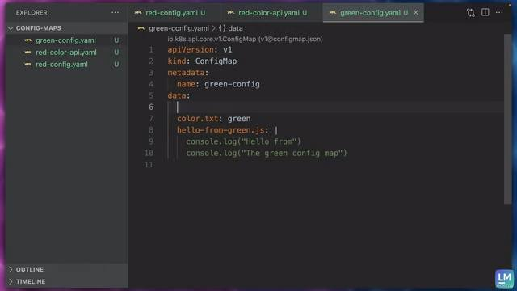
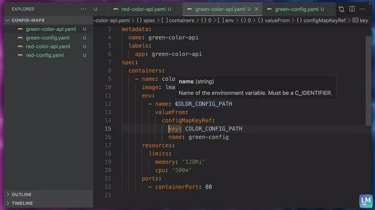
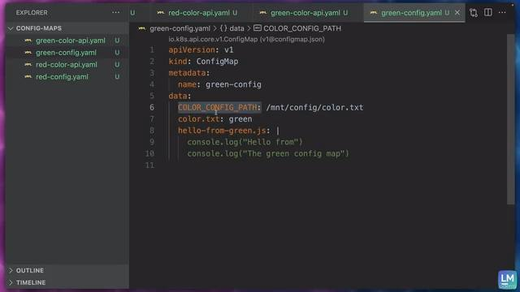
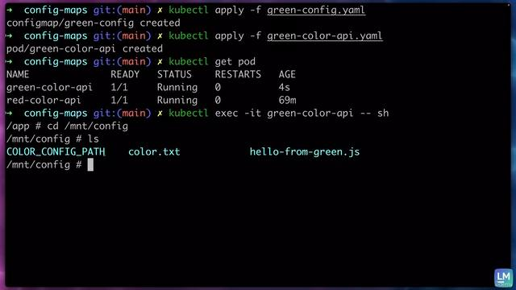
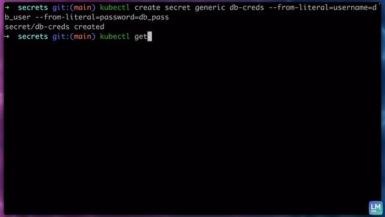
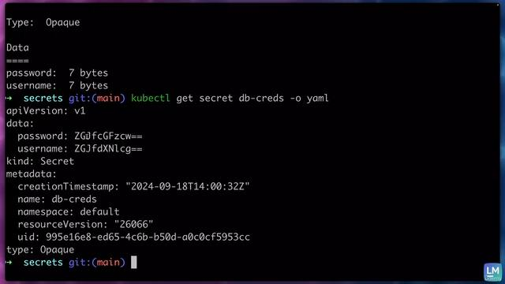
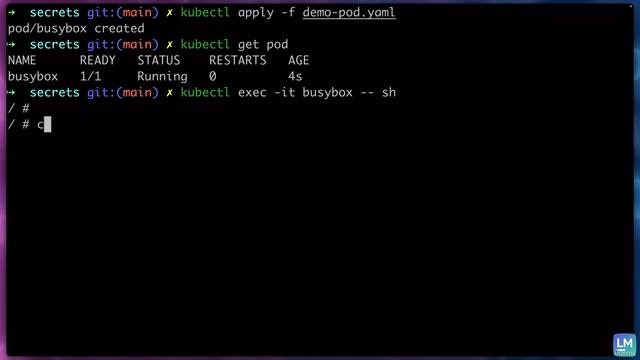
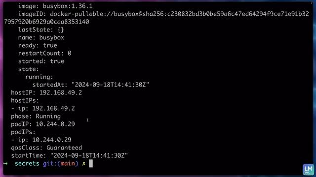

# Docker & Kubernetes Zero to Hero — P011–P014：ConfigMap 挂卷与 Secret 实战

> 课程：BV1XHTu6eEgy ｜ 覆盖 P011（ConfigMap 挂卷）、P012（Secret 概念）、P013（Secret CLI 与环境变量）、P014（Secret 挂卷与 items）
> 目标读者：前端转 AI 应用工程师。本文档按「照着敲就能跑」组织，凡逐字稿未给出的细节均显式标注。

---

## 1. 这一节做什么

这四讲承接前面的 ConfigMap 基础，把「配置数据怎么进容器」这件事讲完整，并顺势把敏感数据（Secret）的完整用法走一遍。具体产出四类东西：

**第一，把 ConfigMap 当作卷挂载（P011）。** 前面几讲是用 `envFrom` / `valueFrom` 把 ConfigMap 的键值对变成环境变量；这一讲的转折点是：**ConfigMap 里的每一个 key，既可以当环境变量，也可以当文件**。讲师做了一个「混合配置」的演示——同一个 ConfigMap 里同时放了要变成文件的 `color.txt`、`hello-from-green.js`，和要变成环境变量的 `color_config_path`。然后演示 `spec.volumes[].configMap` + `containers[].volumeMounts` 的完整写法，并强调挂载出来的文件系统是只读的。

**第二，把「混合配置」拆成「关注点分离」（P011 后半）。** 讲师自己先提出质疑——这种混在一起的做法不好维护，于是给出替代方案：拆成 `green-vars`（只放环境变量）和 `green-files`（只放文件），Pod 里分别用 `envFrom.configMapRef` 和 `volumes[].configMap` 引用。这是这一讲最有价值的部分：不是 API 用法，是**配置管理的心智模型**。

**第三，Secret 是什么，以及为什么不能当密码保险箱（P012）。** 纯概念讲，但结论极其重要：Secret 默认只是 base64 编码、**不加密**；任何拿到字符串的人都能用一条 shell 命令还原；建议开加密静态存储（encryption at rest）+ RBAC 最小权限。

**第四，Secret 的三种进入容器的方式（P013 + P014）。** 用 CLI 创建 `${generic}` secret（不进 Git），然后分别用 `valueFrom.secretKeyRef`（单键转环境变量）、`envFrom.secretRef`（整包转环境变量）、`volumes[].secret` + `volumeMounts`（整包挂文件）、以及 `volumes[].secret.items`（只挂指定键、自定义子路径）四种方式把值喂进去，并在容器里验证看到的都是明文。

> **与前端工作的对应关系**：把 ConfigMap / Secret 想成「集群级别的 `.env` 文件」，只是它被切成了两半——不敏感的那半叫 ConfigMap，敏感的那半叫 Secret。你在 Node 里做的 `process.env.XXX` 和 `fs.readFileSync(path)`，在这个课里分别对应 `env`/`envFrom` 和 `volumes`/`volumeMounts`。

---

## 2. 讲师原话（带「—— pNNN [MM:SS]」）

关于 ConfigMap 挂卷的本质，讲师给了一句总结性的定义：

> "bottom line is that its keys become files and each value for that respective key becomes the content of that file." —— p011 [08:46]

关于为什么要把 ConfigMap 拆开，讲师的原话带明显的个人偏好：

> "I tend to frown upon config maps that have too much data and a lot of mixed stuff here because this can very quickly get very confusing. So if you can leverage this for some segregation and then managing different config maps with different intentions here behind the scenes, I do find that this might make your life easier in the long term." —— p011 [11:07]

关于 ConfigMap 中文案的自洽性完全由使用者负责：

> "from the config map perspective, it doesn't, it's not really aware of any mixed data or anything. It's just key value pairs. That's all. Interpreting this and making sure that it makes sense, everything that we write here, that's our job, right?" —— p011 [09:41]

关于 Secret 的加密真相，这是 P012 最重要的一段：

> "the data is stored in base64 encoded format and it is unencrypted by default. ... anyone who gets access to this base64 encoded string will be able to decode this with a very simple shell command and get a hold of the real value of the secret. So don't rely on having base64 encoded and saying, hey, this is encrypted. It is not true." —— p012 [00:22]

关于为什么不把 Secret 写成 YAML 提交到仓库：

> "secrets are probably one of the very few objects that it makes more sense for us to actually create via the kubectl CLI instead of using files. That's because we don't want to commit these files. It would be very bad practice to commit secrets files because the contents here would be base64 encoded and that is not really encryption." —— p013 [00:27]

关于 Secret 进入容器后的状态：

> "even though they are stored as base 64 in our secrets object in Kubernetes, when they are mounted, they are passed to a certain container, they will be passed in a decoded manner. That means it is the responsibility of the application ... to not print these secrets in any kind of logs." —— p013 [06:58]

关于 Secret 挂卷之后的安全边界，这一段是全课最容易被忽略的：

> "anyone able to exact into a pod that mounts a certain secret will have access to the value of that secret. ... if you want to prevent a certain user from accessing the values of a secret you should also ensure that that user is not able to exact into the pods that actually mount the secrets." —— p014 [02:35]

---

## 3. 从零复现

### 3.0 前置条件

- 已安装并启动 minikube（课程前面已配好，本节不重复）。
- 已安装 `kubectl`，且 `kubectl get nodes` 能返回 Ready 节点。
- 一个能读到 `COLOR_CONFIG_PATH` 指向的文件、并把颜色吐到网页上的 Node 应用镜像。**课里没有给出应用源码和镜像名**，第 4 节给了一份「示意实现」，照它构建即可跑通。

```bash
mkdir -p ~/k8s-config-secret && cd ~/k8s-config-secret
kubectl get nodes     # 确认集群可用
```

### 3.1 构建演示应用镜像（课里没讲，为了能跑必须补）

课程从头到尾用的都是「一个 node based image」（—— p011 [07:55] 原话："这是一个基于节点的镜像"），但**镜像名、端口、源码都没在逐字稿里出现**。为了让文档可复现，下面给一个最小版本，行为与讲师演示的现象一致：读环境变量 → 读文件 → 把颜色渲染出来。

```bash
# 在 ~/k8s-config-secret 目录下
cat > server.js <<'EOF'
const http = require('http');
const fs = require('fs');
const port = process.env.PORT || 3000;
http.createServer((req, res) => {
  // 兼容两种变量名：单键注入常用大写，envFrom 注入保持原 key 大小写
  const colorFile = process.env.COLOR_CONFIG_PATH || process.env.color_config_path;
  let color = 'unknown';
  try { color = fs.readFileSync(colorFile, 'utf8').trim(); }
  catch (e) { color = 'error: ' + e.message; }
  res.writeHead(200, { 'Content-Type': 'text/html' });
  res.end('<h1 style="color:' + color + '">' + color + '</h1>');
}).listen(port, () => console.log('listening on ' + port));
EOF

cat > Dockerfile <<'EOF'
FROM node:20-alpine
WORKDIR /app
COPY server.js .
EXPOSE 3000
CMD ["node", "server.js"]
EOF

eval $(minikube docker-env)          # 让镜像直接进 minikube 的 docker
docker build -t color-api:1.0 .
```

> 如果你用的是 Docker Desktop 而不是 minikube，跳过 `eval $(minikube docker-env)`，改为在 Pod YAML 里设置 `imagePullPolicy: IfNotPresent`（本地镜像）。

### 3.2 P011 第一步：写混合型 ConfigMap

新建 `green-config.yaml`。注意三个 key 的写法：`color.txt` 和 `hello-from-green.js` 是多行值，`color_config_path` 是单行字符串——**Kubernetes 不关心 key 后面带不带 `.txt`/`.js`，它只是字符串**（—— p011 [00:28]："从 Kubernetes 的视角来看，这只是一个随机字符串"）。



（逐字稿此处强调：`color_config_path` 的值就是希望容器里能读到 `color.txt` 的那个路径，即 `/mount/config/color.txt`。）

### 3.3 P011 第二步：写 Pod，只把一个 key 抽成环境变量

新建 `green-color-api.yaml`。这里两个动作要分清：

- **`env` + `valueFrom.configMapKeyRef`**：只从 `green-config` 里抽 `color_config_path` 这一个 key 作为环境变量。
- **`volumes` + `volumeMounts`**：把整个 `green-config` 挂到 `/mount/config`，**所有 key 都变成同名文件**。



讲师特别强调 `volumes` 的位置：**它是 `containers` 的兄弟节点，不是子节点**（—— p011 [03:44]："它与容器平级，并不从属于容器。"）。这是新手最常见的缩进错误。

挂载时加上 `readOnly: true`，这样容器内无法改写配置文件。

### 3.4 P011 第三步：应用并进容器验证

```bash
kubectl apply -f green-config.yaml
kubectl apply -f green-color-api.yaml
kubectl get pod green-color-api     # 等 STATUS 变成 Running

kubectl exec -it green-color-api -- sh
```

进入容器后：

```bash
ls /mount/config
# color.txt  color_config_path  hello-from-green.js
cat /mount/config/color_config_path
# 输出 /mount/config/color.txt（没有换行，和讲师演示一致）
cat /mount/config/color.txt
# green

node /mount/config/hello-from-green.js
# Hello from green
# The green config map
```



验证只读：

```bash
echo yellow > /mount/config/color.txt
# 报错：Read-only file system
```



### 3.5 P011 第四步：暴露服务看结果

```bash
# 退出容器
exit
kubectl expose pod green-color-api --port=3000 --target-port=3000
minikube service green-color-api
```

浏览器打开后应看到一个绿色的页面。

> 讲师的原始命令是「expose pod green color API」（—— p011 [09:14]），逐字稿里没有给出 `--port` / `--target-port`。在你的环境里必须补上这两个参数才能跑通，端口号按你实际应用改。

### 3.6 P011 第五步：拆成两个 ConfigMap（讲师的推荐做法）

讲师认为混在一个 ConfigMap 里「very quickly get very confusing」（—— p011 [11:07]），于是给了替代方案——两个 ConfigMap：

- `green-vars`：只放环境变量，Pod 里用 `envFrom.configMapRef` 一次性导入
- `green-files`：只放要挂载的文件，Pod 里用 `volumes[].configMap` 挂载

**这一步有个逐字稿没点破的坑**：`envFrom` 注入的环境变量名 = ConfigMap 的 key 名，所以注入后名字是 **`color_config_path`（小写）**，而上一个方案里讲师显式写的是 `COLOR_CONFIG_PATH`。用法不同，变量名大小写也不同——第 5 节会详细解释。

### 3.7 P013 第一步：用 CLI 创建 Secret

不进 Git 是核心诉求。**不要**写 `my-secret.yaml`。

```bash
# 先看看 kubectl create secret 支持哪些子命令
kubectl create secret --help
kubectl create secret generic --help

kubectl create secret generic dbcreds \
  --from-literal=username=db_user \
  --from-literal=password=db_pass

kubectl get secret
kubectl describe secret dbcreds
```

`get secret` 输出里的 TYPE 列是 `Opaque`，`describe` 只显示两个 key 的字节数（各 7 字节），**不显示值**。



想看值：

```bash
kubectl get secret dbcreds -o yaml
# data:
#   password: ZGJfcGFzcw==
#   username: ZGJfdXNlcg==

echo 'ZGJfdXNlcg==' | base64 --decode
# db_user
```



这就是讲师反复强调的点：**base64 不是加密**。

### 3.8 P013 第二步：用 valueFrom 从 Secret 取两个 key

新建 `demo-pod.yaml`，用 busybox 做容器，`command` 覆写入口点，`sh -c "..."` 里双引号让环境变量展开，最后 `sleep 1800` 让容器别退出。

```bash
kubectl apply -f demo-pod.yaml
kubectl logs busybox
# db_user
# db_pass
```

日志里看到的是**解码后的明文**——这一点和 ConfigMap 一样，Secret 只是存储层做了 base64，进入容器时还原。

### 3.9 P013 第三步：改用 envFrom（整包注入）

把 `env` 段换成 `envFrom.secretRef`。此时**环境变量名就是 secret 的 key 名本身**：`username`、`password`，不再是 `DB_USER`、`DB_PASSWORD`。所以 `command` 也要跟着改成 `echo $username; echo $password`。

重建 Pod：

```bash
kubectl delete pod busybox --force
kubectl apply -f demo-pod-envfrom.yaml
kubectl logs busybox
# db_user
# db_pass
```

### 3.10 P014 第一步：Secret 挂卷（整包）

把 `envFrom` 拿掉，`command` 改成纯 `sleep 1800`，加 `volumes` + `volumeMounts`：

```bash
kubectl apply -f demo-pod-volume.yaml
kubectl exec -it busybox -- sh
ls /etc/db            # password  username
cat /etc/db/username  # db_user
cat /etc/db/password  # db_pass
```



**讲师在这里的重点不是「怎么挂」，而是「怎么泄露」**：只要 `cat` 一下，明文就出来了。因此集群层面的 RBAC 不够，还要管住谁能 `kubectl exec`，谁能 `kubectl get pod -o yaml`（因为这份 YAML 里就有 `volumeMounts.mountPath`，等于暴露了路径）。

```bash
kubectl get pod busybox -o yaml
# 滚动到 volumes 段能看到 secretName: dbcreds
# 滚动到 containers[].volumeMounts 段能看到 mountPath: /etc/db
```

### 3.11 P014 第二步：用 items 只挂指定 key 并自定义子路径

```bash
kubectl delete pod busybox
kubectl apply -f demo-pod-volume-items.yaml
kubectl exec -it busybox -- sh
ls /etc/db                 # dev
ls /etc/db/dev             # password
cat /etc/db/dev/password   # db_pass
```



讲师最后补了一句：**这个 `items` 选项在 ConfigMap 里同样存在**，上次讲 ConfigMap 时忘了提（—— p014 [06:22]）。

### 3.12 P011 + P014 收尾：清理

```bash
# 用文件删除你自己创建的 Pod / ConfigMap
kubectl delete -f green-color-api.yaml
kubectl delete -f green-config.yaml

# kubectl expose 创建的 Service 不会随文件消失，必须手动删
kubectl delete svc green-color-api
kubectl delete svc red-color-api     # 前面课里留下的

# Secret 也是 CLI 建的，同样不在文件里
kubectl delete secret dbcreds

# 确认干净
kubectl get svc        # 应该只剩 kubernetes
kubectl get configmap  # 应该只剩 kube-root-ca.crt
kubectl get secret     # 只剩默认的 service-account token 类
```

---

## 4. 完整代码

所有文件放在 `~/k8s-config-secret/`，逐个保存即可。

### 4.1 `server.js`（课里没讲源码，以下为示意实现，为了项目能跑起来而补）

```javascript
// server.js
const http = require('http');
const fs = require('fs');

const port = process.env.PORT || 3000;

http.createServer((req, res) => {
  // 兼容两种注入方式：
  // 1) valueFrom.configMapKeyRef 显式指定 env name -> COLOR_CONFIG_PATH
  // 2) envFrom.configMapRef 使用 key 原名           -> color_config_path
  const colorFile = process.env.COLOR_CONFIG_PATH || process.env.color_config_path;

  let color = 'unknown';
  try {
    color = fs.readFileSync(colorFile, 'utf8').trim();
  } catch (e) {
    color = 'error: ' + e.message;
  }

  res.writeHead(200, { 'Content-Type': 'text/html' });
  res.end('<h1 style="color:' + color + '">' + color + '</h1>');
}).listen(port, () => console.log('listening on ' + port));
```

### 4.2 `Dockerfile`（课里没讲，示意）

```dockerfile
FROM node:20-alpine
WORKDIR /app
COPY server.js .
EXPOSE 3000
CMD ["node", "server.js"]
```

构建：

```bash
eval $(minikube docker-env)
docker build -t color-api:1.0 .
```

### 4.3 `green-config.yaml` — P011 的混合型 ConfigMap

```yaml
apiVersion: v1
kind: ConfigMap
metadata:
  name: green-config
data:
  color.txt: "green"
  hello-from-green.js: |
    console.log('Hello from green');
    console.log('The green config map');
  color_config_path: "/mount/config/color.txt"
```

### 4.4 `green-color-api.yaml` — P011 的 Pod（混合引用）

```yaml
apiVersion: v1
kind: Pod
metadata:
  name: green-color-api
  labels:
    app: green-color-api
spec:
  containers:
    - name: green-color-api
      image: color-api:1.0
      imagePullPolicy: IfNotPresent
      ports:
        - containerPort: 3000
      env:
        - name: COLOR_CONFIG_PATH
          valueFrom:
            configMapKeyRef:
              name: green-config
              key: color_config_path
      volumeMounts:
        - name: color-config
          mountPath: /mount/config
          readOnly: true
  volumes:
    - name: color-config
      configMap:
        name: green-config
```

> 说明：`image`、`imagePullPolicy`、`ports.containerPort`、`env.name` 的具体值**逐字稿没有给出**。`image` 用你自己构建的；`env.name` 讲师说的是「the name here will be the color config path」（—— p011 [02:51]），并没有说明大小写，这里取 `COLOR_CONFIG_PATH`。

### 4.5 `green-vars.yaml` — P011 拆分版（环境变量专用）

```yaml
apiVersion: v1
kind: ConfigMap
metadata:
  name: green-vars
data:
  color_config_path: "/mount/config/color.txt"
```

### 4.6 `green-files.yaml` — P011 拆分版（文件专用）

```yaml
apiVersion: v1
kind: ConfigMap
metadata:
  name: green-files
data:
  color.txt: "green"
  hello-from-green.js: |
    console.log('Hello from green');
    console.log('The green config map');
```

### 4.7 `green-color-api-split.yaml` — P011 拆分版 Pod

```yaml
apiVersion: v1
kind: Pod
metadata:
  name: green-color-api
  labels:
    app: green-color-api
spec:
  containers:
    - name: green-color-api
      image: color-api:1.0
      imagePullPolicy: IfNotPresent
      ports:
        - containerPort: 3000
      envFrom:
        - configMapRef:
            name: green-vars
      volumeMounts:
        - name: color-config
          mountPath: /mount/config
          readOnly: true
  volumes:
    - name: color-config
      configMap:
        name: green-files
```

### 4.8 `demo-pod.yaml` — P013 的 Secret 单键注入 Pod

```yaml
apiVersion: v1
kind: Pod
metadata:
  name: busybox
spec:
  containers:
    - name: busybox
      image: busybox:1.36.1
      env:
        - name: DB_USER
          valueFrom:
            secretKeyRef:
              name: dbcreds
              key: username
        - name: DB_PASSWORD
          valueFrom:
            secretKeyRef:
              name: dbcreds
              key: password
      command:
        - sh
        - -c
        - "echo $DB_USER; echo $DB_PASSWORD; sleep 1800"
```

### 4.9 `demo-pod-envfrom.yaml` — P013 的 Secret 整包注入 Pod

```yaml
apiVersion: v1
kind: Pod
metadata:
  name: busybox
spec:
  containers:
    - name: busybox
      image: busybox:1.36.1
      envFrom:
        - secretRef:
            name: dbcreds
      command:
        - sh
        - -c
        - "echo $username; echo $password; sleep 1800"
```

### 4.10 `demo-pod-volume.yaml` — P014 的 Secret 挂卷 Pod（整包）

```yaml
apiVersion: v1
kind: Pod
metadata:
  name: busybox
spec:
  containers:
    - name: busybox
      image: busybox:1.36.1
      command:
        - sh
        - -c
        - "sleep 1800"
      volumeMounts:
        - name: dbsecrets
          mountPath: /etc/db
  volumes:
    - name: dbsecrets
      secret:
        secretName: dbcreds
```

### 4.11 `demo-pod-volume-items.yaml` — P014 的 Secret 挂卷 Pod（items 过滤）

```yaml
apiVersion: v1
kind: Pod
metadata:
  name: busybox
spec:
  containers:
    - name: busybox
      image: busybox:1.36.1
      command:
        - sh
        - -c
        - "sleep 1800"
      volumeMounts:
        - name: dbsecrets
          mountPath: /etc/db
  volumes:
    - name: dbsecrets
      secret:
        secretName: dbcreds
        items:
          - key: password
            path: dev/password
```

### 4.12 一键执行脚本 `run.sh`

```bash
#!/usr/bin/env bash
set -euo pipefail

# ---- P011 ----
docker build -t color-api:1.0 .
kubectl apply -f green-config.yaml
kubectl apply -f green-color-api.yaml
kubectl wait --for=condition=Ready pod/green-color-api --timeout=90s
kubectl exec -it green-color-api -- ls /mount/config
kubectl expose pod green-color-api --port=3000 --target-port=3000
minikube service green-color-api

# ---- P013 ----
kubectl create secret generic dbcreds \
  --from-literal=username=db_user \
  --from-literal=password=db_pass
kubectl apply -f demo-pod.yaml
kubectl wait --for=condition=Ready pod/busybox --timeout=90s
kubectl logs busybox

# ---- P014 ----
kubectl delete pod busybox --force --grace-period=0
kubectl apply -f demo-pod-volume.yaml
kubectl wait --for=condition=Ready pod/busybox --timeout=90s
kubectl exec -it busybox -- sh -c 'ls /etc/db && cat /etc/db/username && echo && cat /etc/db/password && echo'
```

---

## 5. 逐行解释

### 5.1 ConfigMap YAML — 为什么这几个 key 要这样写

```yaml
data:
  color.txt: "green"
  hello-from-green.js: |
    console.log('Hello from green');
    console.log('The green config map');
  color_config_path: "/mount/config/color.txt"
```

- **`color.txt: "green"`** — key 里带 `.txt` 是一个「暗示」，告诉读的人「这个 key 期望变成文件」。Kubernetes 完全不解析这个后缀（—— p011 [00:28]：「this from the perspective of Kubernetes, this is just a random string」）。这意味着你在容器里 `ls /mount/config` 会看到一个**叫 `color.txt` 的可读文件**——key 名即文件名，这一点非常关键，因为它决定了应用侧要读取的路径。
- **`hello-from-green.js: |`** — `|` 是 YAML 的 block scalar，把多行文本整体作为字符串。Kubernetes 只把它当字符串存，不知道这是 JS。挂载后在容器里就是一个可执行文本文件——讲师用来演示「把初始化脚本从 ConfigMap 挂进容器」的用法（—— p011 [07:55]）。
- **`color_config_path: "/mount/config/color.txt"`** — 这是**元数据**。它的值恰好是「`color.txt` 被挂载后的完整路径」。注意这里有一个循环依赖：ConfigMap 自己不可能知道 Pod 会把它挂到哪里，所以这个值必须和 Pod 的 `mountPath` **人工保持一致**。讲师演示里 `mountPath: /mount/config`，所以这里写 `/mount/config/color.txt`。改一个忘了改另一个就会 `EACCES` / `ENOENT`。

### 5.2 Pod YAML — 环境变量与卷的三处对应

```yaml
env:
  - name: COLOR_CONFIG_PATH
    valueFrom:
      configMapKeyRef:
        name: green-config       # ← ConfigMap 的名字
        key: color_config_path   # ← ConfigMap 内部的 key 名
```

- **`valueFrom.configMapKeyRef`** — 「从某个 ConfigMap 的某个 key 里取一个值，塞进这个名字叫 `COLOR_CONFIG_PATH` 的环境变量」。这里 `name` 指的是 **ConfigMap 名**，`key` 指的是 **ConfigMap 内部 data 的 key 名**，两者容易混。
- **为什么只取一个 key** — 讲师的原话（—— p011 [03:16]）：「So now here this is one example where we have more information in the config map than we actually want to pass as environment variables.」这就是选择 `valueFrom` 而不是 `envFrom` 的场景：**ConfigMap 里有 3 个 key，只想把其中 1 个变成环境变量，另外 2 个通过卷挂载变成文件**。

```yaml
volumeMounts:
  - name: color-config
    mountPath: /mount/config
    readOnly: true
```

- **`name: color-config`** — 必须和 `volumes[]` 里的 `name` **完全一致**。Kubernetes 不强校验？其实会报 `volumeMounts.name not found`，但讲师反复强调（—— p011 [05:32]：「so this needs to match the name of our volume」），说明这是最典型的失败点。
- **`mountPath: /mount/config`** — 挂载点。注意：**如果这个目录在镜像里本来就有内容，会被完全遮蔽**（ConfigMap 挂载会覆盖目录内容，不是叠加）。这一点课里没讲，第 7 节再说。
- **`readOnly: true`** — 必须加，否则容器内进程可以 `echo yellow > color.txt` 尝试覆写。加了之后讲师演示中出现 `Read-only file system` 报错（—— p011 [08:24]）。其实 ConfigMap 挂载的卷默认就是只读的，`readOnly: true` 是显式声明，对安全审计有利。

```yaml
volumes:
  - name: color-config
    configMap:
      name: green-config
```

- **`volumes` 是 `containers` 的兄弟节点** — 缩进在 `spec` 下、与 `containers` 同级（—— p011 [03:44]：「This is a sibling to containers. It's not under containers.」）。这是新手最常错的缩进，写在 `containers` 下面 `kubectl apply` 会直接报 schema 错误。
- **`configMap` 而不是 `secret`** — 卷来源类型。卷本身是「挂什么」的声明，`volumeMounts` 是「挂到哪」的声明，两者缺一不可。

### 5.3 拆分方案 — `envFrom` 带来的变量名陷阱

```yaml
envFrom:
  - configMapRef:
      name: green-vars
```

- **`envFrom` 会把这个 ConfigMap 里所有 key 全部变成环境变量，变量名 = key 名**。所以变量名是 `color_config_path`（小写带下划线），而不是上一个方案的 `COLOR_CONFIG_PATH`。
- 在 Node 里，这意味着要读 `process.env.color_config_path`。上面 `server.js` 里用 `||` 同时兼容两者，就是为了让两种注入方式都能跑。**如果你只走拆分方案，记得把变量名改成小写**——讲师演示里没有提到这一点，这是实践里必踩的坑。
- 好处是：`green-files` 只挂 `color.txt` 和 `hello-from-green.js`，`green-vars` 只放一个环境变量。职责清晰，日后改配置不需要动另一个文件。

### 5.4 Secret CLI 命令逐段解释

```bash
kubectl create secret generic dbcreds \
  --from-literal=username=db_user \
  --from-literal=password=db_pass
```

- **`generic`** — 通用类型，对应 Secret 的 `type: Opaque`。讲师在 P012 里解释过：「if you come across a secret that has a type opaque, that means this is a generic secret」（—— p012 [01:33]）。其他类型（Docker registry / TLS / service account token）各有专用子命令。
- **`--from-literal`** — 直接在命令行传键值。另一种是 `--from-file`，从文件读内容。讲师演示里两种都在 `--help` 的输出里出现了（—— p013 [01:34]），但实操只用了 literal。
- **为什么不用 YAML** — 因为 CLI 创建不落盘、不进 Git。讲师原话（—— p013 [00:27]）：「we don't want to commit these files ... because the contents here would be base64 encoded and that is not really encryption」。
- **`base64 --decode`** — 用于演示「base64 就是明文」这件事。`echo 'ZGJfdXNlcg==' | base64 --decode` → `db_user`。注意 `describe secret` 显示的是 7 字节，那正好是 `db_user` 的长度——这是个隐藏的自检点。

### 5.5 Secret 注入 Pod — 四个关键字段

```yaml
env:
  - name: DB_USER
    valueFrom:
      secretKeyRef:
        name: dbcreds
        key: username
```

- **`name` 与 `key` 的区别与 ConfigMap 完全一致**。`name: dbcreds` 是 Secret 对象名，`key: username` 是 Secret 内部的 key 名。
- **`secretKeyRef` vs `configMapKeyRef`** — 结构完全对称。所以你说「Secret 用法和 ConfigMap 一模一样」是不准确的，应该说是「**引用语法**一模一样」，底层存储和语义不同。
- **`command: - sh - -c - "echo $DB_USER; echo $DB_PASSWORD; sleep 1800"`** — `command` 覆写的是 Docker 镜像的 `ENTRYPOINT`，不是 `CMD`。`-c` 后面的字符串必须用**双引号**包住外层，`$DB_USER` 才会在容器内展开；如果写成单引号 `'echo $DB_USER'`，变量不会被 shell 展开，输出就是字面量 `$DB_USER`。讲师原话（—— p013 [06:06]）：「we're gonna just run a shell ... by passing shell and then dash c」，并强调了 double quotes。
- **`sleep 1800`** — 目的是「让容器不要立刻退出」。busybox 执行完 `echo` 就退出，Pod 会进入 `Completed` 状态，就无法 `kubectl exec` 进去了。这是 K8s 调试场景的固定套路，前端同学可以类比成「在 Node 里 `setInterval` 保持进程存活」。

`envFrom` 版本同理：

```yaml
envFrom:
  - secretRef:
      name: dbcreds
command:
  - sh
  - -c
  - "echo $username; echo $password; sleep 1800"
```

- **`$username` 而不是 `$DB_USER`** — 因为 `envFrom` 注入的变量名就是 key 名（`username` / `password`）。讲师在这里显式删掉旧 Pod 又重建（—— p013 [08:24]：「let's delete our busybox pod ... and let's now recreate the pod」），就是为了让改动生效。

### 5.6 Secret 挂卷 — 与 ConfigMap 的对称性

```yaml
volumes:
  - name: dbsecrets
    secret:
      secretName: dbcreds
```

- **`secret:` 取代 `configMap:`，`secretName:` 取代 `name:`**。仅此而已。挂载效果一样：**每个 key 变成同名文件，每个 value 变成文件内容**。
- **文件内容是明文**——讲师在 P014 里现场 `cat /etc/db/password` 看到的就是 `db_pass`（—— p014 [02:12]）。所以「Secret 比 ConfigMap 安全」只在**存储和访问控制**层面成立，在容器内部它跟普通文件没区别。

### 5.7 `items` — 精细化挂载

```yaml
secret:
  secretName: dbcreds
  items:
    - key: password
      path: dev/password
```

- **`key: password`** — 只挑 `dbcreds` 里的 `password` 这一个 key。
- **`path: dev/password`** — 相对于 `mountPath` 的子路径。`mountPath: /etc/db` + `path: dev/password` = 最终文件路径 `/etc/db/dev/password`。
- **`path` 里不能以 `/` 开头** — 因为它必须是相对路径。讲师原话（—— p014 [04:59]）：「without this leading forward slash」。
- **`path` 里可以包含子目录** — 讲师故意用了 `dev/` 前缀来演示。挂载时 kubelet 会自动 `mkdir -p` 出 `/etc/db/dev/`。
- **不写 `items` 挂全部，写 `items` 就只挂列出的**——这是 `items` 的语义。讲师在 P014 [06:22] 补充：「it is also possible to do so」在 ConfigMap 里，`configMap.items` 用法完全对称。

### 5.8 安全边界 — 讲师给的三条防御线

按照 P014 [02:35] 到 [04:04] 的论述，把 Secret 泄露风险拆成三层：

| 攻击面 | 防御手段 | 讲师是否明示 |

## 6. 复现检查清单

- [ ] 前置集群：运行 `kubectl get nodes`；应看到节点状态为 `Ready`。本节没有讲如何安装或修复 minikube。
- [ ] 演示镜像：确认使用按文档示意实现构建的 `color-api:1.0`；应用 `green-color-api.yaml` 后运行 `kubectl get pod green-color-api`，应看到 `Running`。应用源码、镜像名、容器端口在课里没讲。
- [ ] P011 混合 ConfigMap 挂载：`kubectl exec -it green-color-api -- ls /mount/config`；应看到 `color.txt`、`color_config_path`、`hello-from-green.js` 三个文件。
- [ ] P011 文件内容：`cat /mount/config/color_config_path` 应输出 `/mount/config/color.txt`（讲师演示无换行）；`cat /mount/config/color.txt` 应输出 `green`；`node /mount/config/hello-from-green.js` 应输出 `Hello from green` 和 `The green config map`。
- [ ] P011 只读验证：在容器内执行 `echo yellow > /mount/config/color.txt`；应报 `Read-only file system`，文件内容不应被改写。
- [ ] P011 页面效果：运行 `minikube service green-color-api`；应打开绿色页面。`kubectl expose` 的 `--port` / `--target-port` 与端口在课里没讲，需按你的应用补。
- [ ] P011 拆分版挂载：应用 `green-vars.yaml`、`green-files.yaml`、`green-color-api-split.yaml` 后，进入容器执行 `ls /mount/config`；应只看到 `color.txt` 和 `hello-from-green.js`，不应看到 `color_config_path` 文件。
- [ ] P011 拆分版环境变量：在容器内执行 `printenv color_config_path`；应输出 `/mount/config/color.txt`。注意 `envFrom` 注入名是 key 原名小写，不是 `COLOR_CONFIG_PATH`。
- [ ] P011 服务端点：运行 `kubectl describe svc green-color-api`；重建 Pod 后 Endpoints 应包含该 Pod；删除 Pod 后应看到无 Endpoints（课里演示过）。
- [ ] Secret CLI 创建：运行 `kubectl get secret`；应看到 `dbcreds`，TYPE 为 `Opaque`。运行 `kubectl describe secret dbcreds`；应只显示 `username`、`password` 各 7 字节，不显示值。
- [ ] Secret base64 验证：运行 `kubectl get secret dbcreds -o yaml`；`data` 应为 base64 字符串。运行 `echo 'ZGJfdXNlcg==' | base64 --decode`；应输出 `db_user`。确认没有把 Secret 写成 YAML 提交，课里建议用 CLI 创建、不进 Git。
- [ ] Secret 单键注入：应用 `demo-pod.yaml` 后运行 `kubectl logs busybox`；应输出明文 `db_user` 和 `db_pass`。Pod 因 `sleep 1800` 应保持 `Running`，否则无法继续 exec。
- [ ] Secret envFrom：改用 `demo-pod-envfrom.yaml` 重建后运行 `kubectl logs busybox`；应仍输出 `db_user` 和 `db_pass`。可在容器内运行 `printenv username` / `printenv password`；应分别输出 `db_user` / `db_pass`，变量名是 `username` / `password`，不是 `DB_USER` / `DB_PASSWORD`。
- [ ] Secret 整包挂卷：应用 `demo-pod-volume.yaml` 后进入容器执行 `ls /etc/db`；应看到 `password`、`username` 两个文件。执行 `cat /etc/db/username` 应输出 `db_user`；`cat /etc/db/password` 应输出 `db_pass`，均为明文。
- [ ] Secret 路径暴露检查：运行 `kubectl get pod busybox -o yaml`；应能在 `volumes` 看到 `secretName: dbcreds`，在 `containers[].volumeMounts` 看到 `mountPath: /etc/db`。能 exec 进该 Pod 的人可 cat 出明文；若不应访问 Secret，应确保其不能 exec 进挂载该 Secret 的 Pod，也不能执行会暴露路径/值的操作（课里讲的边界）。
- [ ] Secret items：应用 `demo-pod-volume-items.yaml` 后执行 `ls /etc/db`；应只看到 `dev`。执行 `ls /etc/db/dev` 应看到 `password`；`cat /etc/db/dev/password` 应输出 `db_pass`。YAML 中 `path: dev/password` 不应有前导 `/`。
- [ ] ConfigMap items：课里只说明 `items` 在 ConfigMap 中同样存在，未演示具体命令和结果；具体验证输出课里没讲。
- [ ] 清理：删除基于文件的 Pod / ConfigMap，手动删除 `kubectl expose` 创建的 `green-color-api` / `red-color-api` Service，并删除 `dbcreds` Secret。运行 `kubectl get svc` 应只剩 `kubernetes`；`kubectl get configmap` 应只剩 `kube-root-ca.crt`；`kubectl get secret` 不应再有 `dbcreds`，其余默认 service-account token 的具体名称课里没讲。
