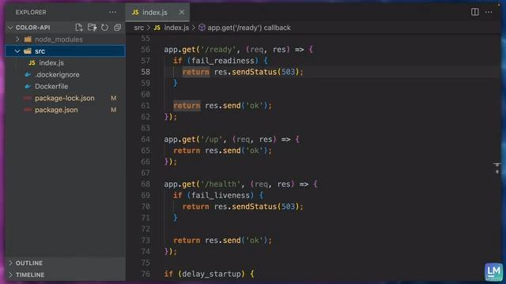
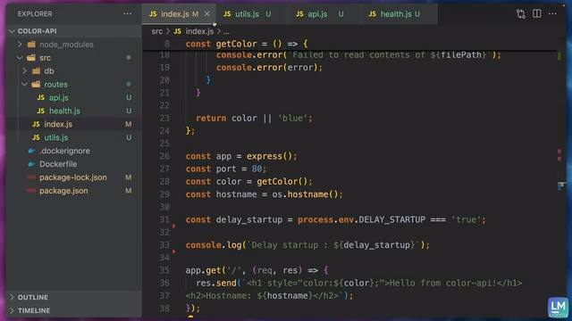
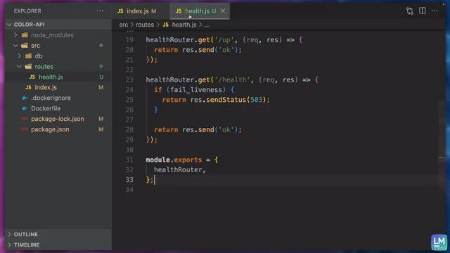
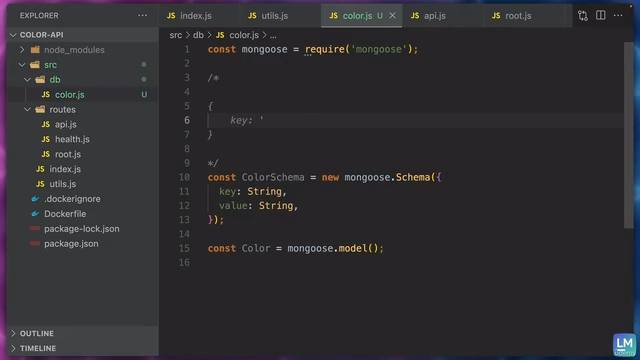
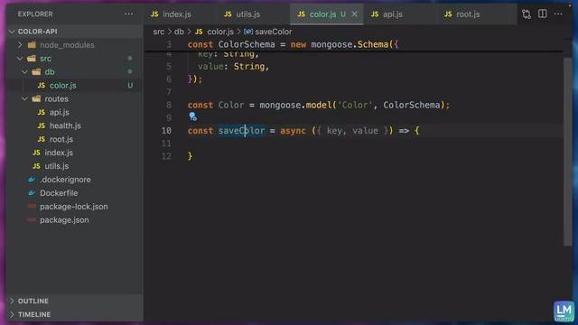
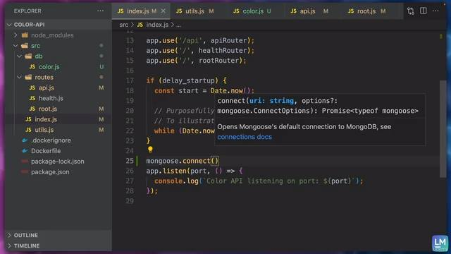
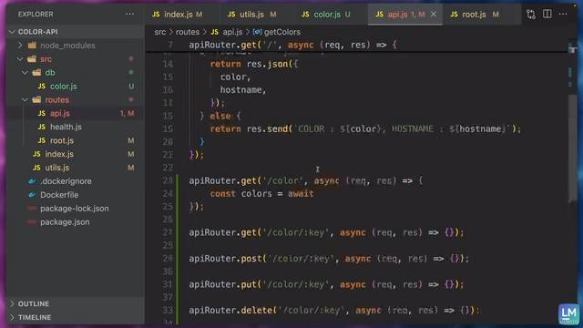
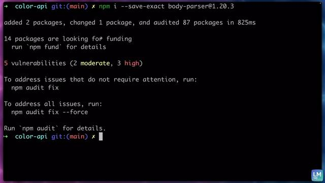

# Docker & Kubernetes Zero to Hero｜P21–P24：把 Color API 从「读文件」改造成「MongoDB 持久化 + 模块化路由」

> 说明：这四集是连续的**应用代码改造**，不是 Kubernetes 内容。讲师在 P021、P022 开头都明确说这两集是 optional（可选），如果你只想跟 K8s 部分，可以直接用讲师打好的镜像 tag。本文按「把项目跑起来」的逻辑重排，代码文件全部写全，可直接保存运行。
>
> 逐字稿没有逐字展示每个文件的完整内容（讲师是边改边讲），下文第 4 节的代码是**按逐字稿描述重建的完整文件**；凡是逐字稿没交代的细节（如端口号、健康检查的状态码、`delayStartup` 的实现），都在第 5、7 节明确标注「课里没讲」，你可以按自己的环境调整。

---

## 1. 这一节做什么

这四集要解决一个很具体的问题：**之前 Color API 的「颜色」是从一个文件里读出来的，容器一重启、一换 Pod，颜色就没了，而且没法改。** 讲师要把颜色的来源换成 MongoDB：

- 颜色存在数据库里 → 用数据库里的值；
- 数据库里没有这个 key → 回退到环境变量 `DEFAULT_COLOR`；
- 再没有 → 最后兜底 `blue`。

同时做一次比较大的代码结构重整：`index.js` 从「什么都塞在一起」拆成 `routes/`（health、api、root 三个 router）+ `db/`（Mongoose 模型与数据访问函数）+ `utils.js`（取 hostname 这类小工具）。

改造完成后提供的能力：

| 能力 | 路由 | 说明 |
|---|---|---|
| 存活/就绪检查 | `GET /ready`、`GET /up`、`GET /health` | 从 `index.js` 抽到 `routes/health.js` |
| 根路由 | `GET /` | 返回 hostname + 当前颜色 |
| API 根路由 | `GET /api` | 返回 hostname + 当前颜色 |
| 列出所有颜色 | `GET /api/color` | 来自数据库 |
| 按 key 取单个颜色 | `GET /api/color/:key` | 找不到返回 404 |
| 按 key 新建/更新颜色 | `POST /api/color/:key` | body 里带 `value`，返回 201 |
| 按 key 删除颜色 | `DELETE /api/color/:key` | 返回 204 |

因为**删掉了「通过文件路径提供颜色」这个功能**，讲师把它定性为 breaking change，所以镜像版本从原来的版本直接跳到 **`2.0.0`**（major bump）。这一点很重要：后面做 Kubernetes 实验时，你要用 `2.0.0` 这个 tag 才能和讲师对齐。

---

## 2. 讲师原话（带时间戳）

关于「这两集可以跳过」：

> "如果你对跟进我们在这里对调用方 API 容器和 Node.js Express 服务器所做的实现或更新不感兴趣，这一讲完全是可选的。那么你可以放心跳过这一讲，只需确保在接下来的几讲中使用和我完全相同的标签，这样你就能直接用到新功能。"
> —— p021 [00:00]

关于钉死依赖版本：

> "我们在这里运行 npm install --save-exact，这样大家就能保持在同一个版本上。我们会安装 Mongoose 包，安装的版本是 8.6.3。这是录制时的最新版本。我在这里把它固定下来，这样大家就能保持一致。"
> —— p021 [00:52]

关于拆路由的动机：

> "目前我们只有一个 index.js 文件，如你所见，这里面发生了很多事情。我们有路由，所有东西都混在一起。所以我们在这里新建一个文件夹，这个文件夹就叫 routes。"
> —— p021 [01:21]

关于数据库优先、环境变量兜底：

> "这将作为主要的信息来源。因此，如果颜色存储在数据库中，我们就使用那个颜色；否则，就回退到环境变量中设置的默认颜色。我们还会移除这个文件路径。这意味着这是一项破坏性变更，因此我们实际上需要发布或进行一次主版本升级。"
> —— p022 [00:28]

关于 schema 的形状（key/value 都是字符串）：

> "这里会有一个表示颜色的键，类型是字符串；它还会有一个值，类型也是字符串。因此，如果我们想在这里保存一种新颜色，可以这样：键就设为主色，值就是实际的颜色值，比如设为紫色。"
> —— p022 [02:20]

关于先连库、再监听请求：

> "然后只有在那之后，我们才真正开始监听请求。如果连接没有成功，我们就不希望监听请求。所以，我们把 app.listen 放到这个代码块里面。"
> —— p023 [00:57]

关于把 `find` 改成 `findOne` 这个坑：

> "我们确实需要对这里的 saveColor 函数做一个小更新。所以这里应该用 await Color.findOne，因为我们要传入一个特定的键；如果这个键不存在，它才会真正返回 undefined。如果这里只传 find，那会返回一个空数组，而不会返回 undefined。"
> —— p024 [08:55]

关于 `strict` 参数的由来：

> "如果不存在颜色——实际上在我们这里这不可能，因为 getColor 函数总是会给我们返回一个值——那么这里其实就不太正确。所以我们可以这样做：也许可以再加一个参数，比如叫 strict 之类的。然后我们把它默认设为 false。"
> —— p024 [02:40]

---

## 3. 从零复现

### 3.1 前置环境

| 依赖 | 说明 |
|---|---|
| Node.js | 需要支持 `async/await` 与 Mongoose 8.x，**建议 Node 18 或以上**（课里没讲具体版本） |
| npm | 随 Node 安装 |
| MongoDB | 一个能连上的 MongoDB 实例（课里没讲怎么起 Mongo，见第 7 节给的最简做法） |
| Docker | P024 结尾要 build + push 镜像 |

目录规划（本文用 `color-api/`，即讲师口中的 color API 应用目录）：

```
color-api/
├── package.json
├── index.js
├── utils.js
├── routes/
│   ├── health.js
│   ├── api.js
│   └── root.js
└── db/
    └── color.js
```

### 3.2 第一步：进入应用目录，钉死依赖版本

```bash
mkdir -p color-api && cd color-api
npm init -y

# 讲师用的是 --save-exact，锁死版本，保证大家一致
npm install --save-exact mongoose@8.6.3
npm install --save-exact body-parser@1.20.3
```

`express` 在之前的课程里已经装过了，课里没讲版本，用你已有的即可（本文示例用 4.x）。

### 3.3 第二步：把健康检查路由拆出去

新建 `routes/health.js`，把原来 `index.js` 里的 `/ready`、`/up`、`/health` 三个路由，连同 `failReadiness`、`failLiveness` 两个开关变量和它们的 `console.log` 一起搬进去。搬完之后在文件底部 `module.exports = healthRouter`。



### 3.4 第三步：抽出 utils.js

原来 `index.js` 里有两个小工具：`getColor`（从文件读颜色）和 `getHostname`（返回 `os.hostname()`）。讲师把它们挪到 `utils.js`，并从 `index.js` 顶部把 `fs`、`path`、`os` 的 require 一起搬过去。



### 3.5 第四步：拆 api 与 root 路由，并验证重构没改坏行为

新建 `routes/api.js`（挂到 `/api`）和 `routes/root.js`（挂到 `/`），在 `index.js` 里用 `app.use()` 挂载。这里有个值得记住的点——**多个 router 可以挂在同一个 base path 上**，Express 会自己按具体路径匹配，只要没有两条完全相同的方法+路径即可。

改完先跑一次回归：

```bash
npm start
# 另开一个终端
curl localhost:3000/up
curl localhost:3000/health
curl localhost:3000/ready
curl localhost:3000/
curl localhost:3000/api
```

三个健康端点都应该返回 `ok`。这一步通过，说明「纯搬家」没搬坏，后面再改行为才有参照。



### 3.6 第五步：建数据库层 `db/color.js`

在 `db/` 下新建 `color.js`，内容分三块：

1. `colorSchema`：`{ key: String, value: String }`；
2. `Color = mongoose.model('color', colorSchema)`，拿到可以 find/save 的模型对象；
3. 四个导出函数：`saveColor`、`getColor`、`getColors`、`deleteColor`。

`saveColor(key, value)` 的语义是 **upsert**：先按 key 找，找到就 `set` 新值，找不到就 `new Color({ key, value })`，最后统一 `await color.save()`。



### 3.7 第六步：删掉基于文件的 getColor，改成从库读

这一步就是 breaking change 的来源：`utils.js` 里的 `getColor`（读文件）整个删掉，`fs`/`path` 的 require 也删掉，`utils.js` 只留 `getHostname`。所有调用方改成 `require('../db/color')`。

同时讲师把签名改了两轮：

- 原来 `getColor()` 无参 → 改成 `getColor(key)`，按 key 查；
- 再加 `getColors()` 无参，返回全表；
- P024 又加了第二个参数 `strict = false`，用于「查不到就返回 404」的场景。



### 3.8 第七步：在 index.js 里连接 MongoDB

在 `app.listen` 之前加 `mongoose.connect(process.env.DB_URL)`，用 `.then()` 里放 `console.log('connected to MongoDB')` + `app.listen(...)`，`.catch()` 里 `console.error`。**连不上就不监听**，这是讲师特意强调的。

因为 `getColor` 现在是 async 的，所有调用它的路由 handler 都要加 `async` 和 `await`——这一步很容易漏，漏了就会拿到一个 Promise 对象当成颜色返回。



### 3.9 第八步：补齐 CRUD 路由 + body-parser

在 `routes/api.js` 里加四条：`GET /color`、`GET /color/:key`、`POST /color/:key`、`DELETE /color/:key`。讲师原本还写了 `PUT /color/:key`，写到一半发现和 POST 逻辑完全一样，就删掉了——「these two methods, they are doing exactly the same. So let's maybe just get rid of the put one」。

然后用 `body-parser` 让 `req.body` 可用：

```bash
npm install --save-exact body-parser@1.20.3
```

在 `index.js` 里 `app.use(bodyParser.json())`。



### 3.10 第九步：端到端验证

```bash
export DB_URL="mongodb://localhost:27017/color-api"
export DEFAULT_COLOR=green
npm start
```

```bash
# 1) 根路由：应返回 hostname + green（库为空时回退到 DEFAULT_COLOR）
curl localhost:3000/
curl "localhost:3000/api?colorKey=primary"

# 2) 写一个颜色
curl -X POST localhost:3000/api/color/primary \
  -H 'Content-Type: application/json' \
  -d '{"value":"purple"}'

# 3) 列出全部
curl localhost:3000/api/color

# 4) 按 key 取单个
curl localhost:3000/api/color/primary

# 5) 取一个不存在的 key，应 404
curl -i localhost:3000/api/color/nope

# 6) 删除，应 204
curl -i -X DELETE localhost:3000/api/color/primary
```

### 3.11 第十步：构建并推送 2.0.0 镜像

```bash
docker build -t lm-academy/color-api:2.0.0 .
docker push lm-academy/color-api:2.0.0
```

`lm-academy` 是讲师用的仓库前缀，你要换成自己的 Docker Hub 用户名/组织名。



---

## 4. 完整代码

> 以下 7 个文件放在同一目录下即可运行。逐字稿未逐字展示完整文件，这里是按讲师口述重建的结果；与逐字稿有出入的地方在第 5 节逐条说明。

### 4.1 `package.json`

```json
{
  "name": "color-api",
  "version": "2.0.0",
  "description": "Color API for the Docker & Kubernetes Zero to Hero course",
  "main": "index.js",
  "scripts": {
    "start": "node index.js"
  },
  "dependencies": {
    "body-parser": "1.20.3",
    "express": "^4.21.0",
    "mongoose": "8.6.3"
  }
}
```

### 4.2 `index.js`

```js
const express = require('express');
const bodyParser = require('body-parser');
const mongoose = require('mongoose');

const healthRouter = require('./routes/health');
const apiRouter = require('./routes/api');
const rootRouter = require('./routes/root');

const app = express();

// 必须在路由之前注册，否则 req.body 是 undefined
app.use(bodyParser.json());

// 健康检查挂根路径：/ready /up /health
app.use('/', healthRouter);

// API router 挂到 /api 子路径
app.use('/api', apiRouter);

// 根路由也挂在 / 下，Express 会按具体路径自行匹配
app.use('/', rootRouter);

const port = process.env.PORT || 3000;

// 课里没讲 delayStartup 的具体实现，这里保留一个最小实现：
// 环境变量给多少毫秒，就在开始监听前等多久
const delayStartup = Number(process.env.DELAY_STARTUP || 0);

mongoose
  .connect(process.env.DB_URL)
  .then(async () => {
    console.log('connected to MongoDB');

    if (delayStartup > 0) {
      await new Promise((resolve) => setTimeout(resolve, delayStartup));
    }

    app.listen(port, () => {
      console.log(`listening on port ${port}`);
    });
  })
  .catch((error) => {
    console.error('could not connect to MongoDB');
    console.error(error);
  });
```

### 4.3 `routes/health.js`

```js
const express = require('express');

const healthRouter = express.Router();

// 课里没讲这两个开关的环境变量名，这里按变量名大写下划线约定
const failReadiness = process.env.FAIL_READINESS === 'true';
const failLiveness = process.env.FAIL_LIVENESS === 'true';

healthRouter.get('/ready', (req, res) => {
  console.log('readiness check requested, failReadiness:', failReadiness);
  if (failReadiness) {
    return res.status(500).send('not ready');
  }
  return res.send('ok');
});

healthRouter.get('/up', (req, res) => {
  console.log('liveness check requested, failLiveness:', failLiveness);
  if (failLiveness) {
    return res.status(500).send('not alive');
  }
  return res.send('ok');
});

healthRouter.get('/health', (req, res) => {
  console.log('health check requested, failLiveness:', failLiveness);
  if (failLiveness) {
    return res.status(500).send('not healthy');
  }
  return res.send('ok');
});

module.exports = healthRouter;
```

### 4.4 `utils.js`

```js
const os = require('os');

const getHostname = () => os.hostname();

module.exports = {
  getHostname,
};
```

### 4.5 `db/color.js`

```js
const mongoose = require('mongoose');

const colorSchema = new mongoose.Schema({
  key: String,
  value: String,
});

const Color = mongoose.model('color', colorSchema);

// 有就更新，没有就新建
async function saveColor(key, value) {
  let color = await Color.findOne({ key });

  if (color) {
    color.set('value', value);
  } else {
    color = new Color({ key, value });
  }

  await color.save();
}

// strict = true 时，查不到就返回 undefined（给 404 用）
async function getColor(key, strict = false) {
  const color = await Color.findOne({ key });

  if (strict && !color) {
    return undefined;
  }

  if (color) {
    return color.value;
  }

  return process.env.DEFAULT_COLOR || 'blue';
}

// 返回数据库里所有颜色
async function getColors() {
  return Color.find();
}

async function deleteColor(key) {
  return Color.deleteOne({ key });
}

module.exports = {
  saveColor,
  getColor,
  getColors,
  deleteColor,
};
```

### 4.6 `routes/root.js`

```js
const express = require('express');

const { getHostname } = require('../utils');
const { getColor } = require('../db/color');

const rootRouter = express.Router();

rootRouter.get('/', async (req, res) => {
  const colorKey = req.query.colorKey;
  console.log('colorKey:', colorKey);

  const color = await getColor(colorKey);

  return res.send({
    hostname: getHostname(),
    color,
  });
});

module.exports = rootRouter;
```

### 4.7 `routes/api.js`

```js
const express = require('express');

const { getHostname } = require('../utils');
const { getColor, getColors, saveColor, deleteColor } = require('../db/color');

const apiRouter = express.Router();

// GET /api —— 返回 hostname + 当前颜色
apiRouter.get('/', async (req, res) => {
  const colorKey = req.query.colorKey;
  console.log('colorKey:', colorKey);

  const color = await getColor(colorKey);

  return res.send({
    hostname: getHostname(),
    color,
  });
});

// GET /api/color —— 列出所有颜色
apiRouter.get('/color', async (req, res) => {
  const colors = await getColors();
  return res.send({ data: colors });
});

// GET /api/color/:key —— 按 key 取单个，不存在返回 404
apiRouter.get('/color/:key', async (req, res) => {
  const key = req.params.key;

  const color = await getColor(key, true);

  if (!color) {
    return res.sendStatus(404);
  }

  return res.send({ data: color });
});

// POST /api/color/:key —— 新建或更新
apiRouter.post('/color/:key', async (req, res) => {
  const key = req.params.key;
  const value = req.body.value;

  await saveColor(key, value);

  return res.status(201).send({ key, value });
});

// DELETE /api/color/:key —— 删除
apiRouter.delete('/color/:key', async (req, res) => {
  const key = req.params.key;

  await deleteColor(key);

  return res.sendStatus(204);
});

module.exports = apiRouter;
```

---

## 5. 逐行解释

### 5.1 `index.js`

- `app.use(bodyParser.json())` **必须在所有路由注册之前**。Express 的中间件是按注册顺序执行的，放到路由后面，`req.body` 永远是 `undefined`，POST 会静默失败（返回 201 但存进去的是 `undefined`）。
- `app.use('/', healthRouter)` 和 `app.use('/', rootRouter)` **两条挂在同一个 base path 上**。这是讲师特意验证过的点：只要没有两条「方法 + 路径」完全相同的路由，Express 会依次尝试匹配，不会冲突。抽 router 的意义就在这——`health.js` 自己只关心 `/ready`、`/up`、`/health`，前缀由挂载点决定。
- `app.use('/api', apiRouter)` 是子路径挂载。`apiRouter` 里写 `get('/')`，实际对外是 `GET /api`；写 `get('/color')`，对外是 `GET /api/color`。**不要**在 `apiRouter` 里再写一遍 `/api`，否则会变成 `/api/api`。
- `mongoose.connect(process.env.DB_URL)` 只传了 URI，课里没讲其它选项。Mongoose 8 默认会缓冲命令（bufferCommands），所以即使连接还没完成，查询也不会立刻报错，而是等着——但这不代表可以不等待连接就 `listen`，讲师的做法是显式放在 `.then()` 里。
- `app.listen` 在 `.then()` **内部**：连接失败时进程不监听端口，在 Kubernetes 里表现为 Pod 一直不 Ready，而不是「服务起来了但每个请求都 500」。这个设计在后面做 readinessProbe 时很关键。
- `.catch()` 里用 `console.error` 而不是 `console.log`——讲师在 P023 [01:27] 特意改成了 `console.error`，方便在 `kubectl logs` 时区分正常输出和错误。
- `delayStartup`：逐字稿只提到「we have our delay startup so that we don't break anything here」，没讲它怎么实现。上面用的是「启动前 sleep N 毫秒」，属于本文补的最小实现，**不是讲师原话**。这个变量在早期课程里是用来模拟慢启动、观察 readinessProbe 行为的。

### 5.2 `routes/health.js`

- `express.Router()` 相当于「一个迷你 app」，在 JS 前端语境里可以类比成 Vue Router / React Router 的 `Router` 实例：本身不带前缀，挂到哪就是哪。
- `failReadiness` / `failLiveness` 从 `index.js` 搬过来后变成了**模块级常量**，在 `require` 的那一刻读一次环境变量。这意味着运行期改环境变量不会生效，必须重启进程——这对容器场景是合适的。
- 三个端点返回 `ok`。逐字稿只确认了「curl 回来是 ok」，**没讲失败时应该返回什么状态码**，上面统一用 500。真实项目中 readiness 失败常用 503，你可以按需改。
- `/ready` 对应 readiness、`/up` 与 `/health` 对应 liveness，这个对应关系**逐字稿没有明确说**，是按变量名 failLiveness 出现的顺序推断的，实际以你后续 K8s manifest 里的探针配置为准。

### 5.3 `utils.js`

- 只剩一个 `getHostname`。P021 时这里还有一个读文件的 `getColor`，P022 删掉了——**这就是 major 版本号变更的原因**。
- `const getHostname = () => os.hostname();` 是箭头函数单表达式，等价于 `function () { return os.hostname(); }`。讲师在 P021 [10:35] 说「we don't even need to have the curly bracket」。
- 之所以费劲抽出一个只有一行的函数，是为了让 `root.js` 和 `api.js` 都能 `require('../utils')`，而不用各自 `require('os')` 再写一遍。讲师的用法是「先重构、再引入新功能」，两步分开，出问题时更容易定位。

### 5.4 `db/color.js`

- `new mongoose.Schema({ key: String, value: String })` —— 这就是逐字稿里那句「key 是 string、value 也是 string」的代码形式。**没有加 `required`、没有加 `unique`**，所以空 value 也能存进去，同一个 key 也可能出现多条（见第 7 节）。
- `mongoose.model('color', colorSchema)` 返回的是**模型构造函数**，它同时是查询入口（`Color.find`、`Color.findOne`、`Color.deleteOne`）。Mongoose 会把模型名复数化成 collection 名，所以实际 collection 大概率叫 `colors`（该行为以实际输出为准）。
- `saveColor` 里的 `color.set('value', value)`：Mongoose 文档的 setter，效果等同于 `color.value = value`，但会走 schema 的类型转换和校验。讲师原话是「we will set a certain property」。
- `saveColor` 用 `findOne` 而不是 `find`，这是 P024 [08:55] 讲师自己踩坑后修的：`find` 返回数组，空数组是 truthy，`if (color)` 永远成立，会走到 `color.set(...)` 对一个数组调用而报错。**`findOne` 查不到返回 `null`**，才是可以判空的。
- `getColor(key, strict = false)` 的三段逻辑，顺序很讲究：
  1. `if (strict && !color) return undefined;` —— 严格模式且查不到，返回 `undefined`，让上层能 `if (!color) return 404`；
  2. `if (color) return color.value;` —— 查到就返回**值**（不是整个文档）。因为调用方要的是颜色字符串，返回文档会让响应体变成 `{ _id, key, value, __v }`；
  3. `return process.env.DEFAULT_COLOR || 'blue';` —— 兜底。讲师在 P024 [04:29] 特意删掉了这里的 `color.value || blue`，把「值可能为空」的保护交给写入侧，而不是读取侧。
  默认参数 `strict = false` 让老调用（`getColor(key)`）行为不变——这是「加参数不破坏兼容」的常见做法。
- `getColors()` 里 `return Color.find();` 没有 `await`。Mongoose 的 Query 是 thenable，`async` 函数 return 它时会自动等待，效果和 `return await Color.find()` 一样，少一层。**注意**：如果你在 `return` 之后还要写 `try/catch`，就必须显式 `await`，否则 catch 不到。
- `deleteColor(key)` 只有一行 `return Color.deleteOne({ key })`。讲师原话：「we don't even need to do that. We can just directly return this like so」。这里**只接受 key**，不接收 value——P024 [09:24] 讲师检查代码时发现路由层多传了 value，特意去掉。
- `deleteOne` 不会告诉你删没删到，返回的是 `{ acknowledged, deletedCount }` 之类的结构（具体字段以实际输出为准）。所以 DELETE 一律返回 204，不区分「本来就不存在」。

### 5.5 `routes/root.js` 与 `routes/api.js`

- 两个文件的根路由几乎一样，都是「取 query 里的 `colorKey` → 查颜色 → 返回 hostname + color」。之所以重复一份，是因为它们被挂在不同前缀下，且讲师希望每个 router 自包含。
- `const colorKey = req.query.colorKey;` 对应 URL 上的 `?colorKey=primary`。讲师演示的 URL 是「localhost 然后 color key 等于 primary」。不传时是 `undefined`，`findOne({ key: undefined })` 查不到，走 `DEFAULT_COLOR` 兜底，所以不会报错。
- `const key = req.params.key;` 对应路径参数 `:key`。`req.params` 来自路径，`req.query` 来自问号后面，`req.body` 来自请求体——三个来源别搞混。
- `getColor(key, true)` 传 `strict = true`，是为了让 `GET /api/color/:key` 能区分「查不到」和「查到了」。如果没有 strict，查不到会返回 `DEFAULT_COLOR`，那就永远返回不了 404。
- `res.sendStatus(404)` 等价于 `res.status(404).send('Not Found')`；`res.sendStatus(204)` 同理。用 `sendStatus` 而不是 `status().send()` 是因为 204 本来就不该有 body。
- `POST` 返回 **201**。讲师自己也说「this is something that I'm not 100% convinced because normally would be 200」——语义上 201 表示「创建了资源」，但这里更新已有 key 时也返回 201。**这是讲师明确承认的妥协**，不是标准做法。
- `res.status(201).send({ key, value })` 是 ES6 简写，等价于 `{ key: key, value: value }`。讲师说「let's just send back the key and the value that we receive here」。
- `GET /api/color` 和 `GET /api/color/:key` 用 `{ data: ... }` 包了一层。讲师原话是「we're gonna send the data and this will be our colors」，**逐字稿没有展示完整的对象字面量**，这里是按「send the data」推断的字段名。如果你想要裸数组/裸字符串，把 `res.send({ data: colors })` 改成 `res.send(colors)` 即可，不影响其它逻辑。
- `PUT` 被删掉了。讲师写到一半发现它和 POST 逻辑完全一致，就删了。**所以现在只有 POST 能写颜色**，用 PUT 请求会 404。

### 5.6 对前端背景读者的补充

- `async/await` 在这份代码里就是「等数据库 IO」。你在浏览器里写 `await fetch()` 是等网络，这里是等 Mongo，写法完全一样。
- **没有锁、没有事务**。`saveColor` 是「先 findOne 再 save」的读-改-写，两个请求同时 POST 同一个新 key，可能各插一条。在 JS/Node 里这不会像 Java 那样有线程安全问题（单线程事件循环），但**跨进程/跨 Pod 依然会重复写入**，因为并发发生在数据库侧。要彻底避免，需要给 `key` 建唯一索引 + 用 `updateOne(..., { upsert: true })`，课里都没做。
- Node 里没有「事务」的原生写法，MongoDB 的事务需要 replica set，本地单机 Mongo 跑不了。这也是课里不做的原因之一。

---

## 6. 复现检查清单

按顺序打勾，任一项不过就别往下走。

**环境**
- [ ] `node -v` 能输出版本，且 ≥ 18
- [ ] MongoDB 可连接（`mongosh "mongodb://localhost:27017"` 能进）
- [ ] `npm ls mongoose` 显示 `8.6.3`
- [ ] `npm ls body-parser` 显示 `1.20.3`

**目录与文件**
- [ ] 存在 `routes/health.js`、`routes/api.js`、`routes/root.js`
- [ ] 存在 `db/color.js`、`utils.js`
- [ ] `utils.js` 里**没有** `fs`、`path` require（说明文件读取已彻底移除）
- [ ] `db/color.js` 里 `saveColor` 用的是 `findOne` 而不是 `find`

**启动**
- [ ] `DB_URL` 已 export，且 `npm start` 打印 `connected to MongoDB` 和 `listening on port`
- [ ] 故意把 `DB_URL` 写错，进程**不会**监听端口（只有 `could not connect to MongoDB` 错误日志）——验证「连不上不 listen」
- [ ] 不设 `DEFAULT_COLOR` 时，`curl localhost:3000/` 返回的 color 是 `blue`
- [ ] 设 `DEFAULT_COLOR=green` 重启后，返回的 color 是 `green`

**接口行为**
- [ ] `curl /up`、`/health`、`/ready` 都返回 `ok`
- [ ] `curl localhost:3000/` 返回的 hostname 和 `hostname` 命令输出一致
- [ ] `POST /api/color/primary` 带 `{"value":"purple"}` 返回 201，body 含 `key` 和 `value`
- [ ] `GET /api/color` 能看到 `primary`
- [ ] `GET /api/color/primary` 返回 `purple`
- [ ] `GET /api/color/nope` 返回 **404**（不是默认色，说明 strict 生效）
- [ ] 再 POST 一次同名 key 不同 value，`GET /api/color` 里该 key **只有一条**（说明是更新不是新增）
- [ ] `DELETE /api/color/primary` 返回 **204**
- [ ] 删完之后 `GET /api/color/primary` 返回 404，`GET /api/color` 里没有该 key

**镜像**
- [ ] `docker build -t <你的仓库>/color-api:2.0.0 .` 成功
- [ ] `docker images` 能看到 `2.0.0` tag
- [ ] `docker push` 成功（如果你要跟后续 K8s 课程，这一步必须做完）

---

## 7. 课里没讲但你会撞上的

这一节全部是逐字稿之外的内容，**不是讲师说的**，但不处理你大概率跑不起来。

**1）MongoDB 从哪来**
课里直接假设你有一个可连的 Mongo，没讲怎么起。用 Docker 起一个最简单机实例：

```bash
docker run -d --name mongo -p 27017:27017 mongo:7
export DB_URL="mongodb://localhost:27017/color-api"
```

**2）端口号**
逐字稿只说 `curl localhost`，没提端口。上面的代码用 `process.env.PORT || 3000`，所以命令里都带 `:3000`。你原来的 `index.js` 如果用的是别的端口，以你实际为准。

**3）没有 Dockerfile**
P024 直接 `docker build`，说明 Dockerfile 在更早的课程里已经写好了，本节没展示。如果你手上没有，一个最小可用版本是（**课里没有这段，以下为示意**）：

```dockerfile
FROM node:20-alpine
WORKDIR /app
COPY package*.json ./
RUN npm ci --omit=dev
COPY . .
EXPOSE 3000
CMD ["npm", "start"]
```

注意 `.dockerignore` 要排除 `node_modules`，否则会把宿主机的依赖（可能是 macOS 编译的二进制）拷进镜像。

**4）`DB_URL` 这个名字**
逐字稿里讲师念的是「db underscore URL」，所以环境变量名是 `DB_URL`。**大小写敏感**，写成 `DB_URL` 而不是 `Db_Url`。后面进 Kubernetes 时，这个值通常来自 Service 名（形如 `mongodb://mongo:27017/color-api`），但那是下一节的内容，本节没讲。

**5）schema 没有 `unique`，会出现重复 key**
`db/color.js` 里 `key: String` 没有 `unique: true`。理论上同一个 key 可以插入多条，`findOne` 只会随机拿一条。要修：

```js
const colorSchema = new mongoose.Schema({
  key: { type: String, unique: true },
  value: String,
});
```

但加了 `unique` 之后，MongoDB 需要先建索引，已有重复数据时启动会失败。**课里没做这件事**，所以你按本文代码复现时，别用并发脚本压 POST。

**6）`saveColor` 的读-改-写有竞态**
两个 Pod 同时 POST 同一个新 key，两边 `findOne` 都返回 `null`，于是各 `save()` 一次 → 两条记录。更稳的写法是：

```js
await Color.updateOne({ key }, { $set: { value } }, { upsert: true });
```

`upsert: true` 表示「有就更新、没有就插入」，一次原子操作。**课里没讲这个**，讲师用的是 `findOne` + `save` 的两步写法。

**7）`body-parser` 其实可以不装**
Express 4.16+ 内置了 `express.json()`，功能等价于 `bodyParser.json()`。课里用 body-parser 1.20.3 是历史习惯。两种写法二选一即可，**不要同时注册**，虽然不会报错，但没必要。

**8）`GET /api/color` 返回的是 Mongoose 文档数组**
序列化成 JSON 后会带上 `_id` 和 `__v`（具体字段以实际输出为准）。如果你后续要用这个接口给前端用，通常要 `res.send(colors.map(c => ({ key: c.key, value: c.value })))` 把内部字段剥掉。

**9）`POST` 没有校验 `value` 是否存在**
`req.body.value` 不传时是 `undefined`，Mongoose 会存成「字段不存在」，`getColor` 取出来是 `undefined`，最后回退成 `DEFAULT_COLOR`——看起来「存成功了但读不出来」。讲师在 P024 [11:23] 自己也说「maybe the user will pass bad input」，但没实现校验。加一行就行：

```js
if (!value) return res.status(400).send({ error: 'value is required' });
```

**10）`/health` 和 `/up` 到底谁对应 liveness**
本文两个都用 `failLiveness` 控制，属于推断。等你写 K8s 的 `livenessProbe` 时，先用 `curl` 自己确认一遍行为，再决定探针指向哪个路径。