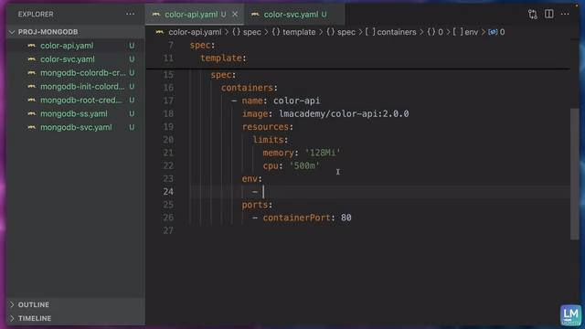
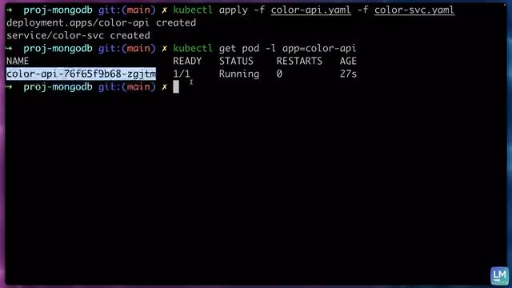
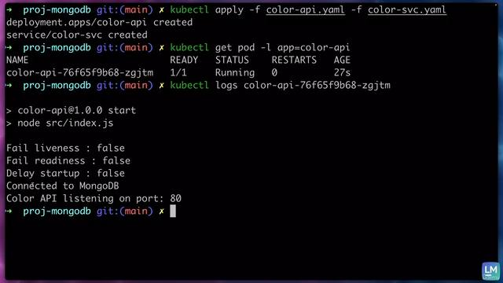
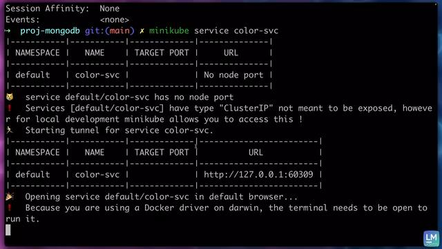
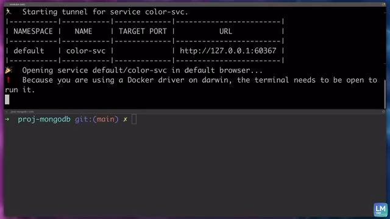
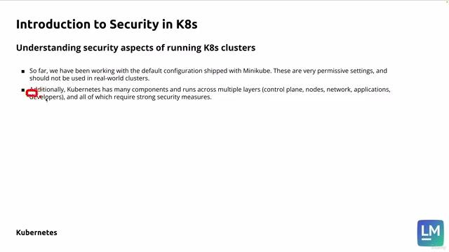

# Docker & Kubernetes Zero to Hero｜P25–P28：把 color API 接入 MongoDB，跑通、扩容、清理，并建立安全视角

> 覆盖 P25–P28。P25–P26 是可动手复现的主体：创建 `color-api` Deployment、`color-svc` Service，用 Secret 注入数据库凭据，通过环境变量插值拼出 `DB_URL`，暴露服务并用 HTTP 请求验证增删查；随后扩缩容 Deployment、用 traffic-generator 观察无状态特性、扩 MongoDB StatefulSet 观察有状态特性，最后完整清理。P27–P28 是安全章节的开场与总览，**只有概念，没有可执行 YAML**；本文会在对应位置明确标注“课里没讲实现”。

---

## 1. 这一节做什么

这一节的目标不是再讲一遍 Kubernetes 对象定义，而是把前面已经跑起来的 MongoDB 和已经构建好的 `color-api:2.0.0` 镜像**接成一个能对外提供 HTTP 服务的完整应用**，然后用它验证两件事：

1. **无状态应用可以随便扩缩容**：`color-api` 不保存任何本地状态，所有颜色数据都在 MongoDB 里。因此把 Deployment 从 1 个 Pod 扩到 3 个，请求会落到不同 Pod，但读到的数据一致。
2. **有状态应用的每个 Pod 是独立状态**：MongoDB StatefulSet 扩到 3 个 Pod 后，`mongodb-ss-0`、`mongodb-ss-1`、`mongodb-ss-2` 各自有独立的数据目录，彼此不自动复制。你把 `DB_HOST` 从 `-0` 改成 `-1`，应用看到的就是另一份数据。

最终产物是一个最小可用的“前端 API + 数据库”部署：

- `color-api.yaml`：Deployment，2 个副本（讲师口述 “a couple of pods”，未展示具体 `replicas` 数值，这里取 2），容器端口 80。
- `color-svc.yaml`：Service，最终改成 `NodePort`，固定 `nodePort: 30007`，让本机 Postman / curl 能访问。
- `traffic-generator.yaml`：一个临时 Pod，每隔 0.5 秒请求一次 `color-svc/api`，用来观察请求落到不同 Pod 时返回的 hostname。
- 前置依赖：MongoDB StatefulSet、headless Service、保存数据库账号密码的 Secret（这些在 P25 之前的课程里创建，本节只引用，不重复创建）。

P27 是安全章节的目录页：RBAC、Role/ClusterRole 与绑定、Kubernetes API 结构、ServiceAccount、NetworkPolicy、Pod Security Standards。P28 是安全总览：控制面暴露、容器以 root 运行、角色权限过大、缺少网络分段、静态/传输数据未加密，以及对应的五类工具。**这两节没有命令和配置文件**，本文在第 7 节把它们作为“你后续会撞上的安全项”列出，不会伪造 YAML。

---

## 2. 讲师原话

> “Differently from the stateful set of our database, we don't really have any state in our color API. That means we don't need a stable identity for the pods... So we can just use the traditional deployment here.”
>
> —— p025 [00:27]

> “The most important environment variable is the `DB_URL` environment variable.”
>
> —— p025 [02:13]

> “The order is important here. So we add entries to the ENV list before our URL. And then we can reference them here... If we were to set this entry here before the `DB_USER` and the `DB_PASSWORD`, this method would not work.”
>
> —— p025 [04:02] / [05:31]

> “From the application's perspective, it shouldn't really worry, it shouldn't really have to know how to build this connection URL. It should just retrieve the `DB_URL` from the environment variable and connect to whatever database we want it to connect to.”
>
> —— p025 [07:03]

> “Services that have a type `ClusterIP` are not meant to be exposed. However, for local development, Minikube allows you to access this.”
>
> —— p025 [11:35]

> “The color API is a stateless application. We can scale this out and in as much as we want... The MongoDB StatefulSet is a stateful application. That means if we want to connect to a specific pod we need to make sure that that pod is up and we have a headless service in front of it.”
>
> —— p026 [06:51]

> “If we wanted to have multiple pods in a StatefulSet that have exactly the same state, we would have to implement this replication logic. MongoDB or the Mongo image here, it does allow for us to configure a replica set... But this is something we have to do ourselves. It's not something that the StatefulSet will take care of.”
>
> —— p026 [07:21]

> “Kubernetes has many components and many of these components they run across multiple layers... So all of these things, they require us to really think about security from different perspectives, from different dimensions.”
>
> —— p028 [00:52]

---

## 3. 从零复现

### 3.1 前置检查：确认 MongoDB 和 Secret 已经存在

本节的所有 YAML 都假设你已经完成前面课程里的 MongoDB 部署。先确认三样东西在默认命名空间里：

```bash
kubectl get statefulset
kubectl get svc
kubectl get secret
```

你应该能看到：

- 一个 MongoDB 的 StatefulSet，讲师在 P25 里称它为 `mongodb-ss`，并通过 `mongodb-ss-0.mongodb-svc.default.svc.cluster.local` 这种完全限定域名访问 0 号 Pod。
- 一个 headless Service，名字是 `mongodb-svc`。
- 一个 Secret，名字是 `colordb-creds`，里面至少有两个键：`username` 和 `password`。

> 注意：`colordb-creds` 的创建命令**本节没有演示**，讲师只说“let's open our credentials here”。为了让文档能直接跑，下面给出按 Deployment 中引用的键名还原的最小命令；如果你的课程环境里已经创建过，跳过即可。

```bash
kubectl create secret generic colordb-creds \
  --from-literal=username=coloruser \
  --from-literal=password=colorpass
```

数据库名讲师明确说是 `colordb`，端口是 `27017`。如果你的 StatefulSet 名字不是 `mongodb-ss`，后面 `DB_HOST` 里的前缀要一起改。

### 3.2 建立目录

在项目根目录下新建一个专门放本节资源的文件夹：

```bash
mkdir -p color-app
cd color-app
```

目录结构最终是：

```text
color-app/
├── color-api.yaml
├── color-svc.yaml
└── traffic-generator.yaml
```

### 3.3 编写 `color-api.yaml`

先写 Deployment。讲师的操作顺序是：先把 `kind` 改成 `Deployment`，再把 `metadata.name`、`labels`、`selector.matchLabels`、容器名统一成 `color-api`，然后填镜像 `color-api:2.0.0` 和 `containerPort: 80`。


接着处理环境变量。讲师强调 `DB_URL` 是最重要的变量，但**不能把用户名密码明文写进去**，因为 Deployment 文件通常要提交到 Git 仓库。做法是：先定义 `DB_USER` 和 `DB_PASSWORD`，让它们从 Secret 读取；再定义 `DB_HOST`、`DB_PORT`、`DB_NAME`；最后用 `$(变量名)` 语法拼出 `DB_URL`。




这里有一个非常容易踩的坑：**`DB_URL` 必须放在 `DB_USER`、`DB_PASSWORD` 等变量之后**。Kubernetes 在启动容器时按 `env` 列表顺序展开 `$(VAR)`，如果 `DB_URL` 写在前面，拿到的就是字面量 `$(DB_USER)`，而不是真实值。讲师在 [04:02] 和 [05:31] 两次强调这一点。

完整文件见第 4 节。写完后先不要 `apply`，继续写 Service。

### 3.4 编写 `color-svc.yaml`

Service 的 `selector` 必须匹配 Deployment 模板里的 Pod 标签 `app: color-api`。讲师先创建的是普通 `ClusterIP` Service，端口 80，名字叫 `color-svc`。

```yaml
apiVersion: v1
kind: Service
metadata:
  name: color-svc
spec:
  selector:
    app: color-api
  ports:
    - port: 80
      targetPort: 80
```

保存后，两个文件一起应用：

```bash
kubectl apply -f color-api.yaml
kubectl apply -f color-svc.yaml
```

### 3.5 确认 Pod 启动并连上数据库

```bash
kubectl get pods -l app=color-api
```

讲师在 [09:40] 用标签过滤只看 `color-api` 的 Pod。确认 Pod 处于 Running 后，查看日志：

```bash
kubectl logs <color-api-pod-name>
```

日志里应该出现：

```text
Connected to MongoDB
Color API listening on port 80
```

讲师在 [10:06] 解释：如果连不上 MongoDB，Pod 会先启动、等一会儿、然后报错退出，日志里会出现更长的错误信息；如果很快就打印出 `Connected to MongoDB`，说明用户名、密码、数据库名、host 全部正确。



再看 Service 的 Endpoints：

```bash
kubectl describe svc color-svc
```

讲师在 [10:58] 确认这里应该有一个 endpoint，指向刚才那个 Pod 的 IP。

### 3.6 用 `minikube service` 临时暴露

因为 `ClusterIP` 只能在集群内部访问，本地 Postman 够不着。讲师用：

```bash
minikube service color-svc
```

这条命令会分配一个本机可访问的 IP:PORT，并**前台阻塞**。讲师特别提醒：这个终端不能关，也不能在里面跑别的命令。



Minikube 同时会打印一条提示：`ClusterIP` 类型的 Service 本来不应该被暴露，这里只是为了本地开发方便。讲师在 [11:35] 读到这条提示后，决定改成 `NodePort`，让配置更“正规”。

### 3.7 改成 NodePort 并固定端口

回到 `color-svc.yaml`，加两行：

```yaml
spec:
  type: NodePort
  selector:
    app: color-api
  ports:
    - port: 80
      targetPort: 80
      nodePort: 30007
```

重新应用：

```bash
kubectl apply -f color-svc.yaml
kubectl describe svc color-svc
```

确认 `Type` 变成 `NodePort`，并且能看到 `NodePort: 30007`。讲师在 [13:02] 说，改成 NodePort 后 Minikube 不再打印那条“不建议暴露 ClusterIP”的提示，访问 URL 也变了，需要把 Postman 里的地址换成新的。



如果不想让命令阻塞，可以用：

```bash
minikube service color-svc --url
```

只输出 URL 就退出。这个参数**课里没讲**，是 Minikube 的常用写法。

### 3.8 用 HTTP 请求验证读写

拿到 `http://<minikube-ip>:30007` 后，依次验证：

1. `GET /`：返回 Pod hostname，讲师在 [13:30] 用它确认请求确实落到了 Deployment 里的 Pod。
2. `GET /api`：返回同样的信息。
3. `POST /api/color/primary`，请求体里带 primary 的值（讲师填的是 `purple`）。
4. `GET /api/color/primary`，应返回 `purple`。
5. `POST /api/color/secondary`，值填 `orange`。
6. `GET /api/color`，应返回 primary 和 secondary 两条记录。
7. `GET /api/color?key=primary` 和 `GET /api/color?key=secondary`，验证按 key 查询。

> 请求体的字段名讲师没有在逐字稿里念出来，以上以你手上 `color-api` 代码的路由约定为准；如果返回 400，先看应用代码里的 DTO 字段名。

### 3.9 扩容 Deployment，观察无状态

```bash
kubectl scale deployment color-api --replicas=3
kubectl get pods -l app=color-api
```



讲师在 [00:54] 确认出现了两个新 Pod，hostname 不同。此时反复请求 `GET /`，返回的 hostname 会在多个 Pod 之间变化——但 `GET /api/color` 读到的数据始终一致，因为状态在 MongoDB 里，不在 Pod 里。

为了更明显地观察，讲师创建了一个 traffic-generator Pod：

```bash
kubectl apply -f traffic-generator.yaml
kubectl logs -f traffic-generator
```


日志里会不断打印不同 hostname 的响应。讲师在 [02:46] 把请求参数改成只查 `primary`，这样能清楚看到颜色值的变化。随后在 Postman 里把 primary 从 `purple` 改成 `red`，traffic-generator 的所有 host 立刻都返回 `red`——这证明状态独立于 Pod。

### 3.10 扩 MongoDB StatefulSet，观察有状态

先删掉 traffic-generator，避免干扰：

```bash
kubectl delete pod traffic-generator
```

然后扩数据库：

```bash
kubectl scale statefulset mongodb-ss --replicas=3
kubectl get pods -l app=mongodb
```

讲师在 [04:38] 确认出现 3 个 MongoDB Pod。此时 `color-api` 的 `DB_HOST` 仍然指向 `mongodb-ss-0`，所以读到的还是 0 号 Pod 的数据。把 `color-api.yaml` 里的 host 改成 `mongodb-ss-1.mongodb-svc.default.svc.cluster.local`，重新 apply：

```bash
kubectl apply -f color-api.yaml
kubectl get pods -l app=color-api
```

Deployment 会滚动重建 Pod。再启动 traffic-generator，会看到颜色回到默认 fallback（蓝色），因为 1 号 MongoDB 是全新实例，里面没有之前写入的 primary/secondary。此时再 POST 一个 `yellow`，只有 1 号库有数据；把 host 改回 `-0`，又能看到之前的 `red`。


讲师在 [07:21] 强调：StatefulSet **不会**自动帮你做数据复制。想要多个 MongoDB Pod 数据一致，必须自己配置 replica set，这是应用层/数据库层的事，不是 StatefulSet 的职责。

### 3.11 清理

讲师在 [08:14] 之后按文件逐个删除，而不是 `kubectl delete -f .`，理由是避免误删整个目录里的无关资源：

```bash
kubectl delete -f color-api.yaml
kubectl delete -f mongodb-statefulset.yaml
kubectl delete -f color-svc.yaml
kubectl delete -f mongodb-svc.yaml
kubectl delete -f mongodb-init-colordb.yaml
kubectl delete -f mongodb-colordb-creds.yaml
kubectl delete -f mongodb-root-creds.yaml
```

然后确认 Deployment、StatefulSet、Pod、Service、ConfigMap、Secret 都没有了：

```bash
kubectl get pods
kubectl get svc
kubectl get deploy
kubectl get statefulset
kubectl get configmap
kubectl get secret
```

最后删 PVC。讲师在 [11:25] 特别提醒：**不要随手 `kubectl delete pvc --all`**，因为可能删掉无关应用的卷，而且如果 PV 的 reclaim policy 是 `Delete`，数据会真的消失。他是逐个指定名字删的：

```bash
kubectl delete pvc <pvc-name-1> <pvc-name-2>
```

删完再 `kubectl get pvc`，应该看到 `No resources found`。

---

## 4. 完整代码

### 4.1 `color-api.yaml`

```yaml
apiVersion: apps/v1
kind: Deployment
metadata:
  name: color-api
  labels:
    app: color-api
spec:
  replicas: 2
  selector:
    matchLabels:
      app: color-api
  template:
    metadata:
      labels:
        app: color-api
    spec:
      containers:
        - name: color-api
          image: <DOCKERHUB_USER>/color-api:2.0.0
          ports:
            - containerPort: 80
          env:
            - name: DB_USER
              valueFrom:
                secretKeyRef:
                  name: colordb-creds
                  key: username
            - name: DB_PASSWORD
              valueFrom:
                secretKeyRef:
                  name: colordb-creds
                  key: password
            - name: DB_HOST
              value: mongodb-ss-0.mongodb-svc.default.svc.cluster.local
            - name: DB_PORT
              value: "27017"
            - name: DB_NAME
              value: colordb
            - name: DB_URL
              value: mongodb://$(DB_USER):$(DB_PASSWORD)@$(DB_HOST):$(DB_PORT)/$(DB_NAME)
```

> 把 `<DOCKERHUB_USER>` 换成你推送镜像时用的 Docker Hub 用户名；讲师原话是 “the LM Academy or your username if you're also pushing the images”。如果直接用讲师的镜像名，需要确认该镜像在仓库里存在，否则会 `ImagePullBackOff`。

### 4.2 `color-svc.yaml`（最终 NodePort 版本）

```yaml
apiVersion: v1
kind: Service
metadata:
  name: color-svc
spec:
  type: NodePort
  selector:
    app: color-api
  ports:
    - port: 80
      targetPort: 80
      nodePort: 30007
```

如果只想先跑通 ClusterIP，把 `type` 和 `nodePort` 两行去掉即可，然后用 `minikube service color-svc` 临时暴露。

### 4.3 `traffic-generator.yaml`

```yaml
apiVersion: v1
kind: Pod
metadata:
  name: traffic-generator
  labels:
    app: traffic-generator
spec:
  containers:
    - name: traffic-generator
      image: <DOCKERHUB_USER>/traffic-generator:1.0.0
      args:
        - "--endpoint=color-svc/api"
        - "--interval=0.5"
```

> 讲师口述的参数是 “endpoint” 和 “interval（every half a second）”，但**没有在画面里展示完整的 `args` 拼写**。上面的 `--endpoint=` / `--interval=` 是按口述还原的写法；如果镜像不接受，先执行 `kubectl run tmp --image=<DOCKERHUB_USER>/traffic-generator:1.0.0 --restart=Never -- --help` 看它实际支持的参数名。也可以尝试位置参数 `color-svc/api` 和 `0.5`。

### 4.4 前置 Secret（本节未演示创建，按引用字段还原）

```bash
kubectl create secret generic colordb-creds \
  --from-literal=username=coloruser \
  --from-literal=password=colorpass
```

---

## 5. 逐行解释

### 5.1 Deployment 部分

- `apiVersion: apps/v1`：Deployment 属于 `apps` 组。讲师在第 27 页提到 Kubernetes API 分组对 RBAC 很重要，这里就是最直观的例子：以后写 Role 时，`apiGroups` 要写 `apps`，`resources` 写 `deployments`。
- `kind: Deployment`：讲师在 [00:27] 解释，color API 没有状态，不需要稳定网络标识和稳定存储标识，所以不用 StatefulSet。StatefulSet 留给 MongoDB。
- `metadata.name: color-api`：Deployment 名字。后面 `kubectl scale deployment color-api` 用的就是它。
- `labels.app: color-api`：Deployment 自身的标签，方便 `kubectl get deploy -l app=color-api`。
- `replicas: 2`：讲师只说 “a couple of pods”，没给具体数字。写 2 是为了让后面 `scale --replicas=3` 有对比。
- `selector.matchLabels.app: color-api`：Deployment 靠它管理 Pod。**必须和 `template.metadata.labels` 完全一致**，否则 `kubectl apply` 会报 `selector does not match template labels`。
- `template.metadata.labels.app: color-api`：Pod 的标签。Service 的 `selector` 也匹配这个标签。三处（Deployment selector、Pod labels、Service selector）必须对齐。
- `containers[0].name: color-api`：容器名，日志里会显示。
- `image: <DOCKERHUB_USER>/color-api:2.0.0`：讲师在 [01:22] 说版本是 `2.0.0`，因为这一版移除了“通过文件传颜色”的功能，属于 breaking change，所以升 major。**镜像必须提前构建并推送**，否则 Pod 会卡在拉取阶段。
- `ports.containerPort: 80`：容器里应用监听的端口。讲师在日志里看到 `Color API listening on port 80`，与这里对应。
- `env` 列表：顺序就是展开顺序。Kubernetes 在容器启动前，用已经解析出的环境变量替换后续 `value` 里的 `$(VAR)`。这不是 shell 展开，也不是 Node 的 `process.env` 插值，而是 kubelet 在生成容器配置时做的字符串替换。

### 5.2 环境变量与 Secret

- `DB_USER.valueFrom.secretKeyRef.name: colordb-creds`：Secret 名字。讲师在 [04:32] 说“the name of the secret will be just the color db creds”。
- `key: username`：取 Secret 里的 `username` 键。
- `DB_PASSWORD` 同理，`key: password`。
- `DB_HOST`：讲师写的是 `mongodb-ss-0.mongodb-svc.default.svc.cluster.local`。拆开看是 `<pod-name>.<headless-service>.<namespace>.svc.cluster.local`。StatefulSet 的 Pod 名是 `<statefulset-name>-<ordinal>`，所以 `-0` 就是 0 号 Pod。**如果你的 StatefulSet 名不是 `mongodb-ss`，这里要改。**
- `DB_PORT: "27017"`：MongoDB 默认端口。注意 YAML 里要加引号，否则会被解析成数字，虽然 Kubernetes 最终也会转成字符串，但加引号更稳。
- `DB_NAME: colordb`：讲师在 [08:23] 说数据库名是 `colordb`。
- `DB_URL`：`mongodb://$(DB_USER):$(DB_PASSWORD)@$(DB_HOST):$(DB_PORT)/$(DB_NAME)`。讲师在 [06:38] 解释为什么不把 host/port/db 直接硬编码进 URL：以后换成 MongoDB Atlas 这类托管服务，连接串前缀和参数都会变，应用不应该关心怎么拼 URL，只应该从 `DB_URL` 读取。这一点对前端转 AI 应用工程师尤其重要：**配置和代码分离**，本地、测试、生产用不同连接串，但应用代码不变。
- 顺序问题：如果把 `DB_URL` 放在 `DB_USER` 前面，`$(DB_USER)` 不会被替换，MongoDB 会收到字面量 `$(DB_USER)` 作为用户名，认证失败。表现是 Pod 启动后过一会儿报连接错误，而不是立刻失败。

### 5.3 Service 部分

- `type: NodePort`：讲师先写 ClusterIP，后用 `minikube service` 暴露，发现 Minikube 提示“ClusterIP 不该被暴露”，于是改成 NodePort。NodePort 会在每个节点上开一个端口（默认范围 30000–32767），外部通过 `<节点IP>:<nodePort>` 访问。
- `selector.app: color-api`：匹配 Pod 标签。如果这里写成 `color-api `（多了空格）或者 `colorapi`，Endpoints 会是空的，`kubectl describe svc` 里看不到地址。
- `port: 80`：Service 自身暴露的端口，集群内其他 Pod 通过 `color-svc:80` 访问。
- `targetPort: 80`：转发到容器端口。可以和 `port` 不同，比如 `port: 80`、`targetPort: 3000`。
- `nodePort: 30007`：讲师手动指定，方便 Postman 里记住地址。不指定的话 Kubernetes 会随机分配。
- 在 JS/Node 世界里，Service 相当于一个反向代理 + 负载均衡器（类似 nginx upstream 或云厂商的 LB），你不需要在应用里写任何“我该连哪个 Pod”的逻辑。

### 5.4 traffic-generator 部分

- `kind: Pod`：不是 Deployment，因为这是一次性调试工具，不需要副本管理和滚动更新。
- `args`：覆盖镜像的默认启动参数。讲师用 `endpoint` 指定 `color-svc/api`，用 `interval` 指定 0.5 秒。因为它在集群内运行，可以直接用 Service 名 `color-svc` 做 DNS，不需要 NodePort。
- 这个 Pod 的价值在于：它把“请求打到不同 Pod”这件事变成日志里肉眼可见的 hostname 变化。你在浏览器/Postman 里手动点，可能受缓存影响；用循环请求更直观。

### 5.5 扩缩容与 StatefulSet

- `kubectl scale deployment color-api --replicas=3`：Deployment 会创建新 Pod，Service 自动把新 Pod 加进 Endpoints。缩回 1 时，多余 Pod 被删，状态不受影响。
- `kubectl scale statefulset mongodb-ss --replicas=3`：StatefulSet 按顺序创建 `mongodb-ss-0`、`-1`、`-2`，每个 Pod 有自己的 PVC。**它不会把 0 号的数据复制到 1 号**。讲师在 [07:21] 明确说，要数据一致必须自己配 replica set。
- 改 `DB_HOST` 从 `-0` 到 `-1`，Deployment 滚动更新，新 Pod 连到 1 号库，看到的是空数据。这就是“有状态应用换 Pod = 换状态”的直观演示。
- 在 Node.js 里，这类似于你把 `DATABASE_URL` 从一台 Postgres 换到另一台，应用本身不用改，但数据不会跟着走。

### 5.6 清理顺序

- 先删工作负载（Deployment / StatefulSet / Pod），再删 Service，再删 ConfigMap / Secret，最后删 PVC。
- 讲师坚持逐个文件删，而不是 `kubectl delete -f .`，因为一个目录里可能混着无关资源。
- PVC 删除要特别小心：如果 StorageClass 的 reclaim policy 是 `Delete`，PV 和底层数据会一起消失。讲师建议用 namespace 隔离，降低误删范围。

---

## 6. 复现检查清单

按顺序打勾，任何一步失败先停在原地排查，不要继续往下。

- [ ] `kubectl get statefulset` 能看到 MongoDB StatefulSet（讲师称 `mongodb-ss`）。
- [ ] `kubectl get svc` 能看到 `mongodb-svc`（headless）。
- [ ] `kubectl get secret colordb-creds` 存在，且包含 `username`、`password` 两个键。
- [ ] `color-api.yaml` 里的 `image` 已替换成你自己推送的 `color-api:2.0.0`。
- [ ] `kubectl apply -f color-api.yaml` 没有报 selector/labels 不匹配。
- [ ] `kubectl get pods -l app=color-api` 的 Pod 进入 Running。
- [ ] `kubectl logs <pod>` 出现 `Connected to MongoDB` 和 `Color API listening on port 80`。
- [ ] `kubectl describe svc color-svc` 的 Endpoints 不为空（至少一个 IP）。
- [ ] `minikube service color-svc` 能拿到可访问 URL（或改用 NodePort 后 `<minikube-ip>:30007` 可访问）。
- [ ] `GET /` 返回的 hostname 是 `color-api-...` 开头的 Pod 名。
- [ ] `POST /api/color/primary` 后，`GET /api/color/primary` 能读回同一个值。
- [ ] `kubectl scale deployment color-api --replicas=3` 后，`GET /` 的 hostname 会在多个 Pod 之间变化。
- [ ] traffic-generator 日志里能看到不同 hostname，且改 primary 颜色后所有 host 同步变化。
- [ ] `kubectl scale statefulset mongodb-ss --replicas=3` 后出现 3 个 MongoDB Pod。
- [ ] 把 `DB_HOST` 改成 `-1` 并 apply 后，颜色数据变为默认值/空，证明两个库状态独立。
- [ ] 清理后 `kubectl get pods`、`get svc`、`get deploy`、`get statefulset`、`get pvc` 都没有你创建的资源。

---

## 7. 课里没讲但你会撞上的

### 7.1 镜像拉不到：`ImagePullBackOff`

讲师直接用了已经推送好的镜像。如果你本地没有 `color-api:2.0.0`，或者没有推送到 Docker Hub，Pod 会一直拉取失败。先确认：

```bash
docker images | grep color-api
docker push <DOCKERHUB_USER>/color-api:2.0.0
```

如果是私有仓库，还需要 `imagePullSecrets`。**课里没讲**私有仓库的配置。

### 7.2 Secret 不存在或键名不对：Pod 起不来

如果 `colordb-creds` 不存在，或者键名写成了 `user` 而不是 `username`，Pod 会卡在容器创建阶段。用：

```bash
kubectl describe pod <color-api-pod>
```

看事件里的报错。字段名以实际输出为准，不要凭记忆猜。

### 7.3 `DB_URL` 里出现字面量 `$(DB_USER)`

这是最常见的顺序错误。检查 `env` 列表：`DB_USER`、`DB_PASSWORD`、`DB_HOST`、`DB_PORT`、`DB_NAME` 必须全部在 `DB_URL` 之前。Kubernetes 不会报错，只会把未展开的字符串原样传给应用，表现为 MongoDB 认证失败。

### 7.4 MongoDB 没 ready 导致应用反复重启

如果 MongoDB Pod 还在初始化，`color-api` 连不上会退出，然后被 Deployment 重启。如果应用没有重试逻辑，就会看到 `CrashLoopBackOff`。讲师在 [10:06] 提到“Pod 会等一会儿然后失败”，但没有演示 `initContainer` 或 readinessProbe 的写法。**课里没讲**如何给 `color-api` 加启动重试。

### 7.5 `nodePort: 30007` 被占用

NodePort 范围是 30000–32767，30007 可能被其他 Service 占用。`kubectl apply` 时会报 `provided port is already allocated`。改一个没被占用的端口即可。

### 7.6 `minikube service` 阻塞终端

这条命令默认前台运行，关掉终端就断。用 `minikube service color-svc --url` 只拿 URL；或者直接用 NodePort 访问 `<minikube ip>:30007`。**`--url` 参数课里没讲**。

### 7.7 清理 PVC 时误删数据

讲师在 [11:25] 反复强调不要 `kubectl delete pvc --all`。如果你在共享集群里操作，先 `kubectl get pvc` 确认名字，再逐个删。更好的做法是用 namespace 隔离本项目：

```bash
kubectl create namespace color-app
kubectl config set-context --current --namespace=color-app
```

这样 `delete pvc --all` 也只影响当前 namespace。**namespace 隔离课里只是提了一句，没有完整演示。**

### 7.8 P27–P28 的安全项：知道概念，但没有 YAML

P27 列出了安全章节的路线图：RBAC（Role、ClusterRole、RoleBinding、ClusterRoleBinding）、Kubernetes API 结构与 API groups、ServiceAccount、NetworkPolicy（ingress/egress）、Pod Security Standards。P28 讲了常见风险和对应工具：

| 风险 | 讲师举的例子 | 对应工具 |
|---|---|---|
| 控制面/API Server 暴露 | 公网无认证访问 API Server、弱口令/默认凭据 | RBAC、认证 |
| 不安全的工作负载 | 容器以 root 运行、privileged 模式、挂载敏感宿主机目录 | Pod Security Standards |
| 角色权限过大 | Minikube 默认用户几乎能做所有操作 | RBAC、最小权限原则 |
| 缺少网络分段 | 默认允许 Pod 之间任意通信 | NetworkPolicy |
| 静态/传输数据未加密 | etcd 未加密、PVC 未加密、未配 TLS | 加密 at rest、TLS |



但 P27–P28 **没有给出任何可执行的 Role、NetworkPolicy 或 Pod Security Standards YAML**。如果你现在就想加固这个项目，需要等后续课程，或者自己查官方文档。不要在这份文档里假装讲师演示过。

### 7.9 前端/Node 视角的类比

- Deployment 多副本 ≈ `pm2 start app.js -i max` 或 Node `cluster` 模块，进程无状态，随便加。
- Service ≈ nginx `upstream` 或云负载均衡，给你一个稳定入口。
- Secret ≈ `.env` + 密钥管理服务，但它是 base64 编码而不是加密，**不要把它当成保险箱**；生产环境要开 etcd 加密。
- `$(VAR)` 插值是 kubelet 做的字符串替换，不是 shell 的 `$VAR`，也不是 Node 的 `process.env` 动态求值。
- StatefulSet ≈ 多个独立数据库实例，每个有自己的磁盘；不是“共享连接池”，也不是“自动主从复制”。
- RBAC ≈ 应用里的权限中间件，但它作用在 Kubernetes API Server 层，控制“谁能对哪个资源做哪个动作”。
- NetworkPolicy ≈ 安全组/防火墙规则，默认全通，配了才收紧。

---

**最后再提醒一次**：本文所有 YAML 里带 `<DOCKERHUB_USER>` 的地方都必须替换；`DB_HOST` 里的 `mongodb-ss` 必须和你实际 StatefulSet 名字一致；`colordb-creds` 的键名必须是 `username` / `password`。这三处任一不对，Pod 都跑不起来。