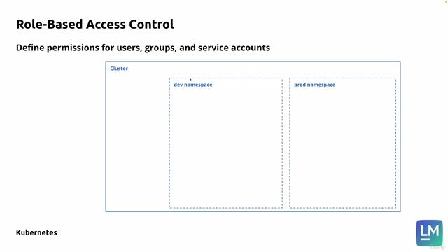
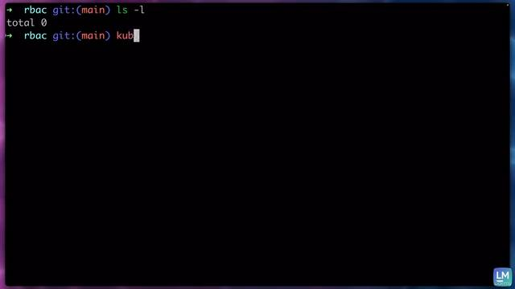
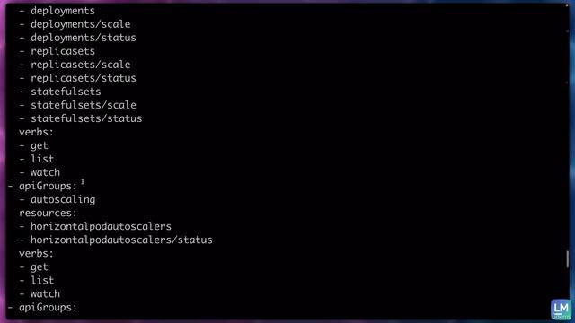
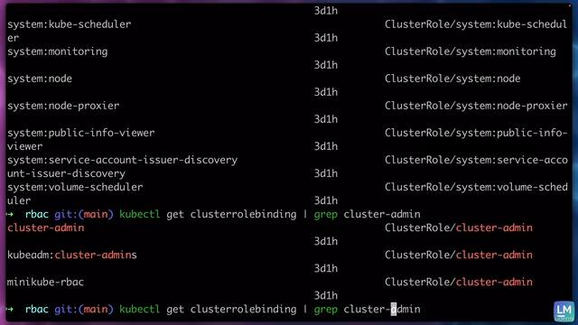
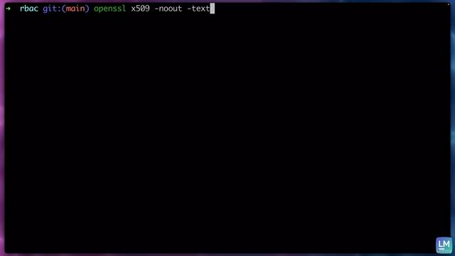
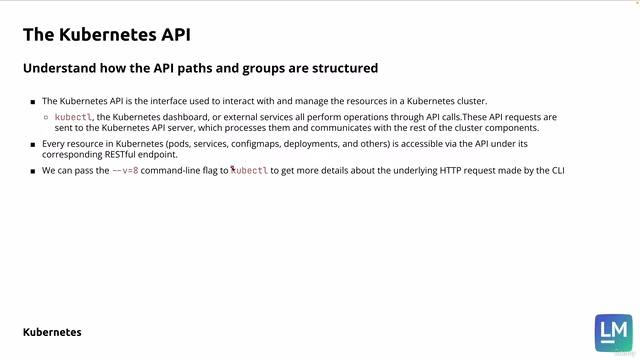
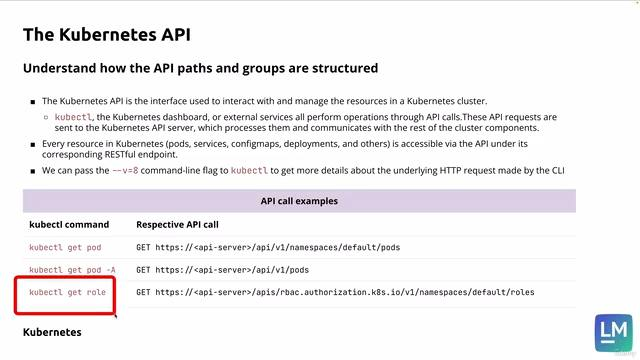
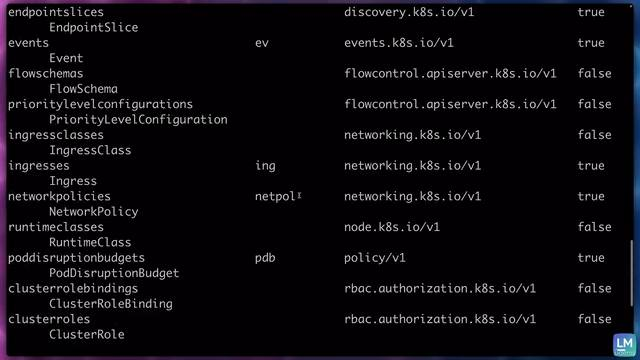
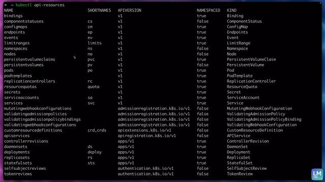

## 1. 这一节做什么

这一节覆盖 P029–P032，目标不是背 RBAC 概念，而是在一个已经跑起来的 minikube 集群里，把下面这条链路亲手串起来：

> 你当前用的 kubeconfig 身份 → 客户端证书里的 CN / O → Kubernetes 认出来的用户和组 → ClusterRoleBinding 的 subject → ClusterRole 的 rules → 最终能对哪些 API 资源、哪些子资源执行哪些 verb。

这条链路可以拆成“身份、绑定、权限”三段来理解：kubeconfig 和客户端证书回答“我是谁”，RoleBinding / ClusterRoleBinding 回答“我被绑到哪个角色”，Role / ClusterRole 的 rules 回答“这个角色能做什么”。三者缺一不可，只看其中一段就很容易误判权限来源。

同时把 P031–P032 的 Kubernetes API 结构落到命令上：`/api/v1` 与 `/apis/<group>/<version>` 的区别、`kubectl api-resources` 怎么查资源、`--namespaced=true` 怎么过滤、`--api-group` 怎么按 API 组过滤、`-o wide` 怎么看可用 verbs。

如果套用前端开发的视角，可以把 kubeconfig 里的当前 context 类比成“当前登录环境和登录态”，证书里的 CN / O 类比成 token 里的用户标识和角色声明，ClusterRoleBinding 的 subject 类比成“把权限表关联到某个账号或角色”的关系表，ClusterRole 的 rules 类比成后端接口权限清单。这个类比只用于帮助记忆，真正落盘时仍以 `kubectl` 和 `openssl` 的实际输出为准。

最终你会得到一个可复现的实验目录：

```text
rbac-lab/
├── inspect-rbac.sh        # 一键采集身份、ClusterRole、ClusterRoleBinding、证书、API 资源
├── rbac-demo.yaml         # 把 p029 的 Role/RoleBinding/ServiceAccount 概念落成可运行示例
└── outputs/               # 所有命令输出，便于对照截图和排错
```

注意：P030 讲师说“要创建 Alice 和 Bob 两个用户”，但逐字稿在“下一讲再见”处结束，**课里没有给出创建 Alice/Bob 的完整命令**。所以本文能完整复现的是：查看 minikube 默认身份、拆解 `cluster-admin` 授权链路、探索 API 资源，以及用 ServiceAccount 做一条命名空间内的 RoleBinding 示例。创建人类用户的 CSR 流程放在第 7 节标注为“课里没讲”。

---

## 2. 讲师原话（带「—— pNNN [MM:SS]」）

下面这些原话是后面复现步骤的依据，不是装饰。阅读时建议把原话、截图和后面的命令输出对照起来看：原话告诉你“为什么查”，截图告诉你“查出来大概长什么样”，命令输出才是你当前集群的“实际答案”。

> "基于角色的访问控制让我们能够为用户、用户组和服务账号定义权限。"
> —— p029 [00:00]

> "角色本身并不与用户、用户组和服务账号关联。这种关联是通过角色绑定完成的。"
> —— p029 [02:26]

> "集群角色在整个集群范围内生效……集群角色绑定用于把某个集群角色分配给一个用户组或服务账号。"
> —— p029 [02:51]

> "Kubernetes 本身没有用户存储这个概念。……Kubernetes 会集成不同的身份认证方式，例如 X509 证书、OpenID Connect 或 Active Directory。"
> —— p030 [00:28]

> "我们一直使用一个名为 minikube 的用户……通过运行 kubectl config view 命令就能看到。"
> —— p030 [01:19]

> "这里的 subject 指的是把角色与实际用户组或服务账号关联起来的主体。"
> —— p030 [08:16]

> "这里的 o 代表组织。Kubernetes 用它来标识用户组。"
> —— p030 [09:40]

> "API 才是实际使用的接口，也是我们用来与 Kubernetes 集群中的资源交互并管理这些资源的唯一接口。"
> —— p031 [00:22]

> "有些资源还可能有子资源……例如 logs、exec、attach……以及 scale 子资源。"
> —— p031 [06:49]

> "kubectl api-resources 会列出我们集群中所有可用的资源。"
> —— p032 [05:01]

> "有些资源是命名空间级的，有些则不是。"
> —— p032 [06:01]

这些原话对应的截图如下，后面步骤会逐张对照。



















---

## 3. 从零复现

### 3.1 前置条件

你需要：

- 已经启动的 minikube 集群；
- `kubectl` 能正常访问该集群；
- `openssl` 可用；
- 一个空目录用来做实验。

课里没有锁定 minikube、kubectl、openssl 的具体版本，所以本文不编造版本号。先确认：

```bash
kubectl version --client
kubectl cluster-info
openssl version
```

这三条命令分工不同：`kubectl version --client` 只证明本机 kubectl 可执行，不代表集群可访问；`kubectl cluster-info` 才验证当前 kubeconfig 是否能连到 API server；`openssl version` 验证后面解析证书的工具存在。

常见错误与排查：如果 `kubectl cluster-info` 报连接 `localhost:8080` 或找不到服务，通常是当前 context 没指向可用集群，先不要继续做 RBAC 实验。前端对照：这相当于调用后端接口前先确认 baseURL、环境和登录态是否有效，否则后面所有请求都会失败在“身份入口”。

如果 `kubectl cluster-info` 不通，后面的 RBAC 实验无法进行。minikube 的启动方式课里前面已经讲过，本节不重复。

### 3.2 建实验目录

P030 开头讲师新建了一个空文件夹，但没有在逐字稿里给出文件夹名。本文统一用 `rbac-lab`：

```bash
mkdir -p rbac-lab/outputs
cd rbac-lab
```

`mkdir -p` 是幂等的：目录已存在时不会报错；`outputs/` 用来保存命令输出，便于与截图对照。常见错误是 `cd` 到错误目录后继续执行，导致输出文件散落在别处；执行下一步前可用 `pwd` 确认当前在 `rbac-lab`。前端对照：这类似初始化一个实验项目目录，后续所有“请求日志”和“配置快照”都放在项目内，方便排查。

后面所有命令都在 `rbac-lab` 里执行。

### 3.3 第一步：先看“我是谁”

P030 的关键入口是 `kubectl config view`。它会把 kubeconfig 里的 clusters、users、contexts 打出来。先跑：

```bash
kubectl config view
kubectl config current-context
kubectl config view -o yaml > outputs/config-view.yaml
```

你会看到三类顶层信息：

- `clusters`：集群的 API server 地址、certificate-authority 等；
- `users`：客户端身份，比如 minikube 用户；
- `contexts`：把 cluster 和 user 绑在一起，并给这个组合起名。

讲师在 P030 里特别指出：当前 context 的 user 是 `minikube`，而这个用户的 `client-certificate` 和 `client-key` 放在某个目录下，用来认证发往 Kubernetes API 的请求。对应截图就是 p030 01:14 那张 `kubectl config view` 输出。


把当前 context 单独记下来：

```bash
kubectl config current-context | tee outputs/current-context.txt
```

讲师说这一步会打印 `minikube`。如果你的 context 名不是 `minikube`，以实际输出为准，不要硬改。常见错误：`kubectl config view` 默认可能对敏感字段做脱敏显示，所以看路径时要结合保存下来的 YAML；`current-context` 为空说明当前没有选中 context，需要先确认 kubeconfig 配置。前端对照：这像查看当前应用使用的是哪个环境配置、哪个登录用户，不能只看配置文件里“存在”某个用户，还要确认当前选中的是谁。

### 3.4 第二步：查看 minikube 用户证书里的 CN 和 O

P030 后面把“为什么 minikube 用户能做这么多操作”追到了证书。先看 kubeconfig 里 minikube 用户的 `client-certificate` 路径：

```bash
kubectl config view -o yaml | grep -A 8 'name: minikube'
```

然后对证书执行讲师用过的命令：

```bash
openssl x509 -noout -text -in <client-certificate 路径>
```

把输出保存下来：

```bash
openssl x509 -noout -text -in <client-certificate 路径> | tee outputs/minikube-client-cert.txt
```

你要在输出里找 `Subject:` 段：

- `CN` 是 common name，课里读作 minikube user；
- `O` 是 organization，课里明确说 `O` 被 Kubernetes 用来识别用户所属的组；
- 讲师说这个组是 `system masters`。openssl 实际输出里通常写成 `system:masters`，字段名和分隔符以你的实际输出为准。

对应截图是 p030 09:24。注意：证书内容很敏感，`outputs/` 不要提交到公开仓库。


常见错误与排查：`grep -A 8 'name: minikube'` 可能因为缩进、顺序或 profile 名不同而找不到，此时从 `outputs/config-view.yaml` 里搜索 `client-certificate` 更稳；`openssl` 报 `No such file` 时先确认路径是否带引号、是否相对路径。前端对照：证书像 JWT，CN / O 像 token 里的用户标识和角色声明，Kubernetes 正是从这些声明推导出 user / group。

### 3.5 第三步：查看 ClusterRole

P030 用 `kubectl get clusterroles` 看集群里已经存在的 ClusterRole。先列出来：

```bash
kubectl get clusterroles | tee outputs/clusterroles.txt
```

讲师说输出很多，是 minikube 在背后创建好的。重点看 `admin` 和 `cluster-admin`：

```bash
kubectl get clusterrole admin -o yaml | tee outputs/clusterrole-admin.yaml
kubectl get clusterrole cluster-admin -o yaml | tee outputs/clusterrole-cluster-admin.yaml
```

在 `admin` 的 YAML 里，讲师带着看了 `rules`，例如 resources 里有 pods、pods/exec、pods/proxy、secrets，verbs 里有 get、list、watch 等。具体 rules 以你集群输出为准，不要背。

`cluster-admin` 更短但更强：讲师说它允许对任意 API group 下的任意资源执行任意 verbs。这里不要把它当成日常账号使用。

对应截图是 p030 05:19。


常见错误与排查：如果执行 `kubectl get clusterrole ...` 报 `Forbidden`，说明你当前身份本身没有读取该对象的权限，这不是 YAML 写错；如果 `admin` 查不到，先看 `outputs/clusterroles.txt` 里实际名称。前端对照：ClusterRole 像一份可复用的权限模板，模板本身不绑定任何人，必须通过 binding 才会发到具体账号上。

### 3.6 第四步：查看 ClusterRoleBinding，找到 subject

ClusterRole 本身不跟用户相连，连接靠 ClusterRoleBinding。先列：

```bash
kubectl get clusterrolebindings | tee outputs/clusterrolebindings.txt
kubectl get clusterrolebindings | grep cluster-admin | tee outputs/clusterrolebindings-cluster-admin.txt || true
```

然后看 `cluster-admin` 这个 binding 的 YAML：

```bash
kubectl get clusterrolebinding cluster-admin -o yaml | tee outputs/clusterrolebinding-cluster-admin.yaml
```

讲师在 P030 里指出两个关键字段：

- `roleRef`：指向 `cluster-admin` 这个 ClusterRole；
- `subjects`：把角色连接到实际的 user、group 或 service account。讲师在 08:16 说 “the subject here is what is doing this connection”。

在 minikube 的 `cluster-admin` binding 里，subject 是 group `system:masters`，不是直接写 `minikube` 用户。这就是为什么只查 ClusterRole 看不到 minikube 用户，必须把证书里的 `O=system:masters` 和 binding 的 subject 对上。

对应截图是 p030 07:46。


常见错误与排查：`grep cluster-admin` 可能匹配到多个名字相近的 binding，真正要看的是 `metadata.name` 为 `cluster-admin` 的那个；`subjects` 是数组，可能包含多个主体，逐个看 `kind` 是 `User`、`Group` 还是 `ServiceAccount`。前端对照：binding 像权限关联表，表里记录“哪个主体”关联“哪个权限模板”，排查权限时不能只打开模板看。

### 3.7 第五步：把链路串起来

现在把四段信息放在一张纸上对照：

1. `kubectl config view`：当前 context 使用 `minikube` 用户；
2. `openssl`：该用户证书 Subject 里有 `CN=minikube-user`、`O=system:masters`；
3. `kubectl get clusterrolebinding cluster-admin -o yaml`：subjects 里有 group `system:masters`；
4. `kubectl get clusterrole cluster-admin -o yaml`：roleRef 指向的 ClusterRole 拥有全集群权限。

于是链路是：

```text
客户端证书
  → Kubernetes 识别出 user / group
  → group system:masters 命中 ClusterRoleBinding 的 subject
  → roleRef 指向 ClusterRole cluster-admin
  → 获得 cluster-admin 的 rules
```

这就是 P030 说的“stitching together”。截图 p029 03:52 的图正好表达 namespace、Role、RoleBinding、ClusterRoleBinding 的关系。


常见错误与排查：如果链路对不上，先确认证书 Subject 的 `O` 是否精确等于 binding 的 subject 名称，冒号、大小写和空格都不要猜；再确认 `roleRef.kind` 是 `ClusterRole` 还是 `Role`。前端对照：这很像排查“登录用户有角色声明，但接口仍 403”，需要同时看 token claims、角色绑定表和接口权限清单。

### 3.8 第六步：用 kubectl 观察 API 路径

P031 说 `kubectl` 背后会把命令翻译成 HTTP 请求，发到 Kubernetes API server。可以用 `--v=8` 看请求细节：

```bash
kubectl get pods --v=8
```

讲师给的路径规律是：

- core 资源，例如 pods：`/api/v1/...`；
- named API group，例如 roles：`/apis/rbac.authorization.k8s.io/v1/...`；
- 带 `-A` 时是集群范围请求，不带时可能限制在某个 namespace。

对应截图 p031 01:26。


再看 API group 的路径差异：core group 是 `/api`，named group 是 `/apis`。截图 p031 03:10。


常见错误与排查：`--v=8` 输出很多，不要逐行读，重点找实际请求的 `GET` / `POST` 路径；如果看不到完整请求，可加 `-n default` 明确 namespace 再观察。前端对照：这相当于打开浏览器 Network 面板，看页面操作最终打到了哪个 REST 路由。

### 3.9 第七步：用 api-resources 查资源

P032 的核心命令是：

```bash
kubectl api-resources
```

它会列出资源名、short names、API version、namespaced 等信息。讲师说：

- `v1` 这种没有 group 前缀的，是 core API group；
- 带 group 名的，是 named API group；
- pods 是 namespaced，nodes 和 namespaces 不是 namespaced；
- 可以用 `--namespaced=true` 只列 namespaced 资源；
- 可以用 `--api-group=storage.k8s.io` 按 API 组过滤；
- 加 `-o wide` 可以看到允许的 verbs。

逐条跑：

```bash
kubectl api-resources | tee outputs/api-resources.txt
kubectl api-resources --namespaced=true | tee outputs/api-resources-namespaced.txt
kubectl api-resources --api-group=storage.k8s.io | tee outputs/api-resources-storage.txt
kubectl api-resources -o wide | tee outputs/api-resources-wide.txt
```

对应截图 p032 05:04 和 p032 06:16。


常见错误与排查：`--api-group` 后面只写组名，不要写成 `storage.k8s.io/v1`，`v1` 是 version 不是 group；`-o wide` 的列名随版本可能不同，先看表头再判断 verbs 列。前端对照：`api-resources` 像查看后端 OpenAPI/Swagger 里的资源清单，`--api-group` 像按模块过滤接口。

### 3.10 第八步：用 ServiceAccount 做一条 namespace 内 RoleBinding 示例

P029 讲了：Pod 要访问 Kubernetes API 时，不应该创建“用户”，而应该创建 ServiceAccount，再把 ServiceAccount 分配给 Pod，并通过 RoleBinding 给它权限。P030 的逐字稿停在“要创建 Alice/Bob 用户”之前，**没有给出完整 YAML**。所以下面这份 `rbac-demo.yaml` 是把 p029 的概念落成可运行示例，字段名参考 p030 展示的 `roleRef`、`subjects` 结构；不是逐字稿原样代码。

它做四件事：

- 建 `dev`、`prod` 两个 namespace；
- 在 `dev` 建 ServiceAccount `dev-app`；
- 建 Role `dev-config-reader`，只允许读 `dev` 里的 configmaps 和 secrets；
- 建 RoleBinding，把 Role 绑给 ServiceAccount；
- 建一个使用该 ServiceAccount 的 Pod，证明“Pod 使用 service account”这条路径。

应用：

```bash
kubectl apply -f rbac-demo.yaml
kubectl get sa,role,rolebinding,pod -n dev
kubectl describe rolebinding dev-app-read-config -n dev
```

清理：

```bash
kubectl delete -f rbac-demo.yaml
```

常见错误与排查：如果 `apply` 报 namespace 正在终止或已存在，先看 `kubectl get ns`；如果 `describe rolebinding` 里 Subjects 为空或名字不对，检查 `subjects[].namespace` 是否与 ServiceAccount 所在 namespace 一致；`roleRef` 创建后不能靠 `edit` 随意改，必要时删除 RoleBinding 重建。前端对照：ServiceAccount 像给后端服务发的机器人 token，RoleBinding 像给这个 token 授权某组只读接口，Pod 只是使用这枚 token 的运行载体。

---

## 4. 完整代码

### 4.1 `inspect-rbac.sh`

保存为 `rbac-lab/inspect-rbac.sh`，然后 `chmod +x inspect-rbac.sh && ./inspect-rbac.sh`。脚本会尽量自动取 minikube 客户端证书路径；取不到时会提示你手动粘贴路径。`jsonpath`、`tee`、`mkdir` 是脚本辅助，不是讲师逐字稿里的命令；核心 kubectl/openssl 命令都来自 P030–P032。

```bash
#!/usr/bin/env bash
set -euo pipefail

mkdir -p outputs

echo "== 1. kubeconfig =="
kubectl config view | tee outputs/config-view.txt
kubectl config current-context | tee outputs/current-context.txt
kubectl config view -o yaml > outputs/config-view.yaml

echo "== 2. clusterroles =="
kubectl get clusterroles | tee outputs/clusterroles.txt
kubectl get clusterrole admin -o yaml | tee outputs/clusterrole-admin.yaml
kubectl get clusterrole cluster-admin -o yaml | tee outputs/clusterrole-cluster-admin.yaml

echo "== 3. clusterrolebindings =="
kubectl get clusterrolebindings | tee outputs/clusterrolebindings.txt
kubectl get clusterrolebindings | grep cluster-admin | tee outputs/clusterrolebindings-cluster-admin.txt || true
kubectl get clusterrolebinding cluster-admin -o yaml | tee outputs/clusterrolebinding-cluster-admin.yaml

echo "== 4. client certificate =="
CERT_PATH="${CERT_PATH:-}"
if [ -z "$CERT_PATH" ]; then
  CERT_PATH="$(kubectl config view --raw -o jsonpath='{.users[?(@.name=="minikube")].user.client-certificate}' 2>/dev/null || true)"
fi
if [ -z "$CERT_PATH" ]; then
  read -r -p "自动获取失败，请粘贴 client-certificate 路径: " CERT_PATH
fi
openssl x509 -noout -text -in "$CERT_PATH" | tee outputs/minikube-client-cert.txt

echo "== 5. namespaced resources =="
kubectl get pods | tee outputs/pods-default.txt
kubectl get pods -A | tee outputs/pods-all-namespaces.txt
kubectl get roles -A | tee outputs/roles-all-namespaces.txt
kubectl get deployments | tee outputs/deployments-default.txt
kubectl get deployments -n default | tee outputs/deployments-default-explicit.txt

echo "== 6. API discovery =="
kubectl api-resources | tee outputs/api-resources.txt
kubectl api-resources --namespaced=true | tee outputs/api-resources-namespaced.txt
kubectl api-resources --api-group=storage.k8s.io | tee outputs/api-resources-storage.txt
kubectl api-resources -o wide | tee outputs/api-resources-wide.txt

echo "== done. 查看 outputs/ 目录 =="
```

脚本可以重复运行，同名输出文件会被覆盖；如果某一步失败，`set -euo pipefail` 会让脚本停下，先修当前错误再重跑，不要在半失败状态下继续看后面的输出。

### 4.2 `rbac-demo.yaml`

保存为 `rbac-lab/rbac-demo.yaml`。这份 YAML 是按 p029 的 RBAC 组件概念整理的示例，逐字稿没有逐行给出它；`serviceAccountName` 字段在逐字稿里只被描述为“assign this service account to the pod”，没有展开字段名，所以这里明确标注为示例字段。镜像版本课里没给，`busybox:1.36` 只是可替换的示例。

```yaml
apiVersion: v1
kind: Namespace
metadata:
  name: dev
---
apiVersion: v1
kind: Namespace
metadata:
  name: prod
---
apiVersion: v1
kind: ServiceAccount
metadata:
  name: dev-app
  namespace: dev
---
apiVersion: rbac.authorization.k8s.io/v1
kind: Role
metadata:
  name: dev-config-reader
  namespace: dev
rules:
  - apiGroups: [""]
    resources: ["configmaps", "secrets"]
    verbs: ["get", "list", "watch"]
---
apiVersion: rbac.authorization.k8s.io/v1
kind: RoleBinding
metadata:
  name: dev-app-read-config
  namespace: dev
subjects:
  - kind: ServiceAccount
    name: dev-app
    namespace: dev
roleRef:
  apiGroup: rbac.authorization.k8s.io
  kind: Role
  name: dev-config-reader
---
apiVersion: v1
kind: Pod
metadata:
  name: dev-app
  namespace: dev
spec:
  serviceAccountName: dev-app
  containers:
    - name: app
      image: busybox:1.36
      command: ["sh", "-c", "sleep 3600"]
```

这份 YAML 的重点不是 Pod 跑什么业务，而是确认 `Role`、`RoleBinding`、`ServiceAccount` 三者的 namespace 和名字互相对得上。Pod 即使启动后只是 `sleep`，也不影响观察 RBAC 绑定关系。

---

## 5. 逐行解释

### 5.1 `inspect-rbac.sh` 关键行

| 代码行 | 作用 | 为什么这样写 / 不这样会怎样 |
|---|---|---|
| `set -euo pipefail` | 任一命令失败就退出 | 避免脚本前半段失败、后半段还在跑，输出看起来“成功”但实际不可信 |
| `mkdir -p outputs` | 建输出目录 | P030 的新空文件夹没有名字，这里统一用 `outputs/` 存证，便于对照截图 |
| `kubectl config view` | 打印 kubeconfig | P030 就是用这条命令看 clusters/users/contexts；不看它，就不知道当前身份是谁 |
| `kubectl config current-context` | 只看当前 context 名 | 讲师说会打印 `minikube`；确认后面所有操作都发生在这个 context |
| `kubectl config view -o yaml > outputs/config-view.yaml` | 保存完整 YAML | 终端会截断，保存文件后可以慢慢找 `client-certificate` 路径 |
| `kubectl get clusterroles` | 列出所有 ClusterRole | P030 先列出来，再挑 `admin` 和 `cluster-admin` 看 |
| `kubectl get clusterrole admin -o yaml` | 看 admin 的 rules | 讲师在这里指出 resources 和 verbs；具体 rules 以你集群为准 |
| `kubectl get clusterrole cluster-admin -o yaml` | 看 cluster-admin 的 rules | 讲师说它允许任意 API group 下任意资源任意 verbs，是最高权限 |
| `kubectl get clusterrolebindings` | 列出所有 ClusterRoleBinding | Role 本身不连用户，必须靠 binding |
| `kubectl get clusterrolebindings \| grep cluster-admin` | 缩小到 cluster-admin 相关 binding | 讲师 P030 也用了 grep；输出多时直接看会乱 |
| `kubectl get clusterrolebinding cluster-admin -o yaml` | 看 `roleRef` 和 `subjects` | 讲师 08:16 说 subject 才是连接 user/group/service account 的地方 |
| `kubectl config view --raw -o jsonpath=...` | 自动取 minikube 客户端证书路径 | 这是脚本辅助；逐字稿没有讲 jsonpath。取不到就手动粘贴，不影响主体 |
| `openssl x509 -noout -text -in "$CERT_PATH"` | 打印证书 Subject | P030 用这条命令找 `CN` 和 `O`；不跑它，就无法解释为什么 group 能命中 binding |
| `kubectl get pods` / `pods -A` | 看 namespaced 资源默认范围和集群范围 | P031 说带 namespace 和不带 namespace 的 API 请求不同，权限也可能不同 |
| `kubectl get roles -A` | 看所有 namespace 的 Role | Role 是 namespaced 的；`-A` 能看出它们分别属于哪个 namespace |
| `kubectl get deployments -n default` | 显式指定 namespace | 讲师演示了 `kubectl get deployments` 和带 `-n default` 的等价关系 |
| `kubectl api-resources` | 列出集群资源 | P032 的核心命令；能看资源名、short name、API version、namespaced |
| `--namespaced=true` | 只列 namespaced 资源 | 讲师说 pods 属于 namespace，nodes/namespaces 不属于；过滤后更容易确认 |
| `--api-group=storage.k8s.io` | 按 API group 过滤 | 讲师拿 storage 组举例；注意 `v1` 是 version，不是 group，所以不能写成 `storage.k8s.io/v1` |
| `-o wide` | 输出更宽，包含 verbs | 讲师用来看某类资源允许哪些动作；具体列名以实际输出为准 |

常见错误与排查：如果 `jsonpath` 取不到证书路径，不要怀疑 RBAC 链路，先从 `outputs/config-view.yaml` 人工复制；`grep ... || true` 是为了防止没有匹配时被 `pipefail` 判定为失败；`openssl` 路径变量要加引号，避免路径中含空格时被拆开。前端对照：这个脚本像一次自动化“接口权限快照”，把身份、权限模板、绑定关系和资源清单一次性采集下来，方便对照排错。

### 5.2 `rbac-demo.yaml` 关键行

| 字段 | 解释 | 不这样写会怎样 |
|---|---|---|
| `kind: Namespace` | 建 `dev`、`prod` | Role/RoleBinding 是 namespaced，没有 namespace 就不好演示边界 |
| `kind: ServiceAccount` | 给 Pod 用的“机器人身份” | 用人类用户去跑 Pod 不符合 p029 的讲法；ServiceAccount 才是 Pod 访问 API 的身份 |
| `kind: Role` | 只在一个 namespace 内定义权限 | 写成 ClusterRole 会变成集群级，容易越权 |
| `apiGroups: [""]` | 空字符串表示 core API group | configmaps 和 secrets 属于 core group；写成 apps 会匹配不到 |
| `resources: ["configmaps", "secrets"]` | 只针对这两类资源 | 写 `["*"]` 会放大权限，不符合最小权限原则 |
| `verbs: ["get", "list", "watch"]` | 只读 | 讲师 P029 用 dev read only 举例；要 CRUD 才加 create/update/patch/delete |
| `subjects[].kind: ServiceAccount` | 绑定对象是 ServiceAccount | 写成 User 就需要真实用户证书，课里没有走到那一步 |
| `subjects[].namespace: dev` | ServiceAccount 所在 namespace | 不写或写错，binding 可能找不到主体 |
| `roleRef.kind: Role` | 引用 namespace 内的 Role | 如果引用 ClusterRole，`kind` 要改成 `ClusterRole` |
| `roleRef.name: dev-config-reader` | 指向上面定义的 Role | 名字不一致会绑定失败或绑到不存在的角色 |
| `serviceAccountName: dev-app` | Pod 使用该 ServiceAccount | 不写就使用 default ServiceAccount，权限来源就变了 |

P031 还提到子资源：`pods/log`、`pods/exec`、`pods/attach`、`deployments/scale`。如果你只想让人 `get/list pods`，但不想让人看日志，就不要在 Role 的 `resources` 里写 `pods/log`。讲师说“给 pods 的 get/list 不会自动给 logs 权限”，这是 RBAC 细粒度控制的关键。

常见错误与排查：`apply` 成功但权限不符合预期时，先 `kubectl describe rolebinding dev-app-read-config -n dev` 看 `RoleRef` 和 `Subjects` 是否对得上，再用 `kubectl auth can-i` 做课外补充验证；不要只看到 Pod Running 就认为授权正确。前端对照：Role 像接口权限清单，RoleBinding 像授权记录，ServiceAccount 像服务端 token，三者要串起来看。

---

## 6. 复现检查清单

按顺序打勾，每一条都尽量写出“怎么验证”和“期望看到什么”：

- [ ] `kubectl config current-context` 有输出；如果是 minikube，通常显示 `minikube`，以实际为准。验证方式：执行后看是否为空；若为空，先检查 kubeconfig，不要继续后面的身份链路。
- [ ] `kubectl config view` 能看到 `clusters`、`users`、`contexts` 三类信息。验证方式：在输出中分别搜索这三个顶层字段，缺一类就说明 kubeconfig 不完整或当前文件不是你以为的那份。
- [ ] 当前 context 的 user 指向 `minikube`，并且能看到 `client-certificate` / `client-key` 路径。验证方式：对照 `current-context` 找到对应 context，再追到它引用的 user；不要只看 users 列表里存在 minikube。
- [ ] `openssl x509 -noout -text -in <证书>` 的 `Subject:` 里能看到 `CN` 和 `O`；课里读作 minikube user 和 `system masters`，实际输出可能是 `system:masters`。验证方式：在 `outputs/minikube-client-cert.txt` 中搜索 `Subject:`，逐字比对 `CN` 和 `O`，不要凭记忆补全。
- [ ] `kubectl get clusterroles` 能列出 `admin` 和 `cluster-admin`。验证方式：在 `outputs/clusterroles.txt` 中搜索这两个名字；若报 Forbidden，先确认当前身份是否有读取权限。
- [ ] `kubectl get clusterrole admin -o yaml` 能看到 `rules`，里面有 resources 和 verbs；具体内容以实际输出为准。验证方式：打开 `outputs/clusterrole-admin.yaml`，确认 `rules` 是数组，并查看其中至少一条 resources/verbs 的对应关系。
- [ ] `kubectl get clusterrolebinding cluster-admin -o yaml` 能看到 `roleRef` 指向 `cluster-admin`，`subjects` 里能看到 group；字段名以实际输出为准。验证方式：同时检查 `roleRef.kind`、`roleRef.name` 和 `subjects[].name`，不要只看其中一个字段。
- [ ] 能把“证书 Subject 的 O → ClusterRoleBinding 的 subject → ClusterRole 的 rules”口述一遍。验证方式：不看文档，按“我是谁 → 我被绑到哪 → 我能做什么”三段复述；卡住时回到对应输出文件定位。
- [ ] `kubectl get pods` 和 `kubectl get pods -A` 都能执行，观察 namespace 范围差异。验证方式：比较两次输出的范围；若 `-A` 报权限错误，记录错误信息，不要把它当成命令写错。
- [ ] `kubectl get roles -A` 能列出 Role；如果为空也正常，说明没有自定义 Role。验证方式：看输出是否为空并检查是否有 Forbidden；空列表和权限失败是两回事。
- [ ] `kubectl api-resources` 能列出 pods、deployments 等资源。验证方式：在输出中搜索 `pods` 和 `deployments`，确认能看到 short name、API version、namespaced 等列。
- [ ] `kubectl api-resources --namespaced=true` 只列 namespaced 资源。验证方式：对比完整列表，确认 nodes、namespaces 这类集群级资源不应出现在过滤结果中。
- [ ] `kubectl api-resources --api-group=storage.k8s.io` 只列 storage 组资源。验证方式：检查输出中的 API group 列是否都为 storage.k8s.io；如果命令报参数错误，先确认没有把版本号拼进 group。
- [ ] `kubectl api-resources -o wide` 能看到更宽的列，列名以实际输出为准。验证方式：先看表头，再找 verbs 相关列；不要假设所有版本列名完全一致。
- [ ] `kubectl apply -f rbac-demo.yaml` 成功。验证方式：看命令退出码和输出中的 created/configured；若 namespace 处于 Terminating，先处理 namespace 再重试。
- [ ] `kubectl describe rolebinding dev-app-read-config -n dev` 能看到 Role `dev-config-reader` 和 ServiceAccount `dev-app` 的绑定关系。验证方式：检查 `RoleRef` 和 `Subjects` 两段，确认名字、kind、namespace 三者一致。
- [ ] `kubectl delete -f rbac-demo.yaml` 清理成功。验证方式：再执行 `kubectl get sa,role,rolebinding,pod -n dev` 观察对象是否已删除；若残留，按提示检查是否有其他对象依赖或 namespace 状态异常。

---

## 7. 课里没讲但你会撞上的（表格：现象 / 原因 / 怎么办）

| 现象 | 原因 | 怎么办 |
|---|---|---|
| 想创建 Alice/Bob 人类用户，但找不到完整命令 | P030 只说“我们准备创建 Alice 和 Bob，用 X509 证书认证”，然后进入下一讲；逐字稿里没有 CSR 创建、证书签名、kubeconfig 合并、`kubectl config use-context` 切换这些步骤 | 本文不冒充讲师补全。你要补做，需要单独查 Kubernetes 的 CertificateSigningRequest 流程；不要把本文的 ServiceAccount 示例误当成“创建人类用户” |
| 有多份 kubeconfig，却不知道当前在用哪份 | `kubectl config use-context` 课里没讲；本节复现一直用当前 minikube context 即可 | 先用 `kubectl config current-context` 确认当前 context；确实需要切换时再查 `use-context` 用法，不要在不确认身份的情况下继续做 RBAC 实验 |
| 不知道 RoleBinding 是否真的生效 | `kubectl auth can-i` 课里没讲；它可以直接验证某个主体能否执行动作 | 可用课外补充命令：`kubectl auth can-i get secrets -n dev --as=system:serviceaccount:dev:dev-app`。这是课外补充，不是讲师逐字稿内容，但能帮你确认 ServiceAccount 是否真的能读 secrets |
| 想直接 `kubectl edit` 改 `roleRef`，改完不生效 | `roleRef` 创建后不能直接改，这是 Kubernetes 的行为，不是讲师原话 | 想换绑定的 Role，通常要删掉 RoleBinding 再重建。不要 `kubectl edit` 硬改 `roleRef` 后以为会生效 |
| `kubectl api-resources -o wide` 的列和文档里对不上 | 不同 Kubernetes 版本列名可能不同；讲师用 `-o wide` 看 verbs，但输出格式以实际集群为准 | 不要硬编码某一列；用 `kubectl api-resources -o wide | head` 先看表头，再按表头找 verbs 相关信息 |
| 把 `outputs/` 或证书内容提交到了公开仓库 | P030 明确说客户端证书和 key 落到别人手里，攻击者就能以该身份认证；`openssl x509 -text` 会把证书内容打到终端和 `outputs/minikube-client-cert.txt` | 把证书和 `outputs/` 当敏感文件处理，不要提交到公开仓库；分享截图前也要检查是否包含证书、key、token 或完整 kubeconfig |
| `kubectl config view` 看不到证书内容或路径不完整 | 它默认可能脱敏；不同 minikube profile 的路径也不同 | 脚本用 `--raw` 尝试取路径，但自动取不到时，从 `outputs/config-view.yaml` 里人工找 `client-certificate`，再粘贴给脚本。不要因为一次取不到就断定证书不存在 |
| 概念抽象，容易把 Role、Binding、ServiceAccount 混在一起 | RBAC 链路涉及身份、绑定、权限模板三层，单看一个对象很难串起来 | 用前端类比帮助记忆：Role 像前端权限表里的“能访问哪些菜单/按钮”，RoleBinding 像“把这张权限表发给某个账号”，ServiceAccount 像 CI/CD 里的机器人 token，ClusterRole 像全站级权限模板。Kubernetes API 的 `/api/v1` 和 `/apis/apps/v1` 像 REST 路由前缀，`pods/log` 像 `/pods/:name/log` 子路由。用这个类比可以，但落盘时仍以 `kubectl api-resources` 和 `kubectl get ... -o yaml` 的实际输出为准 |