# Docker & Kubernetes 从零到实战 · P033–P036
## 为集群创建真实用户：证书签发、kubeconfig 与 RBAC 权限落地

> 本文按「照着做就能跑通」的标准整理。逐字稿是边讲边操作的口语，文中命令是按讲师口述还原的写法；凡是讲师没有明说、由我补足的地方都会标注。所有 YAML 都是完整文件，可直接保存使用。

---

## 1. 这一节做什么

这四节课（P033–P036）把前面讲过的「Kubernetes 里有用户、有组、有权限」从概念变成集群里真实存在的两套凭据和两套权限策略。整条链路是：

1. **P033**：用 `openssl` 给 `alice` 和 `bob` 各生成一对 RSA 私钥；用私钥生成证书签名请求（CSR）文件；把 CSR 文件内容 base64 后填进 Kubernetes 的 `CertificateSigningRequest` 对象；`kubectl apply` 提交、`kubectl certificate approve` 批准；最后从对象里把签好的证书 `status.certificate` 取出来，base64 解码存成 `.crt` 文件。
2. **P034**：把「私钥 + 证书」写进 kubeconfig，注册成两个 user，再分别建两个 context。切到 `alice` 的 context 后执行 `kubectl get pods` 会立刻收到 `Forbidden`——认证成功、授权失败，这是后面 RBAC 的起点。
3. **P035**：搭实验环境（`dev`、`prod` 两个 namespace 各放一个 nginx pod），然后创建 `Role` + `RoleBinding`，只给 `bob` 在 `dev` 这一个 namespace 里读 pod 的权限（`get`、`list`），并在终端逐条验证「能查 dev、不能查 prod、不能 `--all-namespaces`、不能创建、不能删除」。
4. **P036**：把角色升级为 `ClusterRole` + `ClusterRoleBinding`，subject 从「某个 user」换成「某个 group」，把 `alice` 所在的 `admins` 组赋予「跨所有 namespace 管理 pod」的权限（`verbs: ["*"]`），再对比验证 `bob` 依旧不能创建、`alice` 可以创建和删除。

一句话概括这四节的产出：**集群里多了两个能通过 TLS 客户端证书认证的用户，以及两套作用域不同（namespace 级 vs 集群级）的授权规则。**

对前端背景的读者，可以把整件事类比成给两个第三方调用方发 API Key 并配置权限中间件：

| K8s 概念 | 前端/Node 里的近似物 |
|---|---|
| 客户端证书 + 私钥 | mTLS 双向认证的 client cert，等价于「带签名的 API Key」 |
| kubeconfig 的 user | `.env` 里的凭据配置项 |
| kubeconfig 的 context | 一套环境 profile（`.env.local` / `.env.prod`） |
| namespace | 按环境/业务切分的资源分区 |
| Role + RoleBinding | 挂在某个路由前缀上的权限中间件 |
| ClusterRole + ClusterRoleBinding | 全局中间件 |

**前置条件**（课程前几节已完成，这里不重复讲）：minikube 集群正在运行、本机装好 `kubectl`、装好 `openssl`、有一个操作用的工作目录。讲师是在 VS Code 打开的当前目录里做实验的。

---

## 2. 讲师原话

> "所以我们要做的第一件事，是为用户生成密钥，也就是私钥……我们运行 OpenSSL，生成一个 RSA 私钥，把这个私钥输出到 Alice.key 文件里，并把密钥长度设为 2048 位。"
> —— p033 [00:29]

> "所以 Alice 会把这项内容与稍后才会创建的签名证书一起使用；不过，Alice 正是用它来对自己的请求做身份认证。"
> —— p033 [00:56]

> "签名者名称会是 kubernetes.io/kube-apiserver-client……如果签名者名称就是这里这个特定名称，那么这些签名证书会被 Kubernetes 认可。"
> —— p033 [03:45]

> "带有这里这个特定签名者名称的证书签名请求，永远不会被 Kubernetes 自动批准；不过我们也可以在这里加上 -kubelet。这样它可能会由 kube-controller-manager 自动批准。"
> —— p033 [04:15]

> "所以这就是 Alice 可以连同其私钥一起使用的公钥证书，用来通过认证访问我们的 Kubernetes API。"
> —— p033 [08:18]

> "它位于主目录下的 .kube/config……我们也可以用 KUBECONFIG 环境变量覆盖 kubeconfig 文件。"
> —— p034 [00:52]

> "我们一尝试这样做，就会开始收到服务器返回的错误：这是禁止操作。用户 Alice 无法在 API 组为空的情况下、在 default 命名空间中列出 Pod。这完全正常，也完全在预期之中。"
> —— p034 [04:41]

> "kubectl get pod 实际上等价于 API 中的 list 动词，而 kubectl describe pod 才等价于 get 动词。所以这只是实际 Kubernetes API 中使用的动词与 kubectl 中实现的命令名称之间有一点不一致。"
> —— p035 [08:50]

> "我们不需要在 Kubernetes 中创建组。Kubernetes 里并不存在组实体这种东西。同样，Kubernetes 里也不存在用户实体。我们只需要在 RoleBinding 中提及这个组即可。"
> —— p036 [03:36]

---

## 3. 从零复现

全部命令在一个工作目录里执行（讲师把它当作项目根目录）。最终目录结构如下，建议一开始就按这个建好：

```
.
├── alice.key
├── alice.csr
├── alice.crt
├── bob.key
├── bob.csr
├── bob.crt
├── csr.yaml
├── pods.yaml
├── roles/
│   ├── namespaces.yaml
│   ├── dev-pod-reader.yaml
│   └── dev-pod-reader-rolebinding.yaml
└── clusterroles/
    ├── pod-admin.yaml
    └── pod-admin-clusterrolebinding.yaml
```

> 说明：`pods.yaml` 一开始是放在 `roles/` 里的，P036 时讲师把 `pods.yaml` 移到了根目录，所以最终位置是根目录。

### Step 0 · 确认环境

```bash
kubectl version --client
kubectl config current-context       # 应当是 minikube
openssl version
```

讲师在 p033 开头就要求先确认本机有 `openssl`。

### Step 1 · 生成两个用户的私钥

```bash
openssl genrsa -out alice.key 2048
openssl genrsa -out bob.key 2048
```

- `2048` 是讲师明确说的默认值。
- 执行完目录里会多出 `alice.key`、`bob.key`。用 `cat alice.key` 就能看到 PEM 文本。

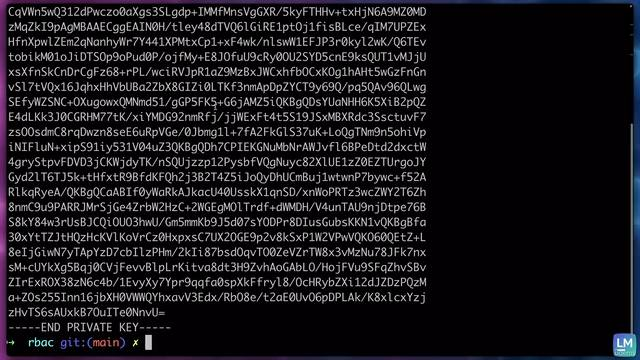

### Step 2 · 用私钥生成证书签名请求（CSR）

```bash
openssl req -new -key alice.key -out alice.csr -subj "/CN=alice/O=admins"
openssl req -new -key bob.key   -out bob.csr   -subj "/CN=bob/O=dev"
```

- `-subj` 里这一串就是讲师反复强调的 **subject**：`CN` 是 common name（用户名），`O` 是 organization（组）。
- `alice` 属于 `admins` 组，`bob` 属于 `dev` 组。**这两个值决定了后面 RBAC 里 `subjects` 能不能匹配上**，一定要和后面的 RoleBinding/ClusterRoleBinding 对齐。

### Step 3 · 编写 csr.yaml（CertificateSigningRequest 对象）

先把两个 CSR 文件转成 base64（去掉换行）：

```bash
cat alice.csr | base64 | tr -d '\n'
cat bob.csr   | base64 | tr -d '\n'
```

讲师特别提醒：终端里可能会在输出末尾显示一个 `%`，那是 shell 的提示符，**不要一起复制**。复制到结尾的两个等号 `==` 为止。

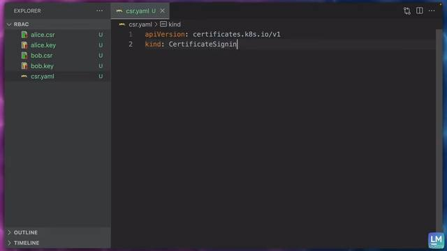

然后把这些 base64 字符串分别粘进下面的完整文件（第 4 节给出）里的 `request:` 字段，保存为 `csr.yaml`。

```bash
kubectl apply -f csr.yaml
```

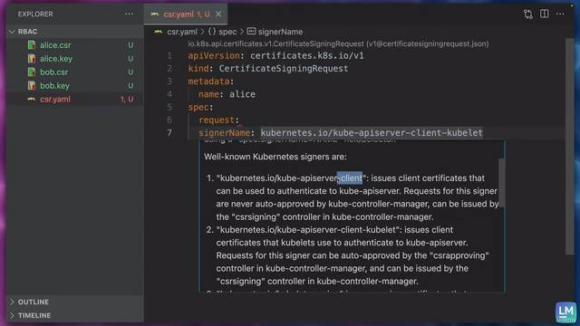

### Step 4 · 查看并批准 CSR

```bash
kubectl get csr
```

讲师当时看到的两个请求都处于 pending。这里命令行的列名以你实际输出为准。

```bash
kubectl certificate approve alice bob
```

讲师说：也可以拆成两次执行，`kubectl certificate approve alice` + `kubectl certificate approve bob`，效果一样。

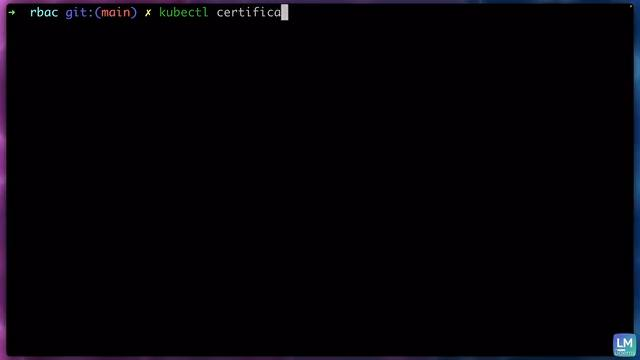

再次 `kubectl get csr`，两条都会变成 Approved/Issued 状态。

### Step 5 · 把签好的证书取出来存成 .crt

```bash
kubectl get csr alice -o jsonpath='{.status.certificate}' | base64 --decode > alice.crt
kubectl get csr bob   -o jsonpath='{.status.certificate}' | base64 --decode > bob.crt
```

讲师的做法是先进去看一眼 `kubectl get csr alice -o yaml`（也可以直接用短名 `csr`），确认 `status.certificate` 字段里已经是 base64 编码的证书，再用 jsonpath 单独把它取出来解码落盘。

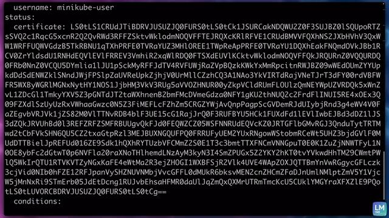

### Step 6 · 校验证书内容

```bash
openssl x509 -in alice.crt -text -noout
openssl x509 -in bob.crt   -text -noout
```

> 讲师现场只说了"运行 openssl 命令"，没逐字念出参数。上面是最常用的查看写法。

你应该能看到：

- `Subject` 里 `CN = alice`、`O = admins`（Bob 对应 `CN = bob`、`O = dev`）
- `Issuer` 是 minikube 的 Certificate Authority

讲师在 p033 [10:27] 特意提到「issuer 是 minikube 的 CA 签的」这一条，用来确认签名方确实是集群。

### Step 7 · 把凭据写进 kubeconfig 并建 context

先看一眼默认配置文件位置：

```bash
ls ~/.kube/config
```

讲师提到 / 演示的两条相关命令（按口述还原）：

```bash
# 1) 建 context（此时用户凭据还没配，讲师现场演示了"先建 context 也行"）
kubectl config set-context alice --cluster=minikube --user=alice

# 2) 给 alice 用户配客户端私钥与证书
kubectl config set-credentials alice \
  --client-key="$(realpath alice.key)" \
  --client-certificate="$(realpath alice.crt)"

# 3) bob 同样两步
kubectl config set-context bob --cluster=minikube --user=bob
kubectl config set-credentials bob \
  --client-key="$(realpath bob.key)" \
  --client-certificate="$(realpath bob.crt)"
```

- 讲师现场第一次把 `set-credentials` 敲成了 `set-credential`，报错后纠正。如果你也报错，先检查子命令拼写。
- `realpath` 是用来把相对路径转成绝对路径的（讲师明确提到）。
- 讲师还演示了 `--embed-certs=true`：加了它会把证书和私钥以 base64 直接内嵌到 kubeconfig，而不是记录文件路径。**讲师本人更推荐引用文件路径**，我这里也按他的偏好写。

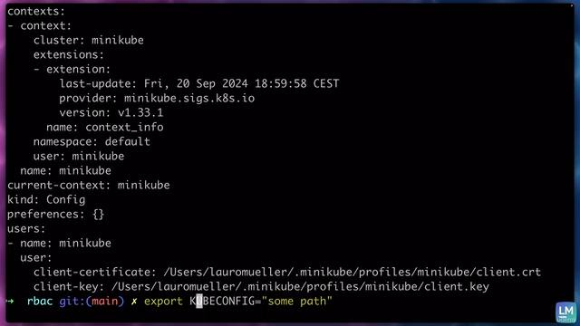

查看结果：

```bash
kubectl config view
kubectl config current-context
```

讲师提到：`kubectl config view` 默认会把证书数据省略；真正打印能看到 base64 的命令，讲师现场没逐字给出，常见的是 `kubectl config view --raw`（这条按需自取）。

### Step 8 · 用 alice 的 context 验证「认证成功、授权失败」

```bash
kubectl config use-context alice
kubectl config current-context
kubectl get pods
```

你会收到 `Forbidden`：大意是 `alice` 这个用户在 `""`（core）API group 下、`default` namespace 里没有 list pods 的权限。

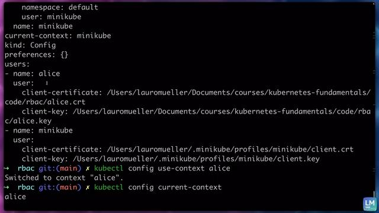

这就是预期结果，不是出错。证书是被集群 CA 签的、认证层过了；RBAC 里还没建角色，所以授权层被拒。

### Step 9 · 搭实验环境：两个 namespace + 两个 pod

**先切回 minikube 的管理员 context**：

```bash
kubectl config use-context minikube
kubectl apply -f roles/namespaces.yaml
```

刻意演示：讲师原本在 alice 的 context 下执行 apply，直接报错——alice 没有创建 namespace 的权限。这正好证明前面的上下文切换是真生效的。

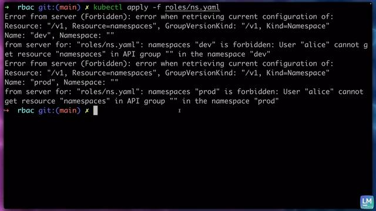

创建 pod：

```bash
kubectl apply -f pods.yaml
kubectl get pods -A
```

`-A` 是 `--all-namespaces` 的短写。你应该能看到 dev 和 prod 各有一个 nginx pod。

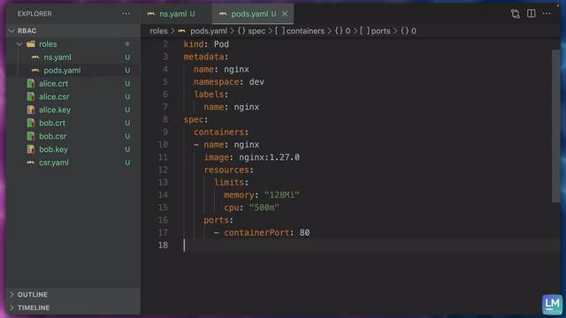

### Step 10 · 创建 Role（namespace 级、只读 pod）

```bash
kubectl apply -f roles/dev-pod-reader.yaml
kubectl get role -n dev
```

讲师在 p035 [04:04] 强调：`Role` 属于 `rbac.authorization.k8s.io` 这个 group，所以 `apiVersion` 是 `rbac.authorization.k8s.io/v1`，和之前 pod、namespace 的 `apiVersion: v1` 长得不一样。

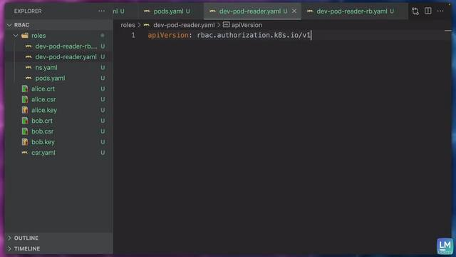

### Step 11 · 创建 RoleBinding（把这个角色绑到 bob）

```bash
kubectl apply -f roles/dev-pod-reader-rolebinding.yaml
kubectl get rolebinding -n dev
```

能看出一条名为 `pod-reader` 的绑定，`roleRef` 指向同为 `pod-reader` 的 Role。

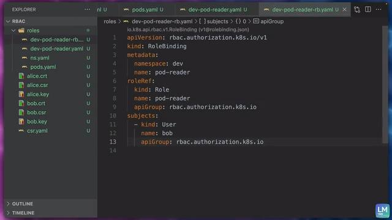

> 讲师在 p035 [06:55] 特别强调：**RoleBinding 的 namespace 必须与它引用的 Role 的 namespace 一致**。

### Step 12 · 用 bob 的 context 逐条验证权限

```bash
kubectl config use-context bob

kubectl get pods                        # 报 Forbidden，因为落在 default namespace
kubectl get pods -n dev                 # ✅ 成功
kubectl describe pod <dev 里那个 pod> -n dev   # ✅ 成功
kubectl get pods -n prod                # ❌ Forbidden
kubectl get pods -A                     # ❌ Forbidden，bob 不能做 cluster 级 list
kubectl delete pod <dev 里那个 pod> -n dev     # ❌ Forbidden
kubectl run busybox --image=busybox -n dev     # ❌ Forbidden，不能创建
```

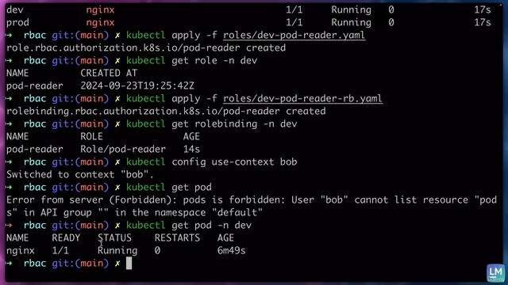

这里有一条反直觉的现象（讲师在 p035 [08:50] 专门解释了）：

- `kubectl get pod`（针对单个对象名）= API 的 `list` 动词
- `kubectl describe pod`（按名字拿单个详情）= API 的 `get` 动词

所以我们在 Role 里给了 `get` 和 `list` 两个动词，结果「集合列表」和「单个详情」都能用。名字对不上不是 bug，是 kubectl 与 API 动词的历史命名差异。

### Step 13 · 创建 ClusterRole（集群级、可写 pod）

```bash
kubectl apply -f clusterroles/pod-admin.yaml
kubectl get clusterrole | grep pod-admin
kubectl describe clusterrole pod-admin
```

`ClusterRole` 与 `Role` 的区别只有两处：`kind` 改了、`metadata` 里**不能写 `namespace`**（讲师在 p036 [02:16] 说得很明确：cluster role is not namespaced）。

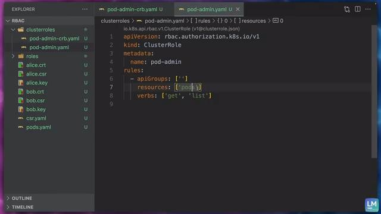

### Step 14 · 创建 ClusterRoleBinding（绑定到 admins 组）

```bash
kubectl apply -f clusterroles/pod-admin-clusterrolebinding.yaml
kubectl describe clusterrolebinding pod-admin
```

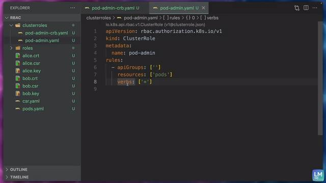

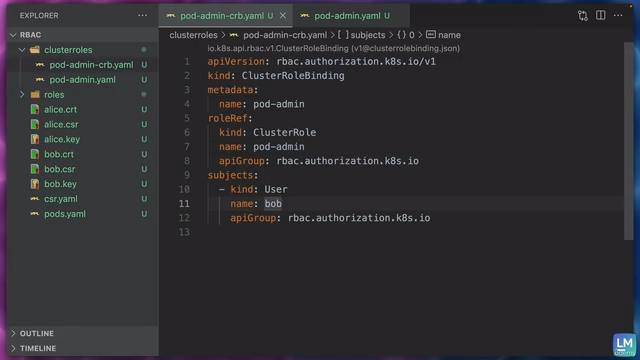

关键点：`subjects` 里是：

```yaml
subjects:
- kind: Group
  name: admins
  apiGroup: rbac.authorization.k8s.io
```

不是 `kind: User  name: alice`。讲师解释：K8s 里根本没有 user 和 group 这两个对象，RBAC 只是把**客户端证书 subject 里解析出来的 CN/O 拿来做字符串匹配**。任何持有 `O=admins` 证书的人（现在只有 alice，将来可以再有别人）都会继承这套权限。

### Step 15 · 对比验证 bob 与 alice

```bash
# bob 不能创建
kubectl config use-context bob
kubectl apply -f pods.yaml          # ❌ Forbidden
kubectl delete pod <dev 的 pod> -n dev   # ❌ Forbidden

# alice 可以创建、也可以删除
kubectl config use-context alice
kubectl apply -f pods.yaml          # ✅ 成功
kubectl delete pod <dev 的 pod> -n dev   # ✅ 成功
```

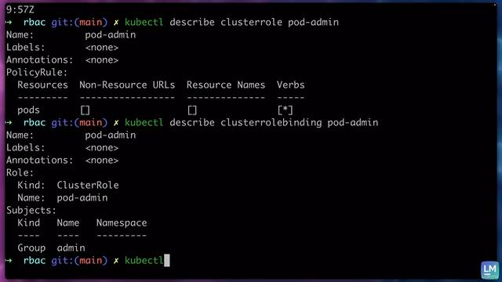

注意一个细节（讲师当时的说明）：`bob` 之前已经在 dev 里建过一个 pod，所以对 `pods.yaml` 的再次 apply，dev 那条会显示 `unchanged`，prod 那条会直接报 Forbidden。这正是「按 namespace 隔离」的直接证据——同一份清单、同一个人，一个 namespace 能命中、另一个被拒。

---

## 4. 完整代码

> 目录约定与第 3 节一致；命令都在项目根目录执行。

### 4.1 `csr.yaml`

**这是需要先替换占位符的文件**：`<ALICE_CSR_BASE64>` 与 `<BOB_CSR_BASE64>` 必须替换为 Step 3 生成的真实 base64 字符串。

```yaml
apiVersion: certificates.k8s.io/v1
kind: CertificateSigningRequest
metadata:
  name: alice
spec:
  request: <ALICE_CSR_BASE64>
  signerName: kubernetes.io/kube-apiserver-client
  expirationSeconds: 86400
  usages:
    - client auth
---
apiVersion: certificates.k8s.io/v1
kind: CertificateSigningRequest
metadata:
  name: bob
spec:
  request: <BOB_CSR_BASE64>
  signerName: kubernetes.io/kube-apiserver-client
  expirationSeconds: 86400
  usages:
    - client auth
```

> 课里是手动复制粘贴 base64（讲师现场就是这么做的）。如果你想少一点手工出错，下面这段是我补的便利做法，**不是课里内容**：用 shell 直接把两个 CSR 拼成 yaml。

```bash
# 本文补充，非课里内容
cat > csr.yaml <<EOF
apiVersion: certificates.k8s.io/v1
kind: CertificateSigningRequest
metadata:
  name: alice
spec:
  request: $(base64 -w0 alice.csr)
  signerName: kubernetes.io/kube-apiserver-client
  expirationSeconds: 86400
  usages:
    - client auth
---
apiVersion: certificates.k8s.io/v1
kind: CertificateSigningRequest
metadata:
  name: bob
spec:
  request: $(base64 -w0 bob.csr)
  signerName: kubernetes.io/kube-apiserver-client
  expirationSeconds: 86400
  usages:
    - client auth
EOF
```

### 4.2 `roles/namespaces.yaml`

```yaml
apiVersion: v1
kind: Namespace
metadata:
  name: dev
---
apiVersion: v1
kind: Namespace
metadata:
  name: prod
```

### 4.3 `pods.yaml`

```yaml
apiVersion: v1
kind: Pod
metadata:
  name: nginx
  namespace: dev
spec:
  containers:
    - name: nginx
      image: nginx:1.27.0
      ports:
        - containerPort: 80
---
apiVersion: v1
kind: Pod
metadata:
  name: nginx
  namespace: prod
spec:
  containers:
    - name: nginx
      image: nginx:1.27.0
      ports:
        - containerPort: 80
```

### 4.4 `roles/dev-pod-reader.yaml`（Role：namespace 级、只读）

```yaml
apiVersion: rbac.authorization.k8s.io/v1
kind: Role
metadata:
  namespace: dev
  name: pod-reader
rules:
  - apiGroups: [""]
    resources: ["pods"]
    verbs: ["get", "list"]
```

### 4.5 `roles/dev-pod-reader-rolebinding.yaml`（把 Role 绑到 bob）

```yaml
apiVersion: rbac.authorization.k8s.io/v1
kind: RoleBinding
metadata:
  namespace: dev
  name: pod-reader
roleRef:
  apiGroup: rbac.authorization.k8s.io
  kind: Role
  name: pod-reader
subjects:
  - kind: User
    name: bob
    apiGroup: rbac.authorization.k8s.io
```

### 4.6 `clusterroles/pod-admin.yaml`（ClusterRole：集群级、全动词）

```yaml
apiVersion: rbac.authorization.k8s.io/v1
kind: ClusterRole
metadata:
  name: pod-admin
rules:
  - apiGroups: [""]
    resources: ["pods"]
    verbs: ["*"]
```

### 4.7 `clusterroles/pod-admin-clusterrolebinding.yaml`（绑定到 admins 组）

```yaml
apiVersion: rbac.authorization.k8s.io/v1
kind: ClusterRoleBinding
metadata:
  name: pod-admin
roleRef:
  apiGroup: rbac.authorization.k8s.io
  kind: ClusterRole
  name: pod-admin
subjects:
  - kind: Group
    name: admins
    apiGroup: rbac.authorization.k8s.io
```

> 讲师在 P036 [02:40] 提到想给 pod-admin 加上 `pods/log` 这个子资源，但当场**明确说先不加**、后面再回来讲。所以上面这版就是课程本节实际落地的版本。课程本节没有实现 `pod logs` 的授予。

---

## 5. 逐行解释

### 5.1 `csr.yaml` 各字段

- `apiVersion: certificates.k8s.io/v1`
  这不是 core group，所以必须写 group 全名。讲师在 P033 [03:16] 用这个例子反推了「为什么有的资源是 `v1`（空 group），有的要写 `xxx/v1`」——因为前者属于 core，后者属于某个具名 API group。前端类比：`/api/v1/users` 与 `/admin/v1/users` 的区别。
- `kind: CertificateSigningRequest`
  就是一个 K8s 对象；CSR 在这种写法里是「申请单」，不是证书本身，必须批准后才会被 CA 填上证书。
- `metadata.name: alice`
  后面 `kubectl certificate approve alice`、`kubectl get csr alice` 用的就是这个 name。
- `spec.signerName: kubernetes.io/kube-apiserver-client`
  讲师在 P033 [03:45] 的解释是：只有用这个 signerName 签出来的证书，**才会被 kube-apiserver 认可用来做客户端认证**。别自作主张换成别的字符串，否则签发出来也用不了。
- `expirationSeconds: 86400`
  1 天有效期，讲师说得很明确。
- `usages: [client auth]`
  用途限定为「客户端认证」。K8s 还支持别的 usage，讲师说那些超出了本节讨论范围。

> 讲师在 P033 [04:15] 一条很关键的说明：使用 `kubernetes.io/kube-apiserver-client` 的 CSR **永远不会被自动批准**。另一个 signer 值 `kubernetes.io/kube-apiserver-client-kubelet` 才可能被 kube-controller-manager 自动批准。所以本节必须手动 `kubectl certificate approve`。

### 5.2 `kubectl certificate approve` 在做什么

你在「批准」时，其实是在告诉 cluster 的签名控制器：请把这个 CSR 拿去用集群 CA 签。签完结果会写回该 CSR 对象的 `status.certificate` 字段（base64 编码的证书）。这一步的设计意图是：**任何能提交 CSR 的人都不能顺手给自己发证书**，必须由有审批权限的人（在 minikube 上是 `minikube` 这个属于 `system:masters` 组的用户）点头。

从 Node 视角看，这更像「提 PR 之后要有门禁审批才能合并」，而不是「自己签个 JWT 就完事」。这是很多人从 JWT 迁移过来最容易误判的一处。

### 5.3 kubeconfig 的 context / user 结构

`kubectl config set-context` / `set-credentials` 是把信息写进 `~/.kube/config`。这份文件的语义是：

- `clusters` 里记录「集群的 API Server 地址 + CA」
- `users` 里记录「我该拿哪对 key / cert 去证明我是谁」
- `contexts` 把「一个 cluster + 一个 user」组合起来，起个名字
- `current-context` 指向「下次 kubectl 执行时用哪个组合」

所以 `set-context alice --user=alice` 单独执行时，`users` 里还没有 alice 这一项，context 依然是合法的（讲师现场演示了这点），执行请求时会报「用户不存在」类的错误；把 `set-credentials` 补上之后就完全可用。

`--embed-certs=true` 与不 embed 的差异：embed 会把 key/cert 的 base64 直接塞进文件。讲师偏好不 embed，理由主要是「文件路径更直观、方便换证、不把私钥散落在文本配置里」。如果你把 kubeconfig 提交到 git 或存到共享磁盘，务必注意——私钥嵌进去等于明文提交凭证。

### 5.4 `Role` 的 `apiGroups: [""]`

`pods` 属于 core API group，在 API 路径里没有 group 段，所以在 rules 里表达为**空字符串**。讲师在 P035 [04:39] 用同一句话解释了这一点：写 `apiGroups: [""]` 就是「根 group」，等价于 `apiVersion: v1`。如果这里写 `rbac.authorization.k8s.io`，那授予的就不是 pod 而是 RBAC 对象本身了。

### 5.5 `verbs` 与实际命令的对应关系

`verbs: ["get", "list"]` 是 API 动词，不是命令名。对应关系（讲师在 P035 [08:50] 点破的关键）：

| kubectl 命令 | 实际打的 API 动词 |
|---|---|
| `kubectl get pods -n dev` | `list` |
| `kubectl describe pod <name> -n dev` | `get` |

所以「只给了 get 和 list」并不意味着「只能 describe」，而是意味着「集合列表 + 单个详情都能行，但 create/update/patch/delete 一律不行」。

### 5.6 `roleRef` 与 `subjects` 的匹配

- `roleRef` 指向 Role 的 `metadata.name`（此处 `pod-reader`）；`roleRef.apiGroup` 是 `rbac.authorization.k8s.io`，不是 core，所以要写全。
- `subjects` 里 `kind: User` + `name: bob` + `apiGroup: rbac.authorization.k8s.io`。这里的 `bob` 是**证书 subject 里的 CN**，不是 K8s 里的某个对象。K8s 里不存在名叫 bob 的 User 对象。

在 Node 类比里，Role 相当于某个路由前缀上的权限中间件，RoleBinding 就是「把这个中间件挂到这个路由前缀，并把某个调用方 ID 放进去」。**作用域和绑定是两件事**——这也是为什么讲师坚持 Role 和 RoleBinding 分两个文件、分开 apply。

### 5.7 `ClusterRole` 为什么不能带 namespace

它是「集群全局」的角色，不存在「属于某个 namespace」这一说，所以 `metadata` 里不能出现 `namespace`。`ClusterRoleBinding` 同理。

### 5.8 `subjects.kind: Group` 的深意

讲师在 P036 [03:36] 说得很清楚：K8s 里没有 group 实体，也没有 user 实体，只有「从证书 subject 里解析出来的字符串」。你在证书里写 `O=admins`，RBAC 就看得见 `Group: admins`；你在证书里写 `O=dev`，RBAC 就看得见 `Group: dev`。**改权限归属不需要改集群对象**，只需要重新申请一份证书。

这一点是本节最重要的设计模式。把它放到 Node 场景里类比：RBAC 相当于在中间件里读 `req.client.get('groups')` 做匹配，而不需要你往数据库里塞一堆 user/group 记录。

### 5.9 为什么 alice 的 `kubectl get pods` 会 Forbidden，而不是其他错误

先决条件是「证书被集群 CA 签过、且写在 kubeconfig 里」。这保证了 TLS 握手能过、apiserver 能解析出 `CN=alice, O=admins`。接下来的 RBAC 阶段发现「这个 subject 没有匹配到任何允许 `list pods` 的 binding」，于是返回 Forbidden。这与「证书不对」的报错（通常是 TLS 握手失败或 401）在终端里一眼就能分开。

### 5.10 RoleBinding 的 namespace 为什么必须与 Role 相同

讲师强调的原因很简单：Role 是 namespace-scoped 对象，整个资源「只在这个 namespace 里可见」。绑定既然要引用它，就得在同一个命名空间；跨 namespace 引用的语义不存在。`ClusterRoleBinding` 因为广播到整个集群，所以干脆没有 namespace 字段。

---

## 6. 复现检查清单

按顺序逐条打勾。每条都带校验命令。

**证书链**

- [ ] `openssl genrsa -out alice.key 2048` 与 `bob.key` 已生成。
- [ ] `openssl req ... -subj "/CN=alice/O=admins"` 与 `/CN=bob/O=dev` 已生成 `alice.csr`、`bob.csr`。
- [ ] `csr.yaml` 里两处 `request` 都已替换为真实 base64（不是占位符）。
- [ ] `kubectl apply -f csr.yaml` 成功。
- [ ] `kubectl get csr` 能看到 `alice`、`bob` 两条。

## 7. 课里没讲但你会撞上的

| 现象 | 原因 | 怎么办 |
|---|---|---|
| `kubectl apply -f csr.yaml` 报 `error converting YAML to JSON` 或 `cannot unmarshal string`，提示 `request` 字段格式不对 | 把终端里 base64 输出末尾的 `%`（shell 提示符）一起复制进去了，或者复制时带了换行。讲师在 p033 [06:07] 专门提醒过「copy up to these two equal signs，这个百分比是终端来的」。 | 重新 `cat alice.csr \| base64 \| tr -d '\n'`，只复制到 `==` 结尾；或直接用文档 4.1 里标注为「本文补充，非课里内容」的 shell 拼接写法，避免手工复制。 |
| `kubectl certificate approve alice bob` 报 `cannot approve a certificate signing request that is not pending` 或提示找不到对象 | CSR 的 `metadata.name` 和你 approve 时写的名字不一致（比如 yaml 里写成 `alice-csr`），或者重复 apply 后状态已变。 | 先 `kubectl get csr` 看实际名字和 STATUS 列，用真实名字 approve。课里没讲重复 apply 同一份 csr.yaml 会怎样，这条属于补充提醒。 |
| `kubectl get csr alice -o jsonpath='{.status.certificate}'` 输出为空，`alice.crt` 是 0 字节 | CSR 还没被批准/签发，`status.certificate` 字段不存在。 | 先 `kubectl get csr` 确认是 `Approved,Issued` 再取证书。课里没讲未签发时取证书的表现。 |
| `kubectl config set-credentials alice ...` 报 `unknown command "set-credential"` | 子命令拼写错误。讲师在 p034 [03:43] 现场就敲错过一次并纠正。 | 用 `set-credentials`（带 s）。 |
| `kubectl config use-context alice` 后执行任何命令报 `error: You must be logged in to the server (Unauthorized)` 或 TLS 握手错误，而不是 Forbidden | `set-credentials` 没执行成功，或 `--client-key` / `--client-certificate` 路径写错（相对路径在别的目录执行 kubectl 时就失效）。 | 用 `realpath` 转绝对路径（讲师在 p034 [02:29] 就是这么做的），再 `kubectl config view` 确认 users 段里有 alice 且路径正确。课里没讲相对路径换目录执行会失效这一点。 |
| 在 alice context 下 `kubectl apply -f roles/namespaces.yaml` 报 Forbidden，以为是环境坏了 | 这正是讲师在 p035 [01:07] 刻意演示的现象：alice 没有创建 namespace 的权限。 | 切回 `kubectl config use-context minikube` 再 apply。这是预期行为，不是 bug。 |
| `kubectl get pods -n dev`（bob context）成功，但 `kubectl get pods`（不带 -n）报 Forbidden，误以为 RoleBinding 没生效 | 不带 `-n` 时落在 `default` namespace，而 RoleBinding 只建在 `dev`。 | 明确带 `-n dev`。课里 Step 12 已列此条，这里只是提醒它容易被当成故障。 |
| `kubectl describe pod <name> -n dev` 成功，但以为「只给了 get/list 不该能 describe」 | 讲师在 p035 [08:50] 解释过：`describe` 对应 API 的 `get`，`get pods`（集合）对应 `list`。 | 不用改，这是正常映射。 |
| `kubectl apply -f pods.yaml`（bob context）时 dev 那条显示 `unchanged`、prod 那条报 Forbidden，以为命令只执行了一半 | 讲师在 p036 [06:29] 说明过：dev 的 pod 已存在所以 unchanged，prod 那条因无权限被拒。 | 正常现象；想验证创建权限就换一个不存在的 pod 名或先删再 apply。 |
| `kubectl apply -f clusterroles/pod-admin.yaml` 报 `metadata.namespace: Invalid value` 或字段不被接受 | ClusterRole 不能带 `metadata.namespace`。讲师在 p036 [02:16] 明确说要删掉 namespace。 | 删掉 `metadata.namespace` 再 apply。 |
| 想按讲师 p036 [02:40] 提到的给 pod-admin 加 `pods/log` 子资源，但照文档 4.6 的 yaml 加 `resources: ["pods/log"]` 后 `kubectl logs` 仍失败 | 讲师当场**明确说先不加、后面再回来讲**，本节落地的版本里没有 `pods/log`。 | 本节不要加；等后续课程。课里没讲这一节如何授予 logs 权限。 |
| `kubectl config view` 看不到证书内容，以为凭据没写进去 | `kubectl config view` 默认省略证书数据。讲师在 p034 [04:11] 提到「data is omitted here」。 | 用 `kubectl config view --raw` 查看（文档 Step 7 已注明这条是按需自取，非讲师逐字给出）。 |
| 把 kubeconfig 提交到 git 或共享后私钥泄露 | 若用了 `--embed-certs=true`，私钥 base64 会明文写进 kubeconfig。讲师在 p034 [03:16] 说不 embed、引用文件路径更好。 | 不要 embed；不要把含私钥路径的 kubeconfig 或 `.key` 文件提交到仓库。课里没讲这条安全注意事项，属于补充。 |
