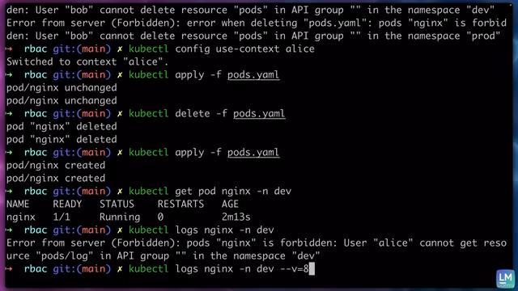
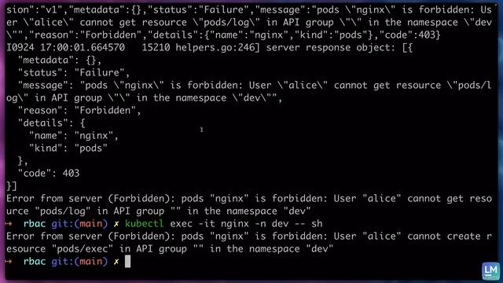
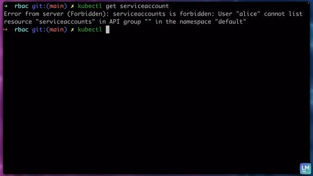
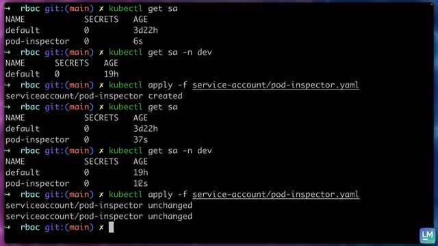
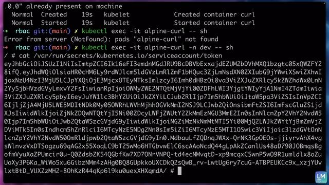
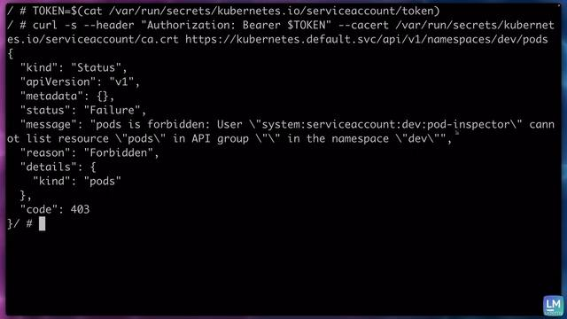
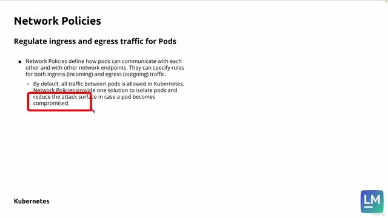
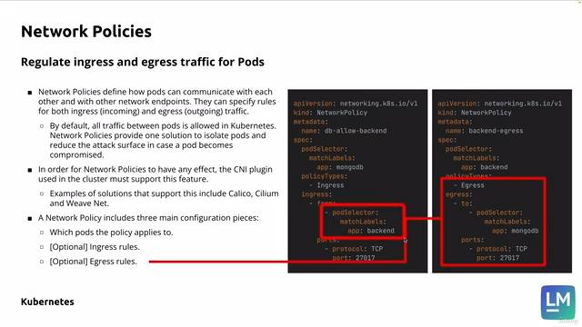

# Docker & Kubernetes Zero to Hero｜P37–P42：Pod 子资源权限、ServiceAccount 与 NetworkPolicy

> 本文覆盖 P37–P42。核心是三件事：**① 给 Pod 的子资源（logs / exec / attach）单独授权**；**② 用 ServiceAccount 让 Pod 里的进程能合法调用 Kubernetes API**；**③ 用 NetworkPolicy 隔离 Pod 之间的流量**（P42 只讲概念，动手在下一节）。
> 本文假设你已经跟完前面的课程：集群里有 `dev` / `prod` 两个 namespace，有 `alice`、`bob` 两个用 X509 证书认证的用户 context，有 `pod-reader` 这个 Role 和 RoleBinding。没有的话，先把那部分补上再往下做。

---

## 1. 这一节做什么

这一节要交付三个可验证的结果：

**结果一：`alice` 能看日志、能 exec 进容器。**
在 P37 开始时，`alice` 已经能 `kubectl get pods`，但一执行 `kubectl logs` 就报 Forbidden，`kubectl exec` 也一样。原因是 Kubernetes 把 `logs`、`exec`、`attach` 当作 **Pod 的子资源（subresource）**，它们在 HTTP API 上对应的是 `/api/v1/namespaces/dev/pods/nginx/log` 这种**嵌套路径**，而不是 `pods` 这个资源本身。给 `pods` 授权不等于给 `pods/log` 授权。我们要做的是在 ClusterRole 里显式列出 `pods/log`、`pods/exec`、`pods/attach`。

**结果二：一个 Pod 里的进程，能凭自己的身份调用 Kubernetes API 列出 Pod。**
这不是靠"进容器就能调 API"，而是靠 **ServiceAccount**：我们自己建一个 `pod-inspector` 的 ServiceAccount，把它挂到 `alpine-curl` 这个 Pod 上，再把这个 ServiceAccount 加进 `pod-reader` 的 RoleBinding 的 subjects 里。最后在容器里用 `curl` 带上 JWT token 直接打 API Server，能拿到 Pod 列表的 JSON。

**结果三：一张能说清楚 NetworkPolicy 三要素的图。**
P42 是纯概念课，讲师没有动手写资源。要复现的是他的**推导**：默认全通 → 为什么需要隔离 → NetworkPolicy 的三个配置块（podSelector 必填、ingress 可选、egress 可选）→ 选择器的四种写法 → **同层是 AND、跨层是 OR** 这条最容易记错的规则 → 以及"CNI 插件不支持就等于没写"这个前提。

最后 P41 是一次清理，把前面造的 Pod、CSR、ClusterRole、ServiceAccount、Role 全部删掉，为下一节的 NetworkPolicy 实验腾出干净的集群。

---

## 2. 讲师原话

关于子资源为什么必须单独授权：

> "正如我们在 Kubernetes API 中已经讨论过的，logs 被视为 pods 的子资源。这意味着，要让用户能够访问 logs，我们需要显式设置权限。"
> —— p037 [00:29]

> "我们得到 API、V1、namespaces、dev、pods、nginx，然后这里得到一个 /log。这个 /log 就是所谓的子资源，我们需要显式地为这个 log 子资源设置权限。"
> —— p037 [01:49]

关于 exec 的报错原文：

> "可以看到，我们得到的正是这个结果：用户 alice 无法创建 pods/exec 这个资源。"
> —— p037 [02:17]

关于授权的连带影响（后面复现会踩到）：

> "还记得 Alice 没有权限应用 role，对吧？……所以我们需要在这里切换到 minikube 的主用户，或者我们已有的 minikube 超级用户。然后就可以在这里应用这些变更，role 也就配置好了。"
> —— p037 [03:10]

关于子资源不止 Pod 一家：

> "如果我们还想在这里允许用户对 deployments 进行扩缩容，那么就得写成 deployments/scale。"
> —— p037 [04:06]

关于用户与服务账号的本质差别：

> "当人类与集群交互时，你很可能使用用户账户；而当运行在 pods 内容器中的应用需要与集群交互时，你很可能使用服务账户。"
> —— p038 [03:54]

> "服务账户通过 JWT 令牌进行身份认证；当使用某个特定服务账户时，Kubernetes 会自动生成这些令牌，并将其挂载到每个 pod 内部。"
> —— p038 [01:22]

> "用户账户名称必须在所有命名空间中唯一……服务账户的范围限定在命名空间内。因此，我们可以有两个不同的命名空间，而它们可以包含名称相同的服务账户。"
> —— p038 [02:44]

关于默认行为：

> "到目前为止，我们还没有在现有的 pod 定义文件中指定服务账户。这意味着默认会有一个服务账户应用到这个 pod 上，也就是 default 服务账户。"
> —— p039 [00:56]

> "从定义上说，或者说默认情况下，服务账户没有任何权限。"
> —— p040 [02:09]

关于 P42 的前提条件：

> "要让网络策略真正生效，我们在集群中使用的容器网络接口插件必须支持这一功能。市面上有几种方案，其中包括 Calico、Cilium 和 WeaveNet。"
> —— p042 [01:14]

关于 AND / OR 这条规则：

> "在 from 或 to 条件下，不同的列表元素之间表现为“或”条件。而如果同一个列表元素下有多个选择项，它们之间则表现为“与”条件。"
> —— p042 [05:15]

---

## 3. 从零复现

### 3.0 前置检查

```bash
minikube status
kubectl config get-contexts
kubectl get ns
```

必须能看到 `dev`、`prod` 两个 namespace，以及 `alice`、`bob`、`minikube` 三个 context。缺哪个就回到前面的课程补。本节所有文件放在一个工作目录里，先建好骨架：

```bash
mkdir -p ~/k8s-rbac/{pods,roles,clusterroles,serviceaccount,networkpolicies}
cd ~/k8s-rbac
```

### 3.1 复现子资源被拒的现象

先把 `alice` 切出来，复现「能 get pod，不能 get logs」：

```bash
kubectl config use-context alice
kubectl get pod nginx -n dev            # 成功
kubectl logs nginx -n dev              # Forbidden
kubectl exec -it nginx -n dev -- sh    # Forbidden：cannot create resource "pods/exec"
```

想看清楚 kubectl 背后到底打了哪个 HTTP 接口，加 `--v=8`：

```bash
kubectl get pods nginx -n dev --v=8
```

讲师在这一步的屏幕上能看到完整请求路径 `.../api/v1/namespaces/dev/pods/nginx/log`，末尾那个 `/log` 就是子资源。**注意：`kubectl logs` 是 GET，但 `kubectl exec` 在 RBAC 里校验的动词是 `create`**，所以下面报错原文是 "无法创建该资源 pods/exec"。





### 3.2 改 ClusterRole，补三个子资源

打开 `clusterroles/pod-admin.yaml`（你上一节应该已经有这个文件），在 `resources` 里补三行。完整文件见第 4 节。

改完直接 apply 会失败——因为 `alice` 自己都没有改 ClusterRole 的权限：

```bash
kubectl apply -f clusterroles/pod-admin.yaml      # alice 身份，失败
```

切到集群管理员身份再 apply，然后切回 `alice` 验证：

```bash
kubectl config use-context minikube
kubectl apply -f clusterroles/pod-admin.yaml

kubectl config use-context alice
kubectl logs nginx -n dev                         # 现在能出日志
kubectl exec -it nginx -n dev -- sh               # 现在能进 shell
```

这一步的意义不只是"修个报错"：它说明**授权粒度可以细到"能起 Pod 但看不了日志"**。讲师明确说了，如果不希望开发者读日志，直接在 resources 里**不写** `pods/log` 就行。

### 3.3 建一个自己的 ServiceAccount

回到管理员 context：

```bash
kubectl config use-context minikube
kubectl apply -f serviceaccount/pod-inspector.yaml
kubectl get sa                       # default + pod-inspector
kubectl get sa -n dev                # 只有 default
```

第一版文件里只有 `metadata.name`，所以只创建在 `default` 命名空间。加上 `namespace: dev` 再 apply 一次，`dev` 里就有了，但 `default` 里那个变成了"没有 manifest 管理"的孤儿——讲师的建议是**同一个文件里放两个文档**（用 `---` 分隔），再 apply 一次，输出会显示两个都 `unchanged`。

这里能直观看到讲师说的"SA 是按命名空间隔离的"：两个同名的 `pod-inspector` 可以同时存在，权限各自独立。



### 3.4 把 ServiceAccount 挂到 Pod 上

编辑 `pods/pods.yaml`，给 `alpine-curl` 这个 Pod 的 spec 加一行 `serviceAccountName: pod-inspector`。

```bash
kubectl apply -f pods/pods.yaml
kubectl describe pod alpine-curl -n dev | head -20
```

`describe` 输出里会出现一行 Service Account 字段，值应该是 `pod-inspector`。**没有这一行就说明挂错了 Pod。**



### 3.5 进容器，用 token 打 API

```bash
kubectl exec -it alpine-curl -n dev -- sh
```

容器里执行：

```bash
ls /var/run/secrets/kubernetes.io/serviceaccount/
# ca.crt  namespace  token
cat /var/run/secrets/kubernetes.io/serviceaccount/token
```

这个文件里是一个 JWT，由 Kubernetes 自动生成并挂载，你不需要手工创建任何 Secret。



把它存进变量，然后带上 CA 证书去请求 API Server：

```bash
TOKEN=$(cat /var/run/secrets/kubernetes.io/serviceaccount/token)
curl -s \
  -H "Authorization: Bearer $TOKEN" \
  --cacert /var/run/secrets/kubernetes.io/serviceaccount/ca.crt \
  https://kubernetes.default.svc/api/v1/namespaces/dev/pods
```

**第一次调用一定失败，返回 Forbidden。** 这不是 token 有问题，而是这个 ServiceAccount 还没绑定任何 Role——讲师原话是 "默认情况下，服务账号没有任何权限。"。



**不要关掉这个 shell。** 新开一个终端，把 ServiceAccount 加进 RoleBinding 的 subjects。

### 3.6 把 ServiceAccount 加进 RoleBinding

编辑 `roles/dev-pod-reader-rolebinding.yaml`，在 `subjects` 列表里追加第二项。注意 ServiceAccount 类型的 subject **不用 apiGroup，用 namespace**：

```bash
kubectl apply -f roles/dev-pod-reader-rolebinding.yaml
kubectl describe rolebinding pod-reader -n dev
```

`describe` 的 Subjects 段落里应该同时出现一个 User 和一个 ServiceAccount，后者带着 `Namespace: dev`。

回到刚才那个容器里的 shell，**原样重新执行那条 curl**，这次返回的是一大坨 JSON——里面就是 `dev` 命名空间所有 Pod 的完整信息，包括你正在 exec 的这个 Pod 自己。讲师的原话是：kubectl 只是把这份 JSON 解析成了更友好的表格。

### 3.7 清理（P41）

讲师给了两条路：`minikube delete` 一把梭，或者按文件一条条删。他选的是后者，因为 `dev` / `prod` 这两个名字太常见，直接删 namespace 可能误伤里面别的东西。

```bash
kubectl config use-context minikube

kubectl delete -f pods/pods.yaml --force
kubectl get pods -n dev      # 空
kubectl get pods -n prod     # 空
kubectl get pods             # 空
# kube-system 里的不要动

kubectl delete -f clusterroles/          # 按目录删
kubectl delete -f serviceaccount/
kubectl delete -f roles/dev-pod-reader.yaml
kubectl delete -f roles/dev-pod-reader-rolebinding.yaml
kubectl delete -f roles/namespace.yaml   # 最后删 namespace
```

讲师特意保留了 `~/.kube/config` 里的 `alice` 和 `bob` 两个用户和 context，说后面可能还用得上。

### 3.8 NetworkPolicy：只复现推导（P42 是概念课）

这一节讲师**没有动手 apply 任何资源**，全部是 PPT 讲解。要"复现"的是他的推理链：

1. **现状**：前面所有实验里，Pod 之间、跨 namespace 之间都能随便通——因为没写任何 NetworkPolicy，K8s 默认全放行。这意味着任何一个 Pod 被攻破，攻击者能横向扫全网。NetworkPolicy 就是缩小这个攻击面的原生手段之一。
2. **前提约束**：CNI 插件必须支持 NetworkPolicy，讲师点名 Calico、Cilium、WeaveNet。**不支持的话，你写的策略会被 API Server 接受，但完全不生效**——这是最坑的一点。
3. **三要素拆解**：
   - `podSelector`：策略作用于哪些 Pod，**必填**。写 `{}` 表示本命名空间全部 Pod。
   - `ingress` 规则：谁可以进来，**可选**。
   - `egress` 规则：能往哪出去，**可选**。
   - 由 `policyTypes` 声明这条策略管的是 Ingress 还是 Egress（或两者）。
4. **两种方向的对称性**：同一个需求可以只做一半，也可以两头都做。讲师用 MongoDB 举例——Ingress 侧写"只允许 backend 进来打 27017"，Egress 侧写"后端只能出站访问 MongoDB 的 27017 端口。"。两个都写才叫闭环；只写一边，另一边靠默认放行仍然可能漏。
5. **选择器的四种写法**：`podSelector`（matchLabels / matchExpressions）、`namespaceSelector`（同样支持 matchLabels / matchExpressions，但**不能按 namespace 名字写**，要用系统自动打的标签）、`ipBlock`、以及 `ports` + `protocol`。
6. **AND / OR 规则**（最容易记反的一条）：
   - `from:` 是**列表**，列表里**不同元素之间是 OR**；
   - 同一个元素内部写多个选择器，**它们之间是 AND**。

   讲师给了对照示例：单个 from 元素里同时写 `namespaceSelector: name=staging` + `podSelector: app=frontend`，意思是"**staging 命名空间里的** frontend Pod"（AND）；如果拆成两个 from 元素，意思就变成"整个 staging 命名空间 **或者** 任意位置的 frontend Pod"（OR）。





真正的动手实验在下一节（P43 起）在 Minikube 里做，本文第 4 节给出按讲师描述整理的 manifest，可以先存着。

---

## 4. 完整代码

目录结构：

```
~/k8s-rbac/
├── pods/
│   └── pods.yaml
├── roles/
│   ├── namespace.yaml
│   ├── dev-pod-reader.yaml
│   ├── dev-pod-reader-rolebinding.yaml
│   └── pod-admin.yaml
├── clusterroles/
│   ├── pod-admin.yaml
│   └── pod-admin-rolebinding.yaml
├── serviceaccount/
│   └── pod-inspector.yaml
└── networkpolicies/
    ├── mongodb-ingress.yaml
    ├── backend-egress.yaml
    ├── from-and-example.yaml
    └── from-or-example.yaml
```

### 4.1 `clusterroles/pod-admin.yaml`（本节要改的就是这个文件）

```yaml
apiVersion: rbac.authorization.k8s.io/v1
kind: ClusterRole
metadata:
  name: pod-admin
rules:
  # 原有规则：pods 本身
  - apiGroups: [""]
    resources:
      - pods
    verbs: ["get", "list", "watch", "create", "delete"]

  # 本节新增：三个 Pod 子资源
  - apiGroups: [""]
    resources:
      - pods/log
      - pods/exec
      - pods/attach
    verbs: ["get", "create"]

  # 讲师顺带提到的另一种子资源：deployments/scale
  - apiGroups: ["apps"]
    resources:
      - deployments
      - deployments/scale
    verbs: ["get", "list", "watch", "update", "patch"]
```

> 说明：上面第一条规则里的 verbs 是**上一节你自己写的内容，保持原样即可**；本节点只看第二条（三个子资源）和第三条（`deployments/scale`）。`pods/log` 是 GET，`pods/exec` / `pods/attach` 在 RBAC 里按 create 校验，所以第二条只给了 `get` 和 `create`。

### 4.2 `clusterroles/pod-admin-rolebinding.yaml`

```yaml
apiVersion: rbac.authorization.k8s.io/v1
kind: ClusterRoleBinding
metadata:
  name: pod-admin-rolebinding
subjects:
  - kind: User
    name: alice
    apiGroup: rbac.authorization.k8s.io
roleRef:
  apiGroup: rbac.authorization.k8s.io
  kind: ClusterRole
  name: pod-admin
```

### 4.3 `roles/namespace.yaml`

```yaml
apiVersion: v1
kind: Namespace
metadata:
  name: dev
---
apiVersion: v1
kind: Namespace
metadata:
  name: prod
```

### 4.4 `roles/dev-pod-reader.yaml`

```yaml
apiVersion: rbac.authorization.k8s.io/v1
kind: Role
metadata:
  name: pod-reader
  namespace: dev
rules:
  - apiGroups: [""]
    resources: ["pods"]
    verbs: ["get", "list", "watch"]
```

### 4.5 `roles/dev-pod-reader-rolebinding.yaml`（本节第二次修改）

```yaml
apiVersion: rbac.authorization.k8s.io/v1
kind: RoleBinding
metadata:
  name: pod-reader
  namespace: dev
subjects:
  # 原来就有的用户
  - kind: User
    name: bob
    apiGroup: rbac.authorization.k8s.io
  # 本节新增：ServiceAccount
  - kind: ServiceAccount
    name: pod-inspector
    namespace: dev
roleRef:
  apiGroup: rbac.authorization.k8s.io
  kind: Role
  name: pod-reader
```

### 4.6 `serviceaccount/pod-inspector.yaml`（两个命名空间各一份）

```yaml
apiVersion: v1
kind: ServiceAccount
metadata:
  name: pod-inspector
  namespace: default
---
apiVersion: v1
kind: ServiceAccount
metadata:
  name: pod-inspector
  namespace: dev
```

### 4.7 `pods/pods.yaml`

```yaml
apiVersion: v1
kind: Pod
metadata:
  name: nginx
  namespace: dev
  labels:
    app: nginx
spec:
  containers:
    - name: nginx
      image: nginx:1.25
      ports:
        - containerPort: 80
---
apiVersion: v1
kind: Pod
metadata:
  name: nginx-prod
  namespace: prod
  labels:
    app: nginx
spec:
  containers:
    - name: nginx
      image: nginx:1.25
      ports:
        - containerPort: 80
---
apiVersion: v1
kind: Pod
metadata:
  name: alpine-curl
  namespace: dev
spec:
  serviceAccountName: pod-inspector
  containers:
    - name: curl
      image: lmacademy/alpine-curl:1.0.0
      command: ["sleep", "36000"]
```

> 说明：`alpine-curl` 的镜像名按讲师原话是 `lmacademy/alpine-curl:1.0.0`（他说 image 叫 curl，container 也叫 alpine-curl）。最后那行 `command: ["sleep", "36000"]` 是为了让容器保持运行、方便 exec——**课里没有展示这一行**，如果你的镜像自带长驻入口可以删掉。

### 4.8 `networkpolicies/mongodb-ingress.yaml`

```yaml
apiVersion: networking.k8s.io/v1
kind: NetworkPolicy
metadata:
  name: mongodb-ingress
spec:
  podSelector:
    matchLabels:
      app: mongodb
  policyTypes:
    - Ingress
  ingress:
    - from:
        - podSelector:
            matchLabels:
              app: backend
      ports:
        - protocol: TCP
          port: 27017
```

### 4.9 `networkpolicies/backend-egress.yaml`

```yaml
apiVersion: networking.k8s.io/v1
kind: NetworkPolicy
metadata:
  name: backend-egress
spec:
  podSelector:
    matchLabels:
      app: backend
  policyTypes:
    - Egress
  egress:
    - to:
        - podSelector:
            matchLabels:
              app: mongodb
      ports:
        - protocol: TCP
          port: 27017
```

### 4.10 `networkpolicies/from-and-example.yaml`（单个 from 元素，条件之间 AND）

```yaml
apiVersion: networking.k8s.io/v1
kind: NetworkPolicy
metadata:
  name: and-example
spec:
  podSelector:
    matchLabels:
      app: mongodb
  policyTypes:
    - Ingress
  ingress:
    - from:
        # 一个列表元素，内部两个选择器 -> AND
        - namespaceSelector:
            matchLabels:
              kubernetes.io/metadata.name: staging
          podSelector:
            matchLabels:
              app: frontend
```

### 4.11 `networkpolicies/from-or-example.yaml`（两个 from 元素，元素之间 OR）

```yaml
apiVersion: networking.k8s.io/v1
kind: NetworkPolicy
metadata:
  name: or-example
spec:
  podSelector:
    matchLabels:
      app: mongodb
  policyTypes:
    - Ingress
  ingress:
    - from:
        # 元素一：整个 staging 命名空间
        - namespaceSelector:
            matchLabels:
              kubernetes.io/metadata.name: staging
        # 元素二：任何位置 app=frontend 的 Pod
        - podSelector:
            matchLabels:
              app: frontend
```

> 说明：4.8–4.11 这四个文件是**按讲师 P42 的口头描述整理出来的**，课里没有展示完整 YAML。namespace 的标签键 `kubernetes.io/metadata.name` 讲师只说"有系统生成的标签可以拿到命名空间名字"，没有念出完整键名，这个键名请用 `kubectl get ns staging --show-labels` 实地确认一下。

---

## 5. 逐行解释

### `pods/log`、`pods/exec`、`pods/attach` 这三行为什么必须拆开写

Kubernetes 的 RBAC 授权对象是「`apiGroup` + `resource` + `verb`」三元组。`pods` 和 `pods/log` 在 API Server 眼里是**两个完全不同的 resource 字符串**，前者的 HTTP 路径是 `/api/v1/namespaces/dev/pods`，后者是 `/api/v1/namespaces/dev/pods/nginx/log`。你在 `resources` 里只写 `pods`，就只覆盖了前一个路径。这也解释了为什么 `alice` 能 get pod 却不能 logs——她不是"权限不够大"，而是**根本没被授权那个 resource**。

`pods/exec` 的动词为什么是 `create`：exec 的本质是在容器里**创建一个进程**，Kubernetes 把它建模成一次 `POST`（对应 SPDY/WebSocket 升级），所以 RBAC 校验的是 `create` 而不是 `get`。这就是讲师屏幕上那句 "用户 alice 无法 **创建** 该资源 pods/exec" 的来历。同理 `pods/attach` 也是 `create`。

`deployments/scale` 是同一个道理的另一个例子：`kubectl scale` 打的是 `/apis/apps/v1/namespaces/dev/deployments/nginx/scale`，路径末端的 `/scale` 又是一个子资源。**这条规则告诉我们：看一个 kubectl 命令需要什么权限，最靠谱的方法是加 `--v=8` 看它实际打的 URL 末段是什么。**

### ClusterRole vs Role，为什么 pod-admin 必须是 ClusterRole

Pod 是 namespaced 资源，但 `pods/log` 这类子资源同样受命名空间约束。之所以用 ClusterRole，是因为讲师想让这个身份在多个命名空间都能用——ClusterRole + ClusterRoleBinding 是集群级授权，一次绑定覆盖所有命名空间；如果只授 `dev`，用 Role + RoleBinding 就够了。**课里没有解释这个选择，这里补充说明。**

### ServiceAccount 的两个字段 `name` + `namespace`

在 `subjects` 里写 ServiceAccount 时，**没有 `apiGroup` 字段**，取而代之的是 `namespace`。原因很直接：ServiceAccount 是命名空间级资源，`dev/pod-inspector` 和 `prod/pod-inspector` 是两个不同的对象，不写 namespace 就无法定位。而 User 类型的 subject 必须写 `apiGroup: rbac.authorization.k8s.io`，因为 K8s 内部根本没有 User 对象，只能靠这个字符串告诉 RBAC "这是个外部身份"。

### `serviceAccountName` 这一行为什么能改变容器里的行为

Pod 的 spec 里写 `serviceAccountName: pod-inspector`，kubelet 在创建容器时会做三件事：① 校验这个 SA 存在；② 向 TokenRequest API 申请一个短期 JWT；③ 把 token 作为**只读文件**挂进容器，路径固定为 `/var/run/secrets/kubernetes.io/serviceaccount/token`，旁边还有 `ca.crt` 和 `namespace` 两个文件。容器里的进程读这个文件就拿到了身份。

**不写这一行会怎样**：Pod 会自动使用所在命名空间的 `default` ServiceAccount，token 一样会被挂载，但 `default` SA 默认没有任何 RoleBinding 给它权限，所以调用 API 一样是 Forbidden。这就是讲师说的"SA 默认无任何权限"。

在 JS/Node 里对应什么：容器里读 token 就是一次普通的文件读取，没有魔法：

```js
// 示意代码，课里没有 JS 示例
import { readFileSync } from 'node:fs';
const token = readFileSync('/var/run/secrets/kubernetes.io/serviceaccount/token', 'utf8');
const res = await fetch('https://kubernetes.default.svc/api/v1/namespaces/dev/pods', {
  headers: { Authorization: `Bearer ${token}` },
});
```

这段代码和上面那条 curl 是**完全等价**的，Authorization 头格式也一样。

### curl 里那两个参数

`-H "Authorization: Bearer $TOKEN"`：标准的 JWT Bearer 认证头，K8s 的 API Server 收到后会去校验签名和过期时间，然后把 token 里的 subject 映射成 `system:serviceaccount:dev:pod-inspector` 这个身份，再去 RBAC 里查权限。

`--cacert /var/run/secrets/kubernetes.io/serviceaccount/ca.crt`：API Server 用的是内部自签 CA 签发的证书，容器里默认不信任它，不加这个参数会报证书校验失败——**这是另一类失败，跟权限无关，别搞混**。

`https://kubernetes.default.svc` 是集群内的 API Server Service DNS 名，只有从 Pod 里访问才解析得到，宿主机上跑不通。

### `policyTypes` 为什么不能省

`podSelector` 是必填项，但 `policyTypes` 决定这条策略"管哪一边"。讲师把 `ingress` 规则标为"可选"，指的是**规则体**可选；`policyTypes` 本身在 NetworkPolicy 里如果不写，Kubernetes 会按"有 ingress 就加 Ingress，有 egress 就加 Egress"来推断，但显式写清楚更安全。**课里没有讨论这个推断规则，这里补充说明。**

一个非常容易踩的坑：一旦某个 Pod 被某条 **Ingress** 类型的策略选中，它的**入站**就变成"默认拒绝 + 白名单放行"；但只要没有任何 **Egress** 类型的策略选中它，它的**出站**仍然是全通。这就是为什么讲师要把 MongoDB 的 ingress 和 backend 的 egress 两头都写——**只写一边，围栏只有半圈。**

### AND / OR 那个例子该怎么读

`from:` 的值是一个**列表**（YAML 里每个 `- ` 开头是一层）。Kubernetes 的语义是：

- 列表里有 N 个元素 → 满足**任意一个**就放行 → **OR**
- 单个元素里写了 M 个选择器 → 必须**全部**满足 → **AND**

所以 `from-or-example.yaml` 里那两个元素，一个是"整个 staging 命名空间"，一个是"任何地方的 frontend Pod"，二者是"或"：来自 prod 里 app=frontend 的 Pod 也能进。而 `from-and-example.yaml` 里合成一个元素之后，限制就紧得多：必须是 staging 里**且**带 `app=frontend` 标签的 Pod。**这两个例子只差一个缩进层级，语义却是天壤之别。**

---

## 6. 复现检查清单

| # | 检查项 | 命令 | 期望 |
|---|---|---|---|
| 1 | alice 能看日志 | `kubectl --context alice logs nginx -n dev` | 输出 nginx 日志，无 Forbidden |
| 2 | alice 能 exec | `kubectl --context alice exec -it nginx -n dev -- sh` | 进入 shell |
| 3 | 子资源能被看到 | `kubectl get clusterrole pod-admin -o yaml \| grep pods/` | 出现 `pods/log` `pods/exec` `pods/attach` |
| 4 | 两个 SA 都存在 | `kubectl get sa -n dev` / `kubectl get sa -n default` | 各有 `pod-inspector` |
| 5 | Pod 挂对了 SA | `kubectl describe pod alpine-curl -n dev` | Service Account 字段为 `pod-inspector` |
| 6 | token 存在 | `kubectl exec alpine-curl -n dev -- ls /var/run/secrets/kubernetes.io/serviceaccount/` | 看到 `token`、`ca.crt`、`namespace` |
| 7 | 授权前 curl 失败 | 容器内执行 3.5 的 curl | Forbidden，且报错里出现 `system:serviceaccount:dev:pod-inspector` |
| 8 | RoleBinding 有两个 subject | `kubectl describe rolebinding pod-reader -n dev` | User `bob` + ServiceAccount `pod-inspector`（Namespace: dev） |
| 9 | 授权后 curl 成功 | 重跑同一条 curl | 返回 JSON，含 `dev` 下所有 Pod |
| 10 | 清理干净 | `kubectl get pods -n dev` / `-n prod` / 默认 | 全部为空，`kube-system` 不受影响 |

NetworkPolicy 部分本节**不设通过标准**——课里没动手，验证留到下一节。

---

## 7. 课里没讲但你会撞上的

**1. `kubectl config use-context alice` 之后 apply 报权限错误，是正常的。**
讲师在 P37 明确演示了：`alice` 没有改 ClusterRole 的权限。凡是改 Role / ClusterRole / RoleBinding 的操作，都先切回 `minikube` context 再 apply，切回 `alice` 再验证。这个来回切换会重复很多次，建议开两个终端，一个常驻 `minikube`。

**2. token 是会过期的，不是永久凭据。**
课里把 token 当作"读出来就能用"的静态文件讲。实际上从 Kubernetes 1.21 起，Pod 里挂载的是 **projected token**，有明确的过期时间，kubelet 会自动轮换重写那个文件。所以**不要在容器启动时读一次 token 就缓存到进程生命周期结束**——这也是讲师说"读文件"而不是"配环境变量"的原因之一。课里没展开这一点。

**3. 你的 Minikube CNI 很可能不支持 NetworkPolicy。**
讲师说"必须支持 CNI 插件，例如 Calico、Cilium、WeaveNet。"。默认 `minikube start` 出来的单节点集群，网络插件不一定支持 NetworkPolicy。如果下一节你 apply 完策略发现流量照通不误，**先查 CNI 再看 YAML**。常见做法是用 `minikube start --cni=calico` 重建集群——但**课里没给这个命令**，这是你按讲师的前提条件自己推出来的。

**4. `kubectl delete -f <目录>/` 只删目录里直接的文件，不递归。**
P41 讲师用 `kubectl delete -f clusterroles/` 和 `-f serviceaccount/` 删整个目录。前提是这些目录里只有该删的东西。如果你的目录里混了 namespace 这种"一删全塌"的资源，一定要像讲师那样**把 roles 拆成单文件一条条删**——他自己也说了 "我们需要对角色稍微更谨慎一些。"。

**5. `--force` 删除 Pod 不会等优雅退出。**
讲师的 `kubectl delete -f pods.yaml --force` 是立刻把 Pod 从 etcd 里摘掉，跳过 terminationGracePeriod。学习环境里没问题，生产环境慎用。课里只说了"如果删得慢可以加 --force"，没讲代价。

**6. `alpine-curl` 这个镜像如果不带长驻命令，Pod 会立刻 Completed。**
讲师是直接 exec 进去的，说明镜像本身能挂住。如果你本地拉到的版本行为不同，用 `command: ["sleep","36000"]` 兜底——**这一行课里没有**，是自己加的。

**7. ServiceAccount 的 token 挂载可以关掉。**
Pod spec 里有 `automountServiceAccountToken: false` 这个字段，适用于"这个 Pod 根本不需要调 API"的场景（比如纯静态前端容器）。关掉能减小攻击面，也是讲师反复强调的"最小权限"原则的延伸。**课里没有提这个字段**，知道有就行。

**8. 从 JS/Node 视角看这套东西的映射关系：**
- `ServiceAccount` ≈ 给一个进程发的**服务身份证书**，不是给人类的账号密码；
- RoleBinding 的 subjects ≈ 一张"谁能干什么"的映射表，比 Node 里的中间件鉴权更静态，改动要重新 apply；
- `pods/log` 这种子资源限制 ≈ 接口级别的权限控制（你能调 `GET /pods` 不代表能调 `GET /pods/:id/log`），和 Express 里给单个路由挂不同 middleware 是一回事；
- NetworkPolicy ≈ 网络层的防火墙规则，跟应用层的 CORS **完全不在一层**，不要指望它替代鉴权。