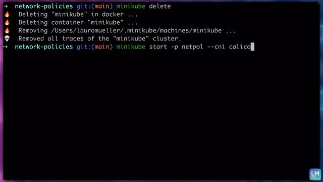
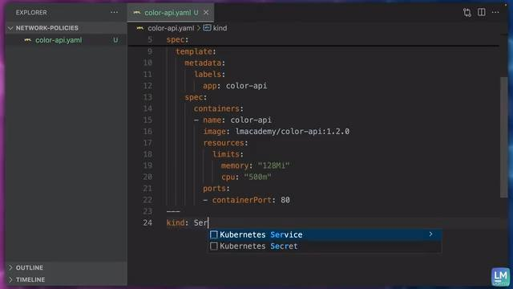
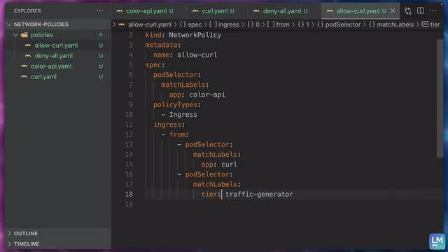
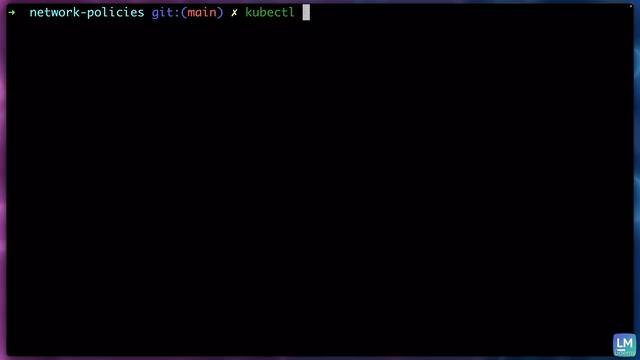
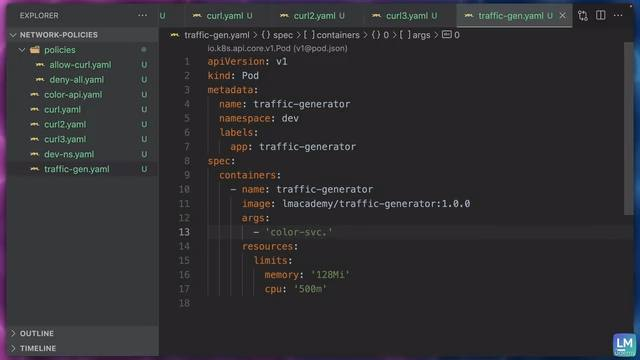
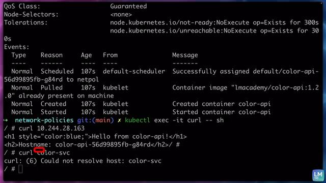

# Docker & Kubernetes Zero to Hero — Network Policies 实战（P43–P48）

> 本节目标：在一个**支持 NetworkPolicy 的 Minikube 集群**（Calico CNI）上，从零把「默认拒绝 → 白名单放行 → 命名空间隔离 → egress 放行 DNS」这条完整链路跑通。读完照着做，你能亲手验证：默认全通、deny-all 后请求挂起、按 label 放行、按 namespace+label 组合放行、以及 egress 只放行到目标 Pod 和 CoreDNS。本文不把 NetworkPolicy 当成背 YAML，而是把每一步都落到可执行的命令、可观察的现象和可排查的失败点上；命令为什么这么写、输出该看什么、失败时先查哪里，都在对应步骤里说明。

---

## 1. 这一节做什么

这一节不是讲理论，而是**动手验证 Kubernetes 原生 NetworkPolicy 的行为**。核心要跑通五件事：

1. 用 Calico CNI 重建 Minikube 集群（默认 CNI 不支持 NetworkPolicy，策略会「无效」）。
2. 部署一个 `color-api` Deployment + Service，再部署一个 `curl` Pod 作为「客户端」，验证**默认 Pod 之间全通**。
3. 写一条 `deny-all` 策略，验证 ingress 被全部阻断、但 egress 不受影响（还能访问外网）。
4. 写 `allow-curl` 策略，只允许带 `app=curl` 标签的 Pod 访问 `color-api`；再演示 `matchExpressions`、多个 `from` 条目（OR）、同一 `from` 条目内多 label（AND）、`namespaceSelector` 组合。
5. 写 egress 策略：先 deny 全部 egress，再只放行到 `color-api` Pod，最后发现**DNS 解析被卡住**，补一条 `allow-egress-dns` 放行到 CoreDNS。

> 一句话：**NetworkPolicy 是「白名单 + 默认拒绝」模型**，你 deny 了什么，就必须显式把「必要的旁路」（DNS、目标 Pod）加回来。

从学习路径看，这五件事不是彼此孤立的演示，而是一条逐步收紧的链路：先确认「没有策略时确实全通」，再确认「策略确实能阻断」，然后确认「白名单确实能按 label 放行」，接着确认「namespace 与 label 可以组合」，最后确认「egress 阻断后，DNS 这种旁路必须单独补回」。如果你只做其中一步，很容易误判：比如没有先验证默认全通，后面请求失败时就不知道是策略生效还是 Service/Deployment 本身有问题；如果没有单独验证 egress 仍可访问外网，看到 deny-all 后请求挂起，就可能误以为所有方向都被阻断。对前端背景的读者，可以把这条链路类比成「先确认本地代理没开、再打开全局 403、再按路由白名单放行、最后发现静态资源域名也要放行」；区别是 NetworkPolicy 作用在网络层，Pod 里的进程完全无感知。

---

## 2. 讲师原话（带出处）

> "接下来的课程中，我们将为 Minikube 使用 Calico 容器网络接口插件……Calico 提供自己的一套资源……这里的 API 版本是 `projectcalico.org/v3`，这和我们这里要用的 `networking.k8s.io/v1` 不同。在本课程中，我们将使用这里的这些策略。"
> —— p043 [00:00]–[00:53]

> "在没有显式配置为其他 CNI 时，Minikube 默认自带的 CNI 不支持网络策略，也无法处理网络策略，这意味着这些策略在我们的集群中不会生效。"
> —— p044 [00:24]

> "要使用 Calico CNI，我们唯一需要做的，就是在这里传入 CNI 选项，并把值设为 Calico。这个 CNI，也就是 Calico，确实需要更多一些计算资源，包括 CPU 和内存。"
> —— p044 [00:54]–[01:21]

> "我们必须定义三个主要字段。第一个是 Pod 选择器，第二个是 ingress，第三个是 egress……如果你指定了 ingress，那么 ingress 字段基本上就变成必填项。这意味着如果你不指定它，就表示不允许任何入站流量。"
> —— p044 [07:24]–[07:51]

> "这里的空对象会产生这样的效果：所有 Pod 都会被选中。"
> —— p044 [08:17]

> "当我们尝试访问这里的 caller SVC API 时，如你所见，果然，请求就卡住了。"
> —— p044 [09:36]

> "这个策略不影响出站流量。因此，如果我们在这里直接向 `https://catfact.ninja/fact` 发送请求，默认就会得到一条随机的猫咪小知识。"
> —— p044 [09:56]

> "无论我们在 ingress 的 `from` 下还是 egress 的 `to` 下定义这个列表中的不同元素，它们都会表现为“或”条件。如果要强制使用“与”条件，就需要把所有这些都定义在同一个条件下。"
> —— p046 [03:27]–[03:56]

> "命名空间选择器的工作方式相同……区别在于，我们实际上不能在这里指定或添加命名空间名称。"
> —— p047 [00:28]

> "一旦这里出现这个短横线，它就会成为 `from` 列表下的另一个条目。这意味着之前应用的“与”逻辑现在变成了“或”逻辑。"
> —— p047 [08:23]

> "答案在于，这里的这个服务为了解析最终 IP……curl Pod 需要与运行在 kube-system 命名空间中的 kube DNS 应用或 Pod 通信。"
> —— p048 [04:50]–[05:14]

> "因此，我们还需要在配置文件中对此进行定制……那我们就允许出站流量实际发往我们的 kube DNS 服务。"
> —— p048 [05:14]–[06:37]

读这些原话时，建议把它们和后面的步骤一一对应：p043 对应「为什么用 Calico、为什么不用 Calico 自己的 API」，p044 对应「重建集群、deny-all、egress 不受影响」，p046 对应「OR 与 AND」，p047 对应「namespaceSelector 和 dash 陷阱」，p048 对应「egress 只放行目标 Pod 后 Service 请求挂起，补 DNS 才恢复」。这样你在复现时不会只记命令，而能知道每条命令是为了验证哪一句结论。

---

## 3. 从零复现

### 3.1 前置条件

- 已安装 `minikube`、`kubectl`（版本以你本机为准，课里没指定具体版本号）。
- 机器至少留出 **2 CPU + 4GB 内存** 给 Minikube（Calico 比默认 CNI 吃资源，p044 [01:21] 明确提醒「containers are being killed」就要释放资源）。
- 一个可用的容器运行时（Docker Desktop / Podman 均可，课里没指定）。

这里的「前置条件」不是走形式，而是决定后面能否稳定复现的基础。`minikube` 负责创建本地单节点集群，`kubectl` 负责向集群 API Server 提交资源；两者版本不要求与课程完全一致，但如果 `kubectl` 太旧，可能不认识某些字段，表现为 `apply` 时报 unknown field。资源不足时，最典型的不是 `minikube start` 立刻失败，而是 Calico 或 CoreDNS Pod 反复重启，`kubectl get pods -n kube-system` 里出现 `CrashLoopBackOff`、`OOMKilled` 或 `ContainerCreating` 长时间不结束。遇到这种情况，先不要怀疑 NetworkPolicy，先看节点和系统 Pod 是否健康。前端背景的读者可以把 Minikube 类比成本地开发服务器：本地开发服务器没起来，页面报错不一定是业务代码；同理，Calico 没 Running，策略行为就不可信。

### 3.2 重建集群（必须带 Calico）

```bash
# 1) 删掉旧集群（课里说 stop 或 delete 都行，这里选 delete）
minikube delete

# 2) 用 Calico CNI 新建集群，profile 命名为 network-policies
minikube start --profile=network-policies --cni=calico

# 3) 观察 kube-system 里 Calico 相关 Pod 启动
kubectl get pods -n kube-system -w
```

> 课里原话：Calico 的 Pod 会先 `ContainerCreating`，中间可能短暂进入 error 状态，**这是正常的**，等它们全部 `Running` 即可（p044 [01:21]–[02:13]）。



确认全部 Running：

```bash
kubectl get pods -n kube-system
```

命令解释：`minikube delete` 会删除当前默认 profile 的集群；如果你之前用过多个 profile，要确认删的是哪一个。`minikube start --profile=network-policies --cni=calico` 中，`--profile` 给集群起一个独立名字，避免和旧集群混在一起；`--cni=calico` 是关键，它让 Minikube 使用 Calico 作为容器网络接口插件。`kubectl get pods -n kube-system -w` 的 `-w` 是 watch，会持续刷新 Pod 状态，适合观察 Calico、CoreDNS 等系统组件从 `ContainerCreating` 到 `Running` 的过程。常见错误：如果提示 profile 已存在，可以先 `minikube delete --profile=network-policies`；如果 Calico Pod 一直不 Running，先看 `kubectl describe pod -n kube-system <pod-name>` 的 Events，再检查本机 Docker Desktop 的内存和 CPU 上限。不要在这一步跳过观察，因为后面所有 NetworkPolicy 是否生效，都依赖 Calico 已经正常接管网络。

### 3.3 目录结构

在任意工作目录下建如下结构（文件名与课里一致）：

```
network-policies-demo/
├── color-api-deployment.yaml
├── color-svc.yaml
├── curl.yaml
├── curl2.yaml
├── curl3.yaml
├── traffic-generator.yaml
├── dev-namespace.yaml
└── policies/
    ├── deny-all.yaml
    ├── allow-curl.yaml
    ├── allow-color-api.yaml
    └── allow-egress-dns.yaml
```

把「业务资源」和「策略资源」分目录存放，是为了后面排查时能清楚知道自己在 apply 什么：`kubectl apply -f .` 会提交当前目录下的 YAML，而 `kubectl apply -f policies/` 只提交策略。常见错误是把 `deny-all.yaml` 和业务 YAML 混在一起后，忘记自己已经 apply 过 deny-all，导致后面所有请求都挂起还以为是 Service 坏了。前端项目里把「路由配置」和「组件代码」分目录也是类似思路：出问题时先确认是哪一层配置生效。

### 3.4 部署 color-api 与 Service

```bash
kubectl apply -f color-api-deployment.yaml
kubectl apply -f color-svc.yaml
kubectl get deploy
kubectl get svc
```

> 课里用 `color-api:1.2.0`（不是 2.0.0，因为 2.0.0 依赖 MongoDB，p044 [02:55]–[03:23]）。

命令解释：`kubectl apply -f` 读取 YAML 并提交给 API Server，Deployment 会创建 ReplicaSet，再由 ReplicaSet 创建 Pod；Service 会根据 `selector` 找到带对应 label 的 Pod，并分配 ClusterIP。`kubectl get deploy` 看 Deployment 的 READY 数量，`kubectl get svc` 看 Service 是否创建成功以及类型、端口。常见错误：如果 `color-api` 的 READY 不是 1/1，先 `kubectl get pods` 看 Pod 状态，再 `kubectl describe pod <pod>` 看 Events；如果是 `ImagePullBackOff`，检查镜像名和网络；如果是 `CrashLoopBackOff`，检查是否误用了依赖 MongoDB 的 2.0.0。Service 创建成功不代表后端一定可用，如果 `kubectl get endpoints color-svc` 没有 Endpoint，通常是 Service 的 `selector` 和 Pod label 不一致。前端对照：Service 像一层稳定的 API 网关地址，Deployment 像后面的业务实例；网关配置对了但后端没起来，请求仍然会失败。

### 3.5 部署 curl Pod 并验证「默认全通」

```bash
kubectl apply -f curl.yaml
kubectl exec -it curl -- sh
# 容器内：
curl color-svc/api
```

预期：**能拿到响应**。这就是 Kubernetes 默认行为——Pod 之间无限制（p044 [05:36]）。

命令解释：`kubectl exec -it curl -- sh` 是在 `curl` Pod 的容器里启动一个交互式 shell，后面的 `curl color-svc/api` 是从集群内部发请求，而不是从你本机发请求。这个区别很重要：NetworkPolicy 验证的是 Pod 之间的流量，从本机访问 NodePort 或端口转发不一定能复现同样的阻断效果。常见错误：如果 `curl` 命令不存在，说明镜像不是课里用的 `lmacademy/alpine-curl:1.0.0`；如果域名解析失败，检查 Pod 是否在 `default` namespace、Service 名是否确实是 `color-svc`；如果连接被拒绝，检查 Service 端口和 `targetPort`。前端对照：这时的集群像「没有配任何防火墙规则的本地环境」，所有服务默认互通；先确认这个基线通，后面 deny-all 挂起才有对照意义。

### 3.6 应用 deny-all，验证 ingress 被阻断

```bash
kubectl apply -f policies/deny-all.yaml
kubectl get networkpolicy
kubectl describe networkpolicy deny-all
```

`describe` 输出里会看到类似「Allowing ingress traffic: none」「Selected pods are isolated for ingress connectivity」的字样（p044 [09:07]）。

再 exec 进 curl Pod 请求 `color-svc/api`：**请求挂起，最终超时**（p044 [09:36]）。

同时验证 egress 不受影响：

```bash
# 容器内：
curl https://catfact.ninja/fact
```

预期：**能拿到一条随机 cat fact**（p044 [09:56]）。



命令解释：`kubectl get networkpolicy` 用来确认策略对象是否创建成功；`kubectl describe networkpolicy deny-all` 用人类可读的方式展示 `podSelector`、`policyTypes`、`ingress`、`egress` 的解析结果。这里要区分「请求被拒绝」和「请求挂起」：NetworkPolicy 实施后，常见现象是数据包被丢弃，客户端表现为等待直到超时，而不是立刻收到 403；所以命令挂住不是 curl 坏了，而是策略在生效。常见错误：如果 apply 后仍然能访问，先确认集群是否真的用了 Calico，再确认策略和 Pod 是否在同一 namespace；`deny-all` 的 `podSelector: {}` 只选当前 namespace 的 Pod，不会自动选全集群。如果 egress 也不能访问外网，检查 `deny-all.yaml` 是否误把 `Egress` 加进了 `policyTypes`；本节 p044 先只演示 Ingress，egress 演示在 p048。前端对照：这像在网关前面加了一个默认丢弃的规则，请求没有响应不是「接口返回空」，而是根本没到应用层。

### 3.7 应用 allow-curl，只放行 app=curl

```bash
kubectl apply -f policies/allow-curl.yaml
kubectl describe networkpolicy allow-curl
kubectl exec -it curl -- sh
# 容器内：
curl color-svc/api
```

预期：**能通**。再部署 `curl2.yaml`（label 为 `app=curl2`），exec 进去请求 `color-svc/api`：**不通**（p045 [05:20]）。

> 课里提醒：策略更新**不一定立即生效**，如果卡住，删掉 Pod 重建一次（p045 [04:27]）。



命令解释：`allow-curl.yaml` 的 `podSelector` 选的是被保护对象 `app=color-api`，`ingress.from.podSelector` 选的是允许来源 `app=curl`。也就是「保护 color-api，只允许 curl 标签的 Pod 进来」。常见错误：把 `podSelector` 和 `from.podSelector` 写反，导致保护对象变成 curl；label 拼写不一致，比如 YAML 里是 `app: curl`，Pod 实际是 `app: curl-client`；策略 apply 后立刻测试，遇到 Calico 规则同步延迟，表现为仍然通或短暂不通。排查时先 `kubectl get pod --show-labels` 确认 label，再 `kubectl describe networkpolicy allow-curl` 确认解析结果，必要时按课里提醒删除客户端 Pod 重建。前端对照：这像路由白名单里按请求头或来源标记放行，标记不匹配就不进业务处理。

### 3.8 演示 OR vs AND（matchExpressions / 多 from / 同 from 多 label）

- **OR**：`from` 列表里放两个 `podSelector`，任一匹配即放行（p046 [00:52]–[01:14]）。
- **AND**：把两个 label 放进**同一个** `podSelector.matchLabels`，必须同时满足（p046 [03:56]）。
- **matchExpressions**：用 `key/operator/values` 表达 `app in (curl, curl2)` 这类条件（p046 [00:25]）。

验证方法：分别部署 `curl.yaml`（`app=curl, tier=frontend`）和 `curl2.yaml`（`app=curl2, tier=backend`），切换策略后 exec 进去 curl，观察通/不通。



这里的重点不是多写几条 YAML，而是理解 YAML 列表层级如何改变逻辑。`from` 下面每出现一个 `-`，就是一个独立的来源条目，条目之间是 OR；如果你想让「来源 namespace 是 dev」且「来源 Pod 的 app 是 traffic-generator」同时满足，就必须把 `namespaceSelector` 和 `podSelector` 放在同一个 `-` 条目里。`matchExpressions` 则适合表达集合条件，例如 `key: app`、`operator: In`、`values: [curl, curl2]`，表示 app 属于这个集合即可。常见错误：缩进错一格，`podSelector` 变成了另一个列表项，逻辑从 AND 变 OR；`operator` 大小写写错；`values` 写成了字符串而不是列表。排查时不要只读 YAML，直接 `kubectl describe networkpolicy <name>` 看 API Server 解析后的结构，再配合客户端 label 验证。

### 3.9 namespaceSelector 组合

```bash
kubectl apply -f dev-namespace.yaml
kubectl describe namespace dev
```

`describe` 会显示 Kubernetes 自动打的稳定 label：`kubernetes.io/metadata.name=dev`（p047 [01:55]）。用它做 `namespaceSelector`，再叠加 `podSelector` 要求 `app=traffic-generator`。

部署 `traffic-generator.yaml`（在 `dev` namespace，请求 `color-svc.default.svc.cluster.local/api`）和 `curl3.yaml`（在 `dev` namespace，但 label 不是 `traffic-generator`）：

```bash
kubectl apply -f .
kubectl logs -n dev <traffic-generator-pod>
kubectl exec -n dev -it curl3 -- sh
# 容器内：
curl color-svc.default.svc.cluster.local/api
```

预期：traffic-generator **能通**；curl3 **不通**（p047 [05:23]–[06:09]）。



> 关键语法陷阱（p047 [08:23]）：`from` 列表里**加一个 `-`** 就变成 OR；不加 `-`、把 `namespaceSelector` 和 `podSelector` 写在同一项里才是 AND。

命令解释：`kubectl describe namespace dev` 除了看状态，还能看到 namespace 的 label；`kubernetes.io/metadata.name=dev` 是 Kubernetes 自动维护的稳定 label，所以 `namespaceSelector` 不需要你手动给 namespace 打标签也能用。`kubectl logs -n dev <traffic-generator-pod>` 用来观察 traffic-generator 的请求日志，确认它是否在持续请求 FQDN；`kubectl exec -n dev -it curl3 -- sh` 是在 dev namespace 的 curl3 Pod 里执行命令。常见错误：忘了加 `-n dev`，结果 exec 到了 default namespace 的 Pod；FQDN 写错，比如漏掉 `.default.svc.cluster.local`；namespace 建了但策略没有按 `kubernetes.io/metadata.name` 匹配。前端对照：这像按「来源应用 + 来源环境」组合鉴权，单独匹配环境或单独匹配应用都不够，必须放在同一个条件项里才表示同时满足。

### 3.10 egress：deny → 放行到 color-api → 补 DNS

```bash
# 1) 先 deny 全部 egress（deny-all.yaml 里 policyTypes 加 Egress）
kubectl apply -f policies/deny-all.yaml
kubectl exec -it curl -- sh
# 容器内：
curl https://google.com   # 立即被阻断
```

```bash
# 2) 应用 allow-color-api.yaml（egress 只放行到 app=color-api）
kubectl apply -f policies/allow-color-api.yaml
kubectl delete pod curl && kubectl apply -f curl.yaml
kubectl exec -it curl -- sh
# 容器内：
curl <color-api-pod-IP>/api   # 通
curl color-svc/api            # 挂起！
```

> 为什么直连 Pod IP 通、走 Service 不通？因为走 Service 需要先向 **CoreDNS** 解析域名，而 egress 只放行了 `color-api`，DNS 请求被拦（p048 [04:50]–[05:14]）。

```bash
# 3) 应用 allow-egress-dns.yaml，放行到 kube-system 里的 CoreDNS
kubectl apply -f policies/allow-egress-dns.yaml
kubectl delete pod curl && kubectl apply -f curl.yaml
kubectl exec -it curl -- sh
# 容器内：
curl color-svc/api   # 通！
```



命令解释：egress 策略控制的是「从这个 Pod 发出去的流量」。第一步把 `Egress` 加进 `policyTypes` 后，curl Pod 的外网请求会被丢弃；第二步 `allow-color-api.yaml` 选的是 `app=curl` 的 Pod 作为被控制对象，`egress.to.podSelector` 只放行到 `app=color-api`，所以直连 color-api Pod IP 能通，而走 Service 域名需要先解析 DNS，DNS 请求也被 egress 策略拦住，于是挂起。第三步 `allow-egress-dns.yaml` 放行到 `kube-system` 里 `k8s-app: kube-dns` 的 Pod，DNS 解析恢复，Service 请求才通。常见错误：只放行目标 Pod 却忘了 DNS；把 `allow-egress-dns` 的 namespaceSelector 写成 namespace 名字而不是 label；CoreDNS 的 label 在不同集群不一样，必须用 `kubectl get pod -n kube-system --show-labels` 或 `describe` 确认。前端对照：这像你只允许前端访问业务 API，却忘了放行 DNS 或鉴权服务，业务域名解析不了，表现就是请求一直 pending。

### 3.11 清理

```bash
kubectl delete -f .
kubectl delete -f policies/
kubectl get pods
kubectl get networkpolicy
```

清理时先删业务资源，再删策略资源，最后用 `get` 确认。`kubectl delete -f .` 会删除当前目录下的 YAML 对应资源，但不会自动删除 `dev` namespace 里的资源；如果你把 `curl3.yaml`、`traffic-generator.yaml` 也放在当前目录并带了 `namespace: dev`，它们会按 YAML 删除。`kubectl delete -f policies/` 删除策略后，如果还想保留集群继续练习，可以只删策略观察行为变化。常见错误：`kubectl get networkpolicy` 仍在，说明策略目录没删干净；`kubectl get pods` 仍有 `curl2` 或 `curl3`，说明对应 YAML 没 apply 或没 delete。前端对照：清空缓存和停掉本地服务是两件事，清理时也要分别确认「业务 Pod」和「策略对象」都不在了。

---

## 4. 完整代码

> 以下 YAML 均为**完整文件**，可直接保存运行。镜像版本、label 名与课里一致；未在课里出现的字段一律不写。

应用顺序建议是：先 `dev-namespace.yaml`，再业务资源，最后策略资源；但本文为了按课程节奏演示，步骤里是分步 apply 的。你实际复现时，只要保证「命名空间先存在、Pod 有对应 label、策略 apply 到正确 namespace」即可。不要为了省事把不同 namespace 的 YAML 混在一个 `kubectl apply -f .` 里却忘记检查 `metadata.namespace`，否则很容易出现「策略在 default，客户端在 dev」这种看似策略失效的问题。

### 4.1 `color-api-deployment.yaml`

```yaml
apiVersion: apps/v1
kind: Deployment
metadata:
  name: color-api
spec:
  replicas: 1
  selector:
    matchLabels:
      app: color-api
  template:
    metadata:
      labels:
        app: color-api
    spec:
      containers:
        - name: color-api
          image: lmacademy/color-api:1.2.0
          ports:
            - containerPort: 80
```

### 4.2 `color-svc.yaml`

```yaml
apiVersion: v1
kind: Service
metadata:
  name: color-svc
spec:
  selector:
    app: color-api
  ports:
    - port: 80
      targetPort: 80
```

### 4.3 `curl.yaml`

```yaml
apiVersion: v1
kind: Pod
metadata:
  name: curl
  labels:
    app: curl
    tier: frontend
spec:
  containers:
    - name: curl
      image: lmacademy/alpine-curl:1.0.0
      command: ["sleep", "3600"]
```

### 4.4 `curl2.yaml`

```yaml
apiVersion: v1
kind: Pod
metadata:
  name: curl2
  labels:
    app: curl2
    tier: backend
spec:
  containers:
    - name: curl2
      image: lmacademy/alpine-curl:1.0.0
      command: ["sleep", "3600"]
```

### 4.5 `curl3.yaml`（部署在 dev namespace）

```yaml
apiVersion: v1
kind: Pod
metadata:
  name: curl3
  namespace: dev
  labels:
    app: curl3
spec:
  containers:
    - name: curl3
      image: lmacademy/alpine-curl:1.0.0
      command: ["sleep", "3600"]
```

### 4.6 `traffic-generator.yaml`

```yaml
apiVersion: v1
kind: Pod
metadata:
  name: traffic-generator
  namespace: dev
  labels:
    app: traffic-generator
spec:
  containers:
    - name: traffic-generator
      image: lmacademy/traffic-generator:1.0.0
      args:
        - "--endpoint=color-svc.default.svc.cluster.local/api"
        - "--interval=0.5s"
```

> 课里只说了「endpoint 用 FQDN、interval 0.5 秒」，具体 flag 名（`--endpoint` / `--interval`）课里没逐字念出，**以你实际镜像的 `--help` 为准**。

### 4.7 `dev-namespace.yaml`

```yaml
apiVersion: v1
kind: Namespace
metadata:
  name: dev
```

### 4.8 `policies/deny-all.yaml`

```yaml
apiVersion: networking.k8s.io/v1
kind: NetworkPolicy
metadata:
  name: deny-all
spec:
  podSelector: {}
  policyTypes:
    - Ingress
    - Egress
```

> 课里 p044 先只演示 Ingress；p048 演示 egress 时把 `Egress` 加进来。这里合并成一份，方便复现。

### 4.9 `policies/allow-curl.yaml`

```yaml
apiVersion: networking.k8s.io/v1
kind: NetworkPolicy
metadata:
  name: allow-curl
spec:
  podSelector:
    matchLabels:
      app: color-api
  policyTypes:
    - Ingress
  ingress:
    - from:
        - podSelector:
            matchLabels:
              app: curl
```

### 4.10 `policies/allow-color-api.yaml`（egress 只放行到 color-api）

```yaml
apiVersion: networking.k8s.io/v1
kind: NetworkPolicy
metadata:
  name: allow-color-api
spec:
  podSelector:
    matchLabels:
      app: curl
  policyTypes:
    - Egress
  egress:
    - to:
        - podSelector:
            matchLabels:
              app: color-api
```

### 4.11 `policies/allow-egress-dns.yaml`

```yaml
apiVersion: networking.k8s.io/v1
kind: NetworkPolicy
metadata:
  name: allow-egress-dns
spec:
  podSelector: {}
  policyTypes:
    - Egress
  egress:
    - to:
        - namespaceSelector:
            matchLabels:
              kubernetes.io/metadata.name: kube-system
          podSelector:
            matchLabels:
              k8s-app: kube-dns
```

> `k8s-app: kube-dns` 这个 label 是讲师在 p048 [07:28]–[07:55] 通过 `kubectl describe pod coredns -n kube-system` 亲眼看到的。**不同集群可能不同**，请以你 `describe` 输出为准。

---

## 5. 逐行解释

**`podSelector: {}`（deny-all 里）**
空对象 = 选中**所有 Pod**。这是最容易踩坑的一行：如果你只想 deny 某个 app，就必须写 `matchLabels`，否则整个 namespace 全被隔离（p044 [08:17]）。从 YAML 语义看，`{}` 不是「没有选择器」，而是「匹配所有」；这和很多前端配置里「空数组表示不做限制」的直觉相反。排查时看 `kubectl describe networkpolicy` 是否显示选中了所有 Pod，就能确认自己有没有误用空对象。

**`policyTypes: [Ingress, Egress]`**
声明这条策略管哪个方向。**关键点**：如果声明了 `Ingress` 但 `ingress:` 字段为空/不写，语义是「**所有 ingress 都拒绝**」，不是「不限制」（p044 [07:51]）。在 JS/Node 里类比：`app.use((req,res,next)=>res.status(403).end())` 挂在所有路由前，而不是「不挂中间件」。如果你只写 `policyTypes: [Ingress]`，那么 egress 仍然不受这条策略影响；如果你把 `Egress` 也加进去，又不在 `egress` 里放行，那么出站流量也会被默认拒绝。这个「声明即默认拒绝」的语义，是后面 DNS 被卡住的根本原因。

**`ingress[].from[]` 列表**
列表里**每一项之间是 OR**。想 AND，就把多个 selector 塞进**同一个列表项**（p046 [03:56]）。读 YAML 时重点看 `-` 的位置：`from:` 下面每个 `-` 都是一个独立条件；同一个 `-` 下面并列的 `podSelector`、`namespaceSelector` 才是同一条件内的 AND。前端对照：这像路由守卫里「来源 A 或来源 B 任一满足即可」和「必须同时满足来源 A 且带某 header」的差别，缩进层级就是逻辑层级。

**`namespaceSelector` 不能写 namespace 名字**
只能按 label 匹配。Kubernetes 自动给每个 namespace 打 `kubernetes.io/metadata.name=<name>`，这是稳定 label，推荐直接用（p047 [01:55]）。常见错误是写成 `namespaceSelector: { name: dev }` 或直接写 `namespace: dev`，这些都不是合法匹配方式。正确做法是 `matchLabels` 里写 `kubernetes.io/metadata.name: dev`，再用 `kubectl describe namespace dev` 确认 label 存在。

**`from` 前面加不加 `-`**
- 加 `-`：新列表项 → OR。
- 不加：和上一个 selector 同项 → AND。
这一行差别是 p047 [08:23] 反复强调的重点。实操中建议改完策略后先用 `kubectl describe networkpolicy` 看解析结果，再用两个 label 不同的客户端 Pod 分别验证，不要只凭肉眼数缩进。

**egress 里的 `to`**
和 ingress 的 `from` 完全对称，只是方向反过来。`to` 里写 `podSelector` 就是「只允许发往这些 Pod」。注意 egress 策略的 `podSelector` 选的是「谁发出流量」，`to` 选的是「允许发到哪里」；这两个 selector 不要写反。前端对照：这像配置「哪个服务可以访问哪个下游服务」的出站白名单，方向错了就会变成保护错对象。

**为什么 egress 只放行 color-api 后，走 Service 会挂**
Service 是虚拟 IP，客户端要先向 CoreDNS 查 `color-svc` 的 ClusterIP，DNS 查询本身是一次 egress 请求，被策略拦了（p048 [04:50]）。所以必须单独放行到 `kube-system` 里 CoreDNS Pod 的 egress。直连 Pod IP 不需要 DNS，所以能通；这正好帮你区分「目标 Pod 放行对了」和「DNS 旁路还没放行」两种状态。

**`k8s-app: kube-dns`**
CoreDNS Pod 的 label，讲师现场 `describe` 出来的。**不要凭记忆写**，用 `kubectl get pod -n kube-system --show-labels` 确认。不同集群的 CoreDNS label 可能不同；如果 label 写错，`allow-egress-dns` 看起来 apply 成功，但 DNS 仍然被拦，表现为 Service 请求继续挂起。

**`lmacademy/color-api:1.2.0` 而不是 2.0.0**
2.0.0 启动时连 MongoDB，没有 MongoDB 就 CrashLoopBackOff。1.2.0 / 1.2.1 无外部依赖（p044 [02:55]–[03:23]）。这也是为什么复现时不要随意换 tag：课程里的策略演示依赖 Pod 能稳定 Running，镜像依赖问题会把你带到完全无关的排查方向。

**`apiVersion: networking.k8s.io/v1`**
本文所有策略都用这个原生 API。p043 提到 Calico 还有 `projectcalico.org/v3` 的资源，但本课不用；混用两套 API 会让你以为策略写错了，其实是资源类型不同。前端对照：这像同一个功能有两套 SDK，课程只讲其中一套，遇到另一套文档时要先确认 API 版本。

**`metadata.name` 与 `metadata.namespace`**
`metadata.name` 是资源名，`metadata.namespace` 决定资源落在哪个命名空间。NetworkPolicy 默认作用于同 namespace 的 Pod；如果你把策略 apply 到 default，而客户端在 dev，策略不会按你预期保护 dev 里的目标。排查时先 `kubectl get networkpolicy -n <namespace>` 确认策略位置，再 `kubectl get pod -n <namespace> --show-labels` 确认 Pod 位置和 label。

---

## 6. 复现检查清单

按顺序打勾，任何一步失败先停下排查。每条都给出「怎么验证」，不要只看命令有没有报错，要看输出和请求现象是否符合预期。

- [ ] `minikube start --profile=network-policies --cni=calico` 成功，`kubectl get pods -n kube-system` 全部 Running。  
  **验证：** 执行 `kubectl get pods -n kube-system`，逐行看 STATUS 是否为 Running；如果有 `ContainerCreating` 长时间不变，执行 `kubectl describe pod -n kube-system <pod>` 看 Events，确认不是资源不足或镜像拉取失败。

- [ ] `kubectl get deploy` 显示 `color-api` READY 1/1。  
  **验证：** READY 列必须是 `1/1`；如果 `0/1`，先 `kubectl get pods` 找到 color-api Pod，再 `kubectl describe pod <pod>` 和 `kubectl logs <pod>` 排查镜像、启动依赖或端口问题。

- [ ] `kubectl get svc` 显示 `color-svc` 是 ClusterIP。  
  **验证：** 看 TYPE 列是否为 ClusterIP，PORT 是否为 80；再执行 `kubectl get endpoints color-svc`，确认 Endpoint 里有 color-api Pod 的 IP，否则说明 Service selector 与 Pod label 不匹配。

- [ ] 未加任何 NetworkPolicy 时，`kubectl exec -it curl -- curl color-svc/api` **能通**。  
  **验证：** 先 `kubectl get networkpolicy` 确认当前没有策略；再 exec 进 curl Pod 执行 `curl color-svc/api`，应能返回响应。若不通，先查 Service、Endpoint 和 Pod 是否 Running，不要先怀疑策略。

- [ ] 应用 `deny-all.yaml` 后，同一命令 **挂起 → 超时**。  
  **验证：** `kubectl apply -f policies/deny-all.yaml` 后执行 `kubectl describe networkpolicy deny-all`，确认 selected pods 和 ingress none；再 exec 进去请求，观察是等待后超时而不是立刻返回业务错误。可以用 `curl -m 5 color-svc/api` 限制等待时间，避免卡太久。

- [ ] 应用 `deny-all.yaml` 后，`curl https://catfact.ninja/fact` **仍能通**（egress 未受影响）。  
  **验证：** 在同一个 curl Pod 内执行外网请求，应能拿到随机 cat fact；如果外网也不通，检查 `deny-all.yaml` 的 `policyTypes` 是否误加了 `Egress`，以及集群本身是否能访问外网。

- [ ] 应用 `allow-curl.yaml` 后，`curl` Pod **能通**，`curl2` Pod **不通**。  
  **验证：** 先 `kubectl get pod curl curl2 --show-labels` 确认 label；分别 exec 进两个 Pod 请求 `color-svc/api`，curl 应通、curl2 应挂起或超时；若 curl2 也通，检查 `allow-curl` 的 `from.podSelector` 是否误选了更宽的 label。

- [ ] 把 `allow-curl.yaml` 改成同一 `from` 项里两个 label（AND），两个 Pod **都不通**。  
  **验证：** 修改后重新 apply，`kubectl describe networkpolicy allow-curl` 确认解析为同一来源条件；再分别请求 curl 和 curl2，若仍有 Pod 能通，说明两个 label 被写成了两个 `-` 列表项，逻辑从 AND 变成了 OR。

- [ ] 应用 `dev-namespace.yaml` 后，`kubectl describe ns dev` 能看到 `kubernetes.io/metadata.name=dev`。  
  **验证：** 看 describe 输出的 Labels 区域，必须有 `kubernetes.io/metadata.name=dev`；如果没有，确认 namespace 名称和 Kubernetes 版本，不要手动编造 label。

- [ ] `traffic-generator`（dev ns，`app=traffic-generator`）**能通**；`curl3`（dev ns，`app=curl3`）**不通**。  
  **验证：** `kubectl logs -n dev <traffic-generator-pod>` 看是否有成功请求日志；`kubectl exec -n dev -it curl3 -- curl color-svc.default.svc.cluster.local/api` 看是否挂起。若两者都通或都不通，先确认策略的 `namespaceSelector` 和 `podSelector` 是否在同一 `from` 条目内。

- [ ] egress deny 后，`curl https://google.com` **立即被阻断**。  
  **验证：** 在 curl Pod 内执行外网请求，观察是否快速失败或等待超时；再用 `kubectl describe networkpolicy` 确认 egress 策略选中了 curl Pod，且 `egress` 没有放行外网。

- [ ] 只放行 egress 到 `color-api` 后，`curl <pod-IP>/api` **通**，`curl color-svc/api` **挂起**。  
  **验证：** 先 `kubectl get pod -o wide` 找到 color-api Pod IP；exec 进 curl Pod 分别直连 Pod IP 和 Service 域名。直连通、域名挂起，说明目标 Pod 放行成功但 DNS 未放行；如果直连也不通，检查 `allow-color-api` 的 `podSelector` 和 `to.podSelector`。

- [ ] 应用 `allow-egress-dns.yaml` 后，`curl color-svc/api` **通**。  
  **验证：** apply 后按课里建议删除 curl Pod 重建，再 exec 请求 Service；如果仍挂起，用 `kubectl get pod -n kube-system --show-labels` 确认 CoreDNS label 是否与 YAML 中的 `k8s-app: kube-dns` 一致。

- [ ] `kubectl delete -f .` + `kubectl delete -f policies/` 后，`kubectl get networkpolicy` 为空。  
  **验证：** 分别执行 `kubectl get pods`、`kubectl get networkpolicy`、`kubectl get ns dev`，确认业务 Pod、策略对象和 namespace 的清理结果符合预期；如果还有残留，按 `kubectl get all -n dev` 和 `kubectl get networkpolicy -A` 再查一遍。

---

## 7. 课里没讲但你会撞上的

| 现象 | 原因 | 怎么办 |
| --- | --- | --- |
| 想使用 Calico 扩展的 NetworkPolicy / GlobalNetworkPolicy 等能力，发现文档里出现 `projectcalico.org/v3`，和本文 YAML 对不上。 | 课里 p043 明确说「Calico 有自己的 NetworkPolicy 资源，API 版本是 `projectcalico.org/v3`，本课**不用**，只用 `networking.k8s.io/v1`」。两套资源类型不同，不能混着背。 | 本课复现只用 `networking.k8s.io/v1`；如果要使用 Calico 的扩展能力，需要另查 Calico 文档。先确认你当前要验证的是原生 NetworkPolicy 还是 Calico 扩展策略，不要因为 API 版本不同就误判 YAML 写错。 |
| `minikube start` 报资源不足，或 Calico / CoreDNS Pod 反复重启、出现 `OOMKilled`、`containers are being killed`。 | 课里只说「containers are being killed 就释放资源」（p044 [01:21]），没给具体数字；Calico 比默认 CNI 更吃 CPU 和内存。 | 实操中给 Minikube 至少留 2 CPU + 4GB 内存；不够就 `minikube stop` 后调 Docker Desktop 或容器运行时的资源上限，再重新 `minikube start`。先保证 `kubectl get pods -n kube-system` 稳定 Running，再验证策略。 |
| 改完 NetworkPolicy 后，请求仍然通或仍然不通，看起来策略「没有立即生效」。 | 课里 p045 [04:27] 提到「可能需要 delete 再 recreate Pod」。Calico 的规则同步可能有秒级延迟，客户端 Pod 也可能保留旧连接状态。 | 改完策略后先 `kubectl describe networkpolicy <name>` 确认解析结果，再按课里提醒删除客户端 Pod 重建，例如 `kubectl delete pod curl && kubectl apply -f curl.yaml`。不要只靠等待，删除重建更可靠。 |
| `allow-egress-dns.yaml` apply 成功，但走 Service 仍然挂起，DNS 还是不通。 | 课里用的 `k8s-app: kube-dns` 是讲师现场 `describe` 出来的；不同集群、不同 CoreDNS 版本的 label 可能不同。 | 永远用 `kubectl get pod -n kube-system --show-labels` 或 `kubectl describe pod coredns -n kube-system` 确认 CoreDNS 的实际 label，再改 YAML；不要照抄本文假设的 label 就认为一定匹配。 |
| `traffic-generator` 镜像启动参数不对，Pod 起来但不发请求，或直接报未知 flag。 | 课里只说了「endpoint 用 FQDN、interval 0.5 秒」，没逐字念 `--endpoint` / `--interval`。 | 用之前先 `docker run --rm lmacademy/traffic-generator:1.0.0 --help` 确认实际 flag 名；如果镜像不支持这些参数，就以镜像帮助为准调整 args，不要硬套本文示例。 |
| `kubectl exec` 进 Pod 后没有 `curl`，提示 `curl: not found`。 | 课里用的镜像是 `lmacademy/alpine-curl:1.0.0`，自带 curl；如果你换成 `alpine` 官方镜像，默认没有 curl。 | 用课里镜像复现，或者先 `apk add curl` 再验证；如果只是排查网络，也可以用镜像里已有的工具替代，但本文命令默认按 `alpine-curl` 写。 |
| 从本机 `curl` NodePort / LoadBalancer 能通，误以为 ingress NetworkPolicy 没生效。 | 课里没展开，但 NetworkPolicy 主要验证「同一集群内 Pod 间流量」；从本机进入的流量是否受 ingress 策略约束，取决于 CNI 实现和入口路径。 | 想验证策略，必须在集群内起一个 Pod 当客户端——这也是课里一直用 `curl` Pod 的原因。不要把「本机能访问」直接等同于「Pod 之间能访问」。 |
| 在 `kube-system` 里也 apply 了 `deny-all` 的 `podSelector: {}`，结果 CoreDNS 被隔离，整个集群 DNS 挂掉。 | 课里 `deny-all` 的 `podSelector: {}` 是**当前 namespace** 全选，不是全集群；但如果你在 `kube-system` 里也 apply 一份，就会选中 CoreDNS 等系统 Pod。 | 不要在 `kube-system` 里随手 apply 全选 deny-all；先确认策略的 `metadata.namespace`。如果已经误操作，删除该 namespace 下的策略并重建系统 Pod 或集群。 |
| 用前端/Node 的「中间件」心智理解 NetworkPolicy，以为它能看到 HTTP 路径、Header 或状态码。 | NetworkPolicy 作用在**网络层**（L3/L4），Express 中间件作用在**应用层**（L7）；前者对 Pod 里的进程完全透明。 | 把 NetworkPolicy 类比成「先挂全局 403 中间件，再对特定来源 `app.use('/api', allowList, handler)`」是可以的，但要记住它只按 Pod、namespace、IP、端口等网络条件匹配，不解析 HTTP 内容。 |

---

**参考帧索引**（本文引用）：
- p044 [01:06] Calico 启动观察
- p044 [04:01] deny-all 后请求挂起
- p045 [02:43] `describe allow-curl`
- p046 [02:06] matchExpressions 写法
- p047 [04:07] `describe ns dev` 看自动 label
- p048 [05:05] egress 只放行 color-api 后走 Service 挂起