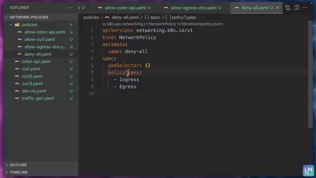
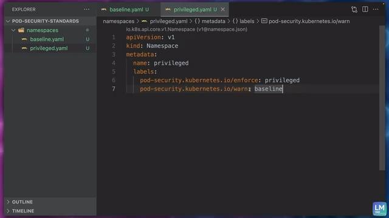
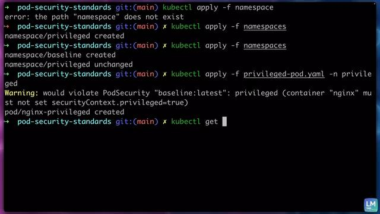
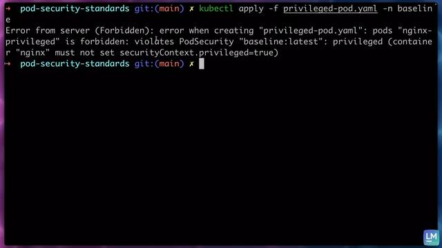
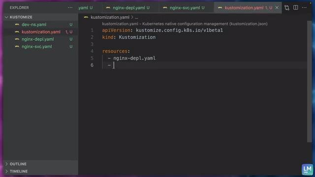
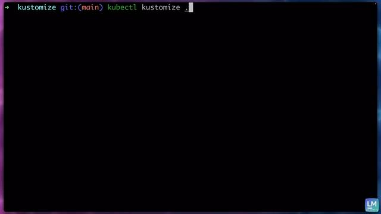

# Docker & Kubernetes Zero to Hero — P49–P55 复现文档

> 覆盖范围：NetworkPolicy 的命名空间局限、Pod Security Standards（PSS）三档策略与三种模式、Kustomize 入门（bases/overlays 概念 + 第一个 kustomization 项目）。
> 读者定位：前端转 AI 应用工程师。涉及「命名空间」「准入控制器」这类后端概念时，会补一句在 Node/前端世界里对应什么。

---

## 1. 这一节做什么

这一节把「集群安全」和「配置管理」两块拼起来，最终产出三样可以直接跑起来的东西：

1. **一个验证实验**：证明 `NetworkPolicy` 只作用于它所在的 namespace，跨 namespace 的流量不受影响（P49）。这个实验的重点不是「写一个很复杂的网络策略」，而是建立一条非常关键的心智模型：Kubernetes 里很多对象都是命名空间级的，你写下一个策略、创建一个 Pod、执行一条命令时，都要先问自己「当前上下文落在哪个 namespace」。如果只看到 `deny-all` 这个名字，很容易误以为它会像集群级防火墙一样把整个集群都封死；实际不是。你要通过两个 curl Pod 的对照，亲手看到「同样的镜像、同样的命令、不同的 namespace，结果完全相反」，这样才能真正记住策略的作用域边界。

2. **一套 Pod Security Standards 实验环境**：三个 namespace（privileged / baseline / 用 restricted 约束的 baseline）+ 三个 nginx Pod，亲眼看到「Enforce 拦截」「Warn 放行但告警」「Audit 只记日志」三种模式的区别，以及 `runAsNonRoot` 与镜像本身以 root 运行之间的冲突（P50–P52）。这里要区分两个层面：第一层是「命名空间标签决定准入标准」，也就是 PSS 通过 namespace label 告诉 API Server 应该用哪一档策略来检查 Pod；第二层是「Pod manifest 里的 securityContext 决定声明是否合规」。PSS 检查的是 YAML 里的声明字段，不是镜像内部真实运行用户。因此你会看到一种很典型的现象：manifest 看起来已经满足 restricted 的要求，Pod 也成功创建了，但容器运行时仍然报错。这个实验就是要把「声明层合规」和「运行时可用」这两件事拆开理解。

3. **一个 Kustomize 项目**：把 nginx Deployment + Service 收进一个 `kustomization.yaml`，用 `kubectl apply -k` 一次性部署，并用 `namespace:` 字段统一注入命名空间，避免在每个 manifest 里重复写（P53–P55）。对前端读者来说，可以先把 Kustomize 理解成「Kubernetes 清单的构建配置」：`kustomization.yaml` 类似一个入口配置，`resources` 类似它要打包的源文件列表，`namespace` 类似一次统一的构建变量注入。它不像 Helm 那样引入模板语法，而是尽量保持标准 YAML，通过声明式组合来减少复制粘贴。

最终你会得到这样的目录结构（本文档会一步步建出来）：

```
k8s-security-and-kustomize/
├── policies/
│   └── deny-all.yaml
├── namespaces/
│   ├── privileged.yaml
│   └── baseline.yaml
├── privileged-pod.yaml
├── baseline-pod.yaml
├── restricted-pod.yaml
├── curl.yaml
├── curl-three.yaml
└── kustomize-demo/
    ├── kustomization.yaml
    ├── nginx-deployment.yaml
    ├── nginx-svc.yaml
    └── devns.yaml
```

这一节结束时，你应当能独立回答三个问题：第一，为什么 `deny-all` 在 `default` 里生效、在 `dev` 里不生效；第二，为什么 privileged Pod 在 privileged namespace 只是 warning、在 baseline namespace 会被拒绝；第三，为什么 `kubectl delete -k` 删除资源后 namespace 还在。能回答这三个问题，说明你不仅跟着命令跑通了，而且理解了对象作用域、准入控制和声明式配置组合的基本边界。

---

## 2. 讲师原话（带出处）

关于 NetworkPolicy 的作用域局限：

> "它们一次只作用于一个命名空间，对吧？我们这里没有定义任何命名空间，也就是说它们会作用于默认命名空间。"
> —— p049 [00:00]

这句话要先抓住两个关键词：`only to a namespace at a time` 和 `default namespace`。前者说明 NetworkPolicy 不是集群级对象，后者说明当 manifest 没有写 `metadata.namespace` 时，`kubectl apply` 会把它落到当前命令上下文对应的命名空间；如果当前上下文就是 `default`，那策略就只保护 `default`。所以后面在 `dev` 里做对照实验时，不能把「能通」理解成策略写错了，而应理解成策略根本没有覆盖到那个命名空间。

> "这里的网络策略虽然拒绝了所有流量，但它只拒绝默认命名空间内部的流量。所以在设计网络策略时也要记住这一点，确保同时保护所有相关命名空间中的流量。"
> —— p049 [01:47]

这句话把「deny all」这个名称的误导性说透了：名字叫 deny all，但它的 all 只限于当前命名空间内的 Pod 流量。设计网络策略时，不能只在一个命名空间里写一条 deny-all 就以为全集群安全了；你要逐个检查真正承载业务的命名空间，确认每个需要保护的 namespace 都有对应策略。对前端读者可以类比成：你在某个 monorepo workspace 里配了 ESLint 忽略规则，它不会自动影响另一个 workspace；要让所有 workspace 都生效，你得在每个 workspace 的配置里分别声明，或者抽一个共享配置被各自引用。

关于 PSS 三档策略：

> "privileged 级别没有任何限制。这是限制最宽松的策略，允许完全访问一切。"
> —— p050 [00:56]

privileged 是最宽松的一档，基本不施加额外限制。它适合确实需要高权限的系统组件、调试环境或受控实验，不适合拿来当普通业务默认值。实验里把 privileged Pod 放到 privileged namespace 时会出现 warning 但仍然创建成功，原因就是 enforce 层面允许，而 warn 层面用更严格的标准提醒你「这个 Pod 如果放到更严格环境里会不合规」。

> "baseline 级别在安全性和灵活性之间取得了很好的平衡，它强制执行一组最低限度的安全限制，适合通用工作负载。"
> —— p050 [01:22]

baseline 是折中档：既保留一般工作负载需要的灵活性，又加上一组最小安全限制。实验里把带 `privileged: true` 的 Pod 放到 enforce baseline 的 namespace，会被直接拒绝，因为 privileged 容器在 baseline 标准下是明确禁止的字段。这个对照能让你看到「enforce 不是 warning，而是服务端拒绝创建」。

> "restricted 级别执行最严格的安全标准，专为运行在高度敏感或受监管环境中的应用而设计。"
> —— p050 [02:15]

restricted 最严格，面向高敏感或受监管环境。实验里 baseline namespace 的 warn 设成 restricted，所以 baseline Pod 能创建，但会收到一组 warning，提示你如果要满足 restricted，还需要补 `allowPrivilegeEscalation: false`、`capabilities.drop: ["ALL"]`、`runAsNonRoot: true`、`seccompProfile.type: RuntimeDefault` 等字段。这里要注意：warn 只是提示，不阻止创建；真正阻止创建的是 enforce。

关于三种模式（Enforce / Warn / Audit）：

> "Enforce 模式会阻止创建违反安全标准的 Pod。然后是 warn 模式，它会在 kubectl 输出或面向用户的警告中显示提示，但仍然允许创建 Pod。最后是 audit 模式，它会在审计日志中记录安全违规，但仍然允许创建 Pod。"
> —— p050 [03:06]

这段要记住三种模式的「动作」不同：Enforce 是拦截，Warn 是放行并给用户可见告警，Audit 是放行并把违规记录到审计日志。它们可以组合在同一个 namespace 上，例如 enforce 较宽松的 baseline、warn 更严格的 restricted，用作渐进收紧。实验里 privileged namespace 的 enforce 是 privileged、warn 是 baseline；baseline namespace 的 enforce 是 baseline、warn 是 restricted。这样你既能观察「拦截」，也能观察「放行但告警」。

关于 label 的写法：

> "标签的形式是这样的：pod-security.kubernetes.io/ 后面跟某个模式，再跟某个级别。"
> —— p050 [03:06]

（注：讲师口述时把域名念成了 `pod-security.com.io`，实际 YAML 里写的是 `pod-security.kubernetes.io`，见 P51 的代码。）

这个注很重要，因为 label 的 key 写错不会触发任何显式报错，Kubernetes 只是把它当成一个普通不认识的标签。结果就是你以为自己开了 PSS，实际上命名空间没有任何 PSS 约束。复现时一定要以代码里的 `pod-security.kubernetes.io` 为准，并用 `kubectl get ns <name> -o yaml` 检查 label 是否真的落在命名空间对象上。

关于 Kustomize 的定位：

> "customize 让我们能够以 YAML 原生的方式声明式地定制和管理多个 Kubernetes 资源。也就是说，它允许我们定制 Kubernetes 清单，而无需复制和修改原始文件或其副本。"
> —— p054 [00:00]

这句话的重点是「不改原文件、不复制副本」。传统做法可能是复制一份 deployment.yaml 到 dev 目录、再复制一份到 prod 目录，然后分别改 namespace、副本数、镜像 tag；Kustomize 的思路是保留一份基础资源，再通过 kustomization 声明如何组合和覆盖。复现里我们先用最简单的 `namespace: dev` 感受这种「统一注入」，还没有进入复杂的 bases/overlays 覆盖，但心智模型要从这里建立。

> "它没有模板机制，只使用标准 YAML，不像 Helm 那样需要模板语法。"
> —— p054 [02:15]

这句话说明 Kustomize 和 Helm 的差异之一：Kustomize 不要求你在 YAML 里写 `{{ }}` 之类的模板语法，它处理的是标准 YAML 资源列表。对前端读者可以粗略类比成「用配置组合 YAML」而不是「用模板渲染字符串」。但不要把这个类比当成精确等价，因为 Kustomize 有自己的 patch、namePrefix、commonLabels 等机制，只是入门阶段先掌握 `resources` 和 `namespace` 两个字段。

关于 `-k` 和 `-f` 的区别：

> "使用 customize 的 -k 标志就不一样了，它会查找一个定制文件，查看该文件内部，并且只部署其中提到的资源。"
> —— p055 [04:16]

这句解释了为什么 `devns.yaml` 明明在 `kustomize-demo/` 目录下，`kubectl apply -k kustomize-demo/` 却不会创建 namespace：`-k` 不是扫描目录下所有 YAML，而是读取 `kustomization.yaml`，只处理 `resources` 里列出的资源。`-f` 才是扫描目录下 YAML 并逐个 apply。因此复现顺序必须是先 `kubectl apply -f kustomize-demo/devns.yaml` 建命名空间，再 `kubectl apply -k kustomize-demo/` 部署 Deployment 和 Service。

---

## 3. 从零复现

### 3.1 前置条件

- 一个可用的 Kubernetes 集群（minikube / kind / 云上集群均可），`kubectl` 已配置好 context。
- Kubernetes 版本 ≥ 1.26（PSS 的 admission controller 默认开启；讲师在 P50 [00:28] 说「since version 1.25 or something like this, at least as a stable version」，P50 [02:39] 又说「anything from 1.26 forwards」——按 1.26+ 准备最稳）。
- `kubectl` 自带 kustomize 子命令（`kubectl kustomize`），无需额外安装。
- 一个能跑 `ping` 的镜像用于网络实验（课里用的是 `curlimages/curl` 系列的 curl pod，具体镜像 tag 课里没念出来，见第 7 节说明）。

先建工作目录：

```bash
mkdir -p k8s-security-and-kustomize/{policies,namespaces,kustomize-demo}
cd k8s-security-and-kustomize
```

这条 `mkdir -p` 命令会一次性创建三层目录：顶层 `k8s-security-and-kustomize`，以及它下面的 `policies`、`namespaces`、`kustomize-demo`。`-p` 的作用是「父目录不存在就一起创建，目录已存在也不报错」，所以重复执行是安全的。`cd` 进入工作目录后，后续所有相对路径都以这里为基准。常见错误是直接在别处执行命令，导致 `-f policies/deny-all.yaml` 找不到文件；排查时先 `pwd` 和 `ls`，确认当前目录是不是 `k8s-security-and-kustomize`。与前端对照：这相当于你先 `mkdir` 一个项目根目录，再在根目录下创建 `src`、`config`、`deploy` 等子目录，后续命令都假定你在项目根目录执行。

### 3.2 实验一：验证 NetworkPolicy 的命名空间局限（P49）

**步骤 1**：写一个 deny-all 策略，放在 `policies/deny-all.yaml`。注意它**没有写 `namespace` 字段**，所以默认落在 `default` 命名空间。这里的「默认落在 default」不是 NetworkPolicy 特有的规则，而是 `kubectl apply` 在没有指定命名空间时的通用行为：如果 manifest 没有 `metadata.namespace`，命令又没带 `-n`，就会使用当前 context 的默认命名空间，通常就是 `default`。因此你在检查时不要只看 YAML，还要看 `kubectl config view --minify --output 'jsonpath={..namespace}'` 或直接 `kubectl get networkpolicy -n default`。

**步骤 2**：应用它，并创建一个 `dev` 命名空间，把 curl pod 放进 `dev`：

```bash
kubectl apply -f policies/deny-all.yaml
kubectl create namespace dev
kubectl apply -f curl-three.yaml -n dev
```

第一条 `kubectl apply -f` 会把 `deny-all` 创建到默认命名空间。第二条 `kubectl create namespace dev` 创建命名空间；如果 `dev` 已存在会报 `AlreadyExists`，这不影响后续实验，可以用 `kubectl get ns dev` 确认状态是 `Active`。第三条命令里的 `-n dev` 很关键：它让 curl-three Pod 落到 `dev` 命名空间，而不是默认命名空间。常见错误是漏掉 `-n dev`，结果 Pod 创建在 `default`，然后你 exec 进去发现 ping 不通，就误以为「跨命名空间也受影响了」。排查方法是 `kubectl get pod -n dev` 和 `kubectl get pod -n default` 对照，确认 Pod 到底在哪。

**步骤 3**：exec 进 `dev` 里的 curl pod，`ping google.com`——能通。再向某个 IP 发 HTTP 请求——立刻有响应。这说明 deny-all 管不到 `dev`。执行 exec 时建议用 `kubectl exec -it curl-three -n dev -- sh`，注意 `-n dev` 要放在 Pod 名后面、`--` 前面；`--` 后面的 `sh` 才是容器内命令。如果 exec 失败，先看 Pod 是否 Running：`kubectl get pod curl-three -n dev`。如果 Pod 立刻退出，通常是镜像默认 entrypoint 不是长驻进程，见第 7 节 curl 镜像说明。与前端的对照：这就像你在 A 工作区里配置了请求拦截，但 B 工作区的请求不会经过 A 的配置；要验证边界，必须在两个工作区分别发同一个请求。

**步骤 4**：把同样的 curl pod 部署到 `default` 命名空间（`curl.yaml` 里不带 namespace），再 exec 进去 `ping google.com`——不通。deny-all 生效了。这里建议先 `kubectl apply -f curl.yaml`，再 `kubectl get pod curl -n default` 确认 Running，最后 `kubectl exec -it curl -n default -- sh`。如果 ping 仍然通，常见原因有三个：第一，`deny-all` 没有真正创建在 `default`；第二，集群 CNI 不支持 NetworkPolicy；第三，Pod 不在 `default`。排查顺序就是先 `kubectl get networkpolicy -n default`，再确认 CNI，再确认 Pod 所在命名空间。

**步骤 5**：清理：

```bash
kubectl delete -f curl.yaml
kubectl delete -f policies/
kubectl delete namespace dev
```

清理时注意删除顺序：先删 Pod，再删策略，最后删命名空间。`kubectl delete -f policies/` 会读取目录下 YAML 并删除对应对象；如果目录里还有别的策略，也会一起删。`kubectl delete namespace dev` 会连带删除 `dev` 里的 Pod，所以如果你还想保留实验现场，先别执行最后一条。常见错误是删了 namespace 后发现 curl-three 也没了，这不是 bug，而是删除命名空间会级联删除其下资源。



### 3.3 实验二：Pod Security Standards 三档 + 三模式（P50–P52）

**步骤 1**：写两个 namespace manifest，放在 `namespaces/` 下。`privileged.yaml` 用 `enforce: privileged` + `warn: baseline`；`baseline.yaml` 用 `enforce: baseline` + `warn: restricted`。写完后先不要急着 apply，先用 `kubectl apply --dry-run=client -f namespaces/` 做客户端校验，确认 YAML 语法没问题；再 `kubectl apply -f namespaces/`。如果你用的是 `--dry-run=server`，还能让服务端校验对象是否合法。常见错误是把 label 的 key 写成 `pod-security.com.io` 或把 `enforce` 拼错，这两种都不会报错，但 PSS 不会按你预期的模式生效。排查方法见步骤 4。

**步骤 2**：写三个 Pod manifest（`privileged-pod.yaml` / `baseline-pod.yaml` / `restricted-pod.yaml`），镜像都用 `nginx:1.27.0`（restricted 那个最后换成 `nginxinc/nginx-unprivileged:1.27.1`）。注意这三个文件里都不写 `metadata.namespace`，部署时用 `-n` 指定命名空间，这样可以复用同一份 manifest 做跨命名空间对照。与前端的对照：这类似同一个组件在不同环境下用不同配置启动，组件代码不变，环境通过外部参数注入。

**步骤 3**：创建 namespace：

```bash
kubectl apply -f namespaces/
```

这条命令会读取 `namespaces/` 下所有 YAML。执行后建议立刻验证：`kubectl get ns privileged baseline` 看两个命名空间是否 Active；`kubectl get ns privileged -o yaml` 看 label 是否真的存在。常见错误是命名空间已存在但 label 没更新，`kubectl apply` 通常会更新 label，但如果你之前手动改过，建议用 `kubectl describe ns privileged` 查看 Labels 区域，确认 `pod-security.kubernetes.io/enforce` 和 `.../warn` 都在。

**步骤 4**：把 privileged pod 部署到 privileged namespace——会看到 warning，但 Pod 创建成功：

```bash
kubectl apply -f privileged-pod.yaml -n privileged
kubectl get pod -n privileged
```

这里 warning 来自 `warn: baseline`：privileged Pod 里有 `privileged: true`，违反 baseline，所以 API Server 返回用户可见警告；但 `enforce: privileged` 不拦截，所以 Pod 仍会创建。验证时不要只看命令输出，还要 `kubectl get pod -n privileged` 看到 Running 或至少 Created。如果 Pod 没创建，先看 `kubectl describe pod -n privileged nginx-privileged` 的 Events，再检查命名空间 label 是否写对。

**步骤 5**：把同一个 privileged pod 部署到 baseline namespace——直接被拒：

```bash
kubectl apply -f privileged-pod.yaml -n baseline
```

这条命令预期会返回类似 `Error from server (Forbidden): pods "nginx-privileged" is forbidden: violates PodSecurity "baseline:latest": privileged` 的错误。注意这是服务端拒绝，不是客户端 YAML 语法错误。常见错误是你看到错误后去改 YAML 的 `privileged: true`，那就失去对照意义了；这里要保留同一个 manifest，只换命名空间，才能证明是 namespace 的 enforce 策略在拦截。

**步骤 6**：把 baseline pod 部署到 baseline namespace——能创建，但会收到来自 restricted 标准的 warning（提示需要 `allowPrivilegeEscalation: false`、`capabilities.drop: ["ALL"]`、`runAsNonRoot: true`、`seccompProfile.type: RuntimeDefault`）。执行 `kubectl apply -f baseline-pod.yaml -n baseline` 后，终端可能输出多条 `Warning: would violate PodSecurity "restricted:latest"`。这些 warning 正是 `warn: restricted` 产生的。验证方法：`kubectl get pod -n baseline` 应看到 `nginx-baseline` 存在；`kubectl describe pod -n baseline nginx-baseline` 可看到容器已创建。warning 不会阻止创建，所以不要因为看到 Warning 就以为失败了。

**步骤 7**：按 warning 逐条补齐，写成 `restricted-pod.yaml`，部署到 baseline namespace。第一次会成功创建但进入 `CreateContainerConfigError`——`kubectl describe` 会告诉你「container has run as non-root and image will run as root」。这一步是整节最值得停下来理解的地方：PSS 已经放行，因为 manifest 里写了 `runAsNonRoot: true`；但 kubelet 真正拉容器时发现镜像默认用户是 root，和声明冲突，于是容器起不来。排查命令：`kubectl get pod -n baseline` 看状态，`kubectl describe pod -n baseline nginx-restricted` 看 Events，重点找 `CreateContainerConfigError` 和 `run as non-root`。常见错误是以为 PSS 没生效，其实是 PSS 生效了但只检查声明层。

**步骤 8**：把镜像换成 `nginxinc/nginx-unprivileged:1.27.1`，重新 apply，Pod 正常 Running。重新 apply 前可以先 `kubectl delete pod -n baseline nginx-restricted`，或者直接 `kubectl apply` 让 Pod 模板变化触发重建；裸 Pod 的镜像字段变更通常需要删除重建。验证：`kubectl get pod -n baseline nginx-restricted` 看到 `Running`，`kubectl describe` 里没有 `CreateContainerConfigError`。如果仍然失败，检查镜像是否能拉取、端口是否写错、`runAsNonRoot` 是否仍然为 true。

**步骤 9**：清理：

```bash
kubectl delete pod --all -n baseline
kubectl delete pod --all -n privileged
kubectl delete -f namespaces/
```

`kubectl delete pod --all -n baseline` 会删除该命名空间下所有 Pod，适合实验环境；生产环境不要随手用 `--all`。删除命名空间后，里面的对象会级联删除。常见错误是先删命名空间再删 Pod，虽然结果一样，但看不到删除过程；如果只是想复现，按上面顺序更清晰。







### 3.4 实验三：第一个 Kustomize 项目（P53–P55）

**步骤 1**：在 `kustomize-demo/` 下写 `nginx-deployment.yaml`、`nginx-svc.yaml`、`devns.yaml`。这三个文件本身都是普通 Kubernetes manifest，没有任何 Kustomize 专用语法。这样设计的好处是：你可以先用 `kubectl apply -f` 单独验证每个文件，再引入 `kustomization.yaml` 做组合。常见错误是过早把 namespace 写死到每个文件里，后面再用 `namespace:` 注入时产生重复或覆盖困惑；本实验故意不在 deployment 和 svc 里写 namespace，让 Kustomize 统一注入。

**步骤 2**：写 `kustomization.yaml`，`apiVersion: kustomize.config.k8s.io/v1beta1`，`kind: Kustomization`，`resources` 列出 deployment 和 svc，`namespace: dev`。注意 `resources` 里不要列 `devns.yaml`，原因见第 5 节和讲师 P55 的解释。常见错误是 `kind` 写成 `Kustomize` 或 `kustomization`，这会直接报错；另一个常见错误是 `resources` 路径写错，`kubectl kustomize` 会提示找不到文件。

**步骤 3**：先看渲染结果（不落地）：

```bash
kubectl kustomize kustomize-demo/
```

你会看到输出的 Service 和 Deployment 的 `metadata.namespace` 已经被填成 `dev`。这条命令只渲染，不向集群提交任何对象，非常适合调试。验证方法：把输出重定向到文件 `kubectl kustomize kustomize-demo/ > /tmp/rendered.yaml`，然后 `grep -n "namespace:" /tmp/rendered.yaml`，应看到 `dev`。常见错误是直接 `kubectl apply -k` 后发现对象没进 `dev`，这时回到 `kubectl kustomize` 看渲染结果，能快速定位是 kustomization 没生效还是 apply 上下文不对。

**步骤 4**：创建 namespace（讲师明确建议 namespace 单独建，不放进 kustomization 的 resources）：

```bash
kubectl apply -f kustomize-demo/devns.yaml
```

这条命令必须在 `kubectl apply -k` 之前执行，因为 `-k` 只部署 `resources` 里列出的 Deployment 和 Service，不会创建 `dev` 命名空间。验证：`kubectl get ns dev` 应为 Active。常见错误是跳过这一步直接 `apply -k`，然后报 `namespaces "dev" not found`。

**步骤 5**：用 `-k` 部署：

```bash
kubectl apply -k kustomize-demo/
```

这条命令会读取 `kustomization.yaml`，渲染后只 apply `resources` 里的对象。与 `-f` 的区别要亲手验证：你可以先 `ls kustomize-demo/` 看到 `devns.yaml` 也在目录里，但 `-k` 不会处理它。常见错误是把 `-k` 和 `-f` 混用，例如 `kubectl apply -f -k` 是无效写法；正确写法就是 `kubectl apply -k <目录>`。

**步骤 6**：验证：

```bash
kubectl get deploy,svc -n dev
```

应看到 `nginx` Deployment 和 `nginx-svc` Service。进一步验证 namespace 注入：`kubectl get deploy nginx -n dev -o yaml | grep namespace`，应看到 `namespace: dev`。如果对象不在 `dev`，先看 `kubectl kustomize` 渲染结果，再看 apply 时是否用了错误的 context。

**步骤 7**：用 `-k` 删除：

```bash
kubectl delete -k kustomize-demo/
kubectl delete -f kustomize-demo/devns.yaml
```

第一条只删除 `resources` 里的 Deployment 和 Service；第二条才删除命名空间。验证顺序：先 `kubectl get deploy,svc -n dev` 看到资源已删，再 `kubectl get ns dev` 仍然存在，最后执行第二条后 `kubectl get ns dev` 才消失。常见错误是以为 `delete -k` 会把目录下所有 YAML 都删掉，实际上 `devns.yaml` 不在 `resources` 里，所以不会被 `-k` 处理。





---

## 4. 完整代码

以下每个文件都是完整可保存的，直接按路径落盘即可。

### 4.1 `policies/deny-all.yaml`

```yaml
apiVersion: networking.k8s.io/v1
kind: NetworkPolicy
metadata:
  name: deny-all
spec:
  podSelector: {}
  policyTypes:
    - Ingress
    - Egress
```

> 说明：课里只说了「deny all network policy」，没有逐字念出 `spec` 内容。上面是标准的 deny-all 写法（空 `podSelector` 匹配所有 Pod，同时声明 Ingress 和 Egress）。如果你的集群默认已有其他策略，行为可能不同，以实际 `kubectl get networkpolicy` 输出为准。

### 4.2 `curl-three.yaml`（部署到 dev 命名空间）

```yaml
apiVersion: v1
kind: Pod
metadata:
  name: curl-three
spec:
  containers:
    - name: curl
      image: curlimages/curl:8.10.1
      command: ["sleep", "3600"]
```

> 说明：课里没有念出 curl pod 的镜像 tag 和 command，只提到「curl three pod」和「get shell」。上面用 `curlimages/curl` 加一个长 sleep 让容器保持运行，方便 `kubectl exec` 进去。镜像 tag 请以你实际能拉到的为准。

### 4.3 `curl.yaml`（部署到 default 命名空间）

```yaml
apiVersion: v1
kind: Pod
metadata:
  name: curl
spec:
  containers:
    - name: curl
      image: curlimages/curl:8.10.1
      command: ["sleep", "3600"]
```

### 4.4 `namespaces/privileged.yaml`

```yaml
apiVersion: v1
kind: Namespace
metadata:
  name: privileged
  labels:
    pod-security.kubernetes.io/enforce: privileged
    pod-security.kubernetes.io/warn: baseline
```

### 4.5 `namespaces/baseline.yaml`

```yaml
apiVersion: v1
kind: Namespace
metadata:
  name: baseline
  labels:
    pod-security.kubernetes.io/enforce: baseline
    pod-security.kubernetes.io/warn: restricted
```

### 4.6 `privileged-pod.yaml`

```yaml
apiVersion: v1
kind: Pod
metadata:
  name: nginx-privileged
spec:
  containers:
    - name: nginx
      image: nginx:1.27.0
      ports:
        - containerPort: 80
      securityContext:
        privileged: true
```

### 4.7 `baseline-pod.yaml`

```yaml
apiVersion: v1
kind: Pod
metadata:
  name: nginx-baseline
spec:
  containers:
    - name: nginx
      image: nginx:1.27.0
      ports:
        - containerPort: 80
```

### 4.8 `restricted-pod.yaml`（最终可用版本）

```yaml
apiVersion: v1
kind: Pod
metadata:
  name: nginx-restricted
spec:
  containers:
    - name: nginx
      image: nginxinc/nginx-unprivileged:1.27.1
      ports:
        - containerPort: 8080
      securityContext:
        allowPrivilegeEscalation: false
        runAsNonRoot: true
        capabilities:
          drop:
            - ALL
        seccompProfile:
          type: RuntimeDefault
```

> 说明：`nginx-unprivileged` 默认监听 8080 而不是 80，所以 `containerPort` 改成 8080。课里讲师没有明确说端口变化，只说了换镜像后 Pod 就 Running 了；如果你保留 80 端口，容器仍能起来（`containerPort` 只是声明，不强制），但对外暴露时要注意实际监听端口。

### 4.9 `kustomize-demo/nginx-deployment.yaml`

```yaml
apiVersion: apps/v1
kind: Deployment
metadata:
  name: nginx
  labels:
    app: nginx
spec:
  replicas: 1
  selector:
    matchLabels:
      app: nginx
  template:
    metadata:
      labels:
        app: nginx
    spec:
      containers:
        - name: nginx
          image: nginx:1.27.0
          ports:
            - containerPort: 80
```

### 4.10 `kustomize-demo/nginx-svc.yaml`

```yaml
apiVersion: v1
kind: Service
metadata:
  name: nginx-svc
spec:
  selector:
    app: nginx
  ports:
    - port: 80
      targetPort: 80
```

### 4.11 `kustomize-demo/devns.yaml`

```yaml
apiVersion: v1
kind: Namespace
metadata:
  name: dev
```

### 4.12 `kustomize-demo/kustomization.yaml`

```yaml
apiVersion: kustomize.config.k8s.io/v1beta1
kind: Kustomization

namespace: dev

resources:
  - nginx-deployment.yaml
  - nginx-svc.yaml
```

---

## 5. 逐行解释

### 5.1 NetworkPolicy 部分

- `podSelector: {}`：空对象表示「选中本命名空间内所有 Pod」。在 JS 里可以类比成 `array.filter(() => true)`——不过滤，全选。这里要注意「本命名空间内」这个限定：`podSelector` 不是全集群选择器，它只在 NetworkPolicy 所在的命名空间里选 Pod。所以即使你写了空对象，也不会跨 namespace 选中 `dev` 里的 Pod。
- `policyTypes: [Ingress, Egress]`：同时管入站和出站。只写 `Ingress` 的话出站不受限，deny-all 就不彻底。实际实验里如果你想观察「出站被禁」，就要同时包含 Egress；如果只写 Ingress，curl Pod 仍可能向外发请求。
- **关键点**：整个文件没有 `metadata.namespace`，所以它落在 `default`。这就是 P49 实验的全部意义——策略是命名空间级的，不是集群级的。你在 `dev` 里跑 curl 能通，不是策略失效，是策略根本没覆盖到 `dev`。与前端对照：这类似某个只在 `packages/app-a` 生效的构建配置，不会自动作用于 `packages/app-b`；要覆盖 b，必须在 b 的配置里也声明，或者把配置提升到能同时被两者引用的层级。NetworkPolicy 没有这种「自动提升」，你必须逐命名空间声明。

### 5.2 PSS 的 label 结构

`pod-security.kubernetes.io/<mode>: <level>` 这个结构要拆开看：

- **mode**（斜杠后面）：`enforce` / `warn` / `audit`，三选一或组合。
- **level**（冒号后面）：`privileged` / `baseline` / `restricted`。

所以 `pod-security.kubernetes.io/enforce: baseline` 读作「强制 baseline 标准，违反就拒绝创建」。`pod-security.kubernetes.io/warn: restricted` 读作「如果违反 restricted 标准，给用户一个 warning，但放行」。`pod-security.kubernetes.io/audit: restricted` 则是「如果违反 restricted，只写审计日志，不向用户显示 warning，也不拦截」。三种 mode 可以同时存在，分别控制拦截、告警、审计三条通道。

讲师在 P51 [04:20] 解释这个组合时说：「we can always enforce one of them and then warn in case the one below is violated or the one more restricted is violated」——即 enforce 一个较宽松的档，warn 一个更严格的档，作为「渐进收紧」的过渡手段。复现时建议先只配 enforce，观察拦截；再加 warn，观察告警；最后理解 audit 的日志去向。常见错误是以为 `warn` 会阻止创建，实际不会；也常见把 `enforce` 和 `warn` 的 level 写反，导致本来想观察拦截却只看到 warning。

### 5.3 `securityContext.privileged: true`

讲师在 P51 [03:27] 的原话：「processes in privileged containers are essentially equivalent to root on the host」。这一行把容器从「受限进程」变成「几乎等于宿主机 root」。在 baseline 标准下这是明确禁止的字段（P52 [00:51] 讲师在文档页上指出「we are not allowed to set the security standard privileged to true neither for containers nor for init nor ephemeral containers」）。

复现时的排查点：如果你把 `privileged: true` 的 Pod 放到 baseline namespace 被拒绝，不要怀疑 YAML 语法；这是 PSS enforce baseline 的正常行为。要看清楚错误信息里提到的 level 和字段，再回到命名空间 label 确认 enforce 的值。与前端对照：这类似某个环境开启了严格的 lint 规则，代码里出现被禁止的写法就直接构建失败；另一个环境只给 warning，构建仍通过。同一个源文件，在不同环境下的结果不同，关键在环境配置。

### 5.4 restricted pod 的四个字段

讲师在 P51 [06:38]–[07:02] 列出的 warning 要求，逐条对应：

| 字段 | 值 | 作用 |
|---|---|---|
| `allowPrivilegeEscalation` | `false` | 禁止进程通过 setuid 等方式提权 |
| `capabilities.drop` | `["ALL"]` | 丢掉所有 Linux capability |
| `runAsNonRoot` | `true` | 强制容器以非 root 用户运行 |
| `seccompProfile.type` | `RuntimeDefault` | 启用默认 seccomp 过滤系统调用 |

讲师在 P51 [07:59] 特别纠正了一个写法细节：`seccompProfile` 下面要有 `type` 字段，不能把值直接写在 `seccompProfile` 下。这是很多人第一次写会踩的坑。正确写法是：

```yaml
seccompProfile:
  type: RuntimeDefault
```

错误写法类似 `seccompProfile: RuntimeDefault`，这会导致字段结构不符合 API 预期。复现时如果 apply 后报字段类型错误，先检查这里。与前端对照：这类似 JSON schema 里某个字段要求是对象，你却传了字符串；表面看名字对，结构不对，校验就过不了。

### 5.5 `CreateContainerConfigError` 的成因

P51 [08:52]–[09:14]：Pod 创建成功（PSS 只检查 manifest 字段，不检查镜像内部行为），但 kubelet 拉起容器时发现 `runAsNonRoot: true` 与镜像默认以 root 运行冲突，于是报 `CreateContainerConfigError`，`kubectl describe` 里的信息是「container has run as non-root and image will run as root」。

**这是本节最重要的认知**：PSS 是「声明层」的守门员，它管的是 YAML 里写了什么，不管镜像里实际跑什么用户。两者不一致时，PSS 放行、运行时失败。解决办法是换一个本身就以非 root 运行的镜像（`nginx-unprivileged`），而不是删掉 `runAsNonRoot`。如果你删掉 `runAsNonRoot`，Pod 可能能起来，但你就绕过了 restricted 的一项关键要求，回到 baseline namespace 的 warn 里仍会提示你不合规。排查顺序建议固定为：先 `kubectl get pod` 看状态，再 `kubectl describe pod` 看 Events，再 `kubectl logs` 看容器日志（如果容器没起来，logs 可能为空），最后回头检查 securityContext 和镜像用户。

### 5.6 Kustomize 的 `kustomization.yaml`

- `apiVersion: kustomize.config.k8s.io/v1beta1`：讲师在 P55 [02:00] 强调「it does need to have a very specific API version」，录制时是 `v1beta1`。
- `kind: Kustomization`：注意大小写，是 `Kustomization` 不是 `Kustomize`。
- `resources:` 列表：只列 deployment 和 svc，**不列 namespace**。讲师在 P55 [06:54]–[07:21] 解释了这个选择：「namespaces are something that they are not necessarily application-specific... I don't find this to be a good practice because you might also want to deploy multiple customizations inside of the same namespace」。翻译成前端语境：namespace 像「部署环境」，一个环境里可能跑多个应用，把环境塞进某个应用的配置里会造成耦合。
- `namespace: dev`：Kustomize 会把 `dev` 注入到 `resources` 里所有资源的 `metadata.namespace`。这就是 P55 [05:12] 说的「不用去每个文件里复制粘贴 namespace」的解法。注意它只影响被 `resources` 引用的资源；`devns.yaml` 没被引用，所以不会被注入，也不会被 `-k` 创建。

### 5.7 `kubectl apply -k` vs `kubectl apply -f`

讲师在 P55 [04:16] 的对比：

- `-f`：扫描目录下**所有** YAML，全部 apply。所以 `devns.yaml` 也会被创建。
- `-k`：只读 `kustomization.yaml`，只 apply 它 `resources` 里列出的东西。所以 `devns.yaml` 不会被创建——这就是为什么必须先单独 `kubectl apply -f devns.yaml`。

`kubectl kustomize <dir>` 是「只渲染不落地」，用来预览最终 manifest，调试时非常有用。建议的排查顺序是：先 `kubectl kustomize` 看渲染结果，再 `kubectl apply -k`；如果 apply 报错，先确认 namespace 是否存在，再确认 resources 路径是否正确，最后确认 API 对象字段是否合法。与前端对照：`kubectl kustomize` 类似本地构建产物预览，`kubectl apply -k` 类似把构建产物发布到环境；预览通过不代表环境一定接受，还要看目标环境的前置条件（例如 namespace 是否存在）。

---

## 6. 复现检查清单

按顺序打勾，任何一项不过就别往下走。每一项后面补充「怎么验证」，避免只凭感觉打勾。

**环境**
- [ ] `kubectl version --short` 显示 server 版本 ≥ 1.26。验证：看输出里的 `Server Version`，如果低于 1.26，PSS 行为可能不同；不要只看 client 版本。
- [ ] `kubectl kustomize --help` 能正常输出（说明 kustomize 子命令可用）。验证：命令退出码为 0，并且能看到用法说明；如果提示 unknown command，说明当前 kubectl 不带 kustomize 子命令。

**实验一（NetworkPolicy）**
- [ ] `kubectl get networkpolicy -n default` 能看到 `deny-all`。验证：输出表里 NAME 列应为 `deny-all`；如果没有，说明 apply 到了别的命名空间或文件路径不对。
- [ ] `kubectl get networkpolicy -n dev` 返回空（策略不在 dev 里）。验证：输出应为 `No resources found in dev namespace.`；如果看到 deny-all，说明你不小心把它 apply 到了 dev。
- [ ] 在 `dev` 的 curl pod 里 `ping google.com` 有响应。验证：`kubectl exec -it curl-three -n dev -- sh` 后执行 ping，看到回包或至少不是 100% packet loss；如果失败，先确认 Pod Running 和镜像里有 ping。
- [ ] 在 `default` 的 curl pod 里 `ping google.com` 无响应。验证：`kubectl exec -it curl -n default -- sh` 后执行 ping，看到请求超时或 100% packet loss；如果仍通，按第 7 节排查 CNI 和策略位置。

**实验二（PSS）**
- [ ] `kubectl get ns privileged baseline` 两个都是 Active。验证：STATUS 列应为 `Active`；如果 Terminating，先等删除完成再重建。
- [ ] `kubectl get ns privileged -o yaml` 能看到 `pod-security.kubernetes.io/enforce: privileged` 和 `.../warn: baseline`。验证：在 `metadata.labels` 下逐字核对 key 和 value，注意域名是 `kubernetes.io` 不是 `com.io`。
- [ ] `kubectl apply -f privileged-pod.yaml -n privileged` 输出里有 `Warning:` 但 Pod 创建成功。验证：命令退出码应为 0，并且随后 `kubectl get pod -n privileged` 能看到 Pod；Warning 文本应提到 baseline。
- [ ] `kubectl apply -f privileged-pod.yaml -n baseline` 返回错误（被 Enforce 拦截）。验证：退出码非 0，错误信息里出现 `violates PodSecurity "baseline"`；不要用 `--validate=false` 绕过。
- [ ] `kubectl apply -f baseline-pod.yaml -n baseline` 有 warning 但创建成功。验证：输出含 `Warning: would violate PodSecurity "restricted"`，但 `kubectl get pod -n baseline` 能看到 `nginx-baseline`。
- [ ] `kubectl apply -f restricted-pod.yaml -n baseline` 无 warning。验证：输出不应出现 `Warning: would violate PodSecurity`；如果还有 warning，逐条对照 5.4 的四个字段是否齐全。
- [ ] 第一次用 `nginx:1.27.0` 时 `kubectl get pod -n baseline` 显示 `CreateContainerConfigError`。验证：STATUS 列不是 Running，而是 `CreateContainerConfigError`；如果显示 `ImagePullBackOff`，那是镜像拉取问题，不是 runAsNonRoot 冲突。
- [ ] `kubectl describe pod -n baseline <name>` 的 Events 里有「run as non-root / image will run as root」。验证：在 Events 区域搜索 `run as non-root`，同时确认 Pod 名称是 restricted 那个；不要看错 Pod。
- [ ] 换成 `nginxinc/nginx-unprivileged:1.27.1` 后 Pod 状态为 `Running`。验证：`kubectl get pod -n baseline` 看 STATUS 为 Running，并且 READY 为 1/1；如果一直 ContainerCreating，看 describe 的 Events。

**实验三（Kustomize）**
- [ ] `kubectl kustomize kustomize-demo/` 输出的 YAML 里 `metadata.namespace` 是 `dev`。验证：把输出保存到文件后 `grep -n "namespace:"`，应看到 `dev`；同时确认 Deployment 和 Service 两份资源都被渲染出来。
- [ ] `kubectl apply -k kustomize-demo/` 成功。验证：退出码为 0；如果报 namespace not found，先执行 3.4 步骤 4。
- [ ] `kubectl get deploy,svc -n dev` 能看到 `nginx` 和 `nginx-svc`。验证：Deployment 的 READY 最终应为 1/1，Service 的 TYPE 可以是 ClusterIP；如果 Deployment 没 Ready，看 Pod describe。
- [ ] `kubectl delete -k kustomize-demo/` 能删掉这两个对象。验证：执行后 `kubectl get deploy,svc -n dev` 应返回空；但 `kubectl get ns dev` 仍应存在。
- [ ] `kubectl get ns dev` 仍然存在（证明 `-k` 没删 namespace）。验证：在 `delete -k` 之后立刻查 `kubectl get ns dev`，STATUS 为 Active；只有再执行 `kubectl delete -f kustomize-demo/devns.yaml` 后才应消失。

---

## 7. 课里没讲但你会撞上的

下面把课里没展开、但复现时很容易撞上的点汇总成表格。表格只列三类信息：你看到的现象、背后的原因、建议怎么办。遇到问题时先按「现象」对号入座，再按「怎么办」逐条排查，不要一上来就重装集群或改镜像。

| 现象 | 原因 | 怎么办 |
|---|---|---|
| curl pod 一创建就退出，`kubectl exec` 进不去 | 课里只说「curl three pod」，没念出镜像和 command。`curlimages/curl` 默认 entrypoint 是 curl 本身，没有长驻进程，容器执行完就退出 | 在 manifest 里加 `command: ["sleep", "3600"]` 让容器保持运行；本文档的 `curl.yaml` 和 `curl-three.yaml` 已经这样写。验证时先 `kubectl get pod` 看是否 Running，再 exec |
| 明明写了 PSS label，但 privileged Pod 在 baseline namespace 没被拦截，也没有 warning | 讲师口述时把域名念成 `pod-security.com.io`（P50 [03:06]），实际 YAML 里必须是 `pod-security.kubernetes.io`。label key 写错不会报错，K8s 只是把它当普通标签 | 用 `kubectl get ns <name> -o yaml` 逐字核对 label key；必要时 `kubectl label ns baseline pod-security.kubernetes.io/enforce=baseline --overwrite` 修正。改完重新 apply Pod 观察 |
| 集群版本低于 1.25，PSS 完全不生效或行为异常 | 讲师两次说法略有出入（P50 [00:28] 说 1.25，P50 [02:39] 说 1.26）。低于门槛时 admission controller 可能未默认开启 | 按 1.26+ 准备最稳；如果必须用低版本，需要手动给 apiserver 加 `--feature-gates=PodSecurity=true`，课里没讲这个操作，建议优先升级实验环境 |
| 换成 `nginx-unprivileged` 后 Pod Running，但通过 Service 访问不到 | 课里没提这个镜像默认监听 8080 而非 80。如果保留 `containerPort: 80` 且 Service 的 `targetPort: 80`，流量打不到容器 | 把 `containerPort` 和 Service 的 `targetPort` 都改成 8080；本文档的 `restricted-pod.yaml` 已改。验证：`kubectl exec` 进容器 `curl localhost:8080`，再检查 Service Endpoints |
| `kubectl delete -k kustomize-demo/` 之后发现 `dev` namespace 还在，以为没删干净 | namespace 不在 `kustomization.yaml` 的 `resources` 里，`-k` 只处理 resources 列出的对象；讲师在 P55 [07:21] 解释过这个设计选择 | 这是预期行为。要删 namespace，再执行 `kubectl delete -f kustomize-demo/devns.yaml`；验证顺序是先看 deploy/svc 是否已删，再看 ns 是否还在 |
| default 里 ping 不通、dev 里也 ping 不通，deny-all 看起来「全集群生效」 | 可能是 CNI 不支持 NetworkPolicy，或者你把 curl-three 也放进了 default；某些精简 CNI 不实现 NetworkPolicy，策略看起来存在但不生效或行为不一致 | 先 `kubectl get pod -n dev` 和 `-n default` 确认 Pod 位置；再确认 CNI 是否支持 NetworkPolicy（minikube 默认 kindnet/calico 通常支持）。验证标准是 default 不通、dev 通两个结果都拿到 |
| 用 Deployment 部署 privileged 容器到 baseline namespace，Deployment 创建成功，但 Pod 起不来 | PSS 在 Pod 创建时检查，Deployment 创建时不会立刻被拦；要等 ReplicaSet 拉起 Pod 时才报错。课里全程用裸 Pod 演示，没碰这个差异 | 用 `kubectl get rs -n baseline` 和 `kubectl describe rs` 找到失败原因；不要以为 Deployment 成功就等于工作负载成功。排查时直接看 Pod Events 最直接 |
| 想同时用 Helm 和 Kustomize，不知道是否冲突 | 讲师在 P54 [03:39]–[06:26] 花了大段对比两者，结论是「not mutually exclusive」。课里没给具体混用示例 | 入门阶段先分开用：Kustomize 管标准 YAML 组合，Helm 管 chart 模板。若后续要混用，常见做法是 `helm template` 出 YAML 再喂给 Kustomize 做 overlay，但这属于课里没讲的内容，先不要在本复现里引入 |
| `kubectl kustomize` 和独立 `kustomize` 二进制渲染结果有细微差别 | 课里用的是 `kubectl kustomize`（内置）。如果你装了独立 `kustomize` CLI，两者版本可能不一致，尤其是 `v1beta1` 之后的新字段 | 以 `kubectl kustomize` 为准，跟课里一致；排查时分别执行 `kubectl kustomize kustomize-demo/` 和 `kustomize build kustomize-demo/` 对比输出，不要混用版本 |
| 从后端概念转不过来，不知道 namespace 和 kustomization 在前端世界里对应什么 | 这一节没有并发/锁/事务，但有两个概念可以类比：`namespace` 类似前端 monorepo 里的「workspace」，`kustomization.yaml` 类似 `package.json` 里的 `workspaces` 字段（声明「这个项目包含哪些子包」），`overlay` 类似「按环境切换的 `.env.production` / `.env.development`」 | 用类比建立心智模型，但别把类比当精确等价。真正排查时仍然回到 Kubernetes 对象字段和命令输出，不要用前端经验替代集群验证 |