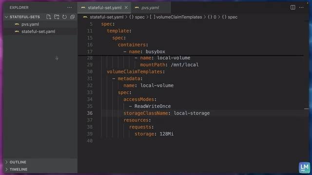
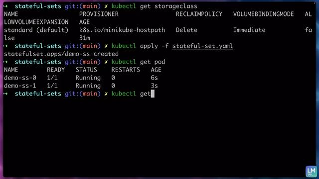
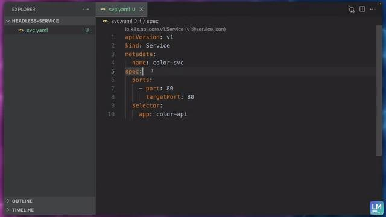
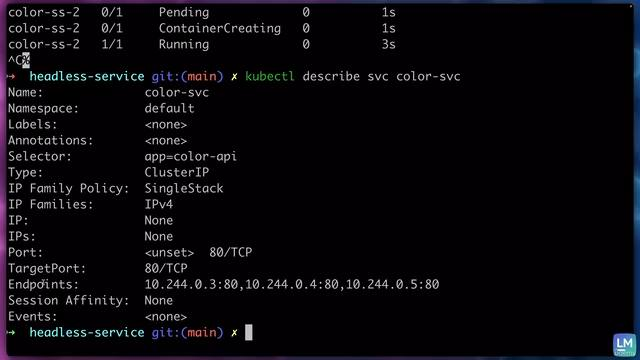
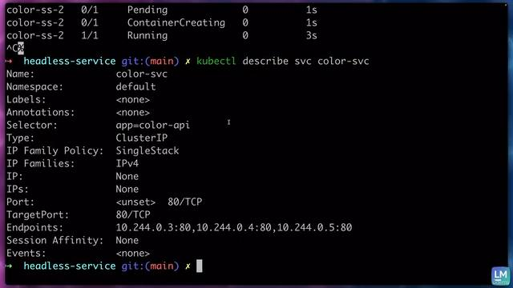
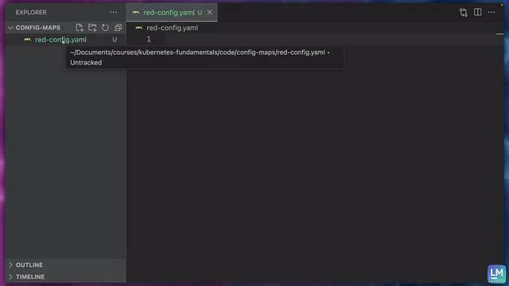
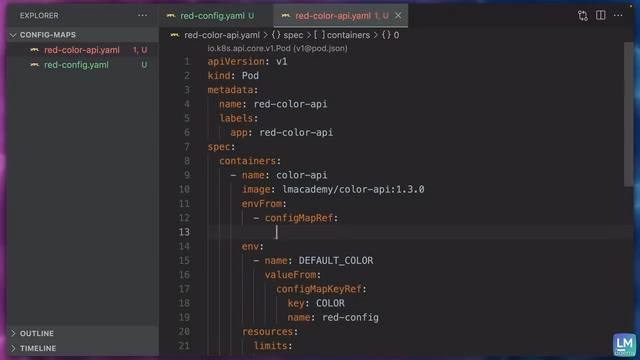
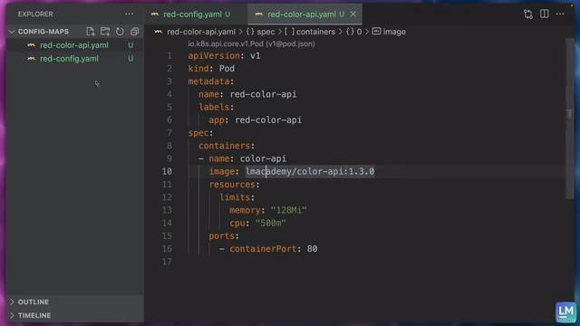
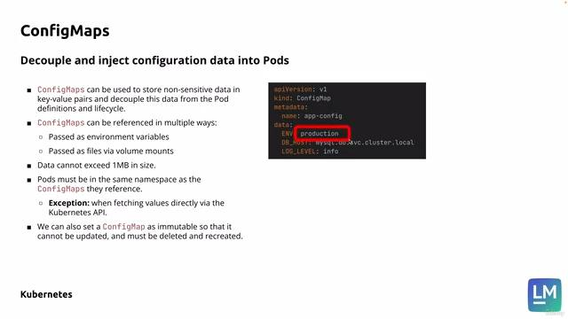

# Docker & Kubernetes Zero to Hero（P005–P010）复现文档

> 覆盖课程片段：P005 动态 PV 迁移、P006 Headless Service、P007 配置管理概览、P008 ConfigMap 概念、P009 改造 Color API、P010 用环境变量消费 ConfigMap。
>
> 读者画像：前端转 AI 应用工程师。文中凡是涉及"持久化 / 服务发现 / 配置注入"的地方，都会补一句它在 Node.js 世界里对应什么。

---

## 1. 这一节做什么

这一节（P005–P010）是三件事叠在一起的一条完整链路：

**第一件事：把 StatefulSet 的存储从"手工铺路"改成"自动铺路"。**
在之前的课里，StatefulSet 用的是 `local` 类型的 PersistentVolume，讲师是手动 `minikube ssh` 进去、手动 `mkdir` 出两个目录、再手写 PV 定义把它们绑定起来的。P005 要做的是把这条手工链路删掉，只改一行 `storageClassName: standard`，让 PVC 自己去触发底层 PV 的创建（动态供给，dynamic provisioning）。

**第二件事：给 StatefulSet 配一个 Headless Service，让每个 Pod 有稳定的 DNS 名字。**
普通 ClusterIP Service 会给一个虚拟 IP，每次访问都被随机转发到某个 Pod——这对无状态应用是好事，对"我要跟 2 号 Pod 说话"的场景是灾难。P006 通过 `clusterIP: None` 造一个没有虚拟 IP 的 Service，从而得到 `color-ss-0.color-svc` 这种"指名道姓"的地址。

**第三件事：把配置从镜像里剥出来，交给 ConfigMap。**
P007/P008 讲概念，P009 动手改 Color API 让它能从环境变量和文件读配置，P010 用两种写法（`envFrom` 和逐个 `valueFrom`）把 ConfigMap 的数据灌进容器。

做完这三件事，你手上会有一个可复现的最小工程：一个能按序号寻址的有状态服务 + 一套外部化配置。对前端出身的读者，这三件事可以粗暴类比为：

| K8s 概念 | Node/前端世界的近似物 |
|---|---|
| StatefulSet + volumeClaimTemplates | 每个实例有自己的 `./data/instance-N/` 目录，删了重建还认同一个目录 |
| Headless Service | 不用负载均衡域名，直接用 `instance-0.internal:3000` 直连某个实例 |
| ConfigMap（envFrom） | 一次性把整个 `.env` 全部注入 `process.env` |
| ConfigMap（valueFrom） | 只挑 `.env` 里的某几个 key 映射成你代码里期望的变量名 |

---

## 2. 讲师原话（带「—— pNNN [MM:SS]」）

关于动态 PV 的迁移，讲师把改动压缩到了一行：

> "这是我们的 StatefulSet 文件里一次非常简单的迁移。只需要把这一行注释掉，或者彻底删掉这里的这一行……或者直接把 StorageClass 名称改成 standard。我确实更愿意在这里显式写明 StorageClass 名称，原因很简单：如果不写，而后台又更改了默认的 StorageClass，就可能出现意外行为。"
> —— p005 [00:27]

这句话里有一个很容易被忽略的判断：**显式写 `storageClassName` 不是啰嗦，是防漂移**。默认 StorageClass 是会变的，你不写，就等于把"用哪块盘"交给集群的默认值决定。

关于 PVC 的命名规则：

> "我们的 PersistentVolumeClaim 名称是组合式的。这里的名称来自 metadata.name 键，然后这里还有 Pod 名称。真正让 Kubernetes 能够识别的是 Pod 名称末尾这个稳定的索引：如果名为 demo-statefulset-1 的 Pod 被重新创建，我们就会把这个 PersistentVolumeClaim 与这个 Pod 关联起来。"
> —— p005 [01:52]

关于删除 StatefulSet 后的行为：

> "当我们删除 StatefulSet 时……PersistentVolume 和 PersistentVolumeClaim 并不会被删除……这很合理，因为 StatefulSet 从定义上说就是有状态应用。如果我们立刻删除 PersistentVolumeClaim 和底层的 PersistentVolume，那基本上就会丢失这些数据。"
> —— p005 [03:13]

Headless Service 的核心一句话：

> "要把它改成无头 Service，我们只需要在这里添加 clusterIP 选项，并将其设为 none。重要的是，clusterIP 中的 IP 必须大写，而且这里的 none 并不等同于不设置该选项。它是 Kubernetes 里的一个特殊字符串。"
> —— p006 [01:11]

以及它为什么不负载均衡：

> "无头 Service 的作用区别在于，它不会被分配 clusterIP。因此它不提供任何负载均衡。我们既不能通过它的 clusterIP 访问它，因为它没有 clusterIP，也不能只通过它的名称访问它。所以无头 Service 的全部意义，实际上就是提供一个稳定的 DNS 记录，让我们可以用它访问特定的 Pod。"
> —— p006 [01:35]

讲师在这里主动交代了自己踩到的两个不稳定现象：

> "有时候，当我尝试像这样通过短名称直接访问 Pod，比如 color-svc，并不总是能成功。所以有时它不会解析到实际底层 Pod，但使用完全限定域名就可以。"
> —— p006 [09:52]

> "我倾向于先创建 Service，再创建 StatefulSet；而当我用不同顺序创建时，有时 Service 无法正确注册来自 StatefulSet 的 Pod。"
> —— p006 [10:42]

ConfigMap 的边界条件，讲师给了两条硬约束：

> "ConfigMap 内的数据大小不能超过 1 兆字节……Pod 必须与它们引用的 ConfigMap 位于同一命名空间。"
> —— p008 [00:56] / [01:25]

> "我们也可以把 ConfigMap 设为不可变；当这里把 immutable 标志设为 true 时，就意味着不能更新 ConfigMap 的值。如果你想发布任何更改……就必须删除并重新创建 ConfigMap。"
> —— p008 [02:12]

两种注入方式的取舍，P010 讲得很直白：

> "我不太喜欢这里的这种做法，因为这意味着我们必须小心处理 ConfigMap 中的命名。而且这些名称需要遵循我们容器内部采用的约定或命名方式。"
> —— p010 [06:28]

> "另一种方案会稍微繁琐一些，但它提供了更大的灵活性，也让 ConfigMap 与应用程序代码之间更加解耦。"
> —— p010 [13:12]

---

## 3. 从零复现

### 3.1 前置条件

课里没讲 Minikube 与 kubectl 的安装过程（那是更早的章节），这里默认你已经具备：

```bash
minikube version    # 需要能正常输出
kubectl version --client
minikube status     # 必须是 Running
```

如果没有在跑：

```bash
minikube start
minikube addons enable ingress   # 本节不用，但保持和课程环境一致
```

确认 Minikube 自带了一个叫 `standard` 的 StorageClass：

```bash
kubectl get storageclass
```

你应该看到 `standard` 这一行，并且它名字旁边有 `(default)` 标记——**这是"它是默认存储类"的标记，不是它的名字**。讲师在 p005 [00:56] 专门强调过这一点：名字是 `standard`，`(default)` 只是身份标记。



### 3.2 建立目录结构

```bash
mkdir -p ~/k8s-demo/01-dynamic-pv
mkdir -p ~/k8s-demo/02-headless-service
mkdir -p ~/k8s-demo/03-configmap-env
mkdir -p ~/k8s-demo/color-api
cd ~/k8s-demo
```

最终结构：

```
k8s-demo/
├── 01-dynamic-pv/
│   └── statefulset.yaml
├── 02-headless-service/
│   ├── service.yaml
│   ├── color-statefulset.yaml
│   └── curl-debug.yaml
├── 03-configmap-env/
│   ├── redconfig.yaml
│   └── red-color-api.yaml
└── color-api/
    ├── package.json
    ├── server.js
    └── Dockerfile
```

### 3.3 第一步：把 StatefulSet 迁到动态 PV（P005）

把 `01-dynamic-pv/statefulset.yaml` 按第 4 节的内容写好。关键就是 `volumeClaimTemplates.spec` 里那一行：

```yaml
storageClassName: standard
```

再强调一次：**不要删掉这一行指望"默认就行"**。删掉也能跑，但以后集群默认 StorageClass 一变，你的行为就跟着变。

进入目录并 apply：

```bash
cd ~/k8s-demo/01-dynamic-pv
kubectl apply -f statefulset.yaml
```

观察 Pod 逐个起来（StatefulSet 是有序创建，`-0` 变成 Running 之后才创建 `-1`）：

```bash
kubectl get pods -w
```

确认 PVC 已经自动创建，并注意名字的拼接方式：

```bash
kubectl get pvc
```

你会看到两条 PVC，名字形如 `<volumeClaimTemplate 名>-<statefulset 名>-<序号>`。讲师在 p005 [01:52] 把这种命名解释为"metadata.name、Pod 名称和稳定索引"的组合。



接着验证 Pod 确实挂的是 PVC 而不是 local 卷：

```bash
kubectl describe pod demo-ss-0
```

在输出的 `Volumes:` 段落里，你会看到该卷的 `Type` 是 `PersistentVolumeClaim`，并且 `ClaimName` 指向刚才那条 PVC。（其余字段名请以实际输出为准。）

再进 Minikube 看一眼宿主目录，确认 `standard` 存储类真的在 hostPath 下建了目录：

```bash
minikube ssh
ls /tmp/hostpath-provisioner/default/
exit
```

讲师在 p005 [02:20] 的做法就是这个：进去之后能看到两个目录，一个 PV 一个。

然后验证"删 StatefulSet 不删数据"：

```bash
kubectl delete -f statefulset.yaml
kubectl get pvc      # 两条 PVC 仍在，仍绑着原来的 PV
```

要真删，得你手动来：

```bash
kubectl delete pvc --all
kubectl get pv       # PV 会被自动回收掉，因为 StorageClass 的 reclaimPolicy 是 Delete
```

想确认回收策略：

```bash
kubectl describe storageclass standard
```

输出里会有一行回收策略，值是 `Delete`。

最后清一下宿主目录（讲师在 p005 [04:29] 提到清理**有时候不会**发生）：

```bash
minikube ssh -- "sudo rm -rf /tmp/hostpath-provisioner/default/*"
```

### 3.4 第二步：建 Headless Service + StatefulSet（P006）

**顺序很重要：先 Service，后 StatefulSet。** 讲师在 p006 [10:42] 明确说过他习惯这个顺序，反过来的顺序有时会导致 Service 没登记上 Pod。

```bash
cd ~/k8s-demo/02-headless-service
kubectl apply -f service.yaml
kubectl get svc
```

`kubectl get svc` 的输出里，`color-svc` 这一行的 `CLUSTER-IP` 列应该显示 `None`。



此时还没 Pod，所以 describe 出来是空的：

```bash
kubectl describe svc color-svc     # Endpoints 为空
```

现在 apply StatefulSet：

```bash
kubectl apply -f color-statefulset.yaml
kubectl get pods -w
```

三个 Pod 会依次变成 Running：

```
color-ss-0   1/1   Running
color-ss-1   1/1   Running
color-ss-2   1/1   Running
```

再 describe 一次 Service，这次 Endpoints 里应该挂着三个 Pod IP：

```bash
kubectl describe svc color-svc
```



准备一个专门用来打 curl 的 Pod：

```bash
kubectl apply -f curl-debug.yaml
kubectl get pods                # 确认 curl-debug 是 Running
kubectl exec -it curl-debug -- sh
```

进入容器后，在同一个 namespace 里直接按"Pod 名.Service 名"访问：

```bash
curl http://color-ss-0.color-svc/
curl http://color-ss-0.color-svc/api
```

再打 2 号：

```bash
curl http://color-ss-2.color-svc/
```

你会发现它**每次都稳定打到 2 号**，不会像 ClusterIP 那样轮转。这就是 Headless Service 的全部意义。



如果你要跨 namespace 访问，用全限定域名（讲师在 p006 [08:17] 给的完整形式）：

```bash
curl http://color-ss-0.color-svc.default.svc.cluster.local/
```

把 `default` 换成目标 namespace 名，就能从任何 namespace 里打到那个 Pod。

退出容器，清理：

```bash
exit
kubectl delete -f color-statefulset.yaml
kubectl delete -f curl-debug.yaml
kubectl delete -f service.yaml
kubectl get pvc                 # 三条 PVC 还在，需手动删
kubectl delete pvc --all
```

### 3.5 第三步：改造 Color API 并构建 1.3.0（P009）

`color-api/server.js` 按第 4 节内容写好。核心是新增 `fs`、`path` 两个依赖（Node 内置，无需 npm install），以及 `getColor()` 函数。

构建并推送：

```bash
cd ~/k8s-demo/color-api
docker build -t lmacademy/color-api:1.3.0 .
docker push lmacademy/color-api:1.3.0
```

> 镜像仓库前缀换成你自己的 Docker Hub 用户名。课程里用的是 `lmacademy`，你如果没这个账号的权限，推送会失败，换成自己的即可，后面的 YAML 也要跟着改。

**如果用的是 Minikube 且不想推公共仓库**，可以直接把镜像塞进 Minikube 的 Docker：

```bash
eval $(minikube docker-env)
docker build -t lmacademy/color-api:1.3.0 .
```

这样不用 push，K8s 直接能拉到本地镜像（但要把 YAML 里的 `imagePullPolicy` 显式设成 `IfNotPresent`，否则默认 `Always` 会去远端拉导致 `ImagePullBackOff`）。

### 3.6 第四步：ConfigMap + 环境变量注入（P010）

```bash
cd ~/k8s-demo/03-configmap-env
kubectl apply -f redconfig.yaml
kubectl get configmap
```

你会看到两条：一条是 Kubernetes 自己托管的（用于 API Server 通信的根证书），一条是你建的 `red-config`。



查看内容：

```bash
kubectl get configmap red-config -o yaml
kubectl describe configmap red-config
```

`describe` 的输出在 key/value 上排版不够清晰，讲师在 p010 [04:18] 建议**对不齐的时候一律改用 `-o yaml`**。

现在 apply Pod：

```bash
kubectl apply -f red-color-api.yaml
kubectl get pods
```

确认环境变量真的注进去了：

```bash
kubectl describe pod red-color-api
```

在 `Environment:` 段落里应该能看到变量名和它引用的 ConfigMap key。（具体字段名请以实际输出为准。）



暴露成 Service 并在浏览器里验证：

```bash
kubectl expose pod red-color-api
kubectl get svc
minikube service red-color-api
```

`minikube service` 会打开浏览器并给你一个 URL。页面里的颜色应该是**红色**——这个红来自 ConfigMap，不是来自镜像。



最后收尾：

```bash
kubectl delete -f red-color-api.yaml
kubectl delete svc red-color-api
kubectl delete -f redconfig.yaml
```

### 3.7 ConfigMap 的完整形态（P008 概念，照此写）

P008 是纯讲解，但它把 ConfigMap 的两种消费方式画成了图，值得对着抄一遍结构：



- 单个值、希望以环境变量出现 → 用 `env` / `envFrom`
- 整个 `.properties` 或一段脚本、希望它以"文件"形式出现在容器里 → 用 `volumes` + `volumeMounts`

挂载成卷时，**每个 key 变成一个文件，文件名 = key，文件内容 = value**。这条规则讲师在 p008 [03:40] 说得很清楚，也是第 7 节要提醒的坑。

---

## 4. 完整代码

> 说明：以下文件都可以原样保存。凡是逐字稿在 P005–P010 中没有逐行展示、但为了能 `kubectl apply` 通过而必须补全的部分（如 `resources`、`containerPort`、HTTP 服务器本体、Dockerfile），都在文件头注释里标了「补全」；只标注、不冒充讲师原话。

### 4.1 `01-dynamic-pv/statefulset.yaml`

```yaml
# 补全说明：P005 只讲了「把 storageClassName 改成 standard」这一处改动，
# 完整 StatefulSet 定义课里没有逐行展示。下面是能直接 apply 的最小可用版本。
apiVersion: apps/v1
kind: StatefulSet
metadata:
  name: demo-ss
spec:
  # 补全：P005 没讲 serviceName，但 StatefulSet 该字段必填。
  # 这里先给一个占位名，P006 才正式讲 Headless Service。
  serviceName: demo-svc
  replicas: 2
  selector:
    matchLabels:
      app: demo-app
  template:
    metadata:
      labels:
        app: demo-app
    spec:
      containers:
        - name: demo
          image: nginx:1.25-alpine
          ports:
            - containerPort: 80
          volumeMounts:
            - name: data
              mountPath: /usr/share/nginx/html
  volumeClaimTemplates:
    - metadata:
        name: data
      spec:
        accessModes:
          - ReadWriteOnce
        # ★ 就是这一行：从手写 local PV 迁移到动态供给
        storageClassName: standard
        resources:
          requests:
            storage: 1Gi
```

### 4.2 `02-headless-service/service.yaml`

```yaml
apiVersion: v1
kind: Service
metadata:
  name: color-svc
spec:
  # ★ 关键：大写 IP + 特殊字符串 None（不是"不写这个字段"）
  clusterIP: None
  selector:
    app: color-api
  ports:
    - port: 80
      targetPort: 80
```

### 4.3 `02-headless-service/color-statefulset.yaml`

```yaml
apiVersion: apps/v1
kind: StatefulSet
metadata:
  name: color-ss
spec:
  # ★ 必须和 Service 的 metadata.name 完全一致，否则 Pod 拿不到 DNS 记录
  serviceName: color-svc
  replicas: 3
  selector:
    matchLabels:
      app: color-api
  template:
    metadata:
      labels:
        app: color-api
    spec:
      containers:
        - name: color-api
          image: lmacademy/color-api:1.2.1
          imagePullPolicy: IfNotPresent
          ports:
            - containerPort: 80
          volumeMounts:
            # 补全：P006 说「把挂载内容改成 temp data」，路径沿用原应用约定
            - name: data
              mountPath: /app/data
  volumeClaimTemplates:
    - metadata:
        name: data
      spec:
        accessModes:
          - ReadWriteOnce
        storageClassName: standard
        resources:
          requests:
            storage: 1Gi
```

### 4.4 `02-headless-service/curl-debug.yaml`

```yaml
apiVersion: v1
kind: Pod
metadata:
  name: curl-debug
spec:
  containers:
    - name: curl
      image: lmacademy/alpine-curl:1.0.0
      imagePullPolicy: IfNotPresent
      command: ["sleep", "3600"]
```

> `command` 是补全的：原始 alpine-curl 镜像是否自带长驻命令，逐字稿没交代；不加这一行，Pod 会起来就退出。

### 4.5 `03-configmap-env/redconfig.yaml`

```yaml
apiVersion: v1
kind: ConfigMap
metadata:
  name: red-config
# ★ 注意：ConfigMap 用 data，不用 spec
data:
  color: red
  multi-line: |
    I'm multi-line
    console.log("I am multi-line")
```

### 4.6 `03-configmap-env/red-color-api.yaml`

```yaml
apiVersion: v1
kind: Pod
metadata:
  name: red-color-api
  labels:
    app: red-color-api
spec:
  containers:
    - name: color-api
      image: lmacademy/color-api:1.3.0
      imagePullPolicy: IfNotPresent
      ports:
        - containerPort: 80

      # ── 写法 A：整份 ConfigMap 一次性灌进来（讲师说「短，但耦合」） ──
      envFrom:
        - configMapRef:
            name: red-config

      # ── 写法 B：逐个 key 手动映射（讲师更推荐） ──
      # 用 B 的时候把上面 envFrom 整段注释掉，并放开下面这段：
      # env:
      #   - name: DEFAULT_COLOR
      #     valueFrom:
      #       configMapKeyRef:
      #         name: red-config
      #         key: color
```

### 4.7 `color-api/package.json`

```json
{
  "name": "color-api",
  "version": "1.3.0",
  "private": true,
  "main": "server.js",
  "scripts": {
    "start": "node server.js"
  }
}
```

### 4.8 `color-api/server.js`

```js
// ─────────────────────────────────────────────────────────────
// P009 [00:00]–[03:20] 讲的部分：fs / path / getColor()
//   - 支持 process.env.DEFAULT_COLOR 设定默认颜色
//   - 支持 process.env.COLOR_CONFIG_PATH 指向一个文件，文件内容覆盖默认颜色
//   - 都拿不到时兜底返回 blue
// HTTP 服务本体（createServer 那几行）逐字稿本节没讲，
// 以下是让它能直接 `node server.js` 跑起来的最小实现（示意）。
// ─────────────────────────────────────────────────────────────

const fs = require('fs');
const path = require('path');
const http = require('http');

const getColor = () => {
  // 1) 先从环境变量取默认值；没设就是 undefined
  let color = process.env.DEFAULT_COLOR;

  // 2) 再看有没有指定配置文件路径
  const filePath = process.env.COLOR_CONFIG_PATH;

  if (filePath) {
    try {
      // 3) 同步读取，显式指定 utf8，避免拿到 Buffer
      const colorFromFile = fs.readFileSync(path.resolve(filePath), {
        encoding: 'utf8',
      });
      // 4) trim 掉文件末尾的换行和空白
      color = colorFromFile.trim();
    } catch (error) {
      console.error(`Failed to read contents of ${filePath}`, error);
    }
  }

  // 5) 兜底：两路都没拿到就返回 blue，保证服务不会因为没配置就崩
  if (!color) {
    return 'blue';
  }
  return color;
};

// ── 以下为示意：最小 HTTP 层 ──
const PORT = process.env.PORT || 80;

const server = http.createServer((req, res) => {
  const color = getColor();
  res.writeHead(200, { 'Content-Type': 'text/html' });
  res.end(
    `<html><body style="background:${color}">` +
      `<h1>color = ${color}</h1>` +
      `</body></html>`
  );
});

server.listen(PORT, () => {
  console.log(`color-api listening on ${PORT}`);
});
```

### 4.9 `color-api/Dockerfile`

```dockerfile
# 补全：P009 只说「build 成 1.3.0 然后 push」，Dockerfile 本体没展示。
FROM node:20-alpine
WORKDIR /app
COPY package.json ./
COPY server.js ./
ENV PORT=80
EXPOSE 80
CMD ["node", "server.js"]
```

---

## 5. 逐行解释

### 5.1 `storageClassName: standard` 这一行为什么不能省

```yaml
storageClassName: standard
```

PVC 模板里不写 `storageClassName`，Kubernetes 会去找集群当前的默认 StorageClass。今天默认是 `standard`，明天运维装了个 Ceph 并把它标成默认，你这份 YAML 的行为就静默变了——**没报错，但盘换了地方**。讲师在 p005 [00:56] 说"这里可能会出现意外行为"，指的就是这个。显式写死，等于把"用哪块盘"从集群状态里解耦出来。

在 Node 世界里这等价于：项目里 `require('./config')` 而不写死 `require('./config.prod')`，你觉得没事，直到有人改了 `NODE_ENV`。

### 5.2 PVC 名字为什么长那样

```
data-demo-ss-0
└─┬─┘ └──┬──┘ └┬┘
  │      │     └─ Pod 的稳定序号（stable index）
  │      └─────── StatefulSet 名
  └────────────── volumeClaimTemplates 里的 metadata.name
```

这个拼接规则不是随便定的。它的作用是：**Pod `demo-ss-0` 被删掉重建后，Kubernetes 会去认领同名 PVC `data-demo-ss-0`**，从而重新挂上同一块 PV。这就是 StatefulSet "有状态"的技术落点——身份稳定，所以存储能跟着身份走。讲师在 p005 [01:52] 说的 "这个稳定索引……让 Kubernetes 也能识别出……我们会在这里把这个持久卷声明与 Pod 关联起来"，说的就是它。

### 5.3 `clusterIP: None` 的三个细节

```yaml
clusterIP: None
```

1. **`IP` 必须大写**。Kubernetes 的字段名是大小写敏感的，写 `clusterIp` 会被当成未知字段（严格模式直接报错）。
2. **`None` 是特殊字符串，不是"这个字段不存在"**。不写 `clusterIP` → 集群给你分配一个虚拟 IP，是普通 ClusterIP Service；写 `clusterIP: None` → 明确告诉控制面"我要 Headless"。两者语义完全相反。
3. **Headless Service 不做事**。它没有虚拟 IP，所以你不做负载均衡；它也不响应 `curl color-svc` 这种"只打服务名"的请求。它的全部产出是 DNS 记录：`<pod-name>.<service-name>.<namespace>.svc.cluster.local`。

这正是 P006 里 `curl http://color-ss-0.color-svc/` 能稳定的原因，也是 `curl http://color-ss-2.color-svc/` 永远打到 2 号的原因。

### 5.4 `serviceName` 为什么必须严丝合缝

```yaml
# color-statefulset.yaml
spec:
  serviceName: color-svc
```

```yaml
# service.yaml
metadata:
  name: color-svc
```

这两个名字不一致时，`kubectl apply` **不会报错**。你只会发现 curl 域名解析不到，然后怀疑人生。讲师在 p006 [04:46] 用一句 "如果这些名称不匹配，那就无法正常工作" 带过了，但这是本节最容易卡住的地方——因为它是一个静默失败。

### 5.5 ConfigMap 为什么没有 `spec`

```yaml
apiVersion: v1
kind: ConfigMap
metadata:
  name: red-config
data:            # ← 不是 spec
  color: red
```

Pod / Service / StatefulSet 都是"声明期望状态"的对象，用 `spec` 描述"我要什么"。ConfigMap 和 Secret 是"数据容器"，没有期望状态可言，所以直接挂在 `data` 下。写 `spec:` 会被 API Server 拒绝。

### 5.6 两种注入方式的真实代价

**写法 A：`envFrom`**

```yaml
envFrom:
  - configMapRef:
      name: red-config
```

- 好处：一行搞定，ConfigMap 里加多少 key 都自动进去。
- 代价：**key 名 = 环境变量名**。也就是说 ConfigMap 里的 `color` 到了容器里就叫 `process.env.color`（小写 c）。如果你的代码里读的是 `DEFAULT_COLOR`，它读不到。这时你有两个选择：改代码，或者改 ConfigMap 的 key 名。讲师在 p010 [06:28] 说的 "我们需要注意在 ConfigMap 中实际命名各项内容的方式"，就是这个意思——配置和代码之间产生了隐式契约。

**写法 B：显式映射**

```yaml
env:
  - name: DEFAULT_COLOR          # 容器里看到的变量名
    valueFrom:
      configMapKeyRef:
        name: red-config         # 哪个 ConfigMap
        key: color               # 取哪个 key
```

- 好处：`color` → `DEFAULT_COLOR` 这个转换关系写在 Pod 定义里，**看得见**。同一个 ConfigMap 可以被十个应用用，各自映射到各自期望的变量名。
- 代价：每加一个变量就多五行 YAML。讲师在 p010 [08:43] 说"如果我有 10 个环境变量，那么这种耦合的代价也许还可以接受"——变量多了你可能就懒得写了，这是真实的工程取舍。

### 5.7 `getColor()` 里每一步的意图

```js
let color = process.env.DEFAULT_COLOR;
```
第一优先级：环境变量。没有则为 `undefined`。

```js
const filePath = process.env.COLOR_CONFIG_PATH;
if (filePath) { ... }
```
第二优先级：文件。**注意 `if (filePath)` 这层判断**——路径没配就整个块跳过，不会去读一个 `undefined` 路径然后抛异常。

```js
const colorFromFile = fs.readFileSync(path.resolve(filePath), { encoding: 'utf8' });
```
- `readFileSync` 而不是异步版本：这里只在一层函数里取值，同步写更短；
- `path.resolve` 把相对路径转成绝对路径，避免工作目录不同导致读不到；
- `encoding: 'utf8'` 让它直接返回字符串而不是 `Buffer`。

```js
color = colorFromFile.trim();
```
文件里通常带结尾换行，不 trim 的话颜色值会变成 `"red\n"`，前端 CSS 直接失效。

```js
} catch (error) {
  console.error(`Failed to read contents of ${filePath}`, error);
}
```
读文件失败**不抛出去**。这意味着：文件路径写错时，服务照样起来，只是回落到环境变量或 `blue`。这是一个有意识的"降级优先"设计——配置文件坏了不该让整个服务挂掉。

```js
if (!color) { return 'blue'; }
```
最后的兜底。三层优先级：文件 > 环境变量 > 硬编码 `blue`。

### 5.8 为什么 P008 说"挂载成卷时每个 key 变成一个文件"

假设把 `redconfig.yaml` 挂到 `/etc/color/`：

```
/etc/color/color        → 内容: red
/etc/color/multi-line   → 内容: I'm multi-line\nconsole.log("I am multi-line")\n
```

**目录里只会有这两个文件，不会有 `redconfig.yaml` 这个名字**。这是初学者最常踩的坑之一：以为挂进去的是一个叫 `redconfig.yaml` 的文件，实际挂进去的是"一对 key-value 变成一对文件名-文件内容"。所以 `multi-line` 那个 key 里写的 JS 脚本，在容器里就是 `/etc/color/multi-line` 这个可直接 `node` 执行的文件。

---

## 6. 复现检查清单

按顺序打勾，任何一项没通过就别往下走。

**环境层**

- [ ] `minikube status` 显示 Running
- [ ] `kubectl get storageclass` 能看到 `standard`，且它旁边有 `(default)` 标记
- [ ] `kubectl get nodes` 状态是 `Ready`

**P005 动态 PV**

- [ ] `kubectl apply -f statefulset.yaml` 无报错
- [ ] `kubectl get pods` 有 `demo-ss-0` 和 `demo-ss-1`，都是 `Running`
- [ ] `kubectl get pvc` 有两条，名字包含 `demo-ss-0` / `demo-ss-1`
- [ ] `kubectl get pvc` 的 STATUS 列是 `Bound`
- [ ] `kubectl describe pod demo-ss-0` 里卷的 Type 是 `PersistentVolumeClaim`
- [ ] `kubectl delete -f statefulset.yaml` 之后，`kubectl get pvc` 仍能看到那两条
- [ ] `kubectl delete pvc --all` 之后，`kubectl get pv` 里对应的 PV 也消失了
- [ ] `kubectl describe storageclass standard` 里回收策略是 `Delete`

**P006 Headless Service**

- [ ] `kubectl apply -f service.yaml` 之后，`kubectl get svc` 里 `color-svc` 的 CLUSTER-IP 是 `None`
- [ ] 只建了 Service 还没建 StatefulSet 时，`kubectl describe svc color-svc` 的 Endpoints 是空的
- [ ] `kubectl apply -f color-statefulset.yaml` 后，`color-ss-0/1/2` 三个 Pod 轮流变成 Running（不是同时）
- [ ] `kubectl describe svc color-svc` 的 Endpoints 里有三个地址
- [ ] `kubectl exec -it curl-debug -- sh` 能进容器
- [ ] 容器内 `curl http://color-ss-0.color-svc/` 有响应
- [ ] 容器内 `curl http://color-ss-2.color-svc/` 有响应，且**多次请求都打到同一个 Pod**
- [ ] 容器内 `curl http://color-ss-0.color-svc.default.svc.cluster.local/` 有响应
- [ ] 删 StatefulSet 后，`kubectl get pvc` 仍有三条（需手动删）

**P009 Color API**

- [ ] `node server.js` 在本地能起，浏览器访问能看到默认的 `blue`
- [ ] `DEFAULT_COLOR=green node server.js` 之后页面变绿（本地验证逻辑）
- [ ] `docker build -t lmacademy/color-api:1.3.0 .` 成功
- [ ] `docker push lmacademy/color-api:1.3.0` 成功（或已 `eval $(minikube docker-env)` 塞进 Minikube）

**P010 ConfigMap**

- [ ] `kubectl apply -f redconfig.yaml` 无报错
- [ ] `kubectl get configmap` 能看到 `red-config`（以及 K8s 自带的根证书那条）
- [ ] `kubectl get configmap red-config -o yaml` 能看见 `color: red`
- [ ] `kubectl apply -f red-color-api.yaml` 后 Pod 是 Running
- [ ] `kubectl describe pod red-color-api` 的 Environment 段能看到注入的变量
- [ ] `minikube service red-color-api` 打开的页面是**红色**
- [ ] 切换到写法 B（逐个 `valueFrom`）后重来一遍，页面**仍然是红色**

**清理**

- [ ] `kubectl delete -f red-color-api.yaml`
- [ ] `kubectl delete svc red-color-api`
- [ ] `kubectl delete -f redconfig.yaml`
- [ ] `kubectl get pods` 干净，没有残留

---

## 7. 课里没讲但你会撞上的

这一节全部来自"逐字稿没覆盖 + 实际动手必遇"，不是讲师原话。

**① Endpoints 是空的，但 Pod 明明在跑**
最常见的三个原因：Service 的 `selector` 和 Pod 的 `labels` 对不上（差一个大小写都不行）；两边不在同一个 namespace；Pod 还没 Ready（`kubectl get pods` 的 READY 列不是 `1/1`）。先跑 `kubectl get pods --show-labels` 和 `kubectl get svc color-svc -o yaml` 对一下 selector。

**② 短域名解析不了，全限定域名能解析**
讲师自己在 p006 [09:52] 撞到过这个问题，他也不知道根因在 Kubernetes、CoreDNS 还是 Minikube。你的应对策略就是：**先试 FQDN**。`color-ss-0.color-svc.default.svc.cluster.local` 能通而 `color-ss-0.color-svc` 不通，说明链路本身是好的，只是 resolver 的 search domain 出了问题，不影响你继续做后面的实验。

**③ Service 建好了但没登记 Pod**
讲师在 p006 [10:42] 给的处方是：删掉 StatefulSet 和 Service，**先建 Service 再建 StatefulSet**。他明确说这是间歇性现象，不是必然。

**④ `envFrom` 注进去的变量名和你代码里读的不一样**
`envFrom` 用 ConfigMap 的 key 原名做环境变量名，**区分大小写**。ConfigMap 里写 `color`，容器里就是 `process.env.color`；你代码里读 `process.env.DEFAULT_COLOR` 会拿到 `undefined`，然后 `getColor()` 静默返回 `blue`——服务不报错，只是颜色不对。P010 最后讲师说"把 key 从 color 改成 default color"，实操时你必须把它写成和代码一致的形式（比如 `DEFAULT_COLOR`），否则读不到。这一条逐字稿没展开，但它是最典型的"配置静默失效"。

**⑤ ConfigMap 改了，Pod 里的值没变**
- 用 `env` / `envFrom` 注入的：**改 ConfigMap 不会自动更新容器里的环境变量**。环境变量在容器启动那一刻就固化了，必须删 Pod 重建。
- 用 volume 挂载的：会更新，但有延迟（kubelet 的同步周期），而且如果 key 名变了，旧文件会消失、新文件出现。

**⑥ `ImagePullBackOff`**
`lmacademy/color-api:1.3.0` 这个镜像要么不存在、要么是私有的。两个解法：推到你自己的 Docker Hub 并改 YAML 里的镜像名；或者 `eval $(minikube docker-env)` 之后在 Minikube 的 Docker 里 build，同时把 `imagePullPolicy` 显式写成 `IfNotPresent`。

**⑦ 删了 StatefulSet，磁盘还在占空间**
讲师在 p005 [04:29] 提过一嘴："有时清理并不会执行"。`/tmp/hostpath-provisioner/default/` 下的目录偶尔不会被回收，得手动 `minikube ssh` 进去删。不删的话磁盘会越占越多。

**⑧ 忘记删 PVC 导致存储类资源泄漏**
`kubectl delete -f statefulset.yaml` 只删 StatefulSet，PVC 和 PV 都留着——这是设计如此，不是 bug。但做实验时容易积累一堆孤立的 PVC。养成习惯：每轮实验结束跑一次 `kubectl get pvc` 和 `kubectl get pv`，该清的清掉。

**⑨ ConfigMap 的 1MB 上限**
P008 [00:56] 讲了这条限制。实际含义是：ConfigMap 不是给你存二进制、存大 JSON、存模型权重的。真要塞静态资源，用镜像或者对象存储。前端出身的人容易本能地想"配置文件嘛，多大都行"，这里不行。

**⑩ 跨 namespace 引用 ConfigMap**
P008 [01:45] 讲了：Pod 只能引用**同 namespace** 的 ConfigMap。讲师提到唯一例外是通过 Kubernetes API 动态拉取，他说这是"高级用例"，本节不展开。如果你真需要跨 namespace，标准做法不是硬拉 API，而是在目标 namespace 里各建一份同名 ConfigMap，或者用 Kustomize / Helm 做配置分发——**这两个工具课里没讲**，属于后续自己补的内容。