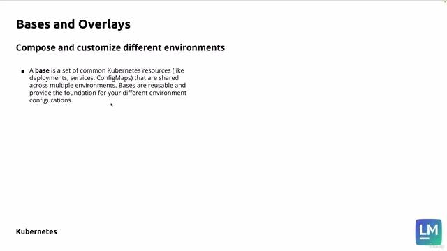
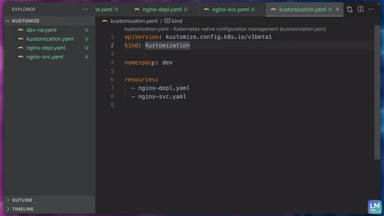
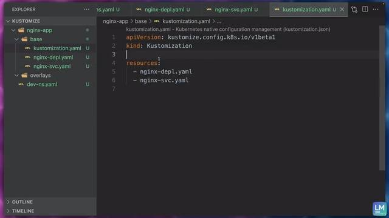
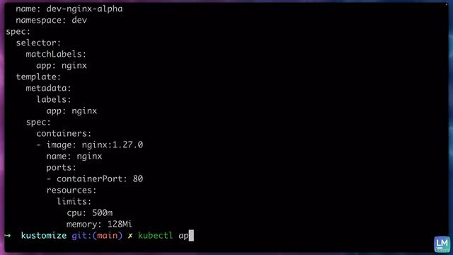
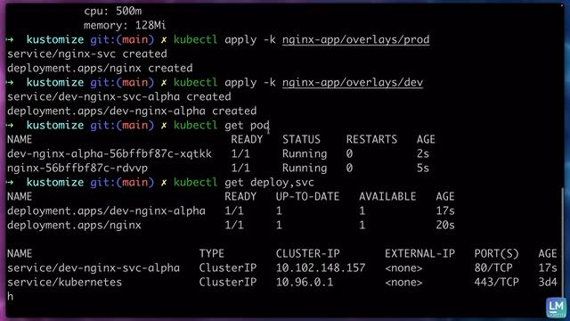
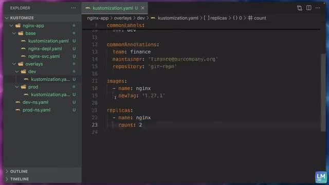
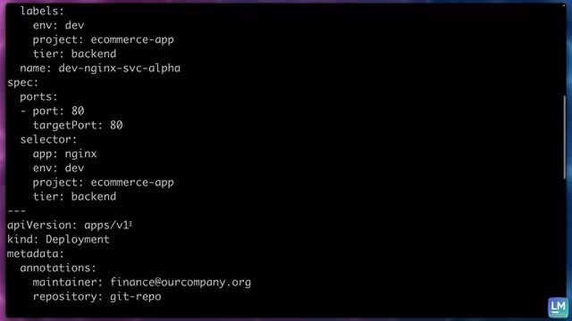

# Docker & Kubernetes Zero to Hero：P56–P60 Kustomize base/overlay 复现文档

> 说明：逐字稿里反复出现 “Customize / customization.yaml”，这是讲师口播和字幕的写法。实际可运行的 Kustomize 文件通常命名为 `kustomization.yaml`，渲染命令是 `kubectl kustomize`，应用命令是 `kubectl apply -k`。下面文档以“能直接跑”的可运行文件名为准；逐字稿原话保持原样引用。

## 1 这一节做什么

这一节要做出一个 **Kustomize 项目骨架**：一份 `base` 作为应用的单一事实来源，里面只放 nginx 的 Deployment 和 Service；两份 overlay 分别代表 `dev` 和 `prod` 环境。`dev` overlay 会演示课程里讲到的 namePrefix、nameSuffix、commonLabels、commonAnnotations、镜像 tag 覆盖，以及用 `configMapGenerator` 从 literals、文件、`.env` 文件生成 ConfigMap。`prod` overlay 演示用 `replicas` 字段把副本数改成 4。

最终效果不是复制两套 YAML，而是：

```text
nginx-app/
├── base/
│   ├── kustomization.yaml
│   ├── nginx-deployment.yaml
│   └── nginx-service.yaml
└── overlays/
    ├── dev/
    │   ├── kustomization.yaml
    │   ├── dbinit.js
    │   └── .env.local
    └── prod/
        └── kustomization.yaml
```

课程的核心判断是：base 保持通用，overlay 放环境差异；Kustomize 把 overlay 合并到 base 上，同时 base 本身不被改掉。讲师在 P056 用一张关系图说明 base 与 overlay 的分层关系：



从操作顺序看，这一节不是上来就写两份完整的 nginx YAML，而是先建立“目录即层次”的心智模型：`base` 目录只表达“这个应用长期不变的部分”，`overlays/dev` 和 `overlays/prod` 只表达“这个环境相对 base 多出来或要覆盖的部分”。因此后面所有字段都要问一句：它属于应用本身，还是属于环境差异？Deployment 和 Service 的骨架属于 base；namespace、资源名前缀后缀、镜像 tag、副本数、环境特定 ConfigMap 属于 overlay。这个判断标准一旦建立，复现时就不容易把 dev 的配置误写回 base，也不会因为复制两份 YAML 导致后续改一处漏一处。

如果你熟悉前端项目，可以把这一节类比成“公共组件 + 环境变量/构建配置”的组织方式：`base` 像多个页面共享的基础组件和默认样式，`overlays/dev`、`overlays/prod` 像不同环境下的配置文件和构建参数。前端通常不会把同一份组件复制两份分别改颜色和接口地址，而是保留公共组件，再用环境配置覆盖差异；Kustomize 的 base/overlay 也是这个思路。区别在于：前端覆盖的是配置对象或构建变量，Kustomize 覆盖的是 Kubernetes 资源清单，并且它会在渲染阶段把最终 YAML 合并出来，方便你先 `kubectl kustomize` 查看，再 `kubectl apply -k` 应用。

这一节最终要能回答三个问题：第一，`base` 是否能独立渲染出 Deployment 和 Service；第二，`dev` overlay 是否能在不改 base 文件的情况下加上资源名前缀后缀、标签、注解、镜像 tag 和 ConfigMap；第三，`prod` overlay 是否只通过 `replicas` 就把副本数改成 4。只要这三个问题都能用命令验证，P56–P60 的复现目标就达成了。

## 2 讲师原话

下面只摘与本项目实现直接相关的句子，保留英文原话，并标注出处。

> "基础配置是一组通用的 Kubernetes 资源，例如 Deployment、Service 和 ConfigMap，由多个环境共享。"
> —— p056 [00:00]

> "覆盖层是一组针对特定环境的变更，叠加在基础配置之上。"
> —— p056 [00:29]

> "我们可以用一个基础配置搭配多个覆盖层，生成多套不同的配置。"
> —— p056 [00:59]

> "不必逐个包含每个资源，只需在这里包含整个目录即可。"
> —— p057 [02:01]

> "运行 kubectl kustomize，并在这里传入路径……nginx-app/overlays/dev。"
> —— p057 [02:50]

> "一旦这样做，你就会看到，Deployment 和 Service 中的 metadata.name 都会被 Kustomize 修改。"
> —— p059 [01:03]

> "这些 labels 会被加到模板的 metadata.labels 中。不仅如此，它们还会被加到 selector.matchLabels 中。"
> —— p059 [03:21]

> "我们其实可以修改镜像……可以在这里设置一个名为 images 的字段。"
> —— p059 [05:54]

> "现在我们在底部创建一个名为 configMapGenerator 的字段。"
> —— p060 [00:00]

> "区别在于，这里的这些环境变量文件必须遵循这种固定格式：每一行都是一个键值对，并用等号分隔。"
> —— p060 [06:59]

引用这些原话的目的不是逐字背诵，而是把讲师在 P56–P60 中反复强调的几个判断固定下来：base 是多个环境共享的公共资源集合；overlay 是叠加在 base 之上的环境差异；一个 base 可以配合多个 overlay 生成多套配置；`resources` 可以写目录而不是逐个写文件；渲染和应用时要使用实际的 `kubectl kustomize` 与 `kubectl apply -k`；`namePrefix` / `nameSuffix` 会修改资源名；`commonLabels` 不仅加到普通 labels，还会进入 selector matchLabels；`images` 用来覆盖镜像；`configMapGenerator` 可以生成 ConfigMap；`envs` 引入的 `.env` 文件必须按 `key=value` 的格式书写。后面复现时如果遇到结果和预期不一致，可以回到这些原话逐条对照，而不是凭感觉修改 YAML。

## 3 从零复现

### 3.1 准备条件

你需要一个可用的 Kubernetes 集群，并且本机 `kubectl` 能连接到它。逐字稿没有讲集群怎么安装、怎么启动，所以这一步课里没讲；可以用你已有的集群、云厂商集群或本地 Kubernetes 环境。确认命令：

```bash
kubectl version --client
kubectl cluster-info
```

如果第二条命令报连接失败，先不要继续写 YAML，先把 kubeconfig 或集群启动处理好。

这两条命令的作用不同：`kubectl version --client` 只检查本机 `kubectl` 客户端是否可用，以及客户端版本信息，它不要求集群在线；`kubectl cluster-info` 会尝试访问当前 kubeconfig 指向的集群，能返回控制面地址才说明后续 `kubectl apply -k` 有希望成功。常见错误是把“客户端能打印版本”误认为“集群已经可用”，结果写到后面 apply 时才报连接拒绝。排查时先看 `kubectl config current-context` 是否指向预期上下文，再看 `kubectl cluster-info` 的报错是证书问题、网络问题还是根本没有集群。如果只是想先验证 Kustomize 渲染，不 apply，那么 `kubectl kustomize` 可以在没有集群的情况下执行；但只要涉及 `kubectl apply -k`、`kubectl get`、`kubectl delete -k`，就必须有可连接的集群。这个区分和前端里“本地能启动构建脚本”不等于“能连上后端接口”类似：渲染阶段是本地拼装 YAML，应用阶段才真正和集群交互。

### 3.2 建目录

在任意工作目录执行：

```bash
mkdir -p kustomize-demo/nginx-app/base
mkdir -p kustomize-demo/nginx-app/overlays/dev
mkdir -p kustomize-demo/nginx-app/overlays/prod
cd kustomize-demo
```

P057 展示的目录结构是“应用目录下面有 base 和 overlays，overlays 下面每个环境一个子目录”。讲师也明确说这个结构不是强制的：



这里的 `mkdir -p` 会一次性创建缺失的父目录，重复执行不会因为目录已存在而报错。执行完可以用 `find nginx-app -maxdepth 3 -type d | sort` 查看目录层次，确认 `base`、`overlays/dev`、`overlays/prod` 都在。常见错误是当前目录不在预期位置，导致后面 `resources: - ../../base` 的相对路径对不上；Kustomize 的相对路径是相对于包含 `kustomization.yaml` 的目录解析的，不是相对于你执行命令的 shell 当前目录。因此建议先 `cd kustomize-demo`，后续命令统一从 `kustomize-demo` 下执行。如果你把目录建成了 `kustomize-demo/nginx-app/overlay/dev`（少了一个 s）或 `overlays/dev/base` 这类结构，渲染时就会提示找不到 base 目录或找不到资源文件。前端项目里 `src/components` 和 `src/pages` 的路径一旦写错，构建工具也会报模块找不到；这里同理，先让目录结构与 `resources` 的相对路径一致，再谈字段覆盖。

### 3.3 写 base 的三个文件

先写 `nginx-app/base/nginx-deployment.yaml` 和 `nginx-app/base/nginx-service.yaml`。课程逐字稿只说了 base 里有 nginx deployment 和 nginx service，没有逐行展示这两个文件的完整内容；下面给的是能直接跑的最小补全。镜像 tag 用课程里提到的 `nginx:1.27.0`，Service 端口用 nginx 默认的 80 端口补全。

然后写 `nginx-app/base/kustomization.yaml`，用 `resources` 把两个文件收进来。base 里不要写 namespace，P057 明确说“remove the namespace because we would like our base to not be tied to any specific namespace”。

这一步的检查重点是“base 只做公共骨架”。Deployment 里保留 `selector.matchLabels` 和 Pod template labels，是为了让 Deployment 自己能选中自己创建的 Pod；Service 里保留 `selector`，是为了让 Service 能找到 nginx Pod。base 中不写 namespace、不写 dev/prod 前缀、不写环境特定 ConfigMap，这些都是为了后面 overlay 可以复用同一份 base。常见错误是直接把 dev 的 namespace、资源名前缀或镜像 tag 写进 base，导致 prod overlay 也继承了 dev 的差异；另一种常见错误是 Deployment 的 `selector.matchLabels` 和 Pod template labels 不一致，apply 后 Deployment 看似创建成功但 Pod 不被管理。复现时可以先单独渲染 base：`kubectl kustomize nginx-app/base`，确认输出里同时有 Deployment 和 Service，并且没有 namespace 字段，再继续写 overlay。

### 3.4 先做 P057 的 dev/prod overlay 和 namespace

P057 先给 dev 和 prod 各建一个 namespace 文件，并让 overlay 通过 `namespace:` 字段把资源放进对应 namespace。namespace 文件放在应用目录外面，课程里讲师的考虑是“namespace 不一定绑定到这个应用”。先写：

```text
dev-ns.yaml
prod-ns.yaml
```

并执行：

```bash
kubectl apply -f dev-ns.yaml
kubectl apply -f prod-ns.yaml
```

然后 dev overlay 的 `kustomization.yaml` 先写成：

```yaml
apiVersion: kustomize.config.k8s.io/v1beta1
kind: Kustomization

namespace: dev

resources:
- ../../base
```

prod overlay 同理，把 `namespace` 改成 `prod`。此时渲染：

```bash
kubectl kustomize nginx-app/overlays/dev
```

Kustomize 会把 `../../base` 目录下的 Deployment 和 Service 都渲染出来，并加上 `namespace: dev`。P057 用终端展示了这个渲染结果：



应用：

```bash
kubectl apply -k nginx-app/overlays/dev
kubectl apply -k nginx-app/overlays/prod
kubectl get pods -n dev
kubectl get pods -n prod
```

如果前面已经 apply 过带 namespace 的版本，后面要切到 P059 的“移除 namespace、用 namePrefix 区分”的版本时，先删除旧资源：

```bash
kubectl delete -k nginx-app/overlays/dev
kubectl delete -k nginx-app/overlays/prod
```

然后再把 overlay 里的 `namespace:` 注释掉或删掉，重新 apply。原因是 P059 讲师为了演示 namePrefix，把 dev 和 prod 的 namespace 都移除了，并让两个 overlay 的资源进入同一命名空间，用名字前缀/后缀区分。

这一段最容易被忽略的是“namespace 资源”和“namespace 字段”不是一回事。`dev-ns.yaml`、`prod-ns.yaml` 是 Namespace 资源，需要先 apply 创建；overlay 里的 `namespace: dev` 只是给渲染出来的 Deployment、Service 等资源写 `metadata.namespace`，它不会替你创建 Namespace。因此如果只写 `namespace: dev` 而没有先 `kubectl apply -f dev-ns.yaml`，apply 时会报 namespace 不存在。另一个常见错误是 `kubectl get pods -n dev` 查不到 Pod，原因是资源被 apply 到了默认命名空间；这时先看 `kubectl get deploy -A` 或 `kubectl get pods -A`，确认资源实际所在 namespace。p057 的终端图可以对照：渲染输出里每个资源都带上了 namespace，但真正的 Namespace 资源并不在渲染结果里，需要单独创建。前端对照来看，这类似“配置文件里写了 API 地址”和“后端服务真的启动了”是两件事：配置写了不等于目标环境存在。

### 3.5 加 P058–P059 的 transformations

按课程顺序，可以在 `dev/kustomization.yaml` 里加这些顶层字段：

```yaml
namePrefix: dev-
nameSuffix: alpha

commonLabels:
  team: finance
  project: e-commerce
  tier: backend
  environment: dev

commonAnnotations:
  maintainer: finance@company.org
  repository: https://github.com/example/e-commerce

images:
- name: nginx
  newTag: 1.27.1
```

`prod/kustomization.yaml` 加副本数：

```yaml
replicas:
- name: nginx
  count: 4
```

注意：如果你先 apply 过没有 `commonLabels` 的版本，再加 `commonLabels` 会改 Deployment / Service 的 selector。P059 里讲师现场遇到了这个错误，并说“the label selector requirement is immutable”，处理办法是 delete 再 recreate。实际复现时建议先 `kubectl delete -k`，再重新 apply。

这些 transformation 字段的先后顺序在 YAML 中不一定决定最终合并顺序，但你必须保证字段名和层级写对：`namePrefix`、`nameSuffix`、`commonLabels`、`commonAnnotations`、`images`、`replicas` 都是 Kustomization 的顶层字段，不能误缩进到 `resources` 下面。`images` 的 `name` 要匹配 base 中镜像名 `nginx`，不是匹配 Deployment 名；`newTag` 只改 tag。`replicas` 的 `name` 要匹配 Deployment 的 `metadata.name`，在 dev 中因为 `namePrefix` / `nameSuffix` 会改名，但在 prod 中如果没有加前后缀，名字仍是 `nginx`；写 `replicas` 时要注意它匹配的是渲染前 base 中的名字还是最终名字，具体以你的 overlay 是否同时改名为准，复现时以 `kubectl kustomize` 输出为准。常见错误是复制 dev 的 `namePrefix` 到 prod 后又忘了改 `replicas.name`，导致副本数没有改到目标 Deployment；排查时直接看渲染输出中的 Deployment 名字和 replicas 字段，而不是只看 overlay 文件。前端里类似“构建配置里的变量名写错，构建不报错但运行时取不到值”，这里则是“字段名没错但匹配对象不对，渲染不报错但覆盖不生效”。

### 3.6 加 P060 的 configMapGenerator

在 `nginx-app/overlays/dev/` 下新增：

```text
dbinit.js
.env.local
```

然后在 dev overlay 的 `kustomization.yaml` 底部加：

```yaml
configMapGenerator:
- name: feature-flags-config
  literals:
  - use_db=true
  - expose_metrics=true
- name: dbinit-config
  files:
  - dbinit.js
- name: local-config
  envs:
  - .env.local

generatorOptions:
  disableNameSuffixHash: true
```

先不加 `generatorOptions` 跑一次 `kubectl kustomize`，可以看到 ConfigMap 名字后面的 hash 后缀；再加 `disableNameSuffixHash: true` 并重跑，hash 后缀消失。课程里还演示了 `files` 和 `envs` 的区别：`files` 只生成一个 key，value 是整个文件内容；`envs` 会按 `key=value` 逐行解析成多个 data key。

复现这一小节时，建议分三步看渲染结果：第一步只加 `literals`，确认生成一个带 `use_db`、`expose_metrics` 的 ConfigMap；第二步加 `files`，确认 `dbinit.js` 文件名成为 key，文件全文成为 value；第三步加 `envs`，确认 `.env.local` 被拆成多个 key。常见错误是 `.env.local` 中写了空行、注释或缺少等号，导致 `envs` 解析失败；也可能是文件路径写成了相对于 shell 当前目录的路径，而 Kustomize 实际按 `kustomization.yaml` 所在目录找文件。排查时先 `cd nginx-app/overlays/dev`，确认 `dbinit.js`、`.env.local` 与 `kustomization.yaml` 同级，再执行 `kubectl kustomize .`。前端对照可以理解为：`files` 像把整个静态文件作为一个字符串塞进配置，`envs` 像读取 `.env` 后拆成多个键值对；前者适合脚本全文，后者适合环境变量列表，不要把两者混用。

## 4 完整代码

下面文件可以按目录直接保存。逐字稿没有逐行展示 base Deployment / Service 的完整字段，也没有展示 Service 端口；代码里对这类补全处做了注释，避免把补全内容误当成讲师原话。

### `dev-ns.yaml`

```yaml
apiVersion: v1
kind: Namespace
metadata:
  name: dev
```

### `prod-ns.yaml`

```yaml
apiVersion: v1
kind: Namespace
metadata:
  name: prod
```

### `nginx-app/base/nginx-deployment.yaml`

```yaml
apiVersion: apps/v1
kind: Deployment
metadata:
  name: nginx
spec:
  # 逐字稿没有展示 base 的 replicas；这里给 1，方便 prod overlay 用 replicas 覆盖成 4。
  replicas: 1
  selector:
    matchLabels:
      app: nginx
  template:
    metadata:
      labels:
        app: nginx
    spec:
      containers:
      - name: nginx
        image: nginx:1.27.0
        ports:
        - containerPort: 80
```

### `nginx-app/base/nginx-service.yaml`

```yaml
apiVersion: v1
kind: Service
metadata:
  name: nginx
spec:
  selector:
    app: nginx
  ports:
  # 逐字稿没有展示 Service 端口；这里用 nginx 默认 80 端口补全，便于直接运行。
  - port: 80
    targetPort: 80
```

### `nginx-app/base/kustomization.yaml`

```yaml
apiVersion: kustomize.config.k8s.io/v1beta1
kind: Kustomization

resources:
- nginx-deployment.yaml
- nginx-service.yaml
```

### `nginx-app/overlays/dev/kustomization.yaml`

```yaml
apiVersion: kustomize.config.k8s.io/v1beta1
kind: Kustomization

# P057 先用 namespace: dev；P059 为演示 namePrefix 移除了 namespace。
# 如果要复现 P057 的分 namespace 版本，取消下一行注释，并同时取消 prod 的 namespace 注释。
# namespace: dev

resources:
- ../../base

namePrefix: dev-
nameSuffix: alpha

commonLabels:
  team: finance
  project: e-commerce
  tier: backend
  environment: dev

commonAnnotations:
  maintainer: finance@company.org
  # 逐字稿只提到“加一个 GitHub 仓库”，没有给出具体 URL；这里用占位符。
  repository: https://github.com/example/e-commerce

images:
- name: nginx
  newTag: 1.27.1

configMapGenerator:
- name: feature-flags-config
  literals:
  - use_db=true
  - expose_metrics=true
- name: dbinit-config
  files:
  - dbinit.js
- name: local-config
  envs:
  - .env.local

generatorOptions:
  disableNameSuffixHash: true
```

### `nginx-app/overlays/dev/dbinit.js`

```javascript
console.log("initializing db");
console.log("performing some operations");
console.log("successfully initialized");
```

### `nginx-app/overlays/dev/.env.local`

```dotenv
environment=local
dbhost=http://localhost
```

### `nginx-app/overlays/prod/kustomization.yaml`

```yaml
apiVersion: kustomize.config.k8s.io/v1beta1
kind: Kustomization

# P057 先用 namespace: prod；P059 为演示同一命名空间下的 namePrefix 移除了 namespace。
# 如果要复现 P057 的分 namespace 版本，取消下一行注释，并同时取消 dev 的 namespace 注释。
# namespace: prod

resources:
- ../../base

replicas:
- name: nginx
  count: 4
```

保存完这些文件后，建议先不要急着 apply，而是按顺序执行三条渲染命令：`kubectl kustomize nginx-app/base` 看 base 是否能独立输出 Deployment 和 Service；`kubectl kustomize nginx-app/overlays/dev` 看 dev 是否出现 `dev-nginx-alpha`、`1.27.1`、commonLabels、commonAnnotations 和三个 ConfigMap；`kubectl kustomize nginx-app/overlays/prod` 看 prod 的 Deployment 是否变成 4 个副本。渲染阶段能完整看到最终 YAML，比直接 apply 后靠 `kubectl describe` 猜问题更直观。前端对照来说，这像发布前先看构建产物：`kubectl kustomize` 是看产物，`kubectl apply -k` 才是把产物真正推上去。

## 5 逐行解释

先解释 base 的 `kustomization.yaml`。`apiVersion: kustomize.config.k8s.io/v1beta1` 和 `kind: Kustomization` 是 Kustomize 识别入口文件所需的两行。逐字稿在 P057 只念了“apiVersion、kind 是 customization”，没有逐字写出值；要真正运行，必须写成上面这种实际值。`resources` 下面的 `nginx-deployment.yaml`、`nginx-service.yaml` 表示这两个资源属于 base。base 不写 `namespace`，是为了让 base 保持环境无关；P057 明确说 namespace 应该放到 overlay 里配置。

dev overlay 里的 `resources: - ../../base` 是课程最关键的路径。`kustomization.yaml` 在 `nginx-app/overlays/dev/` 下，`..` 到 `overlays`，`../..` 到 `nginx-app`，所以 `../../base` 正好指向 `nginx-app/base`。讲师在 P057 说的“从 dev 文件夹往上到 overlays，再往上到 nginx-app，然后进入 base”就是这个意思。只要目录里有合法的 `kustomization.yaml`，`resources` 就可以写目录而不是逐个写文件。常见错误是把路径写成 `../base`、`base` 或绝对路径后忘记对应关系；排查时先 `pwd` 和 `ls nginx-app/overlays/dev`，再从该目录心算 `../../base` 是否落到 `nginx-app/base`。前端里 import 路径写错会报模块找不到，这里路径写错会报 `unable to find one of the following directories` 一类错误，处理方式都是回到入口文件所在目录重新校对相对路径。

`namePrefix: dev-` 和 `nameSuffix: alpha` 会作用于 overlay 里所有资源名。P059 在终端展示了 `metadata.name` 被同时加上前后缀：



因此 dev 的 Deployment 从 `nginx` 变成 `dev-nginx-alpha`，Service 也会跟着变。课程还指出，Pod 名称会包含 Deployment 的新名字，所以在同一命名空间里可以通过名字区分 dev 和 prod。这里要注意，前缀和后缀是同时作用的，不是二选一；如果你看到 `dev-nginx-alpha`，说明两个字段都生效了。如果只看到 `dev-nginx` 或 `nginx-alpha`，检查是否只写了一个字段，或字段是否被误缩进到 `resources` 下面。前端对照可以理解为给组件批量加命名空间前缀，避免同一页面里同名组件冲突；Kustomize 是在 Kubernetes 资源名层面做类似的事情。

`commonLabels` 不只是给顶层 `metadata.labels` 加标签。P059 的终端输出显示，它会加到 Deployment 的 `metadata.labels`、Pod template 的 `metadata.labels`、Deployment 的 `selector.matchLabels`，也会加到 Service 的 labels 和 selector。讲师原话是“the labels … are also added to our selector match labels”。这意味着 `commonLabels` 会改变 selector；如果 Deployment 已经存在，selector 不可变，apply 会报错。课程现场就是 delete 后 recreate：



`commonAnnotations` 会加到 Deployment 顶层 `metadata.annotations`，也会加到 Pod template 的 `metadata.annotations`。P059 说这样任何由该 Deployment 创建的 Pod 都会带上这些 annotations。示例里的 `maintainer: finance@company.org` 来自课程；`repository` 的具体 URL 课程没有给出，所以代码里用占位符。检查 annotations 时，不要只 `kubectl get deploy -o yaml` 看顶层，还要看 Pod template 里的 annotations；如果你发现 Pod 上没有 annotations，先确认是 `commonAnnotations` 还是只写了普通 `metadata.annotations`。前端对照来说，普通 labels/annotations 更像某个组件自己的属性，`commonLabels` / `commonAnnotations` 更像全局主题或全局埋点配置，会批量注入到多个资源中，因此影响面更大，变更前要先评估已有资源是否可更新。

`images` 用来覆盖 base 里的镜像信息。`name: nginx` 必须匹配 base Deployment 里镜像的名字，`newTag: 1.27.1` 会把 `nginx:1.27.0` 覆盖成 `nginx:1.27.1`。P059 强调“the image here it matches the name of the image that we want to change”；如果 name 写错，覆盖不会生效。课程也提到可以覆盖 name、tag 或 digest，本复现只用了 tag。常见错误是把 `name` 写成 `nginx:1.27.0` 或写成 Deployment 名 `nginx-deployment`；前者匹配不到基础镜像名，后者匹配不到镜像名。验证方法是渲染后搜索 `image:` 行，确认 dev 输出是 `nginx:1.27.1`，prod 输出仍是 base 的 `nginx:1.27.0`，除非你也在 prod 里写了 `images`。

prod 的 `replicas` 字段是另一个 transformation。`name: nginx` 指定要改的 Deployment 名字，`count: 4` 指定副本数。P059 说在 prod overlay 里设置后，渲染结果中的 replicas 会变成 4。这个字段比写 patch 更直接，适合“只改副本数”这种简单差异。验证时不要只看 `kubectl get deploy` 的 READY 列，还要看 `kubectl get deploy -o yaml` 里的 `spec.replicas` 是否为 4；如果 Pod 数量暂时不是 4，可能是集群资源不足、调度失败或镜像拉取失败，副本数字段和实际可用 Pod 数是两件事。

`configMapGenerator` 是 P060 的重点。`literals` 直接写 key=value，课程例子是 `use_db=true` 和 `expose_metrics=true`。`files` 把文件内容变成一个 ConfigMap 条目：key 默认是文件名，value 是文件全文，所以 `dbinit.js` 会变成一个多行字符串。`envs` 要求 `.env` 文件每一行都是 `key=value`，Kustomize 会解析成多个 data key；这就是 P060 说的“ENV files … expected to follow this exact format”。同样一个 `.env.local`，如果用 `files` 引入，只会得到一个 key `.env.local`，value 是整份文件内容；如果用 `envs`，会得到 `environment` 和 `dbhost` 两个 key。常见错误是 `.env.local` 里出现空行、`#` 注释或 `export KEY=value` 写法，导致 `envs` 解析不符合预期；排查时先用最干净的两行 `key=value`，确认生成成功后再逐步加内容。

`generatorOptions.disableNameSuffixHash: true` 关闭 ConfigMap 名字后面的内容 hash。P060 先演示 hash 会随数据变化，随后用这个字段全局关闭。注意它只关闭 hash 后缀，不会关闭 `namePrefix` / `nameSuffix`；所以最终 dev 的 ConfigMap 名字仍然是 `dev-...-alpha`，只是末尾不再带 hash。P060 的终端输出可以看到生成出来的 ConfigMap 以及 labels/annotations：





hash 后缀的用途是让 ConfigMap 内容变化时名字也变化，从而触发引用它的工作负载滚动更新；关闭 hash 后名字稳定，但内容更新不会自动因名字变化触发滚动更新。课程这里是为了演示名字变化和关闭方式，不代表所有生产场景都应该关闭。复现时可以先保留 hash 看默认行为，再加 `disableNameSuffixHash: true` 对比；如果你发现 ConfigMap 名字后面有一串字符，不要误判为写错名字，那大概率就是 hash。前端对照可以理解为构建产物文件名是否带 content hash：带 hash 有利于缓存失效，不带 hash 名字稳定；这里要理解“名字稳定”和“内容变更如何被感知”是两件事。

## 6 复现检查清单

- [ ] 目录结构是 `nginx-app/base`、`nginx-app/overlays/dev`、`nginx-app/overlays/prod`。验证：在 `kustomize-demo` 下执行 `find nginx-app -maxdepth 3 -type d | sort`，确认三个目录都存在，且 dev/prod 在 overlays 下面。
- [ ] `nginx-app/base/kustomization.yaml` 的 `resources` 同时包含 `nginx-deployment.yaml` 和 `nginx-service.yaml`。验证：打开文件看 `resources` 列表，或执行 `kubectl kustomize nginx-app/base`，输出中应同时出现 `kind: Deployment` 和 `kind: Service`。
- [ ] base 里没有写 `namespace`。验证：`grep -n "namespace" nginx-app/base/kustomization.yaml nginx-app/base/*.yaml`，正常应没有匹配；再渲染 base 看资源是否不带 `namespace` 字段。
- [ ] dev overlay 的 `resources` 是 `../../base`，prod 也是 `../../base`。验证：分别查看两个 `kustomization.yaml` 的 `resources`，并从各自目录心算相对路径是否指向 `nginx-app/base`；渲染不报“找不到目录”即路径基本正确。
- [ ] 运行 `kubectl kustomize nginx-app/overlays/dev` 能看到 `dev-nginx-alpha` 的 Deployment 和 Service。验证：执行后搜索 `name: dev-nginx-alpha`，同时确认 Deployment 和 Service 的 `metadata.name` 都变了。
- [ ] 运行 `kubectl kustomize nginx-app/overlays/prod` 能看到 Deployment 的 `replicas: 4`。验证：执行后搜索 `replicas:`，确认 Deployment 的 `spec.replicas` 是 4，而不是 base 的 1。
- [ ] dev 渲染结果里镜像 tag 是 `1.27.1`，不是 base 的 `1.27.0`。验证：执行 `kubectl kustomize nginx-app/overlays/dev | grep image:`，应看到 `nginx:1.27.1`；再渲染 base 对照应为 `nginx:1.27.0`。
- [ ] dev 的 commonLabels 同时出现在 `metadata.labels`、Pod template labels、`selector.matchLabels` 和 Service selector 中。验证：渲染 dev 后分别搜索 `team: finance`、`project: e-commerce` 等标签，确认在 Deployment 顶层、Pod template、selector 和 Service selector 处都能看到。
- [ ] dev 的 commonAnnotations 同时出现在 Deployment 顶层和 Pod template 的 annotations 中。验证：渲染 dev 后搜索 `maintainer: finance@company.org`，确认 Deployment 的 `metadata.annotations` 和 `spec.template.metadata.annotations` 都有。
- [ ] dev 生成三个 ConfigMap：`feature-flags-config`、`dbinit-config`、`local-config`，并带 `dev-` 前缀和 `alpha` 后缀。验证：`kubectl kustomize nginx-app/overlays/dev | grep -n "kind: ConfigMap" -A 5`，确认三个 ConfigMap 名字都带 `dev-` 前缀和 `alpha` 后缀。
- [ ] `local-config` 的 data 里能看到 `environment` 和 `dbhost` 两个 key，而不是一个 `.env.local` key。验证：渲染 dev 后找到 `local-config` 的 `data`，确认出现的是 `environment: local` 和 `dbhost: http://localhost` 两个键值，而不是 `.env.local: |-`。
- [ ] 设置 `generatorOptions.disableNameSuffixHash: true` 后，ConfigMap 名字末尾没有 hash 后缀。验证：先注释掉该字段渲染一次，观察 ConfigMap 名字末尾有 hash；再恢复该字段渲染，确认末尾 hash 消失，但 `dev-` 前缀和 `alpha` 后缀仍在。
- [ ] 如果保留 `namespace: dev` / `namespace: prod`，先确认 namespace 已创建：`kubectl apply -f dev-ns.yaml`、`kubectl apply -f prod-ns.yaml`。验证：`kubectl get ns dev prod` 能查到两个 Namespace；如果没有，先创建再 apply overlay。
- [ ] 如果按最终文件移除了 namespace，验证命令用 `kubectl get pods`、`kubectl get deploy,svc,configmap`；如果保留 namespace，则加 `-n dev` 或 `-n prod`。验证：先 `kubectl config view --minify -o jsonpath='{..namespace}'` 看当前默认命名空间，再用 `-A` 确认资源实际位置，避免查错 namespace。
- [ ] 如果 apply 报 selector immutable，先 `kubectl delete -k nginx-app/overlays/dev`，再重新 apply。验证：删除后 `kubectl get deploy -n dev` 应查不到旧 Deployment，再 `kubectl apply -k nginx-app/overlays/dev`，确认新 selector 能创建成功。

清理命令：

```bash
kubectl delete -k nginx-app/overlays/dev
kubectl delete -k nginx-app/overlays/prod
```

## 7 课里没讲但你会撞上的

| 现象 | 原因 | 怎么办 |
|---|---|---|
| `kubectl apply -k` 报连接失败或 `cluster-info` 不通 | 本机没有可用集群，或 kubeconfig 当前上下文不对 | 先执行 `kubectl version --client` 确认客户端存在，再执行 `kubectl cluster-info` 和 `kubectl config current-context`；没有集群时只能先 `kubectl kustomize` 做本地渲染，不能 apply |
| 命令报 unknown command 或参数不对 | 逐字稿里是 “kubectl customize”，实际子命令是 `kubectl kustomize`；应用 overlay 用 `kubectl apply -k <目录>` | 用 `kubectl kustomize --help`、`kubectl apply --help` 自查；渲染写 `kubectl kustomize 路径`，应用写 `kubectl apply -k 路径`，不要写成 `kubectl apply customize` |
| Kustomize 找不到入口文件 | 逐字稿里的 `customization.yaml` 是口播/字幕写法，Kustomize 默认识别 `kustomization.yaml` | 把文件名统一改成 `kustomization.yaml`，并确认它和资源文件在同一层或路径引用正确 |
| `namespace: dev` 写了但 apply 失败，提示 namespace 不存在 | `namespace:` 字段只给资源写命名空间，不会自动创建 Namespace | 先 `kubectl apply -f dev-ns.yaml`、`kubectl apply -f prod-ns.yaml`，再 `kubectl apply -k` overlay；用 `kubectl get ns` 验证 |
| 加完 `commonLabels` 后 apply 报 `label selector requirement is immutable` | `commonLabels` 会改 Deployment / Service 的 selector，已存在 Deployment 的 selector 不可在线修改 | 首次 apply 就带 `commonLabels`；如果已 apply 旧版本，先 `kubectl delete -k nginx-app/overlays/dev`，再重新 apply，不要试图在线改 selector |
| `images` 写了但镜像 tag 没变 | `images.name` 没精确匹配 base 里的镜像名，或写成了完整 `nginx:1.27.0`、Deployment 名 | 把 `name` 写成基础镜像名 `nginx`，`newTag` 写目标 tag；渲染后用 `grep image:` 确认输出是 `nginx:1.27.1` |
| `envs` 引入的 `.env.local` 解析失败或生成的 key 不对 | `.env` 文件不是严格的每行 `key=value`，可能有空行、注释、`export` 或缺少等号 | 先改成最干净的两行 `key=value` 测试，再逐步加内容；确认 `envs` 与 `files` 没有混用 |
| ConfigMap 名字末尾有一串 hash，看起来像名字写错 | 未设置 `generatorOptions.disableNameSuffixHash: true` 时，`configMapGenerator` 默认会加内容 hash 后缀 | 这是正常行为，不是错误；确认 hash 来源后，如课程演示需要可加 `disableNameSuffixHash: true`，再重新渲染确认 hash 消失 |