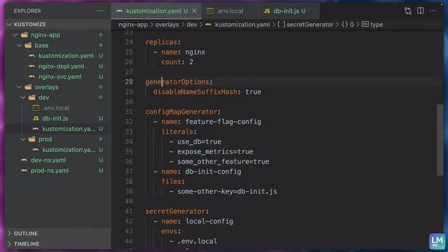
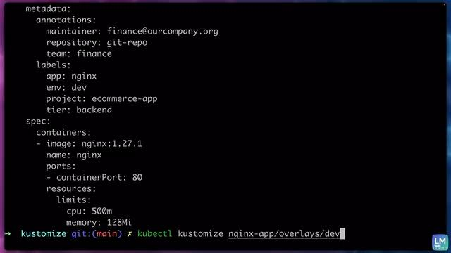
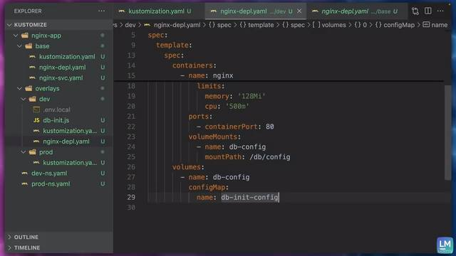
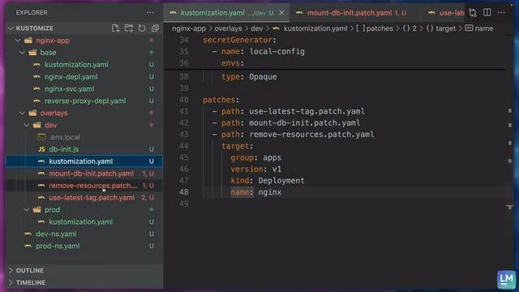
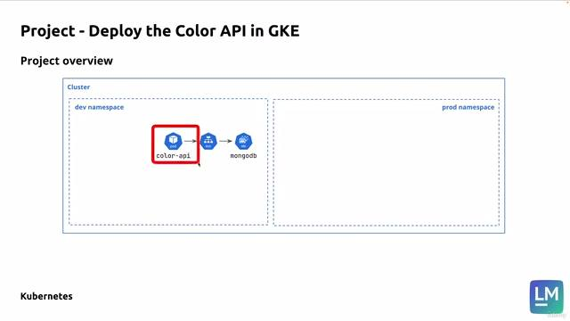
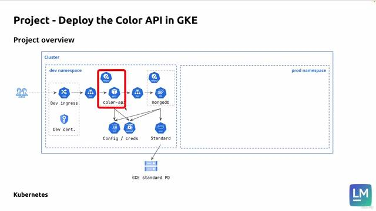

# Docker & Kubernetes Zero to Hero — Kustomize Secret Generators、Patches 与 GKE 项目预览（P61–P65）

## 1. 这一节做什么

P61–P64 是 Kustomize 的「精细化定制」阶段：先把本地开发用的数据库凭据从 ConfigMap 迁移到 Secret（`secretGenerator`），再解决一个更普遍的问题——当 base 里有多个对象使用同一镜像时，顶层的 `images` 字段会「一锅端」，无法只改其中一个。讲师由此引出 `patches`：先用内联的 strategic merge patch 精确修改某个 Deployment 的某个容器，再把 patch 抽成独立文件（`*.patch.yaml`），最后用 JSON Patch（RFC 6902）做 strategic merge 做不到的事——按路径删除字段。

P65 是下一个 GKE 项目的「预告片」，纯讲解、没有可执行命令：目标是把 Color API 的 dev（2.1.0-dev）和 prod（2.0.0）两个环境部署到 Google Kubernetes Engine，涉及 Namespace、StatefulSet、PVC、NodePort Service、Ingress、Google 托管证书、NetworkPolicy，以及用 Kustomize 在 dev 基础上叠加出 prod。

这一节学完，你手里会有一个**不依赖真实集群也能 build 出完整 YAML**的 Kustomize 项目：base 里放 nginx、reverse-proxy 两个 Deployment 和一个 Pod，dev overlay 里放 Secret/ConfigMap 生成器与四个 patch。你可以在终端里反复执行 `kubectl kustomize overlays/dev` 观察每一步输出，确认「只改 nginx、不改 reverse-proxy」以及「按路径删字段」这两个核心效果。





---

## 2. 讲师原话

关于 Secret 与 ConfigMap 生成器的关系：

> "Secret 生成器的行为与 ConfigMap 非常相似。区别在于，它会实际输出 Secret，而不是 ConfigMap。"
> —— p061 [00:00]

> "如你所知，这里的信息经过了 base64 编码。然后你可以在 Secret 的名称里看到，这个后缀也被禁用了，对吧？所以往上看，我们为所有生成器禁用了名称后缀哈希，其中既包括 ConfigMap 生成器，也包括 Secret 生成器。"
> —— p061 [01:20]

关于为什么需要 patch：

> "仅仅采用这里这个通用的顶层字段 images，并不能让我们足够灵活地定位 base 中某个非常具体的对象。因此，这里需要利用的其实是补丁（patches）。"
> —— p062 [02:14]

关于 patch 的版本选择：

> "这里的 patchesJson6902 和 patchesStrategicMerge 都已弃用，建议只使用顶层的 patches 字段。"
> —— p062 [02:41]

关于 partial manifest 需要哪些字段：

> "我们传递的重要信息包括 API 版本和 kind，这样 Kustomize 才知道针对这份部分配置应使用哪种结构定义。接着我们传递 metadata 中的 name，让 Kustomize 知道我们究竟想修改哪个 Deployment。然后这里只指定 paths，也就是我们定义中希望更新的部分。"
> —— p062 [04:30]

关于列表合并的规则：

> "在这里合并对象列表时，行为实际上取决于是否已经存在一个名为 nginx 的容器。因此，它会在我们的 Deployment 下查找名为 nginx 的容器。如果找到，就会更新我们这里提供的字段；但如果不存在这个名称的容器，Kustomize 实际上会把它追加到我们的容器列表中。"
> —— p062 [05:19]

关于外部 patch 文件与顺序冲突：

> "这会很快变得非常难以管理。原因是我们会有大量补丁，而且它们全都内联在 kustomization.yaml 文件里。这确实不是一个可扩展的做法。"
> —— p063 [00:00]

> "最终保留下来的会是最新的那个。因此，这会受顺序影响，而这确实不是我们想开始担心的事情。"
> —— p063 [05:53]

关于 JSON Patch 的代价：

> "这里我们需要非常精确地指定路径。这也是这个方案的一个缺点：我们确实需要知道完整路径。"
> —— p064 [02:38]

> "我们也可以把这些补丁应用到一组资源上，但不能应用到所有资源上。"
> —— p064 [05:54]

关于 GKE 项目目标：

> "我们的目标是在托管 GKE 集群中部署 Color API 应用的两个环境。在开发环境中，我们将部署项目期间编写的新版本，即 2.1.0-dev 版本；在生产环境中，我们将部署稳定版本 2.0.0。"
> —— p065 [00:00] / [00:50]

---

## 3. 从零复现

### 3.1 前置条件

课里**没有讲** Kustomize 的安装步骤，也没有给出具体的 build 命令。按 Kustomize 的标准用法，你有两种方式：

```bash
# 方式一：直接用 kubectl 内置的 kustomize（推荐，无需单独安装）
kubectl version --client
kubectl kustomize overlays/dev

# 方式二：安装独立 kustomize 二进制后
kustomize build overlays/dev
```

课里只说 "在这里运行我们的 overlays/dev。"、"rerun here our overlay"，具体命令以你的环境为准。本节所有验证都**不需要真实 Kubernetes 集群**，`kubectl kustomize` 只做本地渲染。

### 3.2 目录结构

先建出下面这棵树。base 放「与环境和凭据无关」的原始对象；overlays/dev 放所有本地化配置、生成器和 patch。

```text
kustomize-demo/
├── base/
│   ├── kustomization.yaml
│   ├── nginx-deployment.yaml
│   ├── reverse-proxy-deployment.yaml
│   └── reverse-proxy-pod.yaml
└── overlays/
    └── dev/
        ├── kustomization.yaml
        ├── .env
        ├── db-init.js
        ├── update-resources.patch.yaml
        ├── use-latest-tag.patch.yaml
        ├── mount-db-init.patch.yaml
        ├── remove-resources.patch.yaml
        └── remove-resources.patch.json
```

```bash
mkdir -p kustomize-demo/base kustomize-demo/overlays/dev
cd kustomize-demo
```

### 3.3 第一步：写 base（P061 的 nginx Deployment + P062 的 reverse-proxy）

P061 里讲师是「复制粘贴一个 nginx deployment」，逐字稿没有展示完整 YAML；P062 又加了一个用同样 `nginx` 镜像的 `reverse-proxy` Deployment。为了让后面的 patch 有东西可改，base 里这两个 Deployment 都要带 `resources` 字段。



### 3.4 第二步：写 dev overlay 的生成器（P061）

把本地凭据放进 `overlays/dev/.env`（逐字稿说 `.env` 文件通常不提交仓库）。`secretGenerator` 用 `envs` 读它，`type: Opaque` 表示通用 Secret；`configMapGenerator` 用 `files` 把 `db-init.js` 打包。`generatorOptions.disableNameSuffixHash: true` 对**所有生成器**生效——这正是 P061 里「secret 名字后面没有 hash 后缀」的原因。

### 3.5 第三步：先验证「不加 patch」的基线

```bash
kubectl kustomize overlays/dev
```

你应该看到：所有对象名字带 `dev-` 前缀；Secret 的 `data` 里是 base64；ConfigMap 名叫 `db-init-config`（因为 hash 被禁用，没有后缀）。这一步对应 P061 结尾「secret 也可以被 Deployment 按名字引用，Kustomize 会负责替换」。

### 3.6 第四步：加 strategic merge patch（P062）

先只启用 `update-resources.patch.yaml`，再执行 build。观察两点：

1. `dev-nginx` 的容器 resources 被合并成你写的值；
2. `dev-reverse-proxy` 完全没变——这就是 patch 相对顶层 `images` 的精确性。

### 3.7 第五步：把 patch 抽成文件并叠加多个（P063）

把 `use-latest-tag.patch.yaml` 和 `mount-db-init.patch.yaml` 加进 `patches` 列表。重点观察 `mount-db-init`：patch 里写的是 `configMap.name: db-init-config`，但 build 输出里这个名字会被 Kustomize 自动加上 `dev-` 前缀——patch 引用的是「base 名」，最终名字由 overlay 的命名规则决定。

### 3.8 第六步：用 JSON Patch 删除字段（P064）

把 `update-resources.patch.yaml` 从 `patches` 里注释掉，换成 `remove-resources.patch.yaml`。JSON Patch 文件本身只有 `op` 和 `path`，**没有资源身份**，所以必须在 `kustomization.yaml` 的 `patches` 条目里用 `target` 指定 `group/version/kind/name`。



再把 `target.name` 去掉，只留 `group/version/kind`，你会看到所有 Deployment 的 `resources` 都被删了，而 `reverse-proxy-pod` 不受影响——对应 P064 结尾「groups of resources but not all resources」。

### 3.9 第七步：P065 的 GKE 项目——只做规划，不写 YAML

P065 是纯讲解，**课里没有给出任何 GKE 的 YAML 或 gcloud 命令**。这一段不要试图「跑起来」，把讲师描述的架构整理成下面的设计表即可，下一阶段再落地。

| 维度 | dev 环境 | prod 环境 | 讲师原话依据 |
|---|---|---|---|
| Namespace | `dev` | `prod` | p065 [01:20] |
| Color API 版本 | `2.1.0-dev` | `2.0.0` | p065 [00:50] |
| MongoDB | StatefulSet + headless Service | 同左 | p065 [01:20] |
| 配置与凭据 | ConfigMap + Secret | 同左 | p065 [01:33] |
| PVC / StorageClass | standard persistent disk | premium persistent disk（performance SSD） | p065 [01:51] / [03:06] |
| Service | NodePort | NodePort | p065 [01:51] |
| Ingress | dev ingress（不同 host） | prod ingress（不同 host） | p065 [03:06] |
| 证书 | Google 托管 dev 证书 | Google 托管 prod 证书 | p065 [02:18] / [03:06] |
| NetworkPolicy | 默认 deny ingress；Color API 放行外部入口；MongoDB 只放行来自 Color API 的流量 | 同左 | p065 [02:37] |
| 环境差异化手段 | — | 用 Kustomize 在 dev 基础上叠加 | p065 [03:06] |





---

## 4. 完整代码

下面每个文件都可直接保存。**注意**：`update-resources.patch.yaml` 与 `remove-resources.patch.yaml` 是**互斥**的教学步骤（一个改 resources、一个删 resources），默认 kustomization 里只启用 update-resources；要试验 JSON Patch 时，把 update-resources 那行注释掉、把 remove-resources 取消注释。

### `base/kustomization.yaml`

```yaml
apiVersion: kustomize.config.k8s.io/v1beta1
kind: Kustomization

resources:
  - nginx-deployment.yaml
  - reverse-proxy-deployment.yaml
  - reverse-proxy-pod.yaml
```

### `base/nginx-deployment.yaml`

```yaml
apiVersion: apps/v1
kind: Deployment
metadata:
  name: nginx
  labels:
    app: nginx
spec:
  replicas: 1
  selector:
    matchLabels:
      app: nginx
  template:
    metadata:
      labels:
        app: nginx
    spec:
      containers:
        - name: nginx
          image: nginx:1.27.0
          resources:
            requests:
              cpu: 50m
              memory: 64Mi
            limits:
              cpu: 100m
              memory: 128Mi
```

### `base/reverse-proxy-deployment.yaml`

```yaml
apiVersion: apps/v1
kind: Deployment
metadata:
  name: reverse-proxy
  labels:
    app: reverse-proxy
spec:
  replicas: 1
  selector:
    matchLabels:
      app: reverse-proxy
  template:
    metadata:
      labels:
        app: reverse-proxy
    spec:
      containers:
        - name: reverse-proxy
          image: nginx:1.27.0
          resources:
            requests:
              cpu: 50m
              memory: 64Mi
            limits:
              cpu: 100m
              memory: 128Mi
```

### `base/reverse-proxy-pod.yaml`

```yaml
apiVersion: v1
kind: Pod
metadata:
  name: reverse-proxy-pod
  labels:
    app: reverse-proxy-standalone
spec:
  containers:
    - name: reverse-proxy
      image: nginx:1.27.0
      resources:
        requests:
          cpu: 50m
          memory: 64Mi
        limits:
          cpu: 100m
          memory: 128Mi
```

### `overlays/dev/.env`

```dotenv
DB_USERNAME=localuser
DB_PASSWORD=localpassword
DB_HOST=localhost
```

### `overlays/dev/db-init.js`

```js
// 课里没有给出这个文件的具体内容，这里只放一个占位符，
// 目的是让 configMapGenerator 有文件可打包成 db-init-config。
print("db init placeholder");
```

### `overlays/dev/kustomization.yaml`

```yaml
apiVersion: kustomize.config.k8s.io/v1beta1
kind: Kustomization

resources:
  - ../../base

namePrefix: dev-

commonLabels:
  env: dev

configMapGenerator:
  - name: db-init-config
    files:
      - db-init.js

secretGenerator:
  - name: local-config
    envs:
      - .env
    type: Opaque

generatorOptions:
  disableNameSuffixHash: true

patches:
  - path: update-resources.patch.yaml
  - path: use-latest-tag.patch.yaml
  - path: mount-db-init.patch.yaml
  # 下面是 JSON Patch 教学步骤：启用它之前，先注释掉 update-resources.patch.yaml
  # - path: remove-resources.patch.yaml
  #   target:
  #     group: apps
  #     version: v1
  #     kind: Deployment
  #     name: nginx
```

### `overlays/dev/update-resources.patch.yaml`

```yaml
apiVersion: apps/v1
kind: Deployment
metadata:
  name: nginx
spec:
  template:
    spec:
      containers:
        - name: nginx
          resources:
            requests:
              cpu: 100m
              memory: 128Mi
            limits:
              memory: 256Mi
```

### `overlays/dev/use-latest-tag.patch.yaml`

```yaml
apiVersion: apps/v1
kind: Deployment
metadata:
  name: nginx
spec:
  template:
    spec:
      containers:
        - name: nginx
          image: nginx:latest
```

### `overlays/dev/mount-db-init.patch.yaml`

```yaml
apiVersion: apps/v1
kind: Deployment
metadata:
  name: nginx
spec:
  template:
    spec:
      containers:
        - name: nginx
          volumeMounts:
            - name: db-config
              mountPath: /db/config
      volumes:
        - name: db-config
          configMap:
            name: db-init-config
```

### `overlays/dev/remove-resources.patch.yaml`

```yaml
- op: remove
  path: /spec/template/spec/containers/0/resources
```

### `overlays/dev/remove-resources.patch.json`

```json
[
  {
    "op": "remove",
    "path": "/spec/template/spec/containers/0/resources"
  }
]
```

### 运行

```bash
cd kustomize-demo
kubectl kustomize overlays/dev
```

---

## 5. 逐行解释

### 5.1 `base/kustomization.yaml` 为什么这么短

base 里只列 `resources`，不放 `namePrefix`、不放 `images`、不放生成器。原因在 P061 的演示里已经埋下：一旦 base 里写了 `namePrefix`，所有 overlay 都会被迫继承它，dev/staging/prod 就没法各自命名。把「环境相关的」和「结构相关的」分开，是后面所有 patch 能稳定工作的前提。

### 5.2 `namePrefix: dev-` 和 `commonLabels`

`namePrefix` 会让 base 里所有对象名变成 `dev-nginx`、`dev-reverse-proxy`、`dev-db-init-config`。P061 [03:51] 讲师原话是 "Kustomize 会负责按名称替换我们部署中的这些 Secret……"，也就是说 patch 里写 `metadata.name: nginx` 时，Kustomize 会自动把它匹配到最终的 `dev-nginx`，你不需要在 patch 里预先写前缀。`commonLabels` 会同时加到对象的 `metadata.labels` 和 selector 相关字段上——这是 Kustomize 的内置行为，课里没有逐字讲，但 P062 开头讲师明确说过之前已经加过 "common labels, common annotations"。

### 5.3 `configMapGenerator` 与 `secretGenerator`

- `configMapGenerator.files`：把 `db-init.js` 作为一个 key 打进 ConfigMap。P061 [04:48] 讲师在输出里确认 "它还包含 dbinit.js 文件。"（逐字稿拼写如此，实际文件名以你的项目为准）。
- `secretGenerator.envs`：读 `.env`，每一行 `KEY=VALUE` 变成一个 data key。P061 [00:28] 讲师说 `.env` 文件通常不提交仓库，所以它应该被 `.gitignore` 掉。
- `type: Opaque`：P061 [00:54] 原话 "我们还可以在这里添加 type: opaque，向 Kubernetes 表明这是一个通用 Secret。"
- `generatorOptions.disableNameSuffixHash: true`：P061 [01:20] 原话 "我们为所有生成器都禁用了名称后缀哈希，包括 ConfigMap 生成器和 Secret 生成器。" 这个选项是**全局作用于 overlay 内所有生成器**的，不是单个 generator 的字段。

### 5.4 strategic merge patch 的匹配规则

`update-resources.patch.yaml` 的结构是「一个不完整的 Deployment」。Kustomize 靠三样东西找到目标：

1. `apiVersion: apps/v1` + `kind: Deployment`：决定用哪套 schema 解析；
2. `metadata.name: nginx`：决定改哪个对象（最终会被 `namePrefix` 改写成 `dev-nginx`）；
3. `spec.template.spec.containers[].name: nginx`：决定改**哪一个容器**。

P062 [05:19] 讲师把这条规则讲得很透："它会搜索名为 nginx 的容器。如果找到了，就会更新我们在这里提供的字段……但如果没有叫这个名字的容器……那么 Kustomize 实际上会把它追加到我们的容器列表中。" 换句话说，容器列表不是按索引合并，而是按 `name` 字段做「有则合并、无则追加」。这和 JS 里 `array.find(x => x.name === 'nginx')` 再 `Object.assign` 是同一个思路，只是 Kustomize 在 YAML 层自动帮你做了。

`resources` 里只写 `requests.cpu`、`requests.memory`、`limits.memory`，没有写 `limits.cpu`——P062 [07:31] 讲师确认 "这也会合并字段……如果这里的键不同，那么 Kustomize 足够智能，会真正把这里的内容合并起来。" 所以 base 里已有的 `limits.cpu` 会被保留，不会被 patch 抹掉。

### 5.5 `use-latest-tag.patch.yaml` 与顶层 `images` 的对比

P062 [01:49] 讲师先演示了顶层 `images`：只要镜像名是 `nginx`，不管在哪个 Deployment 里都会把 tag 改成 `1.27.1`。结果 `reverse-proxy` 也被改了。这不是 bug，是 `images` 的设计意图——按镜像名全局替换。

`use-latest-tag.patch.yaml` 把同样的修改收窄到 `metadata.name: nginx` 这一个 Deployment。这就是 P062 [02:14] 那句 "它没有给我们足够的灵活性，无法定位到我们基础配置中某个非常具体的对象。" 的解法。

### 5.6 `mount-db-init.patch.yaml` 里的名字必须与 base 对得上

patch 里 `configMap.name: db-init-config`，这个值必须和 `configMapGenerator.name` 完全一致。P061 [05:10] 讲师强调 "重要的是，这里 ConfigMap 的名称，或者这里卷定义中 Secret 的名称，要与我们在 kustomization 文件中指定的名称一致。" 你写 `dbinit-config` 或 `db-init` 都不会被 Kustomize 自动纠正，build 出来的 YAML 里会保留你写的字面量，部署到集群时才会因为找不到 ConfigMap 而失败。

另外注意 `volumeMounts[].name` 和 `volumes[].name` 必须相同（这里都是 `db-config`）。P061 的口述里出现过 "卷名为 dbinit-config，卷挂载名为 dbconfig。" 的不一致，那是讲师现场口误；Kubernetes 要求两边严格相等，所以本文统一成 `db-config`。

### 5.7 JSON Patch 的 `target` 为什么不能省

`remove-resources.patch.yaml` 只有两个字段：`op: remove` 和 `path`。它**没有** `apiVersion`、`kind`、`metadata.name`，Kustomize 无法从文件本身知道要改哪个对象。所以必须在 `kustomization.yaml` 的 `patches` 条目里写 `target`：

```yaml
target:
  group: apps
  version: v1
  kind: Deployment
  name: nginx
```

P064 [01:42] 讲师原话 "这里的 target 对象会包含我们识别该资源所需的全部信息。"，并明确 `group` 是 `apps`、`version` 是 `v1`、`kind` 是 `Deployment`。注意 `group` 和 `version` 是分开的两个字段，不是 `apps/v1` 一个字符串。

### 5.8 `/spec/template/spec/containers/0/resources` 为什么脆弱

JSON Patch 的 `path` 用的是 JSON Pointer，数组必须用下标。P064 [03:32] 讲师演示了从 IDE 的 breadcrumb 里读出 `spec → template → spec → containers → 0 → resources`。`0` 表示「第一个容器」。P064 [04:26] 讲师自己承认 "这确实相当脆弱。"，因为一旦有人在 base 里把 busybox 容器插到 nginx 前面，`0` 就指向了别的容器。

这也是为什么 P064 后面演示「去掉 `name`、只留 `group/version/kind`」时要特别小心：那会让 patch 作用于**所有** Deployment，而 `reverse-proxy` 的容器里也有 `resources`，所以两个 Deployment 都会被删；`reverse-proxy-pod` 不是 Deployment，所以不受影响。P064 [08:38] 还提到可以用 `labelSelector` / `annotationSelector` 扩大或缩小目标集合，但前提是「这个修改对选中的所有资源都兼容」——比如对 Service 删 `resources` 就没有意义。

### 5.9 P063 的顺序冲突

P063 [04:59] 开始，讲师演示了 `use-latest-tag` 和 `use-stable-tag` 同时改同一个字段的情况：谁在 `patches` 列表里靠后，谁就生效。P063 [05:53] 原话 "这就会容易受这里的顺序影响，而这确实不是我们想开始操心的事情。"。结论是：**同一字段的多个修改应该合并进同一个 patch 文件**，而不是拆成多个文件靠顺序决胜。本文的 `use-latest-tag.patch.yaml` 只保留一个版本，就是为了避免这个坑。

---

## 6. 复现检查清单

按顺序执行，每一步都应该能对上：

- [ ] `kubectl kustomize overlays/dev` 能正常输出，没有 schema 报错。
- [ ] 输出里所有对象名都以 `dev-` 开头（`dev-nginx`、`dev-reverse-proxy`、`dev-reverse-proxy-pod`、`dev-db-init-config`、`dev-local-config`）。
- [ ] `Secret` 的 `data` 值是 base64；`echo 'bG9jYWx1c2Vy' | base64 -d` 能还原出 `.env` 里的 `DB_USERNAME` 值（具体值以你写的 `.env` 为准）。
- [ ] `dev-nginx` 的 `resources` 是 patch 里的值：`requests.cpu: 100m`、`requests.memory: 128Mi`、`limits.memory: 256Mi`；而 `limits.cpu` 仍是 base 的 `100m`——这是「合并而非覆盖」的直接证据。
- [ ] `dev-reverse-proxy` 的 `resources` 与 base 一字不差，说明 `metadata.name: nginx` 的收窄生效了。
- [ ] `dev-nginx` 的 `spec.template.spec` 里同时有 `volumeMounts`（`db-config` → `/db/config`）和 `volumes`（`configMap.name: dev-db-init-config`），两边名字相同。
- [ ] `dev-nginx` 的镜像是 `nginx:latest`，`dev-reverse-proxy` 仍是 `nginx:1.27.0`。
- [ ] 切到 JSON Patch 后，`dev-nginx` 与 `dev-reverse-proxy` 的 `resources` 字段都消失，`dev-reverse-proxy-pod` 的 `resources` 还在。
- [ ] `kubectl kustomize overlays/dev > rendered.yaml` 落盘后，`kubectl apply --dry-run=client -f rendered.yaml` 能过——这一步不需要集群，只做本地 schema 校验。
- [ ] 把 `disableNameSuffixHash` 改成 `false`（或删掉），Secret 名会变成 `dev-local-config-<hash>`，同时 `mount-db-init` 里引用的 `db-init-config` 会被 Kustomize 自动改写成带 hash 的名字——这是 P061 讲师说的 "Kustomize 会负责替换我们部署中的这些 Secret。" 的另一半含义。

---

## 7. 课里没讲但你会撞上的

这一节没有对应的视频时间点，全部来自 Kustomize 在真实项目里的行为。讲师演示的是一个「刚写出来的、只 build 不部署」的玩具项目，很多坑要等你把它接进 CI 或者真部署上集群才会暴露。

### 7.1 `commonLabels` 在 Kustomize v5 已经改名

本文 `overlays/dev/kustomization.yaml` 用的是 `commonLabels`，这是 Kustomize v4 及更早的写法。Kustomize v5 把它拆成了两个字段：

```yaml
labels:
  - pairs:
      env: dev
    includeSelectors: true      # 等价于旧 commonLabels
    includeTemplates: true      # 是否同时改 PodTemplate 的 labels
```

**为什么改**：`commonLabels` 会把标签同时塞进 `metadata.labels` 和 `spec.selector.matchLabels`，而 Deployment 的 `selector` 在 Kubernetes 里是**不可变字段**——对一个已经存在的 Deployment 改 selector，`kubectl apply` 会直接报 `field is immutable`。拆成 `includeSelectors` 之后，你可以只加标签不动 selector，避免这个致命错误。

**怎么判断你该用哪个**：`kubectl kustomize --version` 或 `kubectl version --client` 看内置版本。v5 及以上用 `labels`，v4 及以下用 `commonLabels`。混用不会报「未知字段」——Kustomize 对未知字段默认是宽容的，它会**静默忽略**，你会得到一个「标签没加上」但没有任何报错的结果。

### 7.2 顶层 `patches` 字段是 Kustomize v4.1+ 才有的

讲师在 P062 [02:41] 说得很明确："这里的 patchesJson6902 和 patchesStrategicMerge 都已弃用，建议只使用这里的顶层 patches 字段。"

这句话反过来理解就是：**老版本 Kustomize 只认 `patchesStrategicMerge` 和 `patchesJson6902`**。如果你照抄本文的 `patches:` 却跑在 v4.0 及更早的版本上，那两个 patch 文件根本不会生效，build 出来的 YAML 看起来「正常」，只是你的修改一个字都没进去。这种静默失败比报错难查得多——因为 `kubectl kustomize` 的退出码是 0。

一个快速自检：在 `kustomization.yaml` 里故意写一个不存在的 patch 路径。如果 build 报 `no such file`，说明 `patches` 被解析了；如果没报错，说明你的版本根本不认这个字段。

### 7.3 `disableNameSuffixHash: true` 的代价：改了凭据不会自动生效

本文为了让输出好看、让名字好引用，把 hash 后缀关掉了。这在演示里没问题，但在真实项目里有一个明确后果：

ConfigMap 和 Secret 作为 volume 挂载进 Pod 后，**kubelet 会周期性同步内容（默认约 1 分钟），但绝不会重启容器进程**。应用读到的还是启动时加载进内存的值。关掉 hash 后缀后，名字不变，`kubectl apply` 也不会触发任何 rollout——你改完 `.env`、apply 完，Pod 里跑的还是旧的凭据，而所有命令都返回成功。

默认的 hash 后缀正是为了解决这个问题：内容变了 → 名字变了 → Deployment 引用的名字变了 → 滚动更新自动发生。**生产环境建议保留 hash**，只在本地开发和演示时关掉。

要手动触发更新：`kubectl rollout restart deployment/dev-nginx`。但这个操作能起作用的前提是 Deployment 的 `spec.template` 真的变了——如果只是改了 ConfigMap 而 template 没变，`rollout restart` 会给 Pod 打上一个新的 `pod-template-hash` 注解强制重建，这是它和「apply 触发更新」的区别。

### 7.4 Secret 的 base64 不是加密

P061 [01:05] 讲师说 "如你所知，这里的信息是经过 base64 编码的。" 这句话里藏着一个新手最容易忽略的事实：**base64 是可逆编码，不是加密**。

任何能 `kubectl get secret` 的人，一条 `kubectl get secret dev-local-config -o jsonpath='{.data}' | base64 -d` 就能拿到明文密码。`kubectl describe secret` 只显示 key 和字节数，看起来像是藏起来了，那只是显示层的省略，不是权限控制。

真实的做法是三选一：

| 方案 | 原理 | 适用 |
|---|---|---|
| Sealed Secrets | 用集群公钥加密后提交到 Git，只有集群私钥能解 | 中小团队、GitOps |
| External Secrets Operator | Secret 存在 Vault / AWS Secrets Manager / 云厂商 KMS，集群里只放引用 | 已有密钥管理设施 |
| SOPS + age/GPG | 文件级加密，配合 Git 钩子 | 单仓库、无额外组件 |

**本文的 `.env` 文件必须进 `.gitignore`**——P061 [00:28] 讲师提到 `.env` 通常不提交，但没说要加到 `.gitignore` 里。忘了这一步，你就是把数据库密码以明文形式提交了。

### 7.5 JSON Patch 的下标会随 base 变化而漂移

本文的 `remove-resources.patch.yaml` 用的是 `/spec/template/spec/containers/0/resources`。`0` 是硬编码的数组下标，这一点讲师在 P064 [04:26] 自己承认 "这确实相当脆弱。"，但没有给出解法。

真实项目里的解法有两个：

1. **保证 nginx 容器永远在 `0` 位**——不可靠，靠人记。
2. **改用 strategic merge patch 做同样的删除**。strategic merge 里删一个字段可以写 `$patch: delete`：

```yaml
apiVersion: apps/v1
kind: Deployment
metadata:
  name: nginx
spec:
  template:
    spec:
      containers:
        - name: nginx
          resources:
            $patch: delete
```

这样按下标匹配变成按 `name` 匹配，base 里插多少个容器都不影响。**JSON Patch 只应该用在 strategic merge 表达不了的地方**——比如「删掉数组里满足某个特定条件的元素」这种没有 `name` 可用的场景。仅仅删一个字段，用它属于杀鸡用牛刀，还顺带引入了脆弱性。

### 7.6 `kubectl kustomize` 与独立 `kustomize` 二进制可能输出不同

本文 3.1 给了两种安装方式，但没提它们的**版本可能不一致**。`kubectl kustomize` 用的是 kubectl 编译时打包进去的那份 kustomize 库，版本跟着 kubectl 走；独立 `kustomize` 二进制是单独发布的，通常更新更快。

在 CI 里这个差异会直接导致「本机 build 得好好的、流水线里 patch 不生效」。**定死版本**是唯一可靠的解法：

```bash
# 方案一：CI 里固定用独立二进制
curl -sL "https://github.com/kubernetes-sigs/kustomize/releases/download/kustomize%2Fv5.4.3/kustomize_v5.4.3_linux_amd64.tar.gz" | tar xz
./kustomize version

# 方案二：固定 kubectl 镜像版本
docker run --rm -v "$PWD:/work" -w /work bitnami/kubectl:1.30 kubectl kustomize overlays/dev
```

团队内部统一一种，写进 README，别让每个人各用各的。