## 1. 这一节做什么

这一节对应 P66–P71，目标不是写业务代码，而是把后面做 Kubernetes 实验所需的地基搭好：注册 Google Cloud 免费试用、确认 $300/90 天额度、设置预算告警、创建独立项目、启用 Compute Engine 与 Kubernetes Engine API、在本机安装并初始化 `gcloud` CLI，最后用 GKE Autopilot 创建第一个托管 Kubernetes 集群，并用 `gcloud container clusters list` 验证它存在。

要注意：P66–P71 **没有讲 Dockerfile、镜像构建、镜像推送、Deployment YAML**，这些不要硬塞进来。课里这一段的产物是「一个可用的 GCP 项目 + 一个可用的 GKE Autopilot 集群 + 本机可用的 gcloud 配置」。讲师也明确建议把 Google Cloud 控制台当作只读观察窗口，真正的变更以 YAML 文件为准；如果你在控制台改了东西，再执行 apply，控制台改动会被覆盖。

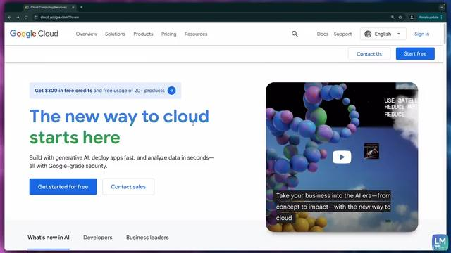

对前端转 AI 应用工程师来说，可以这样类比：`gcloud` 像全局安装的 `npm` 命令，项目 ID 像 npm scope，`gcloud config` 像 `.npmrc` 里的默认配置。本节没有锁、事务、并发问题，不需要对应 Node 原语。

---

## 2. 讲师原话（带「—— pNNN [MM:SS]」）

> "你需要一张信用卡或借记卡，因为有了它，我们才能真正拿到这 300 美元、为期 90 天的免费额度。"
> —— p066 [00:00]

> "因此，要让我们所有人都能享受到 Google Cloud 的 300 美元免费额度，就需要新建一个账号。如果你已经有 GCP 账号，这个优惠就不适用。"
> —— p066 [00:51]

> "我会把预算设为 90。基本上，只要每个月都控制在预算内，我就知道在这个为期三个月的免费试用期内不会产生任何费用，也不会把额度用完。"
> —— p066 [05:24]

> "项目能帮助我们以更结构化的方式隔离资源、管理权限并跟踪账单。"
> —— p068 [00:00]

> "随后，系统会在这里为我们生成一个项目 ID……这个 ID 必须在全局范围内唯一。"
> —— p068 [00:29]

> "每次使用 Compute Engine 时，我们都需要先启用这个 API。"
> —— p068 [02:46]

> "执行完这些命令后，如果你选择把 gcloud 加入 PATH，那么你的 PATH 中应该也能找到 gcloud。"
> —— p069 [01:15]

> "接下来，我们初始化 Google Cloud CLI。对应的命令是 gcloud init。"
> —— p069 [01:15]

> "我们在这里创建的是一个 Autopilot 集群。这意味着，像节点和计算资源这样的底层资源将由 Google Cloud 管理。"
> —— p071 [01:23]

> "运行 gcloud container clusters list，应该会返回我们的演示集群。"
> —— p071 [07:11]

---

## 3. 从零复现

下面按「账号 → 预算 → 项目 → API → 本机 CLI → 创建集群 → 验证」的顺序做。截图只用于对照 UI，Google Cloud 界面会随时间变化。

### 3.1 注册 Google Cloud 免费试用

1. 准备一个可用的 Google 账号；如果没有，就在注册流程里创建。
2. 准备一张信用卡或借记卡。课里说明这是为了拿到 $300、90 天免费试用额度。
3. 从 Google Cloud 首页进入免费试用入口，按页面选择国家/地区，填写个人信息和卡信息。
4. 完成后进入 Console。课里提示：**已有 GCP 账号不适用这个新账号免费试用**，所以要用新账号资格。
5. 刷新页面后确认能看到免费试用横幅，或者从右上角菜单进入 Billing / Billing account management，再点 Credits 查看免费试用额度、到期日、额度范围。课里还强调：后续创建的项目要使用这个 billing account。


### 3.2 设置预算告警

课里在 Billing 里创建了月度预算，示例名称是 `90 monthly budget alert`，金额示例为 90，作用范围是所有项目，并设置阈值邮件提醒。讲师还先试过 30 欧元，后来改成 90，目的是让 90 天免费试用期间每月都在预算内。

操作路径按课里是：Billing → Budgets & alerts → 创建预算 → 填名称、金额、范围（all projects）→ 设置阈值（课里看到 50% 等阈值）→ 保存。预算金额要按你的货币和实际额度调整，不要机械照抄 90 美元。

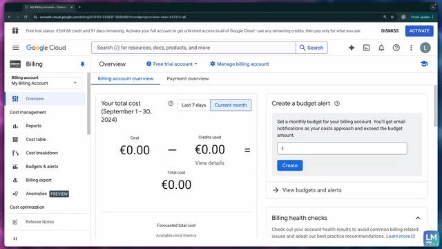

### 3.3 创建独立项目

课里建议不要直接用自动创建的 `My First Project`，而是新建项目，例如 `GKE autopilot demo`。项目 ID 会自动生成，也可以编辑，但必须全局唯一。这个项目 ID 后面会反复用。

路径：顶部项目选择器 → New Project → 填项目名 → 确认项目 ID 可用 → 创建 → 等几分钟 → 选择新项目。课里还提醒：如果要做无关实验，最好再建新项目，利用项目隔离资源、权限和账单。

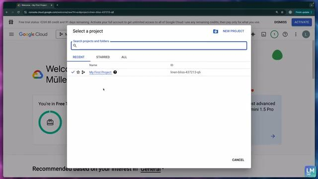

### 3.4 启用 API

课里进入 Compute Engine 时，先被要求 Enable API；进入 Kubernetes Engine 时，也要 Enable API。两者都可能花几秒到几分钟。课里说 Compute Engine API 本身没有费用，但必须启用才能用 VM；Kubernetes Engine API 启用后才能创建 GKE 集群。

UI 路径：汉堡菜单 → View all products → Compute → Compute Engine / Kubernetes Engine → Enable。启用完成后，Kubernetes Engine 页面可以看到 Clusters，以及 workloads、secrets、config maps、storage、security、networking 等入口。

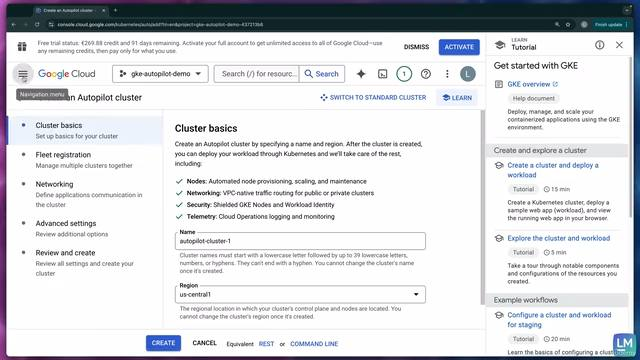

### 3.5 安装并初始化本机 gcloud CLI

课里演示的是 macOS：从安装页面选择操作系统，下载后运行 `install.sh`，按交互提示安装。安装时如果选择把 gcloud 加入 PATH，安装完后终端里应该能直接运行：

```bash
gcloud version
```

能输出版本信息就说明安装成功。课里还提到可以跳过本机安装，直接用 Cloud Shell；Cloud Shell 免费、已经预认证，并且带编辑器。但讲师希望本机也能用，因为后面会在本地 IDE 创建文件。

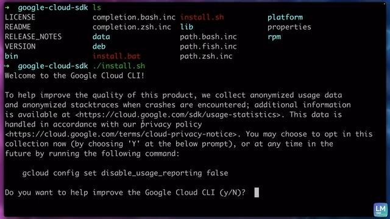

然后初始化：

```bash
gcloud init
```

按提示选择登录，浏览器完成授权后回到终端，选择 `GKE autopilot demo` 对应的项目；再选择默认 compute region 和 zone。课里选的是 Europe West 4 和 Europe West 4A。之后可以检查：

```bash
gcloud auth list
gcloud config list
```

逐字稿里有一处被转写成 `gcloud off list`，按上下文是列出已认证账号；实际常用命令是 `gcloud auth list`，课里没有逐字拼全，执行时以 CLI 帮助为准。`gcloud config list` 会显示 core settings 和 compute settings。

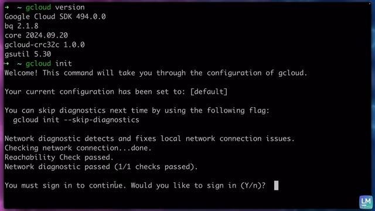

### 3.6 创建 GKE Autopilot 集群

课里从 Kubernetes Engine → Create cluster 进入。页面可能提示新的 cluster creator，点 Get started 继续。集群类型选 Autopilot：底层节点和计算资源由 Google Cloud 管理，按工作负载消耗的 CPU 和内存计费，不按底层节点计费。课里没有选 Standard。

配置要点：
- 名称：`demo-cluster`（课里说 example/demo cluster，后面叫 demo cluster）。
- 区域：`europe-west4`，与 CLI 设置一致。
- Fleet registration：课里不加入 fleet。
- Networking：课里选择 public cluster，并提示该设置创建后不能改。
- 其他网络和高级设置：保持默认；课里检查了没有额外开启昂贵功能，保留 logging 和 Cloud Monitoring。
- Review and create → Create cluster。创建可能需要 5 分钟或更久。

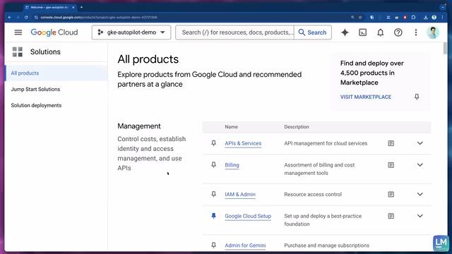

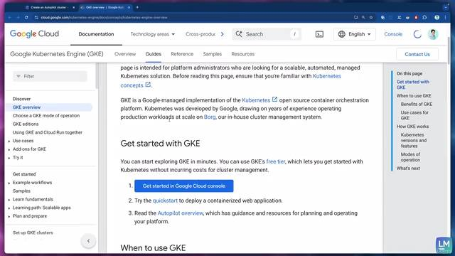

创建时控制台可以点 Command line 查看等价命令。课里展示的是 `gcloud container clusters create-auto` 开头的命令，并带上你在控制台选的选项。实际复制时以你控制台生成的命令为准。

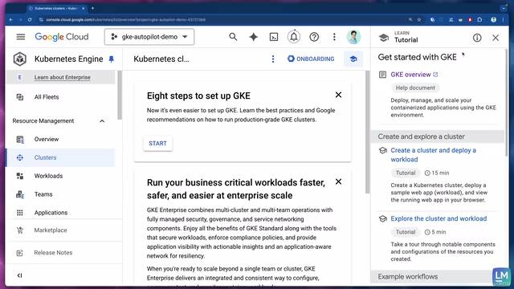

课里还看了 Autopilot 定价：集群管理有每小时 10 美分左右的固定费用，另外按工作负载消耗的 vCPU、内存和存储计费；录制时 Autopilot 有每月约 $74 的免费层额度，足够一个 Autopilot 集群免费跑。实际价格以你控制台为准。

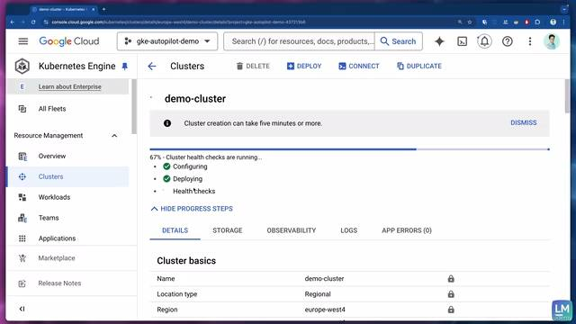

### 3.7 用 CLI 验证

集群创建完成后，在终端执行：

```bash
gcloud container clusters list
```

课里说输出里应该能看到 `demo-cluster`。字段名和列以你实际输出为准。到这里，本节目标完成：UI 能创建集群，CLI 能列出集群。

---

## 4. 完整代码

本课程 P66–P71 没有业务应用代码，只有控制台操作和 `gcloud` 命令。下面把 CLI 部分落成一个完整可执行文件。预算和项目创建仍在控制台完成，因为课里就是 UI 操作，而且项目需要绑定 billing account。

目录结构：

```text
~/gke-autopilot-demo/
└── setup-gke.sh
```

文件：`~/gke-autopilot-demo/setup-gke.sh`

```bash
#!/usr/bin/env bash
set -euo pipefail

# 必填：你在 Google Cloud 控制台创建的项目 ID
: "${PROJECT_ID:?请先 export PROJECT_ID=你的项目ID}"

# 可选：默认值与课里演示保持一致
REGION="${REGION:-europe-west4}"
ZONE="${ZONE:-europe-west4-a}"
CLUSTER_NAME="${CLUSTER_NAME:-demo-cluster}"

echo "==> 1/6 登录 Google Cloud"
gcloud auth login

echo "==> 2/6 绑定项目：${PROJECT_ID}"
gcloud config set project "$PROJECT_ID"

echo "==> 3/6 设置默认 region/zone：${REGION} / ${ZONE}"
gcloud config set compute/region "$REGION"
gcloud config set compute/zone "$ZONE"

echo "==> 4/6 启用本节需要的 API"
# 课里是在控制台点 Enable；下面是 CLI 等价写法，属于补充步骤。
gcloud services enable compute.googleapis.com
gcloud services enable container.googleapis.com

echo "==> 5/6 创建 GKE Autopilot 集群：${CLUSTER_NAME}"
# 课里在控制台查看过等价命令：gcloud container clusters create-auto ...
# 如果你控制台生成的参数不同，以控制台复制出来的命令为准。
gcloud container clusters create-auto "$CLUSTER_NAME" \
  --region="$REGION" \
  --project="$PROJECT_ID"

echo "==> 6/6 验证集群"
gcloud container clusters list --project="$PROJECT_ID"
gcloud config list

echo "完成。请到 Google Cloud 控制台 Kubernetes Engine 页面确认 ${CLUSTER_NAME} 状态。"
```

运行方式：

```bash
mkdir -p ~/gke-autopilot-demo
cd ~/gke-autopilot-demo

# 把上面的 setup-gke.sh 保存到当前目录后执行：
export PROJECT_ID="你的项目ID"
export REGION="europe-west4"
export ZONE="europe-west4-a"
export CLUSTER_NAME="demo-cluster"

bash setup-gke.sh
```

如果你完全照课里的交互式流程，先跑 `gcloud init` 完成登录、选项目、选 region/zone；再运行脚本时，脚本里的 `gcloud auth login` 和 `gcloud config set ...` 会再次确认这些配置，不会破坏集群。若你不想重复登录，可以手动跳过脚本第 1 步。

预算 UI 配置表（课里没有给 CLI 命令，以下按控制台填写）：

| 配置项 | 课里示例 |
|---|---|
| 预算名称 | `90 monthly budget alert` |
| 预算金额 | 90（按你的货币和额度调整） |
| 范围 | all projects |
| 告警方式 | 邮件提醒 |
| 阈值 | 课里看到 50% 等阈值，可自行增加 |
| 作用 | 接近/超过阈值时发邮件，不是自动停机 |

---

## 5. 逐行解释

`set -euo pipefail`：让脚本遇到错误就停，避免 API 没启用还继续创建集群。对前端来说类似 CI 里失败即退出，不要静默继续。

`: "${PROJECT_ID:?请先 export PROJECT_ID=你的项目ID}"`：强制要求项目 ID。课里项目 ID 是全局唯一的，并且后面创建集群、列集群都要用它。不要写死成讲师的 ID。

`REGION`、`ZONE`、`CLUSTER_NAME`：课里 CLI 选的是 Europe West 4 / Europe West 4A，集群名最终是 demo cluster。这里用环境变量，方便你改成离自己近的区域。注意 region 和 zone 不是一个东西：region 是区域，zone 是区域里的可用区。

`gcloud auth login`：打开浏览器完成账号授权。课里用 `gcloud init` 一次性完成登录、选项目、选区域；脚本拆成多步，效果等价。课里还提到 `gcloud auth list` 可以列出已认证账号，`gcloud config set account` 可以切账号。

`gcloud config set project`：把当前 CLI 上下文绑定到项目。课里通过 `gcloud init` 选项目，脚本用 set project 复现同一效果。绑定后执行 gcloud 命令默认作用于这个项目。

`gcloud config set compute/region` 和 `compute/zone`：设置默认计算区域和可用区。课里在 `gcloud init` 里选了 Europe West 4A，终端随后显示 region 为 Europe West 4、zone 为 Europe West 4A。这个默认值会影响后续 compute 相关命令。

`gcloud services enable compute.googleapis.com`：启用 Compute Engine API。课里是在 UI 点 Enable，并说这一步没有费用但必须启用；CLI 写法是补充，课里没有逐字演示这条命令。

`gcloud services enable container.googleapis.com`：启用 Kubernetes Engine API。课里同样是在 UI 点 Enable，等了几秒到几分钟。没有启用就创建 GKE 集群会失败。

`gcloud container clusters create-auto`：创建 Autopilot 集群。课里明确说 Autopilot 的底层节点和计算由 Google Cloud 管理，按工作负载消耗的 CPU/内存计费，不按底层节点计费。控制台会生成等价命令，最稳妥是复制控制台 Command line 里的完整命令；上面脚本是按课里展示的命令结构写的。

`--region="$REGION"`：把集群放在指定区域。课里集群区域选的是 Europe West 4，和 CLI 默认 region 对齐。区域选错会增加延迟或成本，创建后迁移也麻烦。

`--project="$PROJECT_ID"`：显式指定项目，避免当前 gcloud 上下文切到别的项目。

`gcloud container clusters list`：验证集群存在。课里最后就是运行这条命令，期望输出 demo cluster。输出列名以你实际终端为准，不要背字段名。

`gcloud config list`：确认当前账号、项目、region/zone 配置。课里说它会显示 core settings 和 compute settings。看到项目 ID 和区域符合预期再继续。

另外，课里在 P070 强调：控制台适合查看 workloads、secrets、config maps、storage、security、networking，但真正变更应以 YAML 文件为准；如果你在控制台改了对象，再执行 apply，控制台改动会被覆盖。这个习惯从创建集群后就要建立。

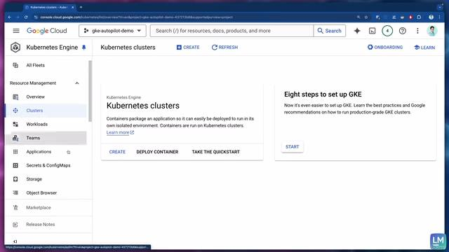

---

## 6. 复现检查清单

- [ ] 使用新 Google Cloud 账号资格拿到 $300/90 天免费试用；已有 GCP 账号不适用，课里明确说过。
- [ ] Billing 里能看到免费试用额度、到期日、credits 范围。
- [ ] 已创建月度预算告警，范围覆盖所有项目，阈值邮件能发到你邮箱。
- [ ] 已创建独立项目，例如 `GKE autopilot demo`，并记下全局唯一的项目 ID。
- [ ] 项目已绑定正确的 billing account。
- [ ] Compute Engine API 已启用。
- [ ] Kubernetes Engine API 已启用。
- [ ] 本机 `gcloud version` 有输出；如果命令找不到，检查安装时是否加入 PATH。
- [ ] `gcloud init` 已登录，已选择正确项目，region/zone 为 `europe-west4` / `europe-west4-a` 或你自己的区域。
- [ ] `gcloud config list` 里的项目、region、zone 符合预期。
- [ ] GKE 创建页选择 Autopilot，名称 `demo-cluster`，区域与 CLI 一致。
- [ ] 集群为 public，课里提示创建后不能改；高级设置保持默认，没有额外开启昂贵功能。
- [ ] 集群创建成功，控制台状态不再是 creating。
- [ ] `gcloud container clusters list` 能看到 `demo-cluster`。
- [ ] 知道控制台是只读观察为主，变更以 YAML 为准。
- [ ] 实验结束或长时间休息前删除资源；课里提醒删除一切避免费用，但删除命令课里没讲。

---

## 7. 课里没讲但你会撞上的

**1. 免费试用不是无限额度，预算告警不是硬止损。** 课里设置的是预算邮件提醒，接近或超过阈值会发邮件；它不会自动帮你删集群或停机。真正避免扣费还是要自己删资源。

**2. 项目 ID 全局唯一，创建后不好改。** 课里强调项目 ID 需要全局唯一。你如果用 `demo` 这种短 ID，很可能被占用。项目名可以随便叫，项目 ID 要按实际生成的来。

**3. API 启用需要时间。** 课里说 Compute Engine API 可能几秒到几分钟，Kubernetes Engine API 也可能要等。脚本里 `gcloud services enable` 之后立刻创建集群，通常没问题；如果报 API 未启用，等一两分钟再重跑创建命令。

**4. Autopilot 创建可能超过 5 分钟。** 课里明确说 cluster creation can take five minutes or more。不要以为卡住了就重复点创建，重复创建可能生成多个集群或报名称冲突。

**5. 区域和可用区不要混。** 课里 CLI 选 Europe West 4A，控制台集群选 Europe West 4。`gcloud config set compute/zone` 是可用区，`--region` 是区域。选错会导致后续命令找不到资源或延迟变高。

**6. public cluster 创建后不能改。** 课里在 networking 步骤明确提示 cannot change after the cluster is created。实验阶段保持 public 没问题；生产环境要提前想好私有集群、网络和安全设置。

**7. 本地 `gcloud` 不在 PATH。** 课里提到安装时可以选择加入 PATH。如果 `gcloud version` 找不到命令，重新打开终端，或回到安装器选择加入 PATH；也可以临时用 Cloud Shell 继续。

**8. 课里没讲 `kubectl` 安装和认证。** P66–P71 只到 `gcloud container clusters list`。后面如果要用 `kubectl`，需要额外安装并获取集群凭据；课里这一段没有演示，不要把它当成已经配好。

**9. 课里没讲删除集群的命令。** 讲师只提醒休息前删除一切资源。你可以在控制台删除集群，或用 `gcloud container clusters delete`，但具体参数课里没讲，执行前用 `--help` 核对。

**10. 定价会变。** 课里录制时 Autopilot 管理费约 10 美分/小时，免费层约每月 $74，一个 Autopilot 集群可免费跑；实际以你控制台 Pricing 为准。创建第二个集群或长期运行工作负载都可能产生费用。

**11. 控制台改动会被 apply 覆盖。** P070 里讲师说得很清楚：控制台可以看 workloads、secrets、config maps、storage，但 source of truth 是 YAML 文件；控制台改了再 apply 会被还原。前端同学可以把它类比成「不要直接改生产数据库，改 migration 文件」。