## 1. 这一节做什么

P72–P77 这一段的主线不是继续讲概念，而是把本地 `kubectl` 接到 Google Cloud 的 GKE 集群上，然后真的部署东西。具体目标如下：

1. 把 `kubectl` 的当前上下文从本地 Minikube 切到 GKE 的 `demo-cluster`。
2. 用 `gcloud container clusters get-credentials` 生成 kubeconfig 条目，并确认 API Server 已经是 GKE 的公网地址。
3. 写一个最小 `nginx:1.27.0` Deployment 和一个 `type: LoadBalancer` Service，把 nginx 暴露到公网。
4. 对比 Minikube 与 GKE 的 StorageClass，理解 GKE 托管存储类背后的 Google Cloud 磁盘/文件存储差异。
5. 对比 `kubectl api-resources` 在 Minikube 与 GKE 上的差异，看到 GKE 扩展出来的 API 组。
6. 用 Kustomize 建 `dev` / `prod` 两个 Namespace，并从 `.env` 文件生成 MongoDB root 凭据和 color-db 凭据的 Secret。
7. 开始搭 `color-db` 的 Kustomize 目录：`_base`、`dev`、`prod`，写出 `mongo-init.js`、`mongodb-svc.yaml` 和 base 的 `customization.yaml`。

**重要边界：P77 结束时，MongoDB StatefulSet 还没有写。** 讲师在 P77 最后明确说先休息，下一节再定义 StatefulSet。因此这份文档不会伪造 `mongodb-statefulset.yaml`。照本文能复现到：GKE 连通、nginx 公网部署、命名空间与 Secret、color-db 的 base 骨架。完整的 MongoDB StatefulSet 要等下一段课程。

---

## 2. 讲师原话（带「—— pNNN [MM:SS]」）

> "现在演示集群已经启动并运行起来了，接下来自然会想到的问题就是：我们究竟怎样才能在这个集群中部署或创建 Pod、Deployment、Service 以及所有其他 Kubernetes 对象？"
> —— p072 [00:00]

> "这里我们唯一需要执行的命令是 `gcloud container clusters get-credentials demo-cluster`。"
> —— p072 [01:13]

> "在本地运行时，这不会产生任何效果，对吧？但现在我们已经连接到 GKE 集群，这就会在后台创建一个负载均衡器并分配一个公网 IP。"
> —— p073 [01:41]

> "当我们把这里改成来自 Google Cloud、AWS 或 Azure 的托管集群时，实际上会看到不少有趣的存储类选项。"
> —— p074 [00:54]

> "一旦这样做，我们就会开始看到一个明显不同且更全面的列表……还会开始看到一些与 gke.io 相关的内容。"
> —— p075 [01:23]

> "我们希望能在项目中没有由 customization.yaml 文件管理的其他部分，引用在这个共享配置定制中创建的 Secret。因此，这里就需要一些更稳定的名称。"
> —— p076 [03:00]

> "在我们的 base 中，将放置所需的资源。所以这里添加一个定制配置……我们还希望包含 Mongo 的 init.js 脚本……MongoDB statefulset.yaml……MongoDB-SVC.yaml。"
> —— p077 [01:14]

> "在应用这个配置之前，我们还应该在这里定义 StatefulSet，并把它包含到我们的定制配置中。所以在做这件事之前，我们先短暂休息一下……"
> —— p077 [05:53]

---

## 3. 从零复现

### 3.1 前置条件与目录

你需要：

- 已经有一个 GKE 集群，课程里叫 `demo-cluster`。**本段不教创建 GKE 集群**，课里默认它已经存在。
- 已安装 Google Cloud SDK（`gcloud`）。
- 已安装 `kubectl`。
- 如果 `gcloud` 未指向正确项目，先执行（这一步课里没讲，但不做后续命令可能找不到集群）：
  ```bash
  gcloud config set project <你的_PROJECT_ID>
  gcloud config set compute/region europe-west4
  ```
  课程里讲师口述的区域是 `europe-west4` 一带；如果你创建集群时用了别的区域，以你实际集群为准。

最终目录结构如下。P73 的 nginx 是临时演示，复现完 P73 后可以删掉；P76 之后进入 color API 项目目录。

```text
project-gke/
├── nginx/
│   ├── deployment.yaml
│   └── service.yaml
├── namespaces/
│   ├── dev.yaml
│   └── prod.yaml
├── shared-config/
│   ├── dev/
│   │   ├── customization.yaml
│   │   ├── .env.root-creds.dev
│   │   └── .env.color-db-creds.dev
│   └── prod/
│       ├── customization.yaml
│       ├── .env.root-creds.prod
│       └── .env.color-db-creds.prod
└── color-db/
    ├── _base/
    │   ├── customization.yaml
    │   ├── mongo-init.js
    │   └── mongodb-svc.yaml
    ├── dev/
    └── prod/
```

`color-db/_base/mongodb-statefulset.yaml` 在 P77 里**还没有写出来**，所以最终目录里先不要伪造这个文件。

### 3.2 把 kubectl 接到 GKE

先看当前上下文：

```bash
kubectl config current-context
kubectl config view --minify
```

`--minify` 只显示当前上下文相关配置；去掉它可以看到 Minikube、Bob、Alice 等其他上下文和用户。讲师在 P72 就是这样对比的。

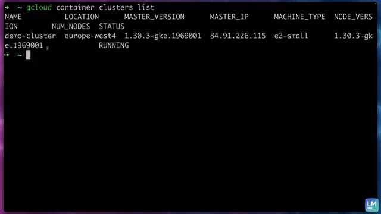

然后拉取 GKE 凭据：

```bash
gcloud container clusters get-credentials demo-cluster --region europe-west4
```

如果终端提示需要安装插件，按提示安装 `gke-gcloud-auth-plugin`：

```bash
gcloud components install gke-gcloud-auth-plugin
gke-gcloud-auth-plugin --version
```

安装完成后再执行一次：

```bash
gcloud container clusters get-credentials demo-cluster --region europe-west4
kubectl config current-context
```

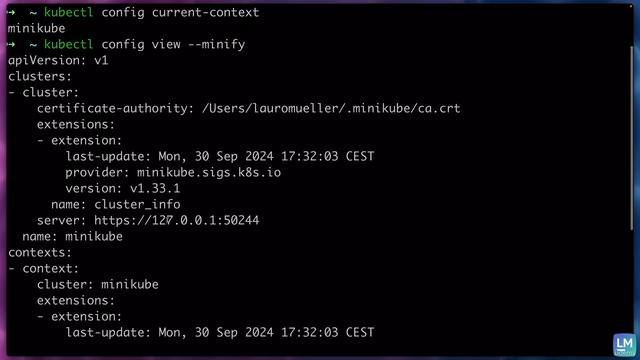

此时 `kubectl config current-context` 应该已经指向 GKE 集群。再执行：

```bash
kubectl config view
```

你会看到新增了 context、user 和 cluster 认证信息。讲师特别指出：带 `--minify` 时这些信息被裁掉，去掉后才能看到其他 context/user。

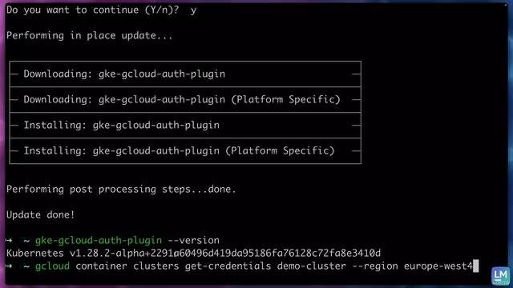

如果你要切回本地 Minikube：

```bash
kubectl config use-context minikube
```

要切回 GKE，最稳的方式是重新跑一次 `gcloud container clusters get-credentials ...`，或者从 `kubectl config get-contexts` 里复制 GKE context 名称后：

```bash
kubectl config use-context <GKE_CONTEXT_NAME>
```

验证请求确实打到 GKE：

```bash
kubectl get pods --v=8
```

课程里用 `--v=8` 看到了实际请求的 API 地址，并和 `gcloud container clusters list` 里的 master IP 对上。具体输出字段以你本机 `kubectl` 为准，不要死记字段名。

### 3.3 部署第一个 nginx LoadBalancer

创建临时目录：

```bash
mkdir -p project-gke/nginx
cd project-gke/nginx
```

把第 4 节里的 `deployment.yaml`、`service.yaml` 保存进去，然后：

```bash
kubectl config current-context
kubectl apply -f .
kubectl get deploy
kubectl get pods
kubectl get service nginx
```

第一个 Pod 可能先处于 pending，课程里等了大约三分钟才起来。GKE 控制台里也能在 Clusters、Workloads 里看到 Pod、CPU/内存/磁盘指标，以及 Service 暴露出来的公网地址。

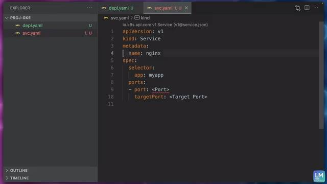

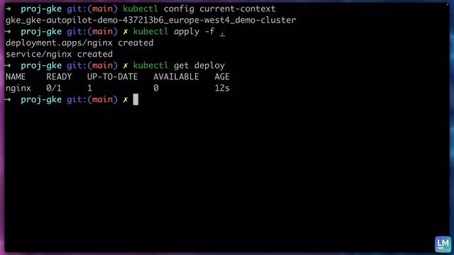

等 `kubectl get service nginx` 显示出外部地址后，用浏览器访问它，应该看到 nginx 欢迎页。课程里也从 Google Cloud 控制台的 Networking → Services & Ingress 里看到了这个 external load balancer，并继续点进 Load Balancing 看到底层资源。

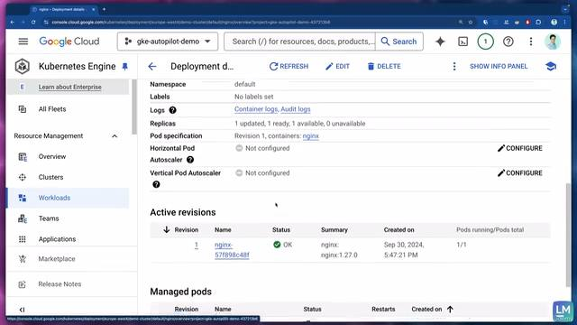

演示完成后删除，避免计费：

```bash
kubectl delete -f .
```

删除 LoadBalancer Service 时，底层负载均衡器不会瞬间消失，云控制台里可能要等一会儿。课程里等它删完后确认 Service 和 Load Balancer 都没了。

### 3.4 看 GKE 的 StorageClass 和 API Resources

先切回 Minikube 对比：

```bash
kubectl config use-context minikube
kubectl get storageclass
kubectl api-resources
```

再切回 GKE：

```bash
gcloud container clusters get-credentials demo-cluster --region europe-west4
kubectl config current-context
kubectl get storageclass
```

GKE 的 StorageClass 输出列很多，课程里用 custom-columns 只取 `metadata.name` 和顶层 `provisioner`：

```bash
kubectl get storageclass -o custom-columns='NAME:.metadata.name,PROVISIONER:.provisioner'
```

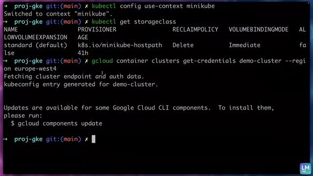

然后挑一个存储类看细节：

```bash
kubectl describe storageclass <从上面输出复制一个存储类名称>
```

课程里重点看了这些点：

- premium 和 standard 的 provisioner 可能相同，但底层磁盘性能不同。
- `read-write-one` 一类使用 Compute Engine Persistent Disk。
- `read-write-many` 一类改用 Filestore provisioner，因为 Persistent Disk 不支持多节点读写。
- `reclaimPolicy` 是 `Delete`：删 PVC 时，PV 和底层磁盘一起删。
- `volumeBindingMode` 是 `WaitForFirstConsumer`：先创建 PVC 不会立刻建盘，等 Pod 调度并真正使用 PVC 时才建盘，避免闲置磁盘成本。

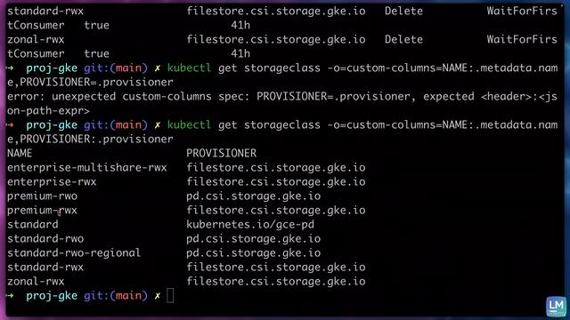

API Resources 对比：

```bash
kubectl api-resources
```

Minikube 上是一组核心资源；GKE 上会多出更多组，包括以 `gke.io` 结尾的组。课程里用这个差异说明“托管集群扩展了 API 能力”。

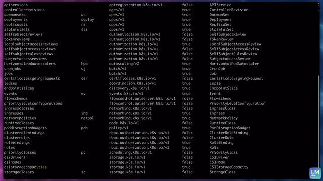

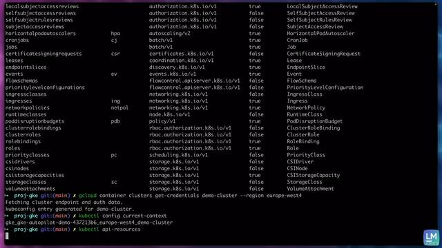

### 3.5 用 Kustomize 创建 Namespace 与 Secret

进入项目目录：

```bash
cd project-gke
mkdir -p namespaces shared-config/dev shared-config/prod
```

把第 4 节的 Namespace、`customization.yaml`、`.env` 文件写好。然后执行：

```bash
kubectl apply -f namespaces/
kubectl get namespaces
```

确认 `dev` 和 `prod` 存在后，应用两个 shared-config：

```bash
kubectl apply -k shared-config/dev
kubectl apply -k shared-config/prod
kubectl get secrets -n dev
kubectl get secrets -n prod
```

你应该能在两个 namespace 里分别看到两个 Secret 名称：MongoDB root 凭据和 color-db 凭据。课程里就是用 Kustomize 的 `secretGenerator` 从 `.env` 文件生成。

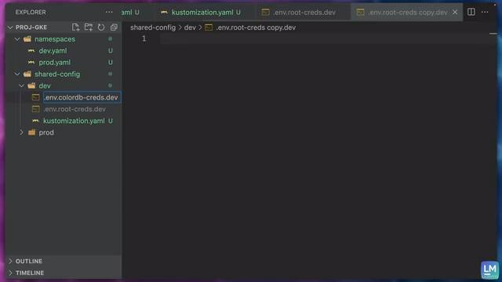

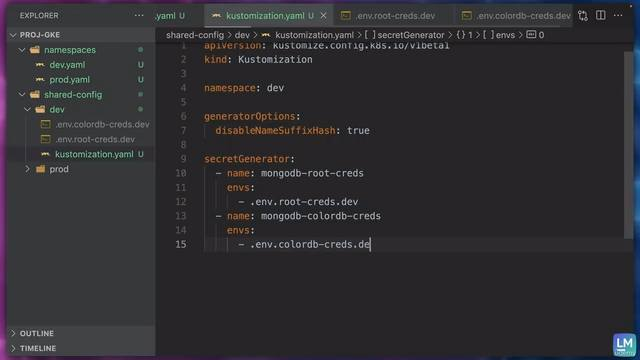

### 3.6 搭 color-db 的 base 骨架

创建目录：

```bash
mkdir -p color-db/_base color-db/dev color-db/prod
```

把第 4 节的 `mongo-init.js`、`mongodb-svc.yaml`、`customization.yaml` 放入 `color-db/_base/`。此时不要急着 `kubectl apply -k color-db/_base`，因为讲师在 P77 明确说还要先定义 StatefulSet 再应用。你可以先用下面命令渲染检查：

```bash
kubectl kustomize color-db/_base
```

它应该能渲染出 ConfigMap 和 Service。`dev`、`prod` 目录在 P77 里只是先建出来，后续会放 overlay。

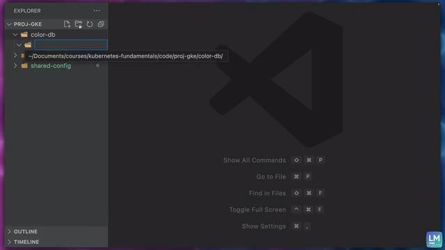

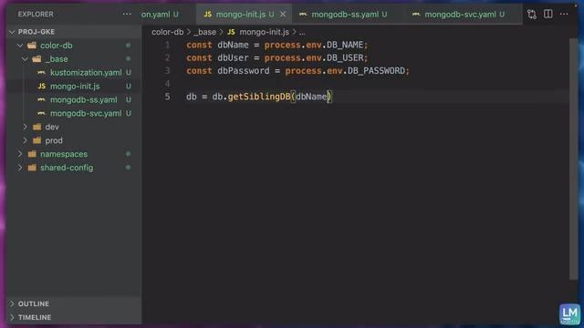

---

## 4. 完整代码

### 4.1 P73 临时 nginx 演示

文件：`project-gke/nginx/deployment.yaml`

```yaml
apiVersion: apps/v1
kind: Deployment
metadata:
  name: nginx
spec:
  selector:
    matchLabels:
      app: nginx
  template:
    metadata:
      labels:
        app: nginx
    spec:
      containers:
        - name: nginx
          image: nginx:1.27.0
          ports:
            - containerPort: 80
          resources:
            limits:
              memory: 256Mi
            requests:
              cpu: 200m
              memory: 128Mi
```

文件：`project-gke/nginx/service.yaml`

```yaml
apiVersion: v1
kind: Service
metadata:
  name: nginx
spec:
  type: LoadBalancer
  selector:
    app: nginx
  ports:
    - port: 80
      targetPort: 80
```

部署与删除：

```bash
cd project-gke/nginx
kubectl apply -f .
kubectl get deploy
kubectl get pods
kubectl get service nginx
# 演示完删除
kubectl delete -f .
```

### 4.2 Namespace

文件：`project-gke/namespaces/dev.yaml`

```yaml
apiVersion: v1
kind: Namespace
metadata:
  name: dev
```

文件：`project-gke/namespaces/prod.yaml`

```yaml
apiVersion: v1
kind: Namespace
metadata:
  name: prod
```

应用：

```bash
cd project-gke
kubectl apply -f namespaces/
```

### 4.3 shared-config/dev

文件：`project-gke/shared-config/dev/customization.yaml`

```yaml
apiVersion: kustomize.config.k8s.io/v1beta1
kind: Kustomization

namespace: dev

generatorOptions:
  disableNameSuffixHash: true

secretGenerator:
  - name: mongodb-root-creds
    envs:
      - .env.root-creds.dev
  - name: mongodb-color-db-creds
    envs:
      - .env.color-db-creds.dev
```

文件：`project-gke/shared-config/dev/.env.root-creds.dev`

```text
username=root_user
password=root_password
```

文件：`project-goke/shared-config/dev/.env.color-db-creds.dev`

> 上面路径故意写错会误导，正确路径是 `project-gke/shared-config/dev/.env.color-db-creds.dev`。下面是文件内容：

```text
username=color_db_user
password=dev_color_db_password_change_me_42
```

这两个密码只是课程演示用的明文示例，真实环境请替换，且不要把 `.env` 提交到 Git。

应用：

```bash
kubectl apply -k shared-config/dev
kubectl get secrets -n dev
```

### 4.4 shared-config/prod

文件：`project-gke/shared-config/prod/customization.yaml`

```yaml
apiVersion: kustomize.config.k8s.io/v1beta1
kind: Kustomization

namespace: prod

generatorOptions:
  disableNameSuffixHash: true

secretGenerator:
  - name: mongodb-root-creds
    envs:
      - .env.root-creds.prod
  - name: mongodb-color-db-creds
    envs:
      - .env.color-db-creds.prod
```

文件：`project-gke/shared-config/prod/.env.root-creds.prod`

```text
username=root_user
password=prod_root_password_change_me_84
```

文件：`project-gke/shared-config/prod/.env.color-db-creds.prod`

```text
username=color_db_user
password=prod_color_db_password_change_me_97
```

应用：

```bash
kubectl apply -k shared-config/prod
kubectl get secrets -n prod
```

### 4.5 color-db/base 的 Mongo 初始化脚本

文件：`project-gke/color-db/_base/mongo-init.js`

```javascript
const DB_NAME = process.env.db_name;
const DB_USER = process.env.db_user;
const DB_PASSWORD = process.env.db_password;

const colorDb = db.getSiblingDB(DB_NAME);

console.log(`initializing ${DB_NAME}`);
console.log(`initializing creating user ${DB_USER}`);

colorDb.createUser({
  user: DB_USER,
  pwd: DB_PASSWORD,
  roles: [
    {
      role: "readWrite",
      db: DB_NAME,
    },
  ],
});

console.log("initializing success");
```

说明：课程口述里是 `db = db.getSiblingDB(...)`，但直接在 mongosh 脚本里用 `const db = ...` 会遮蔽全局 `db`，所以我用 `colorDb` 这个变量名。逻辑与讲师口述一致：取 DB、创建用户、给 `readWrite` 角色、打印日志。

### 4.6 color-db/base 的 Service

文件：`project-gke/color-db/_base/mongodb-svc.yaml`

```yaml
apiVersion: v1
kind: Service
metadata:
  name: mongodb-svc
spec:
  clusterIP: None
  selector:
    app: mongodb
  ports:
    - port: 27017
      targetPort: 27017
```

### 4.7 color-db/base 的 Kustomization

文件：`project-gke/color-db/_base/customization.yaml`

```yaml
apiVersion: kustomize.config.k8s.io/v1beta1
kind: Kustomization

commonLabels:
  app: mongodb
  project: proj-gke

configMapGenerator:
  - name: mongodb-init-colordb
    files:
      - mongo-init.js

resources:
  - mongodb-svc.yaml
```

渲染检查：

```bash
kubectl kustomize color-db/_base
```

暂时不要 `apply` 到集群，因为 StatefulSet 还没写。

### 4.8 尚未由本段课程给出的文件

`project-gke/color-db/_base/mongodb-statefulset.yaml` 在 P77 里只被提到，内容没有出现。讲师原话是“Before we apply this configuration, we should also define our stateful set here and include in our customization. So before we do that, let's take a short break.” 因此本文不提供伪造的 StatefulSet。下一节课程才会写它，届时它应该被加入 `resources`，并引用 `mongodb-init-colordb` ConfigMap 和 `mongodb-color-db-creds` Secret。

---

## 5. 逐行解释

### 5.1 `gcloud container clusters get-credentials` 在做什么

`gcloud container clusters get-credentials demo-cluster --region europe-west4` 不是部署命令，它只改本地 kubeconfig：新增一个 cluster 条目、一个 user 认证条目、一个 context。之后 `kubectl` 才通过这个 context 访问 GKE API Server。

`kubectl config current-context` 看当前用哪个 context；`kubectl config view --minify` 只看当前 context 相关配置；`kubectl config view` 则能看到所有 context 和 user。课程里用这个差异说明“加了 minify 会裁掉其他信息”。

`gke-gcloud-auth-plugin` 是 GKE 认证插件。没有它时 `get-credentials` 会提示 action required，安装后再执行一次即可。这里没有锁、事务或并发问题；在 Node 里可以理解为“换了一套 API 请求的认证 token 来源”。

### 5.2 Deployment 的 selector 与 template labels

`spec.selector.matchLabels.app: nginx` 必须和 `spec.template.metadata.labels.app: nginx` 对上。Deployment 靠这个 selector 管理 Pod。对不上时，Deployment 会创建 Pod 但不算自己的副本，后续滚动更新也会乱。

`image: nginx:1.27.0` 是课程指定版本。`containerPort: 80` 只是声明容器监听 80，不会自动做端口映射；真正暴露靠 Service 的 `targetPort: 80`。

`resources.requests` 是调度时预留的资源；`limits` 是上限。课程里用 `cpu: 200m`、`memory: 128Mi` 做 requests，`memory: 256Mi` 做 limits。`200m` 是 0.2 核；`Mi` 是二进制兆字节，不要写成 `256 bytes`。这些值会影响计费和调度，GKE 控制台里也能看到请求量、限制量和实际使用量。

### 5.3 为什么 `type: LoadBalancer` 在 GKE 有效、在本地无效

Service 的 `type: LoadBalancer` 是一个“声明”。本地 Minikube 没有云控制器

## 6. 复现检查清单

- [ ] GKE 凭据已拉取：执行 `gcloud container clusters get-credentials demo-cluster --region europe-west4` 后，再执行 `kubectl config current-context`；应看到当前上下文已从 `minikube` 切到 GKE 的 `demo-cluster` 对应 context。
- [ ] GKE 认证插件可用：如果 `get-credentials` 提示需要插件，执行 `gcloud components install gke-gcloud-auth-plugin`，再用 `gke-gcloud-auth-plugin --version` 验证；应能显示版本号，然后重跑 `get-credentials` 成功。
- [ ] kubeconfig 条目完整：执行 `kubectl config view`（去掉 `--minify`）；应能看到新增的 GKE context、user、cluster 认证信息，同时还能看到 Minikube、Bob、Alice 等其他 context/user。
- [ ] 请求确实打到 GKE：执行 `kubectl get pods --v=8`；应看到请求的 API 地址不是 localhost，而是 GKE 的公网/master IP，并且能与 `gcloud container clusters list` 里的 master IP 对上（字段名以你本机输出为准）。
- [ ] nginx YAML 的 selector 对齐：`kubectl apply -f .` 前检查 Deployment 的 `spec.selector.matchLabels.app: nginx` 与 Pod template label 一致；Service 的 selector 也应是 `app: nginx`，端口为 `80`，`targetPort` 为 `80`。
- [ ] nginx 资源已创建：执行 `kubectl apply -f .` 后，`kubectl get deploy` 应看到 nginx Deployment；`kubectl get pods` 可能先显示 Pending，课程里约等三分钟后应看到 Pod Running/Ready；`kubectl get service nginx` 应看到 `type: LoadBalancer`。
- [ ] nginx 公网可访问：`kubectl get service nginx` 的 EXTERNAL-IP 显示出公网地址后，用浏览器访问该地址；应看到 nginx 欢迎页。GKE 控制台 Networking → Services & Ingress / Load Balancing 里也应能看到自动创建的负载均衡器。
- [ ] 临时 nginx 已清理：执行 `kubectl delete -f .` 后，`kubectl get deploy` 和 `kubectl get service nginx` 应查不到对应资源；GKE 控制台里 Service 和 Load Balancer 最终消失，删除 LB 可能需要等一会儿。
- [ ] StorageClass 对比成功：`kubectl config use-context minikube` 后执行 `kubectl get storageclass`；应只看到 Minikube 的简单存储类。切回 GKE 后执行 `kubectl get storageclass`；应看到更多存储类。
- [ ] StorageClass 输出列可读：执行 `kubectl get storageclass -o custom-columns='NAME:.metadata.name,PROVISIONER:.provisioner'`；应只输出 NAME 和 PROVISIONER 两列，而不是默认的宽表格。
- [ ] StorageClass 细节符合课程：挑一个存储类执行 `kubectl describe storageclass <名称>`；应能看到 premium/standard 的磁盘性能差异、read-write-many 使用 Filestore provisioner 的说明，以及 `reclaimPolicy: Delete`、`volumeBindingMode: WaitForFirstConsumer`。
- [ ] API Resources 差异可见：Minikube 上执行 `kubectl api-resources` 得到核心资源列表；切回 GKE 后执行同一命令，应看到更扩展的列表，并能看到以 `gke.io` 结尾的 API 组。
- [ ] Namespace 已创建：执行 `kubectl apply -f namespaces/` 后，`kubectl get namespaces` 应看到 `dev` 和 `prod`。
- [ ] shared-config 的 Secret 已生成：分别执行 `kubectl apply -k shared-config/dev` 和 `kubectl apply -k shared-config/prod` 后，`kubectl get secrets -n dev` 与 `kubectl get secrets -n prod` 应分别看到 MongoDB root 凭据和 color-db 凭据两个 Secret。
- [ ] Secret 名称稳定：检查 `shared-config/dev/customization.yaml` 和 `shared-config/prod/customization.yaml` 里的 `generatorOptions.disableNameSuffixHash: true`；应用后 `kubectl get secrets -n dev/prod` 应看到不带随机 hash 后缀的稳定 Secret 名称。
- [ ] `.env` 路径正确：确认存在 `project-gke/shared-config/dev/.env.root-creds.dev`、`.env.color-db-creds.dev`，以及 prod 对应文件；文档 4.3 特别提醒过 `.env.color-db-creds.dev` 的路径容易写错。
- [ ] color-db base 可渲染：执行 `kubectl kustomize color-db/_base`；应能成功渲染出 `mongodb-init-colordb` ConfigMap 和 `mongodb-svc` Service。
- [ ] headless Service 配置正确：检查渲染结果或 `mongodb-svc.yaml`；Service 应有 `clusterIP: None`、selector `app: mongodb`、`port: 27017`、`targetPort: 27017`。
- [ ] 没有提前 apply color-db base：本节 P77 结束时 `mongodb-statefulset.yaml` 还没有写出，因此不要执行 `kubectl apply -k color-db/_base`；只应使用 `kubectl kustomize color-db/_base` 做渲染检查。

## 7. 课里没讲但你会撞上的

| 现象 | 原因 | 怎么办 |
|---|---|---|
| `gcloud container clusters get-credentials demo-cluster ...` 报找不到集群，或 region/project 不正确。 | 课里没讲：本机 `gcloud` 未指向创建 `demo-cluster` 的项目或区域；课程只演示了 `get-credentials`，没有展开 `gcloud config` 前置设置。 | 按文档 3.1 先执行 `gcloud config set project <你的_PROJECT_ID>`、`gcloud config set compute/region europe-west4`；若实际集群不在该区域，用实际 `--region`，并先用 `gcloud container clusters list` 确认集群位置。 |
| 执行 `kubectl apply -k shared-config/dev` 或 `kubectl kustomize color-db/_base` 时提示找不到 kustomization 文件，尽管目录里按文档写了 `customization.yaml`。 | 课里没讲（补充）：Kustomize 默认查找的文件名通常不是 `customization.yaml`；文档中沿用了 `customization.yaml` 这个命名，实际命令可能识别不到。 | 先检查目录里的文件名是否被当前 Kustomize 识别；如果报找不到 kustomization 文件，将对应文件改为 `kustomization.yaml` 后重跑命令。 |
| `kubectl apply -f .` 后 nginx Pod 长时间 Pending，或 GKE 控制台短暂出现错误提示。 | 课里没讲：课程只说第一个 Pod 可能等约三分钟，若超过时间仍异常，具体排查步骤没有展开。 | 先等待几分钟；若仍 Pending，用 `kubectl describe pod <pod>`、`kubectl get events` 查看事件，检查资源请求、配额、镜像拉取等问题。 |
| `kubectl get service nginx` 的 EXTERNAL-IP 长时间显示 `<pending>`，浏览器打不开 nginx 欢迎页。 | 课里没讲（补充）：GKE 创建 LoadBalancer 公网 IP 需要时间，也可能受项目配额或网络配置影响；课程只说明会自动创建负载均衡器，没有给等待和排查步骤。 | 继续用 `kubectl get service nginx` 观察，并查看 Service events；同时到 GKE 控制台 Networking → Services & Ingress / Load Balancing 确认底层 LB 是否创建，必要时检查配额。 |
| 做 Minikube/GKE 对比后，再部署 nginx 或 Secret 时资源跑到了错误集群。 | 课里没讲（补充）：课程中会多次 `kubectl config use-context` 和 `get-credentials` 来回切换，但没有强调每次 `apply` 前都固定检查上下文。 | 每次执行 `kubectl apply` 前先跑 `kubectl config current-context`；确认当前是 GKE context 后再部署 nginx 或 shared-config，做 StorageClass/API 对比时再显式切回对应集群。 |
| `kubectl apply -k shared-config/dev` 报 namespace `dev` 不存在，或 Secret 没出现在预期 namespace。 | 课里没讲（补充）：课程演示了先应用 `namespaces/`，但没有讲顺序错误或 overlay 中 `namespace` 写错时的报错表现。 | 先执行 `kubectl apply -f namespaces/`，再用 `kubectl get namespaces` 确认 `dev`、`prod` 存在；检查 `customization.yaml` 里的 `namespace` 字段，再分别应用 `shared-config/dev` 和 `shared-config/prod`。 |
| `secretGenerator` 报找不到 `.env` 文件，或生成的 Secret 内容不符合预期。 | 课里没讲（补充）：课程没有展开 `envs` 相对路径和文件名拼错时的报错；文档 4.3 也特别提醒过 `.env.color-db-creds.dev` 的路径容易写错。 | 检查 `shared-config/dev/.env.root-creds.dev`、`.env.color-db-creds.dev` 以及 prod 对应文件名；`envs` 路径应相对于 `customization.yaml` 所在目录，修正后重跑 `kubectl apply -k ...`。 |
| Secret 名称后面带了随机 hash，后续引用名称不稳定。 | 课里讲了要禁用 hash，但课里没讲（补充）：如果 `generatorOptions.disableNameSuffixHash: true` 写错位置或缩进不对，实际不会生效。 | 检查 customization 中 `generatorOptions.disableNameSuffixHash: true` 的层级和缩进；重新应用后执行 `kubectl get secrets -n dev` 和 `kubectl get secrets -n prod`，确认名称不带随机后缀。 |
| 提前执行 `kubectl apply -k color-db/_base` 后，没有 MongoDB Pod，或后续无法连接数据库。 | 课里讲了 P77 还没写 StatefulSet，但课里没讲（补充）：误 apply 后实际会出现“Service/ConfigMap 有了，但没有 MongoDB StatefulSet/Pod”的现象。 | 本节不要 apply `color-db/_base`，只用 `kubectl kustomize color-db/_base` 渲染检查；如果已误 apply，删除该 base 产生的 Service/ConfigMap，等下一节补上 `mongodb-statefulset.yaml` 并加入 `resources` 后再应用。 |
| `kubectl kustomize color-db/_base` 输出里 Service 不是 headless，或 selector 与预期不一致。 | 课里没讲（补充）：课程说明了要设 `clusterIP: None` 和 `app: mongodb`，但没有讲渲染后如何核对，以及漏写/写错 selector 时的表现。 | 检查 `mongodb-svc.yaml` 中 `clusterIP: None`、`selector.app: mongodb`、`port: 27017`、`targetPort: 27017`；再执行 `kubectl kustomize color-db/_base` 查看渲染结果。 |
