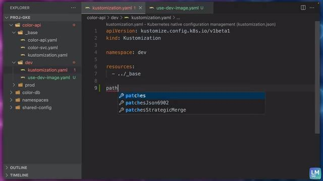
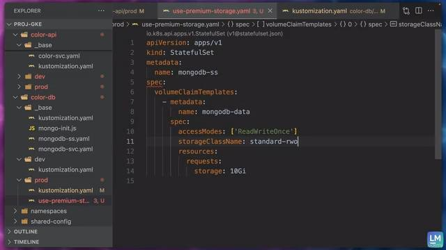
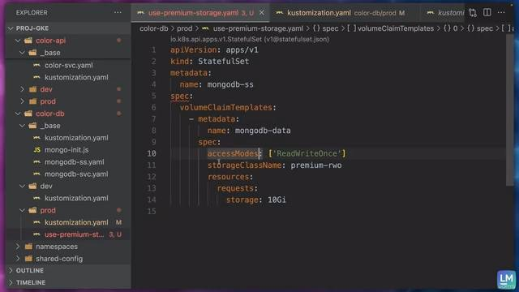
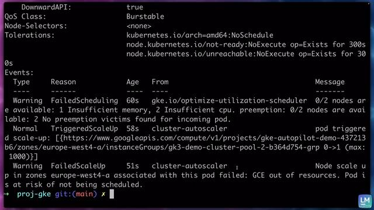
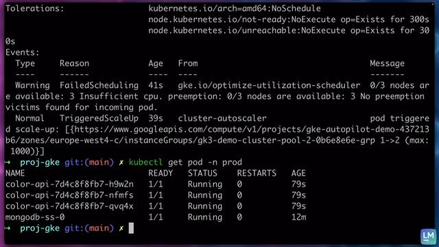
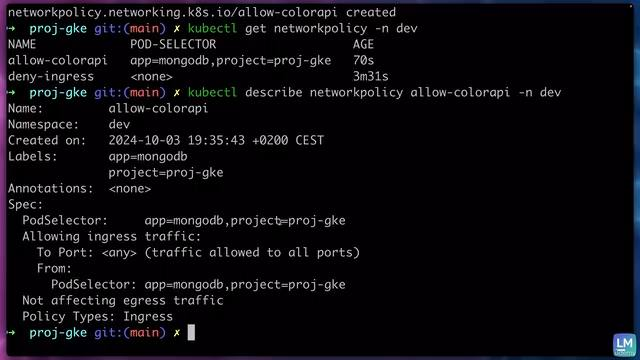
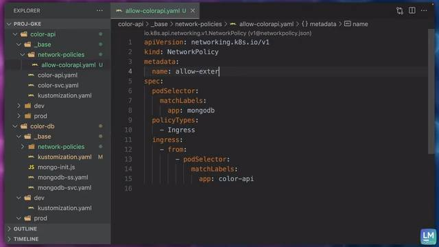
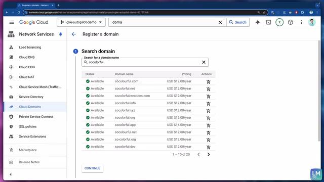

# Docker & Kubernetes Zero to Hero — P083–P087 复现文档

> 覆盖范围：P083–P087。这一段的主题是「用 Kustomize 把 dev / prod 两套环境彻底分叉，然后给集群加上网络策略（NetworkPolicy），最后注册域名准备做 Ingress」。
>
> 阅读前提：你已经跟着前面的课把 `project-gke` 目录、`base`（color-api / color-db）、`overlays/dev`、`overlays/prod` 都建好了。这一段是在那套目录上继续改。

---

## 1. 这一节做什么

这一段一共五集，做的事可以拆成四件互相咬合的事：

1. **P083 — 用 Kustomize patch 把 dev 换成新镜像、把 prod 副本数拉到 3、把 prod 数据库换成 premium 存储。** 中间踩到一个关键坑：`volumeClaimTemplates` 用 strategic merge patch 会被整体覆盖而不是合并，讲师改用 JSON patch（`op: replace` + 路径索引）解决。
2. **P083 后半 — 应用 prod 数据库时 pod 卡在 Pending，`kubectl describe pod` 显示 cluster autoscaler 报 GCE 在 `europe-west4-a` 没资源；等一会儿后 autoscaler 自己换到 `europe-west4-b` 建了新节点，pod 起来了。** 这一段是 GKE Autopilot 的自动节点管理演示。
3. **P084 — 把 dev 的新镜像 apply 上去（滚动更新，旧 pod 被替换），把 prod 的 color-api 也 apply 上去（3 副本），用 curl 打 LoadBalancer 外部 IP 验证负载被分到不同 pod。**
4. **P085–P086 — 建 NetworkPolicy：先 `deny-ingress` 全命名空间默认拒绝，再 `allow-color-api` 允许 color-api → mongo，再 `allow-external` 允许外部 → color-api。** 中间踩到第二个坑：Kustomize 的 `commonLabels` 会被注入到 NetworkPolicy 的 `podSelector` / `namespaceSelector` 里，把选择器改坏，讲师最后选择从这些文件里去掉 commonLabels。
5. **P087 — 在 Cloud Domains 注册一个域名（`colorful.com`），选 Cloud DNS 做 nameserver，关掉自动续费。** 这一集基本是控制台操作，为下一节的 Ingress + 托管证书做准备。

从学习路径上看，这一段的重点不是「多写几个 YAML」，而是理解三组边界：第一组是 Kustomize 的 patch 边界，什么字段能合并、什么字段会整体替换；第二组是 Kubernetes 网络策略的边界，默认拒绝和显式放行必须成对出现；第三组是云平台资源生命周期边界，节点、负载均衡器、域名都不是本地立刻生效的东西，需要观察状态变化。下面每一节都会围绕这三组边界展开，命令、代码和检查项都尽量给出可验证的路径。

---

## 2. 讲师原话（带出处）

- 「the base image that we are using here is the color API 2.0.0. Let's then under dev here create a new patch file and that's just going to be use dev image.yaml」—— p083 [00:00]
- 「this is a partial definition of our resource that will be merged into the existing color API deployment coming from our base」—— p083 [00:48]
- 「Volume claim templates are not merged very well by the Kubernetes strategic merge patches. So for that, we actually need to specify here, this is one case where we need to specify the whole configuration once again, just for the volume claim templates」—— p083 [04:06]
- 「the common labels that are now applied here in our base ... they are actually not applied to the patch」—— p083 [04:31]
- 「instead of actually using a strategic merge patch here, we can actually use a JSON patch because the only thing that we want to change is the storage class name」—— p083 [04:58]
- 「this operation here will be replaced. The path that we want to change will be ... forward slash spec forward slash volume claim templates forward slash zero」—— p083 [05:26]
- 「One drawback here is that if we add more volume claim templates to our state full set here, then these would not be immediately included」—— p083 [07:40]
- 「this cluster autoscalar event here, It is informing that the Google Compute Engine is out of resources. It's looking at the Zone Europe West for A」—— p083 [09:05]
- 「The cluster autoscaler was very smart, was smart enough to recognize that there are not enough resources in the West for A zone. So I'm going to try to create the node in the West for B zone」—— p083 [10:39]
- 「the deployment has been configured ... That's creating a new one that's probably using the newer version」—— p084 [00:28]
- 「the response is then coming back from different hosts, right? So from different pods. That means the load balancer is successfully distributing the load」—— p084 [03:09]
- 「we are going to create a network policy that will basically just deny ingress in all of our pods」—— p085 [00:51]
- 「since the network policies, the default ones, the native ones to Kubernetes, they don't support a cluster wide network policy, we then need to apply them to all the namespaces」—— p085 [03:06]
- 「it seems like customized is a little bit confused here. We don't really want to change these values here. So one way for us to do that is we can just remove the common labels here」—— p085 [06:48]
- 「This will also allow all the rules or basically allow ingress from everywhere into only our color API pods」—— p086 [00:29]
- 「the reason why this is taking time to delete is because of the service ... waiting for the load balancer to also be deleted」—— p086 [02:07]
- 「buying domains is something that is very likely not included in your free trial credits」—— p087 [00:28]
- 「I'm just going to use cloud domains because then we actually already get some integration here with cloud DNS」—— p087 [00:00]

这些原话分别对应几个关键判断：patch 是部分对象、`volumeClaimTemplates` 合并不可靠、JSON patch 用路径索引、NetworkPolicy 没有集群级默认策略、`commonLabels` 会污染选择器、LoadBalancer 删除需要等云平台、域名费用不在试用额度内。复现时如果某一步结果不对，先回到这些原话确认自己是不是把「部分对象」写成了「完整对象」，或者把「默认拒绝」和「显式放行」的顺序搞反了。

---

## 3. 从零复现

### 3.0 前置状态确认

开始前先确认你手上有这些目录（前面课程建的）：

```
project-gke/
├── base/
│   ├── color-api/
│   │   ├── deployment.yaml
│   │   ├── service.yaml
│   │   └── kustomization.yaml
│   ├── color-db/
│   │   ├── statefulset.yaml
│   │   ├── service.yaml
│   │   └── kustomization.yaml
│   └── kustomization.yaml
├── overlays/
│   ├── dev/
│   │   └── kustomization.yaml
│   └── prod/
│       └── kustomization.yaml
└── shared-config/
    ├── dev/
    │   └── kustomization.yaml
    └── prod/
        └── kustomization.yaml
```

先跑一遍确认现状：

```bash
kubectl get pods -n dev
kubectl get pods -n prod
kubectl get svc -n dev
```

这三条命令分别检查 dev 的 pod 是否正常、prod 的 pod 是否正常、dev 的 Service 是否已经分配外部 IP。如果这里已经有异常，不要继续往下做 patch，因为后面的现象会混在一起，很难判断是 patch 的问题还是前置状态的问题。常见错误是 namespace 写错或当前 context 不是目标集群，排查时先跑 `kubectl config current-context` 和 `kubectl get ns`，确认 `dev`、`prod` 两个命名空间存在。

### 3.1 P083：dev 换新镜像

1. 在 `overlays/dev/` 下新建 `use-dev-image.yaml`（内容见第 4 节）。
2. 在 `overlays/dev/kustomization.yaml` 的 `patches` 里加上 `path: use-dev-image.yaml`。
3. 验证渲染结果：

```bash
kubectl kustomize overlays/dev | grep -A2 "image:"
```

应该看到 color-api 的镜像变成 `2.1.0-dev`。

这条命令的完整解释是：`kubectl kustomize overlays/dev` 只做本地渲染，不会把任何东西提交到集群；`grep -A2 "image:"` 是在渲染出的 YAML 里找 `image:` 行并向后多显示两行，方便确认镜像名和上下文。常见错误是直接 `kubectl apply` 之后才看 pod，结果 pod 拉镜像失败，回头还要区分是 patch 没生效还是镜像名写错。更稳的顺序是先渲染、再 apply。如果 `grep` 看不到 `2.1.0-dev`，先检查 `kustomization.yaml` 的 `patches` 是否缩进正确，再检查 patch 文件里的 `metadata.name` 是否和 base 里的 Deployment 名字一致。

### 3.2 P083：prod 副本数拉到 3

1. 在 `overlays/prod/` 下新建 `increase-replica-count.yaml`。
2. 在 `overlays/prod/kustomization.yaml` 的 `patches` 里加上它。
3. 验证：

```bash
kubectl kustomize overlays/prod | grep -A1 "replicas:"
```

这里同样只做本地渲染。`replicas` 是标量字段，strategic merge 会直接覆盖，所以 patch 文件里只需要 `metadata.name` 和 `spec.replicas`。常见错误是把 `replicas` 写到 `spec.template.spec` 下面，那样不会报错但也不会改副本数；排查时看渲染结果里 `replicas:` 出现在哪一层，应该在 `spec` 下、和 `selector`、`template` 同级。

### 3.3 P083：prod 数据库换 premium 存储（关键坑）

**先按「直觉写法」试一次，看它怎么坏**（讲师就是这么演示的）：

1. 在 `overlays/prod/` 下新建 `use-premium-storage.yaml`，内容只写 `metadata.name` + `volumeClaimTemplates` 里改 `storageClassName`。
2. 在 `overlays/prod/kustomization.yaml` 的 `patches` 里加上它。
3. 跑：

```bash
kubectl kustomize overlays/prod
```

你会看到 `volumeClaimTemplates` 被**整体替换**，base 里原有的 `resources.requests.storage`、`accessModes` 等字段全丢了。这就是讲师说的「Volume claim templates are not merged very well」。

**改成 JSON patch 写法**：把 `use-premium-storage.yaml` 换成 `op: replace` 的 JSON patch（内容见第 4 节），并在 `kustomization.yaml` 里给它加 `target`（`version: v1` / `group: apps` / `kind: StatefulSet`）。再跑一次 `kubectl kustomize overlays/prod`，确认 `storageClassName` 变成 `premium-rwo` 且其它字段都还在。

> 注意：讲师在 p083 [06:50] 明确说 target 里**不写 name**，这样会匹配 prod 里所有 StatefulSet 的第一个 volumeClaimTemplate。这是有意的取舍，不是遗漏。

这里的排查重点是「整体替换」四个字：如果你看到渲染结果里 `volumeClaimTemplates` 下面只剩 `storageClassName`，没有 `resources` 和 `accessModes`，说明 strategic merge 已经把列表冲掉了，不是你的 YAML 缩进问题。改成 JSON patch 后，如果 `kubectl kustomize` 报路径找不到，先确认 base 里确实有 `storageClassName` 字段；如果 base 里没有这个字段，`replace` 会失败，需要改成 `add`。这是 JSON patch 和 strategic merge 的另一个差异：`replace` 要求旧值存在，`add` 可以新增。

### 3.4 P083：apply prod 数据库，观察 Pending → 自动扩节点

```bash
kubectl apply -k overlays/prod
kubectl get pods -n prod
kubectl describe pod <mongo-pod-name> -n prod
```

`describe` 里会看到 cluster autoscaler 的事件，说 GCE 在 `europe-west4-a` 没资源。**不要手动改 zone**，等 1–3 分钟，autoscaler 会自己换到 `europe-west4-b` 建新节点。验证：

```bash
kubectl get nodes
kubectl describe node <新节点名> | grep -A20 "Labels"
```

在 Labels 里找 `topology.kubernetes.io/zone`，应该是 `europe-west4-b`。再确认 PVC 用的是 premium 类：

```bash
kubectl get pvc -n prod
```

这一段命令的完整解释是：`kubectl apply -k` 会先渲染再提交，`kubectl get pods` 看调度状态，`kubectl describe pod` 看事件。Pending 本身不是错误，关键是看事件里是「没有节点可调度」还是「镜像拉取失败」还是「PVC 绑定失败」。如果事件里出现 autoscaler 的 `NotTriggerScaleUp` 或 `TriggeredScaleUp`，说明它在尝试扩节点；如果一直 Pending 且没有 autoscaler 事件，先检查集群是否开启了 autoscaler。常见错误是看到 Pending 就手动删 pod，结果只是把等待时间重新开始；更稳的做法是看 `kubectl get events -n prod --sort-by=.lastTimestamp`，确认最近事件是不是在往扩节点方向走。

### 3.5 P084：apply dev 和 prod 的 color-api

```bash
kubectl apply -k overlays/dev
kubectl get pods -n dev
kubectl describe pod <新 pod> -n dev
kubectl get pods -n dev   # 旧 pod 应已消失

kubectl apply -k overlays/prod
kubectl get deployments -n prod
kubectl get pods -n prod
```

prod 的 deployment 可能先显示 `2/3`，因为第 3 个 pod 在等 autoscaler 扩节点。等几分钟后变 `3/3`。

验证负载均衡：

```bash
kubectl get svc -n prod
curl http://<EXTERNAL-IP>/metrics
curl http://<EXTERNAL-IP>/metrics
```

多次 curl 会看到响应来自不同 host（不同 pod）。

这里的排查点是滚动更新：dev 的 Deployment 改镜像后，Kubernetes 会新建 pod 再删旧 pod，所以中间会短暂看到新旧 pod 并存。如果旧 pod 一直不消失，看 `kubectl describe deployment color-api -n dev` 里的 `Progressing` 条件；如果新 pod 一直没 Ready，先看 `kubectl describe pod` 的 Events，再决定是镜像问题还是探针问题。curl 多次时如果 host 一直一样，不一定是负载均衡坏了，可能是连接复用或只有单个后端 Ready，先 `kubectl get pods -n prod` 确认副本数。

### 3.6 P085：建 NetworkPolicy（deny + allow-color-api）

1. 在 `shared-config/` 下新建 `_network-policies/` 目录，里面放 `deny-ingress.yaml` 和 `kustomization.yaml`。
2. 在 `shared-config/dev/kustomization.yaml` 和 `shared-config/prod/kustomization.yaml` 里都加上 `resources: - ../_network-policies`。
3. 在 `base/color-db/` 下新建 `network-policies/` 目录，放 `allow-color-api.yaml`，并在 `base/color-db/kustomization.yaml` 里加进 `resources`。
4. **关键：从 `allow-color-api.yaml` 里去掉 `commonLabels`**（否则 Kustomize 会把 `app.kubernetes.io/part-of: project-gke` 之类注入到 `podSelector`，把选择器改坏——讲师在 p085 [06:48] 演示了这个 bug）。
5. 应用：

```bash
kubectl apply -k shared-config/dev
kubectl apply -k shared-config/prod
kubectl apply -k overlays/dev
kubectl apply -k overlays/prod
```

6. 验证：

```bash
kubectl get networkpolicy -n dev
kubectl describe networkpolicy allow-color-api -n dev
```

`describe` 里 `PodSelector` 应该只显示 `app=mongodb`，没有多余 label。

7. **验证 deny 生效**：此时 `curl http://<dev-EXTERNAL-IP>/metrics` 应该失败（因为 deny-ingress 挡住了外部流量，而 allow-external 还没建）。

这一步的常见错误是只 apply 了 `shared-config/dev` 就以为全集群生效。K8s 原生 NetworkPolicy 是命名空间级的，dev 和 prod 要分别 apply；如果只 apply 一个，另一个命名空间不会自动继承。另一个错误是 `commonLabels` 没去掉，`describe` 里看到 `PodSelector` 多了 `app.kubernetes.io/part-of` 之类的 label，这时选择器匹配不到真实 pod，策略看起来存在但实际不生效。排查时先看 `kubectl describe networkpolicy` 的选择器，再对照 `kubectl get pods --show-labels` 的 pod label。

### 3.7 P086：建 allow-external

1. 在 `base/color-api/` 下新建 `network-policies/` 目录，放 `allow-external.yaml`（内容见第 4 节），并在 `base/color-api/kustomization.yaml` 里加进 `resources`。
2. 同样去掉 `commonLabels`。
3. 应用：

```bash
kubectl delete -k overlays/dev   # 因为改了 commonLabels，需要重建
kubectl delete -k overlays/prod
kubectl apply -k overlays/dev
kubectl apply -k overlays/prod
```

> 删除会慢，因为 LoadBalancer Service 要等 GCP 那边把 LB 删掉（讲师 p086 [02:07] 解释了这点）。

4. 等 30–40 秒让外部 IP 重新分配，然后：

```bash
kubectl get svc -n dev
curl http://<dev-EXTERNAL-IP>/metrics
```

应该成功。再用 Postman 发 `POST` 设置 primary color，再 `GET` 确认能读到——说明 color-api → mongo 的 allow-color-api 也生效了。

这里的排查重点是「删除慢不是卡死」。`kubectl delete -k` 会等 Service 的 LoadBalancer 在云平台侧清理，`kubectl get svc` 可能先看到 `Pending` 或旧 IP 还在，等一会儿再查。如果 `curl` 仍然失败，先确认 `allow-external` 的 `podSelector` 是否匹配 color-api 的 label，再确认 `deny-ingress` 和 `allow-external` 是否在同一个命名空间。NetworkPolicy 是叠加生效的，默认拒绝加上显式放行，顺序上先有拒绝再有放行，最终结果才是放行。

### 3.8 P087：注册域名

这一集是控制台操作，没有代码。步骤：

1. GCP 控制台 → Network Services → Cloud Domains（或顶部搜索 `cloud domain`）。
2. 搜索 `colorful.com`，加入购物车（约 $12/年）。
3. 选 **Use Cloud DNS**（这样不用自己配 nameserver）。
4. 填注册信息 → Register。
5. 收邮件点验证链接（只需一次）。
6. 进域名详情页 → **Disable Auto Renewal**。

> 讲师明确提醒：域名费用**不在 free trial credits 里**，不想花钱就别执行这一步，看视频即可。

这一步没有集群命令可验证，检查点是控制台状态：域名详情页显示 `Active`，nameserver 指向 Cloud DNS，Auto Renewal 是 Disabled。如果找不到 Cloud Domains 入口，用顶部搜索框搜 `Cloud Domains` 或 `Network Services`，GCP 控制台改版后入口位置可能变化。不要为了复现这一步额外买不需要的域名，视频里看一遍流程即可。

---

## 4. 完整代码

以下文件都是**完整可保存**的。路径相对 `project-gke/`。

### 4.1 `overlays/dev/use-dev-image.yaml`

```yaml
apiVersion: apps/v1
kind: Deployment
metadata:
  name: color-api
spec:
  template:
    spec:
      containers:
        - name: color-api
          image: color-api:2.1.0-dev
```

### 4.2 `overlays/dev/kustomization.yaml`

```yaml
apiVersion: kustomize.config.k8s.io/v1beta1
kind: Kustomization

resources:
  - ../../base

patches:
  - path: use-dev-image.yaml
```

> 如果你前面课里 dev 的 kustomization 已经有别的字段（比如 `namePrefix`、`commonLabels`），保留它们，只把 `patches` 这一段加进去。

### 4.3 `overlays/prod/increase-replica-count.yaml`

```yaml
apiVersion: apps/v1
kind: Deployment
metadata:
  name: color-api
spec:
  replicas: 3
```

### 4.4 `overlays/prod/use-premium-storage.yaml`（JSON patch 版）

```yaml
- op: replace
  path: /spec/volumeClaimTemplates/0/spec/storageClassName
  value: premium-rwo
```

> 注意：这是**一个 YAML 列表**，不是带 `apiVersion` 的对象。Kustomize 的 `patches` 支持这种 JSON patch 格式，但必须配 `target`。

### 4.5 `overlays/prod/kustomization.yaml`

```yaml
apiVersion: kustomize.config.k8s.io/v1beta1
kind: Kustomization

resources:
  - ../../base

patches:
  - path: increase-replica-count.yaml
  - path: use-premium-storage.yaml
    target:
      version: v1
      group: apps
      kind: StatefulSet
```

> `target` 里**故意不写 `name`**，这样会匹配 prod 里所有 StatefulSet 的第一个 volumeClaimTemplate（讲师 p083 [06:50] 的取舍）。

### 4.6 `shared-config/_network-policies/deny-ingress.yaml`

```yaml
apiVersion: networking.k8s.io/v1
kind: NetworkPolicy
metadata:
  name: deny-ingress
spec:
  podSelector: {}
  policyTypes:
    - Ingress
```

### 4.7 `shared-config/_network-policies/kustomization.yaml`

```yaml
apiVersion: kustomize.config.k8s.io/v1beta1
kind: Kustomization

resources:
  - deny-ingress.yaml
```

### 4.8 `shared-config/dev/kustomization.yaml`

```yaml
apiVersion: kustomize.config.k8s.io/v1beta1
kind: Kustomization

resources:
  - ../_network-policies
```

### 4.9 `shared-config/prod/kustomization.yaml`

```yaml
apiVersion: kustomize.config.k8s.io/v1beta1
kind: Kustomization

resources:
  - ../_network-policies
```

### 4.10 `base/color-db/network-policies/allow-color-api.yaml`

```yaml
apiVersion: networking.k8s.io/v1
kind: NetworkPolicy
metadata:
  name: allow-color-api
spec:
  podSelector:
    matchLabels:
      app: mongodb
  policyTypes:
    - Ingress
  ingress:
    - from:
        - podSelector:
            matchLabels:
              app: color-api
```

> **不要**在这个文件里加 `commonLabels`。加了会被 Kustomize 注入到 `podSelector`，把选择器改坏（p085 [06:48] 的 bug）。

### 4.11 `base/color-db/kustomization.yaml`

```yaml
apiVersion: kustomize.config.k8s.io/v1beta1
kind: Kustomization

resources:
  - statefulset.yaml
  - service.yaml
  - network-policies/allow-color-api.yaml
```

### 4.12 `base/color-api/network-policies/allow-external.yaml`

```yaml
apiVersion: networking.k8s.io/v1
kind: NetworkPolicy
metadata:
  name: allow-external
spec:
  podSelector:
    matchLabels:
      app: color-api
  policyTypes:
    - Ingress
  ingress:
    - from:
        - ipBlock:
            cidr: 0.0.0.0/0
```

> 讲师在 p086 [00:29] 说「pass an empty object」来允许所有来源。这里用 `ipBlock: 0.0.0.0/0` 是等价且更明确的写法；如果你严格照讲师原话，也可以写成 `ingress: - {}`（空对象表示允许所有）。两种都能跑，选一种即可。

### 4.13 `base/color-api/kustomization.yaml`

```yaml
apiVersion: kustomize.config.k8s.io/v1beta1
kind: Kustomization

resources:
  - deployment.yaml
  - service.yaml
  - network-policies/allow-external.yaml
```

---

## 5. 逐行解释

### 5.1 `use-dev-image.yaml` 为什么只写这么点

Kustomize 的 strategic merge patch 是**部分对象**，不是完整对象。你只写 `metadata.name` 定位目标，只写 `spec.template.spec.containers[0].image` 改镜像，其余字段从 base 继承。讲师 p083 [00:48] 原话：「this is a partial definition of our resource that will be merged into the existing color API deployment coming from our base」。

`containers` 列表里必须写 `name: color-api`，因为 strategic merge 对列表的合并是按 `name` 做 key 的（这是 K8s 的 patchMergeKey 机制）。不写 name 会报错或合并不上。常见错误是把整个 Deployment 复制过来再改镜像，这样虽然能跑，但以后 base 改了字段，overlay 里会保留旧值，失去 patch 的意义。排查时看渲染结果里有没有重复的 `containers` 项，正常应该只有一项。

### 5.2 `increase-replica-count.yaml` 为什么能只写 `replicas: 3`

`replicas` 是标量字段，strategic merge 直接覆盖。`metadata.name` 定位到 `color-api` Deployment，`spec.replicas` 覆盖成 3。base 里其它字段（selector、template、containers）全部保留。

如果渲染后副本数没变，先检查 patch 的 `kind` 和 `apiVersion` 是否和 base 一致；再检查 `metadata.name` 是否拼写正确。Kustomize 找不到目标时不一定报错，可能只是静默不生效，所以一定要用 `kubectl kustomize` 看渲染结果。

### 5.3 为什么 `volumeClaimTemplates` 不能用 strategic merge

`volumeClaimTemplates` 是 `[]PersistentVolumeClaim`，K8s 没有给它定义 patchMergeKey（不像 `containers` 有 `name`）。所以 strategic merge 遇到列表时**整体替换**，不是逐项合并。讲师 p083 [04:06] 原话：「Volume claim templates are not merged very well ... we actually need to specify the whole configuration once again, just for the volume claim templates」。

这就是为什么「直觉写法」（只写 `storageClassName`）会把 base 里的 `resources.requests.storage`、`accessModes` 全冲掉。排查时不要只看 `storageClassName` 对不对，还要看 `resources` 和 `accessModes` 是否还在；如果丢了，说明你还在用 strategic merge，需要换 JSON patch。

### 5.4 JSON patch 的路径怎么读

```
/spec/volumeClaimTemplates/0/spec/storageClassName
```

- `/spec` — StatefulSet 的 spec
- `/volumeClaimTemplates` — 那个列表
- `/0` — 列表第一个元素（JSON patch 用数字索引，不用 name）
- `/spec` — PVC 模板的 spec
- `/storageClassName` — 要改的字段

`op: replace` 表示「把现有值替换掉」。如果字段不存在，`replace` 会失败，要用 `add`。这里 base 里已经有 `storageClassName`，所以 `replace` 是对的。常见错误是路径里多写或少写 `spec`，比如写成 `/spec/volumeClaimTemplates/0/storageClassName`，这样会找不到字段。排查时从外到内逐段对照 StatefulSet 的 YAML 层级。

### 5.5 `target` 里为什么只写 version/group/kind

`target` 是「这个 patch 应用到哪些对象」的过滤器。写 `version: v1` + `group: apps` + `kind: StatefulSet` 表示「所有 apps/v1 的 StatefulSet」。不写 `name` 就是匹配全部。讲师 p083 [06:50] 说这是有意的：「this would actually look at all the stateful sets and it would change all the first volume claim templates to use premium read write ones」。

**代价**（讲师 p083 [07:40] 明说）：如果以后 StatefulSet 里加了第二个 volumeClaimTemplate，这个 patch 不会自动作用到它，因为路径写死了 `/0`。这是 JSON patch 的固有 trade-off。排查时如果发现新增的 volumeClaimTemplate 没换成 premium，不要怀疑 Kustomize 坏了，先看路径索引是不是还停在 `/0`。

### 5.6 `deny-ingress` 为什么 `podSelector: {}` + 空 `ingress`

- `podSelector: {}` — 空对象 = 选中命名空间里**所有** pod。
- `policyTypes: [Ingress]` — 只针对入站。
- 不写 `ingress` 规则 — 没有任何规则 = 默认拒绝所有入站。

这是 K8s NetworkPolicy 的标准「默认拒绝」写法。讲师 p085 [01:17] 原话：「That simply means that the ingress traffic will be denied by default」。

**注意**：K8s 原生 NetworkPolicy **没有集群级**的，必须每个 namespace 各 apply 一份。这就是为什么讲师把它放进 `shared-config/` 然后 dev 和 prod 各引用一次（p085 [03:06]）。常见错误是以为 apply 到 default 命名空间就能管所有命名空间；实际上每个命名空间都要有这份策略，否则没被选中的命名空间仍然是全放行。

### 5.7 `allow-color-api` 的选择器逻辑

```yaml
podSelector:
  matchLabels:
    app: mongodb      # 这条策略作用于 mongo pod
ingress:
  - from:
      - podSelector:
          matchLabels:
            app: color-api   # 允许来自 color-api pod 的流量
```

读法：「作用于 `app=mongodb` 的 pod，允许来自 `app=color-api` 的 pod 的入站流量」。两个 selector 是「谁被保护」和「谁被放行」，别搞反。常见错误是把 `app: mongodb` 写到 `from` 里，结果变成「允许 mongo 访问 mongo」，color-api 还是不通。排查时先 `kubectl get pods --show-labels` 确认两个 pod 的真实 label，再对照策略里的 selector。

### 5.8 commonLabels 为什么会把 NetworkPolicy 改坏

Kustomize 的 `commonLabels` 会**递归注入到所有 selector 类字段**，包括 `NetworkPolicy.spec.podSelector.matchLabels` 和 `spec.ingress[].from[].podSelector.matchLabels`。结果就是 `app=mongodb` 变成 `app=mongodb, app.kubernetes.io/part-of: project-gke`——多了一个 label，选择器就匹配不上真实 pod 了。

讲师 p085 [06:48] 演示了 `kubectl describe networkpolicy` 看到选择器被改，然后决定「remove the common labels here」。代价是这些 NetworkPolicy 文件失去了 commonLabels 带来的统一标记，但功能正确。

**在 JS/Node 里类比**：这就像你用 lodash 的 `merge` 合并两个配置对象，`merge` 会递归合并嵌套对象——如果你只想替换 `config.db.host`，结果 `config.db` 下其它字段也被合并进来了。Kustomize 的 commonLabels 就是这种「递归注入」，对 selector 这种「精确匹配」语义是灾难。前端里如果用过 CSS 选择器，也能理解：`.app.mongodb` 和 `.app.mongodb.part-of-project` 不是同一个选择器，多一个 class 就匹配不到。

### 5.9 `allow-external` 为什么用 `ipBlock: 0.0.0.0/0`

`from: - ipBlock: {cidr: 0.0.0.0/0}` 表示「允许来自任何 IPv4 地址的流量」。讲师 p086 [00:29] 说「pass an empty object」——在 K8s NetworkPolicy 里，`from: - {}`（空对象）也表示允许所有来源。两种写法等价，`ipBlock` 更显式。

**注意**：`0.0.0.0/0` 只覆盖 IPv4，不覆盖 IPv6。如果你的集群有 IPv6，要再加一条 `::/0`。课里没讲 IPv6。常见错误是写了 `ipBlock` 但忘了 `policyTypes: [Ingress]`，结果策略没有生效；排查时 `kubectl describe networkpolicy allow-external` 看 `Policy Types` 是否包含 `Ingress`。

### 5.10 为什么 apply 前要 `delete`

改了 `commonLabels` 之后，Kustomize 渲染出的对象 hash 变了，`kubectl apply` 会尝试 patch 而不是 replace，可能留下旧 label。讲师 p086 [01:39] 直接 `kubectl delete -k overlays/dev` 再 apply，是干净做法。

删除慢是因为 LoadBalancer Service 要等 GCP 删 LB（p086 [02:07]）。常见错误是删除命令还没返回就重复执行，或者以为卡死按 Ctrl+C；更稳的做法是另开一个终端 `kubectl get svc -n dev -w` 观察状态。如果删除一直不返回，先看 `kubectl get svc -n dev` 是否还有 `Terminating`，再等云平台清理。

### 5.11 P087 域名注册为什么选 Cloud DNS

讲师 p087 [00:00] 原话：「I'm just going to use cloud domains because then we actually already get some integration here with cloud DNS and that should be easier for us to set up」。选 Cloud DNS 后，域名注册商自动把 nameserver 指向 GCP 的 DNS，下一节做 Ingress + 托管证书时不用手动改 NS 记录。

关自动续费是因为「I don't plan to keep using this domain after it expires here next year」（p087 [02:45]）。前端对照一下：这就像你买了一个域名但不想让它自动扣费，注册商后台的 Auto Renewal 开关就是「订阅制」的取消入口；不关的话，到期前会自动续费。

---

## 6. 复现检查清单

按顺序打勾，每项都能用命令验证：

- [ ] `kubectl kustomize overlays/dev | grep image:` 显示 `2.1.0-dev`。验证方法：如果没显示，先看 `overlays/dev/kustomization.yaml` 的 `patches` 是否包含 `use-dev-image.yaml`，再看 patch 里的 `metadata.name` 是否等于 `color-api`。
- [ ] `kubectl kustomize overlays/prod | grep replicas:` 显示 `3`。验证方法：如果显示的是 base 里的旧值，检查 patch 是否被 `patches` 引用，以及 `spec.replicas` 的缩进层级。
- [ ] `kubectl kustomize overlays/prod | grep -A5 volumeClaimTemplates` 显示 `storageClassName: premium-rwo` **且** `resources.requests.storage` 还在（没被冲掉）。验证方法：重点看 `resources` 和 `accessModes` 是否还在；如果只剩 `storageClassName`，说明还在用 strategic merge，需要换 JSON patch。
- [ ] `kubectl apply -k overlays/prod` 后 `kubectl get pvc -n prod` 显示 PVC 用的是 premium 类。验证方法：看 `STORAGECLASS` 列是否为 `premium-rwo`；如果 PVC 一直 Pending，看 `kubectl describe pvc` 的事件。
- [ ] `kubectl get nodes` 能看到新节点，`kubectl describe node <新节点> | grep zone` 显示 `europe-west4-b`（或其它非 `-a` 的 zone）。验证方法：在 node 的 Labels 里找 `topology.kubernetes.io/zone`；如果还是 `-a`，等 autoscaler 事件继续变化。
- [ ] `kubectl get pods -n dev` 显示新 pod Running，旧 pod 已消失。验证方法：看 pod 的 `AGE` 和镜像版本；如果旧 pod 一直在 Terminating，看 `kubectl describe pod` 的 Events。
- [ ] `kubectl get deployments -n prod` 显示 `3/3`。验证方法：如果显示 `2/3`，看第 3 个 pod 是否 Pending，以及 autoscaler 是否在扩节点。
- [ ] `curl http://<prod-EXTERNAL-IP>/metrics` 多次调用，响应来自不同 host。验证方法：连续执行两次以上，比较响应里的 host 字段；如果一直一样，先确认后端 pod 数量是否大于 1。
- [ ] `kubectl get networkpolicy -n dev` 显示 `deny-ingress` 和 `allow-color-api`。验证方法：如果少一个，检查 `shared-config/dev` 和 `base/color-db` 的 `resources` 是否都 apply 了。
- [ ] `kubectl describe networkpolicy allow-color-api -n dev` 的 `PodSelector` 只有 `app=mongodb`，没有多余 label。验证方法：如果看到 `app.kubernetes.io/part-of` 之类，说明 `commonLabels` 被注入，需要从该文件去掉 commonLabels 后重建。
- [ ] 只 apply `shared-config/dev`（deny-ingress）后，`curl http://<dev-EXTERNAL-IP>/metrics` **失败**。验证方法：失败是预期结果，说明默认拒绝生效；如果还能成功，检查 NetworkPolicy 是否真的 apply 到了 dev 命名空间。
- [ ] apply `overlays/dev`（含 allow-external）后，`curl http://<dev-EXTERNAL-IP>/metrics` **成功**。验证方法：如果还失败，检查 `allow-external` 的 `podSelector` 是否匹配 color-api，以及 `policyTypes` 是否包含 `Ingress`。
- [ ] Postman `POST` 设置 primary color 成功，`GET` 能读回——证明 color-api → mongo 通路也通了。验证方法：如果 POST 失败但 GET 成功，重点看 `allow-color-api` 的 `from` selector 是否匹配 color-api pod。
- [ ] （可选，花钱）Cloud Domains 里域名状态 `Active`，Auto Renewal 已 Disable。验证方法：进域名详情页看状态和续费开关；不想花钱就跳过这一项。

---

## 7. 课里没讲但你会撞上的

| 现象 | 原因 | 怎么办 |
|---|---|---|
| `premium-rwo` 这个 StorageClass 名字对不上 | 讲师在 p083 [04:06] 说「the storage class name will be premium read write once」，但没说确切字符串。GKE 实际提供的名字是 `premium-rwo`（对应 SSD persistent disk）。 | 先跑 `kubectl get storageclass` 看实际名字，按实际输出改。**课里没讲确切名字，以 `kubectl get storageclass` 输出为准。** |
| `kubectl describe pod` 里 autoscaler 事件的字段名和你看到的不一样 | 讲师 p083 [09:05] 只说「this cluster autoscalar event here」，没念具体字段。 | 实际输出里事件类型和 reason 字段名请以你终端为准，不要照抄本文档。 |
| `kubectl get pvc` 的输出列和文档里写的不完全一致 | 课里没展示完整列名。 | 实际会有 `NAME`、`STATUS`、`VOLUME`、`CAPACITY`、`ACCESS MODES`、`STORAGECLASS`、`AGE` 等，以实际输出为准。 |
| autoscaler 换到的 zone 不是 `europe-west4-b` | 讲师 p083 [11:23] 说 autoscaler「I'm not gonna put any guarantees here where it starts, how it chooses a specific zone」。实际选哪个 zone 取决于 GCP 当时的容量。 | 你复现时可能落到 `-c` 或别的 zone，只要不是 `-a` 就说明 autoscaler 换 zone 成功了。 |
| `ipBlock` 和讲师说的「空对象」看起来不一样 | 讲师 p086 [00:29] 说「pass an empty object」，本文档用了 `ipBlock: 0.0.0.0/0`。两种写法在 K8s 里语义等价（都允许所有来源）。 | 如果你严格照讲师原话，可以改成 `ingress: - {}`。**课里没讲 `ipBlock` 这个字段名**，本文档的 `ipBlock` 写法是基于 K8s 官方 NetworkPolicy 规范补的，不是讲师原话。 |
| `commonLabels` 被注入到 NetworkPolicy 的具体字段和你以为的不一样 | 讲师 p085 [06:48] 只说「it's actually mixing up a little bit the pod select」，没逐字段念。 | 实际被注入的是 `spec.podSelector.matchLabels` 和 `spec.ingress[].from[].podSelector.matchLabels`。**具体字段名以你 `kubectl describe networkpolicy` 的输出为准。** |
| 删除 LoadBalancer Service 等了很久 | 讲师 p086 [02:07] 说「might take a few seconds」，实际可能 30 秒到几分钟，取决于 GCP 那边 LB 删除速度。 | 别以为卡住了，另开终端 `kubectl get svc -n dev -w` 观察状态。 |
| 域名费用不在免费额度里 | 讲师 p087 [00:28] 明确说不在 free trial credits 里。`colorful.com` 约 $12/年。 | 不想花钱就跳过 P087 的执行，只看视频。 |
| 找不到 Cloud Domains 入口 | 讲师 p087 [02:16] 说在「Network Services」下，也可以顶部搜索 `cloud domain`。GCP 控制台改版频繁。 | 搜 `Cloud Domains` 或 `Network Services` 即可。 |
| `kubectl kustomize` 和独立 `kustomize build` 输出略有不同 | 课里用的是 `kubectl kustomize`（kubectl 内置的 kustomize）。如果你装了独立 `kustomize` 二进制，两者输出可能因版本差异略有不同。 | **课里没讲版本号**，建议用 kubectl 内置的，版本跟你的 kubectl 走。 |
| 在 JS/Node 里对应什么 | 这一段涉及的「patch 合并」概念，在 Node 里对应 `lodash.merge`（递归合并）vs `Object.assign`（浅覆盖）。 | Kustomize 的 strategic merge 是「按 patchMergeKey 智能合并」，JSON patch 是「按路径精确替换」——后者更像 `lodash.set(obj, 'a.b[0].c', value)`。NetworkPolicy 的「默认拒绝 + 显式放行」模型，在 Node 里对应中间件顺序：先挂一个 `denyAll` 中间件，再挂 `allowFromColorApi`、`allowExternal`——顺序错了就全挡或全放。 |

---

## 附：截图

















> 说明：上面 8 张图的帧号均取自你给的清单。其中 p083 的 00:48 / 04:06 / 05:26 / 09:05 分别对应清单里的 `p083_0048s.jpg`、`p083_0246s.jpg`、`p083_0326s.jpg`、`p083_0545s.jpg`；p084 的 03:09 对应 `p084_0189s.jpg`；p085 的 06:48 对应 `p085_0408s.jpg`；p086 的 00:29 对应 `p086_0029s.jpg`；p087 的 01:26 对应 `p087_0086s.jpg`。如果你希望严格用清单里「整秒对齐」的帧（如 `p083_0029s.jpg`），把上面路径换成清单里最接近的整秒帧即可，alt 里的时间也相应改。