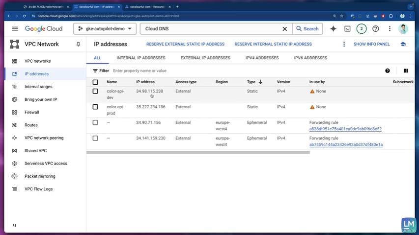
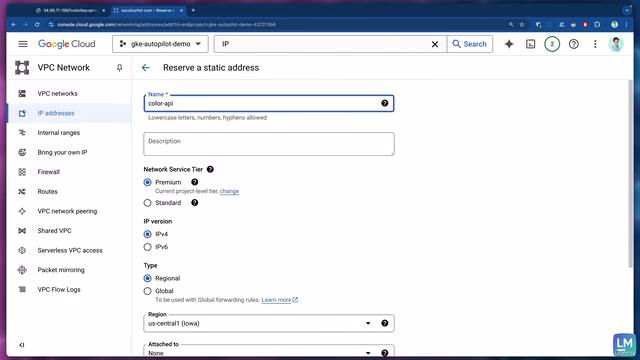
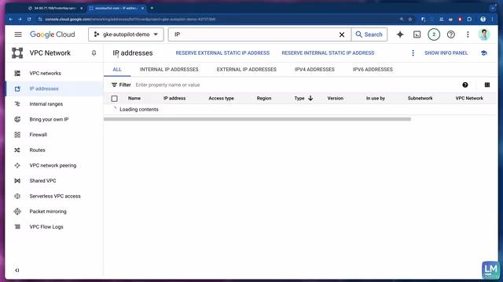
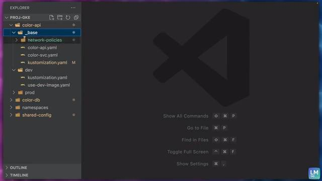
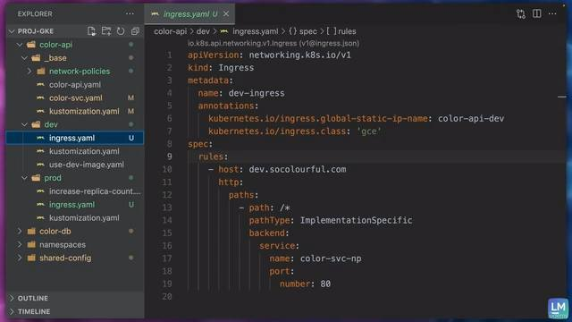
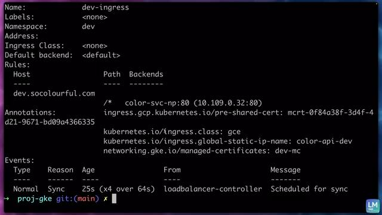
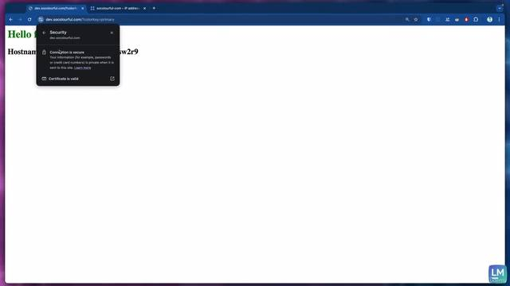
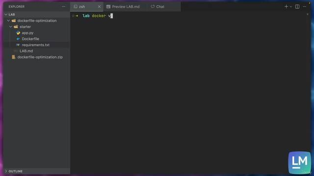
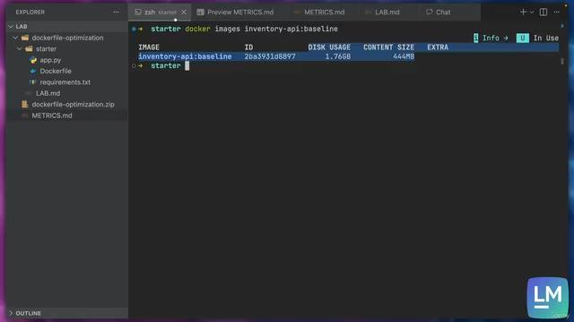
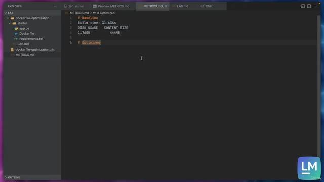

# Docker & Kubernetes Zero to Hero｜P88–P95：域名 + TLS 上线，以及 Dockerfile 优化实验的环境搭建

> 本节覆盖两段彼此独立的内容：
> **A 段（P88–P92）** —— 把已经跑在 GKE 上的 Color API 从「用 IP 访问、浏览器显示不安全」，变成「用域名访问、带有效 TLS 证书」，最后把整套资源清理干净。
> **B 段（P93–P95）** —— 一个独立实验：审计并优化一个 Python Flask 应用的 Dockerfile。P93–P95 只做到「环境搭好 + 测出基线指标」，真正的优化在后面的课。

---

## 1. 这一节做什么

### A 段：从 IP 到域名 + 证书

在这几讲之前，Color API 的 dev 和 prod 两个环境已经通过 `Service type=LoadBalancer` 拿到了公网 IP，浏览器直接访问 IP 就能拿到响应。但有两个问题：

1. 没有人类可读的域名，用户没法记住一串 IP。
2. 没有证书，「the connection is not secure」，证书是签发给域名的，不是你签给 IP 的。

讲师采用的方案是 Google Cloud 上的四件套组合：

| 组件 | 作用 | 谁来创建 |
| --- | --- | --- |
| 全局静态 IP（Global Static IP） | 给域名一个稳定不变的落点 | 在 GCP Console 手动预留 |
| Cloud DNS 记录 | 把 `socolorful.com` / `www.socolorful.com` / `dev.socolorful.com` 解析到静态 IP | 在 GCP Console 手动创建 |
| GKE Ingress（`networking.k8s.io/v1`） | 把域名流量路由到集群内的 NodePort Service | Kubernetes 清单 |
| ManagedCertificate（`networking.gke.io/v1`） | 让 Google 自动签发并续期 TLS 证书 | Kubernetes 清单 |

最终效果在 P091 验证：`https://dev.socolorful.com` 返回 dev Pod 的响应，浏览器显示连接安全，证书有效。

### B 段：Dockerfile 优化实验的基线

P93 介绍实验包（`dockerfileoptimization.zip`），P94 讲目标、前置知识和工具，P95 把环境跑起来并**测出基线指标**：构建耗时 31.636 秒、镜像磁盘占用 1.76 GB、内容大小 444 MB、用 `docker history` 数出层数、`curl` 打通接口。

这一段还没有写任何一行优化代码——所以本文档第 4 节对 B 段只能给出「课里实际执行过的命令 + 指标记录文件」，不会编造一个讲师没有展示过的 Dockerfile。

---

## 2. 讲师原话

> 「so far we are able to communicate with our caller API application via the IP address here, but we don't really have a domain that is actually mapping to this IP address... Additionally, this is not secure, right?」—— p088 [00:00]

> 「certificates they are actually issued to domain names.」—— p088 [00:29]

> 「when we are using the managed certificates from GKE and the ingress from GKE, we need to reserve a global static IP address.」—— p088 [02:40]

> 「these two IP addresses, they are coming from our load balancers.」—— p089 [00:11]

> 「Now this is something that is highly specific to the environment here. So I'm not going to add this to the base. I'm going to add this directly under our dev overlay.」—— p089 [00:40]

> 「we will get a warning that this annotation here is deprecated and we should use the ingress class name option in the spec section. However, the managed Google Cloud ingress is actually still relying on this annotation.」—— p089 [02:17]

> 「The options here are exact, prefix or implementation specific. But I'm going to go with implementation specific. This is also what the Google Cloud documentation recommends for us to use.」—— p089 [03:15]

> 「This will create an additional node port service. And this is required whenever we are using the managed GKE ingress.」—— p089 [04:30]

> 「it does take a good amount of minutes... it took up to anywhere from 15 to 30 minutes to work.」—— p090 [03:43]

> 「The moment this is active then we are really good to go.」—— p091 [00:00]

> 「you don't strictly need to use AI, right? You could go through the Dockerfile yourself and find the issues.」—— p094 [01:08]

> 「So you should document the important decisions you make.」—— p094 [01:53]

> 「once again, just pull your AI companion and ask to translate such commands to a PowerShell compatible version」—— p094 [03:53]

---

## 3. 从零复现

### A 段：域名 + TLS

#### 前置状态（这一讲之前就已经存在，本节不重复创建）

- GKE 集群 `demo-cluster` 已创建，`kubectl` 已指向它。
- 项目里已有 `dev` 和 `prod` 两个 namespace。
- 已有 Kustomize 结构：`base/` + `overlays/dev/` + `overlays/prod/`，每个 overlay 有一个「customization file」（`kustomization.yaml`）。
- Color API 在 dev 和 prod 各有一个 `LoadBalancer` 类型的 Service，已分配到公网 IP。
- 已有 Color DB、shared configuration、Persistent Volume 等资源。

#### 步骤 1：确认静态 IP 真的就是 LoadBalancer 的 IP（P089）

先在终端核对一遍，别跳：

```bash
kubectl get svc -n dev
kubectl get svc -n prod
```

讲师在这一步当场对比了 dev 的 `.90.71` 和 GCP Console 里预留的静态 IP，确认是同一个地址。



#### 步骤 2：在 GCP Console 预留两个全局静态 IP（P088）

`Console → VPC network → IP addresses → Reserve external static IP address`

- 第一个：名字 `color API dev`（控制台会显示成小写连字符形式，如 `color-api-dev`），描述 `global static IP address for dev color API`，网络服务层级保持 **Premium**，类型选 **Global**（IPv4）。
- 第二个：同样流程，名字 `color API prod`，描述 `global static IP address for prod color API`，同样 **Premium + Global**。



> 关键点：必须是 **Global**。因为 GKE 的 Ingress + ManagedCertificate 组合要求全局静态 IP，Regional 的不行。

#### 步骤 3：在 Cloud DNS 建三条记录（P088）

`Cloud DNS → socolorful.com → Add record set`，建三条 **Standard** 记录：

| 名称 | 类型 | 指向 |
| --- | --- | --- |
| `socolorful.com`（apex，无前缀） | A | prod 的静态 IP |
| `www.socolorful.com` | A | prod 的静态 IP（同一条） |
| `dev.socolorful.com` | A | dev 的静态 IP |



建完之后域名能解析了，但**访问仍然会失败**——因为静态 IP 只是「预留」，还没有任何 Load Balancer / Ingress 真正挂到这个 IP 上。这是 P088 结尾讲师反复强调的一点。

#### 步骤 4：写 dev 的 Ingress（P089）

在 `overlays/dev/` 下新建 `ingress.yaml`。完整内容见第 4 节。

三个 annotation 是核心：
- `kubernetes.io/ingress.global-static-ip-name` → 步骤 2 里的 IP 名字
- `kubernetes.io/ingress.class: gce` → 走 GKE 的托管 Ingress Controller
- `networking.gke.io/managed-certificates` → 绑定步骤 5 的证书对象（这个在 P090 才加）



#### 步骤 5：在 base 里加一个 NodePort Service（P089）

讲师特意说明：Ingress 的 backend 必须指向一个 **NodePort** Service，`LoadBalancer` 类型不行。所以要在 `base/` 里**新增**一个 Service（原有的 LoadBalancer Service 保留），类型改成 `NodePort`，端口 `80`。

> 讲师原话是「let's extend our service here. Let's copy this, let's paste it here」。所以他是在 base 的 Service 文件里加了一份，而不是改掉原来那份。

#### 步骤 6：复制成 prod 的 Ingress（P089）

把 dev 的 `ingress.yaml` 复制到 `overlays/prod/`，改四处：

| 字段 | dev | prod |
| --- | --- | --- |
| `metadata.name` | `dev-ingress` | `prod-ingress` |
| `ingress.global-static-ip-name` | dev 的 IP 名 | `color-api-prod` |
| `rules[].host` | `dev.socolorful.com` | `socolorful.com` **和** `www.socolorful.com`（两条规则） |
| managed-certificates | `dev-mc` | `prod-mc` |

prod 有两条 rule，但 backend 都指向同一个 NodePort Service。

#### 步骤 7：先把 NodePort Service 应用上去（P089 结尾）

讲师故意**先不把 Ingress 加进 kustomization**，因为证书还没写：

```bash
kubectl apply -k <dev overlay 路径>
kubectl apply -k <prod overlay 路径>
kubectl get svc -n dev
kubectl get svc -n prod
```

两个 namespace 都能看到新的 NodePort Service，就说明这一步成功。

#### 步骤 8：写 ManagedCertificate（P090）

`overlays/dev/manage-cert.yaml`：

```yaml
apiVersion: networking.gke.io/v1
kind: ManagedCertificate
metadata:
  name: dev-mc
spec:
  domains:
    - dev.socolorful.com
```

prod 版叫 `prod-mc`，`domains` 里写两个：`socolorful.com` 和 `www.socolorful.com`。



#### 步骤 9：把 Ingress 和证书一起加入 kustomization（P090）

在每个 overlay 的 `kustomization.yaml` 的 `resources` 里加上 `manage-cert.yaml` 和 `ingress.yaml`，然后：

```bash
kubectl apply -k <dev overlay 路径>
kubectl apply -k <prod overlay 路径>
```

你会看到关于 `kubernetes.io/ingress.class` 已废弃的 warning——**正常，不要删**。

#### 步骤 10：轮询状态（P090–P091）

```bash
kubectl get managedcertificate -n dev
kubectl describe managedcertificate dev-mc -n dev
kubectl describe ingress dev-ingress -n dev
```

- 证书初始状态是 `provisioning`
- Ingress 会显示 `scheduled for sync`
- 讲师实测 **15–30 分钟**后证书变成 `active`
- 变 `active` 之后可能还要几分钟才真正生效，期间浏览器可能出现握手失败的报错，**这是正常的**



#### 步骤 11：验证（P091）

浏览器打开 `https://dev.socolorful.com`，应当看到：

1. 返回的是 dev Pod 的响应
2. 地址栏显示连接安全，证书有效

再验证 GCP 侧：`Console → Certificate Manager → Classic Certificates`，能看到两张证书，状态 `active`，还能点进去看证书链。



再验证业务侧的差异（讲师用这个证明 dev 和 prod 确实是两套独立环境）：

| 检查项 | `dev.socolorful.com` | `socolorful.com` |
| --- | --- | --- |
| `/metrics` 端点 | 有响应（dev 镜像已升到 2.1.0） | 未定义（prod 故意没升级） |
| 主键颜色 | 绿色 | 蓝色（prod 没设 primary key） |

#### 步骤 12：清理（P092）

顺序很重要，先 K8s 后 GCP，最后删集群：

```bash
# 1. 删除应用（dev → prod），Service/Pod 终止需要时间
kubectl delete -k <dev overlay 路径>
kubectl delete -k <prod overlay 路径>

# 2. 删除数据库（dev 和 prod），没有 LoadBalancer，会快很多
kubectl delete -k <color-db 的 dev overlay 路径>
kubectl delete -k <color-db 的 prod overlay 路径>

# 3. 删除 shared configuration 的 dev / prod overlay
kubectl delete -k <shared config 的 dev overlay 路径>
kubectl delete -k <shared config 的 prod overlay 路径>

# 4. 确认 namespace 里只剩系统自带的东西
kubectl get pods,services,configmaps,networkpolicies,ingress,secrets -n dev
kubectl get pods,services,configmaps,networkpolicies,ingress,secrets -n prod

# 5. 删 namespace（兜底清掉剩余资源）
kubectl delete namespace dev
kubectl delete namespace prod

# 6. 确认 PV / PVC 也没了
kubectl get pvc,pv -A
```

然后在 GCP Console 里：

1. **Certificate Manager → Classic Certificates**：应该已经空了（删 ManagedCertificate 对象时自动删掉）
2. **Load balancing**：三个 Load Balancer 都应该没了
3. **IP addresses**：两个静态 IP **仍然在**——因为是你手动预留的。选中两个 → `Release static addresses`
4. **Compute Engine → Disks**：应该也空了（PVC 删除后 PV 按默认 `Delete` 回收策略释放磁盘）

最后删集群：

`Kubernetes Engine → 选中 demo-cluster → Delete → 输入 demo-cluster 确认`

讲师说 5–10 分钟删完。想彻底一点可以再删整个项目：项目选择器 → 三个点 → `Manage resources` → `GKE autopilot demo` → `Actions → Delete`。

---

### B 段：Dockerfile 优化实验的环境搭建

#### 步骤 1：解压实验包（P093）

资源区下载 `dockerfileoptimization.zip`，解压得到：

```text
dockerfileoptimization/
├── lab.markdown          # 实验说明与活动清单
└── starter/
    ├── Dockerfile        # 待审计的文件
    ├── app.py            # 极简 Flask inventory API
    └── requirements.txt  # Python 依赖
```

`app.py` 里出现红色波浪线是正常的——本地没装 Flask，跟实验无关。讲师明确说「we're gonna keep the application logic super simple」。

#### 步骤 2：确认 Docker 可用（P095）

```bash
docker version
```

讲师本机是 `29.2.1`，他说任何较新版本都可以。



#### 步骤 3：建指标记录文件（P095）

在 `dockerfileoptimization/` 下新建 `metrics.markdown`，后面每测一个数字就写进去。这个文件是本实验的「决策日志」，P094 讲师专门强调过要 document decisions。

#### 步骤 4：构建基线镜像（P095）

```bash
cd dockerfileoptimization/starter
docker build -t inventory-api:baseline .
```

讲师这次构建耗时 **31.636 秒**，过程中能看到 `python:latest` 被拉取、`pip install -r requirements.txt` 被执行。

#### 步骤 5：测镜像大小（P095）

```bash
docker images
```

记录两个数字：
- 磁盘占用（disk usage）：**1.76 GB**
- 内容大小（content size）：**444 MB**

写进 `metrics.markdown`。

#### 步骤 6：看层（P095）

```bash
docker history inventory-api:baseline
```

输出里分两部分：
- 上面一段是 `python:latest` 基础镜像自带的层
- 从「about a minute ago」那几行开始，是本次 `docker build` 自己产生的层

讲师把整段输出贴进了 `metrics.markdown`。



#### 步骤 7：跑起来验证（P095）

```bash
# 讲师本机 5000 端口被占用，所以把宿主端口改成 5001
docker run -p 5001:5000 inventory-api:baseline
```

看到 Flask 启动日志后，另开一个终端：

```bash
curl localhost:5001
```

拿到成功响应，就说明环境搭好了，基线也测完了。



---

## 4. 完整代码

### 4.1 `overlays/dev/manage-cert.yaml`

```yaml
apiVersion: networking.gke.io/v1
kind: ManagedCertificate
metadata:
  name: dev-mc
spec:
  domains:
    - dev.socolorful.com
```

### 4.2 `overlays/prod/manage-cert.yaml`

```yaml
apiVersion: networking.gke.io/v1
kind: ManagedCertificate
metadata:
  name: prod-mc
spec:
  domains:
    - socolorful.com
    - www.socolorful.com
```

### 4.3 `overlays/dev/ingress.yaml`

```yaml
apiVersion: networking.k8s.io/v1
kind: Ingress
metadata:
  name: dev-ingress
  annotations:
    # 步骤 2 预留的全局静态 IP 的名字
    kubernetes.io/ingress.global-static-ip-name: color-api-dev
    # 已废弃，但 GKE 托管 Ingress 仍然依赖它，不能删
    kubernetes.io/ingress.class: gce
    # 绑定 ManagedCertificate 对象（可写多个，逗号分隔）
    networking.gke.io/managed-certificates: dev-mc
spec:
  rules:
    - host: dev.socolorful.com
      http:
        paths:
          - path: /*
            pathType: ImplementationSpecific
            backend:
              service:
                name: color-api-svc-np
                port:
                  number: 80
```

### 4.4 `overlays/prod/ingress.yaml`

```yaml
apiVersion: networking.k8s.io/v1
kind: Ingress
metadata:
  name: prod-ingress
  annotations:
    kubernetes.io/ingress.global-static-ip-name: color-api-prod
    kubernetes.io/ingress.class: gce
    networking.gke.io/managed-certificates: prod-mc
spec:
  rules:
    - host: socolorful.com
      http:
        paths:
          - path: /*
            pathType: ImplementationSpecific
            backend:
              service:
                name: color-api-svc-np
                port:
                  number: 80
    - host: www.socolorful.com
      http:
        paths:
          - path: /*
            pathType: ImplementationSpecific
            backend:
              service:
                name: color-api-svc-np
                port:
                  number: 80
```

### 4.5 `base/` 里新增的 NodePort Service

> 下面这份是「新增」的那个 Service，和原有的 LoadBalancer Service 并存。`selector` 与 `targetPort` 必须和 base 里已有的 Color API Service 保持一致——**课里没有展示这两个字段的具体值**，请照抄你项目里已有的那份 Service。

```yaml
apiVersion: v1
kind: Service
metadata:
  name: color-api-svc-np
spec:
  type: NodePort
  selector:
    # ← 与 base 中已有的 color-api Service 保持一致（课里未展示具体 label）
    app: color-api
  ports:
    - port: 80
      # ← 与容器实际监听端口保持一致（课里未展示具体值）
      targetPort: 8000
      protocol: TCP
```

### 4.6 `overlays/dev/kustomization.yaml`

> 只展示 `resources` 部分。这个文件在本节之前就已经存在，其余字段（`namespace`、`images`、`patches` 等）是前几讲配好的，**课里没有重复展示**，不要删。

```yaml
apiVersion: kustomize.config.k8s.io/v1beta1
kind: Kustomization
resources:
  - ../../base
  - manage-cert.yaml
  - ingress.yaml
```

`overlays/prod/kustomization.yaml` 结构完全相同，`resources` 同样加这两行（文件内容一样，因为文件名相同）。

### 4.7 应用与观察命令

```bash
# 应用（Step 7 只应用 Service，Step 9 起才带上 Ingress + 证书）
kubectl apply -k k8s/overlays/dev
kubectl apply -k k8s/overlays/prod

# 观察
kubectl get svc -n dev
kubectl get svc -n prod
kubectl get managedcertificate -n dev
kubectl get managedcertificate -n prod
kubectl describe managedcertificate dev-mc -n dev
kubectl describe managedcertificate prod-mc -n prod
kubectl describe ingress dev-ingress -n dev
kubectl describe ingress prod-ingress -n prod
```

> `kubectl apply -k` 后面的路径请替换成你项目里 overlay 的实际目录名。

### 4.8 实验侧的 `metrics.markdown`（B 段，讲师的实际记录）

```markdown
# Image Optimization Metrics

## Baseline

### Build time

baseline: 31.636 seconds
optimized:

### Image size

| | disk usage | content size |
| --- | --- | --- |
| baseline | 1.76 GB | 444 MB |
| optimized | | |

### Image layers

<把 docker history inventory-api:baseline 的输出原样粘贴到这里>
```

### 4.9 实验侧的命令清单

```bash
# 0. 确认 Docker
docker version

# 1. 进入 starter
cd dockerfileoptimization/starter

# 2. 构建基线镜像
docker build -t inventory-api:baseline .

# 3. 记录镜像大小
docker images

# 4. 记录层
docker history inventory-api:baseline

# 5. 运行验证（5000 被占用时改用 5001）
docker run -p 5001:5000 inventory-api:baseline

# 6. 另开终端
curl localhost:5001
```

> **注意**：`starter/Dockerfile`、`app.py`、`requirements.txt` 三个文件的内容在 P93–P95 中**完全没有展示**（讲师只打开看了一眼 `app.py` 说「不用管它」）。本段的目标是「把基线跑出来」，不是「重写 Dockerfile」。Dockerfile 的实际优化在后续课程。请不要从别处抄一份 Dockerfile 塞进去，那样测出来的基线和讲师的对不上。

---

## 5. 逐行解释

### `apiVersion: networking.gke.io/v1` + `kind: ManagedCertificate`

这是 GKE 独有的自定义资源（CRD），不是 K8s 原生对象。写法上跟原生对象一模一样，但它只在 GKE 集群里能被识别——换成本地 kind 或 minikube 会直接报错 `no matches for kind`。

`spec.domains` 是一个列表，列几个域名这张证书就覆盖几个。讲师把 `socolorful.com` 和 `www.socolorful.com` 放进同一张 `prod-mc`，因为它们是同一个站点。dev 只有 `dev.socolorful.com`，所以单独一张 `dev-mc`。

**为什么必须两张证书而不是一张？** 因为 Ingress 是分开的，dev Ingress 和 prod Ingress 挂的静态 IP 不同，证书必须跟着 Ingress 走。

### `kubernetes.io/ingress.global-static-ip-name`

这个 annotation 是 GKE Ingress Controller 的专属开关。它告诉 Controller：「别给我临时分配 IP，去用这个名字已经预留好的那个」。值必须和 GCP Console 里静态 IP 的 `Name` 完全一致。

漏了它会怎样：Controller 会自己创建一个临时转发规则，IP 每次重建都可能变，DNS 记录就废了。

### `kubernetes.io/ingress.class: gce`

讲师专门解释了为什么这条明明报 deprecated 还要留：新版写法是在 `spec.ingressClassName` 里写，但 **GKE 的托管 Ingress 目前仍然依赖这个 annotation 才能走动**。删了它 Controller 就不会接管这个 Ingress。

`gce` 这个名字来自 Google Compute Engine——这是 GKE 上托管 Ingress 对应的 class 名。

### `path: /*` + `pathType: ImplementationSpecific`

`pathType` 有三个选项：`Exact`、`Prefix`、`ImplementationSpecific`。

- `Exact` 只能精确匹配 `/`，`/foo` 就 404 了
- `Prefix` 按路径段做前缀匹配
- `ImplementationSpecific` 由具体的 Ingress Controller 决定语义，GCE Controller 把它当通配符处理

讲师选第三个，理由是「Google Cloud 文档推荐」。实际效果就是「这个 host 下的所有路径都转发给这个 backend」，和直接用 `Prefix` + `/` 效果接近，但兼容性有细微差别。

### `backend.service.port.number: 80`

注意这里写的是 **Service 的端口**，不是容器的端口。Ingress 只负责把流量送到 Service 的 `port`，Service 再用 `targetPort` 找到容器。

### Service `type: NodePort`

这是整节里最容易被忽略的一步。为什么 GKE 托管 Ingress 要求 backend 是 NodePort？

Inbound 流量的路径是：`公网 IP → Google 的 Load Balancer → 集群节点 → NodePort → Pod`。Load Balancer 需要知道把流量打到每个节点的哪个端口上，NodePort 正好提供这个「每个节点上都开着的固定端口」。`ClusterIP` 只在集群内部可达，Load Balancer 打不进去。

> **给前端同学的类比**：`LoadBalancer` Service 像你在 Node.js 里用 `app.listen(3000)` 直接对外；`NodePort` 更像是 nginx 反代到 `127.0.0.1:8080`——外面看到的是 nginx，里面实际的服务只监听本地固定端口。

### `pathType` 与多 rule 的关系

prod 有两条 rule，每条各自有 `host` 和 `http.paths`。Ingress Controller 会按 host 分流：请求的 `Host` 头是 `www.socolorful.com` 就匹配第二条，是 `socolorful.com` 就匹配第一条。两条的 backend 相同，所以最终都进同一个 Service。

### `docker history` 怎么读

`docker history` 的输出是**从下往上**对应 Dockerfile 的执行顺序（最底下是最早的层）。讲师用「created time」区分：

- 一堆「2 weeks ago」「3 months ago」的层 → 来自 `python:latest`
- 只有几行「about a minute ago」的层 → 是这次 `docker build` 产生的

这直接决定了优化方向：如果自建层很少但镜像 1.76 GB，说明体积主要来自基础镜像和 `pip install` 那一层。

### `-p 5001:5000` 的顺序

左边是**宿主机端口**，右边是**容器端口**。讲师本机 5000 被占，所以把左边改成 5001，容器内部还是监听 5000。`curl localhost:5001` 才通。

---

## 6. 复现检查清单

### A 段

- [ ] 已有可用的 GKE 集群、`kubectl` 联通的 `dev` / `prod` 两个 namespace
- [ ] GCP Console 里有 **两个 Global + Premium** 的静态 IPv4，名字分别对应 dev 和 prod
- [ ] Cloud DNS 里三条 A 记录：apex → prod IP、`www` → prod IP、`dev` → dev IP
- [ ] `kubectl get svc -n dev` 出来的 IP 与 dev 静态 IP 完全一致
- [ ] `base/` 里新增的 Service 是 `type: NodePort`，且 `kubectl get svc -n dev` 能看到它
- [ ] `overlays/dev/manage-cert.yaml` 只有 `dev.socolorful.com` 一个域名
- [ ] `overlays/prod/manage-cert.yaml` 有 `socolorful.com` 和 `www.socolorful.com` 两个域名
- [ ] dev Ingress annotation 里的静态 IP 名和证书名都改成 dev 的（最容易复制粘贴忘改）
- [ ] prod Ingress 有**两条** rule，backend 都指向同一个 `color-api-svc-np`
- [ ] `kubectl apply -k` 时出现 `ingress.class` deprecated 警告 → 正常
- [ ] `kubectl get managedcertificate -n dev` 初始状态是 `provisioning`
- [ ] `kubectl describe ingress dev-ingress -n dev` 能看到 `scheduled for sync`
- [ ] 等待 15–30 分钟后证书变 `active`
- [ ] `https://dev.socolorful.com` 浏览器显示连接安全
- [ ] `console → Certificate Manager → Classic Certificates` 里两张证书都是 `active`
- [ ] `https://dev.socolorful.com/metrics` 有响应，`https://socolorful.com/metrics` 没有
- [ ] 清理：namespace 删完 `kubectl get pvc,pv -A` 里没有自己创建的 PV
- [ ] 清理：GCP 里手动 **Release static addresses**（这一步 K8s 不会替你做）
- [ ] 清理：`demo-cluster` 已删除

### B 段

- [ ] 解压出 `dockerfileoptimization/starter/` 三个文件
- [ ] `docker version` 能正常输出
- [ ] `docker build -t inventory-api:baseline .` 成功
- [ ] `metrics.markdown` 里记下了构建耗时
- [ ] 记下 disk usage 和 content size 两个数字
- [ ] `docker history` 的输出已粘贴进 `metrics.markdown`
- [ ] `docker run -p 5001:5000 inventory-api:baseline` 启动成功
- [ ] `curl localhost:5001` 返回成功响应

---

## 7. 课里没讲但你会撞上的

**1. 域名是哪儿来的、DNS Zone 是谁建的，课里没讲。**
P088 一开始就说「we have two domains here」，说明讲师在课程更早的位置已经注册了 `socolorful.com` 并建好了 Cloud DNS 的 Zone。如果你是从 P88 直接跳进来的，会卡在「Cloud DNS 里根本没有我的域名」。你需要：先注册域名 → 在 Cloud DNS 建一个 Public Zone → 把注册商处的 NS 记录改成 Cloud DNS 分配的四个 NS。这部分本课没有覆盖。

**2. `kustomization.yaml` 的完整内容，这几讲没展示。**
讲师只说「come to our customization file and include both」，前面几讲配好的 `namespace`、`images`、`patches` 等字段都没再出现。如果你是从零开始，需要先在第 4 节的两份 `kustomization.yaml` 里补上 `namespace: dev` / `namespace: prod` 以及镜像替换等字段，或回头补前面的课。

**3. NodePort Service 的 `selector` 和 `targetPort` 课里没给。**
讲师用「copy this, paste it here」的方式复制的，屏幕上没有停留展示。这两个字段必须和 base 里已有的 Color API Service 逐字一致，否则 Ingress 转发过去的流量找不到 Pod，会一直 503。

**4. GKE 的经典 Ingress 和 Gateway API 是两套东西。**
这一节用的是 `networking.k8s.io/v1` + `gce` class 的**经典 Ingress**，配套的是 `networking.gke.io/v1` 的 `ManagedCertificate`。GKE 现在还有一套新的 Gateway API + Certificate Manager，资源名和写法都不一样。网上搜到的教程经常混着写，照抄会报 `no matches for kind`。

**5. 证书卡在 `provisioning` 出不来，最常见的原因是 DNS 没生效。**
Google 要验证你对域名的控制权，靠的是访问 `http://<domain>/.well-known/acme-challenge/...`。如果 DNS 还没传播完，或者防火墙/Ingress 把 HTTP 挡掉了，验证就永远过不去。用 `dig dev.socolorful.com` 或 `nslookup` 确认解析到的是你预留的静态 IP，再等。

**6. 清理时最容易漏的是手动资源。**
namespace 删了、集群删了，`IP addresses` 里的两个静态 IP 还在，`Compute Engine → Disks` 里的磁盘也要单独确认。讲师专门在 P092 里演示了 `Release static addresses` 这一步，说明这是高频踩坑点。

**7. Windows 上跑 B 段实验。**
讲师用的命令是 bash/zsh 语法。PowerShell 里 `cd` 后面的路径分隔符、以及 `curl` 实际上是 `Invoke-WebRequest` 的别名，都会出问题。他的建议是：把你的命令贴给 AI，让它翻译成 PowerShell 版本，或者干脆用 WSL2。

**8. 5000 端口被占用（macOS 上尤其常见）。**
macOS 的 AirPlay Receiver 默认占 5000。换个宿主端口（`-p 5001:5000`）或者关掉 AirPlay Receiver，二选一。

**9. 关于「并发 / 事务 / 锁」。**
这两段内容里没有涉及锁或事务，所以没有对应关系要补。但如果把本章的 Ingress 类比到 Node 生态：Ingress ≈ 你写的 nginx `location` 块或 `http-proxy-middleware`，NodePort Service ≈ 后端进程实际 listen 的那个本地端口，ManagedCertificate ≈ 用 certbot 自动续期——只是 GKE 把它做成了声明式对象，你不用管 `cron` 和 `renew` 了。