# Dockerfile 审计与优化实战（P096–P100）

> 课程：Docker & Kubernetes Zero to Hero（BV1XHTu6eEgy）
> 覆盖：P096–P100
> 读者定位：前端转 AI 应用工程师。本文档按「审计 → AI 复核 → 优先级矩阵 → 生成优化版 → 构建测量」五步走，你可以从头把整个 lab 跑一遍。

---

## 1. 这一节做什么

这五节课是一个完整的 **Dockerfile 优化 lab**，围绕一个 Python Flask API 的「starter Dockerfile」展开。目标不是学 Docker 语法，而是走一遍**工程化的优化流程**：

1. **人工审计**：先自己读 Dockerfile，标出可疑、浪费、违反最佳实践的地方（P096）。
2. **AI 复核**：把 Dockerfile 连同你的批注丢给 AI，让它补充你漏掉的点（P097）。
3. **优先级矩阵**：让 AI 反过来问你约束（部署环境、有无 secrets 管理、deadline），再产出带 severity / effort / 执行顺序的矩阵（P098）。
4. **生成优化版**：按矩阵的执行顺序让 AI 产出 `Dockerfile.optimized`，同时生成 `.dockerignore`（P099）。
5. **构建并测量**：用 `time docker build` 对比构建时间、`docker images` 对比体积、`docker history` 对比层，再用 Docker Scout 对比 CVE（P100）。

这一节的重点在于流程感：先发现问题，再让 AI 补充，再让 AI 问你的约束，最后才生成改动。顺序反过来就容易变成「AI 直接重写一个 Dockerfile，你只是照抄」，这样既不知道为什么改，也无法判断哪些改动适合你的部署环境。对前端转 AI 应用工程师来说，可以把这套流程类比成一次代码审查：先自己 review，再让工具给建议，然后按业务约束排优先级，最后分批提交并测量效果。

最终产物是三个文件：`Dockerfile.optimized`、`.dockerignore`、`metrics.md`（记录 baseline vs optimized 的对比数据）。讲师在 P100 结尾给出的结论是：**构建时间降 62.8%，镜像体积降 86%**。这三个文件分别对应「优化后的构建定义」「构建上下文过滤规则」「可复核的测量记录」，缺一个都不算完整 lab。

---

## 2. 讲师原话（带出处）

关于 `latest` 标签为什么是红旗：

> "这里的 latest 标签确实是个危险信号……这是一个滚动标签，意味着随着更新版本的 Python 发布，latest 标签也会跟着移动，而某个新的 Python 版本可能会与应用不兼容……这实际上破坏了这里的前提，也就是可复现构建的最佳实践。"
> —— p096 [01:35]

关于 apt 缓存必须和安装在同一层清掉：

> "我们这里也在使用缓存，但没有清理缓存……这里实际下载的缓存会一直固化在镜像里；即使我们决定在后续指令中把它删掉，它仍然会留在这个实际层里，固化在镜像中。"
> —— p096 [02:56]

关于 COPY 顺序导致的缓存失效：

> "如果我们改动了 app.py 文件中的某些内容，那么这也会触发依赖项重新安装。"
> —— p096 [04:06]

关于让 AI 反过来问你（flip the script）：

> "现在我们把球抛给一个名为“翻转脚本”模式的人工智能系统。基本上，我们希望人工智能反过来询问我们自己的优先事项。"
> —— p098 [01:53]

关于 Kubernetes 环境下 healthcheck 的优先级被下调：

> "Dockerfile 中的健康检查会被存活探针和就绪探针取代。因此我们这里其实并不需要健康检查……不过为了保持本地开发环境一致，可能仍然值得加上。"
> —— p098 [03:13]

关于非 root 用户在 K8s 语境下的意义：

> "这一点在 Kubernetes 场景中也有提到。有些集群确实会通过 Pod 安全准入和 Pod 安全标准来强制执行。"
> —— p099 [03:25]

关于构建时间对比：

> "这实际上快得多，对吧，所以这里的构建时间用了 11 秒……这实际上只占初始时间的 30%。"
> —— p100 [00:22]

关于 Docker Scout 的用途：

> "Docker Scout 在这里非常有用，可以帮助我们检查某个镜像是否存在漏洞……在这里获得按严重程度汇总的 CVE 总数概览，以及是否有可用修复。"
> —— p100 [06:38]

这些原话分别对应审计时的判断依据：`latest` 对应可复现性，apt 缓存对应层叠加，COPY 顺序对应缓存键，flip the script 对应优先级矩阵，K8s probe 对应 healthcheck 降级，非 root 对应安全策略，构建时间与 Scout 对应最后的测量环节。读原话时不要只记结论，要把它和 Dockerfile 里的具体行对上。

---

## 3. 从零复现

### 3.1 前置条件

- 已安装 Docker（能跑 `docker build` / `docker images` / `docker history`）。
- 有一个 Python Flask API 项目，目录结构如下（课里没给完整目录树，以下按逐字稿提到的文件推断，`app.py`、`requirements.txt` 是逐字稿明确提到的）：

```
project/
├── starter/
│   ├── Dockerfile            # 待审计的原始文件
│   ├── app.py                # Flask 应用，含 /health 端点
│   └── requirements.txt      # 含 flask、gunicorn
├── .gitignore
├── metrics.md                # 记录 baseline vs optimized
├── priority-matrix.md        # AI 产出的优先级矩阵
└── decisions.md              # 你对矩阵的复核与理由
```

> 课里没讲 `app.py` 的具体内容，只提到它有一个 `/health` 端点、监听 5000 端口、用 Flask 开发服务器启动。你需要自己准备一个最小 Flask 应用（见第 4 节末尾的示意，标注了「课里没有代码，以下为示意」）。

前置条件里最容易忽略的是 Docker 能正常访问网络拉取基础镜像，以及当前目录确实是 `project/`。后面所有命令都默认你在项目根目录或 `starter/` 下执行；如果目录不对，`-f Dockerfile.optimized .` 里的 `.` 会把错误目录当成 build context，表现为构建很慢、找不到文件或把大量无关文件发给 daemon。前端同学可以把它类比成 npm 项目的 `package.json` 所在目录：构建上下文就是「发给 Docker daemon 的目录快照」，`.dockerignore` 则是这份快照的排除规则。

### 3.2 第一步：人工审计 starter Dockerfile（P096）

打开 `starter/Dockerfile`，逐行读，把可疑点写成注释。讲师实际标出的问题清单（按逐字稿顺序）：

| # | 问题 | 讲师原话要点 |
|---|------|-------------|
| 1 | `FROM python:latest` | rolling tag，破坏可复现构建；且 latest 指向完整 Debian 版 Python 镜像，体积大 |
| 2 | `RUN apt-get update && apt-get install git vim ...` | 生产不需要 git/vim；且没在同一层清 apt 缓存 |
| 3 | `COPY . .` 在 `pip install -r requirements.txt` 之前 | 改任何源码都会触发重装依赖，缓存全废 |
| 4 | 没有 `.dockerignore` | 整个 build context（含 `.git`、`__pycache__`、`.env`）都发给 daemon |
| 5 | 硬编码 `SECRET_KEY` | secret 被烤进镜像层，`docker history` 可见 |
| 6 | 硬编码 `DEBUG=true` / `FLASK_ENV=development` | 应通过运行时环境变量或单独的 dev Dockerfile 传入 |

讲师在 P096 结尾说："实际上，大概只有两三行我们完全没有任何评论。"——也就是说人工审计已经覆盖了大部分。

人工审计的做法不是只写「这行不好」，而是尽量写成「这行会导致什么后果」。例如 `COPY . .` 写在不该在的位置，会导致改 `app.py` 后依赖层缓存失效；`apt-get` 缓存不在同层删，会导致后面即使 `rm` 掉，镜像体积仍然包含缓存。写注释时可以用「问题 / 影响 / 初步修法」三栏思路，后面喂给 AI 时它更容易补充而不是重写。

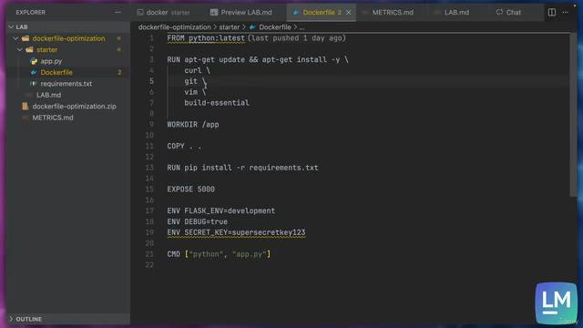

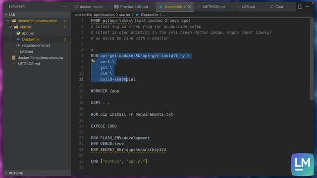

### 3.3 第二步：把 Dockerfile 丢给 AI 复核（P097）

讲师用的是 IDE 内置 chat（他提到 Cloud Sonnet 4.6，并说用什么工具都行）。操作：

1. 选中 Dockerfile 全文，加入 chat 上下文。
2. 用这个 prompt（讲师原话拼出来的）：

```
Here is a Dockerfile for a Python Flask API running in production.
Audit it for issues related to image size, security, caching, and reliability.
I have already added a couple of comments regarding what I could quickly spot.
Feel free to expand on or complement the notes I made.
For each issue, explain the problem and suggest a fix.
```

3. AI 返回一张 summary table + 逐条详解。讲师核对后发现 AI 补充了他漏掉的点：
   - `pip install` 没加 `--no-cache-dir`，pip 缓存的 wheel 会留在镜像里；
   - 没有 `USER` 指令，容器以 root 运行；
   - 用 Flask 开发服务器跑生产（`python app.py`），而 `requirements.txt` 里其实已经有 `gunicorn`；
   - 没有 `HEALTHCHECK`，而 `app.py` 里已经有 `/health` 端点。

这一步的关键是「补充而不是替代」：你已经写了注释的地方，让 AI 展开解释；你没写的地方，让 AI 补。前端对照可以理解为：你把 `package.json`、构建脚本、Dockerfile 一起丢给 AI 做 code review，但要求它逐条解释、逐条给修法，而不是直接重写整个文件。若某条看不懂（比如 `.dockerignore` 如何影响 build context），直接在 chat 里追问，这是加深理解的好机会。常见错误是只贴 Dockerfile 不贴批注，AI 容易泛泛而谈；或者只让 AI 给最终文件，导致你无法复核每一条改动是否适合你的项目。

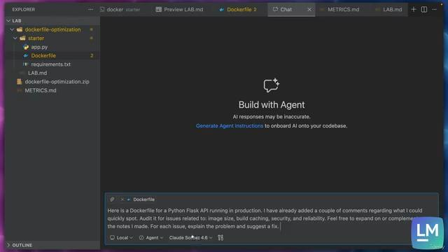

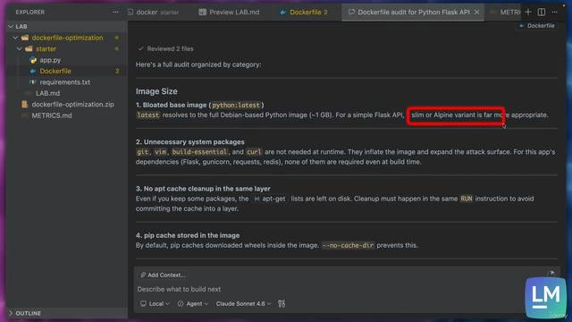

> 讲师特别提醒：如果某条看不懂（比如 `.dockerignore` 如何影响 build context），直接在 chat 里追问，这是加深理解的好机会。

### 3.4 第三步：让 AI 建优先级矩阵（P098）

关键动作是 **flip the script**：不让 AI 直接给矩阵，而是先让它问你约束。讲师用的 prompt：

```
Thank you for the list. I'd like to move on to building a priority matrix to tackle these issues.
Before you create a prioritized issue matrix, ask me any questions you need to understand my priorities and constraints.
```

AI 问的问题和讲师给的回答（逐字稿里明确出现的）：

| AI 的问题 | 讲师回答 |
|-----------|---------|
| How urgent is this remediation? | No hard deadline, full cleanup（一次全做） |
| What is the target deployment environment? | Kubernetes |
| Do you already have a secrets management solution? | No secrets management currently unaddressed / rely on environment variables injected at runtime |
| Which area concerns you the most? | All of them |

AI 基于「K8s + 运行时注入 env」这两个约束，下调了 healthcheck 的优先级（被 liveness/readiness probe 取代），并确认「运行时 env 注入 secret」是合法常见模式。

然后让 AI 把矩阵存成文件：

```
Save this in a priority-matrix.md file.
```

讲师随后**人工复核**矩阵，把复核理由写进 `decisions.md`。他给的复核问题："哪些问题会在生产环境中立刻造成故障，而哪些又只是效率不高？"——安全类是事故级，镜像体积类只是低效。

这一步的前端对照是：你在排前端构建优化项时，也会先问「目标浏览器、是否必须兼容旧版、CI 时间预算、是否有 CDN」；约束不同，优先级就不同。矩阵里给出的执行顺序（逐字稿明确提到）：**commit 1 = P0，commit 2 = P1，commit 3 = P2+P3**，且大部分是 low effort / trivial。复核时要特别看「被 AI 降级的项」是否只是低效，还是会在你的环境里变成事故；例如 healthcheck 在 K8s 下被 probe 取代，但本地开发仍可能需要它做 parity。

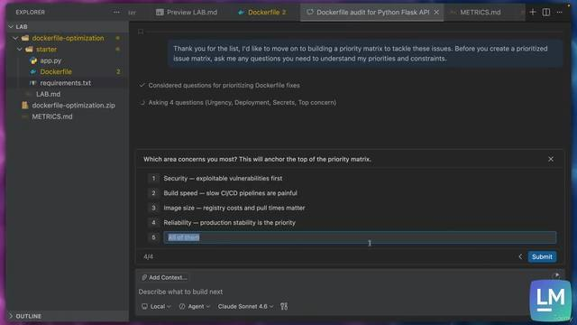

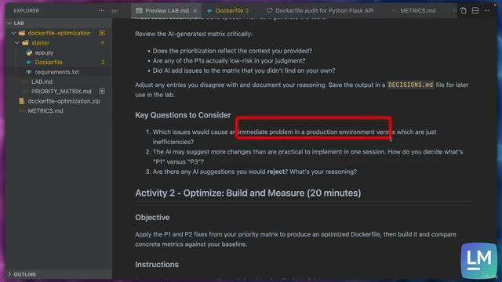

### 3.5 第四步：生成优化版 Dockerfile（P099）

讲师用的 prompt（注意他事后承认这个 prompt 不够明确，AI 没按 commit 分批暂停）：

```
Based on the prioritized issue matrix, generate an optimized Dockerfile for a Python Flask API.
Implement following the suggested execution order and pause before committing to ask for my feedback.
Do not modify the application code or requirements.
Add a short inline comment on each changed line explaining why the change was made.
```

AI 产出的改动（逐字稿逐条确认）：

- `FROM python:latest` → `FROM python:3.12-slim`
- 移除 `git`、`vim`、`build-essential`
- **新增 `curl`**——因为 slim 镜像不带 curl，而 healthcheck 要用 curl（讲师指出 AI 没在这行加注释，是个小遗漏）
- `apt-get update && apt-get install ... && rm -rf /var/lib/apt/lists/*` 合并到**同一条 RUN**（讲师强调必须在同一层删，否则前一层体积照算）
- `COPY requirements.txt .` 提前，再 `RUN pip install --no-cache-dir -r requirements.txt`，最后才 `COPY . .`
- 新增 `RUN addgroup --system app && adduser --system --ingroup app app` + `USER app`
- 新增 `HEALTHCHECK --interval=30s --timeout=5s --start-period=10s --retries=3 CMD curl -f http://localhost:5000/health || exit 1`
- 生成 `.dockerignore`：排除 `.git`、`__pycache__`、`.env` / local env 文件、编辑器与 OS 噪音

讲师的操作细节：**不直接覆盖原 Dockerfile**，而是把 AI 输出另存为 `Dockerfile.optimized`，然后 `git checkout -- starter/Dockerfile` 还原原始文件，保留 baseline 用于对比。这个操作很关键：baseline 一旦被覆盖，后面 `docker images`、`docker history`、`docker scout compare` 就没有对照物，`metrics.md` 也无法证明降幅。前端对照可以理解为：优化前后各保留一份构建配置和产物记录，像对比 bundle size 一样，先留 baseline 再谈优化。

常见排查点：如果 AI 生成的 `Dockerfile.optimized` 里 `HEALTHCHECK` 用了 curl，但 apt 安装列表没有 curl，构建可能成功但容器会 unhealthy；如果 `USER app` 放在 `COPY . .` 之前，可能因为权限导致文件拷贝或应用读取失败；如果 `CMD` 改成 gunicorn 但入口模块不是 `app:app`，容器会启动失败。遇到这些先看 `docker run` 日志和 `docker inspect` 的健康状态，再对回 Dockerfile 行。

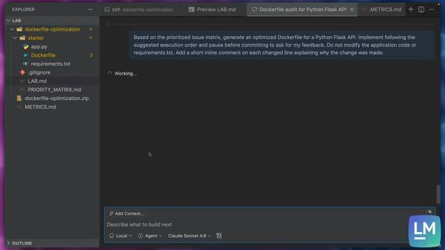

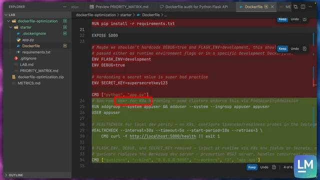

### 3.6 第五步：构建并测量（P100）

```bash
cd starter
time docker build -t api:optimized -f Dockerfile.optimized .
docker images api:optimized
docker history api:optimized
docker run -p 5001:5000 api:optimized
# 另一个终端
curl http://localhost:5001/health
```

命令解释：`cd starter` 进入包含 Dockerfile 和上下文的目录；`time docker build` 用 shell 计时包住构建；`-t api:optimized` 给镜像打标签，便于后面 `docker images`、`docker run`、`docker history` 引用；`-f Dockerfile.optimized` 指定用优化版文件而不是默认 `Dockerfile`；最后一个 `.` 是 build context，表示把当前目录作为上下文发给 Docker daemon。`docker images api:optimized` 看磁盘占用和镜像 ID；`docker history` 看每一层的大小与创建指令；`docker run -p 5001:5000` 把宿主机 5001 映射到容器 5000；`curl http://localhost:5001/health` 验证 `/health` 端点。若 5001 被占用，换一个宿主机端口即可；若 curl 立刻失败，先确认容器是否已启动完成，以及应用是否监听 `0.0.0.0` 而不是仅 `127.0.0.1`。

讲师实测数据（逐字稿明确给出）：

| 指标 | baseline | optimized |
|------|----------|-----------|
| 构建时间 | 约 39s（11.776s 是 optimized，讲师说 optimized 是 baseline 的 30%） | 11.776s |
| 镜像 disk usage | 约 1.8GB（讲师说 optimized 是「one fifth 甚至更少」） | 253 MB |
| 镜像 content size | — | 55 MB |
| 层数 | 未变 | 未变 |
| 构建时间降幅 | — | 62.8% |
| 镜像体积降幅 | — | 86% |

> 注意：baseline 的具体数字逐字稿没有逐个念出来，只给了 optimized 的绝对值（11.776s / 253MB / 55MB）和降幅百分比。你自己跑的时候以实际输出为准。

然后用 AI 做汇总（讲师用 XML 标签组织 prompt）：

```xml
<context>
Under metrics.md you will find data from the baseline and optimized images.
</context>
<format>
（讲师贴了一个对比表格式）
</format>
<task>Please provide a comparison overview following the format above.</task>
```

最后用 Docker Scout 对比 CVE：

```bash
docker login
docker scout quickview api:baseline
docker scout cves api:optimized
docker scout compare api:baseline --to api:optimized
```

命令解释：`docker login` 让 Scout 能访问镜像分析服务；`quickview` 给严重级别汇总；`cves` 列具体漏洞；`compare` 对比两个镜像的 CVE 变化。讲师实测：baseline 是 0 critical / 1 high / 6 medium / 150 low；optimized 是 1 medium / 22 low。Docker Scout 需要登录 Docker Hub，且有免费额度限制。若 compare 失败，先检查登录状态和额度，再决定是否跳过；跳过不影响构建与体积对比的主线。

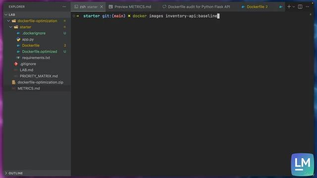

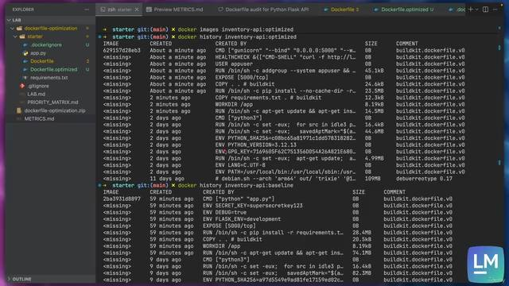

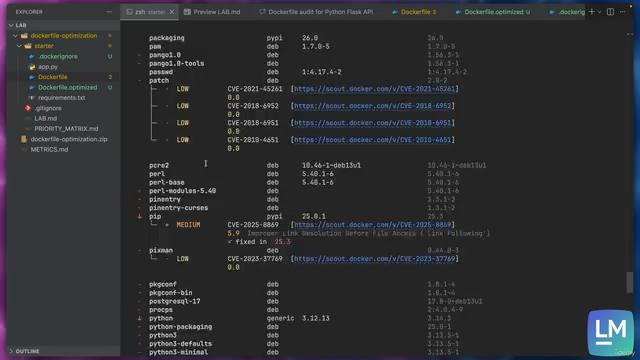

---

## 4. 完整代码

### 4.1 `starter/Dockerfile`（baseline，待审计的原始文件）

> 课里没有逐字贴出完整原文，以下按逐字稿提到的每一行重建，顺序与讲师描述一致。

```dockerfile
# baseline Dockerfile —— 故意保留所有问题，用于对比
FROM python:latest

RUN apt-get update && apt-get install -y git vim build-essential

WORKDIR /app

COPY . .

RUN pip install -r requirements.txt

ENV SECRET_KEY=super-secret-hardcoded-value
ENV DEBUG=true
ENV FLASK_ENV=development

EXPOSE 5000

CMD ["python", "app.py"]
```

这份 baseline 的作用是「保留问题作为对照」，不要因为知道它有错就提前修掉。`FROM`、`RUN apt-get`、`COPY . .`、`ENV` 和 `CMD` 分别对应可复现性、层体积、缓存、secret 与生产服务器问题。前端对照可以把 `COPY . .` 理解为在安装依赖前先拷贝整个源码目录，等于把源码 hash 混进了依赖安装缓存键。

### 4.2 `starter/Dockerfile.optimized`（AI 生成 + 讲师保留的版本）

> 以下按 P099 逐字稿描述的每一处改动重建。注释是讲师让 AI 加的 inline comment。

```dockerfile
# syntax=docker/dockerfile:1
FROM python:3.12-slim

# 安装 curl 供 HEALTHCHECK 使用；apt 缓存在同一层删除，避免体积膨胀
RUN apt-get update && \
    apt-get install -y --no-install-recommends curl && \
    rm -rf /var/lib/apt/lists/*

WORKDIR /app

# 先只拷 requirements，利用层缓存：源码变动不会触发重装依赖
COPY requirements.txt .

# --no-cache-dir 防止 pip wheel 缓存留在镜像层
RUN pip install --no-cache-dir -r requirements.txt

# 创建非 root 用户，降低容器被攻破后的影响面
RUN addgroup --system app && adduser --system --ingroup app app

# 源码在依赖安装之后拷贝
COPY . .

USER app

EXPOSE 5000

# 每 30s 探一次，5s 超时，启动后 10s 开始，连续 3 次失败判定 unhealthy
HEALTHCHECK --interval=30s --timeout=5s --start-period=10s --retries=3 \
    CMD curl -f http://localhost:5000/health || exit 1

# 用 gunicorn 替代 Flask 开发服务器
CMD ["gunicorn", "--bind", "0.0.0.0:5000", "app:app"]
```

> 说明：`CMD` 用 gunicorn 是逐字稿明确提到的（"我们的 requirements.txt 文件里确实有 Gunicorn。它就在这里……我们完全可以用它来实际为应用提供服务。"）。`app:app` 这个模块路径是 Flask 项目常见写法，课里没逐字念出，以你项目实际入口为准。

这份 optimized 的阅读顺序建议从上到下看「基础镜像是否 pin、apt 是否同层清理、依赖清单是否先拷贝、pip 是否禁缓存、是否非 root、源码是否最后拷贝、是否 healthcheck、是否生产服务器」。每一行改动都能对应回第 3.2 节的问题清单；如果某一行无法对应，说明它可能是 AI 额外加的，需要人工复核。

### 4.3 `starter/.dockerignore`

```dockerfile
.git
.gitignore
__pycache__/
*.pyc
.env
.env.*
*.local
.venv/
venv/
.idea/
.vscode/
.DS_Store
```

> 逐字稿明确提到的排除项：`.git`、`__pycache__`、local env 文件（可能含 secret）、编辑器与 OS 噪音。其余为常规补充。

`.dockerignore` 的作用是缩小 build context：被排除的文件不会发给 daemon，也不会进入 `COPY . .`。排查构建慢时，先看上下文大小；如果 `.git`、`.venv`、`__pycache__` 没排除，构建第一步就会明显变慢。它只影响构建上下文，不代表运行时读不到这些文件；运行时 secret 注入是另一套机制。

### 4.4 `.gitignore`（项目根）

```gitignore
.venv/
.env
```

> 讲师原话："我就像这样把 .venv 和 .env 加上。"——只加了这两条，其余说可以让 AI 生成。

`.gitignore` 和 `.dockerignore` 解决的是不同问题：前者防止敏感文件和本地环境进 Git，后者防止它们进 Docker build context。两者都写上 `.env` 是合理的双保险，但不要以为 `.dockerignore` 能替代运行时 secret 管理。

### 4.5 `metrics.md`（记录对比数据）

```markdown
# Dockerfile Optimization Metrics

## Baseline
- Build time: （以你实际 `time docker build` 输出为准）
- Image size: （以 `docker images` 输出为准）

## Optimized
- Build time: 11.776s
- Disk usage: 253 MB
- Content size: 55 MB

## Delta
- Build time reduction: 62.8%
- Image size reduction: 86%
- Layer count: unchanged
```

`metrics.md` 的价值在于把「感觉更快/更小」变成可复核的数字。前端对照就像记录优化前后的 bundle size 和 CI 构建耗时：baseline 必须来自同一台机器或同一环境，optimized 也要用同一命令测得；否则降幅不可比。若你的 baseline 数字与讲师不同，不要改讲师的 optimized 绝对值，按实际输出记录并在 Delta 里说明。

### 4.6 `app.py`（课里没有代码，以下为示意）

> 逐字稿只提到 `app.py` 有一个 `/health` 端点、监听 5000、用 Flask 开发服务器启动。以下是最小示意，**不是讲师原文**。

```python
from flask import Flask, jsonify

app = Flask(__name__)

@app.get("/health")
def health():
    return jsonify(status="ok")

@app.get("/")
def index():
    return jsonify(message="hello")

if __name__ == "__main__":
    app.run(host="0.0.0.0", port=5000)
```

这段示意满足 healthcheck 的前提：有 `/health`、监听 5000、开发服务器启动。实际项目若入口变量名不是 `app`，gunicorn 的 `CMD` 要相应修改；若 healthcheck 路径不是 `/health`，也要同步改。

### 4.7 `requirements.txt`（课里没有完整内容，以下为示意）

```
flask
gunicorn
```

> 逐字稿明确说 `requirements.txt` 里有 `gunicorn`，其余依赖课里没讲。

`requirements.txt` 对应前端的 `package.json` + lock 文件角色：依赖清单决定 `pip install` 层缓存是否命中。只要这个文件不变，`COPY requirements.txt .` 和 `RUN pip install` 就能复用缓存；源码变动不会触发重装。

---

## 5. 逐行解释

### 5.1 baseline 的问题行

- **`FROM python:latest`**：`latest` 是 rolling tag，Python 发新版它就跟着动，构建不可复现；而且 `latest` 指向完整 Debian 版，基础镜像就接近 1GB。改成 `python:3.12-slim` 后基础镜像只加约 150–160MB（P100 讲师对比 `docker history` 时说的）。前端对照：类似 `node:latest`，今天构建和明天构建可能拿到不同大版本。
- **`RUN apt-get update && apt-get install -y git vim build-essential`**：git/vim 生产不需要，build-essential 对这个纯 Python 项目连构建期都不需要（AI 在 P097 明确说 "它们没有一项是必需的，连构建时都不需要。"）。更关键的是**没清 apt 缓存**——Docker 的层是叠加的，你在后面的层 `rm` 掉，前面那层的字节仍然在镜像里。所以清理必须和安装写在**同一条 RUN** 里。常见排查：`docker history` 里看到一大层 apt 安装，即使后面有删除指令，体积也不降。
- **`COPY . .` 在 `pip install` 之前**：Docker 层缓存按指令内容哈希。源码一变，`COPY . .` 这层失效，后面 `pip install` 跟着重跑。正确顺序是先 `COPY requirements.txt`、装依赖、再 `COPY . .`。前端对照：相当于先 `COPY . .` 再 `npm ci`，改一个组件文件就重装全部依赖。
- **硬编码 `SECRET_KEY`**：secret 被烤进镜像层，`docker history` 和任何 registry 都能看到，后面用 env 覆盖也没用（层还在）。secret 应该运行时注入。排查时可以用 `docker history --no-trunc` 查看创建命令，确认有没有明显 secret 字符串。
- **`DEBUG=true` / `FLASK_ENV=development`**：Flask debug 模式开 Werkzeug 交互式调试器，异常时允许远程代码执行（P097 AI 原话 "允许任意远程代码执行。"）。绝不能进生产。前端对照：类似把开发版 source map、调试面板和 verbose 错误页一起打进生产包。
- **`CMD ["python", "app.py"]`**：跑的是 Flask 单线程开发服务器，官方明确不推荐生产用。项目里已经有 gunicorn，直接换。若容器启动后日志显示开发服务器 warning，说明这一行还没换。

### 5.2 optimized 的每一处改动

- **`FROM python:3.12-slim`**：pin 版本 + 小基础镜像，同时解决「不可复现」和「体积大」两个问题。注意 `3.12-slim` 仍是 tag，真正严格可复现还要看第 7 节的 patch/digest 讨论。
- **`apt-get install -y --no-install-recommends curl && rm -rf /var/lib/apt/lists/*`**：`--no-install-recommends` 少装推荐包；`rm` 和 `install` 同层，缓存不残留。装 curl 是因为 slim 镜像不带，而 healthcheck 要用（讲师在 P099 特别指出 AI 漏了这行的注释）。常见错误是删缓存写成下一条 `RUN`，体积不会降。
- **`COPY requirements.txt .` 提前**：依赖清单不变时这层命中缓存，`pip install` 不重跑。前端对照：先拷贝 lock 文件再 `npm ci`。
- **`pip install --no-cache-dir`**：pip 默认把下载的 wheel 缓存在镜像里，`--no-cache-dir` 关掉。排查：`docker history` 里 pip 层异常大时，检查是否漏了这个参数。
- **`addgroup` / `adduser` + `USER app`**：容器默认 root，应用被攻破攻击者就是 root。K8s 里有些集群通过 Pod Security Admission 强制要求非 root（P099 讲师原话）。若 `USER app` 后应用需要写临时文件，可能因权限失败；排查容器日志里的 permission denied。
- **`COPY . .` 放到依赖安装之后**：源码变动只让最后一层失效。前端对照：构建产物和源码的层顺序要按变动频率从低到高排。
- **`HEALTHCHECK`**：让 Docker 和编排器能判断应用是否 crash/hang。参数含义：`--interval=30s` 每 30 秒探一次，`--timeout=5s` 单次 5 秒超时，`--start-period=10s` 启动后等 10 秒再开始探，`--retries=3` 连续 3 次失败判 unhealthy。注意讲师在 P098 说过：**K8s 环境下 healthcheck 会被 liveness/readiness probe 取代**，这里加主要是为了本地开发 parity。排查 healthy 状态用 `docker inspect`，若一直 unhealthy，先 curl 容器内 `/health` 或看应用是否监听 `0.0.0.0`。
- **`CMD ["gunicorn", ...]`**：生产级 WSGI server，替代开发服务器。若启动报模块找不到，检查 `app:app` 是否与项目入口一致。

### 5.3 关于「锁 / 事务 / 并发」的类比

这一节没有锁或事务。唯一沾边的是 **Docker 层缓存**：可以理解为「按指令内容做 key 的 memoization」。`COPY . .` 放在前面等于把整个源码树当成了 `pip install` 的缓存 key，源码一变 key 就变，缓存全失效——在 JS/Node 里对应「把 `package-lock.json` 的 hash 当成 `npm ci` 的缓存 key」，思路完全一样。并发方面，构建缓存本身不保证多构建并发安全；若 CI 多任务共享缓存，需要确认缓存后端和 key 规则，别把不同分支的依赖缓存混用。

---

## 6. 复现检查清单

跑完整个 lab 后逐条打勾，并尽量写下验证方式：

- [ ] `starter/Dockerfile` 保持 baseline 原样（用 `git checkout -- starter/Dockerfile` 确认没被覆盖；`git diff` 应无 baseline 改动）
- [ ] `starter/Dockerfile.optimized` 存在，且 `FROM` 是 pin 过的 slim 镜像（打开文件确认不是 `latest`，构建日志能看到拉取 `python:3.12-slim`）
- [ ] `Dockerfile.optimized` 里 apt 的 `rm -rf /var/lib/apt/lists/*` 和 `apt-get install` 在**同一条 RUN**（看续行符 `&&` 是否在同一指令块内）
- [ ] `COPY requirements.txt` 在 `COPY . .` 之前（按文件从上到下阅读确认顺序）
- [ ] `pip install` 带 `--no-cache-dir`（搜索该参数；构建后 `docker history` 中 pip 层不应异常大）
- [ ] 有 `USER app`（搜索 `USER`；`docker run` 后可用 `docker exec ... whoami` 验证，若镜像内无 shell 则看 Dockerfile）
- [ ] 有 `HEALTHCHECK`，且 `curl` 在 apt 安装列表里（同时搜索 `HEALTHCHECK` 与 `curl`，`docker inspect` 看 Health 状态）
- [ ] `CMD` 用 gunicorn 而非 `python app.py`（搜索 `CMD`；`docker run` 日志应显示 gunicorn 启动）
- [ ] `starter/.dockerignore` 存在，含 `.git`、`__pycache__`、`.env`（打开文件确认；构建上下文大小可用 `docker build` 日志或耗时侧面验证）
- [ ] `time docker build -t api:optimized -f Dockerfile.optimized .` 成功（看退出码为 0，`time` 输出 real 时间）
- [ ] `docker images api:optimized` 的 SIZE 明显小于 baseline（同一命令分别查 `api:baseline` 和 `api:optimized` 对比 SIZE 列）
- [ ] `docker history api:optimized` 里基础镜像那层约 150–160MB（不是近 1GB）（看 `SIZE` 列最大层来自基础镜像还是 apt/pip）
- [ ] `docker run -p 5001:5000 api:optimized` 后 `curl http://localhost:5001/health` 返回 200（看 HTTP 状态码和返回 JSON；失败先查端口占用与容器日志）
- [ ] `metrics.md` 记录了 baseline 与 optimized 的构建时间、体积、降幅（打开文件核对 baseline/optimized/Delta 三块是否都有实际数字）
- [ ] `priority-matrix.md` 和 `decisions.md` 存在（`ls` 确认；`decisions.md` 应有你对矩阵的人工复核理由）
- [ ] （可选）`docker scout quickview` / `docker scout compare` 跑通，记录 CVE 变化（先 `docker login`，看输出是否有 severity 汇总；额度失败则记录跳过原因）

检查清单的用法不是最后一次性打勾，而是每完成一步就验证对应项。尤其是 baseline 是否被覆盖、apt 清理是否同层、`COPY` 顺序、`USER` 和 `HEALTHCHECK` 这几项，一旦漏了，后面的体积和运行验证就会给出误导性结果。

---

## 7. 课里没讲但你会撞上的

下表把常见现象、原因和应对方式放在一起，便于复现时快速排查；这些内容不改变课里已有事实，只是把「课里没讲但你会撞上」的点整理成可操作形式。

| 现象 | 原因 | 怎么办 |
|------|------|--------|
| gunicorn 启动失败，日志提示找不到模块或 app | 课里没给 `app.py` 和 `requirements.txt` 完整内容，`app:app` 只是常见写法 | 自己准备最小 Flask 应用（第 4.6 节有示意）；若入口不是 `app:app`，改 `CMD` 里的模块路径 |
| 你测出的 baseline 构建时间和体积与讲师不同 | 逐字稿只给了 optimized 的绝对值（11.776s / 253MB / 55MB）和降幅（62.8% / 86%），baseline 没逐个念 | 以你实际 `time docker build` 和 `docker images` 输出为准写入 `metrics.md`，不要伪造 baseline |
| `docker history` 字段名和示例不完全一样 | 课里没逐个念 `CREATED BY`、`SIZE`、`IMAGE` 等字段 | 以你终端实际输出为准，重点看每层 `SIZE` 和创建指令 |
| Docker Scout 的 `compare` 失败 | Scout 需要 `docker login`，且有免费额度限制（P100 明确提到） | 先检查登录状态和额度；额度用完可跳过 Scout 步骤，不影响构建与体积对比主线 |
| 运行 AI 给的命令后出现意外行为 | 讲师在 P100 提醒 AI 想跑 Python 做计算时有 prompt injection 风险，外部来源尤其要小心 | 跑 AI 给的任何命令前先读一遍，确认不会访问敏感文件、不会执行未知下载或破坏环境 |
| `HEALTHCHECK` 报未知 flag `--start-period` | 很老的 Docker 版本不支持该参数 | 升级 Docker，或去掉 `--start-period` 再构建；不要为了参数硬改 healthcheck 逻辑 |
| 以为加了 `HEALTHCHECK` 就不用配 K8s probe | P098 讲师说 K8s 用 liveness/readiness probe，Dockerfile 里的 healthcheck 主要是本地开发 parity | 在 K8s 里照常配置 liveness/readiness probe；Dockerfile 的 healthcheck 只作为本地补充 |
| `python:3.12-slim` 过一段时间后构建结果变了 | `3.12-slim` 仍是 tag，具体 patch 版本会随时间变化 | 要真正可复现就 pin 到 `python:3.12.x-slim` 甚至 digest（`python@sha256:...`）；课里只讲到 `3.12-slim` 这一层 |
| AI 没按 commit 分批暂停就直接全改了 | 讲师承认 P099 的 prompt 不够明确 | 真实项目里把 prompt 写死，例如「每完成一个 commit 就停下来等我确认，不要继续下一个」 |
| 以为 `.dockerignore` 排除 `.env` 就安全了 | 排除只防止它进 build context，不代表运行时不会读到 | 运行时 secret 用 K8s Secret 注入 env 等机制；课里只提了一句「运行时 env 注入是合法常见模式」，需要另行展开 |
| `docker run` 后 curl 立刻失败或 connection refused | 容器可能还没启动完成，或应用只监听 `127.0.0.1`、端口映射写错 | 看 `docker logs` 和 `docker ps`；确认应用监听 `0.0.0.0:5000`，映射命令是 `-p 5001:5000` |
| `docker images` 里 optimized 体积没有明显下降 | 可能 baseline 被覆盖、apt 缓存未同层删除、`.dockerignore` 没生效或 `pip` 缓存残留 | 回到检查清单逐项验证：baseline 是否还在、`rm` 是否同一条 `RUN`、`--no-cache-dir` 是否加上、build context 是否过大 |