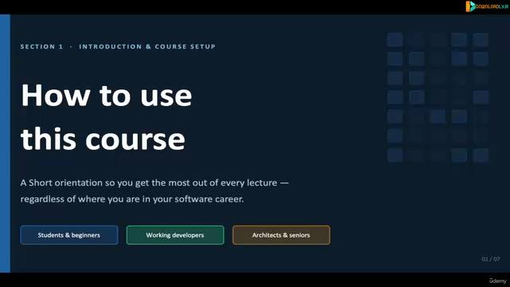
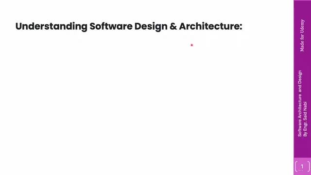
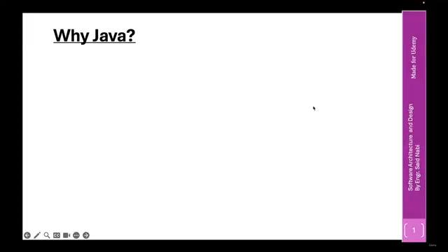
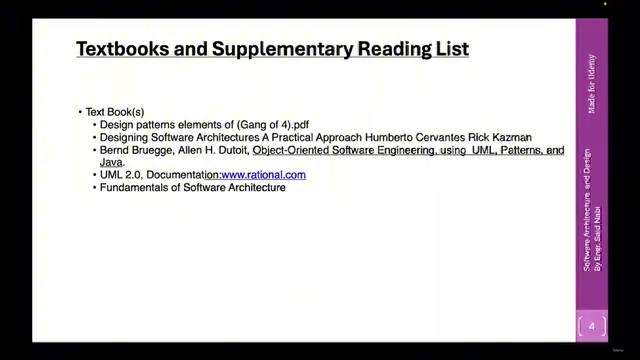
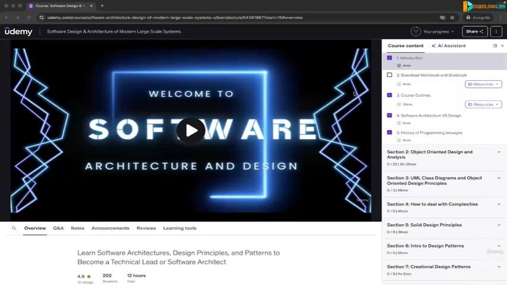
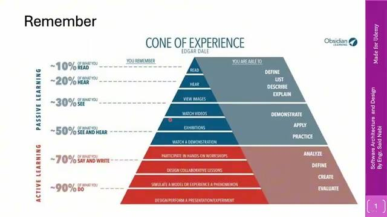

# Software Architecture Scalable · P001–P007 复现文档

## 1. 这一节做什么

P001–P007 是整门课的“开机段”，它不产出任何可运行的系统。逐字稿里从头到尾没有出现一行可执行代码：P001 讲怎么拿课程工作簿，P002 讲三类学习者该怎么用这门课，P003 讲学习金字塔，P004 讲“为什么不能打开 IDE 就写”，P005 给出全课程路线图，P006 定义软件架构与软件设计的边界，P007 回顾编程范式演进史。

但这一段并非可以跳过——它产出的是后续所有实现都要依赖的**三份纸面产物**：

1. **参考系统档案**：p002 [04:58] 要求你选一个自己熟悉的系统，全程拿它当参照系。这份档案决定了后面每一节你拿什么去套用。
2. **架构 / 设计判定表**：p006 花了整整一讲把这两个概念切开，判定表是把这条界线变成可复用工具的唯一方式。
3. **量级定位表**：p006 [09:44] 给了 100 / 10,000 / 100,000 三档用户量，用来判断“当前架构什么时候会崩”。

所以本文档的“复现”不是跑一个 demo，而是**把讲师的口头推理落成五份可以直接填写的文件**，并给出一段可运行的校验脚本，确认你填的东西没缺项。做完这一段，你手里应该有一个装好这五份文件的目录，后面 P008 起每学一个概念就往里补一行。



## 2. 讲师原话

> "在写代码之前，你需要思考，需要分析问题，需要做规划。"
> —— p004 [00:50]

> "没有先确立清晰策略就开发软件，就像没有先打好坚实基础就砌砖建楼。"
> —— p004 [01:47]

> "我们总是从问题出发，从某个概念被发明出来要解决的真实世界场景出发，绝不在交代上下文之前先讲理论。然后我们会用图示而不只是文字来介绍概念本身，之后我会分享一个行业案例……再然后，这是大多数课程会跳过的部分：我们会讨论权衡。每个架构决策都有代价，你不仅要知道什么时候该用某个模式，也同样要知道什么时候不该用它。最后，每节课都会以一个行动项收尾。"
> —— p002 [02:29]

讲师把每节课的结构钉死成五段：**问题 → 概念（配图）→ 行业实例 → 取舍 → 行动项**。本文档第 4 节的“决策卡模板”就是照这个五段式做的。

> "架构要回答的是：所有部分如何协同工作？设计要回答的是：每个单独部分内部如何运作？"
> —— p006 [07:45]

> "目标不是构建最复杂的架构，而是为系统的实际需求和未来需求构建合适的架构。"
> —— p006 [11:33]

> "优秀的软件不是偶然产生的，而是设计出来的。运气无法规模化，猜测也无法规模化，只有深思熟虑、严谨推演的决策才能规模化。"
> —— p006 [05:56]

> "我不希望你只做旁观者……你需要成为参与者……在这门课中学到的任何内容，都不要只是听一听就过去，要去练习、去实验、去应用、去质疑。"
> —— p003 [01:19]

> "针对精选的软件架构概念，我们还会用 Java 编写实践实现……你可以获取 Java 源代码，下载后在本地运行并动手实验。"
> —— p005 [03:37] / [06:54]

课里提到的 UML 工具：Rational Software Architect、Lucidchart、SmartDraw（p006 [00:28]）。课里提到的编程语言：主用 Java，讲师说 Python 或 C++ 也能用（p006 [01:21]）。

## 3. 从零复现

这一节把讲师的推导链按顺序重走一遍。每一步都给出“产出什么文件”，最后你会得到一个目录。

### Step 0 · 建目录

```bash
mkdir -p ~/sa-course/p00-07
cd ~/sa-course/p00-07
```

课里没有要求特定目录名，`~/sa-course/p00-07` 是本文档自定的。

### Step 1 · 用 P004 的问题陈述，写出“你现在想直接动手的那个需求”

p004 [00:22] 说的是新手最自然的反应：看见问题就开 IDE。所以复现的起点不是学概念，而是**把你手上那个“想立刻写”的需求写下来，只写一句话**。写不下来，说明你还没理解问题——这正是 p004 全讲要防的事。

产出：`00-problem.md`

```markdown
# 当前需求（一句话）
例如：给公司内部做一个「会议室预订」网页，50 人用。
```

### Step 2 · 用 P006 的两问句切开架构与设计

p006 [07:45] 给了一对判据，是整个 P006 的浓缩：

- 这个问题问的是「所有部件怎么配合」→ 属于**架构**
- 这个问题问的是「单个部件内部怎么运转」→ 属于**设计**


现在把 Step 1 的需求拆成两组问句。讲师的例子是“几层楼 / 出口在哪 / 电怎么进每个房间”对应架构，“床放哪 / 灯怎么亮 / 墙上挂什么”对应设计——换成软件，架构侧问“用哪个数据库 / 服务之间怎么通信 / 用什么技术栈”，设计侧问“这个类怎么担责 / 这个函数怎么处理非法输入 / 两个模块怎么连才不紧耦合”（p006 [06:54]–[07:18]）。

产出：`01-arch-vs-design.md`（见第 4 节产物二）

### Step 3 · 用量级定位表判断“会不会崩”

p006 [09:44] 给了三档用户量的行为差异，这是全课程里唯一一组可直接引用的量级锚点：

| 用户量 | 讲师原话描述 | 系统表现 |
|---|---|---|
| 100 | “The system might work perfectly fine with 100 users” | 工作正常 |
| 10,000 | “it starts clacking at 10,000 users”（逐字稿原文，应为 cracking，即“开始吃力/开裂”） | 开始出问题 |
| 100,000 | “it may completely collapse at 100,000” | 可能彻底崩溃 |

到这一步你要做的判断只有一件：**你的需求落在哪一档**。p006 [11:03] 还给了另一组对比——公司想两年内到 100 万用户，和只想服务 1 万用户，需要的架构“非常不同”。

产出：`02-scale-band.md`（见第 4 节产物四）

### Step 4 · 写算式（课里没给公式，以下是套用方法）

这里必须说清楚：**讲师只给了量级锚点，没有给任何计算公式，也没给单用户请求频率、峰值系数、机器规格这些参数。** 下面这段算式是给你自己套的模板，标注为“非讲师原话”，不要当成课程内容引用。

假设（全部由你自填）：
```
日活用户数        U
人均每日请求次数   R
峰值系数          K   （峰值 QPS / 平均 QPS，课里没提这个参数，自己按业务估）
→ 平均 QPS = U × R / 86400
→ 峰值 QPS = 平均 QPS × K
```

代入 Step 3 的三档，得到三行，你就知道每一档大概压多少流量。这一步的价值不在于算得准，而在于**把“100 用户”和“100,000 用户”从形容词变成数字**，这是 p006 [11:33] 那句“build the right architecture for the actual requirements”的可执行版本。

### Step 5 · 做取舍：欠设计 vs 过度设计

p006 [11:03] 明确说了两头都会翻车：

- 建太小 → 后期要重新设计（redesign）
- 太早过度工程 → 浪费大量时间和金钱（over-engineer everything too early）

所以 Step 5 的产物是一张**双向风险表**：针对你 Step 4 算出来的峰值，分别写出“如果按低一档做会怎样”和“如果按高一档做会怎样”。



讲师用这两张桥的图说明的不是“要建得结实”，而是“**问题在发现时往往已经太贵、太危险**”（p006 [08:45]）。

### Step 6 · 定学习路线

p002 [00:59] 给了三条路径，逐字如下：

| 你的身份 | 讲师给的路径 |
|---|---|
| 学生 / 初学者 | 按顺序一节不跳，每个概念都建立在上一节之上 |
| 有几年经验的在职开发者 | 基础章节快速略过，从 architecture styles 章节开始深挖 |
| 已是高级工程师 / 架构师 | 直奔 advanced sections 和 case studies，再回头补缺口 |

p002 [01:59] 还补了一句关键前提：**每个 section 是自包含的（self-content）**，所以可以非线性学习，本周工作碰到微服务就跳到微服务那节。

产出：`03-learning-path.md`（见第 4 节产物五）

### Step 7 · 备工具

p006 [00:28] 说 UML 图可以用 Rational Software Architect、Lucidchart 或 SmartDraw 画，要画的有 class diagrams、package diagrams、deployment diagrams 等（逐字稿把 class diagrams 转写成了 “glass diagrams”，按上下文应为类图）。p006 [01:21] 说演示用 Java，理由是 Java 在当时仍在需求前三，且对设计模式的表达力强。



产出：在 `03-learning-path.md` 末尾追加“工具清单”小节。

### Step 8 · 装好书单

p006 [00:00] 说会参考一批书，但只讲“still relevant and are actually being used in the industry”的部分，明确表态不教过时内容。



**注意：逐字稿里没有出现任何一本具体的书名。** 截图里的书单需要你自己看画面抄，逐字稿无法补全，这是本段的一个信息缺口。

---

到这里，`~/sa-course/p00-07` 下应该有五个文件。第 4 节给出全部内容。

## 4. 完整代码

> **重要说明：P001–P007 没有任何代码。** 以下前五份是“纯讲解课”的等价产物——设计决策表、职责表、数据结构草案、容量估算表。最后一段脚本标注了「课里没有代码，以下为示意」，只用来校验前五份文件是否填全，与课程内容无关。

### 目录结构

```
~/sa-course/p00-07/
├── 00-problem.md
├── 01-arch-vs-design.md
├── 02-scale-band.md
├── 03-learning-path.md
├── 04-decision-card.md
├── schema.mjs
└── package.json
```

### 产物一：`00-problem.md`

```markdown
# 当前需求

## 一句话描述
（例：给公司内部做一个会议室预订网页，50 人用。）

## 谁在用
（用户角色，例：行政、普通员工）

## 触发这次设计的真实痛点
（例：现在靠微信群抢会议室，冲突频发）

## 我原本打算直接写的代码
（把 p004 说的“打开 IDE 就写”的冲动写下来，便于后面自查有没有重犯）
```

### 产物二：`01-arch-vs-design.md`

这张表就是 p006 [07:45] 那对判据的可填写版本。

```markdown
# 架构 / 设计 判定表

| # | 问句 | 归属 | 判定依据（p006 判据） | 我的答案 | 若答错的代价 |
|---|------|------|----------------------|----------|--------------|
| 1 | 数据存在哪里？用哪种数据库？ | 架构 | 横跨所有部件 | | 换库要动全系统 |
| 2 | 各服务之间怎么通信？ | 架构 | 横跨所有部件 | | 协议改了所有调用方都要改 |
| 3 | 整体技术栈是什么？ | 架构 | 决定整栋楼的承重 | | 中期推倒重来 |
| 4 | 这个类承担哪些职责？ | 设计 | 单个部件内部 | | 局部返工 |
| 5 | 这个函数怎么处理非法输入？ | 设计 | 单个部件内部 | | 局部返工 |
| 6 | 这两个模块怎么连才不紧耦合？ | 设计 | 单个部件内部 | | 局部返工 |

## 归属判断规则（来自 p006 [07:45]）
- 问「所有部件怎么配合」→ 架构
- 问「单个部件内部怎么运转」→ 设计

## 双向失效（来自 p006 [03:41]）
- 架构漂亮 + 内部设计混乱 → 仍然出问题
- 单个房间漂亮 + 整栋楼结构差 → 系统长大后照样塌
```

### 产物三：`02-scale-band.md`

```markdown
# 量级定位表

## 讲师给的锚点（p006 [09:44]，原话量级，非精确值）
| 用户量 | 系统表现 |
|--------|----------|
| 100 | 工作正常（work perfectly fine） |
| 10,000 | 开始吃力（逐字稿：starts clacking，应为 cracking） |
| 100,000 | 可能彻底崩溃（completely collapse） |

## 业务目标对比（p006 [11:03]）
| 目标 | 讲师结论 |
|------|----------|
| 2 年内达到 1,000,000 用户 | 需要“非常不同”的架构 |
| 只服务 10,000 用户 | 需要“非常不同”的架构 |

## 我的项目落在哪一档
- 预估 12 个月用户量：______
- 落在第 ___ 档
- 因此我**现在**需要的架构复杂度：______

## 套用算式（课里没给公式，以下为自填模板）
- U（日活）= ______
- R（人均日请求）= ______
- K（峰值系数）= ______
- 平均 QPS = U × R / 86400 = ______
- 峰值 QPS = 平均 QPS × K = ______

## 双向风险（来自 p006 [11:03]）
| 方向 | 后果 |
|------|------|
| 按低一档做（建太小） | 后期必须重新设计（redesign） |
| 按高一档做（过早过度工程） | 浪费大量时间和金钱（waste a huge amount of time and money） |
```

### 产物四：`03-learning-path.md`

```markdown
# 学习路径

## 我的身份（三选一，来自 p002 [00:59]）
[ ] 学生 / 初学者
[ ] 有几年经验的在职开发者
[ ] 高级工程师 / 架构师

## 对应路径
- 学生 / 初学者：按 order section by section，不跳
- 在职开发者：基础章节 skim 过，从 architecture styles 起 deep
- 高级工程师 / 架构师：直奔 advanced sections 和 case studies，再回头补

## 我的参考系统（p002 [04:58] 要求，选一个你已经很熟的系统）
- 系统名：______
- 我熟悉的模块：______
- 它的用户量大约落在 02-scale-band.md 的哪一档：______

## 工具清单（来自 p006 [00:28]）
- UML 工具（讲师列出）：Rational Software Architect / Lucidchart / SmartDraw
- 我选：______（理由：______）
- 要画的图（讲师列出）：class diagrams、package diagrams、deployment diagrams
- 演示语言：Java（p006 [01:21]）；讲师说 Python / C++ 也可
- 我的本地 Java 环境：______（版本课里未指定）

## 工作簿（p001 [00:04] / p002 [03:28]）
- [ ] 每进入一个新 section 就去 resources 区下载该 section 的 workbook
- [ ] 下载完整 slide book 作为复习手册
- [ ] 打印 one page architecture decision cheat sheet（p002 [03:58] 建议）
```

### 产物五：`04-decision-card.md`

这张卡严格照 p002 [02:29] 的五段式做。以后每学一个概念，就往后面追加一张。

```markdown
# 架构决策卡

## 模板（五段式，来自 p002 [02:29]）

### 决策卡 · 编号 ____ · 名称 ____

**① 问题（Problem）**
这个概念是为解决什么真实场景的问题而被发明的？

**② 概念（Concept）**
用图描述，不只靠文字。

**③ 行业实例（Industry Example）**
讲师十年以上生产系统的经验案例，或你自己的项目案例。

**④ 取舍（Trade-offs）**
什么时候**不**该用这个模式？（讲师原话：you need to know when not to use a pattern just as much as when to use it）

**⑤ 行动项（Action Item）**
立刻能落到你当前项目或下一次设计讨论里的具体动作。

---

## 已填写的卡

### 决策卡 · 001 · 先规划后编码
**① 问题**：开发者看到需求的第一反应是打开 IDE 直接写（p004 [00:22]）。
**② 概念**：类比组织野餐或规划旅行——出发前要定去哪、怎么去、带什么（p004 [01:06]）。
**③ 行业实例**：讲师给的类比是「不打地基就砌砖」，短期看不出问题，缺陷最终会显现（p004 [01:47]）。
**④ 取舍**：不做规划的代价不是立刻暴露，而是在系统长大后以「难以维护、难以扩展、改动极贵」的形式出现（p004 [03:02]）。
**⑤ 行动项**：写下 00-problem.md 里那一句话需求。
```

### 产物六：`schema.mjs`（示意）

> **课里没有代码，以下为示意。** 这段脚本不实现课程中的任何概念，只做一件事：检查上面五份 Markdown 是否还留着未填的 `______` 占位符和未勾选的 `[ ]`。用它来判断“我这一段是不是真的做完了”。

```javascript
// schema.mjs —— 检查 p00-07 的五份产物是否填写完整
// 注意：这是本文档给的辅助脚本，课程 P001-P007 中没有代码。

import { readFile } from 'node:fs/promises';
import { existsSync } from 'node:fs';

const FILES = [
  '00-problem.md',
  '01-arch-vs-design.md',
  '02-scale-band.md',
  '03-learning-path.md',
  '04-decision-card.md',
];

// 每份文件必须出现的标题关键字（对应第 4 节各产物的必备小节）
const REQUIRED_HEADINGS = {
  '00-problem.md': ['# 当前需求', '## 一句话描述', '## 我原本打算直接写的代码'],
  '01-arch-vs-design.md': ['# 架构 / 设计 判定表', '## 归属判断规则', '## 双向失效'],
  '02-scale-band.md': ['# 量级定位表', '## 我的项目落在哪一档', '## 双向风险'],
  '03-learning-path.md': ['# 学习路径', '## 我的身份', '## 我的参考系统', '## 工具清单'],
  '04-decision-card.md': ['## 模板', '## 已填写的卡'],
};

const BLANK_PATTERNS = [
  { name: '未填占位符', re: /_{4,}/ },
  { name: '未勾选复选框', re: /\[ \]/ },
];

let errors = 0;

for (const file of FILES) {
  if (!existsSync(file)) {
    console.error(`✗ 缺文件：${file}`);
    errors++;
    continue;
  }

  const text = await readFile(file, 'utf8');

  for (const heading of REQUIRED_HEADINGS[file]) {
    if (!text.includes(heading)) {
      console.error(`✗ ${file} 缺小节：${heading}`);
      errors++;
    }
  }

  for (const { name, re } of BLANK_PATTERNS) {
    const hits = text.match(new RegExp(re.source, 'g'));
    if (hits) {
      console.warn(`! ${file} 还有 ${hits.length} 处${name}`);
    }
  }

  console.log(`✓ ${file} 已读取，${text.length} 字符`);
}

if (errors > 0) {
  console.error(`\n共 ${errors} 处结构错误。`);
  process.exit(1);
}
console.log('\n结构检查通过。占位符警告（!）请逐条人工确认。');
```

### `package.json`

```json
{
  "name": "sa-course-p00-07",
  "version": "0.1.0",
  "private": true,
  "type": "module",
  "scripts": {
    "check": "node schema.mjs"
  },
  "engines": {
    "node": ">=18"
  }
}
```

### 运行方式

```bash
cd ~/sa-course/p00-07
npm run check
```

课里未指定任何运行时版本，`node >= 18` 是本文档自定；`schema.mjs` 只用了 `node:fs` / `node:fs/promises`，无第三方依赖，不需要 `npm install`。

## 5. 逐行解释

**`01-arch-vs-design.md` 第 1–3 行为什么是架构**：p006 [06:54] 把架构侧的问句举成“用哪个数据库 / 服务之间怎么通信 / 用什么技术栈”。这三个的共同点是**改一次要动全系统**——换数据库意味着所有数据访问层重写，换通信协议意味着所有调用方改造。所以判定依据写的是“横跨所有部件”，不是“听起来比较宏观”。这一列是防止你凭感觉分类的锚。

**第 4–6 行为什么是设计**：p006 [07:18] 的设计侧问句是“这个类怎么担责 / 这个函数怎么处理非法输入 / 两个模块怎么连才不紧耦合”。注意最后一条——“两个模块怎么连”看起来跨了两个部件，但 p006 [07:45] 把它归到设计，因为问的是**连接方式本身**而不是**整体拓扑**。这是这张表最容易填错的一行，代价列写“局部返工”正是基于这个区别。

**“若答错的代价”这一列为什么必须有**：它其实是 p002 [02:29] 第四段“取舍”的落地。讲师强调 “Every architectural decision has a cost”。把代价写成“局部返工 / 全系统返工”，等于给每个问句贴了成本标签，后面判断“这个决定值不值得现在做”时直接查表。

**“双向失效”小节为什么两边都要写**：p006 [03:41] 的原话是“a beautiful big picture architecture with messy internal details will still cause problems”，反过来“perfectly written code inside a bad overall structure can still collapse when the system grows”。两句话是对称的，只记一边就会掉进“只要架构对就行”的坑。

**`02-scale-band.md` 里为什么把 10,000 那行写“应为 cracking”**：逐字稿原文是 “it starts clacking at 10,000 users”。`clacking` 是拟声词，讲不通；结合上下文（100,000 是 collapse）应为 `cracking`（开裂/吃力）。这类转录错误在本文档中一律标注，不做静默修正，否则你会以为课里真用了某个术语。

**为什么量级表下面还要单独列“业务目标对比”**：p006 [09:14] 的三档描述的是**系统在不同负载下的行为**，p006 [11:03] 的 100 万 / 1 万描述的是**业务预期**。两者维度不同：前者是“现在会怎样”，后者是“该按什么标准建”。混成一张表会丢信息，所以拆开。

**算式那一段为什么反复标“课里没给公式”**：讲师只给量级锚点，没给 U、R、K 任何一个参数，也没给峰值系数的定义。如果我把这五个变量写得像是课程内容，读者会以为后面某节课会讲怎么取 K——实际不会。标注清楚，你才知道这块要自己补。

**`03-learning-path.md` 里“我的参考系统”为什么单列**：p002 [04:58] 把它列为开课前必做三件事之一，原话是 “Pick one system you already know well and keep it in your head as your reference system throughout this course”。它不是一个可选练习，是整门课的挂靠点——后面每讲一个模式（事件驱动、微服务取舍），讲师都要求你先拿这个系统套一遍。同时 p002 [04:58] 也说了 “Architecture is not abstract”，参考系统的存在就是为了让抽象概念落地。

**为什么 `03-learning-path.md` 里 Java 版本写“课里未指定”**：p006 [01:21] 只说用 Java 演示，逐字稿没出现任何版本号。P005 说要下载 Java 源码本地跑，但也没说 JDK 版本。这里留空比填一个猜的版本安全——填 17 或 21 都可能让你后面跑源码时踩坑却不知道错在哪。

**`04-decision-card.md` 为什么先放空模板再放已填卡**：p002 [02:29] 的五段式是**每节课**的固定结构，不是一次性产物。模板单独成段，方便你后面每学一节就复制一份；已填卡只放第一张（P004 的“先规划后编码”），作为格式样例。这样文件是可持续追加的，不会写完就废。

**第 ⑤ 段“行动项”为什么必须是“立刻能落地的动作”**：p002 [02:29] 的原话是 “Something concrete you can apply immediately and your own core base, your current project or your next design conversation”——注意这里逐字稿写的是 `core base`，按语境应为 `codebase`。判断标准是“能不能今天下午就做”，不是“我理解了”。

**`schema.mjs` 里为什么用正则查 `______` 和 `[ ]`**：这两个是“填了但没填完”的唯一机器可判信号。结构完整但内容空着的文件，人眼扫一遍容易漏，脚本扫一遍不会。`[ ]` 的检查特意用 `console.warn` 而不是 `console.error`，因为 `03-learning-path.md` 的身份选择是合法的三选一，勾了一个另外两个仍是空的——这属于正常状态，需要人工确认。

**为什么 `schema.mjs` 只在缺文件 / 缺小节时 `exit(1)`**：缺结构说明你还没做完，必须挡；占位符残留可能是合理中间态，挡了反而逼你乱填。这是“结构严格、内容宽松”的取舍。

## 6. 复现检查清单



跑完第 3 节所有 Step，逐条对照：

**目录与环境**
- [ ] `~/sa-course/p00-07/` 已创建，五个 `.md` + `schema.mjs` + `package.json` 都在
- [ ] `node --version` 输出 ≥ 18
- [ ] `npm run check` 输出“结构检查通过”，无 `✗` 行

**产物一**
- [ ] `00-problem.md` 的“一句话描述”真的是一句话，没有第二句
- [ ] “我原本打算直接写的代码”已填——这一项是给自己留的证据，验证 p004 说的冲动是否真实存在

**产物二**
- [ ] `01-arch-vs-design.md` 六行全部填了“我的答案”
- [ ] 逐行核对过判定依据，尤其是第 6 行“两个模块怎么连”——确认你同意它属于设计
- [ ] “双向失效”两条都写了，没有只写一边

**产物三**
- [ ] 三档锚点按原话量级填写，没有改写成精确数字
- [ ] “我的项目落在哪一档”已勾选
- [ ] 算式五个变量全部填了具体数字（不是“大概”“看情况”）
- [ ] 双向风险表两行都有内容

**产物四**
- [ ] 身份三选一已勾
- [ ] 参考系统已选定，且写下“我熟悉的模块”——选一个你完全没碰过的系统没有意义
- [ ] UML 工具已选定一个，并写下理由
- [ ] Java 环境版本号已记录（哪怕是“暂无”）

**产物五**
- [ ] 空模板完整保留，未删减五段
- [ ] 决策卡 001 五段全部填写
- [ ] 第 ④ 段写的是“什么时候不该用”，不是“什么时候该用”

**学习方法（p003）**
- [ ] 你至少做了一件“参与者”动作：填表、跑脚本、画一张图，而不是只看视频



## 7. 课里没讲但你会撞上

**1. 工作簿到底在哪下载。** P001 [00:04] 说“go to the course resources area and then clicking on the download link provided”，P002 [03:28] 说“the course workbook is the very first resources section and it is available on each section”。这两处说法一个是“课程资源区”，一个是“每个 section 下的第一个资源”。如果你在某个平台上找不到，说明该平台的资源区布局和讲师录制时的平台不一致——这一节里没有更多线索。

**2. JDK 版本。** P005 [03:37] 说要下载 Java 源码本地跑，P006 [01:21] 说用 Java 演示。**全程没有出现版本号。** 你拿到源码后大概率会遇到 `release version X not supported` 这类编译错误，只能从源码里的 `pom.xml` / `build.gradle` 反推。

**3. 源码下载地址。** P005 [06:54] 说“you will have access to the Java source code”，但逐字稿里没有任何 URL 或仓库名。

**4. UML 工具选哪个。** P006 [00:28] 列了三个（Rational Software Architect、Lucidchart、SmartDraw），**没有说推荐哪个，也没说哪个免费**。讲师只说了“可以用任何这类软件”。Lucidchart 和 SmartDraw 都有免费额度限制，具体限制逐字稿没提。

**5. 容量估算的完整公式。** 第 3 节 Step 4 已说明：讲师只给 100 / 10,000 / 100,000 三档行为描述，没给 U、R、K 任何参数。你要自己补这部分。

**6. “vibe coding”具体指什么。** P004 [00:00] 的原话是 “why companies do not promote do not prefer vibe coding instead of software architecture and software design”。讲师把它当作一个已知概念反问了一句，**没有展开定义，也没有点名任何工具**。逐字稿里没有更多信息，别在这里过度联想。

**7. “glass diagrams”。** P006 [00:28] 逐字稿写的是 “such as glass diagrams, package diagrams, deployment diagrams”。`glass diagrams` 不是 UML 图类型，按上下文应为 `class diagrams`。本文档按 `class diagrams` 理解，但保留原始转录。

**8. “core base”。** P002 [04:58] 逐字稿写 “your own core base”，按语境应为 `codebase`。同样保留原始转录。

**9. “model languages”。** P007 [04:33] 逐字稿写 “Then, model languages such as C, Python, and Ruby continued to improve the developer experience”。`model languages` 讲不通，且 C 出现在 1950s 的“higher-level languages”一段里、又出现在这里，时间线矛盾，按上下文应为 `modern languages`。这一处存疑，本文档不做定论。

**10. 架构决策记录（ADR）这个名词没出现。** 第 4 节的“决策卡”用的完全是 P002 [02:29] 的五段式，**不是业界常说的 ADR 格式**。如果你后面在公司里被要求写 ADR，会发现结构不一样——这不是课程内容，是另一套东西。

**11. 三个人的角色差异。** P006 [04:10] 说小公司的架构师每天写代码，大公司（讲师举例 Amazon、Google）的架构师大部分时间在开会、画图、评审设计。但**没说这两种情况下架构师的具体职责边界如何划分**，也没给职级对应关系。

**12. 编程范式史里的年份。** P007 提到 1940s 写 0 和 1（机器语言、第一代编程语言），1950s 出现 Fortran，之后 C 和 Pascal。**Simula、Smalltalk、C++、Java 分别对应哪个年代，逐字稿没给。** 如果你要写进汇报材料，需要另外查证。