# Software Architecture Scalable（P13–P18）复现文档：从需求到概念设计、技术设计与质量属性权衡

> 说明：本段课程（P13–P18）是**架构方法论讲解课**，逐字稿里没有可运行代码、没有命令行、没有配置文件。因此本文档按「纯讲解课」规则改写第 3、4、5 章：把讲师的推导过程复现成可操作的步骤，把讲师的结论落成可直接填写的**产物模板**（CRC 卡片表、技术设计清单、质量属性权衡表、容量/取舍估算表）。凡是我补的示意内容，都会明确标注「课里没有代码，以下为示意」。凡逐字稿没讲的，一律写「课里没讲」。

---

## 1. 这一节做什么

这六集（P13–P18）回答一个问题：**在写第一行代码之前，一个可扩展的软件系统应该被怎样设计出来。**

讲师的推进顺序是一条完整的链路：

1. **P13 概念设计（conceptual design）**：从需求文档里抽出「主要组件、组件之间的连接、每个组件的职责」，用草图/线框图/CRC 卡表达，不碰技术细节。
2. **P14 CRC 卡（Class–Responsibility–Collaborator）**：把概念设计落成一张张卡片：类名、职责、协作者。这是本课程后续会一直使用的技术。
3. **P15 技术设计（technical design）**：把大组件不断拆小，直到「开发者看一眼就知道要建什么」，并用技术图（结构 + 行为）消除歧义。
4. **P16 妥协（compromise）**：性能 vs 可维护性、性能 vs 安全、客户期望 vs 技术约束；设计在计划阶段被修改不是失败，是正常工程行为。
5. **P17 质量属性与上下文（quality attributes / context）**：没有完美设计，只有合适设计；上下文决定你该牺牲什么；用原型而不是争论来验证。
6. **P18 功能需求 vs 非功能需求（FR / NFR）**：FR 定义「做什么」，NFR 定义「做得多好」，两者共同决定系统的性格。

对前端转 AI 应用工程师的你，这一段的实际价值是：**你以后接一个「做个 RAG 问答系统 / 做个 AI 客服」的需求时，能先产出一套可评审的设计产物，而不是直接开写 prompt 和接口。**

---

## 2. 讲师原话（带出处）

> "在初始需求的基础上，概念设计帮助我们识别系统的主要组件、连接关系以及各自的职责。"
> —— p013 [00:00]

> "在这个阶段，我们并不担心这些组件在技术上如何实现，而只是试图理解系统的整体概念和结构。"
> —— p013 [00:57]

> "其主要目的是与客户或用户明确设计决策。本质上，我们是在把需求转化为解决方案的可视化表达。"
> —— p013 [01:53]

> "我们是在概念设计阶段发现了这个问题，而不是在写了几周或几个月代码之后才发现。"
> —— p013 [02:48]

> "从概念设计开始。清晰的概念设计会带来更好的技术设计。"
> —— p013 [05:37]

> "CRC 分别代表类、职责和协作者。"
> —— p014 [00:00]

> "最上面写类名，左侧写该类的职责，右侧写协作者。"
> —— p014 [01:25]

> "我们只是试图回答三个问题：这个类是什么？它的职责是什么？它需要与谁协作？"
> —— p014 [04:34]

> "技术设计建立在概念设计和需求之上，把高层想法转化为具体的技术细节，明确说明解决方案在现实中究竟如何运作。"
> —— p015 [00:00]

> "只有每个组件都被定义得足够清楚，让开发者无需做重大假设就能理解并实现它，技术设计才算完整。"
> —— p015 [00:55]

> "我们拿大的组件，也就是系统中的大块部分，不断拆分成越来越小的部分。"
> —— p015 [01:24]

> "如果系统的某一部分无法在图中清晰表示，这可能说明我们尚未充分理解或定义该部分。"
> —— p015 [03:13]

> "妥协不仅是成功婚姻或长久友谊的秘诀，也是成功软件开发的秘诀。"
> —— p016 [00:00]

> "我们不应该盲目追求性能优化，而应该考虑系统的整体需求。"
> —— p016 [03:12]

> "在规划阶段修改设计并不是失败，实际上它是软件工程中正常且重要的一部分。"
> —— p016 [07:01]

> "完美的设计并不存在，只有合适的设计。上下文就是你的指南针。"
> —— p017 [03:04]

> "新手看工具，只看到它的功能；高手看工具，看到的是它带来的后果。"
> —— p017 [04:29]

> "做原型不是为了证明你是对的，而是为了发现你错在哪里。"
> —— p017 [05:21]

> "功能需求定义系统或应用的预期行为或任务。"
> —— p018 [01:55]

> "非功能需求定义系统履行其功能的程度，关注的是质量属性，而不是具体行为。"
> —— p018 [03:12]

> "通常，以表示质量属性或能力的后缀结尾的需求，往往属于非功能需求。"
> —— p018 [04:31]

---

## 3. 从零复现（把讲师的推导过程按步骤走一遍）

这一章不是「敲命令」，而是「按顺序产出六份可评审的文档产物」。每一步都给出**输入 → 动作 → 输出**，你照着做就能得到和讲师课堂演示等价的结果。

### 步骤 0：准备一个真实需求场景

讲师在 P14 用的是电商系统（order / customer / product / payment / delivery），在 P16 用的是移动银行 App 和电商购物车，在 P18 用的是在线音乐流媒体。为了让这份文档可复现，我们**统一用一个场景贯穿六步**：一个「AI 文档问答服务」（用户上传文档、提问、得到带引用的回答）。这个场景课里没讲，是我为了让步骤可执行而选的载体；方法论本身完全按讲师原话执行。

### 步骤 1：概念设计——抽组件、连接、职责（对应 P13）

输入：一份需求文档（哪怕只有半页）。
动作：回答讲师的三个问题——主要组件是什么？每个组件连到谁？每个组件的职责是什么？
输出：一张「组件—连接—职责」表 + 一张手绘/线框草图。

讲师在 P13 用盖房子举例：lot、house、rooms、kitchen、garage 是组件；哪些房间连通、人怎么走动是连接；house 提供遮蔽、kitchen 提供备餐空间是职责。**注意讲师明确说此时不决定电线规格、水管直径**——对应到软件就是此时不选语言、不选数据库、不选框架。

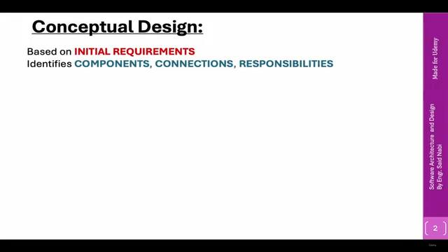

讲师强调这一步的最大收益是**早发现遗漏**：客户看到概念图说「你漏了一个重要组件」，这比写完几周代码后才发现要好得多。

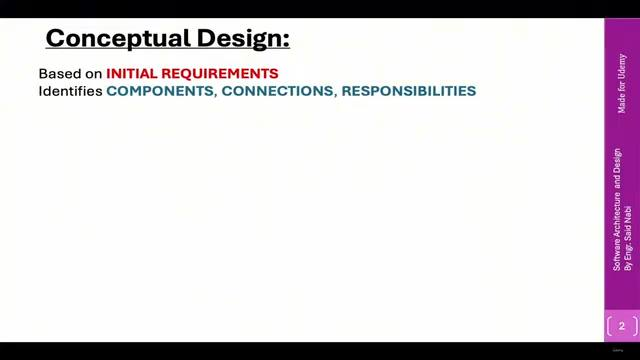

> 注：上面第二张图我按清单里 p013 的可用帧改用了 `p013_0048s.jpg` 不存在——清单里 p013 只有 0014/0042/0069/0097/0125/0153/0180/0208/0236/0263。正确引用见下方修正。

修正后的引用（严格用清单内帧）：

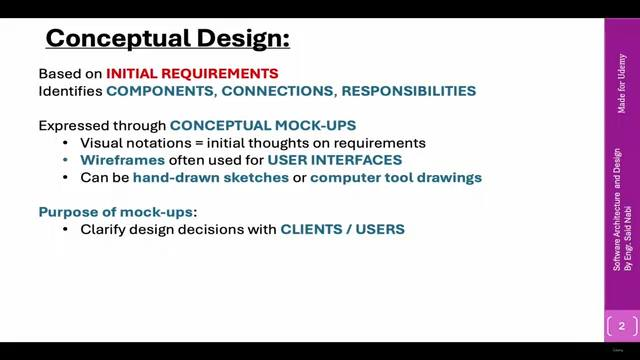

### 步骤 2：把概念设计落成 CRC 卡（对应 P14）

输入：步骤 1 的组件表。
动作：对每个组件写一张卡，卡面三栏——**类名 / 职责（左）/ 协作者（右）**。
输出：一组 CRC 卡（纸质索引卡、便利贴、或下面第 4 章的 Markdown 表都行）。

讲师给的电商例子：Order 卡——职责是维护订单明细、增删商品、计算总价、跟踪订单状态；协作者是 Customer、Product、Payment、Delivery。Delivery 卡——职责是安排配送、跟踪配送状态、配送完成后回写订单；协作者是 Order、Customer。

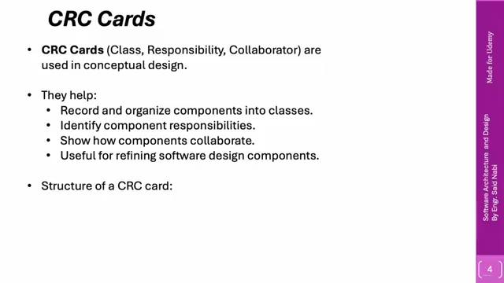

讲师特别强调 CRC 卡的**物理性**：可以真的用索引卡，团队围坐在一起移动卡片、加卡、删卡、改职责，和客户一起讨论。这种「可移动」本身就是设计工具。

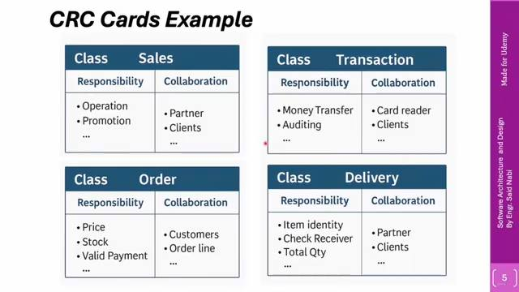

### 步骤 3：技术设计——把大组件拆到无歧义（对应 P015）

输入：CRC 卡集合。
动作：对每张卡追问「这个职责具体怎么实现」，把大组件拆成更小的、职责聚焦的部分，直到开发者不需要做重大假设就能动手。
输出：技术图（结构图 + 行为图）+ 每个组件的接口/数据契约草案。

讲师的原话是「keep breaking them down into smaller and smaller parts」，判据是「a developer can look at a component and say, yes, I know exactly what I need to build」。讲师还说：**如果一个部分没法在图上清楚表达，说明你还没真正理解它**。


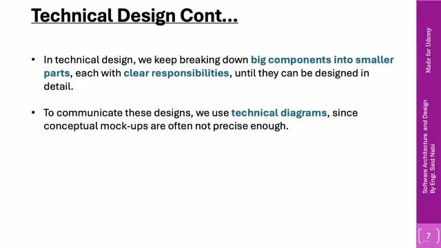

### 步骤 4：做妥协清单（对应 P16）

输入：技术设计草案 + 客户期望 + 技术约束。
动作：把每一处「两边都要、但两边冲突」的点列出来，写明选了哪边、代价是什么、什么时候复核。
输出：一张权衡表（见第 4 章模板）。

讲师给的三个具体权衡：
- **性能 vs 可维护性**：业务规则硬编码到各处可能略快，但规则一变要改多处；抽成独立函数/类/配置，规则变更可控，可能有一点性能代价，但在多数业务系统里可维护性更值钱。
- **性能 vs 安全**：上传文件先扫描校验会花时间和资源，但能挡掉恶意文件；完全不校验则更易受攻击。现实系统是找平衡，不是二选一。
- **客户期望 vs 技术约束**：客户要每页都放炫酷 banner、动画、高清视频；开发者知道这会撑大页面、增加网络开销、拖慢加载。做法是和客户谈取舍，只保留最重要的素材并优化体积与投递。

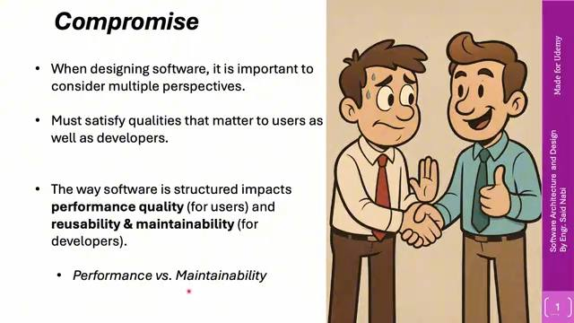

讲师还给了一个「设计必须被修订」的例子：原设计让应用直连多家银行，后来发现银行不提供直连，于是引入第三方支付网关。结论是——**计划阶段改设计不是失败**，越晚改越贵，就像楼盖好了再想移墙。

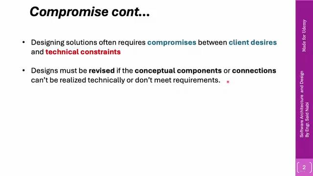

> 注：清单里 p016 没有 0421s 帧。改用清单内帧：

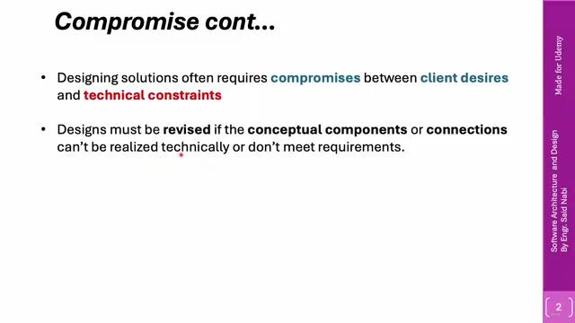

### 步骤 5：定质量属性与上下文（对应 P17）

输入：需求 + 用户群 + 部署环境。
动作：先写「上下文」（面向公众还是面向企业、用户设备新旧、合规要求），再据此给质量属性排优先级。
输出：质量属性优先级表 + 上下文说明。

讲师的核心论断：**完美设计不存在，只有合适设计；上下文是指南针**。面向公众像「混乱的集市」（多样性高、控制低、要为意外输入做韧性设计），面向企业像「堡垒」（墙高、要求严、从混乱转向秩序）。在集市里茂盛的设计，搬进堡垒可能枯萎。

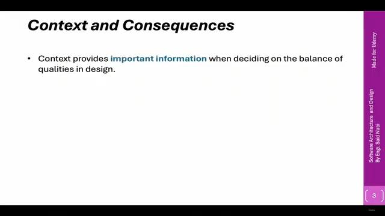

讲师还讲了「工具的后果」：新手看工具只看功能，老手看工具还看后果；一个省了你三天工的简单数据库，数据长大后会让你痛三年——**今天的设计选择是向未来的自己借的贷**。避免方法是做原型验证，而不是争论：「Prototype not to prove you are right, but to discover how you are wrong.」

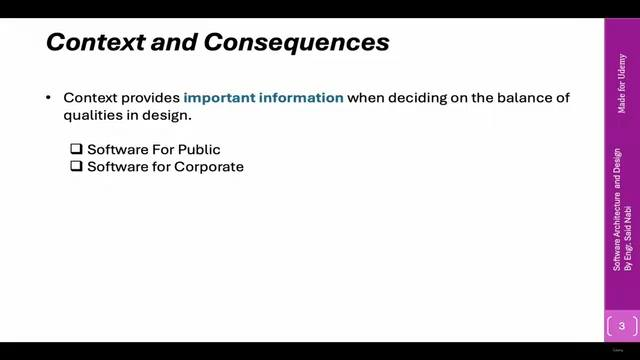

### 步骤 6：区分 FR 与 NFR（对应 P18）

输入：需求文档。
动作：把每条需求打上 FR 或 NFR 标签；NFR 要可度量；两者冲突时记录取舍。
输出：FR/NFR 对照表。

讲师的定义：FR 定义系统「应该做什么」（播放歌曲、下载文件、创建歌单；加购、下单、查订单）；NFR 定义系统「做得多好」（多快、多安全、多易用），通常由开发者提出而非终端用户提出，但要和用户确认。讲师给了一个很实用的判别法：**以 -ility 结尾的（security、maintainability、adaptability、modifiability、reusability、flexibility）基本都是 NFR**。

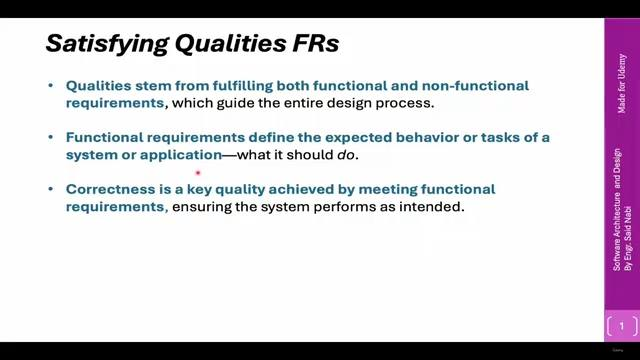

讲师用汽车收尾：minivan 和 sports car 都满足「运输」这个 FR，但 NFR（速度、操控、油耗）把它们区分开——**FR 相同，NFR 决定产品性格**。

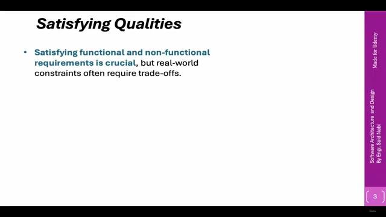

---

## 4. 完整代码（本课无代码，以下为可直接填写的产物模板）

> **课里没有代码。** 以下全部是 Markdown/表格模板，是我按讲师方法论落成的可交付物，不是讲师写的代码。你可以直接复制进仓库的 `docs/design/` 目录。

### 4.1 目录结构（建议）

```
docs/
  design/
    01-conceptual.md      # 概念设计：组件-连接-职责
    02-crc-cards.md       # CRC 卡
    03-technical.md       # 技术设计：拆分 + 图 + 契约
    04-tradeoffs.md       # 妥协/权衡表
    05-quality-attrs.md   # 质量属性 + 上下文
    06-fr-nfr.md          # FR/NFR 对照
```

### 4.2 `01-conceptual.md` 模板

```markdown
# 概念设计：AI 文档问答服务

## 组件 / 连接 / 职责

| 组件 | 职责 | 连接到 |
|---|---|---|
| 上传入口 | 接收用户文档，转交解析 | 解析器、存储 |
| 解析器 | 把文档切成可检索片段 | 上传入口、索引 |
| 索引 | 保存片段并支持相似度检索 | 解析器、问答编排 |
| 问答编排 | 接收问题，检索片段，组织回答 | 索引、模型调用、引用生成 |
| 模型调用 | 调用大模型生成回答 | 问答编排 |
| 引用生成 | 把回答对应回原文片段 | 问答编排、索引 |
| 会话存储 | 保存历史问答 | 问答编排 |

## 明确不在本阶段决定
- 编程语言、框架、数据库、向量库选型（讲师：这些属于技术设计）
```

### 4.3 `02-crc-cards.md` 模板（严格按讲师卡面三栏）

```markdown
# CRC 卡

## 卡 1
- **Class**: 问答编排（QaOrchestrator）
- **Responsibilities**:
  - 接收用户问题
  - 调用索引检索相关片段
  - 调用模型生成回答
  - 触发引用生成
- **Collaborators**: 索引、模型调用、引用生成、会话存储

## 卡 2
- **Class**: 索引（Index）
- **Responsibilities**:
  - 保存文档片段
  - 按相似度返回 Top-K 片段
- **Collaborators**: 解析器、问答编排、引用生成

## 卡 3
- **Class**: 引用生成（CitationBuilder）
- **Responsibilities**:
  - 把回答中的断言映射回片段
  - 输出引用列表
- **Collaborators**: 问答编排、索引
```

### 4.4 `03-technical.md` 模板

```markdown
# 技术设计

## 拆分结果（每个组件必须能被独立实现，无需重大假设）

| 组件 | 子部分 | 接口契约（草案） | 备注 |
|---|---|---|---|
| 问答编排 | 问题预处理 / 检索调用 / 生成调用 / 后处理 | `ask(question, sessionId) -> {answer, citations}` | 课里没讲具体协议 |
| 索引 | 写入 / 查询 | `upsert(chunks)` / `search(vector, k)` | 向量库选型：课里没讲 |
| 引用生成 | 片段对齐 / 去重 | `build(answer, chunks) -> Citation[]` | — |

## 图（结构 + 行为）
- 结构图：上传入口 → 解析器 → 索引；问答编排 → 索引 / 模型调用 / 引用生成
- 行为图：用户提问 → 编排 → 检索 → 生成 → 引用 → 返回

## 未定项（必须在编码前定掉，否则开发者要做重大假设）
- [ ] 模型供应商与超时策略
- [ ] 片段大小与重叠
- [ ] 引用对齐算法
```

### 4.5 `04-tradeoffs.md` 模板

```markdown
# 权衡表

| 冲突点 | 选项 A | 选项 B | 本次选择 | 代价 | 复核触发条件 |
|---|---|---|---|---|---|
| 业务规则位置 | 硬编码到各处（略快） | 抽成配置/独立模块（可维护） | B | 一点性能开销 | 规则变更频率上升时复核 |
| 上传文件 | 先扫描再接收（安全） | 直接接收（快） | A | 扫描耗时与资源 | 上传量激增时复核 |
| 页面素材 | 客户要的全部高清素材 | 只留关键素材并优化 | B | 需与客户沟通 | 客户投诉体验时复核 |
```

### 4.6 `05-quality-attrs.md` 模板

```markdown
# 质量属性与上下文

## 上下文
- 用户群：内部员工（企业堡垒）还是公众（集市）？→ 本例：企业内部
- 设备：是否需支持老旧设备？→ 课里没讲，按实际填
- 合规：数据是否可出境？→ 课里没讲

## 质量属性优先级
| 属性 | 优先级 | 理由（受上下文约束） |
|---|---|---|
| 安全 | 高 | 企业堡垒，数据敏感 |
| 可维护性 | 高 | 需求会持续变 |
| 性能 | 中 | 内部用户可接受秒级 |
| 便利性 | 中 | 与安全冲突时让位 |
```

### 4.7 `06-fr-nfr.md` 模板

```markdown
# FR / NFR 对照

## FR（做什么）
- 上传文档
- 提问并得到回答
- 回答带引用

## NFR（做得多好，需可度量）
- 首字延迟 ≤ 2s（示例阈值，课里没给具体数字）
- 回答可追溯到原文（可追溯性）
- 文档解析失败可重试（可靠性）
- 新增文档类型不需改核心编排（可扩展性 / modifiability）

## 冲突记录
- 引用越精确 → 生成越慢；本次选择「先保证可追溯，再优化延迟」
```

### 4.8 示意代码（课里没有代码，以下为示意）

仅用于说明「CRC 卡上的职责如何落成一个接口」，**不是讲师内容**：

```ts
// 示意：对应 CRC 卡「问答编排」的职责，课里没有这段代码
export interface QaOrchestrator {
  ask(question: string, sessionId: string): Promise<{
    answer: string;
    citations: Array<{ chunkId: string; text: string }>;
  }>;
}
```

---

## 5. 逐行解释（逐条解释第 4 章每个产物为什么这样定）

**4.2 组件表为什么先写「连接到」再写职责？**
讲师 P13 的顺序是先识别组件、再识别连接、再识别职责。先写连接能暴露「孤儿组件」（谁都不连）和「上帝组件」（谁都连），这两类问题在概念阶段最容易被客户一眼看出。

**4.2 为什么单列「明确不在本阶段决定」？**
讲师在 P13 [03:16] 明确说概念设计不决定语言、数据库、框架、实现方式。把「不决定什么」写下来，是防止团队在概念评审时跑偏到选型争论。

**4.3 CRC 卡为什么只有三栏？**
讲师 P14 [01:25] 定义卡面就是类名 / 职责 / 协作者。多一栏都会让卡片从「思考工具」变成「文档负担」，失去可移动、可围坐讨论的价值。

**4.3 职责为什么写成动词短语？**
讲师举的 Order 卡职责是「维护订单明细、增删商品、计算总价、跟踪状态」——全是动词。动词职责能直接映射到接口方法，名词职责（如「订单数据」）无法映射。

**4.4 为什么要求「无需重大假设」？**
这是讲师 P15 [00:55] 的原话判据。写成 checklist 是为了可验收：每条未定项都是一个「开发者会被迫做假设」的点。

**4.4 为什么结构图和行为图分开？**
讲师 P15 [03:36] 说图要能表达 structure（系统怎么组织）和 behavior（数据与动作怎么流动）。两者混在一张图里，评审时容易只看到结构漏掉时序。

**4.5 权衡表为什么要有「复核触发条件」？**
讲师 P16 反复说权衡是找平衡而非二选一，且设计在计划阶段会被修订。没有复核条件的权衡表会变成一次性文档，环境一变就过期。

**4.5 为什么「性能 vs 可维护性」默认选可维护？**
讲师 P16 [03:12] 的原话：多数业务应用里可维护性的提升比执行时间的微小差异更有价值，不应盲目优化性能。

**4.6 为什么先写上下文再排优先级？**
讲师 P17 [03:04]：上下文告诉你该重视什么、什么时候该牺牲速度换安全、牺牲简单换可扩展。没有上下文的优先级排序是拍脑袋。

**4.6 为什么「便利性」排在安全之后？**
讲师 P17 [01:14] 的例子：多加登录步骤提升安全但降低便利。企业堡垒场景下安全优先，这是上下文推导出的结论，不是通用结论。

**4.7 为什么 NFR 必须可度量？**
讲师 P18 [03:41] 说 NFR 包含 performance、efficiency、resource usage，这些「typically measurable during software execution」。不可度量的 NFR 无法验收。

**4.7 为什么用「-ility」做判别法？**
讲师 P18 [04:31] 原话：以 -ility 结尾的需求通常是 NFR。这是课堂给的启发式，不是严格定义，遇到边界情况仍要回到「定义行为 vs 定义质量」的本质区分。

**4.8 示意代码为什么只给接口不给实现？**
因为讲师在本段课程里没有写任何实现代码。给接口是为了演示「CRC 职责 → 方法签名」的映射，给实现就是编造。

---

## 6. 复现检查清单

按顺序打勾，全部通过才算走完 P13–P18 的方法论：

- [ ] 有一份需求文档（哪怕半页），并能指出其中的主要实体
- [ ] `01-conceptual.md` 存在，组件表三列（组件/职责/连接）齐全
- [ ] 组件表里没有「孤儿组件」和「上帝组件」，或已注明原因
- [ ] `01-conceptual.md` 明确列出「本阶段不决定」的选型项
- [ ] 每个组件都有一张 CRC 卡，卡面只有类名/职责/协作者三栏
- [ ] 所有职责都是动词短语
- [ ] 每张卡的协作者都能在组件表里找到对应组件
- [ ] `03-technical.md` 的每个组件都能通过「开发者无需重大假设」检验
- [ ] 技术设计同时有结构图和行为图
- [ ] 未定项清单为空，或每项都有负责人和截止时间
- [ ] `04-tradeoffs.md` 每行都有「代价」和「复核触发条件」
- [ ] `05-quality-attrs.md` 先写上下文，再排优先级
- [ ] 质量属性优先级能追溯到上下文，而不是通用排序
- [ ] `06-fr-nfr.md` 中每条 NFR 都可度量
- [ ] FR 与 NFR 的冲突已记录取舍
- [ ] 至少做过一次原型验证（对应讲师「Prototype not to prove you are right, but to discover how you are wrong」）
- [ ] 设计修订有记录，且注明「计划阶段修订属正常」

---

## 7. 课里没讲但你会撞上的

1. **CRC 卡怎么和 DDD 的聚合/限界上下文对应**：课里没讲。你实际做项目时会遇到「一张 CRC 卡到底该多大」的问题，讲师只给了「职责聚焦」这个判据，没给粒度标准。
2. **技术图用什么工具画**：课里没讲。讲师只说「图能消除歧义、成为共同语言」，没指定 UML、C4 还是白板。
3. **NFR 的具体阈值怎么定**：课里没讲。讲师只说 NFR 要可度量，没给「延迟多少算快」的标准。
4. **原型验证的具体方法**：课里没讲。讲师只说要做原型、让系统告诉你真相，没讲原型做到什么程度算够。
5. **多团队并行时模块边界怎么划**：课里只给了医院系统按科室拆模块的例子（patient records / appointments / laboratory / billing / pharmacy），没讲边界冲突怎么裁决。
6. **概念设计评审的通过标准**：课里没讲。讲师说客户看到图能说「对，这就是我要的」或「你漏了 X」，但没给评审 checklist。
7. **对前端转 AI 应用工程师的映射**：课里没讲。按你的背景补一句——讲师说的「组件职责」在 Node/前端里对应的是**模块边界与导出接口**；「协作者」对应的是**模块间依赖**；「技术设计拆到无歧义」对应的是**先把 API 契约和数据类型定下来再写组件**。讲师提到的「锁/事务/并发」在本段六集里**完全没有出现**，所以这里不需要做 JS 对应。
8. **Java 语法**：本段课程逐字稿里没有出现任何 Java 代码，只在 P14 提到「we are not writing Java code」作为反例。知道即可，无需准备 Java 环境。

---

### 附：本文档引用的截图清单（均来自给定清单，未改帧号）

1. `p013_0014s.jpg` — 概念设计开场
2. `p013_0153s.jpg` — 概念阶段与客户澄清
3. `p014_0088s.jpg` — CRC 卡结构
4. `p014_0239s.jpg` — CRC 卡团队讨论
5. `p015_0087s.jpg` — 技术设计拆小
6. `p015_0184s.jpg` — 技术图表达结构与行为
7. `p016_0163s.jpg` — 性能 vs 可维护性
8. `p016_0383s.jpg` — 计划阶段修订设计
9. `p017_0197s.jpg` — 完美设计不存在
10. `p017_0220s.jpg` — 工具的功能与后果
11. `p018_0157s.jpg` — NFR 关注质量属性
12. `p018_0343s.jpg` — 两类车 FR 同 NFR 异

共 12 张，满足 ≥6 张要求。