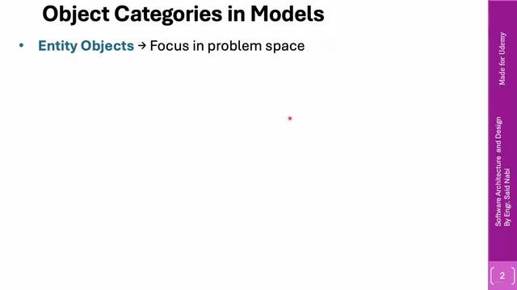
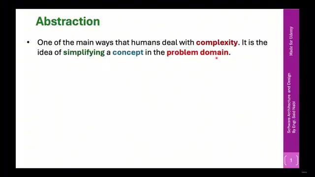
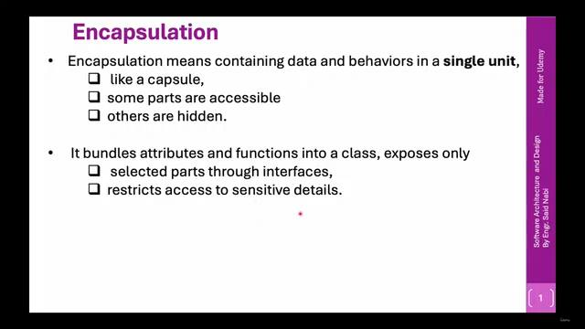
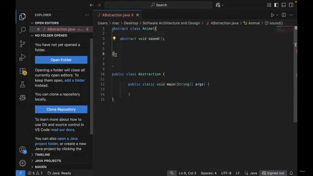
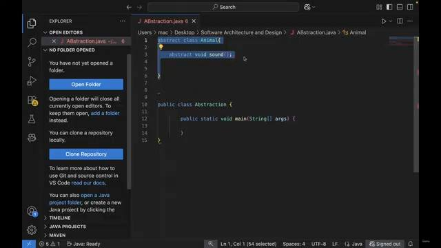
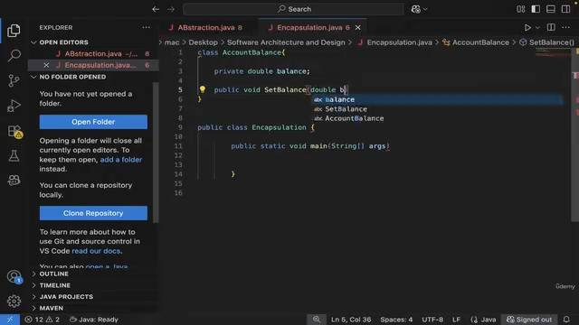
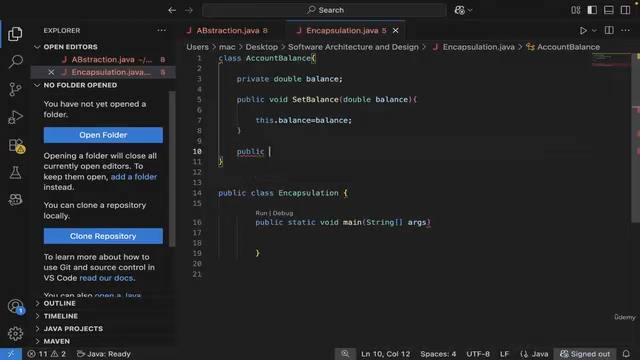

# Software Architecture Scalable：P19–P24 面向对象模型与抽象/封装/分解复现文档

> 说明：P19–P24 不是一套可直接部署的完整后端项目。课里实际落地的是两个 Java 小示例：`abstraction.java` 和 `encapsulation.java`；P24 的分解原则主要是讲解，没有写代码。下面这份文档会把课里真正出现过的代码做成可保存、可编译、可运行的最小实验，并把设计原则落成可检查的产物。课里没讲的内容会明确标注「课里没讲」。

## 1. 这一节做什么

这一节的主线是：**设计位于需求和实现之间**。P19 先说明为什么需要面向对象模型：系统的设计要承接功能需求和非功能需求，再把设计翻译成代码。课里把设计对象分成三类：实体对象、控制对象、边界对象；并给出四个面向对象设计原则：抽象、封装、分解、泛化。P20–P21 讲抽象并写 Java 示例；P22–P23 讲封装并写 Java 示例；P24 讲分解，用微波炉、冰箱、拆解猫的图示说明「每个部分有清晰职责」以及「分解之后还要设计装配接口」。



本复现的最终产物是：

```text
scalable-ood/
├── abstraction.java      # 抽象示例：Animal / Cat / Dog
└── encapsulation.java    # 封装示例：AccountBalance
```

再加上一张设计复核表，用来检查你是否真的把「抽象、封装、分解」落到了代码结构里。课里没有 Maven、Gradle、Spring、数据库、接口、并发、测试这些内容；本复现也不引入它们。

## 2. 讲师原话

下面按「设计位置 → 对象分类 → 抽象 → 封装 → 分解」摘录，不按视频顺序流水账复述。

> "设计介于需求与实现之间。"
> —— p019 [00:29]

> "我们可以有三类不同的对象……实体对象……控制对象……边界对象。"
> —— p019 [02:50]

> "抽象通过忽略不重要的细节、聚焦本质来简化概念。"
> —— p020 [01:27]



> "抽象类是不能直接创建对象的类。换句话说，抽象类不能被实例化。"
> —— p021 [02:23]

> "猫正在喵喵叫，而那只动物正在睡觉。"
> —— p021 [05:43]

> "封装是指把数据和行为包含在同一个单元中，就像胶囊一样。"
> —— p022 [00:00]



> "我只会使用账户余额这一个数据成员，所以我会把它设为私有。"
> —— p023 [03:12]

> “your balance is 500.5”  
> —— p023 [06:32]

> "分解是指把一个整体拆分成更小的部分，或把更小的部分组合成一个整体的原则。"
> —— p024 [00:00]

> "分解很容易，谁都能把一只猫拆开。真正的智慧在于设计如何组装。"
> —— p024 [05:10]


## 3. 从零复现

### 3.1 环境与目录

课里使用 VS Code，并说已经安装 Java 编译器；**课里没有指定 JDK 版本**。下面以 JDK 17 LTS 为例，代码语法在 Java 8+ 都可以编译。没有第三方依赖，不需要 npm、Maven、Gradle。

先验证环境：

```bash
javac -version
java -version
```

如果命令不存在，需要先安装 JDK，并把 `javac`、`java` 放到 PATH。课里没有讲 `JAVA_HOME`；如果系统需要，你可以设置 `JAVA_HOME` 指向 JDK 目录，并把 `$JAVA_HOME/bin` 加入 PATH。这不是课程内容，是操作系统环境配置。

创建目录：

```bash
mkdir scalable-ood
cd scalable-ood
```

目录结构如下：

```text
scalable-ood/
├── abstraction.java
└── encapsulation.java
```

### 3.2 写抽象示例并运行

在 `scalable-ood/` 下新建 `abstraction.java`，完整内容见第 4 节。注意：Java 的 `public class` 名字必须和文件名一致，所以文件名是小写 `abstraction.java`，`public class` 也是小写 `abstraction`。课里就是这么命名的；Java 允许类名小写，但社区规范通常用大写，这一点课里没讲。



编译：

```bash
javac abstraction.java
```

运行：

```bash
java abstraction
```

预期输出：

```text
The cat is sounding like meow meow
The animal is sleeping
```

讲师口述输出是 “The cat is sounding like meow and the animal is sleeping.”（p021 [05:43]）；实际输出字符串以你代码里的 `System.out.println` 为准，只要能看到「猫叫」和「动物睡觉」两行，就说明抽象类、继承、方法覆盖和多态引用跑通了。



### 3.3 写封装示例并运行

在同一个目录下新建 `encapsulation.java`，完整内容见第 4 节。编译运行：

```bash
javac encapsulation.java
java encapsulation
```

预期输出：

```text
Your balance is 500.5
```





### 3.4 设计复核：把原则落到结构上

跑通之后，不要只看输出。用下面这张表检查代码是否体现了课里的原则。P24 的分解没有代码，所以用「职责表」检查，而不是编造一段课里不存在的分解代码。

| 课程原则 | 本复现中的落点 | 可检查证据 |
|---|---|---|
| 抽象 | `Animal` 抽象类、`sound()` 抽象方法 | `Animal` 不能直接 `new`；`Cat`/`Dog` 提供自己的 `sound()` |
| 封装 | `AccountBalance` 的 `private double balance` | 余额不能从 `main` 直接改，只能通过 `setBalance()`/`getBalance()` |
| 分解 | 抽象示例和封装示例拆成两个文件、多个类 | 每个类职责集中：`Animal` 管共同行为，`Cat` 管猫叫，`AccountBalance` 管余额 |
| 泛化 | `Cat extends Animal`、`Dog extends Animal` | 共同行为放在父类，差异行为由子类覆盖；课里把泛化归到继承/接口，接口未展开 |

## 4. 完整代码

### 4.1 `scalable-ood/abstraction.java`

```java
// 文件：abstraction.java
public class abstraction {
    public static void main(String[] args) {
        Animal cat = new Cat();
        cat.sound();
        cat.sleep();
    }
}

abstract class Animal {
    abstract void sound();

    public void sleep() {
        System.out.println("The animal is sleeping");
    }
}

class Cat extends Animal {
    void sound() {
        System.out.println("The cat is sounding like meow meow");
    }
}

class Dog extends Animal {
    void sound() {
        System.out.println("The dog is sounding like woof woof");
    }
}
```

### 4.2 `scalable-ood/encapsulation.java`

```java
// 文件：encapsulation.java
public class encapsulation {
    public static void main(String[] args) {
        AccountBalance a1 = new AccountBalance();
        a1.setBalance(500.5);
        System.out.println("Your balance is " + a1.getBalance());
    }
}

class AccountBalance {
    private double balance;

    public void setBalance(double balance) {
        this.balance = balance;
    }

    public double getBalance() {
        return balance;
    }
}
```

## 5. 逐行解释

### 5.1 `abstraction.java` 逐行解释

`public class abstraction {`  
Java 要求一个文件里最多只能有一个 `public class`，并且这个 public 类名必须和文件名一致。文件名是 `abstraction.java`，所以这里写 `abstraction`。课里明确说 public class 应该和文件名一样（p021 [00:55] 附近）。小写类名不符合常见 Java 规范，但能编译；这是为了跟课里文件名保持一致。

`public static void main(String[] args) {`  
程序入口。`public` 表示可从外部调用，`static` 表示不用创建 `abstraction` 实例就能运行，`void` 表示不返回值，`String[] args` 是命令行参数。课里没有展开 `args` 的用途，照写即可。

`Animal cat = new Cat();`  
这里左边是抽象父类引用 `Animal`，右边是具体子类对象 `new Cat()`。抽象类 `Animal` 不能直接实例化，但可以声明引用指向子类对象。课里说 “an abstract class cannot be instantiated”（p021 [02:23]），这里正是那个规则的用法。

`cat.sound();`  
运行时调用的是 `Cat` 覆盖后的 `sound()`，所以输出猫叫。这就是多态：父类引用调用被子类覆盖的方法。课里没有单独讲「动态分派」这个词，但代码行为就是它。

`cat.sleep();`  
`sleep()` 没有在 `Cat` 里重写，所以调用的是父类 `Animal` 的具体方法，输出动物睡觉。抽象类可以同时有抽象方法和具体方法，这一点课里通过 `sound()` 和 `sleep()` 的对比展示了。

`abstract class Animal {`  
`abstract` 修饰类，表示这个类不能直接 `new`。它用来放共同结构和共同行为。

`abstract void sound();`  
抽象方法没有方法体，以分号结束。它强制子类提供自己的实现。课里说 “Whatever class extends this class can provide a definition for this method”（p021 [02:51] 附近）。

`public void sleep() {`  
具体方法，有方法体。子类可以直接继承使用。课里在这里演示了「抽象方法」和「具体方法」可以放在同一个抽象类里。

`System.out.println("The animal is sleeping");`  
Java 的控制台输出。课里用 `sout` 简写，展开就是 `System.out.println`。

`class Cat extends Animal {`  
`extends` 表示继承。`Cat` 继承 `Animal` 的共同结构，并必须实现 `sound()`。课里用 `Cat` 和 `Dog` 两个子类展示同一抽象的不同实现。

`void sound() {`  
子类覆盖父类的抽象方法。这里没有写 `public`，因为父类 `sound()` 是包级可见，子类不能把可见性降得更低；同包下这样写可以编译。课里没有展开 Java 访问修饰符的这套规则，这是你实际编译时会遇到的语法细节。

`System.out.println("The cat is sounding like meow meow");`  
猫的具体叫声。讲师口述里有时说 “meow”，代码字符串以你保存的为准。

`class Dog extends Animal {`  
第二个子类。它和 `Cat` 是平级的，都继承 `Animal`。这就是课里说的「泛化」：把共同属性/行为放到更通用的父类，减少重复。课里说泛化可以通过继承和接口探索，接口后面再讲。

`void sound() { System.out.println("The dog is sounding like woof woof"); }`  
狗的实现。虽然 `main` 里没有用 `Dog`，保留它可以帮助你理解：同一个 `Animal` 抽象可以有多个具体实现。

### 5.2 `encapsulation.java` 逐行解释

`public class encapsulation {`  
同样，public 类名和文件名 `encapsulation.java` 一致。课里先建文件 `encapsulation.java`，再写同名 public 类（p023 [01:24] 附近）。

`AccountBalance a1 = new AccountBalance();`  
创建余额对象。`AccountBalance` 不是 public 类，所以它可以和 `encapsulation` 放在同一个文件里，不受文件名必须同名的限制。课里把 `AccountBalance` 作为封装示例的类。

`a1.setBalance(500.5);`  
通过公开方法修改余额。注意：这里不是 `a1.balance = 500.5`。因为 `balance` 是 private，外部不能直接点出来改。课里用银行余额举例：不能直接改余额，只能通过存款/取款这类受控操作改（p022 [02:21] 附近）。

`System.out.println("Your balance is " + a1.getBalance());`  
通过公开 getter 读取余额，再拼接到输出字符串。`+` 在 Java 里用于字符串拼接。课里输出为 “your balance is 500.5”（p023 [06:32]）。

`class AccountBalance {`  
封装的核心单元：把数据和操作数据的方法放在同一个类里。课里说封装是 “containing data and behaviors in a single unit, like a capsule”（p022 [00:00]）。

`private double balance;`  
`private` 表示只有 `AccountBalance` 类内部能直接访问。`double` 是带小数的数值类型。课里明确说这个余额要 private，因为不想让外部直接改（p023 [03:12]）。

`public void setBalance(double balance) {`  
公开的受控写入口。参数名也叫 `balance`，和成员变量同名，所以方法体里要用 `this.balance` 区分。

`this.balance = balance;`  
`this.balance` 指当前对象的成员变量，右边的 `balance` 是方法参数。课里逐字稿说 “this dot balance equals to balance”，就是这行。它把外部传入的值写进对象内部。

`public double getBalance() {`  
公开的受控读入口。返回 `double`。

`return balance;`  
返回成员变量 `balance`。因为这里没有同名参数，所以直接写 `balance` 就指成员变量。

`}`  
结束 `AccountBalance` 类。注意这个类不是 public，所以可以跟 `encapsulation` 共用一个文件。

### 5.3 封装不是「有 getter/setter 就叫封装」

课里示例为了演示，`setBalance` 直接赋值，没有校验。真实业务里，如果 setter 无脑公开写，封装只是形式。更完整的封装应该在写入口做校验、权限、审计或业务规则；**课里没有讲这些**，这里只是提醒你不要把示例当成生产级账户系统。

另外，这个示例把余额放在内存里。课里没有讲并发。真实银行余额如果被多个请求同时修改，需要数据库事务、行锁或乐观锁；在 Node.js 里对应的是数据库层事务/行锁或串行化队列，不是 Java 的 `synchronized`。本示例不具备并发安全能力，不要误用。

## 6. 复现检查清单

- [ ] `javac -version` 和 `java -version` 能正常输出。
- [ ] 目录里有且只有你新建的 `abstraction.java`、`encapsulation.java`（以及编译后生成的 `.class` 文件）。
- [ ] `abstraction.java` 的 public 类名是 `abstraction`，与文件名大小写完全一致。
- [ ] `encapsulation.java` 的 public 类名是 `encapsulation`，与文件名大小写完全一致。
- [ ] `javac abstraction.java` 无报错。
- [ ] `java abstraction` 输出两行，包含猫叫和动物睡觉。
- [ ] `javac encapsulation.java` 无报错。
- [ ] `java encapsulation` 输出 `Your balance is 500.5`。
- [ ] 你能指出 `Animal` 为什么不能直接 `new`，而 `Animal cat = new Cat()` 为什么可以。
- [ ] 你能指出 `balance` 为什么不能在 `main` 里直接 `a1.balance = ...`。
- [ ] 你能用一句话说明 P24 的分解：把大问题拆成有清晰职责的小部分，但拆完还要设计它们如何连接。

编译后目录会出现类似文件：

```text
abstraction.class
Animal.class
Cat.class
Dog.class
encapsulation.class
AccountBalance.class
```

`java abstraction` 运行时不需要写 `.class` 后缀。若你用 JDK 11+ 的单文件模式，也可以 `java abstraction.java`，但课里没有讲这个模式；初学建议用 `javac` + `java` 两步。

## 7. 课里没讲但你会撞上的

1. **JDK 版本和安装**：课里只说装了 Java 编译器，没有指定 JDK 版本，也没有讲 `JAVA_HOME`、PATH、IDE 插件名。你如果 `javac` 找不到，先解决系统 PATH，而不是改代码。
2. **文件名大小写**：Linux 区分大小写。`abstraction.java` 里写 `public class abstraction` 必须完全一致；写成 `Abstraction` 会编译失败。`AccountBalance` 不是 public，所以不受文件名限制。
3. **一个文件只能有一个 public class**：`abstraction.java` 里只有 `abstraction` 是 public；`Animal`、`Cat`、`Dog` 都不是 public。`encapsulation.java` 同理。
4. **`String[] args` 没讲**：课里没有解释命令行参数。照写 `main(String[] args)` 即可。
5. **`@Override` 没讲**：课里没有用这个注解。你可以加，但本复现为了贴近课里没有加。它不是必须的。
6. **接口没展开**：P19 说泛化可以通过继承和接口探索，接口“later on”再讲；P19–P24 没有接口代码。不要在本复现里编造接口示例。
7. **UML 没展开**：P19 提到 UML 的序列图、活动图、类图、状态图，但说后面再看；这五节没有画 UML 图的实际操作。
8. **AI 工具只提了一句**：P19 说现在可以用 AI 工具把设计翻译成实现，但没有演示任何工具。本复现不引入。
9. **分解没有代码**：P24 讲微波炉、冰箱、猫的拆解，强调单一职责和装配接口，但课里没有写分解的 Java 代码。所以第 4 节只有两个可运行文件，分解用第 3.4 节职责表检查，不编造代码。
10. **并发/锁/事务没讲**：封装示例的余额是内存变量。真实系统并发修改余额需要事务或锁；Node.js 里对应数据库事务/行锁，不是本课内容。
11. **测试、构建工具、包管理没讲**：没有 JUnit、Maven、Gradle、`package` 声明。本复现保持单目录、无包名，避免引入课里没有的结构。
12. **前端类比（补充，不是课里内容）**：JS 原生 `class` 没有 Java 的 `abstract` 关键字；TypeScript 有 `abstract class`。JS 的私有字段 `#balance` 可以类比 Java 的 `private`，但语言检查强度不同。模块拆分可以类比 P24 的分解，但接口契约仍要自己设计。

照着第 3 节做完，你应该得到两个能独立编译运行的小程序，并且能说清楚：抽象是「隐藏不必要细节、保留本质」；封装是「把数据和行为放进一个单元，只暴露受控入口」；分解是「拆成有职责的小部分，再设计装配方式」。这三件事在 P19–P24 里是连着的，不是三个孤立名词。