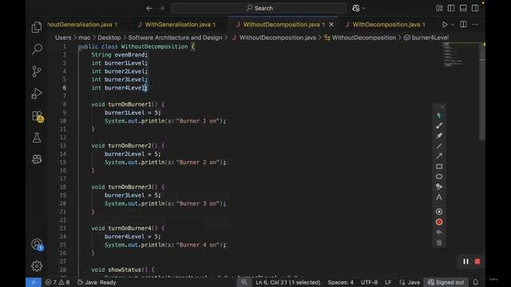
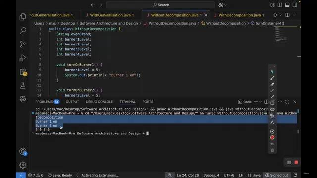
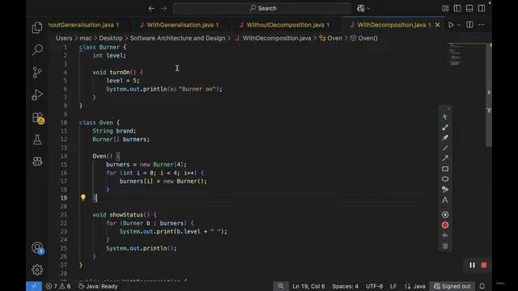
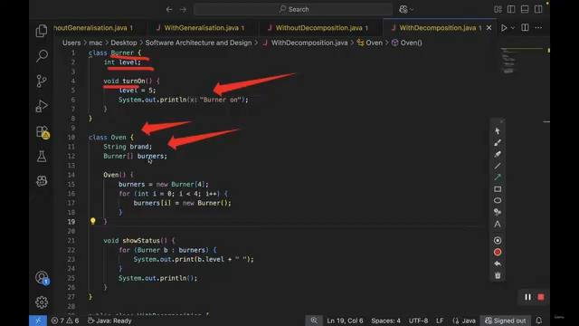
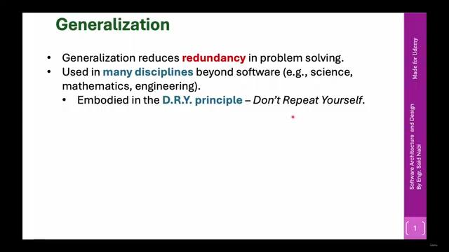
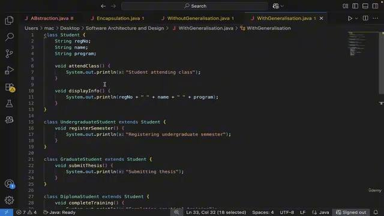
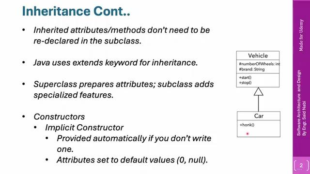
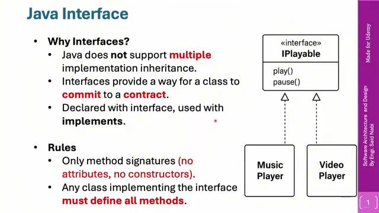
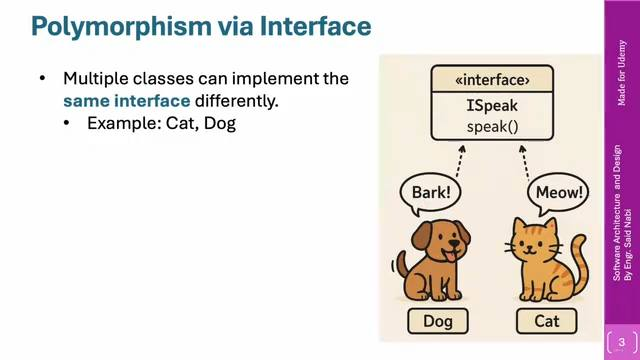

老师，我根据课程内容为您整理好了这份可直接复现的实操文档。

# Software Architecture Scalable｜P25–P29：把「上帝类」拆开——分解、泛化、继承、接口与多态

> 覆盖 P025–P029。这五集是讲师在讲「面向对象设计原则」的最后两块内容：**分解（Decomposition）** 与 **泛化（Generalization）**，并进一步落到 Java 的 **继承（inheritance）**、**方法重写（method overriding）**、**接口（interface）** 和 **多态（polymorphism）**。
> 讲师在 P026 开头明确说：「这是第四个也是最后一个面向对象设计原则，它就是泛化。」（—— p026 [00:00]）所以这五集是一条完整的收尾线。
>
> **给前端同学的阅读提示：** 课里用的是 Java。本文出现的 `class` / `extends` / `implements` / `interface` 语法，语法层面「知道即可」，不需要背；但**它们背后的设计判断（什么时候该拆、什么时候该抽公共父类、什么时候该上接口）是语言无关的**，TypeScript 能一一对应。涉及并发/锁的地方这门课没讲，本文在第 7 节补了对照。

---

## 1. 这一节做什么

这五集不是「讲概念」，而是讲师**当场写代码、当场跑**。所以本文的目标也很明确：**在一台装了 JDK 的机器上，把课里四个演示逐个编译、逐个跑出结果**。

最终你会得到一个目录，里面是四组可以独立运行的 Java 程序：

| 目录 | 对应集数 | 演示的是什么 | 跑起来你会看到 |
|---|---|---|---|
| `p025-god-class/` | P025 前半段 | **反面教材**：一个类干完整个微波炉 | Burner 1 的 level=5、Burner 2 的 level=0……（分解前的输出） |
| `p025-decomposed/` | P025 后半段 | 同样的微波炉，拆成 `Burner` + `MicrowaveOven` | 和上面**一模一样**的输出，但代码结构完全不同 |
| `p027-generalization/` | P027 | 学籍系统用「泛化」抽公共父类 | 上课、注册学期、提交论文、打印学生信息 |
| `p029-interface-polymorphism/` | P029 | 同一接口、不同实现（多态） | 一条狗叫、一只猫叫，走的是同一个 `speak()` 契约 |

**这五集真正要你带走的一句话**（讲师在 P025 反复强调）：

> 「重复是我们的敌人。」（—— p025 [01:21]）

- P025 反对的是**方法的重复**：`turnOnBurner1()` 到 `turnOnBurner4()` 四份几乎一样的代码；
- P027 反对的是**类之间的重复**：本科、研究生、文凭生三个类里塞着同一套 `regNumber / name / program`；
- P029 给你的解法是**接口 + 多态**：把「必须做什么」和「具体怎么做」彻底分开。

---

## 2. 讲师原话

下面按「设计判断」的顺序整理，不是按集数流水账。

**关于「上帝类」为什么必须拆：**

> 「这个程序是用来实现微波炉的，但是没有用分解。整个系统是在一个类里实现的。有时候这类类会被叫作上帝类或上帝对象，我们需要避免这样的类。如果我们希望系统可维护、可扩展、安全，分解非常非常重要。」（—— p025 [00:00]–[00:29]，中文转述）

> 「如果系统没有被分解成不同的、独立的部分，那么将来某一处的小改动就可能影响系统其他部分的功能。」（—— p025 [00:53]，中文转述）

> 「比如打开 1 号炉、打开 2 号炉、打开 3 号炉、打开 4 号炉，这本质上就是函数的重复。而重复是我们的敌人。」（—— p025 [01:21]，中文转述）



> 「分解让系统更好管理，你可以轻松改动任何一部分，而不会不必要地影响其他部分的功能。所以分解是最重要的面向对象设计原则之一。」（—— p025 [08:19]，中文转述）

**关于分解前后的输出对比：**

> 「如果我现在跑这段代码，我会得到预期结果。你能看到 1 号炉是开的、3 号炉是开的。1 号炉的 level 是 5，意思是它是开的；2 号炉是关的，所以你能看到 0。」（—— p025 [02:19]，中文转述）



> 「所以这就是在不使用分解的情况下实现微波炉功能的方式。但将来我们会遇到不同的问题，如果对某一部分做改动，可能造成严重后果。」（—— p025 [02:45]，中文转述）



> 「现在有了 Burner 类，Burner 只有一个变量 level，还有一个函数 turnOn。这样我们就不用一遍遍重复同一个函数了。代码只写在函数里一次，然后可以反复使用。」（—— p025 [03:41]，中文转述）



**关于泛化（Generalization）：**

> 「泛化减少冗余，让问题求解更容易。泛化是一种智慧：看到不同事物中共同的东西。当我们一遍又一遍重复同一个想法，就制造了冗余。」（—— p026 [00:00]–[00:24]，中文转述）

> 「泛化会移除这种重复，我们可以在泛化中使用 DRY 原则。DRY 原则告诉你不要重复自己：把想法定义在一个地方，然后反复复用这个想法。」（—— p026 [00:24]，中文转述）

> 「比如系统里有很多类，这些类有一些共同的属性和共同的行为，你就得一遍遍写同样的数据和同样的函数，这就是冗余，我们必须移除它。怎么做？我们可以有一个更通用的类，把公共属性和公共行为放进去。」（—— p026 [00:54]，中文转述）



> 「如果在多个地方写了相同的代码，那么一旦有变更，你可能只更新了一处、忘了更新别处，于是产生不一致。」（—— p026 [01:52]，中文转述）

> 「共享特征被提取到一个新的更高层的类里。」（—— p026 [02:21]，中文转述）

**关于泛化的代价（讲师在 P027 用「复制 50 遍甚至 100 遍」来讲）：**

> 「我们把同样的那几行代码复制了一遍又一遍……同样一套属性和行为，本科生需要、研究生也需要、文凭生也需要。你看到到处都是代码重复，而这正是我们要避免的。」（—— p027 [01:14]，中文转述）

> 「如果将来 program 或某个函数有改动，你就得在 150 个地方同步这个改动，取决于你重复了多少次。这非常耗时、非常令人烦躁。而且也许你忘了在某些地方同步修改，于是产生不一致，进而可能导致软件系统失败。」（—— p027 [03:23]，中文转述）



> 「这里是通用的 Student 类，是所有类的公共属性，比如 regNumber、name、program，以及 attendClass、displayInfo 这些行为。这些行为每个类都需要，所以放在通用类 Student 里。」（—— p027 [04:19]，中文转述）

**关于继承与构造函数：**

> 「Java 用 `extends` 关键字做继承。」（—— p028 [01:48]，中文转述）

> 「一个类里的构造函数用于在对象被创建时初始化对象，包括初始化它的数据成员。有两种常见方式：程序员显式定义的构造函数，和编译器提供的默认构造函数。」（—— p028 [02:15]，中文转述）

> 「如果你在类里没有提供构造函数，Java 会自动提供一个无参默认构造函数，前提是没有定义其他构造函数。这个默认构造函数会用默认值初始化实例变量，比如数值类型是 0，引用类型是 null。」（—— p028 [02:42]，中文转述）

> 「但如果你自己提供了构造函数，Java 就不会再自动提供那个默认构造函数了。」（—— p028 [03:05]，中文转述）

> 「这里井号表示这些数据成员是 `protected`。protected 成员可以在同一个类内、在子类中、以及同一个包内的类中访问，受 Java 访问规则约束。」（—— p028 [04:00]，中文转述）



> 「Java 不直接支持类的多重继承。比如一个类不能同时 extend Car 和 Vehicle。」（—— p028 [06:12]，中文转述）

**关于接口与多态：**

> 「Java 不支持类的多重继承。接口解决了这个问题，它允许一个类承诺一份契约。」（—— p029 [00:00]，中文转述）

> 「接口定义必须做什么，而不定义怎么做。比如 `pay` 可以在接口里声明，但它的实现对于信用卡支付和现金支付可以不同。」（—— p029 [00:22]，中文转述）



> 「任何实现接口的类都必须为它所有的抽象方法提供实现，除非这个类本身被声明为 abstract。」（—— p029 [01:34]，中文转述）

> 「但重要的是要记住，你不应该把每一块行为都泛化成接口。比如紧密相关的内部逻辑，比如内部计算步骤，可能应该留在类里，而不是放进接口。」（—— p029 [03:46]，中文转述）

> 「多态这个词来自两个词。Poly 意思是多，morph 意思是形态。当一样东西可以呈现多种形态，这就是多态。」（—— p029 [04:39]–[05:07]，中文转述）



> 「类实现接口（implements），而接口继承另一个接口（extends）。所以两个接口之间不用 implements 这个词，而是用 extends。」（—— p029 [08:16]，中文转述）

---

## 3. 从零复现

### 3.0 环境准备

课里**没讲** JDK 版本。你只需要一个能跑 `javac` / `java` 的 JDK。先确认：

```bash
javac -version
java -version
```

两条命令都能打印出版本号就能继续。如果 `javac` 提示 command not found，说明装的是 JRE 不是 JDK，去装一个完整的 JDK 即可。**课里没讲具体版本，以你本机实际安装的为准。**

### 3.1 建目录

```bash
mkdir -p oop-demo
cd oop-demo

mkdir -p p025-god-class
mkdir -p p025-decomposed
mkdir -p p027-generalization
mkdir -p p029-interface-polymorphism
```

最终结构（**注意：课里没讲 package 包结构，下面一律不加 `package` 声明，所有 `.java` 文件平铺在各自目录下**）：

```
oop-demo/
├── p025-god-class/
│   └── MicrowaveOvenGod.java
├── p025-decomposed/
│   ├── Burner.java
│   ├── MicrowaveOven.java
│   └── Main.java
├── p027-generalization/
│   ├── Student.java
│   ├── UndergraduateStudent.java
│   ├── GraduateStudent.java
│   ├── DiplomaStudent.java
│   └── Main.java
└── p029-interface-polymorphism/
    ├── ISpeak.java
    ├── Cat.java
    ├── Dog.java
    └── Main.java
```

### 3.2 第一组：先跑「上帝类」版本（P025 前半段）

把第 4 节的 `MicrowaveOvenGod.java` 存进 `p025-god-class/`，然后：

```bash
cd p025-god-class
javac MicrowaveOvenGod.java
java MicrowaveOvenGod
```

**期望输出**（数字形态对应讲师说的「5 表示开、0 表示关」）：

```
Burner 1 level: 5
Burner 2 level: 0
Burner 3 level: 5
Burner 4 level: 0
```

讲师现场跑出来的现象是「1 号炉开着、3 号炉开着，2 号和 4 号是 0」（—— p025 [02:19]）。**注意：`println` 里那串文字的具体措辞课里没逐字给出，这里是我为了对齐「level 是 5 / 0」这个事实写的示意文本，你换成任何等价文字都不影响结论。**

### 3.3 第二组：同样的功能，换成分解后的版本（P025 后半段）

把 `Burner.java`、`MicrowaveOven.java`、`Main.java` 三个文件存进 `p025-decomposed/`，然后：

```bash
cd ../p025-decomposed
javac *.java
java Main
```

**期望输出**：和 3.2 完全一样的四行数字——**这是这集最重要的一点：分解不改变行为，只改变结构**。

### 3.4 第三组：学籍系统用泛化（P027）

把五个文件存进 `p027-generalization/`：

```bash
cd ../p027-generalization
javac *.java
java Main
```

**期望输出**（顺序对应讲师现场演示的顺序：先本科生上课+注册学期+打信息，再研究生上课+提交论文+打信息）：

```
Ali is attending class
Ali registered for this semester
Reg No: 101
Name: Ali
Program: BS Computer Science

Sara is attending class
Sara submitted thesis
Reg No: 202
Name: Sara
Program: MS Computer Science
```

**注意：姓名、学号、专业名课里没给具体值**，讲师只说了「设置 reg number、name 和 program 这三个字段」并展示了输出形状。上面是示意数据。

### 3.5 第四组：接口 + 多态（P029）

```bash
cd ../p029-interface-polymorphism
javac *.java
java Main
```

**期望输出**：

```
Woof
Meow
```

同样的 `speak()` 调用，两种完全不同的行为——这就是讲师说的「同一个接口定义同一份契约，但不同的类可以提供不同的实现」（—— p029 [07:51]）。

### 3.6 一键跑完全部四组

```bash
cd oop-demo
for d in p025-god-class p025-decomposed p027-generalization p029-interface-polymorphism; do
  echo "===== $d ====="
  ( cd "$d" && javac *.java && java Main 2>/dev/null || java MicrowaveOvenGod )
done
```

> 这段 shell 脚本是我为了方便你验收写的示意脚本，课里没有。

---

## 4. 完整代码

> **重要声明：** 讲师在 P025 和 P027 是**现场在编辑器里敲代码**的（逐字稿里能听到他念「第 14 行的构造函数」「第 15 行预留四个空间」「第 23 到 24 行的 for each 循环」这类行号），但逐字稿本身**没有把代码原样转录出来**。下面五个文件是按逐字稿描述的结构**还原**的，能编译、能跑、输出形状与讲师描述一致。行号与你看到的录像编辑器行号不会一样，这是正常的。

### 4.1 `p025-god-class/MicrowaveOvenGod.java`

```java
public class MicrowaveOvenGod {

    String brand = "Acme";

    // 四个炉灶，每个都是独立的 int 变量
    int burner1Level;
    int burner2Level;
    int burner3Level;
    int burner4Level;

    // 四个几乎一模一样的方法 —— 这就是讲师说的「重复是我们的敌人」
    void turnOnBurner1() {
        burner1Level = 5;
    }

    void turnOnBurner2() {
        burner2Level = 5;
    }

    void turnOnBurner3() {
        burner3Level = 5;
    }

    void turnOnBurner4() {
        burner4Level = 5;
    }

    void showStatus() {
        System.out.println("Burner 1 level: " + burner1Level);
        System.out.println("Burner 2 level: " + burner2Level);
        System.out.println("Burner 3 level: " + burner3Level);
        System.out.println("Burner 4 level: " + burner4Level);
    }

    public static void main(String[] args) {
        MicrowaveOvenGod oven = new MicrowaveOvenGod();
        oven.turnOnBurner1();
        oven.turnOnBurner3();
        oven.showStatus();
    }
}
```

### 4.2 `p025-decomposed/Burner.java`

```java
public class Burner {

    int level;

    void turnOn() {
        level = 5;
    }
}
```

### 4.3 `p025-decomposed/MicrowaveOven.java`

```java
public class MicrowaveOven {

    String brand;
    Burner[] burners;

    MicrowaveOven(String brand) {
        this.brand = brand;
        this.burners = new Burner[4];          // 先预留 4 个槽位
        for (int i = 0; i < burners.length; i++) {
            burners[i] = new Burner();         // 每个槽位放一个 Burner 对象
        }
    }

    void showStatus() {
        for (Burner burner : burners) {
            System.out.println("Burner level: " + burner.level);
        }
        System.out.println();
    }
}
```

### 4.4 `p025-decomposed/Main.java`

```java
public class Main {

    public static void main(String[] args) {
        MicrowaveOven oven = new MicrowaveOven("Acme");

        oven.burners[0].turnOn();
        oven.burners[2].turnOn();

        oven.showStatus();
    }
}
```

### 4.5 `p027-generalization/Student.java`

```java
public class Student {

    int regNumber;
    String name;
    String program;

    void attendClass() {
        System.out.println(name + " is attending class");
    }

    void displayInfo() {
        System.out.println("Reg No: " + regNumber);
        System.out.println("Name: " + name);
        System.out.println("Program: " + program);
    }
}
```

### 4.6 `p027-generalization/UndergraduateStudent.java`

```java
public class UndergraduateStudent extends Student {

    void registerSemester() {
        System.out.println(name + " registered for this semester");
    }
}
```

### 4.7 `p027-generalization/GraduateStudent.java`

```java
public class GraduateStudent extends Student {

    void submitThesis() {
        System.out.println(name + " submitted thesis");
    }
}
```

### 4.8 `p027-generalization/DiplomaStudent.java`

```java
public class DiplomaStudent extends Student {

    void completeTraining() {
        System.out.println(name + " completed training");
    }
}
```

### 4.9 `p027-generalization/Main.java`

```java
public class Main {

    public static void main(String[] args) {
        UndergraduateStudent ug = new UndergraduateStudent();
        ug.regNumber = 101;
        ug.name = "Ali";
        ug.program = "BS Computer Science";
        ug.attendClass();        // 来自 Student
        ug.registerSemester();   // 来自 UndergraduateStudent
        ug.displayInfo();        // 来自 Student

        System.out.println();

        GraduateStudent grad = new GraduateStudent();
        grad.regNumber = 202;
        grad.name = "Sara";
        grad.program = "MS Computer Science";
        grad.attendClass();      // 来自 Student
        grad.submitThesis();     // 来自 GraduateStudent
        grad.displayInfo();      // 来自 Student
    }
}
```

### 4.10 `p029-interface-polymorphism/ISpeak.java`

```java
public interface ISpeak {

    void speak();
}
```

### 4.11 `p029-interface-polymorphism/Dog.java`

```java
public class Dog implements ISpeak {

    public void speak() {
        System.out.println("Woof");
    }
}
```

### 4.12 `p029-interface-polymorphism/Cat.java`

```java
public class Cat implements ISpeak {

    public void speak() {
        System.out.println("Meow");
    }
}
```

### 4.13 `p029-interface-polymorphism/Main.java`

```java
public class Main {

    public static void main(String[] args) {
        // 数组元素类型是接口，装进去的却是具体类 —— 这就是多态
        ISpeak[] animals = new ISpeak[] { new Dog(), new Cat() };

        for (ISpeak animal : animals) {
            animal.speak();
        }
    }
}
```

> 用数组 + 循环遍历是**本文的示意写法**，目的是把「同一个接口、不同实现」这件事一次跑出来。讲师在 P029 展示的是 `Cat` 和 `Dog` 两个类各自实现 `ISpeak` 的静态结构图，没有逐字展示这段 main。

---

## 5. 逐行解释

### 5.1 为什么 `MicrowaveOvenGod` 是「反面教材」

`burner1Level ~ burner4Level` 这四个字段，本质上描述的是**同一件事的四个实例**。讲师的原话是「本质上就是函数的重复，而重复是我们的敌人」（—— p025 [01:21]）。

`turnOnBurner1()` 到 `turnOnBurner4()` 四个方法，方法体完全一致。**这说明这四个方法之间没有语义差异，差异只在「哪一个炉灶」这个参数上。** 一旦将来「打开炉灶」这个动作要加逻辑（比如先检查是否已开、再打日志、再设 level），你就得**改四处**。漏改一处 → 讲师在 P027 [03:23] 说的那种「不一致导致系统失败」。

`main` 里手动 `turnOnBurner1()` + `turnOnBurner3()` + `showStatus()`：这是为了复现讲师现场跑出的「1 号开、3 号开、另外两个是 0」的结果。

### 5.2 `Burner` 类为什么只留一个 `level`

讲师的说法是：「Burner 只有一个变量 level，还有一个函数 turnOn。这样我们就不用一遍遍重复同一个函数了。」（—— p025 [03:41]）

这是**把「一个炉灶」抽象成一个类型**。`burner1Level` 这个 int 变量，从此变成了「一个 `Burner` 对象里的 `level` 字段」。区别在于：

- `int burner1Level` —— 数据是裸的，没有任何行为附着在它上面；
- `Burner.level` —— 数据和行为绑在一起，`turnOn()` 是这个类型的**唯一入口**。

这就是「分解」的最小单位：**当你发现一组数据总是跟着同一组操作出现，就把它们合成一个类型**。

### 5.3 `MicrowaveOven` 构造函数的两步

```java
this.burners = new Burner[4];              // 第一步
for (int i = 0; i < burners.length; i++) {
    burners[i] = new Burner();             // 第二步
}
```

讲师的原话拆得很清楚（—— p025 [05:04]–[05:31]）：

> 「构造函数做的第一件事是为炉灶预留四个空间……这四个空间在第 15 行被预留。然后第 16 行有一个 for 循环，在循环里我们想把 Burner 对象放进每个索引。于是先在一个索引上创建新的 Burner 并存进数组，然后对索引 0、1、2、3 做同样的事。」

**这两步不能合并，原因很硬：**

- `new Burner[4]` 只创建了**数组容器**，数组里四个位置都是 `null`。这时候你去 `burners[0].turnOn()`，会直接 `NullPointerException`。
- 必须再用 `new Burner()` 逐个把对象造出来塞进去。

这是纯 Java 的语法约束。**TypeScript 里对应 `const burners: Burner[] = Array.from({length: 4}, () => new Burner())`，本质上也是「先占位、再填对象」两步**，只是 TS 的 `Array(4)` 也会得到 `[empty × 4]`，同样不能直接访问元素。

### 5.4 `showStatus` 为什么用 for-each

```java
for (Burner burner : burners) {
    System.out.println("Burner level: " + burner.level);
}
```

讲师说的是：「我们用了 for each 循环来显示炉灶状态，不管是开还是关。」（—— p025 [06:00]）

**这是分解带来的直接收益：** 现在不管你有 4 个炉灶还是 8 个炉灶，这段代码一个字都不用改。而上帝类版本里，加第五个炉灶要新增一个字段 + 一个方法 + 一行 println。

`System.out.println()` 传空字符串打印一个空行——讲师专门提了这句：「它本质上把输出移到新的一行」（—— p025 [06:28]）。

### 5.5 `Main` 里为什么写 `oven.burners[0].turnOn()`

讲师把这一句拆得极细（—— p025 [06:58]–[07:50]）：

> 「`oven.burners` 是那个数组……在这个索引上存着一个 Burner 对象，那个 Burner 对象被用来调用 `turnOn` 方法。」

顺序是：**拿 oven → 拿它的 burners 数组 → 取第 0 个元素（这是一个 Burner 对象）→ 在这个对象上调用 `turnOn()`**。三个点连续，从左到右读。

`oven.burners[0]` 是数据访问（读数组元素），`.turnOn()` 是行为调用。**因为 `burners[0]` 的类型是 `Burner`，所以它有 `turnOn` 方法可用。** 如果这里是上帝类，你只会写 `oven.turnOnBurner1()`——参数被硬编码进了方法名。

### 5.6 `Student` 父类：为什么 `regNumber / name / program` 该搬走

讲师的原话（—— p027 [00:23]）：

> 「我们需要这三个变量，不只是本科生需要，研究生也需要同样的属性，文凭生也一样。」

这三个字段在三个子类里**语义完全相同**（都是「学号」「姓名」「专业」），只是值不同。这种情况就是泛化的教科书信号：**同一组属性和同一组行为在多个类里重复出现，且没有语义差异 → 抽到父类。**

`attendClass()` 和 `displayInfo()` 同理。讲师说：「这些行为是每个类都需要的，所以放在通用类 Student 里。」（—— p027 [04:19]）

### 5.7 `extends` 之后，子类为什么这么短

看 `GraduateStudent`：

```java
public class GraduateStudent extends Student {
    void submitThesis() { ... }
}
```

整个类**只有三行实际内容**。`regNumber`、`name`、`program`、`attendClass()`、`displayInfo()` 全部通过 `extends Student` 继承而来，一行都不用重写。

讲师的措辞是：「所有列在 student 类里的行为都会被继承、被加进 undergraduate student 类，再加上我们想额外添加的东西。」（—— p027 [04:49]–[05:18]）

**三个子类各自多出来的那一个方法，才是它们真正的差异点：**

| 子类 | 独有行为 | 讲师给的业务理由 |
|---|---|---|
| `UndergraduateStudent` | `registerSemester()` | 本科生要按学期注册 |
| `GraduateStudent` | `submitThesis()` | 研究生要提交论文 |
| `DiplomaStudent` | `completeTraining()` | 文凭生要完成实训 |

讲师在 P027 [06:42] 说得很直接：「文凭生需要 student 类里所有的基础属性和基础行为，再加上我们添加的 `completeTraining`，这就是把文凭生和其他学生区分开的东西。」

### 5.8 构造函数默认值这件事（P028 的坑）

讲师在 P028 [02:42] 讲了一段很容易被跳过的细节：

> 「如果你没有在类里提供构造函数，Java 会自动提供一个无参默认构造函数，前提是没有定义其他构造函数。」

对应到我们的代码：

- `Student`、`Burner`、`Cat`、`Dog` **都没有写构造函数** → Java 自动补一个无参构造函数 → 所以 `new Burner()`、`new Cat()` 能编译通过。
- `MicrowaveOven` **写了** `MicrowaveOven(String brand)` → Java **不再**补无参构造函数 → 所以 `new MicrowaveOven()` 会编译报错，必须写成 `new MicrowaveOven("Acme")`。

这就是讲师在 P028 [03:05] 强调的那句：「但如果你自己提供了构造函数，Java 就不会再自动提供那个默认构造函数了。」

**TypeScript 里的对照：** TS 的类如果没有声明 constructor，也会有一个隐式的无参构造；但一旦你写了 `constructor(brand: string)`，`new MicrowaveOven()` 同样会报错。行为是一致的。

### 5.9 接口：`public void speak()` 前面那个 `public` 为什么不能省

`ISpeak` 里的 `void speak();` 没有写 `public`——**接口里的方法默认就是 public abstract**，讲师在 P029 [01:43] 说的是「接口里通常是方法签名，而不是方法实现」。

但 `Dog` 里实现它时，**必须显式写 `public`**：

```java
public void speak() { ... }
```

原因：接口方法的可见性是 public，实现类不能把可见性收窄。**省掉 `public` 会导致编译错误**（"试图分配更弱的访问权限"）。这是新手第一个会撞上的墙，我在第 7 节再提一次。

### 5.10 `ISpeak[] animals` 这一行就是多态的全部

```java
ISpeak[] animals = new ISpeak[] { new Dog(), new Cat() };
```

- 数组的**编译期类型**是 `ISpeak[]`——编译器只知道「这里装的东西都会 `speak()`」；
- 数组里的**运行期对象**分别是 `Dog` 和 `Cat`——`animal.speak()` 在运行时才决定调用哪一份实现。

讲师在 P029 [06:34] 用学籍系统举了同一个道理：「你在网站上填表选『我是本科生』，系统行为会不同；选『研究生』，展示的项目和要求又不一样。运行时系统可以根据正在使用的类型或角色表现出不同行为。」

**前端的等价物：** TypeScript 里的 `interface Animal { speak(): void }` + 两个 class 各实现一次 + `const list: Animal[] = [new Dog(), new Cat()]`，是同一件事。JS 因为是鸭子类型，甚至可以连 interface 都不写，但**一旦上了 TS 或团队协作，接口就是那份「契约」**。

### 5.11 为什么讲师说「不要给每块逻辑都建接口」

P029 [03:46] 这段话值得单独拎出来，因为它是在给你**刹车**：

> 「你不应该把每一块行为都泛化成接口。比如紧密相关的内部逻辑，比如内部计算步骤，可能应该留在类里，而不是放进接口。我们并不需要为每一小块逻辑都创建一个接口。」

判断标准讲师也给了（—— p029 [04:12]）：「接口满足一个特定需求：它为相关或不相关的类提供了一种遵循共同契约的方式。」`Cat` 和 `Dog` 在业务上毫无关系，但它们都「会发出声音」——**只有当多个类共享的是「契约」而不是「实现」时，才该抽接口。** 如果你发现两个类的实现体长得一模一样，那该抽的是**父类（泛化）**，不是接口。

---

## 6. 复现检查清单

逐条打勾，全过就算这节课跑通了。

**环境**
- [ ] `javac -version` 和 `java -version` 都能输出版本号
- [ ] `oop-demo/` 下四个子目录都建好了
- [ ] 所有 `.java` 文件**没有** `package` 声明（本文明确定义过：课里没讲包结构，一律平铺）

**第一组：上帝类**
- [ ] `javac MicrowaveOvenGod.java` 无报错
- [ ] `java MicrowaveOvenGod` 输出四行，其中第 1、3 行是 `5`，第 2、4 行是 `0`
- [ ] 你能指出这个文件里「哪四段代码是重复的」

**第二组：分解版**
- [ ] `javac *.java` 三个文件一起编译通过（注意 `*` 要能匹配到三个文件）
- [ ] `java Main` 的输出**和第一组完全一致**
- [ ] 如果只写 `new MicrowaveOven()`（不传 brand），确认它**编译报错**——这就是「自己写了构造函数后默认构造函数消失」
- [ ] 你能指出 `new Burner[4]` 之后、循环之前，`burners[0]` 是什么（答案：`null`）

**第三组：泛化**
- [ ] `javac

## 7. 课里没讲但你会撞上的

| 现象 | 原因 | 怎么办 |
|---|---|---|
| `javac` 或 `java` 提示 command not found | 本机可能只装了 JRE，没有完整 JDK；课里没讲 JDK 版本和安装（补充：课里没讲）。 | 安装完整 JDK，确认 `javac -version` 和 `java -version` 都能输出版本号。 |
| 在 `p025-god-class/` 里执行 `javac *.java` 后跑 `java Main`，报找不到主类 | 这一组的主类名是 `MicrowaveOvenGod`，不是 `Main`；本文四个目录的主类名不统一（补充：课里没讲本文的类名/主类组织方式）。 | 该目录用 `java MicrowaveOvenGod`；其余三个目录用 `java Main`。不要对四个目录机械套同一个 `java Main`。 |
| `new Burner[4]` 之后、填充循环之前就调用 `burners[0].turnOn()`，抛出 `NullPointerException` | `new Burner[4]` 只创建数组容器，四个槽位仍是 `null`；P025 讲的是先预留空间，再用循环放入 `new Burner()`。`NullPointerException` 这个具体报错课里没讲（补充：课里没讲）。 | 保留构造函数里的两步：先 `new Burner[4]`，再 `for` 循环 `burners[i] = new Burner()`；不要在填对象之前调用槽位上的方法。 |
| 写 `new MicrowaveOven()` 编译失败 | `MicrowaveOven` 已显式定义 `MicrowaveOven(String brand)`，Java 不再自动提供无参默认构造函数（P028 讲了这一点）。 | 传品牌参数：`new MicrowaveOven("Acme")`；若确实需要无参构造，要自己再写一个（本文复现代码没写）。 |
| `Dog`/`Cat` 的 `speak()` 漏写 `public`，编译报 weaker access privileges | 接口方法默认是 public，实现类不能把可见性收窄；接口实现的这个 public 可见性细节课里没讲（补充：课里没讲）。 | 实现写成 `public void speak() { ... }`，不要写成包级 `void speak()`。 |
| 按其他 Java 习惯给文件加了 `package`，随后编译/运行路径出错，或子类跨包访问 `Student` 的 `name` 等字段失败 | 本文明确按课里没讲包结构处理：所有文件平铺、不写 `package`；`Student` 的字段在还原代码里是包级可见，跨包访问会失败（补充：课里没讲包结构和访问范围）。 | 按本文结构：每个目录内平铺 `.java`，文件不写 `package`，在该目录内 `javac *.java`、`java Main`。不要自行加包声明。 |
| 严格逐字比较 P025 上帝类版和分解版输出，发现行文本不完全一样 | 上帝类版打印 `Burner 1 level: ...` 到 `Burner 4 level: ...`，分解版还原代码打印的是 `Burner level: ...`；课里没逐字给出 `println` 文本（补充：课里没讲打印措辞）。 | 以数字和开闭状态为准：1、3 为 5，2、4 为 0；不要按逐字文本判失败。要完全一致只能自行统一打印文本，但这不是课里给出的原文。 |
| 在 Windows `cmd`/PowerShell 直接跑 3.6 的一键脚本失败 | 3.6 的 `for d in ...; do ...; done`、`2>/dev/null`、`||` 是 bash 写法；课里没讲运行环境和脚本（补充：课里没讲）。 | 逐目录手动执行 `javac`/`java`，或用 WSL/Git Bash 等 bash 环境跑该示意脚本。 |
| 把逐字稿里的口语 `iSpeak` 直接用作文件名，却保留本文的 `ISpeak` 接口名，编译报 public 类型与文件名不一致 | Java 要求 public 接口名与 `.java` 文件名一致；课里只口语提到 `iSpeak`，没讲文件命名规则（补充：课里没讲）。 | 统一为本文的 `ISpeak.java` + `public interface ISpeak`，或全部统一成同一个大小写；不要一个文件里混用。 |
