## 1. 这一节做什么

P30–P32 的主线不是“再讲一遍面向对象概念”，而是把需求/概念设计一步步落到可表达的 UML，再落到可运行的 Java 骨架。P30 讲 **CRC 卡 → UML 类图 → Java 代码**，重点是把 abstraction、encapsulation、decomposition 画出来；P31 讲 **UML 序列图**，回答“谁先找谁、按什么顺序通信”；P32 讲 **UML 状态图**，回答“同一个对象在不同状态下的行为如何被事件触发改变”。

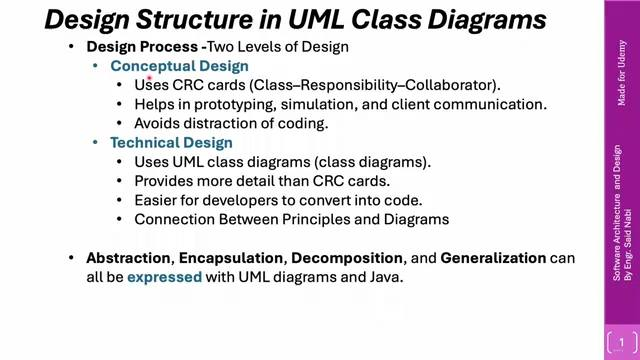

这一节要复现出来的东西可以分成两类：

1. **能跑起来的 Java 最小项目**：用 `Food`、`Student`、`Support`、`CrewMember`、`Airliner`、`Room`、`House` 这些类，把类图里的封装、关联、聚合、组合落到代码。
2. **能照着画出来的设计稿**：CRC 卡、UML 类图关系、电视换台序列图、售货机状态图。P31/P32 逐字稿里没有给完整 Java 状态机源码，课里也明确说 vending machine 的 live Java code “probably later”，所以这部分本文只做设计表，不冒充讲师源码。

读完并照做后，你应该能：
- 用 `javac` 编译并运行一个无第三方依赖的 Java 示例；
- 说清楚 `private/public` 在 UML 里的 `-`/`+` 符号，以及它在 Java 里怎么落；
- 区分 association / aggregation / composition 的 UML 符号和 Java 写法；
- 画出“人按遥控器换台”的序列图，并加上 ALT/LOOP；
- 画出“投币售货机”的状态图，写清 state name、state variables、entry/do/exit、event/guard/action。

---

## 2. 讲师原话（带「—— pNNN [MM:SS]」）

- “Design is mainly divided into two main processes. The first one is conceptual design. In conceptual design, we use CRC cards, which means class, responsibility and collaborators.” —— p030 [00:29]
- “Once the conceptual design is done, based on that conceptual design, we can start the technical design. In technical design we use UML class diagrams and they provide more details than CRC cards.” —— p030 [01:28]
- “The minus symbol represents private access and the plus symbol represents public access.” —— p030 [07:53]
- “The first one is association, which is a loose relationship. The other one is aggregation, which is a weak has a relationship. And the third one is composition, which is a strong has a relationship.” —— p030 [11:13]
- “In aggregation, we use a hollow diamond. But in composition, we use the filled diamond.” —— p030 [16:25]
- “A UML sequence diagram shows how different parts of a system communicate with each other over time. It focuses not on structure, but on interaction.” —— p031 [00:00]
- “The dotted arrows show return messages or responses.” —— p031 [02:46]
- “A sequence diagram is a type of UML diagram commonly used as a planning and design tool before the development team starts programming.” —— p031 [03:40]
- “A UML state diagram illustrates object behavior by depicting the changing states of an object.” —— p032 [03:39]
- “Entry is the activity that is performed when the object enters a new state. Do is the activity that is performed while the object is in that state. And exit is the activity that is performed when the object leaves that state.” —— p032 [07:33]
- “A transition may also have a guard condition and an action.” —— p032 [12:07]

---

## 3. 从零复现

### 3.1 环境与依赖版本

逐字稿只说明“in this course, since we are using Java”，**没有讲具体 JDK 版本、构建工具和 IDE**。为了让你能照着跑，本文采用下面环境；这是可复现建议，不是讲师原话：

- JDK：17（LTS 建议）
- 构建工具：不用 Maven/Gradle，直接用 `javac` / `java`
- 第三方依赖：无
- 环境变量：不需要新增；确保 `java`、`javac` 在 PATH 里即可。可选设置 `JAVA_HOME` 指向 JDK 17。
- 编码：源码用 UTF-8 保存，编译时加 `-encoding UTF-8`。

检查命令：

```bash
java -version
javac -version
```

### 3.2 目录结构

在任意空目录下创建：

```text
uml-design-demo/
├── src/
│   ├── Food.java
│   ├── Student.java
│   ├── Support.java
│   ├── CrewMember.java
│   ├── Airliner.java
│   ├── Room.java
│   ├── House.java
│   └── Main.java
└── out/
```

创建目录：

```bash
mkdir -p uml-design-demo/src
cd uml-design-demo
mkdir -p out
```

把第 4 节的 8 个文件分别保存到 `src/` 下，文件名必须和 `public class` 名字一致。

### 3.3 用 CRC 卡复现概念设计

逐字稿 p030 [00:29] 说 CRC 是 class、responsibility、collaborators。讲师给的 `Food` 例子里，责任列包括 grocery ID、name、manufacturer、expiry date、price、check if on sale；collaborators 列暂时为空。可复现成：

| Class | Responsibilities / Attributes | Collaborators |
|---|---|---|
| `Food` | `groceryID: String`、`name: String`、`manufacturer: String`、`expiryDate: Date`、`price: double`、`isOnSale(): Boolean` | 逐字稿中该列为空 |

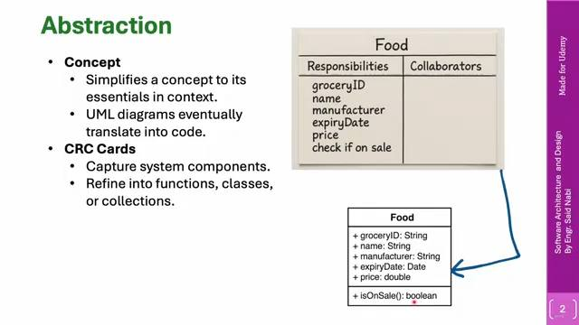

### 3.4 把 UML 类图落到 Java

`Food` 的 UML 元素和 Java 对应关系：

| UML 元素 | 含义 | Java 落地 |
|---|---|---|
| `groceryID: String` | 冒号后是类型 | `private String groceryID;` 或按实际改成 public；本文用 private + getter/setter |
| `price: double` | double 值 | `private double price;` |
| `expiryDate: Date` | Date 值 | `private Date expiryDate;` |
| `isOnSale(): Boolean` | 返回 Boolean 的函数 | `public boolean isOnSale()` |

注意：逐字稿只说明 `isOnSale` 返回 Boolean，**没有给“什么条件算 on sale”的业务规则**。本文不编业务规则，先让它返回 `false`，你复现时按需求替换。

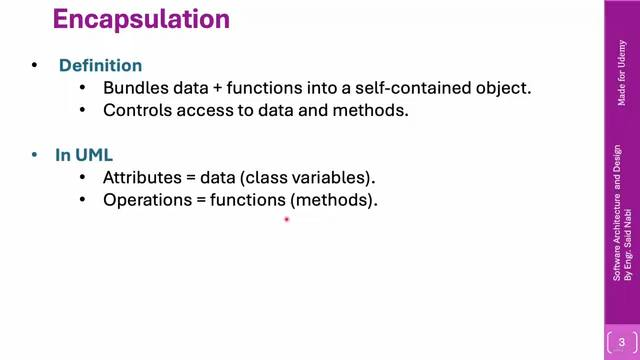

封装示例里，讲师明确说 `-` 是 private，`+` 是 public；`Student` 有两个 private 变量 `GPA` 和 `degreeProgram`，`setGPA` 接收 `float`，并且是 public。Java 里对应 `private float GPA;`、`private String degreeProgram;`、`public void setGPA(float GPA)`。

### 3.5 复现三种 decomposition 关系

| 关系 | UML 表示 | 讲师例子 | Java 落地方式 | 生命周期 |
|---|---|---|---|---|
| Association | 直线，无菱形；可带 multiplicity | Person 与 Hotel；Student 使用 Support 对象 | 对象通过构造器/参数传入，调用其方法；两边可独立存在 | 弱 |
| Aggregation | 直线 + 空心菱形（hollow diamond）在 whole 侧 | Airliner 有 CrewMember 数组 | `Airliner` 持有 `CrewMember[]`，`addCrewMember()` 从外部加入 | 部件可独立存在 |
| Composition | 直线 + 实心菱形（filled diamond）在 whole 侧 | House 有 Room；Car 有 Engine | `House` 在构造器里 `new Room(...)`，Room 由 House 内部创建和管理 | 强，whole 销毁时 part 作为该 whole 的一部分不再独立 |

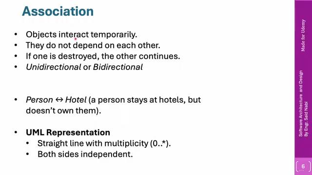

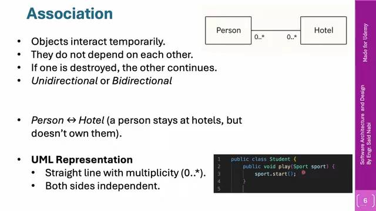

### 3.6 序列图复现：电视换台

逐字稿 p031 [01:38] 起用 restaurant 例子解释 lifeline、activation、return message；p031 [12:32] 左右讲电视遥控器。复现时先画最简单的 TV 换台：

参与者：`Person`、`Remote`、`TV`。

| 顺序 | 发送方 | 接收方 | 消息 | 说明 |
|---|---|---|---|---|
| 1 | Person | Remote | `pressChannelNumber(n)` | 人按遥控器数字键 |
| 2 | Remote | TV | `sendSignal(n)` | 遥控器转发信号 |
| 3 | TV | TV | `changeChannel(n)` | 电视执行命令 |
| 4 | TV | Remote | `channelChanged` | 虚线返回消息 |
| 5 | Remote | Person | `displayChannel` | 虚线返回，用户看到结果 |

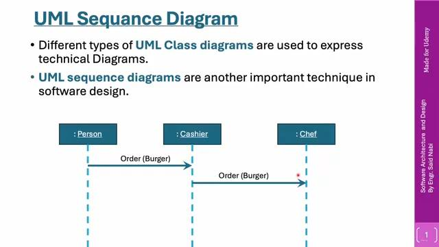

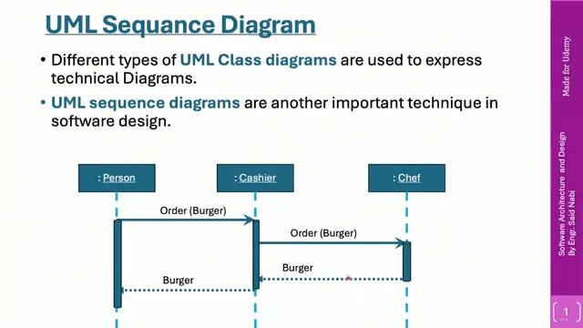

加 ALT/LOOP 的版本：

- ALT 条件：用户知道频道号。
  - true：输入频道号，例如 61，直接切换。
  - false：进入 LOOP，按 up/down 逐个换台，直到到达目标频道。
- 逐字稿 p031 [14:15] 左右说明：知道频道号就输入 61；不知道就按上下键循环，最终找到目标频道。

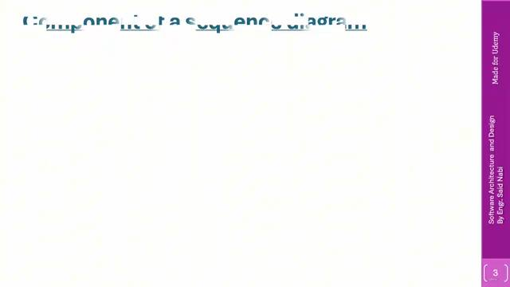

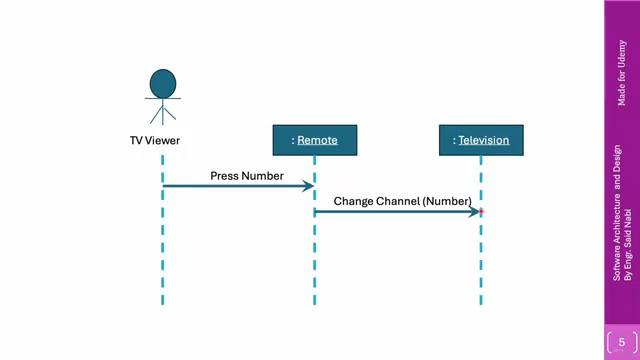

### 3.7 状态图复现：投币售货机

逐字稿 p032 先用 Mr. X 的情绪变化讲 state/event，再用自动挡汽车讲 reverse/neutral/drive，最后在 [08:57] 左右画 vending machine 的 idle 和 enough coins 两个状态。复现表：

| 元素 | 内容 |
|---|---|
| Initial state | filled circle，起始点 |
| State 1 | `Idle` |
| State variables | `totalAmount` |
| Activities | entry/do/exit 按需要写；讲师例子里有“display total amount” |
| Transition | 用户投币：`insertCoins(amount)` |
| Guard | `totalAmount >= productPrice` |
| State 2 | `EnoughCoins` |
| Action | `dispenseProduct()`；随后价格从 total 扣除，回到 Idle |
| Cancel | 用户点 cancel，退币，`totalAmount = 0`，回到 Idle |

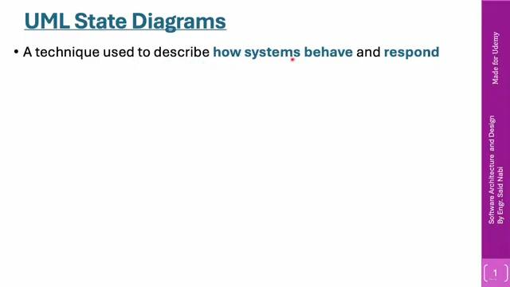

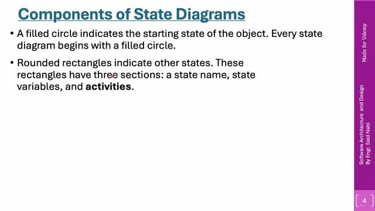

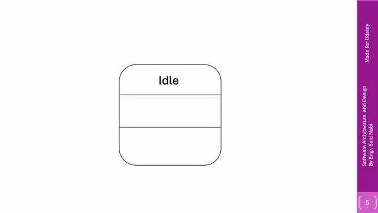

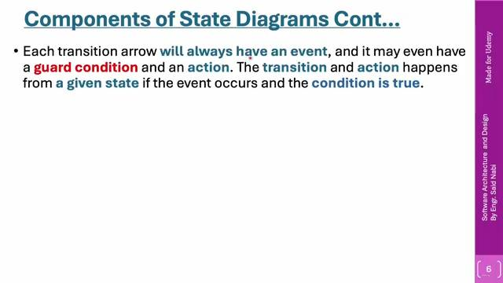

---

## 4. 完整代码

> 说明：逐字稿只给了零散 Java 片段和类图描述，没有给完整工程源码。下面是按逐字稿出现过的类名、属性名、方法名重建的最小可运行版本。`Food.isOnSale()` 的业务判断、`Support` 类名、`Airliner` 容量、`Room` 的构造细节，逐字稿没有完整给出；本文用最小实现补齐，并在第 7 节标注。  
> 运行方式：
> ```bash
> javac -encoding UTF-8 -d out src/*.java
> java -cp out Main
> ```

### src/Food.java

```java
import java.util.Date;

public class Food {
    private String groceryID;
    private String name;
    private String manufacturer;
    private Date expiryDate;
    private double price;

    public Food(String groceryID, String name, String manufacturer, Date expiryDate, double price) {
        this.groceryID = groceryID;
        this.name = name;
        this.manufacturer = manufacturer;
        this.expiryDate = expiryDate;
        this.price = price;
    }

    public String getGroceryID() {
        return groceryID;
    }

    public void setGroceryID(String groceryID) {
        this.groceryID = groceryID;
    }

    public String getName() {
        return name;
    }

    public void setName(String name) {
        this.name = name;
    }

    public String getManufacturer() {
        return manufacturer;
    }

    public void setManufacturer(String manufacturer) {
        this.manufacturer = manufacturer;
    }

    public Date getExpiryDate() {
        return expiryDate;
    }

    public void setExpiryDate(Date expiryDate) {
        this.expiryDate = expiryDate;
    }

    public double getPrice() {
        return price;
    }

    public void setPrice(double price) {
        this.price = price;
    }

    public boolean isOnSale() {
        // 逐字稿只说明 isOnSale() 返回 Boolean，没有给业务判断规则。
        // 这里用最小占位实现，避免编造折扣规则。按你的需求替换。
        return false;
    }
}
```

### src/Support.java

```java
public class Support {
    public void start() {
        System.out.println("Support.start() called");
    }
}
```

### src/Student.java

```java
public class Student {
    private float GPA;
    private String degreeProgram;
    private Support support;

    public Student(float GPA, String degreeProgram, Support support) {
        this.GPA = GPA;
        this.degreeProgram = degreeProgram;
        this.support = support;
    }

    public float getGPA() {
        return GPA;
    }

    public void setGPA(float GPA) {
        this.GPA = GPA;
    }

    public String getDegreeProgram() {
        return degreeProgram;
    }

    public void setDegreeProgram(String degreeProgram) {
        this.degreeProgram = degreeProgram;
    }

    // 逐字稿中讲师说的是 support.start。
    // 为了从 Main 演示 association，这里加一个 public 包装方法。
    public void startSupport() {
        support.start();
    }
}
```

### src/CrewMember.java

```java
public class CrewMember {
    private String name;

    public CrewMember(String name) {
        this.name = name;
    }

    public String getName() {
        return name;
    }
}
```

### src/Airliner.java

```java
public class Airliner {
    private CrewMember[] crewMembers;
    private int count;

    public Airliner(int capacity) {
        this.crewMembers = new CrewMember[capacity];
        this.count = 0;
    }

    public void addCrewMember(CrewMember crewMember) {
        if (count < crewMembers.length) {
            crewMembers[count] = crewMember;
            count++;
        }
    }

    public int getCrewCount() {
        return count;
    }
}
```

### src/Room.java

```java
public class Room {
    private String name;

    public Room(String name) {
        this.name = name;
    }

    public String getName() {
        return name;
    }
}
```

### src/House.java

```java
public class House {
    private Room room;

    public House(String roomName) {
        this.room = new Room(roomName);
    }

    public Room getRoom() {
        return room;
    }
}
```

### src/Main.java

```java
import java.util.Date;

public class Main {
    public static void main(String[] args) {
        Support support = new Support();
        Student student = new Student(3.5f, "Computer Science", support);

        System.out.println("Student GPA=" + student.getGPA()
                + ", degreeProgram=" + student.getDegreeProgram());
        student.startSupport();

        Airliner airliner = new Airliner(3);
        airliner.addCrewMember(new CrewMember("Pilot"));
        airliner.addCrewMember(new CrewMember("Cabin Crew"));
        System.out.println("Airliner crew count=" + airliner.getCrewCount());

        House house = new House("LivingRoom");
        System.out.println("House room=" + house.getRoom().getName());

        Food food = new Food("G001", "Milk", "DairyCo", new Date(), 2.5);
        System.out.println("Food isOnSale()=" + food.isOnSale());
    }
}
```

预期输出：

```text
Student GPA=3.5, degreeProgram=Computer Science
Support.start() called
Airliner crew count=2
House room=LivingRoom
Food isOnSale()=false
```

---

## 5. 逐行解释

### 5.1 `Food.java`：把 UML 属性和方法落成字段/方法

`private String groceryID;` 对应 UML 里 `groceryID: String`。冒号后写类型，这是讲师 p030 [04:19] 左右明确讲的：`grocery ID is of type string`，`price is of type double`，`expiry date is of type date`。Java 里 `Date` 来自 `java.util.Date`，所以文件顶部要 `import java.util.Date;`。

`public boolean isOnSale()` 对应 UML 中返回 `Boolean` 的函数。Java 的 `boolean` 是基本类型，`Boolean` 是包装类；本文用 `boolean` 更直接。要注意，逐字稿只说了“returns a Boolean value”，没有讲判断条件，所以这里只写 `return false;`。这不是偷懒，而是为了避免把讲师没讲的折扣规则编进去。

getter/setter 是逐字稿没有逐行展开的部分。讲师 p030 [05:45] 左右只展示了属性、构造和 `isOnSale`；为了能演示读取，本文补了 getter/setter。你如果只是复现 UML 到 Java 的映射，可以删掉 getter/setter，改成 public 字段或直接构造后不读取。

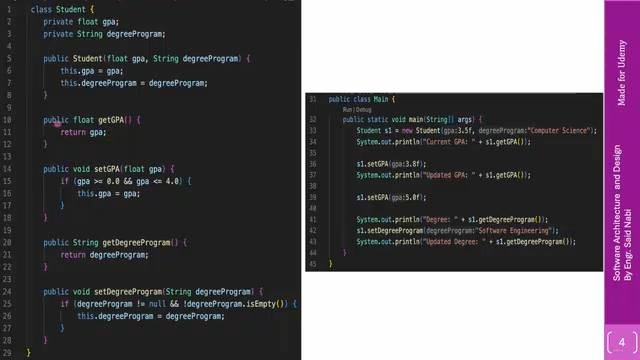

### 5.2 `Student.java`：封装与 association 放在同一个类里

`private float GPA;` 和 `private String degreeProgram;` 对应 UML 里的 `- GPA: float`、`- degreeProgram: String`。讲师 p030 [07:53] 明确说 `minus symbol represents private access`，`plus symbol represents public access`。在 Java 里，private 字段只能被本类内部直接访问；外部要通过 `getGPA()` / `setGPA()` 这类 public 方法。  
在 JS/Node 里，等价概念可以是 `class Student { #gpa; #degreeProgram; }` 的私有字段，或者用闭包隐藏变量；public 方法就是类上公开的方法。Java 这里只是语法不同，核心是“数据藏起来，公开受控入口”。

`private Support support;` 和构造器里的 `this.support = support;` 是 association 的 Java 落地：`Student` 使用另一个 `Support` 对象，但 `Support` 是从外部传进来的，不是 `Student` 内部 `new` 出来的。讲师 p030 [13:08] 左右说，“inside the student class, we are using an object of another class called support. An object of the support class is passed to the student class.” 这对应“对象可交互，但可独立存在”。

`public void startSupport() { support.start(); }` 中，`support.start()` 正是逐字稿里出现的调用。因为 `support` 是 private 字段，`Main` 不能直接 `student.support.start()`，所以加一个 public 包装方法。这个包装方法是本文为可运行演示补的，逐字稿没有逐字给出这个方法名。

### 5.3 `Support.java`：被关联对象的独立存在

`Support` 只有一个 `start()` 方法，用来对应逐字稿里的 `support.start`。它不持有 `Student`，所以 `Student` 和 `Support` 是松耦合：改 `Student` 不必然影响 `Support`，改 `Support` 也不必然影响 `Student`。这就是 association 的“loose relationship”。

### 5.4 `CrewMember.java` 与 `Airliner.java`：聚合 aggregation

`Airliner` 里 `private CrewMember[] crewMembers;` 对应讲师 p030 [14:34] 左右的“airliner has an array of crew members”。聚合的 UML 符号是 whole 侧的空心菱形；Java 里常见写法就是“整体持有部件的数组/集合”，并且部件从外部加入：

```java
public void addCrewMember(CrewMember crewMember) {
    if (count < crewMembers.length) {
        crewMembers[count] = crewMember;
        count++;
    }
}
```

`CrewMember` 对象是在 `Main` 里 `new` 出来再传进去的，不是 `Airliner` 构造器内部创建。所以 `CrewMember` 可以独立于 `Airliner` 存在。讲师 p030 [15:03] 左右说“crew members can exist independently of the airliner”，这就是聚合和组合的关键差别。

容量 `capacity` 和 `count` 是逐字稿没有细讲的实现细节。逐字稿只说“array of crew members”和“add a crew member”，本文用固定容量数组做最小实现；实际项目可换成 `List<CrewMember>`，但那是课里没讲的替换。

### 5.5 `House.java` 与 `Room.java`：组合 composition

`House` 的构造器里：

```java
public House(String roomName) {
    this.room = new Room(roomName);
}
```

这是组合的核心：`Room` 由 `House` 内部创建并管理，不是外部传进来。讲师 p030 [16:25] 左右说 composition 用 filled diamond；p030 [16:55] 左右说“A house is made of rooms. Here we have a private room object and we have added a constructor in which the room is initialized as part of the house.” 本文照这个描述写。  
如果 `House` 被销毁，这个 `Room` 作为“这栋房子的房间”不再作为同一个独立房间存在；UML 上就是实心菱形。注意，Java 的垃圾回收不会自动“销毁”对象，但设计语义上表达的是生命周期绑定。

### 5.6 `Main.java`：把四种代码关系串起来

`Support support = new Support();` 先创建被关联对象，再传给 `Student`。`student.startSupport()` 触发 association 调用。  
`Airliner airliner = new Airliner(3);` 创建整体，再 `addCrewMember(...)` 从外部加入部件，演示 aggregation。  
`House house = new House("LivingRoom");` 不传 `Room`，由 `House` 内部创建，演示 composition。  
`Food food = new Food(...);` 演示 UML 属性到 Java 字段/构造器，以及 `isOnSale()` 返回布尔值。

### 5.7 序列图解释：为什么“人”不直接找“电视”

讲师 p031 [01:20] 左右说，person 把订单给 cashier，cashier 再转给 chef；person 不直接和 chef 说话。电视换台同理：`Person -> Remote -> TV`。这不是多绕一步，而是职责边界清楚。序列图里每个竖线是 lifeline，粗竖条是 activation bar；实线箭头是调用，虚线箭头是 return message。p031 [02:46] 明确说 dotted arrows 表示 responses。

画 ALT/LOOP 时，把“知道频道号”和“不知道频道号”分开：true 分支输入 61；false 分支进入 loop，按 up/down 直到目标频道。课里没给绘图工具，你可用纸笔或任意 UML 工具；不要声称讲师指定了某个工具。

### 5.8 状态图解释：event + guard + action

售货机 `Idle` 状态下投币，事件是 `insertCoins`；检查 `totalAmount >= productPrice` 是 guard condition；满足后进入 `EnoughCoins`，执行 `dispenseProduct()` 是 action。讲师 p032 [12:07] 左右用自动门举例：输入正确密码是 event，检查密码是否正确是 condition，开门是 action；三者同时满足才 transition。  
状态图不是代码，P32 也没有给出 vending machine 的完整 Java 实现；所以本文只给设计表。你如果后面学 design pattern 里的 State pattern，才会看到对应的代码实现。

---

## 6. 复现检查清单

- [ ] 已安装 JDK 17 或兼容 JDK，`java -version` 和 `javac -version` 能输出。
- [ ] 目录为 `uml-design-demo/src` 和 `uml-design-demo/out`。
- [ ] `src/` 下有 8 个文件：`Food.java`、`Student.java`、`Support.java`、`CrewMember.java`、`Airliner.java`、`Room.java`、`House.java`、`Main.java`。
- [ ] 每个 `public class` 的文件名和类名一致，例如 `public class Food` 必须在 `Food.java`。
- [ ] 没有 package 声明；如果有，编译和运行命令要加包路径。
- [ ] 编译命令成功：
  ```bash
  javac -encoding UTF-8 -d out src/*.java
  ```
- [ ] 运行命令成功：
  ```bash
  java -cp out Main
  ```
- [ ] 输出包含：
  ```text
  Student GPA=3.5, degreeProgram=Computer Science
  Support.start() called
  Airliner crew count=2
  House room=LivingRoom
  Food isOnSale()=false
  ```
- [ ] 能指出 `Student` 里 `private float GPA` 对应 UML 的 `- GPA: float`。
- [ ] 能指出 `Support` 是 association：从外部传入，`Student` 调 `support.start()`。
- [ ] 能指出 `Airliner` 是 aggregation：持有 `CrewMember[]`，成员从外部加入。
- [ ] 能指出 `House` 是 composition：`House` 构造器内部 `new Room(...)`。
- [ ] 能画出电视换台序列图的三条 lifeline：Person、Remote、TV。
- [ ] 能在序列图里加 ALT（知道/不知道频道号）和 LOOP（上下键换台）。
- [ ] 能画出售货机状态图：filled circle → `Idle` → `EnoughCoins`，并写清 insertCoins、guard、dispense、cancel。
- [ ] 知道 P31/P32 没有给完整状态机 Java 代码，不要把本文的状态表当成讲师源码。

---

## 7. 课里没讲但你会撞上的

1. **JDK 版本和构建工具没讲**：逐字稿只说用 Java，没有说 JDK 17、Maven 或 Gradle。本文用 JDK 17 + `javac` 是最小可复现方案；你换成 JDK 8/11/21 一般也能编译这段代码，但以实际环境为准。
2. **完整源码没有逐字给出**：讲师展示的是片段和类图描述。本文的 `getGPA()`、`getDegreeProgram()`、`Airliner(int capacity)`、`Room` 的 name 构造等，都是为了可运行补的最小实现。若你回看视频发现讲师源码字段名不同，以视频为准。
3. **`Support` 类名有歧义**：逐字稿里写作 `support` / `support.start`，本文按字面写成 `Support`。如果实际视频里是 `Sport` 或其他类名，你需要同步改类名、文件名和 `Student` 字段类型。
4. **`Food.isOnSale()` 没有业务规则**：逐字稿只说返回 Boolean，没有说“价格低于多少算 on sale”。本文返回 `false` 只是占位，不是讲师规则。
5. **`GPA` 大写字段名不符合 Java 命名习惯**：Java 通常写 `gpa`，但逐字稿明确出现 `float GPA`，本文保留 `GPA` 以对齐课程。改名不影响运行，但要同步 getter/setter。
6. **组合不是 GC 语义**：UML composition 表达生命周期绑定，Java 的垃圾回收不会因为 `House` 不可达就自动“销毁” `Room` 这个设计概念。设计图和运行时内存管理是两层事。
7. **P31/P32 没有完整 Java 状态机**：讲师在 P32 末尾说 vending machine 的 live Java code “probably later”，所以本文没有编一个状态机实现。你后面学 State pattern 时才会看到代码化写法。
8. **绘图工具没讲**：序列图和状态图可以用纸笔、白板或任意 UML 工具画；课里没有指定工具名，不要写成“讲师要求用某工具”。
9. **Windows 命令差异**：本文命令是 bash 风格。Windows PowerShell 下 `src/*.java` 的通配可能不展开，可以逐个写文件名，或用：
   ```powershell
   Get-ChildItem src\*.java | ForEach-Object { javac -encoding UTF-8 -d out $_.FullName }
   java -cp out Main
   ```
10. **没有并发/锁/事务内容**：P30–P32 是 UML 设计和类关系，没有讲多线程、数据库事务或分布式锁。因此本文不需要补 JS/Node 里的锁对应物；如果你把示例改造成 Web 服务，才需要另行考虑并发。