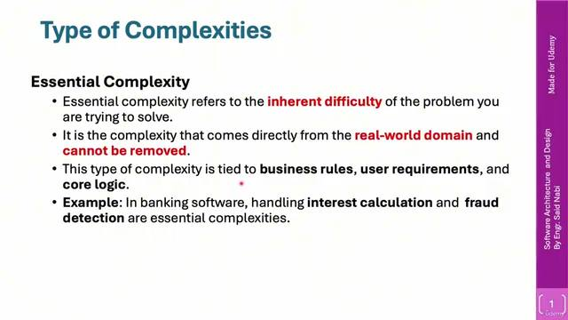
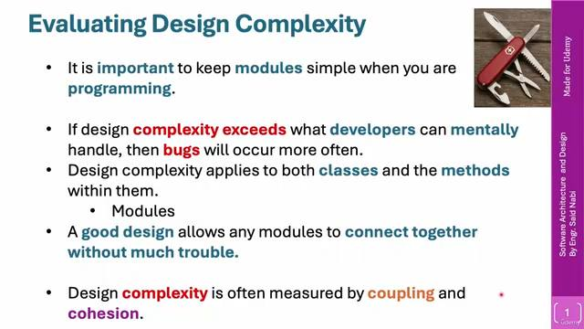
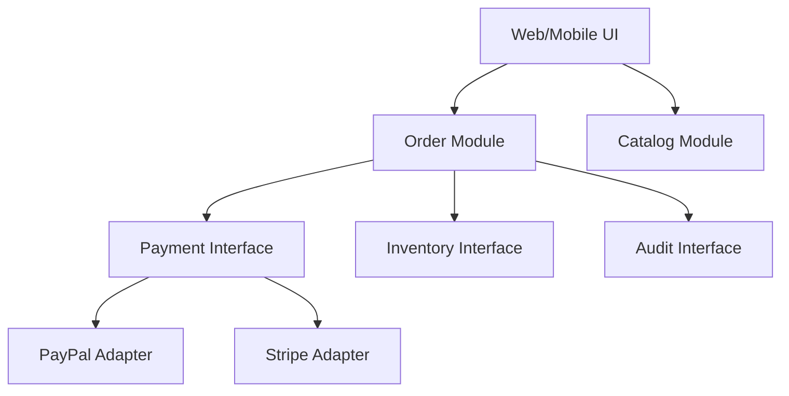
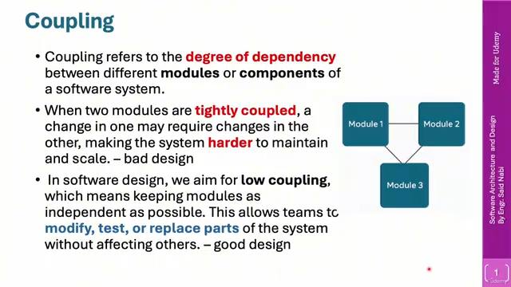
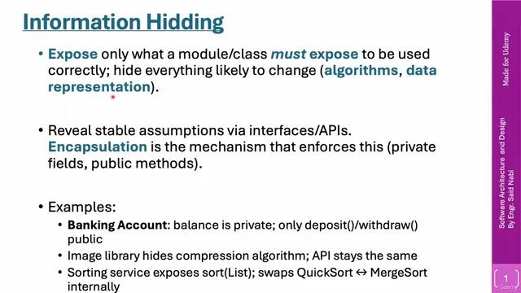
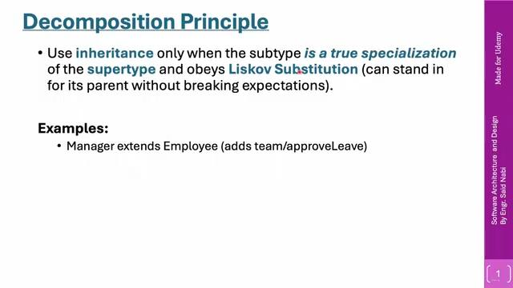
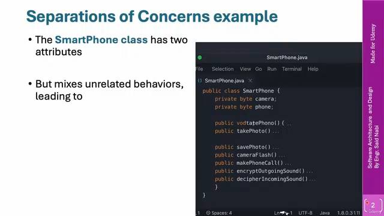
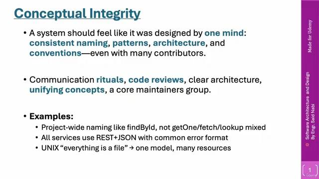
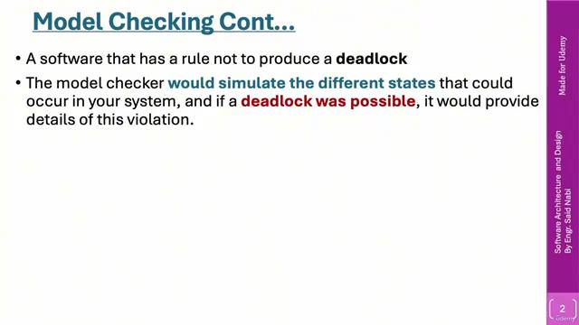

# Software Architecture Scalable（P33–P40）复现文档：从复杂度分类到模型检查

## 1. 这一节做什么

P33–P40 是一门**纯架构讲解课**，逐字稿里没有可运行的业务代码、没有终端命令、没有依赖安装步骤。因此本文的“复现”不是把某个仓库跑起来，而是把讲师在这八节里反复强调的设计判断，落成一份**可评审、可检查、可交接的架构设计工件**：先区分“问题本身难”还是“我们把它做难了”，再用耦合/内聚检查模块边界，用信息隐藏和封装保护变化点，用继承/组合表达真实关系，用关注点分离拆职责，用概念完整性统一命名与接口，最后用模型检查验证状态机在所有可能状态下的行为。

读者照着本文做完，应该得到一套目录和文件：`docs/architecture/design-review.md`、`docs/architecture/model-checking-notes.md`、`src/design/contracts.ts`，以及一份可勾选的评审清单。课里没有给出容量数字和模型检查工具语法，本文只给模板和示意，不把模板冒充成讲师结论。


这一节的核心不是背定义，而是建立一条可执行的设计流水线：**复杂度分类 → 模块划分 → 耦合/内聚评分 → 信息隐藏 → 继承/组合决策 → 关注点分离 → 概念完整性 → 模型检查**。下面按这条流水线重组，不按“P033 讲了什么、P034 讲了什么”的流水账写。

---

## 2. 讲师原话（带「—— pNNN [MM:SS]」）

下面只摘与复现直接相关的原话，英文原话后附中文解释。逐字稿没有代码，所以这里不伪造代码引用。

1. “essential complexity refers to the inherent difficulty of the problem you are trying to solve.”  
   —— p033 [00:59]  
   本质复杂度来自问题本身：业务规则、用户预期、核心逻辑。银行利息计算、欺诈检测、医疗隐私、电商支付/退款/折扣/税/跨境运费，都是不能靠换框架消灭的。

2. “accidental complexity is the extra difficulty caused by tools. Technologies are poor implementation choices.”  
   —— p033 [03:28]  
   意外复杂度来自工具、技术选型和实现方式。讲师举了“简单应用却选低级语言”“代码结构混乱”等例子。它可以通过更好的语言、框架和设计实践减少。

3. “design complexity is often measured by coupling and cohesion.”  
   —— p034 [02:12]  
   设计复杂度常用耦合与内聚衡量：耦合看模块之间依赖多紧，内聚看一个模块内部职责是否属于一起。目标是低耦合、高内聚。

4. “Coupling refers to the degree of dependency between different modules or components of a software system.”  
   —— p035 [00:00]  
   耦合是模块/组件之间的依赖程度。两个模块知道彼此太多，就会一起变、一起坏。

5. “Cohesion describes how closely related and focused the responsibilities of a single module R.”  
   —— p035 [04:11]  
   内聚描述单个模块职责是否紧密相关、是否聚焦。高内聚的模块只做一件清楚的事，容易理解、测试和复用。

6. “expose only what a module or class must expose to be used correctly everything that is likely to change should be hidden”  
   —— p036 [00:00]  
   信息隐藏：只暴露“正确使用所必需”的部分，把可能变化的东西藏起来。讲师用汽车方向盘/踏板与发动机、银行账户余额私有、图片库隐藏压缩算法、排序服务暴露 `sort` 等例子说明。

7. “inheritance is not about sharing code you know it is about representing a real relationship”  
   —— p037 [00:24]  
   继承不是复用代码，而是表达真实关系。只有子类型确实是父类型的特化，并遵守里氏替换，才用继承；否则优先组合。

8. “separation of concerns means keeping different concerns apart”  
   —— p038 [00:59]  
   关注点分离：不同关注点放在不同部分。讲师用医院医生/护士/药剂师、在线商店登录/商品目录/支付规则、手机通话与相机拍照等例子说明。

9. “a system should feel like it was designed by one mind.”  
   —— p039 [00:00]  
   概念完整性：系统应像一个人设计出来的，命名、模式、架构、规则遵循同一套逻辑。讲师举了统一 `findById`、统一 REST/JSON 和错误格式、Unix“一切皆文件”等例子。

10. “Model checking is a systematic check of your system's state model in all its possible states and no single state is ignored.”  
    —— p040 [00:29]  
    模型检查是对系统状态模型的所有可能状态做系统检查，不忽略任何状态。它适合找测试很难撞到的隐藏 bug，例如银行系统里罕见的线程时序死锁。

11. “modeling phase... running phase... analysis phase”  
    —— p040 [04:28] 起  
    模型检查分三阶段：建模阶段定义抽象状态机与规则；运行阶段自动探索所有可能状态；分析阶段检查违规并给出反例路径。



---

## 3. 从零复现

> 说明：本课程是纯讲解课，没有可运行项目。下面复现的是“设计评审工件”的制作过程。课里没有代码，第 4 节出现的 TypeScript 和状态机伪代码均为示意，不是讲师给出的实现。

### 3.1 准备目录与运行环境

建议新建一个空目录，例如 `architecture-scalable-p33-p40/`。目录结构如下：

```text
architecture-scalable-p33-p40/
├── README.md
├── package.json
├── tsconfig.json
├── docs/
│   └── architecture/
│       ├── design-review.md
│       └── model-checking-notes.md
└── src/
    └── design/
        └── contracts.ts
```

课里没有讲依赖版本和启动命令。为了能对第 4 节的示意 TypeScript 做类型检查，本文建议使用 Node.js 20+、TypeScript 5.4.5；这不是讲师要求，只是复现建议。没有环境变量需要设置。启动命令是：

```bash
npm install
npm run check
```

### 3.2 第一步：列“复杂度清单”，先分清哪些难是应该的

拿一张表，把系统里的难点分成两列：

| 编号 | 难点 | 类型 | 判断理由 | 处理方式 |
|---|---|---|---|---|
| C1 | 支付、退款、折扣、税、跨境运费 | 本质复杂度 | 真实业务规则，不能靠换框架消灭 | 深入理解，设计 around it |
| C2 | 欺诈检测、风控规则 | 本质复杂度 | 现实世界不确定性 | 独立模块，持续迭代 |
| C3 | 用户隐私与合规 | 本质复杂度 | 法律与业务约束 | 边界清楚，审计留痕 |
| C4 | 简单应用却选复杂低级技术 | 意外复杂度 | 工具/选型造成 | 换合适语言/框架 |
| C5 | 代码结构混乱、命名不统一 | 意外复杂度 | 实现方式造成 | 重构、统一规范 |
| C6 | 模块之间互相知道内部细节 | 意外复杂度 | 设计造成 | 信息隐藏、接口隔离 |

这一步的产出不是“写代码”，而是**先承认哪些难必须尊重，哪些难要删掉**。讲师的原话是“A good software architect learns to respect unavoidable complexity and remove unnecessary complexity”——p033 [00:29]。



### 3.3 第二步：划分模块，先让每个模块只有一个清楚职责

以逐字稿里出现过的在线商店为例，先划出候选模块：

| 模块 | 唯一职责 | 不应该做什么 |
|---|---|---|
| 用户模块 | 登录、身份、用户资料 | 不处理支付规则 |
| 商品目录模块 | 商品展示、分类、搜索 | 不处理退款 |
| 订单模块 | 下单、订单状态 | 不直接调用具体支付网关 |
| 支付模块 | 支付、退款、支付网关适配 | 不知道 UI 是移动端还是网页 |
| 物流模块 | 发货、配送状态 | 不计算税费 |
| 通知模块 | 邮件/短信/站内信 | 不决定订单是否可退 |
| 审计模块 | 记录关键行为 | 不修改业务状态 |

这一步对应讲师的“simple modules does only one clear job”——p034 [00:00]。判断标准不是“类大不大”，而是“职责是否属于一起”。如果一个方法同时做登录校验、日志、数据库访问，就是 p034 [00:56] 说的“F1 method handles login validation logging and database access all at once”。

### 3.4 第三步：画依赖图，检查耦合方向

用 Mermaid 或纸笔画依赖图，只允许“上层依赖下层接口”，不允许支付模块反向依赖 UI。示例：



检查点：支付模块不应知道 UI 是移动端还是网页；订单模块不应知道 PayPal 的内部字段；替换支付网关不应改订单模块。讲师在 p035 [01:24] 说“a payment module can be replaced without changing the order or user modules”。



### 3.5 第四步：给耦合/内聚打分

不要凭感觉说“高内聚低耦合”，要打分。可以按讲师在 p035 [01:52] 提到的维度：连接数、连接简单性、灵活性。

| 模块 | 连接数（越少越好） | 是否必须知道对方内部细节 | 替换成本 | 内聚判断 | 结论 |
|---|---|---|---|---|---|
| 支付模块 | 3 | 否，只依赖接口 | 低 | 只做支付/退款 | 保留 |
| 订单模块 | 4 | 否，依赖支付/库存接口 | 中 | 只做订单状态 | 保留 |
| 用户模块 | 2 | 否 | 低 | 只做身份 | 保留 |
| 通知模块 | 2 | 否 | 低 | 只做通知 | 保留 |
| 某“万能”模块 | 8 | 是 | 高 | 职责混杂 | 拆分 |

如果某模块连接数很多、参数很多、必须知道别人内部细节，就是讲师说的“tight coupling”信号——p035 [03:13]。在 JS/Node 里，这通常表现为一个 service 里 `import` 了十几个模块、函数参数超过 5 个、直接读别的模块的数据库表。对应做法是抽接口、传 DTO、把跨模块调用收口到 application service。

### 3.6 第五步：做信息隐藏检查

对每个模块问三个问题：

1. 哪些是“使用它必须知道”的？
2. 哪些是“可能变化”的？
3. 变化的东西有没有被藏在接口后面？

以支付模块为例：对外只暴露 `pay(orderId, amount, idempotencyKey)` 和 `refund(paymentId, amount)`；隐藏 PayPal/Stripe 的字段、签名、重试细节。讲师在 p036 [00:00] 说“everything that is likely to change should be hidden”。在 AI 应用里同理：业务代码不应直接依赖某家模型 SDK 的请求/响应结构，而应依赖自己的 `LlmClient` 接口；否则换模型供应商会像“改数据库结构把 UI 弄坏”一样扩散。



### 3.7 第六步：继承还是组合，逐条做决策

讲师在 p037 [00:24] 给了一个简单问题：“Can this child truly replace its parent without surprising anyone?” 把候选关系列成表：

| 候选关系 | 是否是“is-a” | 是否遵守里氏替换 | 决策 |
|---|---|---|---|
| Manager is an Employee | 是 | 是，经理仍可被当员工支付/分配工作 | 可用继承 |
| Whale is an Animal 且 Animal 有 run() | 否 | 鲸鱼不能 run，会破坏父类承诺 | 不用继承，改组合/接口 |
| PayPalAdapter is a PaymentGateway | 是 | 是，可替换 | 可实现接口 |
| 为了复用代码让 Order 继承 User | 否 | 否 | 用组合 |

课里没有代码，但决策表就是产物。前端转 AI 应用工程师要注意：不要因为“想复用几个方法”就建 `BaseAgent` 继承树；优先组合 `ToolRegistry`、`MemoryStore`、`ModelClient`。

### 3.8 第七步：关注点分离，拿手机示例做一次拆分

讲师在 p038 [02:58] 起用 Smartphone 举例：一个类同时处理通话、短信、相机控制、电池管理，低内聚、难复用。复现时把它拆成：

| 组件 | 职责 | 对外接口 |
|---|---|---|
| Phone | 拨号、接听、通话管理 | `dial(number)`、`answer()` |
| Camera | 对焦、拍照、存储 | `takePhoto()` |
| Power | 电池管理 | `getBatteryLevel()` |
| Smartphone | 协调者，组合上述组件 | 不管理内部细节 |

讲师说 Smartphone 应像乐队指挥，“brings different instruments together without playing them”——p038 [06:27]。这就是协调者模式：它依赖接口，不依赖实现。



### 3.9 第八步：概念完整性检查

列一张“统一规范”表：

| 项目 | 统一规则 | 反例 |
|---|---|---|
| 查询命名 | 统一 `findById` | `get1`、`fetch`、`lookup` 混用 |
| API 风格 | 统一 REST + JSON | 有的返回 XML，有的返回纯文本 |
| 错误格式 | 统一 `{ code, message, traceId }` | 每个服务自定义错误字段 |
| 时间格式 | 统一 ISO 8601 | 有的用时间戳，有的用本地字符串 |
| 分页 | 统一 `page`/`pageSize` | 有的用 `offset`，有的用 `limit` |

讲师在 p039 [01:30] 说“One name or one meaning that is something which brings clarity to the design”。这一步的产物是团队规范，不是代码。



### 3.10 第九步：模型检查，把状态机画出来

讲师在 p040 [04:28] 把模型检查分三阶段：

1. **建模阶段**：定义抽象状态机与规则。例如交通灯状态 `RED`、`GREEN`、`YELLOW`，规则“不能同时 GREEN 和 RED”。
2. **运行阶段**：模型检查器自动探索所有可能状态和事件组合。
3. **分析阶段**：如果违反规则，给出反例路径，按步骤定位。

复现时先写属性表：

| 属性 | 规则 | 反例 |
|---|---|---|
| 安全属性 | 交通灯不能同时 GREEN 和 RED | 两个灯同时亮 |
| 无死锁 | 银行转账不能永久等待 | 两个事务互相等锁 |
| 最终响应 | 请求最终有响应 | 请求永久 pending |
| 一致性 | 分布式系统不能出现不一致状态 | 扣款成功但订单未更新 |

在 JS/Node 里，死锁不一定表现为线程阻塞，可能是 Promise 永久 pending、数据库行锁等待超时、Redis 分布式锁未释放。对应做法是设置超时、幂等键、事务边界清晰、锁带过期时间。课里没有讲这些 Node 细节，这是给前端转 AI 应用工程师的补充。



### 3.11 第十步：开一次设计评审会

按第 6 节清单逐项打勾。评审产出不是“感觉不错”，而是：哪些本质复杂度被尊重、哪些意外复杂度被删除、哪些模块耦合超标、哪些接口暴露了变化点、哪些继承关系不满足里氏替换、哪些状态机属性需要模型检查。



---

## 4. 完整代码

> 再次说明：本课程没有可运行代码。以下文件是复现用的设计工件模板和 TypeScript 示意，**课里没有代码，以下为示意**。它们能保存、能通过类型检查，但不代表讲师讲过这些实现。

### 4.1 `package.json`

```json
{
  "name": "architecture-scalable-p33-p40",
  "version": "1.0.0",
  "private": true,
  "scripts": {
    "check": "tsc --noEmit"
  },
  "devDependencies": {
    "typescript": "5.4.5"
  }
}
```

### 4.2 `tsconfig.json`

```json
{
  "compilerOptions": {
    "target": "ES2022",
    "module": "ESNext",
    "moduleResolution": "Bundler",
    "strict": true,
    "noEmit": true,
    "skipLibCheck": true
  },
  "include": ["src/**/*.ts"]
}
```

### 4.3 `src/design/contracts.ts`

```ts
// 课里没有代码，以下为示意：用接口表达信息隐藏与低耦合。
export type Money = {
  amount: number;
  currency: "CNY" | "USD" | "EUR";
};

export type OrderId = string;
export type PaymentId = string;

export interface PaymentGateway {
  pay(input: {
    orderId: OrderId;
    amount: Money;
    idempotencyKey: string;
  }): Promise<{ paymentId: PaymentId; status: "SUCCEEDED" | "FAILED" }>;

  refund(input: {
    paymentId: PaymentId;
    amount: Money;
    idempotencyKey: string;
  }): Promise<{ refundId: string; status: "SUCCEEDED" | "FAILED" }>;
}

export interface OrderRepository {
  findById(orderId: OrderId): Promise<{
    id: OrderId;
    userId: string;
    total: Money;
    status: "CREATED" | "PAID" | "CANCELLED";
  } | null>;

  markPaid(orderId: OrderId, paymentId: PaymentId): Promise<void>;
}

export interface AuditLogger {
  record(event: {
    name: string;
    traceId: string;
    payload: Record<string, unknown>;
  }): Promise<void>;
}

export class PayOrderUseCase {
  constructor(
    private readonly orders: OrderRepository,
    private readonly payments: PaymentGateway,
    private readonly audit: AuditLogger
  ) {}

  async execute(input: {
    orderId: OrderId;
    idempotencyKey: string;
    traceId: string;
  }): Promise<{ ok: true; paymentId: PaymentId } | { ok: false; reason: string }> {
    const order = await this.orders.findById(input.orderId);
    if (!order) {
      return { ok: false, reason: "ORDER_NOT_FOUND" };
    }
    if (order.status !== "CREATED") {
      return { ok: false, reason: "ORDER_NOT_PAYABLE" };
    }

    const result = await this.payments.pay({
      orderId: order.id,
      amount: order.total,
      idempotencyKey: input.idempotencyKey
    });

    if (result.status !== "SUCCEEDED") {
      await this.audit.record({
        name: "payment_failed",
        traceId: input.traceId,
        payload: { orderId: order.id }
      });
      return { ok: false, reason: "PAYMENT_FAILED" };
    }

    await this.orders.markPaid(order.id, result.paymentId);
    await this.audit.record({
      name: "payment_succeeded",
      traceId: input.traceId,
      payload: { orderId: order.id, paymentId: result.paymentId }
    });

    return { ok: true, paymentId: result.paymentId };
  }
}
```

### 4.4 `docs/architecture/design-review.md`

```markdown
# 架构设计评审工件（P33–P40 复现）

## 1. 复杂度清单

| 编号 | 难点 | 类型 | 判断理由 | 处理方式 |
|---|---|---|---|---|
| C1 | 支付/退款/折扣/税/跨境运费 | 本质复杂度 | 真实业务规则 | 独立支付模块，深入理解 |
| C2 | 风控/欺诈检测 | 本质复杂度 | 现实不确定性 | 独立风控模块 |
| C3 | 隐私合规 | 本质复杂度 | 法律约束 | 审计与权限边界 |
| C4 | 工具选型过重 | 意外复杂度 | 实现造成 | 换合适技术 |
| C5 | 命名/结构混乱 | 意外复杂度 | 实现造成 | 统一规范，重构 |

## 2. 模块职责表

| 模块 | 唯一职责 | 不做什么 |
|---|---|---|
| 用户 | 身份与资料 | 不处理支付规则 |
| 商品目录 | 商品展示与搜索 | 不处理退款 |
| 订单 | 下单与订单状态 | 不直接依赖具体支付网关 |
| 支付 | 支付/退款/网关适配 | 不知道 UI 类型 |
| 物流 | 发货与配送状态 | 不计算税费 |
| 通知 | 邮件/短信/站内信 | 不决定订单状态 |
| 审计 | 记录关键行为 | 不修改业务状态 |

## 3. 耦合/内聚评分

| 模块 | 连接数 | 是否知道对方内部细节 | 替换成本 | 内聚 | 结论 |
|---|---|---|---|---|---|
| 支付 | 3 | 否 | 低 | 高 | 保留 |
| 订单 | 4 | 否 | 中 | 高 | 保留 |
| 用户 | 2 | 否 | 低 | 高 | 保留 |
| 通知 | 2 | 否 | 低 | 高 | 保留 |
| 万能模块 | 8 | 是 | 高 | 低 | 拆分 |

## 4. 继承/组合决策表

| 候选关系 | 是否 is-a | 是否遵守里氏替换 | 决策 |
|---|---|---|---|
| Manager is Employee | 是 | 是 | 可用继承 |
| Whale is Animal 且 Animal.run() | 否 | 否 | 不用继承 |
| PayPalAdapter is PaymentGateway | 是 | 是 | 实现接口 |
| Order 继承 User 以复用代码 | 否 | 否 | 用组合 |

## 5. 概念完整性规范

| 项目 | 统一规则 | 反例 |
|---|---|---|
| 查询命名 | 统一 findById | get1/fetch/lookup 混用 |
| API 风格 | REST + JSON | XML/纯文本混用 |
| 错误格式 | { code, message, traceId } | 每个服务自定义 |
| 时间格式 | ISO 8601 | 时间戳/本地字符串混用 |
| 分页 | page/pageSize | offset/limit 混用 |

## 6. 容量估算表（课里没有给出数字，以下为留空模板）

| 指标 | 公式 | 当前值 | 备注 |
|---|---|---|---|
| 日订单量 | 待填 | 待填 | 课里没讲 |
| 支付峰值 QPS | 待填 | 待填 | 课里没讲 |
| 平均响应时间 | 待填 | 待填 | 课里没讲 |
| 存储增长 | 待填 | 待填 | 课里没讲 |

> 注意：上表不是讲师结论，只是复现时用来暴露“还缺哪些数据”的模板。
```

### 4.5 `docs/architecture/model-checking-notes.md`

```markdown
# 模型检查笔记（P40 复现）

## 状态机草案（课里没有代码，以下为示意）

状态：RED、GREEN、YELLOW
事件：TIMER、EMERGENCY_STOP、RESET

规则：
1. 不能同时 GREEN 和 RED。
2. 每次 TIMER 只能进入下一个合法状态。
3. EMERGENCY_STOP 后必须进入安全状态。

## 属性表

| 属性 | 规则 | 反例 |
|---|---|---|
| 安全属性 | 不能同时 GREEN 和 RED | 两灯同时亮 |
| 无死锁 | 银行转账不能永久等待 | 互相等锁 |
| 最终响应 | 请求最终有响应 | 永久 pending |
| 一致性 | 分布式系统不能不一致 | 扣款成功但订单未更新 |

## 三阶段

1. 建模阶段：定义抽象状态机与规则。
2. 运行阶段：自动探索所有可能状态与事件组合。
3. 分析阶段：检查违规并输出反例路径。
```

### 4.6 `README.md`

```markdown
# Architecture Scalable P33–P40 复现

本仓库是纯讲解课的复现工件，不是讲师提供的代码。

## 环境
- Node.js 20+
- TypeScript 5.4.5（复现建议，不是讲师要求）

## 命令
```bash
npm install
npm run check
```

## 产物
- docs/architecture/design-review.md
- docs/architecture/model-checking-notes.md
- src/design/contracts.ts
```

---

## 5. 逐行解释

### 5.1 为什么先做“复杂度清单”

因为讲师在 p033 [00:29] 把问题分成“房子本身不平/天气恶劣”和“你自己把房子弄乱”。如果不先分类，团队会把业务本身的支付/税/合规当成“代码没写好”，或者把工具选型造成的混乱当成“业务太难”。清单里 C1–C3 是本质复杂度，处理方式是“尊重并设计 around it”；C4–C6 是意外复杂度，处理方式是“换工具、重构、抽接口”。不这样做的后果是：该投入业务建模的地方去换框架，该删的复杂度反而被保留。

### 5.2 为什么模块职责表要写“不做什么”

只写“做什么”容易让模块膨胀。写“不做什么”是在边界上做信息隐藏。支付模块“不知道 UI 类型”，订单模块“不直接依赖具体支付网关”，这两条直接对应 p035 [01:24] 的“payment module can be replaced without changing the order or user modules”。如果不写“不做什么”，支付模块就会开始读 UI 参数、订单模块就会 `new PayPalClient()`，耦合立刻升高。

### 5.3 耦合/内聚评分表为什么用连接数、内部细节、替换成本

讲师在 p035 [01:52] 说“Degree is how many connections a module has”“ease means connections should be simple and not required knowing other modules details”“Flexibility means modules can be easily replaced”。所以表里三列不是随便加的：连接数看“度”，内部细节看“简单性”，替换成本看“灵活性”。如果某模块连接数 8、必须知道对方内部字段、替换成本高，就是 p035 [03:13] 说的“tight coupling”信号。不这样量化，评审就会变成“我觉得还行”。

### 5.4 `contracts.ts` 为什么这样定义接口

`PaymentGateway` 只暴露 `pay` 和 `refund`，入参只有订单号、金额、幂等键，出参只有支付 ID 和状态。PayPal/Stripe 的签名、重试、字段全部藏起来，这就是 p036 [00:00] 的“expose only what a module or class must expose to be used correctly”。`OrderRepository` 只暴露 `findById` 和 `markPaid`，不暴露数据库表结构；`AuditLogger` 只暴露 `record`，不暴露日志存储细节。`PayOrderUseCase` 通过构造函数注入三个接口，不直接 `import` 具体实现，这样替换支付网关不需要改用例。不这样做的后果是：业务用例直接依赖某家 SDK，换供应商时改动扩散到订单、用户、UI。

### 5.5 为什么 `PayOrderUseCase` 先查订单再支付

这是示意代码，不是讲师给出的实现。它体现的是“订单状态”和“支付”两个关注点分开：用例负责编排，支付网关负责支付，订单仓库负责状态，审计负责记录。讲师在 p038 [01:29] 说“one part handles payment rules change we update only the payment module not the whole system”。如果把这些逻辑全塞进一个 `pay()` 方法，就会变成 p034 [00:56] 的“F1 method handles login validation logging and database access all at once”。

### 5.6 继承/组合决策表为什么把 Whale 判为“不用继承”

讲师在 p037 [01:42] 说：如果 `Animal` 类期望所有动物都能 `run`，让 `Whale` 继承 `Animal` 就破坏承诺。表里“是否遵守里氏替换”这一列就是用来挡住这种继承的。`Manager is Employee` 可以继承，因为经理仍可被当员工支付、分配工作；`Order 继承 User` 不行，因为订单不是用户，只是为了复用代码。不这样判的后果是：子类重写父类方法改变语义，调用方被“惊喜”，bug 扩散。

### 5.7 关注点分离的手机示例为什么让 Smartphone 当协调者

讲师在 p038 [06:27] 说 Smartphone 应像指挥，“brings different instruments together without playing them”。所以 `Smartphone` 不实现拍照细节，也不实现拨号细节，只组合 `Phone` 和 `Camera`。如果 Smartphone 自己处理相机对焦、通话、电池，就会低内聚、难复用；升级相机要改整个类。拆开后，升级相机不影响通话，升级电池不影响消息。

### 5.8 概念完整性规范为什么必须统一 `findById`

讲师在 p039 [01:30] 说“One name or one meaning that is something which brings clarity to the design”。如果项目里 `get1`、`fetch`、`lookup` 混用，开发者每次都要猜语义，认知负担上升。统一 `findById`、统一错误格式、统一分页，不是“洁癖”，而是降低意外复杂度。不这样做的后果是：集成时要写适配层，错误处理到处不一样，排查问题靠猜。

### 5.9 模型检查属性表为什么先写“反例”

模型检查的价值不是“证明没问题”，而是“如果违反，给出反例路径”。讲师在 p040 [06:57] 说分析阶段会提供“counter example step by step description”。所以属性表里写“反例”列，逼你想清楚：如果规则被破坏，系统长什么样？例如“两灯同时亮”“两个事务互相等锁”“请求永久 pending”。不写反例，属性就会写成“系统要正确”这种无法检查的话。

### 5.10 容量估算表为什么留空

逐字稿没有给出任何 QPS、订单量、存储增长数字。本文不能编造。留空模板的作用是：评审时明确“这些数字还没有”，而不是假装已经估算过。课里没讲容量估算方法，所以第 7 节会把它列为“你会撞上的坑”。

---

## 6. 复现检查清单

- [ ] 已建立 `architecture-scalable-p33-p40/` 目录和 `docs/architecture/`、`src/design/` 子目录。
- [ ] 已写 `package.json`、`tsconfig.json`，`npm install` 后 `npm run check` 能通过。
- [ ] 已列复杂度清单，并标注每项是本质复杂度还是意外复杂度。
- [ ] 已写模块职责表，每个模块都有“唯一职责”和“不做什么”。
- [ ] 已画依赖图，确认支付模块不依赖 UI，订单模块不依赖具体支付网关。
- [ ] 已给耦合/内聚打分，连接数多、知道内部细节、替换成本高的模块已标记。
- [ ] 已做信息隐藏检查：每个模块只暴露必要接口，变化点被藏在接口后。
- [ ] 已做继承/组合决策表，不满足里氏替换的关系已改为组合。
- [ ] 已用手机示例完成关注点分离拆分，Smartphone 只做协调者。
- [ ] 已写概念完整性规范：命名、API 风格、错误格式、时间格式、分页统一。
- [ ] 已写模型检查属性表，每条属性都有可检查的规则和反例。
- [ ] 已按建模、运行、分析三阶段记录模型检查笔记。
- [ ] 已开设计评审会，按本清单逐项确认，而不是只凭感觉。

---

## 7. 课里没讲但你会撞上的

1. **模型检查工具的具体安装和语法**  
   讲师提到 SPIN、TLA+、NuSMV（逐字稿拼作 spend/TLA plus/NUSM），但没有讲安装、语法、配置。你真正上手时会遇到工具链、状态爆炸、模型抽象粒度问题。本文只给属性表和三阶段笔记，不伪造工具命令。

2. **容量估算和性能数字**  
   逐字稿没有给 QPS、订单量、存储增长、延迟目标。第 4 节的容量估算表是留空模板，不是讲师结论。真实项目要补压测和容量规划。

3. **锁、事务、并发在 Node 里的对应**  
   讲师讲模型检查时提到银行系统线程时序死锁，但没有讲 Node。前端转 AI 应用工程师要注意：Node 单线程不等于无并发，`await` 交错、数据库连接池、Redis 分布式锁、事务隔离级别都会导致“永久等待”或“状态不一致”。对应做法是超时、幂等键、事务边界、锁过期、重试策略。这部分是补充，不是讲师原话。

4. **AI 应用里的迁移**  
   把课程原则迁移到 AI 应用时：业务代码不要直接依赖某家模型 SDK（信息隐藏）；检索、工具调用、评测、审计分开（关注点分离）；统一错误格式和 traceId（概念完整性）；Agent 状态机要检查死锁/无限循环（模型检查）。这些是类比，课里没有讲 AI 应用。

5. **团队协作和评审落地**  
   讲师在 p039 [00:59] 提到沟通、代码评审、核心维护者，但没有给会议模板。真实团队会撞上“规范写了没人执行”“评审变成甩锅”。建议把第 6 节清单放进 PR 模板，每次架构变更必须勾选。

6. **“低耦合高内聚”不是一次性的**  
   讲师在 p035 [05:36] 说改善一个可能影响另一个，需要平衡。真实项目里，过度拆分会增加调用链和运维成本；过度集中会低内聚。没有银弹，只有持续评审和取舍。

7. **截图对应的 PPT 细节**  
   本文引用的截图只用于定位讲师讲解位置，具体图表细节以原视频为准。逐字稿没有给出的字段名、工具输出、配置项，本文一律没有补造；实际输出请以你本地工具为准。