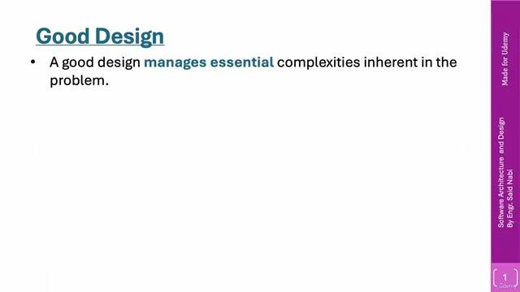
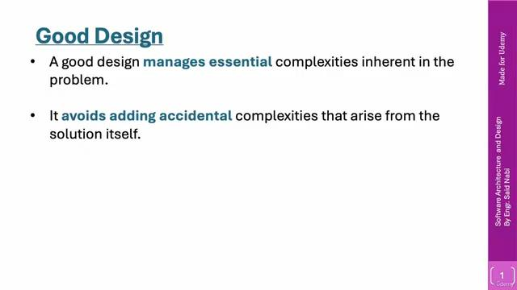
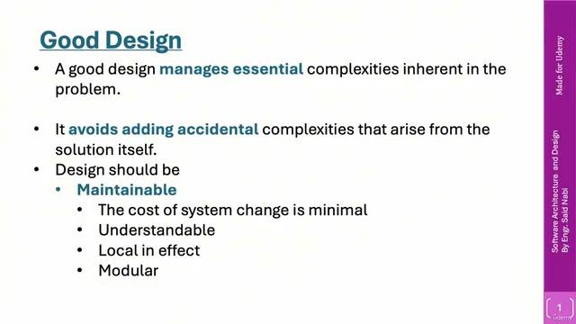
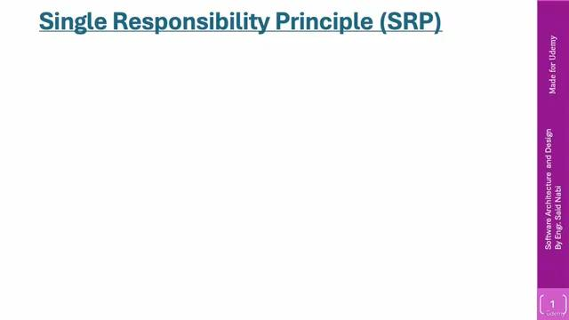
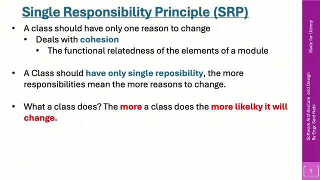
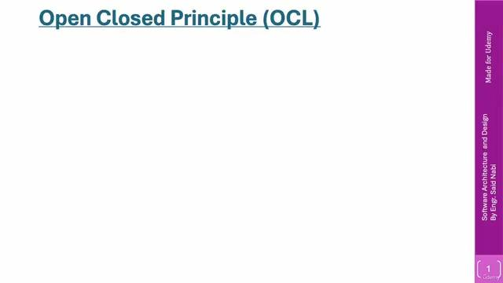
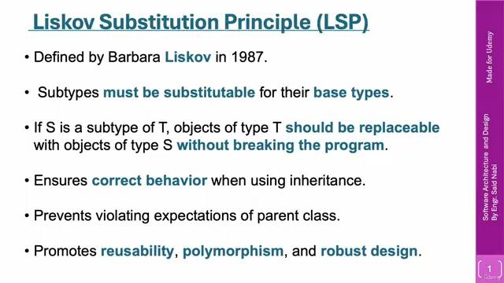
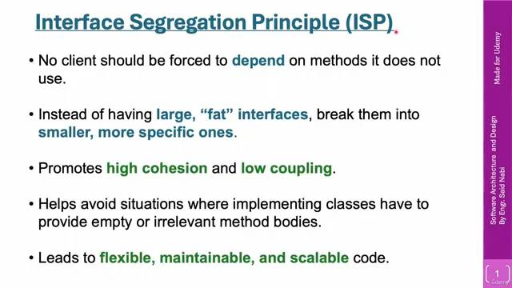
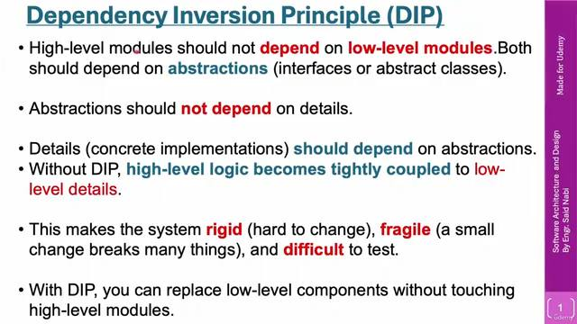

# Software Architecture Scalable（P41–P47）复现文档：从“好设计”到 SOLID 再到设计模式

> 说明：P41–P47 是**纯讲解课**，逐字稿里没有给出可启动的服务、完整工程、构建脚本或依赖版本。因此本文的“复现”不是把某个 Web 服务跑起来，而是把讲师给出的判断标准落成一套**可照着执行的设计评审与重构产物**：好设计检查表、SOLID 职责拆分表、接口/数据模型草案、设计模式选型表、容量估算模板和验收清单。  
> 课里用 Java 讲示例；逐字稿没有贴出完整源码。第 4 节会给出**完整可保存的设计文档**，并附一段**明确标注“课里没有代码，以下为示意”**的 Java 代码用于验证 SRP 拆分思路。读者是前端转 AI 应用工程师，文中会补一句 JS/Node 中的对应物；锁/事务/并发课里没讲，我会在第七节明确标出。

---

## 1. 这一节做什么

这一节要解决的不是“背出 SOLID 五个单词”，而是建立一个可重复的设计评审流程：拿到一个类、一个模块或一个 AI 应用功能，判断它是否把**问题本身的复杂度**和**解决方案引入的额外复杂度**混在一起，然后按讲师的原则拆开。

讲师在开场把“好设计”定义为管理问题固有的本质复杂度，避免解决方案自己制造 accidental complexity：



课程覆盖的核心产出有四类：

1. **好设计检查表**：可维护、可理解、影响局部、模块化、低耦合高内聚。对应 p041。
2. **SOLID 五原则的落地表**：SRP 单一职责、OCP 开闭、LSP 里氏替换、ISP 接口隔离、DIP 依赖倒置。对应 p042–p046。
3. **重构动作表**：把 `FileProcessor` 这种“打开文件 + 捕获异常 + 打印错误 + 写日志 + 关闭日志”的 God class 拆成 `FileProcessor`、`ErrorHandler`、`Logger`；把 `Post.createPost` 的类型分支改成可扩展子类；把 `Worker.work/eat` 拆成更小接口；把 `UserService` 对 `MySQLDatabase` 的直接依赖改成对 `Database` 抽象的依赖。
4. **设计模式选型表**：观察者用于实时通知，单例用于日志系统，工厂用于支付方式，策略用于路由算法，装饰器在 p047 被点名但未展开。对应 p047。

最终验收不是“能背定义”，而是你能在一个新需求到来时回答：这次改动会改几个类？是否改了已测试代码？子类型是否破坏父类承诺？客户端是否被迫实现不用方法？高层模块是否直接 import 低层具体实现？如果答案不对，就按本文第 3、4 节的表重做设计。

---

## 2. 讲师原话（带「—— pNNN [MM:SS]」）

下面摘录逐字稿中的关键原话。英文为逐字稿摘录，中文是本文转述；每条都带 `—— pNNN [MM:SS]`，方便回看。

> "好的设计要管理问题本身固有的本质复杂性……好的设计会避免引入由解决方案本身带来的偶然复杂性。"
> —— p041 [00:00]  
> 中文：好设计管理问题固有的本质复杂度，避免解决方案自己引入的额外复杂度。比如银行系统必须处理账户、交易、安全，这是本质复杂度；自定义加密而不是用成熟库，就是额外复杂度。



> "设计应当可维护、易理解、影响局部化、模块化，并做到低耦合、高内聚。"
> —— p041 [00:59]–[02:29]  
> 中文：设计要可维护、可理解、影响局部、模块化；目标是低耦合、高内聚。讲师用 Amazon 结账加支付方式、Spotify 播放列表、Netflix 拆分用户资料/推荐/流媒体、Uber 拆分司机匹配与支付处理来说明。



> "每个类或模块都应当只有一个导致其变更的理由。"
> —— p041 [04:28] / p042 [00:00]  
> 中文：SRP 要求一个类或模块只有一个变化原因。讲师强调：职责越多，变化原因越多，bug 概率越高；`FileProcessor` 同时做打开文件、处理错误、写日志，就违反了 SRP。



> "类、函数、模块等软件实体应当对扩展开放、对修改关闭。"
> —— p043 [00:00]  
> 中文：OCP 要求软件实体对扩展开放、对修改关闭。新增帖子类型时，不应改已测试的 `Post.createPost`，而应扩展新类。

> "子类型应当能够替换其基类型，而不会破坏程序。"
> —— p044 [00:00]  
> 中文：LSP 要求子类型能替换父类型而不破坏程序。讲师用 `Bird` 有 `fly`、`Penguin` 不能飞来说明违反 LSP。

> "不应强迫客户端依赖它不使用的方法。"
> —— p045 [00:00]  
> 中文：ISP 要求客户端不被强迫依赖它不使用的方法。`Worker` 同时有 `work` 和 `eat`，`Robot` 实现 `eat` 就是被迫提供无用方法。

> "高层模块不应依赖低层模块，二者都应依赖抽象。"
> —— p046 [00:00]  
> 中文：DIP 要求高层模块不直接依赖低层模块，二者都依赖抽象。`UserService` 直接依赖 `MySQLDatabase` 会因换 PostgreSQL/Oracle 而改高层；改为依赖 `Database` 接口。

> "设计模式是针对反复出现的设计问题的经过验证的解决方案。"
> —— p047 [02:58]  
> 中文：设计模式是对重复出现的设计问题的成熟解法，复用专家经验，避免从零开始。

> "观察者模式与实时通知……单例模式可用于日志系统……工厂模式可用于创建不同的支付方式……策略模式可用于不同的路由算法。"
> —— p047 [02:58]–[03:58]  
> 中文：讲师点名的模式包括观察者、单例、工厂、策略、装饰器；观察者用于实时通知，单例用于日志系统，工厂用于电商支付方式，策略用于路由算法。


> "先掌握单一职责原则，其余几项面向对象设计原则就很容易理解了。"
> —— p042 [03:58]–[04:28]  
> 中文：先把 SRP 练熟，其他 SOLID 原则会容易理解；SRP 是核心，其他原则都在不同角度支撑它。

---

## 3. 从零复现

这一节按“需求 → 约束 → 估算/判定 → 方案 → 取舍”复现讲师的推导过程。注意：课程没有给出 QPS、延迟、存储容量等数字，所以这里的“估算”是**设计判定计数**，不是性能容量估算；容量表在第 4 节只给模板，不编数字。

### 3.1 需求：用讲师给的三个切片做演练

讲师在 P41–P47 反复用了这些例子，我们直接拿来作为复现对象：

- **帖子系统**：`Post.createPost` 目前按消息是否以 `#` 开头分 `tag` 和普通 `post`；未来要加 `mention`。—— p043 [03:13] 前后
- **支付/订单**：`OrderProcessor` 依赖具体支付方式；未来要从信用卡换 Stripe、PayPal。`PaymentMethod` 可被 Credit Card、PayPal、Stripe 实现。—— p046 [00:18]–[01:59]
- **数据库访问**：`UserService` 直接使用 `MySQLDatabase`；未来换 PostgreSQL/Oracle。应抽象 `Database` 接口。—— p046 [02:42]–[04:58]
- **文件处理**：`FileProcessor` 打开文件，捕获异常，打印错误，打开日志写错误和时间，关闭日志；应拆成三个类。—— p042 [04:30] 之后
- **鸟类**：`Bird` 有 `eat`、`fly`；`Penguin` 不能飞，违反 LSP。—— p044 [02:13]
- ** Worker**：`Worker` 接口有 `work`、`eat`；`Robot` 不能吃，违反 ISP；拆成 `Workable`、`Eatable`。—— p045 [02:14]

### 3.2 约束：把讲师的原则变成硬性门槛

复现时每条设计必须过这些门槛：

1. **SRP 门槛**：一个类/模块只能有一个“变化原因”。如果一个类因为文件格式、错误展示、日志存储三种原因变化，就不合格。
2. **OCP 门槛**：新增帖子类型、支付方式、数据库实现时，不允许修改已测试的旧类；只能新增类/注册新实现。
3. **LSP 门槛**：子类型必须兑现父类型的全部行为承诺；不能出现“父类能 fly，子类只能抛异常/空实现”。
4. **ISP 门槛**：客户端只依赖它实际调用的方法；不能出现 `Robot` 被迫实现 `eat()` 空方法。
5. **DIP 门槛**：高层模块不能直接 `new MySQLDatabase()` 或直接 import 具体实现；必须依赖接口/抽象类。
6. **模块化门槛**：低耦合、高内聚；改 UI 颜色不能破坏后端逻辑，改支付不能牵动订单核心。

在 JS/Node 里，这六条对应为：一个模块/文件只承担一个变化原因；用策略表或插件注册替代 `if/else` 类型分支；不要用继承伪造能力；用小的 TypeScript `interface`/`type` 而不是大而全接口；构造函数注入依赖而不是在模块里直接 `new` 具体客户端。课里没讲 TypeScript，这是给前端读者的映射，不是讲师原话。

### 3.3 估算/判定：用“变化原因计数”和“分支计数”做设计决策

课程没有给性能容量，所以这里做设计估算。把每个候选类列出来，数它因为多少种原因会变：

| 候选 | 课程中的问题 | 变化原因计数/分支计数 | 判定 |
|---|---|---|---|
| `FileProcessor` 原版 | 打开文件、捕获异常、打印错误、写日志、关闭日志 | 至少 3 类变化原因：文件打开、错误展示、日志存储 | 违反 SRP，拆 |
| `Post.createPost` 原版 | 按 `#` 判断 tag/post，未来加 mention | 每加一种消息类型就改一次旧类 | 违反 OCP，改为可扩展子类 |
| `Bird` / `Penguin` | 父类有 `fly`，企鹅不能飞 | 子类不能兑现父类行为 | 违反 LSP，子类型不能继承不适用的能力 |
| `Worker` / `Robot` | `work` 和 `eat` 在同一接口 | `Robot` 被迫实现 `eat` | 违反 ISP，拆 `Workable`/`Eatable` |
| `UserService` / `MySQLDatabase` | 高层直接依赖具体数据库 | 换数据库就改高层 | 违反 DIP，抽 `Database` 接口 |

这个表的用法是：**先数变化原因，再决定拆不拆**。讲师在 p042 说“The more a class does, the more a class changes... limited changes will cause limited bugs”，所以计数不是为了精确，而是为了暴露耦合。



### 3.4 方案：按讲师例子落成组件职责

**方案 A：文件处理拆三个类**

- `FileProcessor`：只负责打开文件；遇到异常抛给 `ErrorHandler`。
- `ErrorHandler`：只负责把错误消息展示给用户，并调用 `Logger`。
- `Logger`：只负责打开日志、写入错误类型和时间、关闭日志。

这与讲师在 p042 后半段描述的重构一致：不是让 `FileProcessor` 自己打印和写日志，而是把异常抛给 `ErrorHandler`，`ErrorHandler` 再调用 `Logger`。

**方案 B：帖子类型用扩展替代修改**

- 保留 `Post` 基类/通用创建方法。
- `TagPost` 继承并重写创建逻辑，把 tag 帖子存到对应位置。
- 未来 `MentionPost` 同样扩展，不改 `Post` 旧代码。

讲师在 p043 明确用 `Post`、`TagPost`、未来 `MentionPost` 说明“closed for modification, open for extension”。



**方案 C：LSP 约束**

- `Bird` 的通用行为只放所有鸟都能兑现的：`eat`、`sound`。
- `fly` 不能放在所有鸟的父类承诺里；讲师只指出 `Penguin` 不能飞是 LSP 违反，课里没有给完整重构代码，所以复现时至少要做到：不要强迫企鹅实现 `fly` 的有效行为，也不要用空实现掩盖。



**方案 D：ISP 拆接口**

- `Workable`：`work()`。
- `Eatable`：`eat()`。
- `Human` 可实现两个；`Robot` 只实现 `Workable`。
- 这样客户端不会被强迫依赖不使用的方法。



**方案 E：DIP 抽数据库接口**

- 定义 `Database` 抽象接口。
- `MySQLDatabase`、`PostgresDatabase` 实现它。
- `UserService` 持有 `Database` 类型，而不是 `MySQLDatabase` 具体类型。
- 换数据库时不改 `UserService` 的高层逻辑。



**方案 F：设计模式选型**

- 观察者：实时通知。讲师只点名用途，未展开实现。
- 单例：日志系统。讲师只点名用途，未展开实现。
- 工厂：创建不同支付方式。讲师点名。
- 策略：路由算法。讲师点名。
- 装饰器：p047 点名，但未展开。


### 3.5 取舍：先 SRP，再模式；不要为模式而模式

讲师在 p042 说 SRP 是最基础的原则，其他原则都在支撑它；在 p047 说设计模式是成熟解法，但不是理论摆设。复现时的取舍顺序是：

1. 先用 SRP 找变化原因，拆 God class。
2. 再用 OCP 把“每加类型就改旧类”的分支改成扩展点。
3. 用 LSP 检查扩展出来的子类是否破坏父类承诺。
4. 用 ISP 把大接口拆小，避免空实现。
5. 用 DIP 把高层对低层的直接依赖反转成抽象依赖。
6. 最后才考虑设计模式。模式是结果，不是起点；如果 SRP 没做好，直接套观察者/单例/工厂只会增加 accidental complexity。

---

## 4. 完整代码

> 本节标题按七段结构保留为“完整代码”。但 P41–P47 是纯讲解课，逐字稿没有完整工程。下面给的是**可直接保存的复现产物**：目录结构、完整设计决策表、完整示意 Java 文件。示意 Java 文件会明确标注“课里没有代码，以下为示意”，它只用于验证第 3 节 SRP 的拆分，不代表讲师原工程。

### 4.1 目录结构

```text
design-review/
├── decision-table.md
├── responsibility-map.md
├── interfaces.md
├── capacity-estimate.md
├── checklist.md
└── samples/
    └── SrpDemo.java
```

创建命令：

```bash
mkdir -p design-review/samples
cd design-review
```

课里没有讲构建工具、包管理器、环境变量。本文复现不需要环境变量；运行示意 Java 只需要本机 JDK。JDK 具体版本课里没讲，示意代码按 JDK 17+ 语法编写。

### 4.2 完整文件：`decision-table.md`

把下面内容完整保存为 `design-review/decision-table.md`：

```markdown
# SOLID 设计决策表（P41–P47 复现）

| 编号 | 设计问题 | 课程原则 | 判定 | 复现动作 |
|---|---|---|---|---|
| D01 | FileProcessor 同时打开文件、捕获异常、打印错误、写日志 | SRP | 违反：一个类多个变化原因 | 拆为 FileProcessor、ErrorHandler、Logger |
| D02 | Post.createPost 用 if 判断 # 开头，未来还要加 mention | OCP | 违反：新增类型改旧类 | 保留 Post 扩展点，新增 TagPost、MentionPost |
| D03 | Bird 父类承诺 fly，Penguin 不能飞 | LSP | 违反：子类型不能替换父类型 | 不把 fly 放进所有鸟的通用承诺；不要空实现掩盖 |
| D04 | Worker 接口有 work 和 eat，Robot 不能 eat | ISP | 违反：客户端被迫依赖不用方法 | 拆为 Workable、Eatable |
| D05 | UserService 直接依赖 MySQLDatabase | DIP | 违反：高层依赖低层具体实现 | 抽 Database 接口，UserService 依赖 Database |
| D06 | 订单处理器直接 new 信用卡支付 | DIP/OCP | 违反：换支付方式改高层 | 依赖 PaymentMethod 抽象；具体实现可替换 |
| D07 | 新增支付方式需要改 OrderProcessor | OCP | 违反：对修改未关闭 | 新增支付实现类，不改 OrderProcessor |
| D08 | 日志系统到处 new Logger | 单例候选 | 课里只点名用途，未给实现 | 先确认是否真的需要单例；不要为单例而单例 |
| D09 | 实时通知逻辑散落 | 观察者候选 | 课里只点名用途，未给实现 | 先画通知发布/订阅职责，再决定是否用观察者 |
| D10 | 路由算法用 if/else 分支 | 策略候选 | 课里只点名用途，未给实现 | 把算法封装为可替换策略；课里未给完整代码 |
```

### 4.3 完整文件：`responsibility-map.md`

```markdown
# 组件职责表

| 组件 | 单一职责 | 不负责 | 变化原因 |
|---|---|---|---|
| FileProcessor | 打开文件 | 不打印错误、不写日志 | 文件打开方式变化 |
| ErrorHandler | 展示错误消息 | 不写日志文件 | 错误展示方式变化 |
| Logger | 写错误类型和时间到日志 | 不决定是否展示给用户 | 日志存储格式变化 |
| Post | 提供帖子创建通用入口 | 不写死所有帖子类型 | 通用帖子契约变化 |
| TagPost | 处理 tag 帖子 | 不处理 mention | tag 规则变化 |
| MentionPost | 处理 mention 帖子 | 不处理 tag | mention 规则变化 |
| Workable | 声明 work 能力 | 不声明 eat | work 契约变化 |
| Eatable | 声明 eat 能力 | 不声明 work | eat 契约变化 |
| Database | 数据库访问抽象 | 不绑定 MySQL/Postgres | 抽象契约变化 |
| UserService | 用户高层业务 | 不直接依赖具体数据库 | 用户业务规则变化 |
```

### 4.4 完整文件：`interfaces.md`

```markdown
# 接口/数据模型草案

> 课里没有给出完整方法签名；以下是按讲师描述整理的草案，不是讲师原代码。

## Database 抽象
- 职责：屏蔽具体数据库差异
- 实现：MySQLDatabase、PostgresDatabase
- 高层：UserService 只依赖 Database

## PaymentMethod 抽象
- 职责：屏蔽具体支付渠道
- 实现：CreditCardPayment、PayPalPayment、StripePayment
- 高层：OrderProcessor 只依赖 PaymentMethod

## Workable
- work()

## Eatable
- eat()

## Post 扩展点
- Post 通用创建入口
- TagPost 扩展 tag 规则
- MentionPost 扩展 mention 规则
```

### 4.5 完整文件：`capacity-estimate.md`

> 课程没有给出任何 QPS、延迟、存储容量数字。下面不是讲师数据，而是复现模板；不要凭空填数字。

```markdown
# 容量估算模板（课里未给数值）

| 指标 | 单位 | 课程是否给出 | 复现时怎么填 |
|---|---|---|---|
| 帖子写入 QPS | req/s | 未给出 | 用真实压测或监控填 |
| 支付请求 QPS | req/s | 未给出 | 用真实压测或监控填 |
| 日志写入量 | MB/day | 未给出 | 用单条日志大小 × 日请求量估算 |
| 数据库连接数 | 个 | 未给出 | 用连接池配置和压测填 |
| 通知延迟 | ms | 未给出 | 用端到端监控填 |

结论：本节只复现设计原则，不编造容量数字。
```

### 4.6 完整文件：`samples/SrpDemo.java`（课里没有代码，以下为示意）

> 这段代码不是讲师原代码，只用于验证“FileProcessor / ErrorHandler / Logger”拆分。它对应讲师在 p042 描述的职责拆分。

```java
import java.io.IOException;
import java.nio.file.Files;
import java.nio.file.Path;
import java.time.Instant;

public class SrpDemo {
    public static void main(String[] args) {
        Logger logger = new Logger();
        ErrorHandler errorHandler = new ErrorHandler(logger);
        FileProcessor processor = new FileProcessor(errorHandler);

        try {
            processor.open("input.txt");
            System.out.println("file opened");
        } catch (IOException e) {
            System.out.println("failed to open file");
        }
    }
}

class FileProcessor {
    private final ErrorHandler errorHandler;

    FileProcessor(ErrorHandler errorHandler) {
        this.errorHandler = errorHandler;
    }

    void open(String path) throws IOException {
        try {
            Files.readString(Path.of(path));
        } catch (IOException e) {
            errorHandler.handle(e);
            throw e;
        }
    }
}

class ErrorHandler {
    private final Logger logger;

    ErrorHandler(Logger logger) {
        this.logger = logger;
    }

    void handle(Exception e) {
        System.out.println("error: " + e.getMessage());
        logger.log(e);
    }
}

class Logger {
    void log(Exception e) {
        try {
            String line = Instant.now() + " " + e.getClass().getSimpleName() + " " + e.getMessage();
            Files.writeString(Path.of("log.txt"), line + System.lineSeparator());
        } catch (IOException io) {
            System.out.println("log failed: " + io.getMessage());
        }
    }
}
```

运行命令（仅运行示意代码）：

```bash
cd design-review
javac samples/SrpDemo.java
java -cp samples SrpDemo
cat log.txt
```

如果当前目录没有 `input.txt`，预期会看到错误提示，并生成 `log.txt`。具体输出以你的实际终端为准；课里没有给出该示意程序的输出字段。

---

## 5. 逐行解释

这一节解释第 4 节每个决策和示意代码为什么这样定，不这样会怎样。

### 5.1 解释 `decision-table.md` 的决策

- **D01 拆 FileProcessor**：因为原类同时有“打开文件、展示错误、写日志”三个变化原因。按 SRP，变化原因越多，未来改动越容易碰坏旧逻辑。拆完后，文件打开方式变化只改 `FileProcessor`，错误展示变化只改 `ErrorHandler`，日志格式变化只改 `Logger`。在 JS/Node 里对应为三个模块，而不是一个 `fileService.js` 里同时 `fs.readFile`、`console.error`、`fs.appendFile`。
- **D02 帖子类型扩展**：原 `createPost` 用 `#` 分支判断 tag/post；未来加 mention 还要改同一个方法，违反 OCP。改为基类 + 子类后，新增类型是新增文件，不改旧测试通过的代码。课里没给完整 `Post` 代码，所以第 4 节只给扩展点草案，不伪造方法体。
- **D03 LSP**：`Bird` 如果把 `fly` 当所有鸟的承诺，`Penguin` 就不能安全替换 `Bird`。复现时不要把 `fly` 放进通用父类承诺；不要用空方法或抛异常掩盖。课里只指出违反，没有给完整重构代码，所以本文不编造“Bird 一定怎么改”。
- **D04 ISP**：`Worker` 同时声明 `work/eat`，`Robot` 被迫实现 `eat` 空方法。拆成 `Workable`、`Eatable` 后，客户端只依赖自己用的能力。不是接口越碎越好，而是按客户端实际使用面拆。
- **D05 DIP**：`UserService` 直接依赖 `MySQLDatabase`，换 PostgreSQL/Oracle 就改高层。改为依赖 `Database` 接口后，低层实现变化不影响高层。JS/Node 里对应为构造函数传入 `db` 接口对象，而不是在 `userService.js` 顶部直接 `new MySQLClient()`。
- **D06/D07 支付**：`OrderProcessor` 直接依赖信用卡支付，换 Stripe/PayPal 要改订单核心。改为依赖 `PaymentMethod` 抽象，新增支付方式是新增实现类，不改 `OrderProcessor`。这同时服务 OCP 和 DIP。
- **D08/D09/D10 设计模式**：讲师只点名观察者、单例、工厂、策略、装饰器，并给用途，没有给完整实现。因此复现表里标“候选”，不把模式硬套进代码。模式选型必须先有职责边界，否则会增加 accidental complexity。

### 5.2 解释 `SrpDemo.java` 的关键行

- `public class SrpDemo`：只做组装和入口，不承载文件打开、错误展示、日志写入，避免入口类变成 God class。
- `Logger logger = new Logger();`：先创建底层日志组件。
- `ErrorHandler errorHandler = new ErrorHandler(logger);`：把 Logger 通过构造函数注入 ErrorHandler，对应 DIP 的“依赖抽象/注入”思路。课里讲的是 DIP 原则，这里只是示意。
- `FileProcessor processor = new FileProcessor(errorHandler);`：FileProcessor 不自己 new ErrorHandler，而是接收依赖；这样职责边界清楚。
- `processor.open("input.txt");`：调用方只关心“打开文件”这个职责。
- `catch (IOException e) { System.out.println("failed to open file"); }`：入口只负责告知失败，不负责日志细节。
- `class FileProcessor`：只保留 `open` 方法，符合 SRP；它不打印错误、不写日志。
- `try { Files.readString(...) } catch (IOException e) { errorHandler.handle(e); throw e; }`：FileProcessor 捕获异常后交给 ErrorHandler，再继续抛出，让调用方知道失败。这对应讲师说的“把异常抛给另一个类处理”。
- `class ErrorHandler`：只负责展示错误和调用 Logger，不直接写日志文件。
- `logger.log(e);`：ErrorHandler 不关心日志格式，把日志存储细节交给 Logger。
- `class Logger`：只负责写日志；`Instant.now()` 记录时间，`e.getClass().getSimpleName()` 记录错误类型，`e.getMessage()` 记录错误消息。这对应讲师描述的“写入错误类型和发生时间”。
- `Files.writeString(Path.of("log.txt"), ...)`：示意写法；课里讲的是“打开日志文件、写入、关闭”，这里用 NIO 简化了打开/关闭细节。实际项目里日志并发写入、文件锁、轮转课里没讲，第七节会列出。

### 5.3 解释容量估算表为什么空着

讲师在 P41–P47 没有给任何性能数字。复现文档如果填“1000 QPS”“50ms 延迟”就是编造。正确做法是保留指标、单位、是否给出、怎么填四列，等真实压测/监控数据再填。这符合“课里没讲就写课里没讲”的要求。

---

## 6. 复现检查清单

照着下面做，可以把第 4 节产物完整复现出来。

### 6.1 创建目录并保存文件

```bash
mkdir -p design-review/samples
cd design-review
```

把第 4.2 到 4.5 的四个 Markdown 文件分别保存为：

```text
decision-table.md
responsibility-map.md
interfaces.md
capacity-estimate.md
```

把第 4.6 的 Java 代码完整保存为：

```text
samples/SrpDemo.java
```

### 6.2 运行示意代码

```bash
javac samples/SrpDemo.java
java -cp samples SrpDemo
cat log.txt
```

检查：

- [ ] `javac` 没有报错。
- [ ] 终端出现失败提示或 `file opened`，以实际文件是否存在为准。
- [ ] 当前目录生成 `log.txt`。
- [ ] `log.txt` 中包含时间、异常类型和消息；具体格式以实际输出为准。

### 6.3 设计评审检查

- [ ] `FileProcessor` 只有一个变化原因：文件打开。
- [ ] `ErrorHandler` 只负责错误展示，不写日志文件。
- [ ] `Logger` 只负责日志存储，不决定用户提示。
- [ ] 新增帖子类型时，不需要改 `Post` 已测试的旧代码。
- [ ] `Penguin` 没有被强迫实现有效的 `fly`。
- [ ] `Robot` 不需要实现 `eat` 空方法。
- [ ] `UserService` 不直接 import `MySQLDatabase` 具体类，而依赖 `Database` 抽象。
- [ ] 新增支付方式时，`OrderProcessor` 不需要修改。
- [ ] 设计模式只作为候选，不在没有职责边界时硬套。
- [ ] 容量估算表没有凭空填数字。

### 6.4 文件清单检查

```bash
find . -maxdepth 2 -type f | sort
```

应看到：

```text
./capacity-estimate.md
./decision-table.md
./interfaces.md
./responsibility-map.md
./samples/SrpDemo.java
```

运行后还会多出 `./log.txt` 和 `./samples/SrpDemo.class`。课里没有规定这些文件名以外的工程结构；以上是本文复现产物。

---

## 7. 课里没讲但你会撞上的

这一节把“课程没给、但复现时一定会遇到”的问题列清楚，避免把本文示意当成讲师原工程。

1. **课里没有完整 Java 工程**。逐字稿只描述 `FileProcessor`、`Post`、`Bird`、`Worker`、`UserService` 等类的思路，没有给完整文件、包名、目录结构。本文第 4 节的 `SrpDemo.java` 明确是示意，不是讲师原代码。
2. **课里没有构建工具和依赖版本**。没有 Maven/Gradle/npm 配置，也没有 JDK 版本要求。本文示意按 JDK 17+ 编写，仅为了能编译；这不是讲师说的版本。
3. **课里没有环境变量名**。P41–P47 不涉及服务启动、数据库连接、密钥配置，所以本文不编造 `DB_HOST`、`API_KEY` 之类变量。
4. **课里没有测试框架**。讲师强调可维护、可扩展，但没有给 JUnit/TestNG 示例。复现时应自己补单元测试，重点测：新增支付方式不改 `OrderProcessor`；新增帖子类型不改 `Post`；`Robot` 不实现 `Eatable`；`UserService` 可注入假 `Database`。
5. **课里没有讲锁、事务、并发**。文件日志并发写、数据库事务、支付幂等、分布式锁都没有展开。在 JS/Node 里如果多个请求同时写日志，可能需要串行队列或追加写策略；但这是课里没讲的内容，不要写成讲师观点。
6. **课里没有性能容量数字**。QPS、延迟、存储、连接数都没有给。第 4 节容量表只是模板，必须用真实压测/监控填。
7. **课里没有完整设计模式实现**。观察者、单例、工厂、策略、装饰器只点名用途；没有给完整代码。复现时不要把“观察者”硬套成某个具体库，也不要把“单例”当成全局变量的借口。
8. **课里对 GoF 作者人数的说法**：逐字稿 p047 [00:59] 说“there were 24 people... wrote a book”。本文不纠正、不扩展，只记录讲师原话；具体历史人数请自行查证，不要写进设计决策。
9. **前端/Node 映射是本文补充，不是讲师原话**。TS `interface`、构造函数注入、策略表、模块拆分可以作为落地手段，但课里没有讲 TypeScript/Node 具体实现。
10. **最容易撞上的坑是“抽象过度”**。DIP 不是给每个类都加接口；ISP 不是把接口拆成一行一个方法；OCP 不是所有 `if` 都改成继承；设计模式不是越多越高级。讲师在 p041 反复强调避免 accidental complexity，在 p042 强调 SRP 是核心。复现时先问“这个类有几个变化原因”，再问“要不要抽象”，比先套模式更稳。