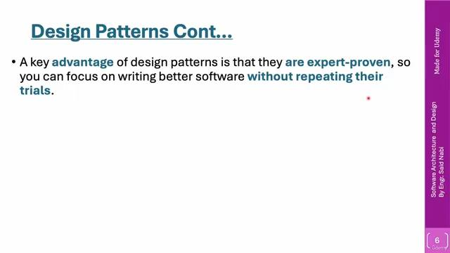
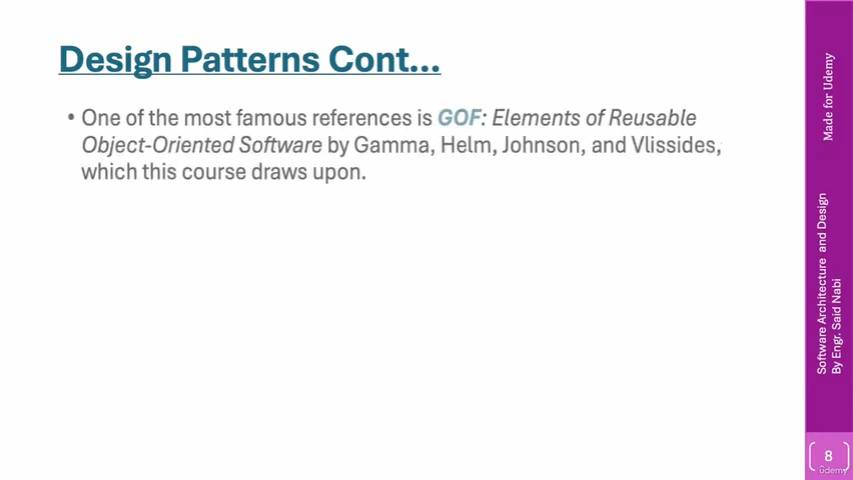
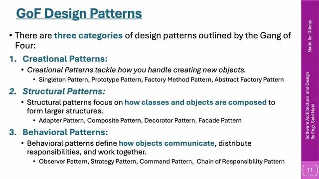
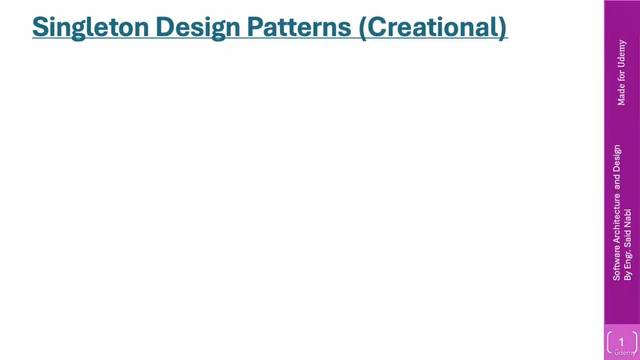
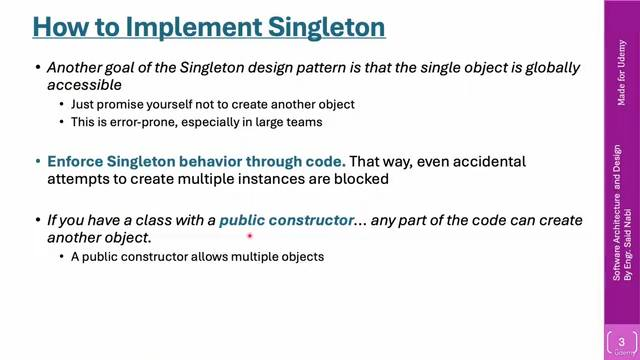
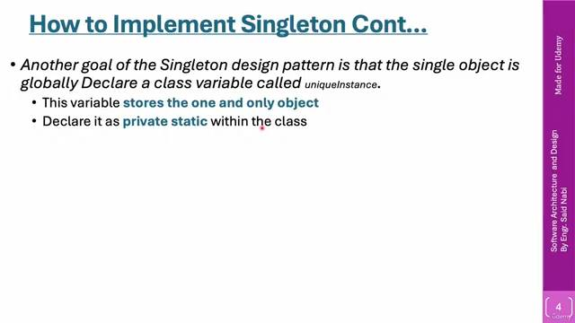
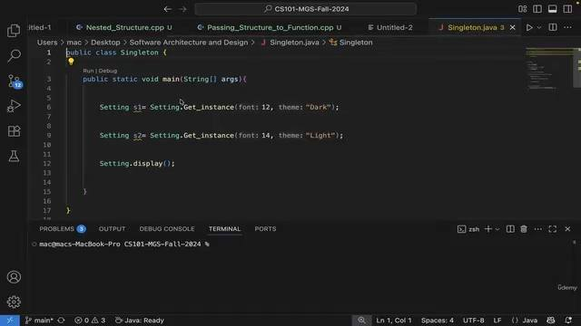
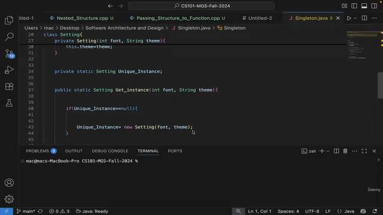
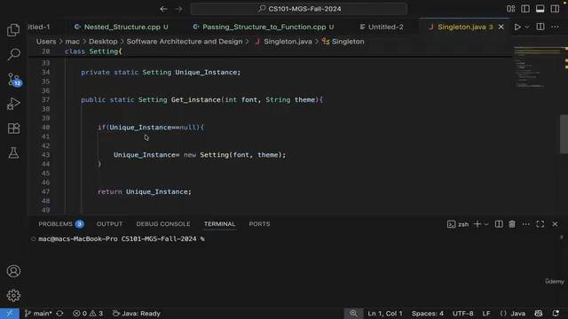

# Software Architecture Scalable P48–P53 复现文档：从设计模式选型到可运行的 Singleton

## 1. 这一节做什么

这一节覆盖 P48–P53，核心不是搭一个 Web 服务，也不是引入 Maven、Spring 或数据库，而是完成两件事：

1. 建立一套“为什么用设计模式、怎么选、怎么沟通、三类模式分别管什么、代价是什么”的判断框架；
2. 把讲师在 P053 展示的 **Singleton（单例）Java 示例**完整跑起来：同一个 `Setting` 类连续取两次实例，第二次即使传入不同参数，拿到的仍然是第一次创建的对象。

本节最终的可运行产物很小，只有一个 Java 文件：

```text
singleton-demo/
└── singleton.java
```

编译后会多出：

```text
singleton-demo/
├── singleton.java
├── singleton.class
└── Setting.class
```

这门课在这一段里没有讲 Web 框架、没有讲数据库、没有讲 npm 依赖，也没有给出现成的项目脚手架。讲师主要用讲解和 Java 代码演示来建立“设计模式是经验复用，不是背代码”的观念，然后落到 Singleton 的 `private` 构造器、`private static` 唯一实例、`public static getInstance()` 懒创建这条实现线上。


讲师先用“食谱”类比设计模式：模式不是临时拍脑袋，而是被反复验证过的做法。这个类比对应到工程里，就是不要每次遇到对象创建、通知、算法切换都从零发明一套。P048 里还举了支付系统的例子：可以用 factory、strategy 或 template method 处理支付，选择 factory 可以动态创建不同支付处理器而不改已有代码。这里要注意，讲师不是在说“factory 永远正确”，而是在说**选错模式会让后续扩展更难**。

P049 进一步把设计模式的价值归纳为“专家验证过”和“共享词汇”。例如团队里有人说“这里用 observer”，其他人不需要听一段“对象 A 变化时要通知对象 B、C、D”的长解释，就能理解意图。这对代码评审、维护和架构一致性都有帮助。



P050 说明这些模式的经典来源是 **Gang of Four**，也就是《Elements of Reusable Object-Oriented Software》这本书和它的四位作者。课程后续会围绕这个模式目录展开。讲师还用“电影里的 trope（常见桥段）”来类比模式：同一个模式可以在很多软件系统里以不同形式出现。这里的关键不是背 UML，而是理解问题空间和意图。



P051 把 Gang of Four 的模式分成三大类。下面这张表是按讲师口述整理的，方便前端转 AI 应用工程师先建立地图：

| 类别 | 管什么 | 讲师在这一段提到的例子 |
|---|---|---|
| 创建型模式 | 对象怎样被创建，让创建过程灵活、可复用 | Singleton、Builder、Factory |
| 结构型模式 | 类和对象怎样组合成更大的结构 | Adapter、Composite、Facade；逐字稿里还出现 creator pattern，课里未展开 |
| 行为型模式 | 对象之间怎样通信、怎样分担职责、怎样协作 | Observer、Strategy、Command、Chain of Responsibility |


P051 后半段讲优缺点。优点包括：帮助开发者形成面向对象设计直觉、识别常见解法、促进模块化和可维护性、加快团队沟通、帮助分析取舍。缺点包括：某些模式可能资源密集、复杂工厂链可能增加内存占用或初始化时间、小规模单用户应用用 Observer 可能过度设计、多个装饰器可能让调试变难。讲师的核心结论是：**模式要用在合适的地方，不是越多越好**。



P052 正式进入创建型模式里的 Singleton。讲师用板球队只有一个队长、电视只有一个遥控器、手机偏好设置只能有一份来做类比：如果同一个配置存在多个实例，一个实例保存红色卡背，另一个保存黑色卡背，就会冲突。Singleton 要解决的是：**一个类只允许一个对象存在，并且这个对象要能被全局访问**。



实现上，讲师给出一条非常关键的线索：如果构造器是 `public`，任何代码都能 `new` 出新对象；要把创建入口收回来，就要把构造器改成 `private`。然后在一个 `private static` 的类变量里保存唯一实例，再用一个 `public static` 的 `getInstance()` 方法对外提供访问：实例为 `null` 就创建，不为 `null` 就返回已有对象。





P053 是现场 Java 代码演示。讲师打开 `singleton.java`，在 `main` 方法里故意尝试创建两次实例，验证第二次不会真正创建新对象。下面第 3、4、5 节会把这条实现线完整复现。



## 2. 讲师原话（带「—— pNNN [MM:SS]」）

下面引用的是逐字稿中能支撑本文实现路线的原话，英文保留原表述，后面用中文说明我为什么把它放在这个位置。

> "设计模式就像经过反复验证的配方……开发者使用设计模式来创建可靠、可维护且高质量的软件。"
> —— p048 [00:00]

这句话确定了整段课程的基调：设计模式是经验复用，不是语法糖。后面写 Singleton 时，重点也应放在“为什么这样限制对象创建”，而不是只背代码。

> "在支付系统中，你可以使用工厂、策略或模板方法来处理支付；选择工厂可以让你动态创建不同的支付处理器，而无需修改现有代码。"
> —— p048 [00:59]

讲师在这里强调“选型”而不是“唯一正确答案”。同样的支付问题可能有多个模式候选，选错会让未来扩展更难。

> "设计模式的一个关键优势在于，它们经过专家验证……你不必从头重新发明轮子。"
> —— p049 [00:00]

这句话对应本文的复现态度：我们不是从零发明单例，而是按讲师给的结构把已验证的做法跑通。

> "设计模式还形成了共享的设计词汇……模式名称让开发者能够高效地沟通解决方案。"
> —— p049 [00:29]

团队说“用 observer”“用 strategy”时，模式名本身就是压缩后的设计意图。这一点对代码评审尤其明显。

> "最著名的参考之一就是四人组，它也是《可复用面向对象软件的基础》这本书的名称。"
> —— p050 [00:00]

课程的_pattern 目录来自 Gang of Four。本文不扩展书外模式，只围绕讲师这一段讲到的分类和 Singleton 展开。

> "在四人组中，设计模式可以分为三大类……创建型模式……结构型模式……行为型模式。"
> —— p051 [00:00]

这句话给出本节的结构地图：创建型、结构型、行为型。Singleton 属于创建型。

> "有些模式可能更消耗资源……没有哪种模式适用于所有场景。"
> —— p051 [03:58]

讲师没有把模式讲成“万能药”。复现时也要保留这个判断：Singleton 解决冲突，但也带来多线程、测试隔离、全局状态等问题。

> "在一支板球队中，只有一名队长……如果有不止两个队长，队长之间就可能发生冲突。"
> —— p052 [00:29]

这是 Singleton 的直观类比：多个“队长”会发出冲突指令，多个配置实例会写入冲突设置。

> "解决方案是把构造函数设为私有，这样它就不能从类外部被调用。"
> —— p052 [08:26]

逐字稿这句话有口语重复，但意思明确：把构造器设为 `private`，类外部就不能直接 `new`，创建入口被收回到类内部。

> "这个单一对象通过一个名为 unique instance 的类变量进行全局声明。"
> —— p052 [08:56]

对应代码里的 `private static Setting uniqueInstance;`。`static` 表示它属于类，不属于某个实例。

> "我在这里打开了 singleton.java 程序……我将创建同一个类的两个实例。"
> —— p053 [00:00]

P053 的现场演示就是“故意创建两次”，验证 Singleton 是否真的只保留一个对象。

> "如果 unique instance 等于 null……unique instance 会被初始化为新实例……如果这个 if 块中的条件为假……它将返回现有实例。"
> —— p053 [02:52]

这是 `getInstance()` 的核心分支：第一次为 `null` 时创建，后续不为 `null` 时直接返回旧对象。

> "所以这里可以看到主题是深色，字号是 12。"
> —— p053 [05:43]

讲师运行后看到的是第一次传入的 `dark` 和 `12`，而不是第二次传入的 `light` 和 `14`。这说明第二次调用没有覆盖第一次创建的对象。

## 3. 从零复现

### 3.1 环境与版本说明

课里没有讲 JDK 版本，也没有讲编译命令。下面给出的是“能复现这段代码”的补充环境说明，不是讲师原话。

- 依赖：只需要 JDK，不需要 Maven、Gradle、Spring 或任何第三方库。
- 版本基线：建议使用 **JDK 17**。这段代码只用了最基础的类、字段、构造器、`static` 方法和 `main` 方法，JDK 8 及以上通常都能编译；如果你本机是 JDK 17/21，也可以直接跑。
- 环境变量：本示例不读取任何环境变量。`JAVA_HOME` 只影响你的 `javac`、`java` 是否在命令行 PATH 里，代码本身不依赖它。
- 工作目录：本文约定为 `singleton-demo`，你可以换成任意目录，但后续命令要在该目录内执行。

先确认命令行能找到 Java：

```bash
java -version
javac -version
```

如果这两条命令都能输出版本信息，就可以继续。具体版本号以你机器实际输出为准。

### 3.2 创建目录和文件

```bash
mkdir singleton-demo
cd singleton-demo
```

在 `singleton-demo` 下创建文件：

```text
singleton-demo/singleton.java
```

文件名必须是 `singleton.java`，因为文件里有一个 `public class singleton`。Java 要求 `public` 顶层类的类名和文件名一致，大小写也要一致。这一点课里没有专门讲，但复现时一定会遇到。



### 3.3 写入完整代码

把第 4 节的完整代码原样保存到 `singleton.java`。不要只复制片段，也不要省略 `main` 方法，否则无法直接运行。

### 3.4 编译

在 `singleton-demo` 目录执行：

```bash
javac singleton.java
```

编译成功后，当前目录会出现：

```text
singleton.class
Setting.class
```

如果编译报错，优先检查：

1. 文件名是否为 `singleton.java`；
2. `public class` 后面的类名是否为 `singleton`，大小写是否一致；
3. 是否在 `singleton-demo` 目录里执行命令；
4. `javac` 是否在 PATH 中。

### 3.5 运行

```bash
java singleton
```

预期输出如下。输出文字的具体排版由 `display()` 方法决定，关键是两次显示的都是第一次创建的 `dark` 和 `12`：

```text
Theme: dark
Font size: 12
Theme: dark
Font size: 12
s1 == s2: true
```

最后一行 `s1 == s2: true` 是本文为了复现检查额外加的验证，课里没有讲这一行。它用引用比较确认 `s1` 和 `s2` 指向同一个对象。

### 3.6 做一次“第二次参数不生效”的实验

代码里 `main` 方法故意写了两次调用：

```java
Setting s1 = Setting.getInstance(12, "dark");
Setting s2 = Setting.getInstance(14, "light");
```

第一次传入 `12` 和 `dark`，第二次传入 `14` 和 `light`。运行后第二次的 `14` 和 `light` 不会覆盖第一次的对象，因为 `getInstance()` 在 `uniqueInstance != null` 时直接返回旧实例。



### 3.7 可选实验：验证外部不能直接 new

如果你想亲眼看到“构造器私有”的效果，可以临时在 `main` 方法里加一行：

```java
// 这行会导致编译失败，验证完请删掉
Setting s3 = new Setting(16, "blue");
```

因为 `Setting` 的构造器是 `private`，`main` 虽然在同一个文件里，但它位于另一个类 `singleton` 中，仍然不能直接调用 `Setting` 的私有构造器。编译会失败。具体报错文字以你的 JDK 为准，课里没有展示这段失败输出。

验证完请把这一行删掉，恢复成第 4 节的完整代码，否则无法通过编译。


### 3.8 本节不需要的东西

这一段课里没有讲以下内容，复现时也不需要：

- 不需要数据库；
- 不需要 HTTP 服务；
- 不需要 npm、pnpm、yarn；
- 不需要 Docker；
- 不需要任何环境变量文件；
- 不需要第三方依赖版本锁定。

如果你照着本文做，唯一需要保证的是 JDK 可用、文件名正确、代码完整。

## 4. 完整代码

文件路径：`singleton-demo/singleton.java`

```java
// 文件：singleton-demo/singleton.java
// 说明：P053 的 Singleton 现场示例复现。
// 运行：javac singleton.java && java singleton

class Setting {
    // 字体大小
    private int fontSize;

    // 主题，例如 dark / light
    private String theme;

    // 唯一实例。static 表示它属于 Setting 类本身，不属于某个 Setting 对象。
    // 未赋值时默认是 null。
    private static Setting uniqueInstance;

    // 构造器私有：类外部不能直接 new Setting(...)
    private Setting(int fontSize, String theme) {
        this.fontSize = fontSize;
        this.theme = theme;
    }

    // 对外唯一入口：第一次调用时创建，之后返回同一个对象。
    public static Setting getInstance(int fontSize, String theme) {
        if (uniqueInstance == null) {
            uniqueInstance = new Setting(fontSize, theme);
        }
        return uniqueInstance;
    }

    // 打印当前实例保存的设置
    public void display() {
        System.out.println("Theme: " + theme);
        System.out.println("Font size: " + fontSize);
    }
}

public class singleton {
    public static void main(String[] args) {
        // 第一次调用：uniqueInstance 为 null，会创建对象
        Setting s1 = Setting.getInstance(12, "dark");

        // 第二次调用：传入不同参数，但 uniqueInstance 已经不是 null，
        // 因此不会创建新对象，而是返回第一次创建的对象
        Setting s2 = Setting.getInstance(14, "light");

        // 两次 display 都应显示第一次创建的 dark / 12
        s1.display();
        s2.display();

        // 额外验证：s1 和 s2 是否指向同一个对象。
        // 这一行是复现检查用的，课里没有讲。
        System.out.println("s1 == s2: " + (s1 == s2));
    }
}
```

保存后执行：

```bash
javac singleton.java
java singleton
```

预期输出：

```text
Theme: dark
Font size: 12
Theme: dark
Font size: 12
s1 == s2: true
```

如果你把 `display()` 的文字改成中文，输出文字会变，但“两次都是第一次的值、`s1 == s2` 为 `true`”这个结果不变。

## 5. 逐行解释

下面按代码顺序解释。Java 语法对前端读者可能陌生，我会在必要处补一句“知道即可”和“在 JS/Node 里对应什么”。

1. `class Setting {`  
   `Setting` 是配置类。它没有加 `public`，所以可以和 `public class singleton` 放在同一个 `singleton.java` 文件里。Java 只要求 `public` 顶层类与文件名一致，非 `public` 类可以同文件存在。这个规则课里没有展开，但复现时要知道。

2. `private int fontSize;`  
   字体大小字段。`private` 表示只有 `Setting` 类内部能直接访问。这样做是为了把设置收进类里，不让外部随便改。对应到 JS/Node，可以理解为模块内部变量，不通过 `export` 暴露。

3. `private String theme;`  
   主题字段，例如 `dark`、`light`。同样被 `private` 封装。讲师在 P053 说过类里有两个私有变量：一个整型表示字体大小，一个字符串表示主题。

4. `private static Setting uniqueInstance;`  
   这是单例的核心存储。`static` 表示它属于 `Setting` 类本身，而不是某个 `Setting` 对象。所有通过 `Setting.getInstance()` 的调用共享这一个类级变量。未赋值时，Java 引用类型默认是 `null`。  
   在 JS/Node 里，模块级变量或闭包变量也能起到“模块内共享一份”的效果；但 Java 的 `static` 是类级变量，概念上要知道即可。

5. `private Setting(int fontSize, String theme) {`  
   构造器被设为 `private`。这是讲师在 P052 [08:26] 强调的关键：如果构造器是 `public`，任何代码都能 `new Setting(...)`；设为 `private` 后，类外部不能直接创建对象。  
   注意：`private` 不是“永远不能创建”，而是“只能在 `Setting` 类内部创建”。所以 `getInstance()` 里仍然可以 `new Setting(...)`。

6. `this.fontSize = fontSize;`  
   把构造器参数赋给字段。`this` 表示当前对象。这里没有复杂逻辑，只是保存第一次创建时的设置。

7. `this.theme = theme;`  
   同上，保存主题。

8. `public static Setting getInstance(int fontSize, String theme) {`  
   这是对外唯一入口。`public` 表示外部可调用；`static` 表示不用先创建 `Setting` 对象，直接 `Setting.getInstance(...)` 就能调用。  
   参数 `fontSize` 和 `theme` 只在第一次真正创建对象时生效。第二次调用虽然也传了参数，但方法内部不会再用它们覆盖旧对象。这个“参数被忽略”的行为是单例懒创建的直接结果，也是初学者最容易误会的地方。

9. `if (uniqueInstance == null) {`  
   判断唯一实例是否还没创建。第一次调用时 `uniqueInstance` 是 `null`，条件为真；第二次调用时它已经指向一个对象，条件为假。  
   这里的 `==` 比较的是引用是否为 `null`，不是比较对象内容。

10. `uniqueInstance = new Setting(fontSize, theme);`  
    第一次调用时进入这里，创建唯一对象并赋给类变量。因为这段代码在 `Setting` 类内部，所以可以访问 `private` 构造器。  
    这就是“懒创建”：不是类一加载就创建对象，而是第一次真正需要时才创建。讲师在 P052 后半段提到，这样做可以节省内存和启动时间，适合资源较重的对象。

11. `return uniqueInstance;`  
    无论刚才是否新建，最后都返回 `uniqueInstance`。第一次返回新对象，第二次返回旧对象。  
    因此 `s2` 虽然看起来是“第二次获取”，实际和 `s1` 指向同一个对象。

12. `public void display() {`  
    实例方法，用来打印当前对象的设置。它不是 `static`，所以要通过对象调用，例如 `s1.display()`。

13. `System.out.println("Theme: " + theme);`  
    输出主题。具体输出格式是本文定的，课里只说了运行后看到 theme 是 dark、font size 是 12。

14. `System.out.println("Font size: " + fontSize);`  
    输出字体大小。

15. `public class singleton {`  
    主类。文件名 `singleton.java` 与这个 `public` 类名一致，所以可以编译。类名用小写不是 Java 常见命名风格，但语法上合法；这里是为了贴近讲师演示的文件名 `singleton.java`。  
    如果你把类名改成 `SingletonDemo`，文件名也要改成 `SingletonDemo.java`，启动命令也要改成 `java SingletonDemo`。这是复现时常见的坑。

16. `public static void main(String[] args) {`  
    Java 程序入口。`java singleton` 会找这个类的 `main` 方法。

17. `Setting s1 = Setting.getInstance(12, "dark");`  
    第一次获取实例。`uniqueInstance` 为 `null`，所以创建对象，保存 `12` 和 `dark`。

18. `Setting s2 = Setting.getInstance(14, "light");`  
    第二次获取实例。虽然传了 `14` 和 `light`，但 `uniqueInstance` 已经不为 `null`，所以不会创建新对象，直接返回第一次的对象。  
    这正是 P053 现场演示想验证的行为。

19. `s1.display();`  
    打印第一次引用看到的设置：`dark` 和 `12`。

20. `s2.display();`  
    打印第二次引用看到的设置。因为 `s2` 和 `s1` 是同一个对象，所以仍然是 `dark` 和 `12`，而不是 `light` 和 `14`。

21. `System.out.println("s1 == s2: " + (s1 == s2));`  
    额外验证两个引用是否指向同一个对象。`==` 对对象比较的是引用地址，不是内容。输出 `true` 说明单例生效。  
    这一行课里没有讲，是本文为了“照着复现能自检”加的。

22. 关于线程安全：讲师在 P052 提到，多线程可能带来问题，可以用“锁住对象”解决，但他说这是 advanced topic，课里没有展开具体锁代码。因此本文的代码是**教学版单例**，不是线程安全版。  
    在 Java 里，如果多个线程同时第一次调用 `getInstance()`，理论上可能都看到 `uniqueInstance == null`，从而创建多个对象。要解决需要额外同步机制，但课里没讲具体实现，本文不编造。  
    在 JS/Node 里，主线程是单线程事件循环，普通模块初始化通常不会遇到 Java 这种多线程竞态；但 Node 的多进程、多 worker、多容器部署仍然各自有独立内存，单例不会跨进程共享。这一点课里没讲，但前端转 AI 应用工程师在部署时会遇到。

23. 关于“设计模式不是代码模板”：讲师在 P049 [03:28] 附近说，设计模式不是背下来 plug in 的代码，而是对常见问题的概念性解法。Singleton 的概念是“一个类只有一个实例并全局访问”，具体用 Java、Python 还是 JavaScript 写，语法不同，意图相同。

## 6. 复现检查清单

照着下面逐项打勾，能确认你不是“看懂了”，而是“跑通了”。

- [ ] 已创建目录 `singleton-demo`，并进入该目录。
- [ ] 已创建文件 `singleton-demo/singleton.java`。
- [ ] 文件中的 `public class` 类名是 `singleton`，与文件名大小写一致。
- [ ] 代码包含 `class Setting`、`private static Setting uniqueInstance`、`private Setting(...)`、`public static Setting getInstance(...)`。
- [ ] `javac singleton.java` 编译成功，没有报错。
- [ ] 编译后能看到 `singleton.class` 和 `Setting.class`。
- [ ] `java singleton` 能正常启动。
- [ ] 输出中两次 `display()` 都显示 `Theme: dark` 和 `Font size: 12`。
- [ ] 输出中 `s1 == s2: true`。
- [ ] 能解释为什么第二次传入的 `14` 和 `light` 没有生效。
- [ ] 能解释 `private` 构造器阻止了类外部直接 `new Setting(...)`。
- [ ] 能说出 `static` 变量 `uniqueInstance` 属于类，不属于某个对象。
- [ ] 知道本文代码是教学版单例，课里没有展开线程安全的具体锁实现。
- [ ] 如果做了“直接 new”的实验，已经把那行会导致编译失败的代码删掉。
- [ ] 能把 `display()` 的输出文字改成中文后重新编译运行，并仍然得到两次相同结果。

## 7. 课里没讲但你会撞上的

这一节列的是复现时容易卡住、但逐字稿没有展开的点。它们不是讲师原话，而是你照着做时大概率会遇到的问题。

1. **JDK 版本和 PATH**  
   课里没有讲 JDK 版本，也没有讲 `javac`、`java` 命令。你本机如果没装 JDK，或者只装了 JRE，`javac` 会找不到。先跑 `java -version` 和 `javac -version`，两者都能输出版本再继续。具体版本号以实际输出为准。

2. **public 类名必须和文件名一致**  
   `public class singleton` 必须放在 `singleton.java` 里。如果你改成 `public class Singleton`，文件名也要改成 `Singleton.java`，启动命令也要改成 `java Singleton`。Java 对大小写敏感，`singleton.java` 和 `Singleton.java` 不是同一个文件。

3. **类名小写不是常规风格**  
   本文为了贴近讲师演示的文件名使用了 `public class singleton`。实际项目里 Java 类名通常用大驼峰，例如 `SingletonDemo`。这属于命名风格问题，不影响这段代码运行，但你在真实项目里不要照搬小写类名。

4. **私有构造器后不能直接 new**  
   把 `Setting` 的构造器改成 `private` 后，`main` 里写 `new Setting(16, "blue")` 会编译失败。这是预期行为，不是代码坏了。课里只讲了“私有构造器限制外部创建”，没有展示具体报错文字；你看到的报错以本机 JDK 为准。

5. **第二次传入的参数被忽略**  
   `getInstance(14, "light")` 不会把已有对象改成 `light`。这不是 bug，而是单例“只创建一次”的结果。如果你希望第二次参数生效，那就不应该用这种懒创建单例，而应该改用配置更新方法或重新设计。课里没有讲这种扩展。

6. **教学版单例不是线程安全版**  
   讲师提到多线程可能出问题，可以用锁，但没有给具体锁代码。本文也没有加 `synchronized` 或双重检查锁，因为那会超出逐字稿范围。你在真实 Java 后端项目里如果要用单例，需要另外学习线程安全实现；在 Node 里则要区分单线程事件循环和多进程部署的差异。

7. **单例不跨进程**  
   Java 的 `static` 变量只在同一个 JVM 进程内共享。你启动两个 `java singleton` 进程，它们各自有自己的 `uniqueInstance`。课里没有讲分布式或多进程，但实际部署时会遇到。Node 的多进程、多容器同理，不要以为模块级单例能跨机器共享。

8. **测试隔离问题**  
   单例的全局状态会让单元测试之间互相影响：前一个测试改了设置，后一个测试可能读到脏数据。课里没有讲测试，但这是单例最常见的工程代价之一。实际项目里通常需要提供重置入口或依赖注入来隔离测试。

9. **反射、序列化等破坏单例的方式**  
   Java 里通过反射或序列化可能绕过私有构造器创建新对象。课里完全没有讲这些 advanced 话题，本文也不展开。你只需要知道：教学版单例解决的是“正常代码路径下的重复创建”，不是“对抗所有反射攻击”。

10. **热更新/热重载会重新加载类**  
    在某些开发环境里，类被重新加载后 `static` 变量可能被重置，单例状态不一定像你以为的那样一直存在。课里没有讲热更新，但前端转后端时容易把“模块缓存”与“JVM 类加载”混为一谈。复现时用命令行 `javac` + `java` 最稳。

11. **Node/前端里的对应物**  
    在 Node 里，ES module 的模块缓存可以让一个模块只初始化一次，模块内导出的对象天然有点像“单例”。但这不是 Java 的 `static` 类变量，也不能跨进程。课里没有讲 Node，这一段只是帮助你建立类比，不要把它当成讲师讲过的内容。

12. **不要为了用模式而用模式**  
    P051 明确讲了代价：小规模、单用户应用用 Observer 可能过度设计，复杂工厂链可能增加内存和初始化时间。Singleton 也一样：如果一个配置对象本来只在一个函数里用，没必要为了“架构感”做成全局单例。先问“是否真的需要全局唯一”，再决定用不用。