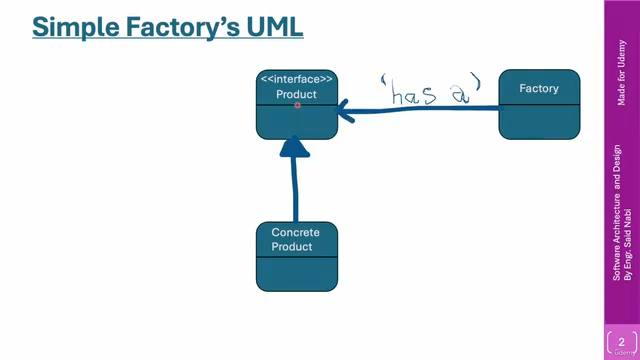
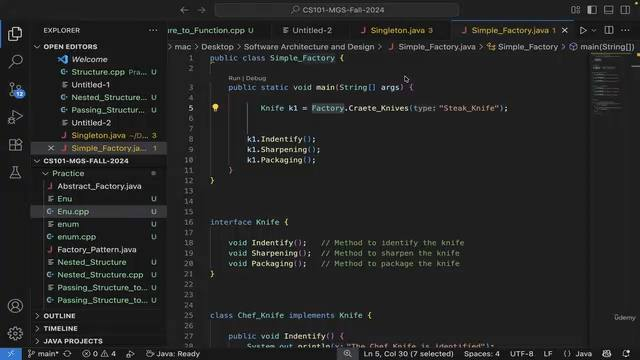
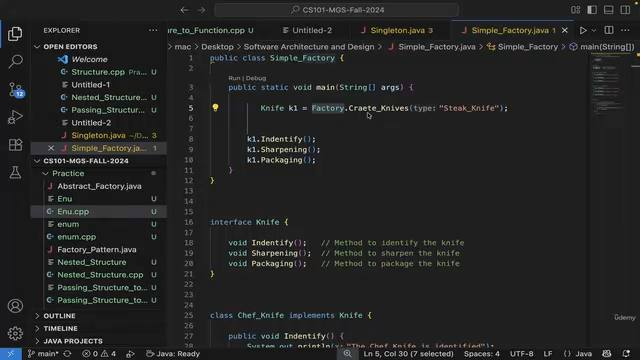
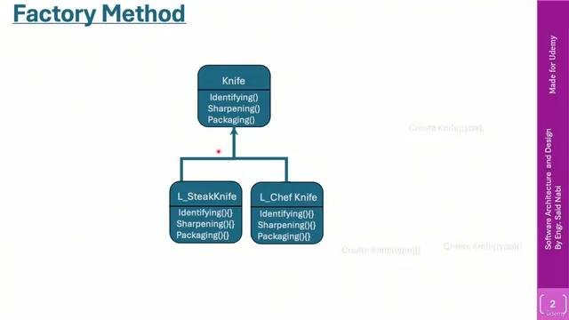
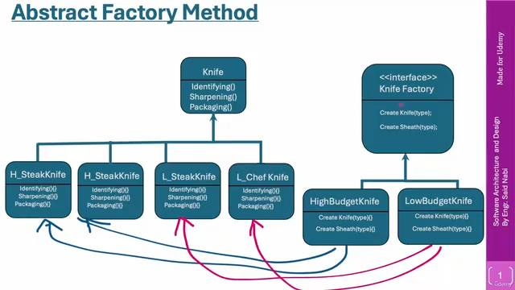
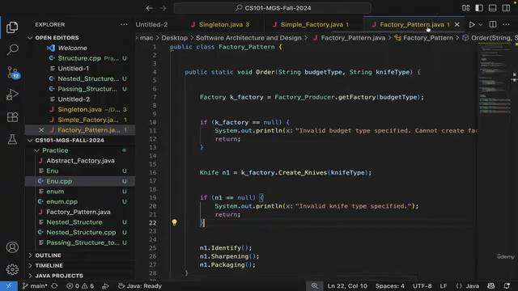
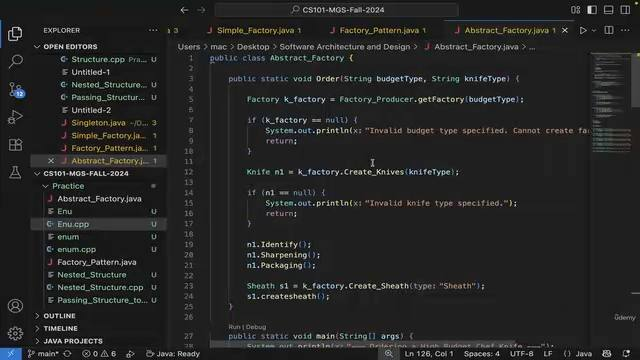

# Software Architecture Scalable：工厂模式三连（P54–P60）复现文档

## 1. 这一节做什么

这一节围绕同一个“刀具店”业务，把**对象创建逻辑**从下单业务逻辑里拆出去，按课程顺序做成三个可运行版本：

1. **简单工厂 Simple Factory**：用 `KnifeFactory` 一个静态方法，根据字符串返回 `ChefKnife` 或 `SteakKnife`。调用方不再直接 `new` 具体刀具。
2. **工厂方法 Factory Method**：把工厂抽象成 `KnifeFactory` 接口，再提供 `LowBudgetKnifeFactory` 和 `HighBudgetKnifeFactory`。下单时先根据预算选工厂，再由工厂根据刀型创建具体刀具。
3. **抽象工厂 Abstract Factory**：在工厂接口上增加 `createSheath()`，让同一个工厂不只创建一把刀，还创建与预算档次匹配的刀鞘，形成“刀 + 刀鞘”的对象家族。

这三个版本不是互相替代的三套无关代码，而是同一个业务问题逐步加约束的结果：简单工厂先解决“调用方不要直接 `new`”的问题；工厂方法再解决“工厂本身也要能按预算替换”的问题；抽象工厂最后解决“同一个预算档次下，多个产品要成家族出现”的问题。复现时建议严格按这个顺序做，因为后一个版本会复用前一个版本的产品命名、接口命名和下单流程，先跑通简单工厂，后面的接口关系和错误分支会更容易看懂。

你要交付的产物是三个独立 Java 程序，目录如下：

```text
factory-pattern-demo/
├── simple-factory/
│   └── SimpleFactory.java
├── factory-method/
│   └── FactoryPattern.java
└── abstract-factory/
    └── AbstractFactoryDemo.java
```

课程里没有讲构建工具、包管理、测试框架；本复现只用 JDK 自带的 `javac` 和 `java`。课程里用 VS Code 展示代码，但没有讲 VS Code 的 Java 插件安装步骤，这一点会在第 7 节说明。


## 2. 讲师原话（带「—— pNNN [MM:SS]」）

讲师先把工厂的动机说得很直接：

> "工厂帮助我们将对象创建与业务逻辑分离，这让代码更易于管理、修改和扩展。"
> —— p054 [01:29]

也就是说，工厂的目的不是“多写一个类”，而是把“创建哪个对象”的判断从业务方法里挪走。对应到本复现，`SimpleFactory.main` 里只写 `KnifeFactory.createKnife("chef")`，不写 `new ChefKnife()`；`FactoryPattern.order` 里只写 `factory.createKnife(knifeType)`，不写 `new LowBudgetChefKnife()`。业务代码关心的是“要什么”，工厂关心的是“怎么造”。

在解释工厂对象时，讲师说：

> "工厂对象是一种专门用来创建其他对象的对象。"
> —— p054 [09:26]

简单工厂里，讲师把“工厂类”的职责定义成：

> "负责决定实例化哪个具体类的工厂类称为工厂。"
> —— p055 [02:29]

这句话落到代码里，就是 `KnifeFactory.createKnife(String type)` 里的两个 `if`：判断 `type` 是 `chef` 还是 `steak`，再决定 `new ChefKnife()` 还是 `new SteakKnife()`。到了工厂方法，讲师强调它不是“一个具体工厂”，而是“接口 + 多个派生工厂”：

> "定义一个用于创建对象的接口，但让派生类决定实例化哪个类。"
> —— p057 [02:59]

工厂方法的下单方法要接收两个参数：

> "我们必须传入两类参数：预算类型和刀具类型。"
> —— p058 [00:29]

抽象工厂的关键增量是 `create sheath`：

> "现在接口不再只是创建刀对象，还多了另一个方法，也就是 create sheath；它实际上创建的是一个对象族。"
> —— p059 [00:29]

讲师在抽象工厂代码里也重复了这一点：

> "与工厂方法类似，只是额外增加了 create sheath 这个方法。"
> —— p060 [00:00]

下面不按“第 54 页讲了什么、第 55 页讲了什么”来写，而是按“先做简单工厂，再做工厂方法，最后做抽象工厂”的实现顺序重组。每条原话在复现中的落点都可以对应到具体类和方法：简单工厂对应 `KnifeFactory`，工厂方法对应 `KnifeFactory` 接口加两个实现工厂，抽象工厂对应接口上多出的 `createSheath()` 以及 `Sheath` 产品家族。

## 3. 从零复现

### 3.1 复现环境与依赖版本

课程没有指定 JDK 版本。为了让读者能直接跑，本复现建议：

- **JDK：OpenJDK 17（LTS）**。示例可用 17.0.x；代码只使用基础语法，JDK 8+ 也能编译。
- **构建工具：不使用**。课程没有讲 Maven/Gradle，本复现不引入。
- **第三方依赖：无**。
- **编辑器：VS Code 或任意文本编辑器**。课程使用 VS Code 展示，但没有讲插件安装。

环境变量名：

- `JAVA_HOME`：指向 JDK 根目录。
- `PATH`：把 `%JAVA_HOME%\bin`（Windows）或 `$JAVA_HOME/bin`（macOS/Linux）加进去。

Windows 示例：

```bat
set JAVA_HOME=C:\Program Files\Java\jdk-17
set PATH=%JAVA_HOME%\bin;%PATH%
java -version
javac -version
```

macOS/Linux 示例：

```bash
export JAVA_HOME=/path/to/jdk-17
export PATH="$JAVA_HOME/bin:$PATH"
java -version
javac -version
```

只要能分别看到 `java version` 和 `javac` 的版本输出，就说明环境可用。这里要把命令拆开理解：`java -version` 检查的是运行时 JVM 是否可用；`javac -version` 检查的是编译器是否可用。两者可能来自不同 JDK，如果版本明显不一致，后面可能出现“编译能过但运行类版本不匹配”的问题。`JAVA_HOME` 本身不会自动生效，必须把它的 `bin` 目录加入 `PATH`，终端才能直接找到 `java` 和 `javac`。Windows 的 `set` 只对当前命令行窗口有效，关掉窗口后要重新设置；macOS/Linux 的 `export` 也只对当前 shell 会话有效，写入 `~/.bashrc` 或 `~/.zshrc` 才会长期保留。这里属于复现环境说明，不是课程原话。

常见错误与排查：如果提示“`java` 不是内部或外部命令”，通常是 `PATH` 没配好；如果 `java -version` 有输出但 `javac -version` 没有，说明只安装了 JRE 或只把 JRE 加进了 `PATH`；如果两个版本差异很大，先把 `JAVA_HOME` 和 `PATH` 指向同一个 JDK。前端读者可以把它类比为 Node 环境里 `node -v` 和 `npm -v` 分开检查：运行时和工具链是两件事，不能只看一个命令成功就认为环境完整。

### 3.2 创建目录

在任意工作目录执行：

```bash
mkdir -p factory-pattern-demo/simple-factory
mkdir -p factory-pattern-demo/factory-method
mkdir -p factory-pattern-demo/abstract-factory
```

Windows 可以手动建三个文件夹：

```text
factory-pattern-demo\simple-factory
factory-pattern-demo\factory-method
factory-pattern-demo\abstract-factory
```

`mkdir -p` 的含义是“目录不存在就创建，父目录也一起创建；目录已存在不报错”。Windows 的 `mkdir` 在命令提示符里通常也能创建多级目录，但为了和文档命令一致，手动建文件夹也可以。三个目录分开是为了让每个版本都能独立 `javac`、独立运行，不互相覆盖 `.class` 文件。常见错误是只建了 `factory-pattern-demo` 而没建子目录，后面 `cd` 会失败；或者把三个 Java 文件都放在同一个目录里，因为三个文件里都有 `Knife`、`KnifeFactory` 等同名类型，虽然分文件编译时可能各自成立，但混在一起容易产生类名冲突和 `.class` 覆盖。前端对照可以理解为三个独立的小 demo 目录，类似三个独立的 `src` 文件夹，不要让它们的模块名互相污染。

### 3.3 运行简单工厂

把第 4 节的 `SimpleFactory.java` 保存到：

```text
factory-pattern-demo/simple-factory/SimpleFactory.java
```

然后执行：

```bash
cd factory-pattern-demo/simple-factory
javac SimpleFactory.java
java SimpleFactory
```

预期输出：

```text
Chef knife is identified.
Chef knife is sharpened.
Chef knife is packaged.
Steak knife is identified.
Steak knife is sharpened.
Steak knife is packaged.
```

命令解释：`cd` 进入简单工厂目录；`javac SimpleFactory.java` 让编译器读取源文件，并在当前目录生成 `SimpleFactory.class`、`Knife.class`、`ChefKnife.class`、`SteakKnife.class`、`KnifeFactory.class` 等字节码文件；`java SimpleFactory` 启动 JVM，加载名为 `SimpleFactory` 的主类并执行 `main`。注意 `java` 后面写的是类名，不写 `.java`，也不写 `.class`。如果写 `java SimpleFactory.java`，在较新 JDK 的单文件源码模式下可能能跑，但这不是本复现要训练的标准流程；如果写 `java SimpleFactory.class`，通常会报找不到主类。

常见错误与排查：报“找不到或无法加载主类 SimpleFactory”时，先确认当前目录下是否有 `SimpleFactory.class`，再确认 `public class SimpleFactory` 与文件名完全一致；报“类 KnifeFactory 是公共的，应在名为 KnifeFactory.java 的文件中声明”时，说明有人给辅助类加了 `public`，本文件中只有 `SimpleFactory` 能是 `public`；报“程序包 xxx 不存在”时，说明代码里被误加了 `package` 语句，而命令没有按包路径执行。前端对照：这一步相当于“先编译/打包，再运行产物”，不像 Node 直接 `node index.js` 那样跳过编译步骤；Java 的 `javac` 和 `java` 是两个阶段，排错时也要分阶段看。

### 3.4 运行工厂方法

把 `FactoryPattern.java` 保存到：

```text
factory-pattern-demo/factory-method/FactoryPattern.java
```

执行：

```bash
cd factory-pattern-demo/factory-method
javac FactoryPattern.java
java FactoryPattern
```

预期输出会包含多次下单，其中最后两条是错误分支：

```text
Low budget chef knife is identified.
Low budget chef knife is sharpened.
Low budget chef knife is packaged.
Order completed.

Low budget steak knife is identified.
Low budget steak knife is sharpened.
Low budget steak knife is packaged.
Order completed.

High budget chef knife is identified.
High budget chef knife is sharpened.
High budget chef knife is packaged.
Order completed.

High budget steak knife is identified.
High budget steak knife is sharpened.
High budget steak knife is packaged.
Order completed.

Invalid budget type: premium
Invalid knife type specified: bread
```

命令解释与简单工厂相同：`javac` 编译当前目录下的源文件，`java` 运行主类 `FactoryPattern`。这个文件同样包含多个顶层类：`FactoryPattern` 是唯一 `public` 类，`Knife`、四个具体刀具、`KnifeFactory` 接口、两个具体工厂都不是 `public`。编译成功后目录里会出现多个 `.class` 文件，这是正常的，不是“多生成了垃圾文件”。运行输出里 `Order completed.` 后面有一个空行，是因为代码里写的是 `System.out.println("订单已完成。")`，`\n` 会产生额外换行，比对输出时不要把空行当成错误。

常见错误与排查：如果只看到前四单、看不到 `Invalid budget type` 和 `Invalid knife type`，检查 `main` 里是否保留了最后两次 `order("premium", "chef")` 和 `order("low", "bread")`；如果编译报“方法 createKnife 未实现”，说明某个具体工厂没有实现接口方法；如果运行报空指针，通常是把 `factory == null` 或 `knife == null` 的判空删掉了。前端对照：`order(budgetType, knifeType)` 很像一个接收配置对象的业务函数，先根据 `budgetType` 选 provider，再让 provider 根据 `knifeType` 产出实例；区别是 Java 的接口实现会在编译期被检查，漏实现方法不是运行时才暴露。

### 3.5 运行抽象工厂

把 `AbstractFactoryDemo.java` 保存到：

```text
factory-pattern-demo/abstract-factory/AbstractFactoryDemo.java
```

执行：

```bash
cd factory-pattern-demo/abstract-factory
javac AbstractFactoryDemo.java
java AbstractFactoryDemo
```

预期输出会多出刀鞘的 `protect` 输出：

```text
Low budget chef knife is identified.
Low budget chef knife is sharpened.
Low budget chef knife is packaged.
Low budget sheath protects the knife.
Order with sheath completed.

High budget steak knife is identified.
High budget steak knife is sharpened.
High budget steak knife is packaged.
High budget sheath protects the knife.
Order with sheath completed.

Invalid budget type: premium
Invalid knife type specified: bread
```

命令解释仍分两段：`javac AbstractFactoryDemo.java` 编译，`java AbstractFactoryDemo` 运行。这个版本比前两个多出 `Sheath` 接口、`LowBudgetSheath`、`HighBudgetSheath` 三个类型，以及工厂接口上的 `createSheath()` 方法。编译后如果看到 `Sheath.class`、`LowBudgetSheath.class` 等文件，说明编译范围完整。输出比对时重点看两件事：每一单在刀具三行输出后是否出现对应预算的刀鞘输出；无效预算和无效刀型是否仍然在创建刀鞘之前被拦截。

常见错误与排查：如果编译报“`createSheath()` 未实现”，说明两个具体工厂里至少有一个没补上该方法；如果低预算订单打印了 `High budget sheath`，说明 `LowBudgetKnifeFactory.createSheath()` 返回错了实现类；如果 `bread` 分支打印了 `Invalid knife type` 但后面仍出现刀鞘输出，说明 `return` 没有把流程截断。前端对照：抽象工厂很像设计系统里的 ThemeProvider，一次提供同一主题下的 Button、Input、Modal；如果 Button 来自低预算主题、Sheath 来自高预算主题，就是“家族不一致”，本复现用同一个工厂同时创建刀和刀鞘来避免这个问题。



## 4. 完整代码

> 说明：逐字稿里的类名是口语化的 `simple factory`、`factory pattern`、`abstract factory`，Java 文件名不能带空格，所以分别合法化为 `SimpleFactory`、`FactoryPattern`、`AbstractFactoryDemo`。逐字稿里的 `packaging` 方法名不能用 `package`，因为 `package` 是 Java 关键字，本复现统一写成 `packageKnife()`。逐字稿语音转写中 `shift`/`stick` 不稳定，按前文首次出现的 `chef`/`steak` 命名。

三个文件都采用“一个 `public` 主类 + 多个非 `public` 辅助类型”的写法。这样做的原因是 Java 允许一个 `.java` 文件里放多个顶层类，但只允许一个 `public` 顶层类，并且它的名字必须与文件名一致。复现时不要为了“看起来整齐”给 `Knife`、`KnifeFactory` 等辅助类型加 `public`，否则 `javac` 会要求它们各自拆到同名文件里。下面代码块保持原有内容，运行前只需确认保存路径和文件名。

### 4.1 `SimpleFactory.java`

```java
// 文件路径：factory-pattern-demo/simple-factory/SimpleFactory.java
public class SimpleFactory {

    public static void main(String[] args) {
        Knife k1 = KnifeFactory.createKnife("chef");
        if (k1 != null) {
            k1.identify();
            k1.sharpen();
            k1.packageKnife();
        } else {
            System.out.println("Error: unknown knife type requested");
        }

        Knife k2 = KnifeFactory.createKnife("steak");
        if (k2 != null) {
            k2.identify();
            k2.sharpen();
            k2.packageKnife();
        } else {
            System.out.println("Error: unknown knife type requested");
        }
    }
}

interface Knife {
    void identify();
    void sharpen();
    void packageKnife();
}

class ChefKnife implements Knife {
    public void identify() {
        System.out.println("Chef knife is identified.");
    }

    public void sharpen() {
        System.out.println("Chef knife is sharpened.");
    }

    public void packageKnife() {
        System.out.println("Chef knife is packaged.");
    }
}

class SteakKnife implements Knife {
    public void identify() {
        System.out.println("Steak knife is identified.");
    }

    public void sharpen() {
        System.out.println("Steak knife is sharpened.");
    }

    public void packageKnife() {
        System.out.println("Steak knife is packaged.");
    }
}

class KnifeFactory {
    public static Knife createKnife(String type) {
        if ("chef".equalsIgnoreCase(type)) {
            return new ChefKnife();
        }
        if ("steak".equalsIgnoreCase(type)) {
            return new SteakKnife();
        }
        return null;
    }
}
```

### 4.2 `FactoryPattern.java`

```java
// 文件路径：factory-pattern-demo/factory-method/FactoryPattern.java
public class FactoryPattern {

    public static void main(String[] args) {
        order("low", "chef");
        order("low", "steak");
        order("high", "chef");
        order("high", "steak");
        order("premium", "chef");
        order("low", "bread");
    }

    public static void order(String budgetType, String knifeType) {
        KnifeFactory factory = null;

        if ("low".equalsIgnoreCase(budgetType)) {
            factory = new LowBudgetKnifeFactory();
        } else if ("high".equalsIgnoreCase(budgetType)) {
            factory = new HighBudgetKnifeFactory();
        }

        if (factory == null) {
            System.out.println("Invalid budget type: " + budgetType);
            return;
        }

        Knife knife = factory.createKnife(knifeType);
        if (knife == null) {
            System.out.println("Invalid knife type specified: " + knifeType);
            return;
        }

        knife.identify();
        knife.sharpen();
        knife.packageKnife();
        System.out.println("Order completed.\n");
    }
}

interface Knife {
    void identify();
    void sharpen();
    void packageKnife();
}

class LowBudgetChefKnife implements Knife {
    public void identify() {
        System.out.println("Low budget chef knife is identified.");
    }

    public void sharpen() {
        System.out.println("Low budget chef knife is sharpened.");
    }

    public void packageKnife() {
        System.out.println("Low budget chef knife is packaged.");
    }
}

class LowBudgetSteakKnife implements Knife {
    public void identify() {
        System.out.println("Low budget steak knife is identified.");
    }

    public void sharpen() {
        System.out.println("Low budget steak knife is sharpened.");
    }

    public void packageKnife() {
        System.out.println("Low budget steak knife is packaged.");
    }
}

class HighBudgetChefKnife implements Knife {
    public void identify() {
        System.out.println("High budget chef knife is identified.");
    }

    public void sharpen() {
        System.out.println("High budget chef knife is sharpened.");
    }

    public void packageKnife() {
        System.out.println("High budget chef knife is packaged.");
    }
}

class HighBudgetSteakKnife implements Knife {
    public void identify() {
        System.out.println("High budget steak knife is identified.");
    }

    public void sharpen() {
        System.out.println("High budget steak knife is sharpened.");
    }

    public void packageKnife() {
        System.out.println("High budget steak knife is packaged.");
    }
}

interface KnifeFactory {
    Knife createKnife(String knifeType);
}

class LowBudgetKnifeFactory implements KnifeFactory {
    public Knife createKnife(String knifeType) {
        if ("chef".equalsIgnoreCase(knifeType)) {
            return new LowBudgetChefKnife();
        }
        if ("steak".equalsIgnoreCase(knifeType)) {
            return new LowBudgetSteakKnife();
        }
        return null;
    }
}

class HighBudgetKnifeFactory implements KnifeFactory {
    public Knife createKnife(String knifeType) {
        if ("chef".equalsIgnoreCase(knifeType)) {
            return new HighBudgetChefKnife();
        }
        if ("steak".equalsIgnoreCase(knifeType)) {
            return new HighBudgetSteakKnife();
        }
        return null;
    }
}
```

### 4.3 `AbstractFactoryDemo.java`

> 逐字稿只讲“工厂接口增加 create sheath”，没有讲清楚 `createSheath` 到底带不带参数。本复现按无参处理：低预算工厂返回低预算刀鞘，高预算工厂返回高预算刀鞘。如果你要按刀型返回不同刀鞘，需要自己给 `createSheath` 加参数；这一点课程没有展开。

```java
// 文件路径：factory-pattern-demo/abstract-factory/AbstractFactoryDemo.java
public class AbstractFactoryDemo {

    public static void main(String[] args) {
        order("low", "chef");
        order("high", "steak");
        order("premium", "chef");
        order("low", "bread");
    }

    public static void order(String budgetType, String knifeType) {
        KnifeFactory factory = null;

        if ("low".equalsIgnoreCase(budgetType)) {
            factory = new LowBudgetKnifeFactory();
        } else if ("high".equalsIgnoreCase(budgetType)) {
            factory = new HighBudgetKnifeFactory();
        }

        if (factory == null) {
            System.out.println("Invalid budget type: " + budgetType);
            return;
        }

        Knife knife = factory.createKnife(knifeType);
        if (knife == null) {
            System.out.println("Invalid knife type specified: " + knifeType);
            return;
        }

        Sheath sheath = factory.createSheath();

        knife.identify();
        knife.sharpen();
        knife.packageKnife();
        sheath.protect();
        System.out.println("Order with sheath completed.\n");
    }
}

interface Knife {
    void identify();
    void sharpen();
    void packageKnife();
}

interface Sheath {
    void protect();
}

class LowBudgetChefKnife implements Knife {
    public void identify() {
        System.out.println("Low budget chef knife is identified.");
    }

    public void sharpen() {
        System.out.println("Low budget chef knife is sharpened.");
    }

    public void packageKnife() {
        System.out.println("Low budget chef knife is packaged.");
    }
}

class LowBudgetSteakKnife implements Knife {
    public void identify() {
        System.out.println("Low budget steak knife is identified.");
    }

    public void sharpen() {
        System.out.println("Low budget steak knife is sharpened.");
    }

    public void packageKnife() {
        System.out.println("Low budget steak knife is packaged.");
    }
}

class HighBudgetChefKnife implements Knife {
    public void identify() {
        System.out.println("High budget chef knife is identified.");
    }

    public void sharpen() {
        System.out.println("High budget chef knife is sharpened.");
    }

    public void packageKnife() {
        System.out.println("High budget chef knife is packaged.");
    }
}

class HighBudgetSteakKnife implements Knife {
    public void identify() {
        System.out.println("High budget steak knife is identified.");
    }

    public void sharpen() {
        System.out.println("High budget steak knife is sharpened.");
    }

    public void packageKnife() {
        System.out.println("High budget steak knife is packaged.");
    }
}

class LowBudgetSheath implements Sheath {
    public void protect() {
        System.out.println("Low budget sheath protects the knife.");
    }
}

class HighBudgetSheath implements Sheath {
    public void protect() {
        System.out.println("High budget sheath protects the knife.");
    }
}

interface KnifeFactory {
    Knife createKnife(String knifeType);
    Sheath createSheath();
}

class LowBudgetKnifeFactory implements KnifeFactory {
    public Knife createKnife(String knifeType) {
        if ("chef".equalsIgnoreCase(knifeType)) {
            return new LowBudgetChefKnife();
        }
        if ("steak".equalsIgnoreCase(knifeType)) {
            return new LowBudgetSteakKnife();
        }
        return null;
    }

    public Sheath createSheath() {
        return new LowBudgetSheath();
    }
}

class HighBudgetKnifeFactory implements KnifeFactory {
    public Knife createKnife(String knifeType) {
        if ("chef".equalsIgnoreCase(knifeType)) {
            return new HighBudgetChefKnife();
        }
        if ("steak".equalsIgnoreCase(knifeType)) {
            return new HighBudgetSteakKnife();
        }
        return null;
    }

    public Sheath createSheath() {
        return new HighBudgetSheath();
    }
}
```



## 5. 逐行解释

### 5.1 简单工厂：把 `new` 从 main 里挪走

`public class SimpleFactory` 和文件名 `SimpleFactory.java` 必须一致，这是 Java 的硬规则。一个 `.java` 文件里可以有多个类，但只能有一个 `public class`，而且 public 类的名字必须等于文件名。本复现把接口 `Knife`、两个产品类、一个工厂类都放在同一个文件里，所以它们都不加 `public`。如果误把 `class ChefKnife` 改成 `public class ChefKnife`，`javac` 会立刻报“应在名为 ChefKnife.java 的文件中声明”；这不是代码逻辑错误，而是顶层类的文件规则。

`main` 里没有写 `new ChefKnife()`，而是写：

```java
Knife k1 = KnifeFactory.createKnife("chef");
```

这一步就是讲师说的“把对象创建从业务逻辑里分离”。调用方只知道“我要一把 chef 刀”，不知道也不关心 `ChefKnife` 的构造细节。如果以后 `ChefKnife` 构造时要传参数、要做校验，调用方也不需要改；改工厂内部即可。前端对照：这类似把 `new ChefKnife()` 收进一个 `createKnife(type)` 工厂函数，页面只传配置，不直接依赖具体构造器。

`if (k1 != null)` 是必要的防御。工厂在遇到不认识的字符串时返回 `null`，如果直接调用 `k1.identify()`，运行时会抛 `NullPointerException`。课程里讲师展示了工厂返回 `null` 的分支，但没有展开 NPE，本复现补了判空。常见错误是把工厂返回 `null` 当成“空对象”继续调用方法；Java 的 `null` 不是空对象，调用实例方法就会失败。排查时看异常栈里第一行是不是 `NullPointerException`，再回看出问题的变量是不是来自工厂返回值。

`interface Knife` 是产品契约：任何刀具都必须实现 `identify()`、`sharpen()`、`packageKnife()`。`ChefKnife` 和 `SteakKnife` 分别实现这三个方法，输出各自的识别、磨刀、包装文本。这里的方法名 `packageKnife()` 是复现时的必要改名：Java 里 `package` 是关键字，不能作为方法名；逐字稿说的 packaging 语义保留在方法名里。如果写成 `void package()`，编译会报“不是语句”或关键字相关错误，排查时直接搜索 `package` 方法名即可。

`KnifeFactory.createKnife(String type)` 是 `static` 方法。讲师在 p056 [01:21] 附近专门解释过：`static` 方法可以直接用“类名.方法名”调用，不需要先创建工厂对象。所以 `main` 里写 `KnifeFactory.createKnife(...)`，没有 `new KnifeFactory()`。常见错误是声明成实例方法却仍用类名调用，编译会报“无法从静态上下文引用非静态方法”。如果确实想保留实例方法，就要先 `new KnifeFactory()`，但这就不是本课简单工厂展示的写法了。

工厂内部是两条 `if`：

```java
if ("chef".equalsIgnoreCase(type)) return new ChefKnife();
if ("steak".equalsIgnoreCase(type)) return new SteakKnife();
return null;
```

逐字稿里讲师用字符串相等判断决定创建哪种刀；本复现用 `equalsIgnoreCase`，避免大小写导致意外返回 `null`。课程没有讨论大小写，这属于复现时的稳健性处理。注意这里把常量 `"chef"` 写在前面，是为了避免 `type` 为 `null` 时调用 `type.equals(...)` 抛空指针；`"chef".equalsIgnoreCase(null)` 只会返回 `false`。如果写成 `type.equalsIgnoreCase("chef")`，传入 `null` 就会 NPE。最后 `return null` 对应讲师说的“不是 chef 也不是 steak 时返回 null”。

简单工厂的局限也在这里：每新增一种刀，都要改 `KnifeFactory.createKnife` 里的 `if`。如果未来有 bread knife、paring knife、fillet knife，这个工厂方法会越来越长。讲师在 p054 [04:58] 之后提到过这种“条件判断越来越多”的问题，所以下一步才需要工厂方法。前端对照：这像一个越来越长的 `switch(type)` 工厂函数，类型一多就难维护；工厂方法相当于把每个分支拆成独立 provider。



### 5.2 工厂方法：先选工厂，再让工厂选产品

`FactoryPattern.order(String budgetType, String knifeType)` 接收两个参数，对应讲师 p058 [00:29] 说的“预算类型 + 刀型”。业务方法不再直接决定 `new LowBudgetChefKnife()` 还是 `new HighBudgetChefKnife()`，而是先选工厂：

```java
if ("low".equalsIgnoreCase(budgetType)) {
    factory = new LowBudgetKnifeFactory();
} else if ("high".equalsIgnoreCase(budgetType)) {
    factory = new HighBudgetKnifeFactory();
}
```

如果 `budgetType` 既不是 low 也不是 high，`factory` 保持 `null`，下面打印 `Invalid budget type` 并 `return`。这对应讲师在 p058 [01:54] 附近说的“预算类型无效时，factory 没有被正确初始化，就执行无效预算分支”。这里先判预算、再判刀型，顺序很重要：预算无效时连工厂都没有，不能继续调用 `factory.createKnife`；否则会先 NPE，而不是打印预期的错误信息。

然后：

```java
Knife knife = factory.createKnife(knifeType);
if (knife == null) {
    System.out.println("Invalid knife type specified: " + knifeType);
    return;
}
```

这里把“刀型是否合法”交给具体工厂判断。`LowBudgetKnifeFactory` 只认识 low 档的 chef/steak，`HighBudgetKnifeFactory` 只认识 high 档的 chef/steak。两个工厂都实现 `KnifeFactory` 接口，所以 `order` 方法只依赖接口，不依赖具体工厂类。这就是讲师说的“面向接口编程，而不是面向实现”。常见错误是 `order` 里直接写 `new LowBudgetChefKnife()`，这样预算判断和产品创建又耦合回业务方法，工厂方法就退化成简单工厂了。

`interface KnifeFactory` 里只声明 `Knife createKnife(String knifeType);`。接口是契约，具体工厂必须实现。`LowBudgetKnifeFactory` 和 `HighBudgetKnifeFactory` 各自 `implements KnifeFactory`，在 `createKnife` 里 `new` 自己档次的产品。四个产品类 `LowBudgetChefKnife`、`LowBudgetSteakKnife`、`HighBudgetChefKnife`、`HighBudgetSteakKnife` 都实现 `Knife` 接口，所以都能被 `order` 方法以 `Knife` 类型接收。前端对照：接口像 TypeScript 的 `interface KnifeFactory`，实现类像多个 provider；但 Java 在编译期会检查实现类是否漏方法，TS 类型检查主要发生在编译/类型检查阶段，运行时接口会被擦除，不能完全等同。

和简单工厂相比，工厂方法把“创建哪个具体产品”的判断分散到了具体工厂里。新增一个 `PremiumKnifeFactory` 时，理论上新增工厂类和产品类即可；但 `order` 里“根据 budgetType 选工厂”的 `if` 仍然要改。这一点课程没有展开到注册表或反射，本复现也不引入。排查这一节时，先看 `order` 是否只调用接口方法，再看两个工厂的 `createKnife` 是否各自返回本档次产品；如果 low 订单出现 high 产品，说明工厂选择或工厂内部返回写串了。



### 5.3 抽象工厂：一次创建“刀 + 刀鞘”家族

抽象工厂版本的 `KnifeFactory` 接口变成两个方法：

```java
Knife createKnife(String knifeType);
Sheath createSheath();
```

这就是讲师 p059 [00:29] 说的“接口多了一个 create sheath 方法，工厂创建的是 family of objects，不是单个对象”。`LowBudgetKnifeFactory` 除了返回低预算刀，还必须返回 `LowBudgetSheath`；`HighBudgetKnifeFactory` 必须返回 `HighBudgetSheath`。这样 `order` 方法里拿到的 `knife` 和 `sheath` 来自同一个工厂，档次不会串：低预算订单不会配出高预算刀鞘。前端对照：这类似一个主题 provider 同时提供 Button 和 Modal，保证同一订单里组件风格一致；如果 Button 和 Modal 来自不同主题，就是家族不一致。

`Sheath` 接口只声明 `protect()`，两个实现类分别输出低预算/高预算刀鞘的保护行为。逐字稿语音转写里出现过 `sheet`，按刀具语境应为 `sheath`（刀鞘）；本复现用 `Sheath` 命名。课程没有给出刀鞘的完整方法细节，`protect()` 是复现用的最小行为，目的是让“家族对象”可运行、可观察。这里不要误以为课程明确规定了 `protect()` 的名字；它是复现时为演示刀鞘行为补的最小方法，事实边界要分清。

`order` 里的顺序是：先校验预算，再创建刀，刀为空则报无效刀型，最后创建刀鞘并调用 `protect()`。注意如果 `knifeType` 无效，本复现直接返回，不会创建刀鞘；课程没有讲这种情况下是否还要创建刀鞘，这里按“订单无效就不继续组装”处理。常见错误是接口加了 `createSheath()` 后只改了一个工厂，另一个工厂编译报“未实现抽象方法”；或者低预算工厂里返回了 `new HighBudgetSheath()`，运行时输出串档。排查时先编译，编译器会把漏实现方法指出来；编译通过后再用输出比对家族是否一致。



### 5.4 给前端读者的类比

这一节没有锁、事务、并发内容，所以不需要展开 JS/Node 的锁对应。只做一个类型系统上的类比：Java 的 `interface Knife` 类似 TypeScript 的 `interface Knife`；`KnifeFactory` 类似一个“创建器接口”；简单工厂像前端写一个 `createKnife(type)` 函数；工厂方法像“先选策略，再让策略创建对象”；抽象工厂像“主题包”一次产出 Button、Input、Modal 一整套组件，保证同一主题。这个类比不是讲师原话，只是帮助你从熟悉的领域理解结构。

再展开一点：简单工厂相当于一个集中式工厂函数，调用方传字符串，函数内部 `switch` 后 `new` 具体类；工厂方法相当于把每个预算档次的创建逻辑拆成独立 provider，业务层先选 provider，再调用 provider 的创建方法；抽象工厂相当于 provider 不只产出一个组件，而是产出一组必须配套的组件。前端里如果只用 `createKnife(type)` 并在函数里写死所有构造细节，类型一多就会变成大 `switch`；如果拆成 `lowProvider`、`highProvider`，就可以按主题或环境替换。要注意 Java 的接口是编译期契约，漏实现方法会编译失败；前端 TS 接口更多是类型约束，运行时对象仍可能缺方法，所以两者的排错时机不同。



## 6. 复现检查清单

按下面顺序检查，任何一项不通过都先停下修环境或代码，不要继续往下堆。每条后面的“验证”是具体动作，不是再抄一遍结论。

- [ ] `java -version` 和 `javac -version` 都能输出版本号。验证：在同一个终端窗口分别执行两条命令，确认输出里都有版本号；如果只有一条成功，先修 `PATH` 或 JDK 安装。
- [ ] 三个目录 `simple-factory`、`factory-method`、`abstract-factory` 已创建。验证：在 `factory-pattern-demo` 下执行 `ls`（Windows 用 `dir`），能看到三个子目录；进入每个子目录执行 `pwd` 或 `cd` 能成功。
- [ ] `SimpleFactory.java` 文件名与 `public class SimpleFactory` 完全一致，大小写一致。验证：看目录文件名，再用编辑器搜索 `public class`；如果写成 `simpleFactory.java` 而类名是 `SimpleFactory`，在大小写敏感系统会编译失败。
- [ ] `FactoryPattern.java` 文件名与 `public class FactoryPattern` 完全一致。验证：同上，重点看 `F` 和 `P` 的大小写，以及有没有多余空格。
- [ ] `AbstractFactoryDemo.java` 文件名与 `public class AbstractFactoryDemo` 完全一致。验证：同上，确认没有把 `Demo` 写成 `demo`。
- [ ] 简单工厂编译无报错，运行后能看到 Chef 和 Steak 的 identify/sharpen/package 输出。验证：执行 `javac SimpleFactory.java` 后检查退出码和终端是否有红色报错；再执行 `java SimpleFactory`，逐行对照 3.3 的六行输出。
- [ ] 工厂方法运行后，low/high 两种预算都能创建对应档次的刀。验证：看输出前四单，low 两单只出现 `Low budget`，high 两单只出现 `High budget`；如果 low 单里出现 high 文本，检查工厂选择分支。
- [ ] 工厂方法传入 `premium` 时输出 `Invalid budget type: premium`。验证：在输出中搜索这一整行；如果看到的是空指针或没有输出，检查 `factory == null` 判断是否在调用 `createKnife` 之前。
- [ ] 工厂方法传入 `bread` 时输出 `Invalid knife type specified: bread`。验证：在输出中搜索这一整行；如果出现 NPE，检查 `knife == null` 判断是否保留。
- [ ] 抽象工厂运行后，每一单都同时出现刀具输出和 `sheath protects the knife` 输出。验证：对有效两单逐单看，每单应有 identify、sharpen、package、protect 四类输出，最后是 `Order with sheath completed.`。
- [ ] 抽象工厂中低预算订单只出现 `Low budget sheath`，高预算订单只出现 `High budget sheath`。验证：搜索输出里的 `sheath protects` 行，确认第一单是 Low、第二单是 High；如果相反，检查两个工厂的 `createSheath()` 返回值。
- [ ] 没有把 `package` 写成方法名；所有包装方法都叫 `packageKnife()`。验证：在源码里搜索 `void package` 和 `.package(`，应只看到 `packageKnife`；如果编译器报关键字错误，优先查这里。
- [ ] 没有在工厂返回 `null` 后直接调用对象方法；所有调用前都有判空。验证：搜索 `createKnife` 的调用点，看下一行或附近是否有 `if (knife != null)` / `if (k1 != null)`；简单工厂的 `main` 和工厂方法的 `order` 都要查。
- [ ] 编译后目录里出现 `.class` 文件；如果没出现，说明 `javac` 没有真正执行成功。验证：执行 `ls *.class`（Windows 用 `dir *.class`），应看到主类和辅助类型的字节码；如果没有，回看 `javac` 的报错。
- [ ] 如果新增一种刀，先改简单工厂的 `if`，再观察工厂方法需要新增哪些产品类和工厂类，最后观察抽象工厂是否还要新增刀鞘家族。验证：不要真改提交代码，只在纸上或临时副本里推演；简单工厂需改 `createKnife`，工厂方法需加产品类和工厂分支，抽象工厂还要考虑 `createSheath` 是否受影响。



## 7. 课里没讲但你会撞上的

课程只展示 Java 代码，没有系统讲 JDK 版本、构建工具、VS Code Java 插件和常见编译运行错误。下面把复现时最容易撞上的情况按“现象 / 原因 / 怎么办”列出。它不是课程原话，而是围绕本复现代码的排错补充；遇到问题时先按表格定位，再回到第 3 节对应命令复查。

| 现象 | 原因 | 怎么办 |
| --- | --- | --- |
| 终端提示 `java` 不是内部或外部命令，或 `command not found: java` | `JAVA_HOME` 没设置，或 `PATH` 没包含 JDK 的 `bin` 目录；也可能只装了 JRE | 按 3.1 设置 `JAVA_HOME` 和 `PATH`，重新打开终端；分别执行 `java -version` 和 `javac -version` 确认两者都可用 |
| `java -version` 有输出，但 `javac -version` 找不到命令 | 只安装了运行环境，或 `PATH` 指向的是 JRE；JDK 和 JRE 的 `bin` 内容不同 | 安装完整 JDK（建议 OpenJDK 17），把 `JAVA_HOME` 指向 JDK 根目录，再把 `%JAVA_HOME%\bin` 或 `$JAVA_HOME/bin` 加入 `PATH` |
| `javac` 报“类 X 是公共的，应在名为 X.java 的文件中声明” | 给辅助类误加了 `public`，例如 `public class ChefKnife` 仍放在 `SimpleFactory.java` 里 | 保持只有主类 `public`；辅助类型 `Knife`、`ChefKnife`、`KnifeFactory` 等不要加 `public`，或把它们拆到同名文件并调整编译命令 |
| 文件名与 `public class` 大小写不一致，编译失败 | Java 的 public 顶层类名必须与文件名完全一致，大小写敏感系统会直接报错 | 把文件名改成与类名完全一致，例如 `SimpleFactory.java` 对应 `public class SimpleFactory` |
| `javac` 报“不是语句”或与 `package` 关键字相关的错误 | 把包装方法写成了 `package()`，而 `package` 是 Java 关键字 | 按复现统一改成 `packageKnife()`；搜索源码中的 `package`，只保留文件顶部可能存在的包声明（本复现不应有包声明） |
| `java` 报“找不到或无法加载主类 SimpleFactory” | 当前目录没有对应的 `.class`；类名写成了文件名；或误加了 `package` 导致类在包路径下 | 先 `javac` 成功，再在生成 `.class` 的目录执行 `java SimpleFactory`；不要写 `java SimpleFactory.java` 或 `java SimpleFactory.class` |
| 运行时报 `NullPointerException`，位置在 `knife.identify()` 或 `factory.createKnife(...)` | 工厂返回了 `null` 但调用前没判空；或预算无效导致 `factory` 仍为 `null` | 保留 `if (factory == null)` 和 `if (knife == null)` 分支；先判工厂再判刀，顺序不要颠倒 |
| 工厂方法编译报“未实现抽象方法 createKnife” | `LowBudgetKnifeFactory` 或 `HighBudgetKnifeFactory` 没有实现接口方法，方法签名不匹配 | 检查两个工厂是否都写了 `public Knife createKnife(String knifeType)`；返回类型、参数类型、方法名都要与接口一致 |
| 抽象工厂编译报“未实现抽象方法 createSheath” | 工厂接口新增了 `createSheath()`，但某个具体工厂没补实现 | 给 `LowBudgetKnifeFactory` 和 `HighBudgetKnifeFactory` 都补上 `public Sheath createSheath()`，分别返回本档次刀鞘 |
| 低预算订单打印了 `High budget sheath` | 工厂选择对了，但 `LowBudgetKnifeFactory.createSheath()` 返回了 `new HighBudgetSheath()` | 检查 `createSheath()` 的返回对象；低预算工厂只返回 `LowBudgetSheath`，高预算工厂只返回 `HighBudgetSheath` |
| `bread` 分支已经打印无效刀型，但后面仍出现刀鞘或完成订单输出 | `knife == null` 分支没有 `return`，流程继续往下走 | 在打印 `Invalid knife type specified` 后立即 `return`；无效订单不要继续组装刀鞘 |
| 输出中文或特殊字符乱码 | 终端编码、文件编码或 `javac -encoding` 不一致；本复现代码输出是英文，通常不应出现 | 先确认源码保存为 UTF-8；本复现输出全英文，若仍乱码，检查终端编码设置，不要随意改代码文本 |
| VS Code 里代码有红波浪线，但终端 `javac` 能过 | VS Code 没装 Java 扩展，或扩展没有识别到 JDK；也可能是工作区没打开到正确目录 | 课程没讲插件安装，但复现时可在 VS Code 安装 Java 扩展并设置 `java.home` 指向 JDK 17；更稳妥的是先用终端 `javac`/`java` 验证代码本身 |
| 目录里出现很多 `.class` 文件，误以为编译错了 | 一个 `.java` 文件里有多个顶层类，`javac` 会为每个类生成 `.class` | 这是正常现象；主类 `SimpleFactory.class` 用于 `java SimpleFactory`，其余是辅助类型字节码，不要删到运行所需文件 |
| 新增刀型后简单工厂越写越长 | 简单工厂把类型判断集中在一个 `createKnife` 里，类型越多 `if` 越多 | 按课程演进思路观察工厂方法如何拆分工厂；本复现不引入注册表、反射或构建工具，不要超出课程范围扩展 |

排错总顺序建议：先确认 JDK 环境，再确认文件名和 `public` 类规则，然后确认 `javac` 是否生成 `.class`，最后才看运行输出和业务分支。大部分“工厂写错了”的现象，实际是环境、文件名、判空顺序或接口漏实现造成的；按这个顺序查，能避免把编译问题误判成设计问题。