# Software Architecture Scalable（BV1LuHX6YEi4）P61–P65 复现手册：外观模式 Facade + 适配器模式 Adapter

> 适用对象：会写 JS/TS、没怎么写过 Java 的读者。
> 本节产出：**两个能直接用 `javac` + `java` 跑起来的 Java 控制台项目**，一个演示外观模式（银行账户），一个演示适配器模式（媒体播放器）。
> 说明：P061/P062/P064 是纯讲解（PPT + UML），P063/P065 是讲师现场敲 Java 代码。逐字稿只记录了类名、方法名、行号提示和运行输出，**没有逐字符记录源码**；第 4 节的代码是按逐字稿口述重建的可编译版本，凡属重建的地方都在注释和正文里标了出来。

---

## 1. 这一节做什么

这一节做两件互不相关、但都属于「结构型设计模式」的事：

**项目 A —— 银行账户外观（Facade）**
你要写一个 `IAccount` 接口，声明四个方法：创建账户、存款、取款、查余额；再写三个实现类 `SavingAccount`（储蓄账户）、`CurrentAccount`（活期账户）、`CheckingAccount`（支票账户）；最后写一个外观类 `BankService`，它内部持有这三个账户对象，对外只暴露「开一个活期账户」「给活期账户存款」「查活期账户余额」这类**业务级方法**。主程序里只 `new BankService()` 一次，再也不用碰 `SavingAccount` / `CurrentAccount` / `CheckingAccount` 这三个类。

**项目 B —— 媒体播放器适配器（Adapter）**
你有一份「现代」接口 `ModernMediaPlayer`，声明 `play(file)`、`pause()`、`playWith2x(file)`；你自己写的 `MP3Player` 正常实现它。但你还有一个**第三方/遗留**类 `LegacyMediaPlayer`，它干的是同一件事，方法名却叫 `startMusic(file)` 和 `stopMusic()`，而且**根本没有 2 倍速**。你不能改它（也改不动），也不想让自己的代码到处写 `startMusic` 从而绑死在这份遗留库上。于是写一个 `MediaAdapter implements ModernMediaPlayer`，内部持有 `LegacyMediaPlayer`，把 `play` 翻译成 `startMusic`、把 `pause` 翻译成 `stopMusic`、把 `playWith2x` 降级成一句「不支持」。

两个项目都是**纯本地 console 程序**：没有数据库、没有网络、没有框架、没有构建工具，只有 `.java` 文件和 JDK。跑通的标准就是控制台打印出和讲师演示一致的那几行字。

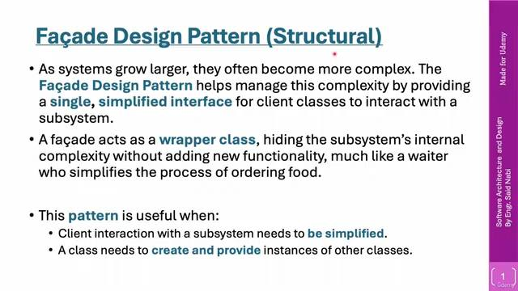

---

## 2. 讲师原话（带时间戳）

**关于外观模式「不新增功能，只做简化」：**

> "外观实际上并不会给系统增加任何额外内容，而是让系统变得简单，使用户能够与系统交互。"
> —— p061 [00:29]

> "你想开车，不需要了解发动机内部如何工作、制动系统如何工作……你只需要知道如何转动钥匙并点火。"
> —— p061 [00:59]

**关于外观类的定位（门面 = 单一高层方法）：**

> "外观会暴露一个单一的高层方法，比如“good night”……系统会启动安全功能，灯光会自动关闭，然后温度会被设置到适合睡眠的理想状态。"
> —— p061 [04:28]

> "委托是指，当客户端在外观上调用“good night”时，外观会在幕后完成所有繁重工作，并且确切知道该调用复杂子系统中的哪些方法。"
> —— p061 [04:58]

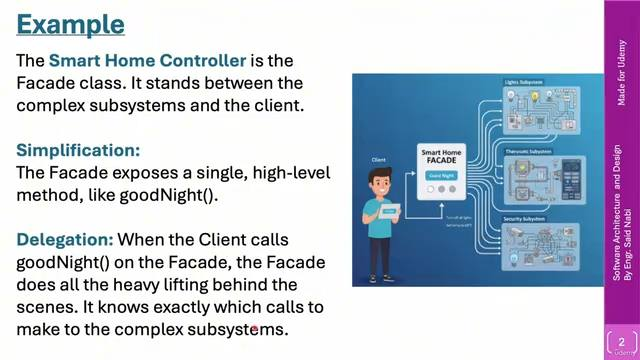

**关于外观模式的实现步骤与 UML：**

> "先设计接口，再用一个或多个类实现该接口，然后创建外观类，包装实现该接口的类，并使用外观类访问子系统。"
> —— p061 [05:57]

> "接口名是 account，这个 account 接口由 current、saving 和 checking 三类子类实现……这个外观类由该接口构成。"
> —— p061 [06:57]–[07:27]

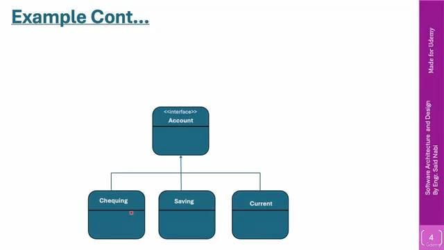

**关于优点：**

> "它通过将子系统封装在一个名为外观类的统一包装器后面，隐藏子系统的复杂性……这样客户端类就不必自行管理子系统，从而降低耦合。"
> —— p062 [00:00]–[00:29]

**关于缺点（三条，注意第三条对落地最有价值）：**

> "外观可能不会暴露底层子系统的全部功能。"
> —— p062 [01:59]

> "外观就像一名门卫，你可以通过它与某个特定的人交互……但那名门卫可能并不认识某栋特定建筑里的所有人。"
> —— p062 [02:28]

> "可能导致外观类变得庞大而臃肿，试图做太多事情，从而让外观本身变得和系统一样复杂。"
> —— p062 [02:58]

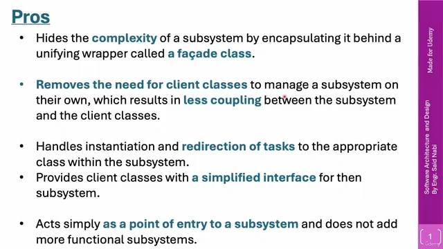

**写代码时讲师提到的坑（拼写）：**

> "这个单词的拼写不正确，本应是 B-A-L-A-N-C-E，这里却写成了 E-N-C-E，所以这是错的，抱歉这个笔误。"
> —— p063 [00:42]

**关于接口的「黄金法则」：**

> "黄金法则是：无论哪个类想实现某种特定类型的接口，这个类都必须为该接口中的所有方法提供定义。"
> —— p065 [00:59]

**关于适配器的动机：**

> "你无法直接做出一个能适配这个充电器的插座，而这件事可能成本很高。"
> —— p064 [00:29]

> "适配器实际上会转换所有这些函数调用和名称，并为你提供目标接口。"
> —— p064 [05:57]

> "在这种情况下，你的系统会完全依赖第三方系统，而这是从来都不被鼓励的。"
> —— p064 [08:26]


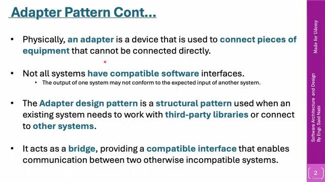

**演示跑出来的结果：**

> "这里可以看到活期账户创建成功，活期账户余额是 12 000，对，我设置的初始余额是 12 000……然后我查询余额，所以现在你应该看到余额应当是 15,000。"
> —— p063 [08:34]–[09:01]

> "现在我用的是同一个 play 方法，而不是 startMusic，也不是 stopMusic，因为我已经使用了适配器，而适配器正在完成它的任务。"
> —— p065 [09:35]

---

## 3. 从零复现

### 3.1 环境

- **JDK**：讲师**没有指定版本**。JDK 8 及以上都能跑本节代码（本节没用到 record / var / switch 表达式等新语法）。本文命令按 JDK 17 书写，8/11 同样适用。
- 编辑器：任意（讲师用的是在线/IDE 的 Java 编辑器，画面里能看到行号）。VS Code + Extension Pack for Java 即可。
- 不需要 Maven / Gradle / Spring。**课里没讲构建工具**。

先确认环境：

```bash
java -version
javac -version
```

两条命令都应打印出 `17.x`（或你自己的版本）。`javac` 不存在 = 装的是 JRE 不是 JDK，重装 JDK。

### 3.2 目录结构

在任意空目录下建两个完全独立的项目（**不要放在同一个目录**，因为两个项目各有一个 `Main` 类，放一起会撞名）：

```
design-patterns/
├── facade-pattern/
│   ├── src/
│   │   ├── IAccount.java
│   │   ├── SavingAccount.java
│   │   ├── CurrentAccount.java
│   │   ├── CheckingAccount.java
│   │   ├── BankService.java
│   │   └── Main.java
│   └── out/            ← 编译产物，自动生成
└── adapter-pattern/
    ├── src/
    │   ├── ModernMediaPlayer.java
    │   ├── MP3Player.java
    │   ├── LegacyMediaPlayer.java
    │   ├── MediaAdapter.java
    │   └── Main.java
    └── out/
```

创建骨架：

```bash
mkdir -p design-patterns/facade-pattern/src
mkdir -p design-patterns/adapter-pattern/src
```

Windows PowerShell 用：

```powershell
New-Item -ItemType Directory -Force design-patterns/facade-pattern/src
New-Item -ItemType Directory -Force design-patterns/adapter-pattern/src
```

> 本节所有类都放在**默认包**（不写 `package` 声明），这是讲师的做法——画面里文件名是 `IAccount.java`、`BankService.java`，没有包名。默认包在真实项目里不推荐，但复现阶段最省事。

### 3.3 项目 A：外观模式，编译并运行

1. 按第 4.1 节的六个文件，逐个写进 `facade-pattern/src/`。**文件名必须和 `public class` / `public interface` 的名字一模一样**（`IAccount.java` 里必须是 `public interface IAccount`），否则 `javac` 直接报错。
2. 编译：

```bash
cd design-patterns/facade-pattern
javac -encoding UTF-8 -d out src/*.java
```

`-d out` 表示把 `.class` 放到 `out/` 目录；`-encoding UTF-8` 是为了中文注释/中文输出不乱码（讲师代码里输出的是英文，你也可以全程用英文文案避开这个问题）。

3. 运行：

```bash
java -cp out Main
```

4. **预期输出**（文案按讲师演示；`12000.0` 后面的 `.0` 见第 7 节说明）：

```
Current account created successfully
Current account balance is 12000.0
3000.0 deposited successfully to your current account
Current account balance is 15000.0
```

如果最后一行是 `15000.0` 而不是 `15000`，这是 `double` 的打印行为，不是你的逻辑错了。

### 3.4 项目 B：适配器模式，编译并运行

1. 按第 4.2 节的五个文件写进 `adapter-pattern/src/`。
2. 编译：

```bash
cd ../adapter-pattern
javac -encoding UTF-8 -d out src/*.java
```

3. 运行：

```bash
java -cp out Main
```

4. **预期输出**（文案按讲师演示；逐字稿把语音识别成了 "rdo"，实际是 "audio"）：

```
The audio Rahat Fateh Ali Khan.mp3 is running now
```

上面这是 `MP3Player` 直接实现接口的路径。要看到**适配器**的效果，把 `Main` 里的驱动代码换成第 4.2 节 `Main.java` 中注释掉的「适配器路径」两行，重新编译运行，输出变成：

```
Playing Rahat Fateh Ali Khan.mp3 now
```

注意第二组输出里**没有** `play` 这个词——`Main` 调的是接口方法 `play`，实际执行的是遗留库的 `startMusic`。这就是讲师 [09:35] 说的 "我使用的是同样的方法，不播放音乐也不停止音乐，因为我用了适配器"。

### 3.5 一次跑通两个项目的完整命令序列

```bash
# 项目 A
cd design-patterns/facade-pattern
javac -encoding UTF-8 -d out src/*.java && java -cp out Main

# 项目 B
cd ../../design-patterns/adapter-pattern
javac -encoding UTF-8 -d out src/*.java && java -cp out Main
```

---

## 4. 完整代码

### 4.1 项目 A：facade-pattern

#### `facade-pattern/src/IAccount.java`

```java
/**
 * 外观模式示例：账户接口（讲师命名 IAccount）。
 * 讲师在 p061 [06:57] 说 "The interface name is account and this account interface
 * is implemented by three types of subclasses like current and saving and then checking"。
 *
 * 四个方法按 p063 [00:27] 的原话："the create account method, the deposit method,
 * the withdraw method and the check balance method"。
 */
public interface IAccount {

    void createAccount(int accountNumber, double initialBalance);

    void deposit(double amount);

    void withdraw(double amount);

    double checkBalance();
}
```

#### `facade-pattern/src/SavingAccount.java`

```java
public class SavingAccount implements IAccount {

    // 讲师 p063 [01:35]：两个私有成员，"integer type of account number" 和 "double type of variable which will be used for storing the balance"
    private int accountNumber;
    private double balance;

    @Override
    public void createAccount(int accountNumber, double initialBalance) {
        this.accountNumber = accountNumber;
        this.balance = initialBalance;
        System.out.println("Saving account created successfully");
    }

    @Override
    public void deposit(double amount) {
        this.balance += amount;
        System.out.println(amount + " deposited successfully to your saving account");
    }

    @Override
    public void withdraw(double amount) {
        // 讲师 p063 [02:55]：先判断取款金额是否大于余额
        if (amount > this.balance) {
            System.out.println("Insufficient balance in your saving account");
        } else {
            this.balance -= amount;
            System.out.println(amount + " withdrawn successfully from your saving account");
        }
    }

    @Override
    public double checkBalance() {
        return this.balance;
    }
}
```

#### `facade-pattern/src/CurrentAccount.java`

```java
public class CurrentAccount implements IAccount {

    private int accountNumber;
    private double balance;

    @Override
    public void createAccount(int accountNumber, double initialBalance) {
        this.accountNumber = accountNumber;
        this.balance = initialBalance;
        System.out.println("Current account created successfully");
    }

    @Override
    public void deposit(double amount) {
        this.balance += amount;
        System.out.println(amount + " deposited successfully to your current account");
    }

    @Override
    public void withdraw(double amount) {
        if (amount > this.balance) {
            System.out.println("Insufficient balance in your current account");
        } else {
            this.balance -= amount;
            System.out.println(amount + " withdrawn successfully from your current account");
        }
    }

    @Override
    public double checkBalance() {
        return this.balance;
    }
}
```

#### `facade-pattern/src/CheckingAccount.java`

```java
public class CheckingAccount implements IAccount {

    private int accountNumber;
    private double balance;

    @Override
    public void createAccount(int accountNumber, double initialBalance) {
        this.accountNumber = accountNumber;
        this.balance = initialBalance;
        System.out.println("Checking account created successfully");
    }

    @Override
    public void deposit(double amount) {
        this.balance += amount;
        System.out.println(amount + " deposited successfully to your checking account");
    }

    @Override
    public void withdraw(double amount) {
        if (amount > this.balance) {
            System.out.println("Insufficient balance in your checking account");
        } else {
            this.balance -= amount;
            System.out.println(amount + " withdrawn successfully from your checking account");
        }
    }

    @Override
    public double checkBalance() {
        return this.balance;
    }
}
```

#### `facade-pattern/src/BankService.java`

```java
/**
 * 外观类（Facade）。
 * 讲师 p061 [07:27]："I have a facade class … the bank service, which is the facade class"。
 * 讲师 p063 [05:27]："all three types of objects are initialized over here from line number 103 to 105"。
 */
public class BankService {

    private SavingAccount saving;
    private CurrentAccount current;
    private CheckingAccount checking;

    public BankService() {
        this.saving = new SavingAccount();
        this.current = new CurrentAccount();
        this.checking = new CheckingAccount();
    }

    // ---- 储蓄账户 ----
    public void createSavingAccount(int accountNumber, double initialBalance) {
        this.saving.createAccount(accountNumber, initialBalance);
    }

    public void depositToSavingAccount(double amount) {
        this.saving.deposit(amount);
    }

    public void withdrawFromSavingAccount(double amount) {
        this.saving.withdraw(amount);
    }

    public double savingBalanceCheck() {
        double b = this.saving.checkBalance();
        System.out.println("Saving account balance is " + b);
        return b;
    }

    // ---- 活期账户（讲师演示用的就是这一组） ----
    public void createCurrentAccount(int accountNumber, double initialBalance) {
        this.current.createAccount(accountNumber, initialBalance);
    }

    public void depositToCurrentAccount(double amount) {
        this.current.deposit(amount);
    }

    public void withdrawFromCurrentAccount(double amount) {
        this.current.withdraw(amount);
    }

    public double currentBalanceCheck() {
        double b = this.current.checkBalance();
        System.out.println("Current account balance is " + b);
        return b;
    }

    // ---- 支票账户 ----
    public void createCheckingAccount(int accountNumber, double initialBalance) {
        this.checking.createAccount(accountNumber, initialBalance);
    }

    public void depositToCheckingAccount(double amount) {
        this.checking.deposit(amount);
    }

    public void withdrawFromCheckingAccount(double amount) {
        this.checking.withdraw(amount);
    }

    public double checkingBalanceCheck() {
        double b = this.checking.checkBalance();
        System.out.println("Checking account balance is " + b);
        return b;
    }
}
```

#### `facade-pattern/src/Main.java`

```java
public class Main {

    public static void main(String[] args) {

        // 讲师 p063 [07:46]："in the main function … I have created an object of facade class"
        BankService f1 = new BankService();

        // p063 [08:05]：f1.createCurrentAccount(账号, 初始余额)
        f1.createCurrentAccount(1001, 12000);

        // p063 [08:18]：f1.currentBalanceCheck() → 12000
        f1.currentBalanceCheck();

        // p063 [09:01]：f1.depositToCurrentAccount(3000) → 再查余额应为 15000
        f1.depositToCurrentAccount(3000);
        f1.currentBalanceCheck();
    }
}
```

> 讲师演示的账号值没有出现在逐字稿里（只说 "账号使用整数类型的变量"），这里用 `1001` 占位，不影响输出。

### 4.2 项目 B：adapter-pattern

> 逐字稿只明确说了接口有三个方法 `play`、`pause`、`play with 2x`，以及 `play` 带一个 `String file` 参数。`playWith2x` 的签名逐字稿没交代，这里按 `play` 的形式写成 `String file`；如果你看到的画面里它是无参的，把两处签名一起改掉即可。

#### `adapter-pattern/src/ModernMediaPlayer.java`

```java
/**
 * 目标接口（Target Interface）。
 * 讲师 p065 [00:29]："in line number three I have an interface called modern media player
 * … the play pause and play with 2x … the play method is also expecting a parameter of type string which is named file"。
 */
public interface ModernMediaPlayer {

    void play(String file);

    void pause();

    void playWith2x(String file);
}
```

#### `adapter-pattern/src/MP3Player.java`

```java
/**
 * 我们自己系统里「原生」的实现类，直接实现目标接口，不需要适配器。
 */
public class MP3Player implements ModernMediaPlayer {

    @Override
    public void play(String file) {
        System.out.println("The audio " + file + " is running now");
    }

    @Override
    public void pause() {
        System.out.println("The audio is paused");
    }

    @Override
    public void playWith2x(String file) {
        System.out.println("The audio " + file + " is being played with 2x");
    }
}
```

#### `adapter-pattern/src/LegacyMediaPlayer.java`

```java
/**
 * 被适配者（Adaptee）：第三方 / 遗留库。
 * 它做同样的事，但方法名是 startMusic / stopMusic，且没有 2 倍速。
 * 讲师 p065 [02:29]："instead of using the name play, the function is named start music"。
 *
 * 注意：这个类我们「不能改」，所以它不实现 ModernMediaPlayer。
 */
public class LegacyMediaPlayer {

    public void startMusic(String file) {
        System.out.println("Playing " + file + " now");
    }

    public void stopMusic() {
        System.out.println("Music stopped");
    }
}
```

#### `adapter-pattern/src/MediaAdapter.java`

```java
/**
 * 适配器类（Adapter）：实现目标接口，内部持有被适配者，负责「翻译」。
 * 讲师 p065 [04:35]："line number 36 I have media adapter … implements the modern media player"。
 */
public class MediaAdapter implements ModernMediaPlayer {

    // p065 [05:00]：声明一个 legacy media player 类型的变量，讲师叫它 o_player（old player）
    private LegacyMediaPlayer oldPlayer;

    // p065 [05:30]：构造器必须传一个 LegacyMediaPlayer 进来，否则创建不了实例
    public MediaAdapter(LegacyMediaPlayer oldPlayer) {
        this.oldPlayer = oldPlayer;
    }

    @Override
    public void play(String file) {
        // 翻译：play → startMusic
        this.oldPlayer.startMusic(file);
    }

    @Override
    public void pause() {
        // 翻译：pause → stopMusic
        this.oldPlayer.stopMusic();
    }

    @Override
    public void playWith2x(String file) {
        // 遗留库根本没有 2 倍速能力，只能在适配器里降级处理
        System.out.println("2x playback is not supported by the legacy media player: " + file);
    }
}
```

#### `adapter-pattern/src/Main.java`

```java
public class Main {

    public static void main(String[] args) {

        // ---------- 路径 1：原生实现，不经过适配器 ----------
        ModernMediaPlayer nativePlayer = new MP3Player();
        nativePlayer.play("Rahat Fateh Ali Khan.mp3");

        // ---------- 路径 2：第三方库，经过适配器 ----------
        // 讲师 p065 [08:18]："modern media player player1 and then media adapter …
        // you have to pass a variable of type legacy media player"。
        // 想看到适配器效果，就注释掉上面两行，取消下面三行的注释：
        //
        // LegacyMediaPlayer oldPlayer = new LegacyMediaPlayer();
        // ModernMediaPlayer player1 = new MediaAdapter(oldPlayer);
        // player1.play("Rahat Fateh Ali Khan.mp3");
    }
}
```

---

## 5. 逐行解释

### 5.1 项目 A

**`public interface IAccount`** —— 这里的接口不是「为了显得高级」，而是外观类能工作的前提。讲师在 p061 [07:27] 说 "这个外观类是由这个接口构成的"，意思就是外观类持有的是**接口类型**的引用。虽然本项目里 `BankService` 的字段被我写成了具体类（因为讲师演示时是直接 `new CurrentAccount()`），但真实收益在于：一旦你后面要换成信用卡账户，只要新类 `implements IAccount`，外观类的方法签名不用动。**在 TS 里这就是 `interface IAccount { ... }`**，区别是 TypeScript 靠结构类型检查，Java 必须显式 `implements` 且**实现全部方法**，少一个就编译不过——这就是讲师 p065 [00:59] 说的 "golden rule"。

**`private int accountNumber; private double balance;`** —— 讲师 p063 [01:35] 明确说这两个是私有成员，对应他画面的第 13、14 行。`private` 的含义是「只有本类能直接读写」，外部想改余额只能走 `deposit` / `withdraw`。这一层封装是外观模式能成立的底层保障：如果余额是 public，客户端就能绕过外观直接改，外观就白做了。

**`this.accountNumber = accountNumber;`** —— 参数名和字段名同名，`this.` 用来区分「字段」和「参数」。**在 JS 里等价于 `this.accountNumber = accountNumber`**，同一个套路。讲师 p063 [01:56] 特意解释了这一句："我在第13行和第14行声明的这些变量将由这个指针初始化"。

**`withdraw` 里的 `if (amount > this.balance)`** —— 讲师 p063 [02:55] 讲得很具体：如果余额 1000、取 500，`500 > 1000` 为 false，就走 else 扣钱。注意判断顺序不能反：**先判断、后扣款**。如果你先 `balance -= amount` 再判断，余额已经变成负数了，判断就失去意义。这类「先校验后变更」的顺序，在任何语言里都一样。

**`BankService` 的三个字段 + 构造器里的三次 `new`** —— 讲师 p063 [05:27] 说 "所有三种类型的对象都在这里从第103行到第105行进行初始化"。这三个 `new` 就是外观类**替客户端承担的对象创建工作**。收益：`Main` 里从头到尾只出现了一个类型 `BankService`。

**`public void createCurrentAccount(int accountNumber, double initialBalance) { this.current.createAccount(...); }`** —— 这一行是整个外观模式的**核心动作：纯转发**。它没有加任何业务逻辑，没有加任何校验，只是把调用转给子系统。讲师 p061 [00:29] 反复强调 "外观实际上并不会添加任何额外的东西"。反过来说，**如果你在这个方法里开始写业务规则（比如「余额低于 500 不让取」），你就正在把外观变成第 7 节要说的「bloated facade」**。

**`currentBalanceCheck()` 里的 `System.out.println("当前账户余额是" + b)`** —— 讲师演示的输出是 "当前账户余额为 12 000。"。我把打印放在外观层而不是账户类里，是因为「怎么展示」是客户端关注的事，账户类只负责 `return this.balance`。不过讲师具体怎么分布的，**逐字稿没讲**，你在画面上看到的可能是账户类自己打印——两种都能得到同样输出，选一种即可。

**`Main` 里的三行** —— `new BankService()` → `createCurrentAccount(1001, 12000)` → `currentBalanceCheck()` → `depositToCurrentAccount(3000)` → 再 `currentBalanceCheck()`。这就是讲师 p063 [07:46]–[09:01] 的完整演示路径，输出 12000 → 15000。

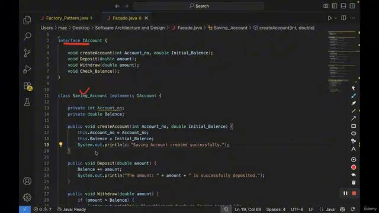

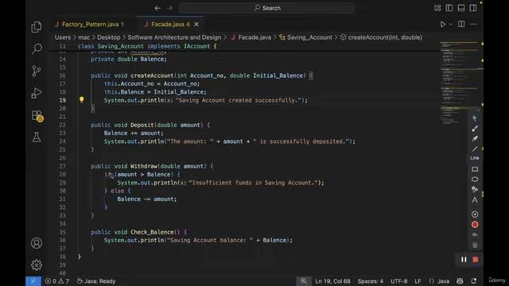

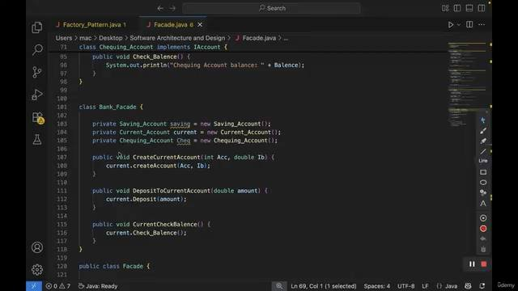

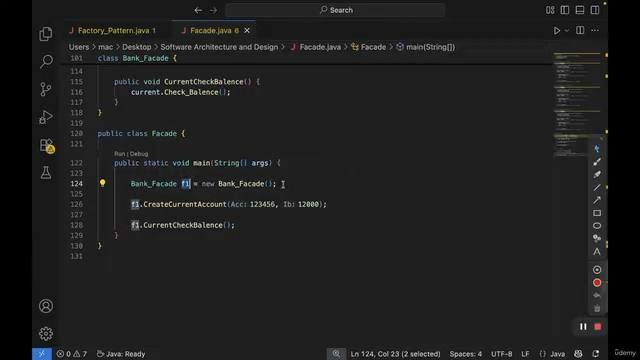

### 5.2 项目 B

**`public interface ModernMediaPlayer` 三个方法** —— 讲师 p065 [00:29] 说这个接口声明了 `play`、`pause`、`play with 2x`，且 `play` 收一个 `String file`。这三个方法是**客户端（你的业务代码）期望的通信格式**，讲师 p064 [06:57] 把它叫 "目标接口，它定义了客户端期望的通信格式"。

**`MP3Player implements ModernMediaPlayer`** —— 这是「不需要适配器」的对照组。因为 `MP3Player` 是你自己写的，它天生就用你想要的方法名，直接实现接口就行。**没有它做对照，你就看不出适配器到底适配了什么**。

**`LegacyMediaPlayer` 里没有 `implements`** —— 这是关键。它是第三方/遗留库，**它不知道也不关心你的接口**。它有自己的 `startMusic(String)` 和 `stopMusic()`。讲师 p065 [02:29] 说得很清楚："函数没有使用 play 这个名字，而是命名为 start music。但功能是一样的。"

**`private LegacyMediaPlayer oldPlayer;` + 构造器赋值** —— 讲师 p065 [05:00] 说 "在第38行……我有一个变量，变量的类型是 legacy media player……也就是那个第三方库"；[05:30] 说 "每当你想创建这个 MediaAdapter 类的对象时，都必须传入一个参数……如果不传入 MediaPlayer 类型的参数，就无法创建实例。"。这就是**依赖注入的手写版**：适配器不在自己内部 `new LegacyMediaPlayer()`，而是从外面接收。好处是测试时你能塞一个假的遗留播放器进来。**在 JS 里等价于 `class MediaAdapter { constructor(oldPlayer) { this.oldPlayer = oldPlayer } }`**。

**`play()` 里只写一行 `this.oldPlayer.startMusic(file);`** —— 适配器的全部工作就在这一行：**方法名翻译**。参数 `file` 原样透传，因为两边语义一致。如果参数类型不一致（比如遗留库要 URL、你的接口给本地路径），翻译就会变复杂——但那属于第 7 节的内容，**课里没讲**。

**`pause()` → `stopMusic()`** —— 同样是名字映射。注意这里有个语义偷换：`pause`（暂停，可恢复）和 `stop`（停止，通常不可恢复）不是一回事。讲师在 p065 [07:28] 就是直接调 `stopMusic` 的，**课里没有讨论这个语义差异**。真实项目里这是要单独处理的，见第 7 节。

**`playWith2x()` 里自己打印一句话** —— 讲师 p065 [07:48]："LegacyMediaPlayer 里没有任何用于 2 倍速播放的方法。所以我必须以某种方式为 play2x 提供定义……LegacyMediaPlayer 不支持这一功能。"。这是适配器模式的**固有限制**：目标接口的能力集如果大于被适配者，多出来的能力只能降级、抛异常或返回空。讲师选了「降级提示」。

**`MediaAdapter implements ModernMediaPlayer`** —— 注意这个类的**双重身份**：对客户端它长得像 `ModernMediaPlayer`（实现接口），对遗留库它是调用方（内部持有 `LegacyMediaPlayer`）。讲师 p064 [04:58] 的描述是 "适配器位于客户端和被适配者之间"。

**`Main` 里 `ModernMediaPlayer player1 = new MediaAdapter(oldPlayer);`** —— 左边声明类型是**接口**，右边实例是**适配器**。这一行是适配器模式的收益所在：`Main` 后续所有代码只认 `ModernMediaPlayer`，一行 `startMusic` 都不会出现。哪怕明天遗留库换了实现（换成 `VLCMusicPlayer`），你只要再写一个 Adapter，`Main` 一个字都不用改。讲师 p064 [08:26] 反过来警告了坏做法："你也可以开始使用相同的名称，但那样的话你的系统就会完全依赖于第三方系统，而这从来都不被鼓励"。

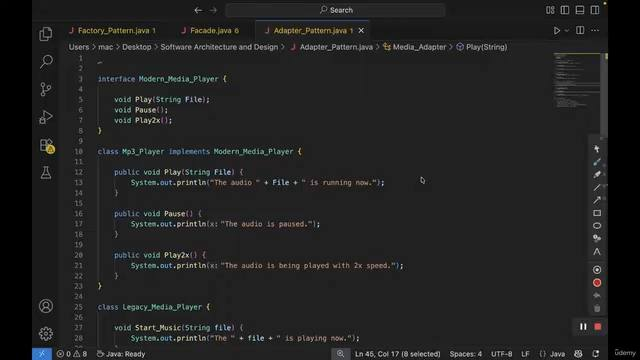

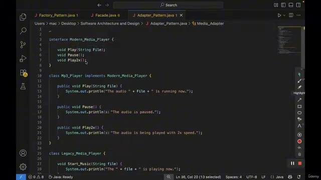

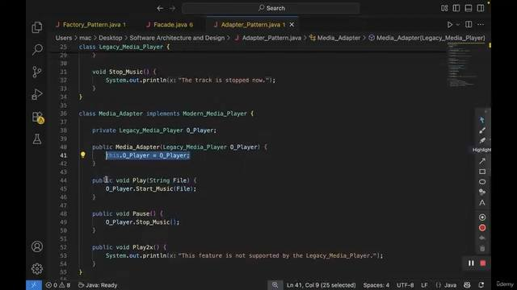

---

## 6. 复现检查清单

按顺序勾，全勾上就算这节课复现成功：

**环境**
- [ ] `java -version` 和 `javac -version` 都能输出版本号
- [ ] `design-patterns/facade-pattern/src/` 和 `design-patterns/adapter-pattern/src/` 两个目录已建好
- [ ] 两个项目**不在同一个目录**（否则两个 `Main` 会撞）

**项目 A（外观）**
- [ ] `IAccount.java` 里 `public interface IAccount` 名字与文件名一致
- [ ] 三个实现类都写了 `implements IAccount`，且**四个方法全部实现**（少一个就编译报 `does not override abstract method`）
- [ ] `javac -encoding UTF-8 -d out src/*.java` 无报错
- [ ] `java -cp out Main` 输出第一行为 `Current account created successfully`
- [ ] 紧接着输出余额 `12000`（或 `12000.0`）
- [ ] 存款 3000 后余额变成 `15000`（或 `15000.0`）
- [ ] 确认 `Main.java` 里**没有出现** `SavingAccount` / `CurrentAccount` / `CheckingAccount` 这三个类名——出现就说明外观没起作用
- [ ] 手动把 `Main` 里的初始余额改成别的数字，输出跟着变（证明不是硬编码）

**项目 B（适配器）**
- [ ] `LegacyMediaPlayer.java` 里**没有** `implements ModernMediaPlayer`
- [ ] `MediaAdapter.java` 里有 `implements ModernMediaPlayer`，且三个方法全部实现
- [ ] `MediaAdapter` 的构造器**必须**接收一个 `LegacyMediaPlayer` 参数，类里没有 `new LegacyMediaPlayer()`
- [ ] 走原生路径时输出 `The audio Rahat Fateh Ali Khan.mp3 is running now`
- [ ] 走适配器路径时输出 `Playing Rahat Fateh Ali Khan.mp3 now`（开头是 `Playing`，不是 `The audio`）
- [ ] 确认 `Main.java` 里**没有直接调用** `startMusic` / `stopMusic`
- [ ] 把 `Main` 里传的文件名换一个，两处输出的文件名都跟着变

**理解**
- [ ] 能用自己的话说清「外观不新增功能，只做简化」和「适配器不新增功能，只做翻译」的区别
- [ ] 能说出外观模式下客户端依赖的是 `BankService`，适配器模式下客户端依赖的是 `ModernMediaPlayer` 接口

---

## 7. 课里没讲但你会撞上的

**1）`double` 打印出来带 `.0`。**
讲师演示里说 "余额是 12000"、"15,000"，但你实际跑出来是 `12000.0`、`15000.0`。这是 Java `double` 的 `toString` 行为，不是 bug。想打印成整数可以用 `(long) b` 强转或 `String.format("%.0f", b)`。**讲师没有讨论货币精度问题**——真实系统里金额应该用 `BigDecimal` 而不是 `double`，这一点课里完全没讲。

**2）`javac` 报「类 X 是公共的，应在名为 X.java 的文件中声明」。**
Java 强制 `public class` 的文件名与类名**逐字符一致**（大小写敏感）。`CurrentAccount.java` 里写成 `public class Currentaccount` 就编译失败。这是前端同学最容易踩的第一个坑（JS 里文件名随便起）。

**3）`java -cp out Main` 报 `Could not find or load main class Main`。**
原因通常是：忘了 `-cp out`（默认去当前目录找 `.class`，而 `.class` 在 `out/` 里），或者类的全名不是 `Main`。如果以后加了 `package com.demo;`，运行命令必须写全名 `java -cp out com.demo.Main`。**本节用的是默认包，课里也没讲包（package）**。

**4）两个 `Main` 千万别放一起。**
这是复现时最现实的问题：你如果偷懒把两个项目的文件都丢进一个 `src/`，`javac` 会因为「重复的类 Main」直接失败。老老实实两个目录。

**5）`playWith2x` 的签名逐字稿没记录。**
讲师只说到有这个方法和「遗留库不支持 2x」。如果你的编译报 `playWith2x() 无法应用`，说明你看到的画面里它是无参的，把接口和两个实现类里的 `String file` 一起删掉即可。

**6）`pause` 翻译成 `stopMusic` 是语义降级。**
`pause` 可以恢复，`stop` 不行。课里讲到 `stopMusic` 就结束了，没讨论恢复播放怎么办。真实项目里需要额外状态位或让适配器自己缓存播放位置——**这部分课里没讲**。

**7）外观类会越长越胖（讲师自己也警告了）。**
p062 [02:58] 的原话是 "可能导致外观类变得庞大臃肿，试图做太多事情，从而使外观变得和系统一样复杂"。实操判据：**如果 `BankService` 里出现了 `if`、`for`、余额计算，就该停下了**——那是业务逻辑，不该在外观里。外观里只应该有「转发」和「编排（先调 A 再调 B）」。

**8）外观会挡住子系统的高级能力。**
p062 [01:59]："a facade may not expose the full functionality of the underlying subsystem"。比如你的 `BankService` 只暴露了「活期账户」的操作，用户想操作储蓄账户就没门。补救办法是给外观加方法（然后就胖了），或者干脆允许高级用户绕过外观直接 `new SavingAccount()`（那封装就漏了）。这是设计取舍，**课里只提了问题没给方案**。

**9）没有并发、锁、事务的任何内容。**
P61–P65 全程单线程 `main`，`balance += amount` 在单线程下没问题。但如果把 `BankService` 搬到 Node 里做多请求处理，同样的「读余额 → 判断 → 扣款」在并发下会超扣——那时需要事务或原子操作。**课里完全没讲这一层**，这里只是提醒你别把这段代码直接当生产代码用。

**10）在 JS/TS 里怎么写这两个模式。**
外观 ≈ 一个 `bankService.ts` 文件，`export` 几个函数，内部 `import` 并调用三个 `savingAccount` / `currentAccount` / `checkingAccount` 模块；客户端只 `import { bankService }`。适配器 ≈ 一个 `mediaAdapter.ts`：

```ts
export class MediaAdapter implements ModernMediaPlayer {
  constructor(private readonly oldPlayer: LegacyMediaPlayer) {}
  play(file: string) { this.oldPlayer.startMusic(file); }
  pause() { this.oldPlayer.stopMusic(); }
  playWith2x(file: string) { console.log(`2x not supported: ${file}`); }
}
```

区别只有一个：TS 的 `implements` 少了方法会**在编译期报错但不阻止运行**（`tsc` 报错、`node` 照样跑），Java 的 `implements` 少了方法是**硬编译失败**，根本生成不了 `.class`。这也是为什么讲师敢说 "the golden rule"——在 Java 里这不靠自觉，靠编译器。

**11）课里没有测试、没有异常处理、没有日志框架。**
所有错误都靠 `System.out.println` 打印一句话。真实项目里 `Insufficient balance` 应该抛异常或返回 Result 对象——**课里没讲**，复现阶段保持原样即可。