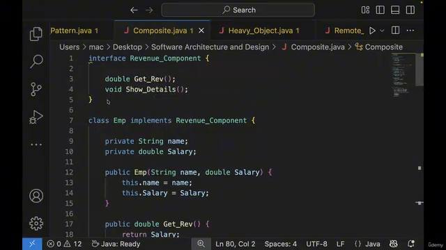
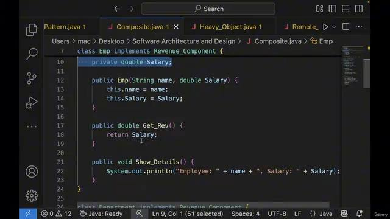
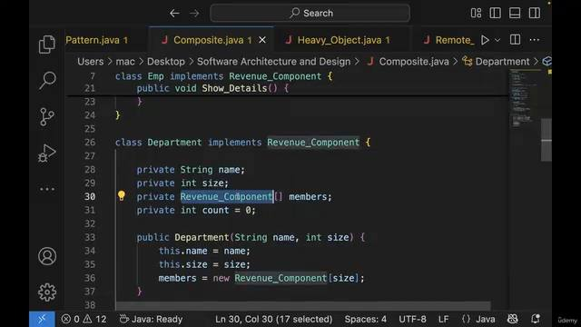
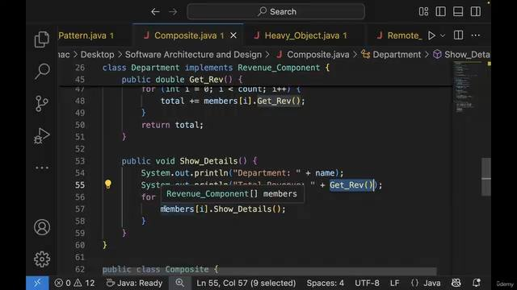
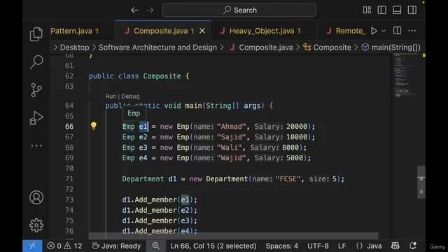
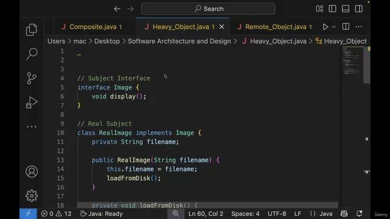
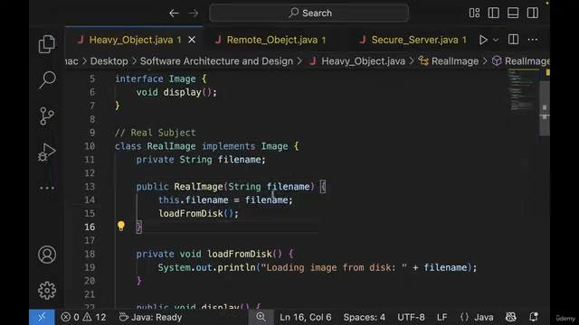
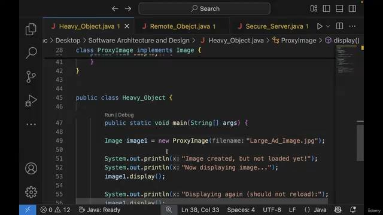
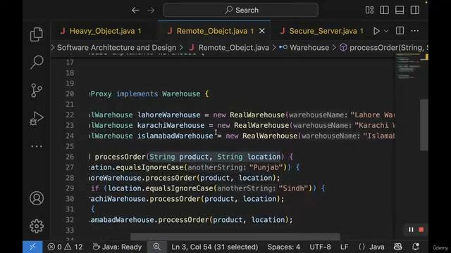
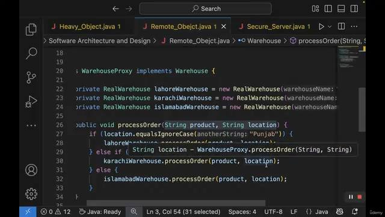

# Software Architecture Scalable（P66–P69）复现文档：Composite 与 Proxy 设计模式

## 1. 这一节做什么

这四集从“公司组织架构算总薪资”这个具体问题出发，引出 **Composite（组合）设计模式**，并用 Java 写出一个可运行的“员工/部门/公司”层级营收计算示例；随后用“图库缩略图、跨城市仓库、权限门禁”三个生活类比讲 **Proxy（代理）设计模式**，并分别给出 heavy object、remote object、secure server 三个 Java 实现。读者按本文档操作，可以在本地用 `javac`/`java` 直接跑出两种模式的控制台输出，理解“把单个对象和对象组同等对待”以及“用代理类控制对真实对象的访问”到底怎么落到代码里。

这四集的问题背景并不复杂，但很适合把“设计模式”从名词变成可运行代码。Composite 部分的核心不是单纯算工资，而是让 `Employee` 这种叶子节点和 `Department` 这种容器节点共用同一个接口，于是调用方只需面向 `RevenueComponent` 编程，不必关心当前拿到的是一个人还是一个部门。Proxy 部分的核心也不是“多写一个中间类”，而是把访问控制、延迟创建、远程路由、权限判断这些横切逻辑从真实对象里抽出来，让真实对象只处理自己的业务。课里使用的是 Java，但讲师没有指定 JDK 版本、IDE 和构建工具；本文档用命令行编译运行，不引入 Maven/Gradle，保证零配置可复现。

如果你是从前端背景转过来，可以先把这两个模式理解成两类常见组织方式：Composite 很像 React 组件树或 DOM 树，容器组件可以包含子组件，最终都通过统一接口参与渲染或统计；Proxy 很像图片懒加载、请求拦截器或鉴权中间件，调用方先经过代理，代理决定是延迟创建、转发、拒绝还是自行处理。本文档会在逐行解释部分继续用这种对照方式说明，但不会引入课里没有出现的后端框架或网络协议。

---

## 2. 讲师原话（带「—— pNNN [MM:SS]」）

> "组合类持有并管理多个组件……而叶子类表示单个独立对象。"
> —— p066 [09:09]

> "两者实现同一个组件接口，因此我们可以用统一的方式处理单个对象和整组对象。"
> —— p066 [09:51]

> "这里可以看到，我有一个名为收入组件的接口；在这个接口里定义了两个方法：获取收入和显示详情。"
> —— p067 [00:00]

> "在部门类中，我们持有的是多名员工，而不是单个员工……构造函数会初始化这两个值……数组也会被初始化。"
> —— p067 [03:34]

> "因此，如果调用部门的这个获取收入函数，就会得到该部门所有成员的收入。"
> —— p067 [06:22]

> "代理设计模式是指，不直接与真实对象通信——真实对象可能很重、很敏感或位于远程——而是与一个处于中间层的代理通信，由这个代理表示真实对象或控制对它的访问。"
> —— p068 [01:29]

> "代理类包装真实对象。它隐藏对真实主体的引用，并控制访问该对象的方式和时机。"
> —— p068 [06:57]

> "代理可以决定自己处理简单请求，而把复杂请求转发给真实对象。"
> —— p068 [07:56]

> "这里可以看到，首先是重量级对象，然后是远程对象，最后是安全服务器。这就是使用代理设计模式的三个不同场景。"
> —— p069 [00:00]

> "如果 realImage 等于 null，就把 realImage 赋值为 new RealImage(fileName)，然后调用 realImage.display()。"
> —— p069 [04:30]

> "如果用户角色是管理员或经理，就授予该用户访问系统的权限；否则显示这条消息：角色无权访问。"
> —— p069 [13:46]

以上引用主要用于定位课程讲解位置：Composite 部分从统一接口、叶子节点、组合节点、部门营收汇总逐步展开；Proxy 部分从“不要直接碰真实对象”这一动机出发，再分别落到 heavy object、remote object、secure server 三个示例。本文档后续的代码和解释都围绕这些原话展开，不额外编造课堂中没有出现的实现细节。引用中的英文原话保留原样，括号中的时间点和页码用于回看视频定位。

---

## 3. 从零复现

### 3.1 环境准备

课里没讲 JDK 版本，只用了 Java 基础语法（接口、数组、继承、重写、`System.out.println`）。任何 **JDK 8 及以上** 都可以。确认命令行可用：

```bash
java -version
javac -version
```

如果二者都能打印版本号，继续。`java -version` 用来确认运行环境存在，`javac -version` 用来确认编译器存在；只装了 JRE 而没有 JDK 的环境通常能运行已有 class，却不能编译本文档的 `.java` 源文件。若提示“不是内部或外部命令”，说明 JDK 的 `bin` 目录没有加入 `PATH`。Windows 可以检查环境变量 `Path` 中是否有类似 `C:\Program Files\Java\jdk-17\bin` 的路径；macOS 或 Linux 可以用 `which java`、`which javac` 查看实际调用位置。确认两个命令都可用后再进入下一步，可以避免后面把“环境问题”误判成“代码问题”。

另外，本文档假设你使用 Bash 风格命令行。Windows 的 PowerShell 对 `src/*.java` 这种通配符的处理可能与 Bash 不同；如果编译命令没有展开文件列表，可以改用 `javac -d out src\*.java`，或者直接在 `src` 目录内执行 `javac -d ../out *.java`。这仍然属于命令行编译运行，不引入 IDE 和构建工具。

### 3.2 目录结构

在任意空目录下创建如下结构（所有 `.java` 文件放在 `src` 下，不写 `package`，方便直接编译）：

```text
composite-proxy-demo/
├── src/
│   ├── RevenueComponent.java
│   ├── Employee.java
│   ├── Department.java
│   ├── CompositeDemo.java
│   ├── Image.java
│   ├── RealImage.java
│   ├── ProxyImage.java
│   ├── ProxyImageDemo.java
│   ├── Warehouse.java
│   ├── RealWarehouse.java
│   ├── ProxyWarehouse.java
│   ├── ProxyWarehouseDemo.java
│   ├── Server.java
│   ├── RealServer.java
│   ├── ProxyServer.java
│   └── ProxyServerDemo.java
└── out/                （编译输出目录，可不存在，编译时自动创建）
```

目录结构看似只是文件摆放，但它直接影响编译命令能否成功。本文档所有类都在默认包中，所以 `src/*.java` 可以一次性编译，运行入口类时写类名即可。文件名必须与 `public class` 类名一致，例如 `CompositeDemo.java` 对应 `public class CompositeDemo`，`ProxyImageDemo.java` 对应 `public class ProxyImageDemo`。Java 区分大小写，`proxyImageDemo` 和 `ProxyImageDemo` 不是同一个类名。`out` 目录可以提前创建，也可以由 `javac -d out` 自动创建；它的作用是集中存放 `.class` 文件，避免源码目录和编译产物混在一起。

如果复制文件时误把某个文件命名为 `ProxyWarehouseDemo.java.txt`，编辑器可能仍然显示为 Java 代码，但 `javac` 不会把它当成源文件。建议复制后在命令行执行 `ls src` 或 `dir src`，确认 16 个文件都以 `.java` 结尾，并且类名拼写与第 4 节代码块标题一致。

### 3.3 编译与运行

在项目根目录 `composite-proxy-demo/` 下执行：

```bash
mkdir -p out
javac -d out src/*.java
```

然后分别运行四个入口类：

```bash
java -cp out CompositeDemo
java -cp out ProxyImageDemo
java -cp out ProxyWarehouseDemo
java -cp out ProxyServerDemo
```

每个命令都会在终端打印对应模式的输出。下面第 4 节给出每个文件的完整内容，逐个复制保存即可。

命令解释如下：`mkdir -p out` 创建输出目录，`-p` 表示父目录存在时不报错、目录已存在时也不报错；`javac -d out src/*.java` 中 `-d out` 指定编译产物输出目录，`src/*.java` 表示把 `src` 下所有 `.java` 文件一起参与编译。一次性编译的好处是接口和实现类之间的依赖可以在同一轮编译中解析，避免先编译某个入口类时提示“找不到符号”。运行命令 `java -cp out CompositeDemo` 中 `-cp out` 表示 classpath 指向 `out` 目录，最后一个参数是主类名，不写 `.class` 后缀。四个入口类分别对应 Composite、图片代理、仓库代理和权限服务器代理，每个都独立带 `main` 方法。

如果编译时报“找不到符号”，优先检查是否有某个接口或实现类漏保存、类名拼写不一致、或者 `src/*.java` 没有包含全部文件。如果运行时报“Error: Could not find or load main class CompositeDemo”，先确认 `out` 目录下存在 `CompositeDemo.class`，再确认执行 `java` 命令时当前工作目录是否为项目根目录。如果输出乱码，通常与代码中的非 ASCII 字符和平台默认编码有关；本文档代码本身没有中文注释，一般不会触发，但如果你自己加了中文注释，可以在编译时加 `-encoding UTF-8`。

> 截图说明：P67 开始处讲师展示 `RevenueComponent` 接口的代码编辑器画面，对应接口定义。  
> 

> 截图说明：P67 讲到 `Employee` 类实现接口、持有 `name` 和 `salary` 字段。  
> 

> 截图说明：P67 展示 `Department` 类中的数组声明、`addMember` 和 `getRevenue` 循环。  
> 

---

## 4. 完整代码

### 4.1 Composite 模式

#### `src/RevenueComponent.java`

```java
public interface RevenueComponent {
    double getRevenue();
    void showDetails();
}
```

#### `src/Employee.java`

```java
public class Employee implements RevenueComponent {
    private String name;
    private double salary;

    public Employee(String name, double salary) {
        this.name = name;
        this.salary = salary;
    }

    @Override
    public double getRevenue() {
        return salary;
    }

    @Override
    public void showDetails() {
        System.out.println("Employee: " + name + ", Salary: " + salary);
    }
}
```

#### `src/Department.java`

```java
public class Department implements RevenueComponent {
    private String name;
    private int size;
    private RevenueComponent[] members;
    private int count = 0;

    public Department(String name, int size) {
        this.name = name;
        this.size = size;
        this.members = new RevenueComponent[size];
    }

    public void addMember(RevenueComponent member) {
        if (count < size) {
            members[count] = member;
            count++;
        } else {
            System.out.println("Department " + name + " is full, cannot add more members.");
        }
    }

    @Override
    public double getRevenue() {
        double total = 0;
        for (int i = 0; i < count; i++) {
            total += members[i].getRevenue();
        }
        return total;
    }

    @Override
    public void showDetails() {
        System.out.println("Department: " + name + ", Total Revenue: " + getRevenue());
        for (int i = 0; i < count; i++) {
            members[i].showDetails();
        }
    }
}
```

#### `src/CompositeDemo.java`

```java
public class CompositeDemo {
    public static void main(String[] args) {
        Employee e1 = new Employee("Ali", 50000);
        Employee e2 = new Employee("Sara", 60000);
        Employee e3 = new Employee("John", 70000);

        Department d1 = new Department("FCSC, Faculty of Computer Science and Engineering", 5);
        d1.addMember(e1);
        d1.addMember(e2);
        d1.addMember(e3);

        d1.showDetails();

        System.out.println("Total revenue of department: " + d1.getRevenue());
    }
}
```

保存这四个文件后，先不要急着运行，可以逐个检查：接口名是否为 `RevenueComponent`，两个实现类是否都写了 `implements RevenueComponent`，`Department` 的成员数组类型是否为 `RevenueComponent[]` 而不是 `Employee[]`。如果 `Department` 只存 `Employee[]`，当前示例仍然能跑，但就失去了“部门里还能放子部门”的类型扩展能力，也就削弱了 Composite 的意义。

> 截图说明：P67 末尾讲师运行 Composite 示例，终端先打印部门总营收，再打印每个员工明细。  
> 

> 截图说明：P67 运行结果画面，对应 `showDetails()` 的输出。  
> 

### 4.2 Proxy 模式：Heavy Object（图片加载）

#### `src/Image.java`

```java
public interface Image {
    void display();
}
```

#### `src/RealImage.java`

```java
public class RealImage implements Image {
    private String fileName;

    public RealImage(String fileName) {
        this.fileName = fileName;
        loadFromDisk();
    }

    private void loadFromDisk() {
        System.out.println("Loading image from disk: " + fileName);
    }

    @Override
    public void display() {
        System.out.println("Displaying image: " + fileName);
    }
}
```

#### `src/ProxyImage.java`

```java
public class ProxyImage implements Image {
    private RealImage realImage;
    private String fileName;

    public ProxyImage(String fileName) {
        this.fileName = fileName;
    }

    @Override
    public void display() {
        if (realImage == null) {
            realImage = new RealImage(fileName);
        }
        realImage.display();
    }
}
```

#### `src/ProxyImageDemo.java`

```java
public class ProxyImageDemo {
    public static void main(String[] args) {
        Image image1 = new ProxyImage("large_image.jpg");
        System.out.println("Image created but not loaded yet");
        image1.display();
    }
}
```

这一组代码的关键点是构造顺序：`new ProxyImage("large_image.jpg")` 只保存文件名，不会立刻创建 `RealImage`，因此也不会立刻打印 `Loading image from disk`。只有第一次调用 `image1.display()` 时，`realImage == null` 成立，代理才创建真实图片对象，真实对象的构造函数再触发 `loadFromDisk()`。第二次调用 `display()` 时 `realImage` 已经非 null，就不会重复加载。这种“用到才创建”的效果就是 heavy object 代理的典型用途。

> 截图说明：P69 展示 `Image` 接口和 `RealImage` 类，并说明构造时 `loadFromDisk` 才真正加载。  
> 

> 截图说明：P69 展示 `ProxyImage` 中“realImage 为 null 才创建真实对象”的判断。  
> 

### 4.3 Proxy 模式：Remote Object（仓库路由）

#### `src/Warehouse.java`

```java
public interface Warehouse {
    void processOrder(String product, String location);
}
```

#### `src/RealWarehouse.java`

```java
public class RealWarehouse implements Warehouse {
    private String warehouseName;

    public RealWarehouse(String warehouseName) {
        this.warehouseName = warehouseName;
    }

    @Override
    public void processOrder(String product, String location) {
        System.out.println(warehouseName + " is processing order for product "
                + product + " at location " + location);
    }
}
```

#### `src/ProxyWarehouse.java`

```java
public class ProxyWarehouse implements Warehouse {
    private RealWarehouse lahoreWarehouse = new RealWarehouse("Lahore Warehouse");
    private RealWarehouse karachiWarehouse = new RealWarehouse("Karachi Warehouse");
    private RealWarehouse islamabadWarehouse = new RealWarehouse("Islamabad Warehouse");

    @Override
    public void processOrder(String product, String location) {
        if (location.equalsIgnoreCase("Punjab")) {
            lahoreWarehouse.processOrder(product, location);
        } else if (location.equalsIgnoreCase("Sindh")) {
            karachiWarehouse.processOrder(product, location);
        } else {
            islamabadWarehouse.processOrder(product, location);
        }
    }
}
```

#### `src/ProxyWarehouseDemo.java`

```java
public class ProxyWarehouseDemo {
    public static void main(String[] args) {
        Warehouse proxy = new ProxyWarehouse();
        proxy.processOrder("Laptop", "Punjab");
        proxy.processOrder("Phone", "Sindh");
        proxy.processOrder("Tablet", "KPK");
    }
}
```

这里的代理类持有三个真实仓库对象，调用方只面对 `Warehouse` 接口。代理根据 `location` 决定把订单转给哪个仓库：`Punjab` 走 Lahore，`Sindh` 走 Karachi，其余走 Islamabad。虽然类名叫 remote object，但这组代码本身是本地 `new` 出来的对象，并没有发起网络请求；它用本地对象模拟“客户端不直接决定远程目标”的路由过程。理解这一点可以避免把课堂示例误认为完整的 RMI、HTTP 或消息队列实现。

> 截图说明：P69 展示仓库代理根据 location 分发到不同仓库的 `if/else` 逻辑。  
> 

### 4.4 Proxy 模式：Secure Server（权限校验）

#### `src/Server.java`

```java
public interface Server {
    void access(String userRole);
}
```

#### `src/RealServer.java`

```java
public class RealServer implements Server {
    @Override
    public void access(String userRole) {
        System.out.println("Access granted to secure server for role: " + userRole);
    }
}
```

#### `src/ProxyServer.java`

```java
public class ProxyServer implements Server {
    private RealServer realServer = new RealServer();

    @Override
    public void access(String userRole) {
        if (userRole.equalsIgnoreCase("admin") || userRole.equalsIgnoreCase("manager")) {
            realServer.access(userRole);
        } else {
            System.out.println("Access denied for role: " + userRole);
        }
    }
}
```

#### `src/ProxyServerDemo.java`

```java
public class ProxyServerDemo {
    public static void main(String[] args) {
        Server proxy = new ProxyServer();
        proxy.access("admin");
        proxy.access("guest");
        proxy.access("manager");
        proxy.access("user");
    }
}
```

权限示例的代理逻辑很直接：`admin` 和 `manager` 放行，其他角色拒绝。真实服务器 `RealServer` 本身不写权限判断，只打印授权成功信息；判断逻辑集中在 `ProxyServer`。如果以后权限规则变化，只需改代理类，调用方和真实服务器都可以保持不变。运行这个入口类时，四行输出应依次对应 `admin` 放行、`guest` 拒绝、`manager` 放行、`user` 拒绝。

> 截图说明：P69 展示 `ProxyServer` 中 admin/manager 放行、其他角色拒绝的分支。  
> 

> 截图说明：P69 运行权限示例，终端依次出现 access granted / access denied / access granted / access denied。  
> 

---

## 5. 逐行解释

### 5.1 Composite：同一个接口，两种粒度

`RevenueComponent` 只有两个方法：`getRevenue()` 和 `showDetails()`。这是整个模式的“统一契约”。`Employee` 是叶子节点，`Department` 是组合节点，二者都实现这个接口，于是调用方不需要写 `if (obj instanceof Employee) ... else if (obj instanceof Department) ...`。这种统一契约的好处是，调用方只依赖抽象接口，不依赖具体节点类型；以后新增“外包员工”“子部门”“项目组”等节点，只要实现同一个接口，原有汇总和展示逻辑就可以继续复用。

`Employee.getRevenue()` 直接返回 `salary`；`Employee.showDetails()` 打印自己的姓名和工资。这对应 P67 中“leaf class 只有一个对象，覆盖接口方法即可”。叶子节点不持有子节点，它的职责很单一：把自己的业务数据暴露成接口要求的形式。这样组合节点在遍历成员时，不需要知道成员内部是员工还是别的叶子类型。

`Department` 内部持有 `RevenueComponent[] members`，而不是 `Employee[]`。这一步很关键：因为 `Department` 本身也实现了 `RevenueComponent`，所以**部门里可以继续放部门**，形成递归树。课里 p066 [10:50] 说“composite object can include other composite objects forming a recursive or tree like structure”，代码里用 `RevenueComponent[]` 就把这个能力留下了（当前示例只放员工，但类型允许放子部门）。从类型系统角度看，`Department` 既可以是“被遍历的成员”，也可以是“包含成员的容器”，这正是 Composite 的递归能力来源。

`addMember` 先判断 `count < size`，再写入数组。课里 p067 [05:18] 专门解释：如果 size 是 10 且已经放了 10 个，就不再添加。这里额外打印一行提示，避免静默失败。实际项目里还可以把这种“容器已满”的情况改成抛异常、自动扩容或返回布尔值，但课堂示例选择打印提示，方便在控制台直接观察行为。

`getRevenue()` 里 `for (int i = 0; i < count; i++)` 用的是 `count` 而不是 `size`，因为数组可能没填满。如果误用 `size`，空槽位会抛 `NullPointerException`。课里没有显式说“用 count 不用 size”，但代码描述里 count 从 0 开始、每次 add 递增，隐含了这一点。这个细节是复现时最容易忽略的地方：数组长度是容量，`count` 才是当前实际成员数；容量和已用数量不是一回事。

`showDetails()` 先打印部门名和部门总营收，再循环调用每个成员的 `showDetails()`。如果成员是员工，打印员工明细；如果以后成员是子部门，就会递归打印整棵子树。这就是“统一对待”的收益。递归调用的终止条件是叶子节点的 `showDetails()` 不再向下遍历，因此整棵树可以在不写多层嵌套循环的情况下完成展示。

**在 JS/Node 里对应什么？** Composite 的写法非常像前端组件树：一个 `Component` 接口有 `render()` 或 `getSize()`，叶子组件和容器组件都实现它，容器里存 `children` 数组并递归调用。React 的组件组合、DOM 树的 `Node` 接口都是同一思路。Java 的 `interface` 对应 TypeScript 的 `interface`，`implements` 对应 `implements`。前端的“父组件传 children、子组件递归渲染”与这里的“部门遍历成员、成员递归展示”在结构上是一致的。

### 5.2 Proxy：控制访问，而不是替代业务

`ProxyImage` 和 `RealImage` 都实现 `Image`。`ProxyImage.display()` 先看 `realImage == null`，为空才 `new RealImage(fileName)`。`RealImage` 的构造函数里调用 `loadFromDisk()`，所以“加载大图”发生在第一次 `display()` 时，而不是 `new ProxyImage()` 时。课里 p069 [04:30] 的原话就是“if the real image equals to null so then the real image equals to new real image...”。这样图库可以只创建代理对象，等用户真正点开再占内存。代理在这里没有改变“展示图片”的业务结果，它改变的是真实对象被创建和被加载的时机。

`ProxyWarehouse` 在类字段里直接 `new` 了三个 `RealWarehouse`。课里说“proxy is having all the instances of different warehouses”，所以三个真实仓库对象在代理构造时就存在。`processOrder` 根据 `location` 做 `equalsIgnoreCase` 判断：Punjab → Lahore，Sindh → Karachi，其他 → Islamabad。课里 p069 [10:32] 描述的就是这个 if/else 链。注意这里 `equalsIgnoreCase` 避免了大小写问题；课里原话是“equals to ignore our case”，可以理解为忽略大小写。这个代理的职责是“路由选择”，调用方不需要知道 Lahore、Karachi、Islamabad 三个真实仓库的存在。

`ProxyServer` 持有 `RealServer`，`access` 先检查 `userRole` 是否为 `admin` 或 `manager`。是则调用 `realServer.access(userRole)`，否则打印 `Access denied for role: ...`。课里 p069 [13:46] 说“if the user role is admin or the user role is manager so the user will be given an access... otherwise access denied for role”。`main` 里依次传 `admin`、`guest`、`manager`、`user`，输出就是 granted、denied、granted、denied。这里的代理承担访问控制，真实服务器只负责“被授权后的业务动作”，两者职责分离。

**在 JS/Node 里对应什么？** Proxy 模式在 JS 里最直接的就是 ES6 的 `Proxy` 对象，但那是语言层面的拦截器；设计模式层面的 Proxy 更像“鉴权中间件”：请求先过 `authMiddleware`，通过才进真正的 controller。前端调用远程 API 时的 `fetch` 封装、图片组件的懒加载占位图，都是代理思想。课里没有提 WebSocket、ConfigMap 等后端概念，我们也不引入。需要区分的是：ES6 `Proxy` 是 JavaScript 语言提供的对象拦截 API，而这里讲的是软件设计模式中的代理类；二者名字相同，但讨论层次不同。

### 5.3 为什么不用继承硬编码

如果不用 Composite，`main` 里算总营收就要写三层循环：先遍历部门、再遍历员工、再按员工类型分别算。课里 p066 [04:26] 说“this makes the code complex, repetitive and hard to maintain. And every time a new employee type or department is added, the code must be updated everywhere”。Composite 把“算营收”这个动作委托给每个节点自己，新增部门类型只要实现 `RevenueComponent`，调用方代码不动。也就是说，组合模式把“遍历结构”与“处理节点”解耦了：容器负责递归，叶子负责自身计算，调用方只需调用统一接口。

Proxy 同理：如果不用代理，客户端要自己判断“图片加载了没有”“订单该发哪个仓库”“这个角色有没有权限”，判断逻辑散落在各处。代理把控制逻辑收在一个类里，真实对象只负责本职业务。这样做的直接收益是调用方代码更短，间接收益是控制逻辑更容易集中修改和测试。比如权限规则从 admin/manager 改成 admin/manager/auditor，只需改代理类，不必在每个调用点重复判断。

换到前端视角，这种“不要在业务组件里到处写 if 判断”与“把鉴权、缓存、懒加载放到路由守卫、请求拦截器、图片组件包装层”是同一个工程思路：业务组件保持纯粹，横切逻辑交给外层包装。本文档不进一步引入具体前端框架 API，只保留这种结构上的对照。

---

## 6. 复现检查清单

- [ ] `java -version` 和 `javac -version` 均能输出，且主版本 ≥ 8。  
  验证方式：两条命令都在同一终端执行；如果 `java` 可用但 `javac` 不可用，说明当前可能只是 JRE 或 `PATH` 配置不完整。把两个版本号截图或记下来，可以避免后续环境问题混入代码问题。

- [ ] 项目根目录下存在 `src` 文件夹，16 个 `.java` 文件全部按第 4 节内容保存，文件名与类名一致（Java 区分大小写）。  
  验证方式：执行 `ls src` 或 `dir src`，逐个核对文件名；再检查每个 `public class` 后的类名是否与文件名完全一致。常见错误是 `ProxyServer.java` 里写成了 `public class ProxySever`，编译时会直接报类名不匹配。

- [ ] 执行 `javac -d out src/*.java` 没有编译错误。如果提示“找不到符号”，检查是否漏了某个接口或类文件。  
  验证方式：命令结束后终端没有 `error:` 行，并且 `out` 目录下出现对应的 `.class` 文件。若提示找不到 `RevenueComponent`，优先检查接口文件是否保存到了 `src`；若提示找不到 `RealImage`，检查 `ProxyImage.java` 是否与 `RealImage.java` 在同一轮编译中。

- [ ] `java -cp out CompositeDemo` 输出包含 `Department: FCSC...`、`Total Revenue: 180000.0`（50000+60000+70000）以及三行 `Employee:` 明细。  
  验证方式：先看第一行部门信息，再看总营收是否为 `180000.0`，最后数一数 `Employee:` 是否出现三次。若总营收不是 180000.0，检查三个员工薪资是否分别写成 50000、60000、70000；若出现 `NullPointerException`，检查 `getRevenue` 循环条件是否误用了 `size`。

- [ ] `java -cp out ProxyImageDemo` 先输出 `Image created but not loaded yet`，再输出 `Loading image from disk: large_image.jpg`，最后 `Displaying image: large_image.jpg`。如果“Loading”出现在第一行之前，说明代理的延迟加载没生效。  
  验证方式：按输出行顺序核对三行文本。如果第一行就是 `Loading image from disk`，说明 `ProxyImage` 构造时或类字段初始化时提前创建了 `RealImage`，需要检查 `realImage` 是否被提前 `new`。

- [ ] `java -cp out ProxyWarehouseDemo` 三行分别指向 `Lahore Warehouse`、`Karachi Warehouse`、`Islamabad Warehouse`。  
  验证方式：三行输出中的仓库名应与传入 location 一一对应：Punjab 对应 Lahore，Sindh 对应 Karachi，KPK 走 else 分支对应 Islamabad。如果顺序错乱，检查 `processOrder` 的 if/else 条件顺序和字符串拼写。

- [ ] `java -cp out ProxyServerDemo` 四行依次为 granted、denied、granted、denied；角色名与传入参数一致。  
  验证方式：逐行核对 `admin`、`guest`、`manager`、`user` 四个角色名是否出现在对应输出中，并确认 granted/denied 顺序与 `main` 中调用顺序一致。若 `guest` 也被放行，检查条件是否为 `admin || manager`，不要误写成 `admin || guest`。

- [ ] 把 `Department` 的 `size` 改成 2、添加 3 个员工，应看到“Department ... is full”提示，且总营收只算前两个。  
  验证方式：临时把 `new Department(..., 5)` 改成 `new Department(..., 2)`，保留三次 `addMember`，重新编译运行。终端应出现一次 full 提示，总营收应等于前两个员工薪资之和；这个检查用于验证 `count < size` 的保护逻辑。

- [ ] 把 `ProxyImageDemo` 中 `image1.display()` 调用两次，第二次不应再打印 `Loading image from disk`，因为 `realImage` 已非 null。  
  验证方式：在 `image1.display()` 后复制一行相同调用，重新编译运行。输出中 `Loading image from disk` 只应出现一次，`Displaying image` 应出现两次；若 `Loading` 出现两次，说明每次 `display()` 都重新创建了真实对象，延迟缓存逻辑没有生效。

---

## 7. 课里没讲但你会撞上的

| 现象 | 原因 | 怎么办 |
|---|---|---|
| 终端提示 `javac: command not found` 或“不是内部或外部命令” | 课里没提安装 JDK；当前环境可能只有 JRE，或 JDK 的 `bin` 目录没有加入 `PATH`。 | 先安装 JDK 8 及以上版本，再把 JDK 的 `bin` 目录加入 `PATH`。Windows 可检查环境变量 `Path`，macOS 可用 `brew install openjdk` 或安装官方 JDK；配置完成后重新打开终端执行 `javac -version`。 |
| 自己加了中文注释后编译或输出乱码 | `javac` 默认平台编码在 Windows 可能是 GBK，与 UTF-8 源码不一致。 | 编译时显式指定编码：`javac -encoding UTF-8 -d out src/*.java`。本文档代码没有中文注释，一般不会触发；如果复制时编辑器自动加入了不可见字符，也可以检查文件编码并保存为 UTF-8。 |
| 编译报“类 X 是公共的，应在名为 X.java 的文件中声明” | Java 要求 `public class` 的文件名与类名完全一致；多个 public 类塞进一个文件也会报错。 | 每个 `public class` 单独一个文件，文件名与类名大小写完全一致。例如 `ProxyServer.java` 中只能有 `public class ProxyServer`；不要写成 `ProxySever`、`proxyserver` 或 `.java.txt`。 |
| `Department` 添加成员时报 `ArrayIndexOutOfBoundsException`，或计算营收时报 `NullPointerException` | `members` 数组按 `size` 分配；若不检查 `count < size`，第 `size+1` 次添加会越界。`getRevenue` 若用 `size` 而不是 `count` 循环，会读到空槽位 `null`。 | 保留 `addMember` 中的 `if (count < size)` 保护；`getRevenue` 和 `showDetails` 的循环条件都用 `count`。如果要支持更多成员，应扩容数组或换用 `List`，但本文档保持课堂数组写法。 |
| `ProxyWarehouse.processOrder` 或 `ProxyServer.access` 传入 `null` 时抛 `NullPointerException` | 代码直接调用 `location.equalsIgnoreCase(...)` 或 `userRole.equalsIgnoreCase(...)`，`null` 不能调用实例方法。 | 在代理层加入入参校验，例如先判断 `location == null` 再走默认分支，或使用 `Objects.equals` 等安全比较方式。课里没讲入参校验，实际项目应在代理层补上；前端同学注意 JS 里对 `null` 调 `toLowerCase()` 也会崩，同理。 |
| 以为 `ProxyWarehouse` 会真的发 HTTP 请求或连接远程仓库，运行后却没有网络日志 | 课里用本地 `new RealWarehouse(...)` 模拟 remote object，代码本身没有 RMI、gRPC 或 HTTP 客户端。 | 按课堂示例理解为“本地模拟远程路由”即可。若要做真实远程调用，需要另外引入网络客户端和序列化协议，但本文档不引入课里没有出现的后端技术栈。 |
| 执行 `java -cp out CompositeDemo` 报“Could not find or load main class” | 所有类都在默认包下，运行命令依赖 `out` 目录中存在 `.class` 文件；若当前工作目录不对、`out` 路径写错，或源码里加了 `package` 但命令没写全限定名，就会找不到主类。 | 确认当前目录是项目根目录，确认 `out/CompositeDemo.class` 存在；若加了 `package com.example;`，编译和运行命令都要相应调整，主类名要写全限定名。课里没提包名，初学建议先不加。 |
| 在 IDE 里能点运行，但命令行失败；或反过来命令行成功、IDE 报错 | IDE 可能自动配置了模块、源码根目录、输出目录和运行配置；命令行则完全依赖你写的 `-cp` 和当前目录。 | 用 IntelliJ IDEA 时，把 `src` 标记为 Sources Root，右键 `CompositeDemo` 运行即可；用命令行时，检查 `-cp out` 后面的目录是否包含 `.class` 文件，以及当前工作目录是否正确。两种方式不要混用未同步的编译产物，改代码后重新编译再运行。 |