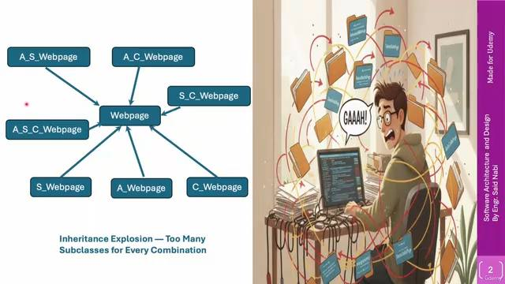
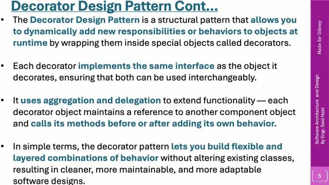
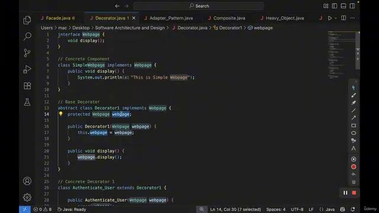
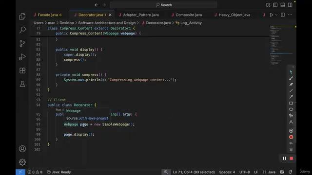
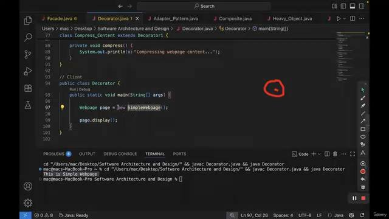
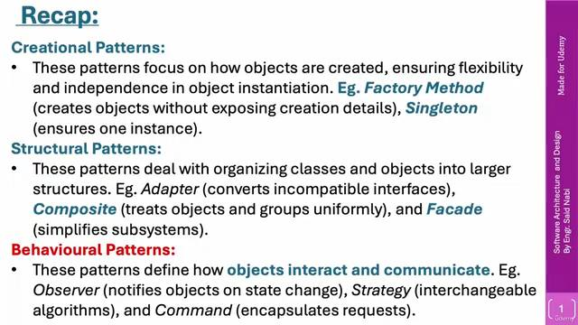
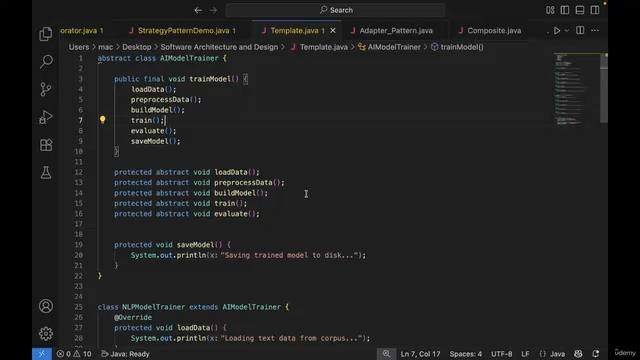
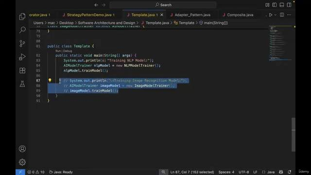

# Software Architecture Scalable：装饰器模式与模板方法模式（P70–P73）可复现文档

> 本课 P70–P73 用 Java 演示两个 GoF 设计模式：**装饰器模式（Decorator）** 与 **模板方法模式（Template Method）**。这四集里真正要跑起来的东西只有两块：一个 `decorator` 目录和一个 `template-method` 目录，都是纯 JDK 项目，不用 Maven、不用 Gradle（课里没讲构建工具），`javac` + `java` 两条命令就能跑。
>
> **关于代码来源的说明（请先读）**：逐字稿是讲师边看编辑器边口述的，没有把源码逐字念出来。下面第四章的完整代码是**按讲师口述的类结构、类名、方法名、执行顺序重建的**，并保证可以直接编译运行。凡是逐字稿里念过的输出文案（例如 `Authenticating user credential`、`loading data from the corpus`），我都按原样写；逐字稿只说了“这里也加了功能”而没有念出文案的地方，我在代码注释里标了「文案课里没念，可自行修改」，你可以放心替换成自己的。

---

## 1. 这一节做什么

P70–P73 是两段独立的小工程，不是一个完整系统。你要产出的是两个能编译运行的 Java 目录：

| 项目目录 | 覆盖视频 | 要解决的真实问题 | 最终产出 |
|---|---|---|---|
| `decorator/` | P70（概念 + UML）、P71（编码演示） | 客户不断提新需求（安全、认证、授权、缓存），如果每一组合都写一个子类，会出现**继承爆炸** | 1 个接口 + 1 个基础实现 + 1 个抽象装饰器 + 4 个具体装饰器，`main` 里用嵌套 `new` 的方式在**运行时**叠加任意层功能 |
| `template-method/` | P72（模式回顾 + 引入）、P73（编码演示） | 训练流程（加载数据 → 预处理 → 建模型 → 训练 → 评估 → 保存）**必须固定顺序**，任何一个模型训练器都不得调换、不得漏步 | 1 个抽象类（`final` 模板方法 + `abstract` 步骤 + 1 个带默认实现的钩子方法）+ 2 个具体训练器 |

两段的关键差别，用一句话记住：

- **装饰器**解决的是「功能怎么**加**」——不改原类，用包装（组合）一层层加；
- **模板方法**解决的是「步骤怎么**锁**」——父类把顺序钉死，子类只能填每一步的肉。

对前端背景的人来说，装饰器你可以直接类比成高阶函数：

```js
// JS 直觉：fetchPage -> withAuth(fetchPage) -> withCache(withAuth(fetchPage))
const page = withLog(withCache(withAuth(renderSimplePage)));
```

本课的 Java 版就是这个东西的面向对象写法——**包装器持有被包装对象**，调用时先转调内层，再执行自己的附加动作。模板方法则类似你在 React / Vue 里写的「生命周期 + 钩子」：框架（父类）决定什么时候调 `mounted`，你（子类）只填 `mounted` 里面干什么，不能改调用顺序。

---

## 2. 讲师原话（带时间戳）

讲师在 P70 花了大半集讲**为什么不能用继承**。他描述了一个开发者，先做出简单网页，然后客户依次要求「加密/安全」「加认证」「只有特定用户能看某些区块」「加快、加缓存」，于是这个开发者靠继承一路派生子类，最后产生了 `SecureWebPage`、`AuthorizedWebPage`、`CachedWebPage`、`AuthorizedSecureWebPage`、`AuthorizedCachedWebPage`、`SecureCachedWebPage`，以及「授权 + 安全 + 缓存全都有」的最后一个类：

> 「现在我们有了授权、安全、缓存，但我们有一大堆类与子类，这就是我们所说的**继承爆炸**（inheritance explosion）。每一个组合——安全的、缓存加安全的、授权加缓存的、授权加安全和缓存的——都要一个单独的类。我们不应该这么做。」
> —— p070 [04:28]

> 「装饰器模式告诉我们：不要为每一种可能的行为组合都创建多个子类（认证、授权、缓存、日志），装饰器模式允许我们在**运行时动态地**把这些行为附加到**一个基础对象**上。」
> —— p070 [05:27]

> 「这个模式使用的是**组合**，是 has-a 关系，而不是继承……我们可以用一个对象包装另一个对象，在不修改已有代码的前提下增量地添加职责。」
> —— p070 [05:57]



> 「每个装饰器实现和被装饰对象**相同的接口**，保证两者可以互换使用；它使用**聚合与委托**来扩展功能——每个装饰器持有一个到另一个组件对象的引用，在添加自己行为之前或之后调用它的方法。」
> —— p070 [09:26]–[09:56]



P70 末尾讲师切到 UML，明确了结构：`SimpleWebPage` 这个接口有两个实现方向——一个是基础网页 `BasicWebPage`，另一个是抽象装饰器 `WebPageDecorator`，装饰器下面再挂 `AuthenticationDecorator`、`AuthorizationDecorator` 等子类：

> 「装饰器模式的主要目的，是在**运行时**给对象添加功能，而不改变它的核心逻辑、不改变它所属的类。……我们会创建这个 `WebPage` 接口的对象，然后想加什么功能就从哪个装饰器加。」
> —— p070 [13:54]


P71 全程是在编辑器里演示。讲师从第 1 行的 `WebPage` 接口讲起，一路讲到 `main` 里怎么嵌套 `new`：

> 「我们先有一个接口 `WebPage`，里面只有一个方法 `display`……然后是 `SimpleWebPage` 类实现这个接口并覆盖 `display`。」
> —— p071 [00:47]

> 「然后我们有一个抽象类 Decorator，它实现 `WebPage`。抽象类不能被实例化……你可以创建它子类的对象，但不能创建这个原始类本身的对象。」
> —— p071 [01:39]–[02:02]

> 「这里有一个 `protected` 的 `WebPage` 实例——不是 `private`，是 `protected`——所以任何实现了 `WebPage` 的类对象都可以存到这个变量里。」
> —— p071 [02:24]

> 「`AuthenticateUser` 继承（`extends`）Decorator，因为这不是接口，所以不能写 `implements`，必须写 `extends`……构造函数里我们初始化它的父类，父类构造函数会把传进来的对象存起来。」
> —— p071 [03:46]–[05:10]



> 「在 `display` 里，我先调用 `display`，然后调用 `authorization`——这是我想添加的附加功能。」
> —— p071 [06:57]–[07:25]

```text
讲师在 p071 [10:36]–[11:29] 增加装饰层后口头念出的输出顺序：
  authentication first ... then compressing page ...
```

> 「所以我们现在把一个对象包在另一个对象里……现在我的对象被包进了 `AuthenticateUser` 对象。如果我跑一下，你会看到不同的输出——`authenticating user credential`。」
> —— p071 [10:08]–[10:36]





P72 是模式地图式回顾，把已学的创建型（Factory Method、Singleton）、结构型（Adapter、Composite、Facade、Decorator）和即将学的行为型（Observer、Strategy、Command）串了一遍，然后引入第一个行为型模式——模板方法：



> 「比如你必须先执行 process one，再执行 process two，再执行 process three 第三，我们必须维持这些函数、这些过程的执行顺序，那么在软件系统里我们就可以用模板方法模式。」
> —— p072 [03:58]

> 「模板方法模式以通用方式定义了一个算法的步骤……当两个或更多类具有相似功能和操作时最有效，让它们泛化到一个新的超类里，从而让改动只需在一个地方做，而不是多个地方。」
> —— p072 [04:28]–[05:27]

> 「你不可能先建模型再预处理，也不可能先训练再加载数据——无论是什么模型，NLP 训练器还是图像训练器，都必须遵守这些方法的顺序。」
> —— p072 [07:56]

P73 是模板方法的编码演示：

> 「在模板方法模式里，我们想强制执行一条规则：某些活动必须按特定顺序执行……所以这里我有一个抽象类 `AIModelTrainer`，里面有一个方法 `trainModel`，在 `trainModel` 方法内部我调用了不同的函数：`loadData`、`preprocessData`、`buildModel`、`train`、`evaluate`、`saveModel`。」
> —— p073 [00:21]

> 「这个方法（`trainModel`）是 `final` 的，意思是你不能重写这个 `trainModel` 方法，不能对它做修改。」
> —— p073 [00:49]

> 「接下来我有一批 `protected abstract` 方法：`loadData`、`preprocessData`、`buildModel`、`train`、`evaluate`……然后 `saveModel` 是带默认实现的：如果某个具体实现没有提供这个方法，就会用这里的定义。」
> —— p073 [01:18]–[01:47]

> 「对于抽象函数，我们必须提供定义，不能跳过……但抽象类本身不能被实例化，提供具体实现的子类才可以被实例化。」
> —— p073 [03:20]–[02:39]



> 「我运行一下——这里你可以看到 `loading data from the corpus`、`tokenizing and removing stop words`，这些是各个函数里我已经写好的输出。」
> —— p073 [05:30]–[05:58]



> 「现在是图像识别模型在跑：`training image recognition model`、`loading image and resizing and normalizing image`，这些消息来自不同的函数，函数按那个顺序被调用，而我们希望这个顺序被维持，所以用模板方法保证顺序不被改变。」
> —— p073 [06:24]–[07:10]

---

## 3. 从零复现

### 3.1 环境准备

课里全程只用 JDK，没提 IDE 品牌（讲师用的是某个在线/本地 Java 编辑器截图），也没提 JDK 版本。**JDK 版本课里没讲**，本文用 JDK 17（LTS，装哪个 11+ 都行，代码只用到很基础的语法）。

macOS（Homebrew）：

```bash
brew install openjdk@17
java -version    # 期望看到 openjdk version "17.x.x"
javac -version
```

Ubuntu / Debian：

```bash
sudo apt update
sudo apt install -y openjdk-17-jdk
java -version && javac -version
```

Windows：装 Temurin 17（或任意发行版）后，在 PowerShell 里执行 `java -version; javac -version`。

如果 `java -version` 报「找不到命令」，先把 `JAVA_HOME` 和 `$JAVA_HOME/bin` 加进 PATH。这一步课里没讲，但本地环境一定会撞上。

### 3.2 建立目录结构

本文需要两个完全独立的项目（不要放在同一个 `src` 下，两个 `main` 类各自独立）：

```bash
mkdir -p software-architecture-scalable/decorator/src
mkdir -p software-architecture-scalable/decorator/out
mkdir -p software-architecture-scalable/template-method/src
mkdir -p software-architecture-scalable/template-method/out
```

最终目录（所有文件内容见第 4 章）：

```text
software-architecture-scalable/
├── decorator/
│   ├── src/
│   │   ├── WebPage.java
│   │   ├── SimpleWebPage.java
│   │   ├── WebPageDecorator.java
│   │   ├── AuthenticateUser.java
│   │   ├── AuthorizeUser.java
│   │   ├── CompressedContent.java
│   │   ├── LogActivity.java
│   │   └── DecoratorDemo.java
│   └── out/
└── template-method/
    ├── src/
    │   ├── AIModelTrainer.java
    │   ├── NLPModelTrainer.java
    │   ├── ImageModelTrainer.java
    │   └── TemplateDemo.java
    └── out/
```

**注意**：本文所有类都不写 `package` 行，落在默认包里——这样 `javac -d out src/*.java` 之后，`out/` 下直接就是 `.class` 文件，`java -cp out DecoratorDemo` 一句就能跑。如果加 `package`，`-cp` 就要指到包的父目录，这是新手最常见的第一个坑。

### 3.3 编译并运行项目一（装饰器）

```bash
cd software-architecture-scalable/decorator
javac -d out src/*.java
java -cp out DecoratorDemo
```

预期输出（顺序很重要，和讲师 P71 演示一致：基础页最先打印，之后按「由内向外」回程依次打印各层附加功能）：

```text
=== 1. 只有基础页 ===
Simple Web Page
=== 2. 包一层认证 ===
Simple Web Page
Authenticating user credential
=== 3. 认证 + 压缩 ===
Simple Web Page
Authenticating user credential
Compressing page
=== 4. 换顺序：压缩 + 认证 ===
Simple Web Page
Compressing page
Authenticating user credential
=== 5. 认证 + 授权 + 压缩 + 日志 ===
Simple Web Page
Authenticating user credential
Authorizing user access rights
Compressing page
Logging activity
```

> 其中 `Authenticating user credential` 与 `Compressing page` 来自逐字稿原话（p071 [10:36]、[11:05]），其余三条文案（授权、日志、基础页）课里没有逐字念出，可按需替换；**换行的顺序和层级关系是模式本身保证的，不是我编的**。

### 3.4 编译并运行项目二（模板方法）

```bash
cd ../template-method
javac -d out src/*.java
java -cp out TemplateDemo
```

预期输出：

```text
Training NLP model
Loading data from the corpus
Tokenizing and removing stop words
Building NLP model architecture
Training NLP model on tokens
Evaluating NLP model accuracy
Saving model to disk
Training image recognition model
Loading image and resizing and normalizing image
Preprocessing images
Building image recognition model architecture
Training image recognition model on batches
Evaluating image recognition model accuracy
Saving model to disk
```

前两行 NLP 输出与逐字稿 p073 [05:58] 一致，图像那段的 `training image recognition model`、`loading image and resizing and normalizing image` 也与 p073 [06:24] 一致；剩余步骤的文案课里没念，属于示意。

### 3.5 验证「顺序锁定」是否真的生效

这是本章最值得动手做的一步，用来亲眼看到 `final` 的威力。在 `template-method/src/NLPModelTrainer.java` 里加一行 `@Override public final void trainModel() { }` 试图重写模板方法，重新编译：

```bash
javac -d out src/*.java
```

编译器会报形如 `trainModel() in NLPModelTrainer cannot override trainModel() in AIModelTrainer; overridden method is final` 的错误。**报错信息的具体措辞以你本地 JDK 版本的实际输出为准**，但只要出现 `final` 相关字样，就说明顺序保护生效了——这正是讲师在 p073 [00:49] 说的「`final` 意味着你不能重写」。

---

## 4. 完整代码

### 4.1 `decorator/src/WebPage.java`

```java
/**
 * 组件接口：p071 [00:47] 讲师说「我们有一个接口 WebPage，
 * 里面只有一个方法 display」。
 */
public interface WebPage {
    void display();
}
```

### 4.2 `decorator/src/SimpleWebPage.java`

```java
/**
 * 基础实现：p071 [01:16] 讲师说这个类 implements WebPage 并覆盖 display。
 * 它是被装饰的「核心对象」，任何装饰器都不修改它。
 */
public class SimpleWebPage implements WebPage {

    @Override
    public void display() {
        // 文案课里只说「你会看到 simple web page」，大小写未念出，可自行修改
        System.out.println("Simple Web Page");
    }
}
```

### 4.3 `decorator/src/WebPageDecorator.java`

```java
/**
 * 抽象装饰器：p070 UML 里叫 WebPageDecorator，p071 讲师口述时叫 "Decorator"
 * （字幕转写成了 Decorator1）。这里统一用 UML 里的名字。
 *
 * 两个关键点（讲师 p070 [09:26] + p071 [02:24]）：
 *  1. 它 implements WebPage —— 与基础对象同接口，才能互换使用；
 *  2. 它持有一个 protected 的 WebPage 字段 —— 聚合 + 委托，不是继承。
 */
public abstract class WebPageDecorator implements WebPage {

    // 讲师明确强调是 protected，不是 private
    protected WebPage webPage;

    public WebPageDecorator(WebPage webPage) {
        this.webPage = webPage;
    }

    // 默认行为：原样转发给被包装对象。子类覆盖它来「加料」。
    @Override
    public void display() {
        this.webPage.display();
    }
}
```

### 4.4 `decorator/src/AuthenticateUser.java`

```java
/**
 * 具体装饰器 1：p071 [03:46]-[06:01]
 * 讲师强调：因为父类是抽象类不是接口，所以用 extends，不能用 implements。
 */
public class AuthenticateUser extends WebPageDecorator {

    public AuthenticateUser(WebPage webPage) {
        // 讲师 p071 [05:10]：构造函数里初始化父类，
        // 父类构造函数会把传进来的对象存进 webPage 字段
        super(webPage);
    }

    @Override
    public void display() {
        super.display();          // 先跑原对象的行为
        this.authenticateUser();  // 再追加自己的功能
    }

    private void authenticateUser() {
        // 这条文案是逐字稿里念过的（p071 [10:36]）
        System.out.println("Authenticating user credential");
    }
}
```

### 4.5 `decorator/src/AuthorizeUser.java`

```java
/**
 * 具体装饰器 2：p071 [06:01]-[07:52]
 * 讲师说 authorization 函数体里是「authorizing user access rights」。
 */
public class AuthorizeUser extends WebPageDecorator {

    public AuthorizeUser(WebPage webPage) {
        super(webPage);
    }

    @Override
    public void display() {
        super.display();
        this.authorizeUser();
    }

    private void authorizeUser() {
        System.out.println("Authorizing user access rights");
    }
}
```

### 4.6 `decorator/src/CompressedContent.java`

```java
/**
 * 具体装饰器 3：p071 [10:36] 讲师加的第二层，输出里出现 compressing page。
 */
public class CompressedContent extends WebPageDecorator {

    public CompressedContent(WebPage webPage) {
        super(webPage);
    }

    @Override
    public void display() {
        super.display();
        this.compressContent();
    }

    private void compressContent() {
        System.out.println("Compressing page");
    }
}
```

### 4.7 `decorator/src/LogActivity.java`

```java
/**
 * 具体装饰器 4：p071 [11:29] 讲师最后加的一层，输出 logging activity。
 */
public class LogActivity extends WebPageDecorator {

    public LogActivity(WebPage webPage) {
        super(webPage);
    }

    @Override
    public void display() {
        super.display();
        this.logActivity();
    }

    private void logActivity() {
        System.out.println("Logging activity");
    }
}
```

### 4.8 `decorator/src/DecoratorDemo.java`

```java
/**
 * 运行入口：对应 p071 [08:15] 起讲师在 main 里一步步叠加的过程。
 * 讲师的做法就是「把上一步的对象当作参数，塞进下一个装饰器的构造函数」。
 */
public class DecoratorDemo {

    public static void main(String[] args) {

        // 1. 最初的核心对象
        WebPage page = new SimpleWebPage();
        System.out.println("=== 1. 只有基础页 ===");
        page.display();

        // 2. 包一层认证（讲师 p071 [10:08]：把 page 作为参数传进去）
        System.out.println("=== 2. 包一层认证 ===");
        WebPage authenticated = new AuthenticateUser(page);
        authenticated.display();

        // 3. 再包一层压缩
        System.out.println("=== 3. 认证 + 压缩 ===");
        WebPage authenticatedAndCompressed = new CompressedContent(new AuthenticateUser(page));
        authenticatedAndCompressed.display();

        // 4. 换一下顺序，输出顺序就跟着变（讲师 p070 [07:56] 讲的「运行时改顺序」）
        System.out.println("=== 4. 换顺序：压缩 + 认证 ===");
        WebPage reordered = new AuthenticateUser(new CompressedContent(page));
        reordered.display();

        // 5. 四个装饰器全叠上
        System.out.println("=== 5. 认证 + 授权 + 压缩 + 日志 ===");
        WebPage full = new LogActivity(
                            new CompressedContent(
                                new AuthorizeUser(
                                    new AuthenticateUser(page))));
        full.display();

        // 注意：page 原对象始终没有被修改过，它的类还是 SimpleWebPage
        System.out.println("=== page 的实际类型 ===");
        System.out.println(page.getClass().getName());
    }
}
```

### 4.9 `template-method/src/AIModelTrainer.java`

```java
/**
 * 抽象父类：p073 [00:21] 起。
 * trainModel() 是「模板方法」——它定义步骤与顺序，并且是 final。
 * 下面的 loadData / preprocessData / buildModel / train / evaluate 是抽象步骤，
 * saveModel 是带默认实现的钩子（hook）。
 *
 * 命名说明：讲师口述时模板方法叫 trainModel，里面调用的训练步骤也叫「train model」。
 * 同名的两个方法在 Java 里无法共存（会变成重载而非调用），所以这里把
 * 内部训练步骤命名为 train()。这是为了让代码能编译，语义与讲师一致。
 */
public abstract class AIModelTrainer {

    // final：子类不能重写，顺序因此被锁死
    public final void trainModel() {
        loadData();
        preprocessData();
        buildModel();
        train();
        evaluateModel();
        saveModel();
    }

    // 抽象步骤：子类必须逐一实现，一个都不能漏
    protected abstract void loadData();

    protected abstract void preprocessData();

    protected abstract void buildModel();

    protected abstract void train();

    protected abstract void evaluateModel();

    // 钩子方法：有默认实现，子类可以覆盖，也可以不管（讲师 p073 [01:47]）
    protected void saveModel() {
        // 文案课里没念，可自行修改
        System.out.println("Saving model to disk");
    }
}
```

### 4.10 `template-method/src/NLPModelTrainer.java`

```java
/**
 * 具体训练器 1：p073 [02:15]-[03:20]
 * 讲师强调：抽象类用 extends；抽象方法必须全部实现。
 */
public class NLPModelTrainer extends AIModelTrainer {

    @Override
    protected void loadData() {
        // 这条输出逐字稿念过（p073 [05:58]）
        System.out.println("Loading data from the corpus");
    }

    @Override
    protected void preprocessData() {
        // 这条输出逐字稿也念过（p073 [05:58]）
        System.out.println("Tokenizing and removing stop words");
    }

    @Override
    protected void buildModel() {
        System.out.println("Building NLP model architecture");
    }

    @Override
    protected void train() {
        System.out.println("Training NLP model on tokens");
    }

    @Override
    protected void evaluateModel() {
        System.out.println("Evaluating NLP model accuracy");
    }

    // 故意不覆盖 saveModel()，用来验证父类钩子的默认实现生效
}
```

### 4.11 `template-method/src/ImageModelTrainer.java`

```java
/**
 * 具体训练器 2：p073 [03:49] 起，结构与 NLP 版完全对称。
 */
public class ImageModelTrainer extends AIModelTrainer {

    @Override
    protected void loadData() {
        // 逐字稿念过（p073 [06:24]）
        System.out.println("Loading image and resizing and normalizing image");
    }

    @Override
    protected void preprocessData() {
        System.out.println("Preprocessing images");
    }

    @Override
    protected void buildModel() {
        System.out.println("Building image recognition model architecture");
    }

    @Override
    protected void train() {
        System.out.println("Training image recognition model on batches");
    }

    @Override
    protected void evaluateModel() {
        System.out.println("Evaluating image recognition model accuracy");
    }
}
```

### 4.12 `template-method/src/TemplateDemo.java`

```java
/**
 * 运行入口：p073 [04:19] 起。
 * 讲师用父类类型接收子类对象（多态），再调用父类的 trainModel()。
 */
public class TemplateDemo {

    public static void main(String[] args) {

        // 这一行 println 是讲师写的：先给用户一句提示
        System.out.println("Training NLP model");

        AIModelTrainer nlpTrainer = new NLPModelTrainer();
        nlpTrainer.trainModel();   // 进入父类的 final 模板方法，顺序由父类决定

        System.out.println("Training image recognition model");

        AIModelTrainer imageTrainer = new ImageModelTrainer();
        imageTrainer.trainModel();
    }
}
```

---

## 5. 逐行解释

### 5.1 装饰器部分

**`public interface WebPage { void display(); }`**
接口只声明一个行为，没有任何实现。它是「可互换性」的地基：基础网页和所有装饰器都实现它，所以你在客户端眼里它们都是 `WebPage`。讲师在 p070 [09:56] 说得更直白：装饰器和被装饰对象实现同一个接口，两者才能互换使用。

**`protected WebPage webPage;`**
这一行是整个模式的发动机。字段类型是**接口**而不是 `SimpleWebPage`，意味着它可以装任何 `WebPage` 实现——包括另一个装饰器。正因为能装装饰器，才能出现 `new CompressedContent(new AuthenticateUser(page))` 这种嵌套。如果这里写死成 `SimpleWebPage`，就只能包一层基础页，模式立刻失效。

为什么是 `protected` 不是 `private`？讲师在 p071 [02:24] 特意纠正过自己。`protected` 让子类（`AuthenticateUser` 等）能直接访问该字段；不过我们下面的子类代码其实是通过 `super.display()` 走父类方法间接访问的，所以改成 `private` + 父类提供 getter 也能工作——**这是课里没讲的取舍**，老实说按讲师版写 `protected` 就够了。

**`public WebPageDecorator(WebPage webPage) { this.webPage = webPage; }`**
构造注入。装饰器不 new 内层对象，而是**接收**一个已经存在的对象。这就是「组合优于继承」的物理体现：装饰器**持有**内层，而不是**是**内层的一种。

**`AuthenticateUser(WebPage webPage) { super(webPage); }`**
讲师在 p071 [05:10] 说明：子类构造函数先调父类构造函数，值被存进父类的 `webPage` 字段。如果没有这行 `super(...)`，`webPage` 会是 `null`，运行时 `display()` 立刻空指针。讲师在 p071 [10:08] 提到他删掉了原来的 `null`（编辑器模板自动生成的那个占位），说的就是这件事。

**`super.display(); this.authenticateUser();`**
顺序决定输出顺序。先 `super.display()` 意味着「先执行被包装对象的行为，再执行我自己的」。所以最内层（`SimpleWebPage`）**最先**打印，最外层装饰器**最后**打印——这也解释了为什么 `new CompressedContent(new AuthenticateUser(page))` 打印出「先认证、后压缩」：认证在里层，回程时先回。

如果反过来把 `this.authenticateUser()` 写在 `super.display()` 前面，输出顺序会整体反转。**讲师没有演示这个反序写法**，但 p070 [07:56] 明确说了顺序可以在运行时改变，所以值得你自己改一行试试——这是理解递归式调用栈最快的办法。

**`full.getClass()` 的验证**
`main` 最后打印 `page.getClass().getName()`，结果仍然是 `SimpleWebPage`。这是整个模式最想证明的一句话：核心对象在整个过程中**没有发生任何变化**，功能是「包」上去的，不是「改」进去的。对应讲师 p070 [08:56] 的「open for extension, closed for modification」。

**前端视角对照**：这四层嵌套等价于

```js
const render = pipe(
  withLog, withCompress, withAuthorize, withAuth
)(renderSimplePage);
```

区别只是 JS 用函数包装函数，Java 用对象包装对象。你在 Express 里写 `app.use(auth); app.use(logger);` 也是同一个思想——中间件就是一个装饰器，`next()` 就是 `super.display()`。

### 5.2 模板方法部分

**`public final void trainModel()`**
`final` 是整段代码的灵魂。它保证了「加载 → 预处理 → 建模 → 训练 → 评估 → 保存」这个顺序**不可能被子类改写**，也不可能被子类整个替换掉。讲师在 p073 [00:49] 专门解释这行。子类能做的是填每一步的内容，不能动步骤清单。

对前端背景的人，这个角色类似框架里的调度器：`useEffect(() => {...}, [])` 里你只写回调体，框架决定什么时候调它，你没办法让 React 在 render 之前先跑 effect。

**`loadData(); preprocessData(); ... saveModel();`**
六行顺序调用，无分支、无条件判断。这就是「模板」——骨架写死在父类，一次成型。注意最后一步 `saveModel()` 永远会被调用，不会漏。讲师在 p072 [07:56] 举的反例（不能先建模型再预处理、不能先训练再加载数据）在这里被物理排除了。

**`protected abstract void loadData();` 等五个**
`abstract` 强制子类必须实现，漏一个就编译不过——这就是「不得跳过步骤」的编译期保障。`protected` 而不是 `public`：这些是内部步骤，外部只该看到 `trainModel()`，不该直接调 `loadData()`。

**`protected void saveModel() { ... }`**
这是**钩子方法（hook）**。有方法体、不是 `abstract`，所以子类可以实现也可以不实现。讲师在 p073 [01:47] 的原话是：如果某个具体实现没有提供这个方法的定义，就用这里的定义。本项目的 `NLPModelTrainer` 就故意没覆盖它，你在输出里能看到 `Saving model to disk` 被打印——这证明默认实现生效了。

**`AIModelTrainer nlpTrainer = new NLPModelTrainer();`**
声明类型是抽象类，实例类型是具体子类。这是标准多态写法。注意不能直接 `new AIModelTrainer()`——编译不过，对应讲师 p073 [02:39] 强调的「抽象类不能被实例化，能实例化的是提供具体实现的子类」。

**为什么 `train()` 不叫 `trainModel()`**：Java 里同名同参的方法就是重写/重载，父类模板方法里再调同名的自己会变成无限递归。讲师口述时确实把两者都叫成「train model」，但落到能编译的代码上必须区分。这是本课口述与代码之间唯一需要「翻译」的地方，我在注释里标了。

---

## 6. 复现检查清单

按顺序打勾，每一步都通过再进下一步：

- [ ] `java -version` 与 `javac -version` 都能输出版本号（JDK 11+ 均可，课里没指定版本）
- [ ] 两个项目目录按 3.2 建立完毕，`decorator/out` 与 `template-method/out` 都存在
- [ ] 所有 `.java` 文件都**没有** `package` 声明；文件名与 `public class` 名完全一致（`WebPage.java` ↔ `public interface WebPage`）
- [ ] `decorator/` 下执行 `javac -d out src/*.java`，`out/` 里出现 8 个 `.class` 文件
- [ ] `java -cp out DecoratorDemo` 输出第一组 `Simple Web Page`，无异常堆栈
- [ ] 第 3 组（认证 + 压缩）的输出里，`Authenticating user credential` 出现在 `Compressing page` **之前**
- [ ] 第 4 组（把认证和压缩的顺序对调）的输出顺序**整体反转**——说明装饰顺序真的决定执行顺序
- [ ] 第 5 组四层全叠，输出里依次能看到认证、授权、压缩、日志四条消息
- [ ] `page.getClass().getName()` 打印出 `SimpleWebPage`，证明原对象未被改造
- [ ] 把 `AuthenticateUser.display()` 里两行调换顺序，输出顺序随之变化（可选验证）
- [ ] `template-method/` 下 `javac -d out src/*.java` 通过，出现 4 个 `.class`
- [ ] `java -cp out TemplateDemo` 里 NLP 段严格按「加载 → 预处理 → 建模 → 训练 → 评估 → 保存」六步打印，一步不少、一步不乱
- [ ] 图像段同样六步，且最后一步打印的是父类默认的保存消息（子类没覆盖钩子）
- [ ] 故意在 `NLPModelTrainer` 里加 `public void trainModel() {}`，编译**失败**并提示 `final`；确认后删掉这行
- [ ] 故意删掉 `NLPModelTrainer` 中的一个 `@Override` 步骤实现，编译**失败**（证明 abstract 强制实现）

---

## 7. 课里没讲但你会撞上的

**1. 抽象类的名字在两个地方不一致。** P70 的 UML 里叫 `WebPageDecorator`，P71 讲师口述时说的是 `Decorator`，字幕把它转写成了 `Decorator1` 和 `decorator one`。这不是两个类，是同一个东西。本文统一用 `WebPageDecorator`，因为它和 UML 一致、也不容易和 GoF 模式名混淆。你如果照字幕写 `Decorator`，代码照样能跑，不用纠结。

**2. 模板方法里两个方法同名的问题。** 讲师说的是「`trainModel` 里面调用 `train model`」。这在自然语言里没问题，在 Java 里会变成递归调用自己。本文把内部步骤改名 `train()`。这是**为了让代码能运行而做的必要改写**，不是讲师讲了别的设计。你如果发现自己的代码栈溢出（`StackOverflowError`），先检查这里。

**3. 构建工具与测试。** 课里全程没有 Maven / Gradle，没有 `pom.xml`，也没有任何单元测试。如果你想把这两个项目放进真实的 Java 工程，需要自己补 `pom.xml` 或 `build.gradle`，并把文件挪到 `src/main/java` 下——这时**必须加 `package` 声明**，否则主流构建工具会拒绝编译（默认包在模块化项目里是禁止的）。课里没讲这块。

**4. `main` 类名与文件名。** 讲师演示时 `main` 放在一个叫 `Decorator` 的 public 类里，而 `Decorator` 这个名字同时被抽象类用掉了。Java 里一个文件只能有一个 public 类且文件名必须匹配，同包内类名还不能重复。所以本文把入口拆成 `DecoratorDemo` 和 `TemplateDemo` 两个名字。这是为可编译性做的调整。

**5. 装饰器链的调试噩梦。** 叠到四层以后，一旦某一层抛异常，栈里会是四层 `display()` 嵌套，报错行号会指向最内层，但问题可能在最外层。课里没讲怎么排查。实用做法：给每层的打印加序号（例如 `[2] Authenticating`），或者临时在最外层打印 `full.getClass()` 看包装结构。前端类比就是 Redux middleware 链里出错时，你要靠 middleware 自己的日志判断是哪一层——这也是为什么真实项目里的中间件几乎都会打日志。

**6. 装饰器不是万能的。** 课里没讲它的代价：每一层都是一次额外的对象创建和方法转发，层数多时调用链变长、栈变深；而且装饰器只能加「前后包裹式」的行为，没法改变接口签名（想加返回值就做不到，因为 `display()` 返回 `void`）。如果需求是「改变接口」而不是「追加行为」，该用 Adapter（P72 里讲师回顾过）；如果是「把一组对象当单个对象处理」，该用 Composite。

**7. 模板方法与「顺序」的边界。** `final` 锁住的是**调用顺序**，锁不住**步骤之间是否互相依赖**。如果 `buildModel()` 悄悄依赖了 `preprocessData()` 产出的某个字段，而这个字段在 `preprocessData()` 抛异常时没被赋值，`buildModel()` 会在无提示的情况下跑出错误结果——编译器不会帮你。真实的 ML 流水线里，这就是「预处理产物没落盘但训练照跑」的经典事故。课里没讲错误处理，你自己加 try/catch 时要想清楚：是整条链失败，还是允许 `saveModel()` 在失败时跳过。

**8. 与前端工程的实际映射。** 你现在最可能用到这两个模式的地方：装饰器 → Express/Koa 中间件、Axios 拦截器、React 高阶组件；模板方法 → 任何「固定生命周期 + 可插拔实现」的基建，比如你写一个 `BaseAgentRunner`，把「拼 prompt → 调 LLM → 解析输出 → 落库」钉死，只把「怎么拼 prompt」「怎么解析」留给子类。这两条**都是我从前端经验里补的类比，讲师没有做这个迁移**，仅供参考。