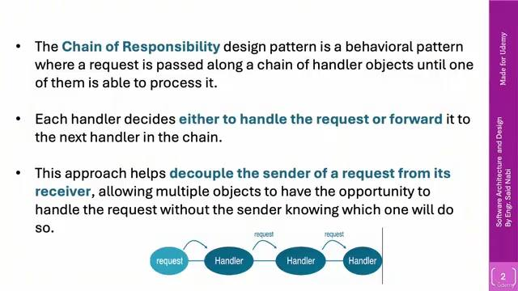
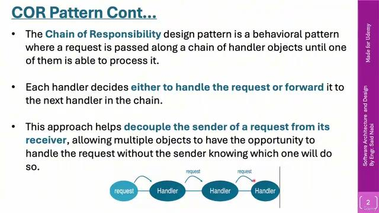
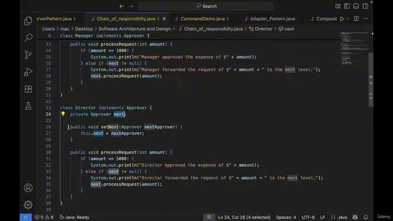
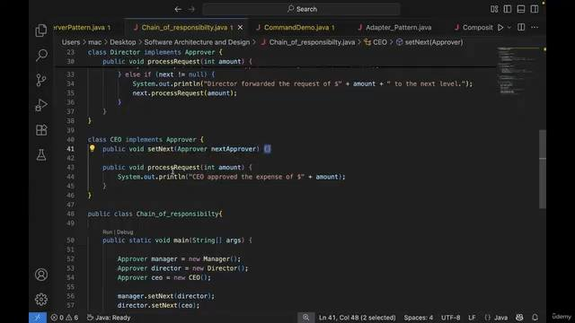
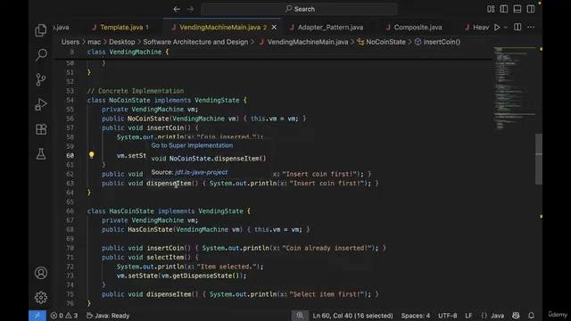
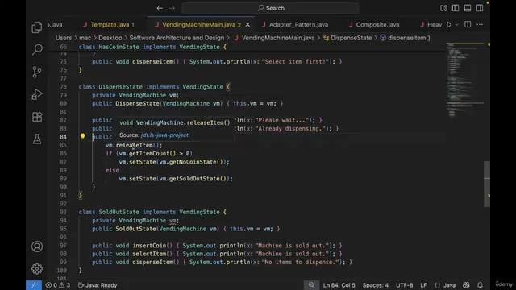
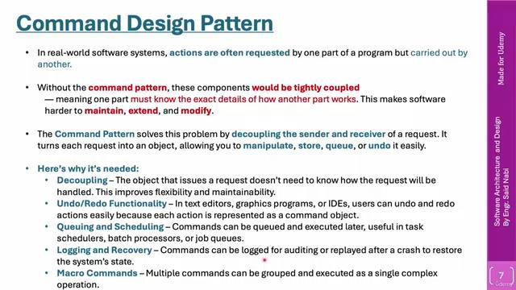

# Software Architecture Scalable｜P074–P078：责任链、状态、命令三个行为型模式的落地复现

这三节（P074–P078）是同一门课里连着讲的三个**行为型设计模式**：责任链（Chain of Responsibility）、状态（State）、命令（Command）。每个模式都是「先给一个生活类比 → 再给 UML 类图 → 再给 Java 代码并跑一遍」。P074/P076/P078 讲概念和类图，P075/P077 是现场敲代码，P078 现场只讲到类图，逐字稿里没有出现可运行的命令模式代码——这点很关键，后面会单独标出来。

---

## 1. 这一节做什么

从工程结果看，这五段视频要交付三样可以独立运行的小程序：

1. **一个多级审批链**：Manager / Director / CEO 三个审批人串成一条链，一笔金额从 Manager 开始往后传递，谁额度够谁批，都不够就拒绝。对应责任链模式。
2. **一台自动售货机**：机器只有「无币、有币、出货中、售罄」四个状态，用户在某个状态下点某个按钮，有的动作会产生状态迁移，有的只会被打回。对应状态模式。
3. **一套命令对象结构**：把「一次操作」封装成对象，从而可以排队、记录、撤销/重做。课里只讲到 UML 类图，代码没讲。

三者的共同点：**把一个「谁来处理 / 现在处于什么阶段 / 这个动作怎么撤销」的判断，从一大堆 if-else 里搬出来，变成一条可以插拔的对象序列**。对前端转 AI 应用工程师的人来说，这正好对应你在 Node 里常见的几种东西——中间件链、状态机、任务队列。



---

## 2. 讲师原话（带定位）

**关于责任链的定义：**

> "责任链设计模式是一种行为型模式，它将请求沿着处理者对象链传递，直到其中某个处理者能够处理该请求为止。"
> —— p074 [03:28]

> "因此每个处理者要么决定处理该请求，要么将其转发给链中的下一个处理者，这种方式有助于将请求的发送者与其接收者解耦。"
> —— p074 [04:28]

讲师在这一段反复强调类比：学生（请求发起者）→ 老师 → HOD → Prorector → Rector → 学院负责人（Head of the institute）。老师没预算就转给 HOD，HOD 不行转给 Prorector，一路往上，最后要么获批要么在某一层被拒。

> "所以学生要么会得到批准，要么会从这个人那里得到拒绝。"
> —— p074 [03:28]

关于 ATM 的例子，讲师的原话是：

> "处理者会先来到这里，如果这个处理者能够满足请求……但如果他无法满足，那么他只会返回5000，并将1000的请求转发给这个处理者。"
> —— p074 [05:27]

即 6300 元会被拆成 5000（5000 面额节点）+ 1000（1000 面额节点）+ 300（100 面额节点），一层层往后递减。



**关于责任链的代码判定条件（P075 现场编码）：**

> "如果金额小于或等于1000，那么经理就能够批准该金额；否则如果下一个处理者不为空，经理就会转发该请求。"
> —— p075 [01:24]

> "他会检查金额是否小于或等于5000，如果是就处理该请求并批准预算；但如果大于5000，他就会将请求传递给下一个审批者。"
> —— p075 [02:19]

CEO 那一层：

> "这里你可以看到这个方法的函数体是空的，我们没有下一个审批者，所以把这个方法的函数体留空了。"
> —— p075 [03:16]

**关于状态模式最重要的一句话：**

> "并不一定是对象中的每个函数在被调用时都会改变对象的状态，有时候即使你调用了一个函数，对象也可能保持在同一状态。"
> —— p076 [01:29]

这句话决定了整套代码的写法：每个状态类都要实现接口里的**全部**方法，不能实现的就打印一句提示、状态不动。

**关于售货机的初始状态：**

> "如果商品数量大于0，那么当前状态就是无硬币状态；如果商品数量不大于0，那么当前状态就是售罄状态。"
> —— p077 [02:22]

**关于命令模式：**

> "命令模式通过将请求的发送者和接收者解耦来解决这个问题……它将每个请求变成一个对象，使你能够轻松地操作、存储、排队或撤销它。"
> —— p078 [06:27]

讲师用 Word/Excel 的 Ctrl+Z 举例，说这类编辑软件内部维护**两个队列**：已执行命令队列（executed commands）和未执行命令队列（unexecuted commands），按 Ctrl+Z 就把命令从前者搬到后者。

---

## 3. 从零复现

### 3.1 环境与目录

课里用的是 **VS Code + Java**（p076 [05:27] 讲师明确说代码会随每节课提供，可以下载下来直接跑）。你这边准备：

- JDK 17 或更高（课里没指定版本，17 足够，`javac` 支持到哪个版本就用哪个）
- VS Code + Extension Pack for Java（可选，纯命令行也行）

目录结构（三块互相独立，不写 `package`，避免路径和包名对不上）：

```
design-patterns/
├── chain/
│   ├── Approver.java
│   ├── Manager.java
│   ├── Director.java
│   ├── CEO.java
│   └── ChainOfResponsibilityDemo.java
├── state/
│   ├── VendingState.java
│   ├── VendingMachine.java
│   ├── NoCoinState.java
│   ├── HasCoinState.java
│   ├── DispenseState.java
│   ├── SoldOutState.java
│   └── VendingMachineMain.java
└── command/
    ├── Command.java
    ├── Receiver.java
    ├── ConcreteCommand.java
    ├── Invoker.java
    └── CommandDemo.java
```

编译运行命令（在 `design-patterns/` 下执行）：

```bash
javac -d out chain/*.java && java -cp out ChainOfResponsibilityDemo
javac -d out state/*.java && java -cp out VendingMachineMain
javac -d out command/*.java && java -cp out CommandDemo
```

> 注意：目录名 `chain/state/command` 只是分类用的，Java 里**没有 package 声明**，所以 `java -cp out 类名` 就能直接跑。如果你加了 `package chain;`，那编译和运行的命令都要跟着改。

### 3.2 复现责任链（对应 P074–P075）

**第 1 步：先写契约。** 讲师 p075 [00:00] 的起手式是先声明接口 `Approver`，里面两个方法：`setNext(Approver)` 和 `processRequest(int)`。他原话是"这个方法接收整型变量参数，而另一个方法接收 Approver 类型的参数"——一个收审批人，一个收金额。

**第 2 步：写具体审批人。** 每个审批人内部持有一个 `private Approver next`，`setNext` 里把参数存进去；`processRequest` 里做「额度够就批 / 不够且 next 不为空就转发 / 否则拒绝」三分支。

**第 3 步：额度按讲师口述设定。** Manager ≤ 1000，Director ≤ 5000，CEO 无条件通过（他的 `setNext` 方法体是空的）。

**第 4 步：在 main 里串链。**

```java
manager.setNext(director);
director.setNext(ceo);
```

讲师 p075 [04:15] 原话："因此我们也创建了责任链，从经理开始，然后是总监，最后是首席执行官"。

**第 5 步：用三个金额验证。** 800 / 3000 / 12000。讲师 p075 [04:43]–[05:12] 明确说：800 走 Manager，3000 走 Director，12000 走 CEO。**每次请求都从 Manager 重新开始**，不是接着上一次往后传。

**在 JS/Node 里对应什么：** 这就是 Express/Koa 的中间件链。`app.use(fn)` 里 `fn(req, res, next)` 调 `next()` 就等于 `next.processRequest(amount)`。区别是 Java 版本传的是「下一个处理器对象」，JS 版本传的是「下一个函数」。

### 3.3 复现状态模式（对应 P076–P077）

**第 1 步：写状态接口 `VendingState`**，三个方法：`insertCoin()`、`selectItem()`、`dispenseItem()`。讲师 p077 [00:00] 说"如果你想实现这个接口，就必须重写这三个方法"。

**第 2 步：写 `VendingMachine` 主类（它不实现接口）。** 它持有五个字段：四个状态对象 + 一个 `currentState`，外加 `itemCount`。构造器里 new 出四个状态对象（每个都传 `this` 进去），然后按 `itemCount > 0` 决定初始状态。

**第 3 步：写四个状态类。** 每个都 `implements VendingState`，构造器里接住 `VendingMachine` 引用，然后：

| 状态类 | insertCoin | selectItem | dispenseItem |
|---|---|---|---|
| `NoCoinState` | 打印「金币已投入」并切到 `HasCoinState` | 提示「请先投币」 | 提示「请先投币」 |
| `HasCoinState` | 提示「金币已投入过」 | 打印「商品已选择」并切到 `DispenseState` | 提示「请先选商品」 |
| `DispenseState` | 提示「请稍候」 | 提示「请稍候」 | 调 `releaseItem()`，按剩余数量切回 `NoCoinState` 或 `SoldOutState` |
| `SoldOutState` | 提示「已售罄」 | 提示「已售罄」 | 提示「已售罄」 |

**第 4 步：main 里放 2 个商品，走两轮。** 讲师 p077 [14:02] 原话："我传入了两个值，最初我希望这台自动售货机里有两个商品"，然后连续调用 `insertCoin → selectItem → dispenseItem` 两遍，第三遍再投币就应该看到售罄。

**在 JS/Node 里对应什么：** 这就是 XState 那种有限状态机的最小形态。`currentState.insertCoin()` 等于 `machine.send('INSERT_COIN')`，`setState(...)` 等于状态迁移。Java 里 `currentState` 存的是**对象**，JS 里通常存**字符串**，但迁移逻辑是同一件事。

### 3.4 命令模式（对应 P078）

课里到 UML 就结束了。讲师 p078 [09:26] 说"现在我们把这张 UML 类图转换成 Java 代码"，之后逐字稿只剩音乐，没有实际编码内容。所以要跑起来，你只能照 UML 自己补——第 4 节给了一份**明确标注为示意的**实现，不要当成讲师原码。

---

## 4. 完整代码

> 说明：P075 / P077 的代码在视频里是**现场敲 + 逐行口述**的，下面这份是按逐字稿描述重写的**可编译可运行版本**，类名、方法名、判定阈值（1000 / 5000 / 无条件）、打印文案都对齐讲师口述。行号以上课时的屏幕为准，这里不做声称。

### 4.1 责任链：`chain/Approver.java`

```java
public interface Approver {
    void setNext(Approver next);
    void processRequest(int amount);
}
```

### 4.2 `chain/Manager.java`

```java
public class Manager implements Approver {
    private Approver next;

    @Override
    public void setNext(Approver next) {
        this.next = next;
    }

    @Override
    public void processRequest(int amount) {
        if (amount <= 1000) {
            System.out.println("Manager approved the expense of " + amount);
        } else if (next != null) {
            System.out.println("Manager forwarded the request of " + amount + " to the next level");
            next.processRequest(amount);
        } else {
            System.out.println("Request rejected: no approver available for " + amount);
        }
    }
}
```

### 4.3 `chain/Director.java`

```java
public class Director implements Approver {
    private Approver next;

    @Override
    public void setNext(Approver next) {
        this.next = next;
    }

    @Override
    public void processRequest(int amount) {
        if (amount <= 5000) {
            System.out.println("Director approved the expense of " + amount);
        } else if (next != null) {
            System.out.println("Director forwarded the request of " + amount + " to the next level");
            next.processRequest(amount);
        } else {
            System.out.println("Request rejected: no approver available for " + amount);
        }
    }
}
```

### 4.4 `chain/CEO.java`

```java
public class CEO implements Approver {
    @Override
    public void setNext(Approver next) {
        // CEO 是链尾，没有下一个审批人，方法体留空
    }

    @Override
    public void processRequest(int amount) {
        System.out.println("CEO approved the expense of " + amount);
    }
}
```

### 4.5 `chain/ChainOfResponsibilityDemo.java`

```java
public class ChainOfResponsibilityDemo {
    public static void main(String[] args) {
        Approver manager = new Manager();
        Approver director = new Director();
        Approver ceo = new CEO();

        manager.setNext(director);
        director.setNext(ceo);

        manager.processRequest(800);
        manager.processRequest(3000);
        manager.processRequest(12000);
    }
}
```

预期输出（三笔请求各自从 Manager 起跑）：

```
Manager approved the expense of 800
Manager forwarded the request of 3000 to the next level
Director approved the expense of 3000
Manager forwarded the request of 12000 to the next level
Director forwarded the request of 12000 to the next level
CEO approved the expense of 12000
```





### 4.6 状态模式：`state/VendingState.java`

```java
public interface VendingState {
    void insertCoin();
    void selectItem();
    void dispenseItem();
}
```

### 4.7 `state/VendingMachine.java`

```java
public class VendingMachine {
    private VendingState noCoinState;
    private VendingState hasCoinState;
    private VendingState dispenseState;
    private VendingState soldOutState;
    private VendingState currentState;

    private int itemCount;

    public VendingMachine(int itemCount) {
        this.itemCount = itemCount;

        this.noCoinState = new NoCoinState(this);
        this.hasCoinState = new HasCoinState(this);
        this.dispenseState = new DispenseState(this);
        this.soldOutState = new SoldOutState(this);

        this.currentState = itemCount > 0 ? noCoinState : soldOutState;
    }

    public void insertCoin() {
        currentState.insertCoin();
    }

    public void selectItem() {
        currentState.selectItem();
    }

    public void dispenseItem() {
        currentState.dispenseItem();
    }

    public void setState(VendingState state) {
        this.currentState = state;
    }

    public VendingState getNoCoinState() {
        return noCoinState;
    }

    public VendingState getHasCoinState() {
        return hasCoinState;
    }

    public VendingState getDispenseState() {
        return dispenseState;
    }

    public VendingState getSoldOutState() {
        return soldOutState;
    }

    public int getItemCount() {
        return itemCount;
    }

    public void releaseItem() {
        if (itemCount > 0) {
            System.out.println("dispensing item");
            itemCount = itemCount - 1;
        }
    }
}
```

### 4.8 `state/NoCoinState.java`

```java
public class NoCoinState implements VendingState {
    private VendingMachine vm;

    public NoCoinState(VendingMachine vm) {
        this.vm = vm;
    }

    @Override
    public void insertCoin() {
        System.out.println("coin inserted successfully");
        vm.setState(vm.getHasCoinState());
    }

    @Override
    public void selectItem() {
        System.out.println("please insert coin first");
    }

    @Override
    public void dispenseItem() {
        System.out.println("please insert coin first");
    }
}
```

### 4.9 `state/HasCoinState.java`

```java
public class HasCoinState implements VendingState {
    private VendingMachine vm;

    public HasCoinState(VendingMachine vm) {
        this.vm = vm;
    }

    @Override
    public void insertCoin() {
        System.out.println("coin already inserted");
    }

    @Override
    public void selectItem() {
        System.out.println("item selected");
        vm.setState(vm.getDispenseState());
    }

    @Override
    public void dispenseItem() {
        System.out.println("select item first");
    }
}
```



### 4.10 `state/DispenseState.java`

```java
public class DispenseState implements VendingState {
    private VendingMachine vm;

    public DispenseState(VendingMachine vm) {
        this.vm = vm;
    }

    @Override
    public void insertCoin() {
        System.out.println("please wait, dispensing in progress");
    }

    @Override
    public void selectItem() {
        System.out.println("please wait, dispensing in progress");
    }

    @Override
    public void dispenseItem() {
        vm.releaseItem();

        if (vm.getItemCount() > 0) {
            vm.setState(vm.getNoCoinState());
        } else {
            vm.setState(vm.getSoldOutState());
        }
    }
}
```



### 4.11 `state/SoldOutState.java`

```java
public class SoldOutState implements VendingState {
    private VendingMachine vm;

    public SoldOutState(VendingMachine vm) {
        this.vm = vm;
    }

    @Override
    public void insertCoin() {
        System.out.println("machine is sold out, no items to dispense");
    }

    @Override
    public void selectItem() {
        System.out.println("machine is sold out, no items to dispense");
    }

    @Override
    public void dispenseItem() {
        System.out.println("machine is sold out, no items to dispense");
    }
}
```

### 4.12 `state/VendingMachineMain.java`

```java
public class VendingMachineMain {
    public static void main(String[] args) {
        VendingMachine vm = new VendingMachine(2);

        vm.insertCoin();
        vm.selectItem();
        vm.dispenseItem();

        vm.insertCoin();
        vm.selectItem();
        vm.dispenseItem();

        // 第三次：仓库已空
        vm.insertCoin();
    }
}
```

预期输出：

```
coin inserted successfully
item selected
dispensing item
coin inserted successfully
item selected
dispensing item
machine is sold out, no items to dispense
```

### 4.13 命令模式（课里没有代码，以下为示意）

> **课里没有可运行的命令模式代码**，P078 只讲到 UML 类图（Command 接口含 `execute` / `unexecute`，ConcreteCommand 持有 Receiver，Invoker 提供 `setCommand` / `executeCommand` / `undoCommand`）。下面这份是按该 UML 补的最小可跑版本，用于帮助理解，**不是讲师原码**。

`command/Command.java`

```java
public interface Command {
    void execute();
    void unexecute();
}
```

`command/Receiver.java`

```java
public class Receiver {
    private String text = "";

    public void action(String piece) {
        text = text + piece;
        System.out.println("current text: " + text);
    }

    public void undoAction() {
        if (!text.isEmpty()) {
            text = text.substring(0, text.length() - 1);
        }
        System.out.println("after undo: " + text);
    }
}
```

`command/ConcreteCommand.java`

```java
public class ConcreteCommand implements Command {
    private Receiver receiver;
    private String piece;

    public ConcreteCommand(Receiver receiver, String piece) {
        this.receiver = receiver;
        this.piece = piece;
    }

    @Override
    public void execute() {
        receiver.action(piece);
    }

    @Override
    public void unexecute() {
        receiver.undoAction();
    }
}
```

`command/Invoker.java`

```java
import java.util.ArrayDeque;
import java.util.Deque;

public class Invoker {
    private Command command;
    private Deque<Command> executed = new ArrayDeque<>();

    public void setCommand(Command command) {
        this.command = command;
    }

    public void executeCommand() {
        if (command != null) {
            command.execute();
            executed.push(command);
        }
    }

    public void undoCommand() {
        if (!executed.isEmpty()) {
            executed.pop().unexecute();
        }
    }
}
```

`command/CommandDemo.java`

```java
public class CommandDemo {
    public static void main(String[] args) {
        Receiver receiver = new Receiver();
        Invoker invoker = new Invoker();

        for (String piece : new String[] {"A", "B", "C"}) {
            invoker.setCommand(new ConcreteCommand(receiver, piece));
            invoker.executeCommand();
        }

        invoker.undoCommand();
        invoker.undoCommand();
    }
}
```



---

## 5. 逐行解释

### 5.1 责任链：为什么「额度判断」要写在每个具体类里

`Approver` 只声明两件事：能接下一个审批人、能处理一笔金额。接口里**没有**额度字段——额度是每个实现类自己的私有常量（`1000` / `5000` / 无上限）。这样做的直接收益是：加一个「VP 审批人、额度 20000」只需要新增一个类，在 main 里改一行 `director.setNext(vp)`，`Manager` 和 `Director` 一行都不用动。

`else if (next != null)` 这个分支是整个模式的安全阀。讲师在 p075 里反复说「if the next is not equal to none」——如果 `next` 是 null 还去调 `next.processRequest(...)`，就是 `NullPointerException`。你在 JS/Express 里对应的是「忘了写 `next()` 或者链尾没兜底，请求就挂住了」，现象不一样（那边是请求超时，这边是直接抛异常），但根因一样：**链尾必须有明确的终止行为**。

`CEO.setNext()` 方法体为空，是刻意的。讲师 p075 [03:16] 原话："我们没有下一个审批者，所以把这个方法的方法体留空了"。接口要求必须实现，但语义上 CEO 没有下级，所以给一个空实现。这里更稳的写法是抛 `UnsupportedOperationException`，课里没这么做，我们照原样。

三个金额的验证顺序也有讲究：**每次都从 `manager.processRequest()` 重新进入**。如果你写成 `manager.processRequest(800)` 之后再调 `director.processRequest(3000)`，那 3000 就绕过了 Manager 的额度判断——链的语义是「从头开始逐级判断」，不是「接着上次往下走」。

### 5.2 状态模式：`VendingMachine` 为什么自己不是状态

`VendingMachine` 没有 `implements VendingState`。讲师 p077 [00:28] 讲得很清楚："这个自动售货机类通常用于操作自动售货机，它并没有实现这个接口"。它是**上下文（context）**：对外提供 `insertCoin/selectItem/dispenseItem` 三个入口，对内把调用**原样委托**给 `currentState`。

这一层委托是所有「无状态迁移」分支能工作的原因。比如现在是 `SoldOutState`，用户点 `insertCoin()`，`VendingMachine.insertCoin()` 照样调 `currentState.insertCoin()`，只是 `SoldOutState` 里的实现是打印一句售罄提示、**不改 `currentState`**。这就精确对应了讲师 p076 [01:29] 那句话：不是每次函数调用都要换状态。

`releaseItem()` 里 `if (itemCount > 0)` 这个判断，在 `DispenseState` 已经把 `itemCount` 判过一次的前提下看起来是重复的，但它是防御性的：`releaseItem` 是 `public` 的，任何状态类都能调。加这一层，`DispenseState.dispenseItem()` 里就不会出现「出货到 -1」。

`setState` + 四个 `getXxxState()` 的组合，本质是把「状态对象的创建」锁在构造器里，其他类只能「取用」不能「新建」。好处是四个状态对象整个生命周期只有一份，状态切换就是换一个引用，没有对象分配开销；代价是这四个 `getter` 必须全部公开——讲师在 p077 [04:09] 讲到这里时也只是一句带过。

**课里代码与状态机图不一致的地方（必须点出来）：** P076 画的状态机图里有「投入硬币总额 vs 商品价格」的比较，钱不够就停在 `idle` 并提示「再投一些」。但 P077 的 Java 代码里**完全没有价格和总金额字段**，`NoCoinState.insertCoin()` 是无条件切到 `HasCoinState`。也就是说课里的代码是图的一个简化版。你自己扩的时候要加一个 `int total` 和一个 `int price`。

### 5.3 命令模式：为什么要把「动作」变成一个对象

`Receiver` 里其实已经有 `action()` 和 `undoAction()` 两个方法了，按说不包一层也能直接调。包成 `Command` 之后多出来的是**可持有性**：`Invoker` 能把命令塞进队列（课里那个 `ArrayDeque`）、能记录历史、能在之后任意时刻取出来再执行或撤销。

`ConcreteCommand` 里同时持有 `receiver` 和 `piece`，意思是「这条命令知道要对谁、做什么」。这正是讲师 p078 [06:27] 说的 "把每个请求转换成一个对象"——`piece` 这个参数被固化进了对象里，而不是留在调用现场。

`Invoker.undoCommand()` 用的是栈（`push` / `pop`），对应讲师在 Word 演示里说的「已执行队列 → 未执行队列」。真正的撤销/重做需要两个栈，否则重做无处可取；课里没讲到这一层，示意代码也只做了单向撤销。

**在 JS/Node 里对应什么：** 命令对象就是「把 `() => doSomething(x)` 存进数组」。队列消费就是 `for (const cmd of queue) cmd.execute()`。区别在于 Java 的 `Command` 接口是编译期契约，TS 里你写成 `interface Command { execute(): void; unexecute(): void }` 就是同一件事。

---

## 6. 复现检查清单

编译前：

- [ ] `java -version` 和 `javac -version` 都能输出版本号，且两者大版本一致
- [ ] 每个 `.java` 文件里**只有一个 `public` 类**，且**文件名和类名完全一致**（`Manager.java` 里只能有 `public class Manager`）
- [ ] 三块代码之间没有 `import` 互相引用，各自独立编译
- [ ] 没有写 `package` 声明（如果写了，编译和运行命令都要跟着改）

责任链跑通：

- [ ] 输出里出现 `Manager approved the expense of 800`
- [ ] 3000 那一笔同时出现 `Manager forwarded...` 和 `Director approved...`
- [ ] 12000 那一笔出现三次转发/批准（Manager 转发 → Director 转发 → CEO 批准）
- [ ] 把 `director.setNext(ceo)` 注释掉再跑 12000，程序**不崩**，而是走到「no approver available」分支

状态模式跑通：

- [ ] 前两轮都完整输出 `coin inserted successfully` / `item selected` / `dispensing item`
- [ ] 第三轮 `insertCoin()` 输出售罄提示，且**不再打印** `coin inserted successfully`
- [ ] 把构造参数从 `2` 改成 `0`，第一句 `insertCoin()` 就应该直接输出售罄提示
- [ ] 单独调 `vm.selectItem()`（不先投币）能拿到 `please insert coin first`

命令模式（示意代码）：

- [ ] 能连续输出 A / B / C 三次追加后的文本
- [ ] 两次 `undoCommand()` 后文本回退两个字符
- [ ] 队列空了再 `undoCommand()` 不抛异常

---

## 7. 课里没讲但你会撞上的

**1. `javac` 报「class X is public, should be declared in a file named X.java」。** 这是新手在跟这门课时最容易撞的墙。讲师在 VS Code 里每个类都是单独一个文件，你如果图省事全塞进一个 `Main.java`，`public class Manager` 就会编译失败。解法：要么拆文件，要么把除主类外的类全部去掉 `public` 修饰符。

**2. 构造器里 `new NoCoinState(this)` 的 `this` 逃逸。** 四个状态类在 `VendingMachine` 构造器里就拿到了 `this` 引用。目前这些状态类的构造器**只是把引用存起来**，所以没问题；但如果你在状态类构造器里调用 `vm.getItemCount()`，而此时 `VendingMachine` 的字段还没全部初始化完，拿到的可能是默认值 `0`。加任何构造期逻辑前先想清楚这一点。

**3. 责任链的「拒绝」不是 `throw`。** 课里的拒绝分支只是 `System.out.println`，调用方拿不到任何反馈。生产代码里通常让 `processRequest` 返回一个结果对象或抛出自定义异常，否则审批被拒了你不知道。课里没讲怎么改，这是你的判断。

**4. 状态模式的打印语句是硬编码中文/英文混排。** 我上面统一用了英文（对齐讲师口述），你在 Windows 控制台跑的时候如果看到乱码，是终端编码问题，`chcp 65001` 或换 PowerShell 7 即可，和代码无关。

**5. 命令模式，你手上没有可运行的讲师代码。** P078 逐字稿在 10:05 之后只剩音乐，说明视频里没有落地的编码环节（或者被剪掉了）。第 4.13 节那份实现是我按 UML 补的示意，能跑，但**不要把它当成「课里就是这么写的」引用**。想严格跟课，命令模式你只能拿到类图级别的理解：`Command` 接口两个方法、`ConcreteCommand` 持 `Receiver`、`Invoker` 提供 `setCommand` / `executeCommand` / `undoCommand`。

**6. 这三个模式在 JS/Node 里都没有语言层面的对应物。** Java 靠 `interface` + `implements` 强制契约，TS 的 `interface` 在编译后会被擦除，运行时**不做任何检查**——你写 `class Manager implements Approver` 但漏实现一个方法，`tsc` 会报错，直接 `node` 跑 `.js` 不会。所以把这三段代码翻成 Node 时，契约得靠测试守住，不能靠编译器。

**7. 状态和锁/并发的关系，课里一句没提。** 如果 `VendingMachine` 会被多个请求同时调用，`itemCount` 和 `currentState` 都存在竞态：两个线程可能同时通过 `itemCount > 0` 判断然后各自减一，把库存减成负数。Java 里对应 `synchronized` 方法或 `AtomicInteger`；在 Node 里因为单线程事件循环，**同步代码块内不会被打断**，但一旦中间有 `await`，状态就可能被别的请求改掉——所以 Node 版本的 `releaseItem` 要保持完全同步、不夹 `await`。

**8. 讲师反复强调的「代码会随课提供」。** p076 [05:27] 原话："我会针对每一讲提供这些代码片段……你可以下载这些 Java 代码，并且完全可以用它们来加深理解"。如果你手上有配套源码，优先用源码对照，本文档里的代码是按逐字稿重写的可运行版本，行号和变量命名以讲师屏幕为准。