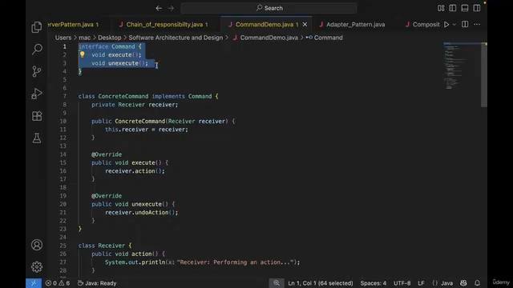
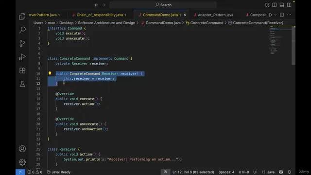
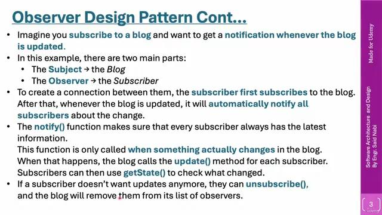
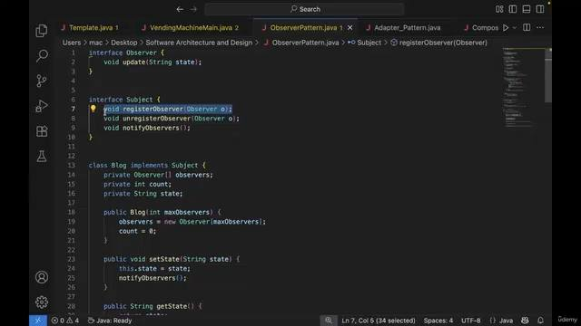
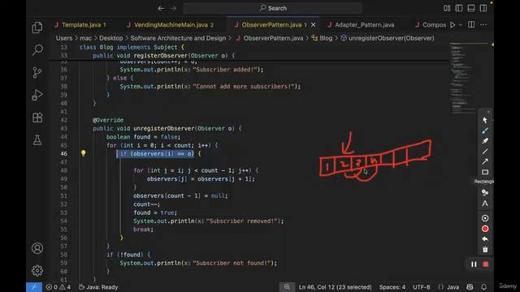
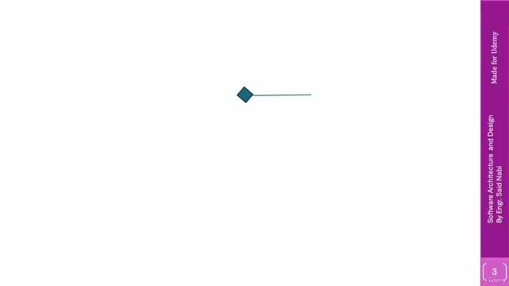
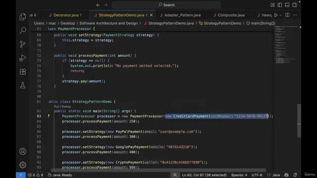
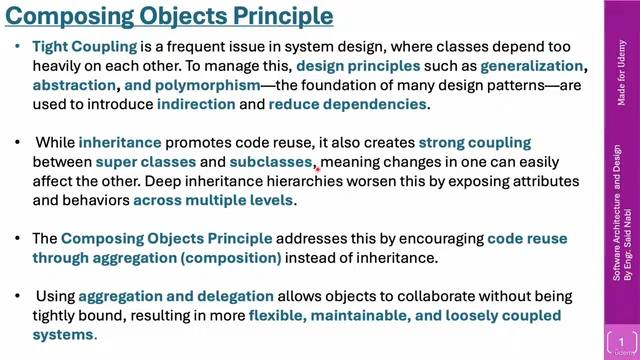

# Software Architecture Scalable P079–P084 复现文档：Command / Observer / Strategy 与组合对象原则

## 1. 这一节做什么

这节课覆盖 P079–P084，核心不是讲一堆名词，而是用 Java 把三个行为型设计模式跑起来，再用一个设计原则收尾：

- **P079 Command 命令模式**：把“请求”封装成一个对象，让调用者只认识 `Command` 接口，不直接认识真正干活的 `Receiver`。
- **P080–P081 Observer 观察者模式**：`Subject` 维护一组 `Observer`，状态变化时逐个通知；演示注册、取消注册、通知。
- **P082–P083 Strategy 策略模式**：把不同支付方式封装成不同策略类，运行时通过 `setStrategy()` 切换。
- **P084 Composing Objects Principle 组合对象原则**：优先用组合/聚合降低耦合，而不是到处用继承。P084 是原则讲解，**逐字稿里没有给代码**，所以本文不硬造它的实现，只给可执行的设计对照表。

本文目标：你在本机新建一个目录，按下面的文件路径保存 3 个 Java 文件，执行编译和运行命令，就能看到与课程一致的三组演示输出。课程使用 Java，前端读者可以把 `interface` 理解成 TypeScript 的 `interface`，把“面向接口编程”理解成“依赖注入时依赖抽象类型，而不是具体实现”。

课里没有讲 Maven/Gradle 工程化，也没有给 JDK 版本号。本文用**纯 JDK、无第三方依赖**的方式复现；命令中的 JDK 版本请以你本机为准。

最终目录结构如下：

```text
scalable-patterns/
├── src/
│   ├── command/
│   │   └── CommandDemo.java
│   ├── observer/
│   │   └── ObserverDemo.java
│   └── strategy/
│       └── StrategyDemo.java
└── out/
```

---

## 2. 讲师原话（带「—— pNNN [MM:SS]」）

> "现在让我们用 Java 实现命令设计模式。我已经添加了一个 command 接口，你需要重写 execute 和 un-execute 这两个方法。"
> —— p079 [00:00]

> "有一个称为主题的主对象，它维护一个由其他称为观察者的对象组成的列表。只要主题内部发生变化，它就会自动把变化通知给所有观察者。"
> —— p080 [00:29]

> "我们有一个博客对象，并希望最多有五个观察者。我们把这些观察者全部注册进去。如果我们要改变状态，比如发布一篇题为《理解观察者模式》的新文章。"
> —— p081 [08:48]

> "策略设计模式是一种行为型模式，允许定义多种算法，将每种算法封装到各自的类中，并在运行时轻松切换。"
> —— p082 [00:29]

> "我们将信用卡支付作为参数传给了这个支付处理器类，因为这个类期望我们传入一个支付策略类型的变量。"
> —— p083 [05:09]

> "这条原则告诉我们，不要使用继承，而应使用组合；这样我们实际上可以降低组件之间的耦合。"
> —— p084 [00:00]

下面是课程中与 UML、接口定义和主流程相关的关键画面。截图路径保持清单原样。

















---

## 3. 从零复现

### 3.1 准备目录和 Java 环境

先建目录：

```bash
mkdir -p scalable-patterns/src/command
mkdir -p scalable-patterns/src/observer
mkdir -p scalable-patterns/src/strategy
mkdir -p scalable-patterns/out
cd scalable-patterns
```

检查 Java：

```bash
javac -version
java -version
```

课里没有规定 JDK 版本。你只要保证 `javac` 和 `java` 命令可用即可。本文代码只用了接口、类、数组、构造器、`if`、`for`、`System.out.println` 这些基础语法。

### 3.2 先做 Command：请求被封装成对象

Command 模式的角色要分清：

1. `Command`：接口，规定 `execute()` 和 `unExecute()`。
2. `Receiver`：真正干活的对象，有 `action()` 和 `undoAction()`。
3. `ConcreteCommand`：实现 `Command`，内部持有 `Receiver`，把 `execute()` 转成 `receiver.action()`。
4. `Invoker`：持有 `Command`，提供 `setCommand()`、`executeCommand()`、`undoCommand()`。
5. `CommandDemo`：创建 Receiver、ConcreteCommand、Invoker，然后执行和撤销。

讲师在 P079 强调：实现接口就必须提供接口里所有方法的定义；`ConcreteCommand` 构造时要把 `Receiver` 传进去并保存；`Invoker` 里先判断 `command != null`，再调用执行或撤销。

复现顺序：

- 先写 `Command` 接口；
- 再写 `Receiver`；
- 再写 `ConcreteCommand`；
- 再写 `Invoker`；
- 最后在 `main` 里串起来。

对应代码在 4.1。运行后应看到“执行动作”和“撤销动作”两行，以及没有设置命令时的提示。

### 3.3 再做 Observer：Subject 维护 Observer 列表

Observer 模式的关键不是“通知”两个字，而是**Subject 持有 Observer 的集合**。P080 里讲师用博客和订阅者举例：博客是 Subject，订阅者是 Observer；博客更新时通知所有订阅者。P081 的 Java 实现里，`Blog` 用一个数组保存观察者，并用 `count` 记录当前数量。

复现步骤：

1. 定义 `Observer` 接口，里面只有 `update(String state)`。
2. 定义 `Subject` 接口，里面有三个方法：`registerObserver`、`unregisterObserver`、`notifyObservers`。
3. `Blog implements Subject`，内部用 `Observer[] observers` 和 `int count`。
4. `registerObserver`：如果 `count < observers.length`，放到 `observers[count]`，然后 `count++`；否则提示不能继续添加。
5. `unregisterObserver`：遍历数组找到目标；找到后把后面的元素整体前移一位，把最后一个位置置 `null`，`count--`。
6. `notifyObservers`：从 0 到 `count-1` 逐个调用 `observer.update(state)`。
7. `Subscriber implements Observer`，`update` 打印“谁收到了什么状态”。
8. `main` 里创建容量为 5 的 Blog，注册 Alice、Bob、Charlie，改变状态，再取消 Bob，再改变状态。

对应代码在 4.2。运行后应看到三次“Subscriber added”，第一次状态变化三个人都收到；取消 Bob 后，第二次状态变化只有 Alice 和 Charlie 收到。

### 3.4 再做 Strategy：运行时替换算法

Strategy 模式的关键是：`PaymentProcessor` 不直接写 `if (type == 信用卡) ... else if (type == PayPal) ...`，而是持有一个 `PaymentStrategy` 接口引用。具体用哪种支付方式，由外部传入，运行时可以 `setStrategy()` 换掉。

复现步骤：

1. 定义 `PaymentStrategy`，方法 `pay(int amount)`。
2. 写四个实现类：`CreditCardPayment`、`PayPalPayment`、`GooglePayment`、`CryptoPayment`。每个类保存自己的必要字段，例如卡号、邮箱、手机号、钱包地址。
3. 写 `PaymentProcessor`，字段是 `private PaymentStrategy strategy`。
4. 构造器接收策略；`setStrategy` 替换策略；`processPayment` 里如果 `strategy == null` 就提示“还没选支付方式”，否则调用 `strategy.pay(amount)`。
5. `main` 里先传信用卡策略支付 250，再换成 PayPal 支付 300，再换 Google 支付 400，再换 Crypto 支付 500，最后演示 `null` 策略的提示。

对应代码在 4.3。运行后应看到不同策略各自的支付输出，以及最后一行“No payment method selected yet”。

### 3.5 P084 没有代码：用设计对照表检查前三个模式

P084 讲的是组合对象原则：不要把所有变化都塞进继承层级，优先把可变化的部分拆成独立对象，再组合起来。讲师举了 `Car` 和 `Engine` 的例子：如果 `Car` 是父类，`ElectricCar`、`GasCar`、`HybridCar` 都继承它，父类引擎一变，子类都受影响；如果 `Car` 组合一个 `Engine`，就可以在运行时换引擎实现。

这一节没有 Java 代码，不要为了凑代码编造课程实现。复现方式是做一次设计复盘：

| 检查问题 | 如果答案是“是” | 应该怎么改 |
|---|---|---|
| 我是不是写了很多 `if/else if` 来区分算法？ | 可能是 Strategy 场景 | 把每个分支抽成策略类，由 `PaymentProcessor` 持有接口 |
| 我是不是让子类继承父类只为复用一小段代码？ | 可能造成强耦合 | 把可复用行为拆成独立对象，用组合/委托 |
| 我是不是一改父类就影响很多子类？ | 继承层级过深 | 用聚合替代继承，缩小父类职责 |
| 我是不是在对象内部直接 `new` 具体实现？ | 调用方依赖具体类 | 改成构造器传入接口类型，运行时替换 |

---

## 4. 完整代码

以下 3 个文件都是完整文件，直接保存即可。为了复现方便，每个文件使用“一个 public 类 + 多个非 public 类”的单文件形式；生产项目通常一个类一个文件，但课里没有讲工程拆分，这里以能编译运行为先。

### 4.1 `src/command/CommandDemo.java`

```java
public class CommandDemo {

    public static void main(String[] args) {
        Receiver receiver = new Receiver();
        Command command = new ConcreteCommand(receiver);

        Invoker invoker = new Invoker();
        invoker.setCommand(command);

        System.out.println("== command set ==");
        invoker.executeCommand();
        invoker.undoCommand();

        System.out.println("== empty invoker ==");
        Invoker emptyInvoker = new Invoker();
        emptyInvoker.executeCommand();
        emptyInvoker.undoCommand();
    }
}

interface Command {
    void execute();

    void unExecute();
}

class Receiver {
    public void action() {
        System.out.println("Receiver performing an action");
    }

    public void undoAction() {
        System.out.println("Receiver undoing the action");
    }
}

class ConcreteCommand implements Command {
    private final Receiver receiver;

    public ConcreteCommand(Receiver receiver) {
        this.receiver = receiver;
    }

    @Override
    public void execute() {
        receiver.action();
    }

    @Override
    public void unExecute() {
        receiver.undoAction();
    }
}

class Invoker {
    private Command command;

    public void setCommand(Command command) {
        this.command = command;
    }

    public void executeCommand() {
        if (command != null) {
            command.execute();
        } else {
            System.out.println("No command set");
        }
    }

    public void undoCommand() {
        if (command != null) {
            command.unExecute();
        } else {
            System.out.println("No command to undo");
        }
    }
}
```

### 4.2 `src/observer/ObserverDemo.java`

```java
public class ObserverDemo {

    public static void main(String[] args) {
        Blog blog = new Blog(5);

        Observer alice = new Subscriber("Alice");
        Observer bob = new Subscriber("Bob");
        Observer charlie = new Subscriber("Charlie");

        blog.registerObserver(alice);
        blog.registerObserver(bob);
        blog.registerObserver(charlie);

        blog.setState("New post: understanding the observer pattern");

        blog.unregisterObserver(bob);

        blog.setState("Another post: the decorator pattern explained");
    }
}

interface Observer {
    void update(String state);
}

interface Subject {
    void registerObserver(Observer observer);

    void unregisterObserver(Observer observer);

    void notifyObservers();
}

class Blog implements Subject {
    private final Observer[] observers;
    private int count;
    private String state;

    public Blog(int capacity) {
        this.observers = new Observer[capacity];
        this.count = 0;
    }

    public void setState(String state) {
        this.state = state;
        notifyObservers();
    }

    public String getState() {
        return state;
    }

    @Override
    public void registerObserver(Observer observer) {
        if (count < observers.length) {
            observers[count] = observer;
            count++;
            System.out.println("Subscriber added");
        } else {
            System.out.println("Cannot add more subscribers");
        }
    }

    @Override
    public void unregisterObserver(Observer observer) {
        boolean found = false;

        for (int i = 0; i < count; i++) {
            if (observers[i] == observer) {
                for (int j = i; j < count - 1; j++) {
                    observers[j] = observers[j + 1];
                }
                observers[count - 1] = null;
                count--;
                found = true;
                System.out.println("Subscriber removed");
                break;
            }
        }

        if (!found) {
            System.out.println("Subscriber not found");
        }
    }

    @Override
    public void notifyObservers() {
        for (int i = 0; i < count; i++) {
            observers[i].update(state);
        }
    }
}

class Subscriber implements Observer {
    private final String name;

    public Subscriber(String name) {
        this.name = name;
    }

    @Override
    public void update(String state) {
        System.out.println(name + " received update: " + state);
    }
}
```

### 4.3 `src/strategy/StrategyDemo.java`

```java
public class StrategyDemo {

    public static void main(String[] args) {
        PaymentProcessor processor =
                new PaymentProcessor(new CreditCardPayment("1234-5678-9012-3456"));

        processor.processPayment(250);

        processor.setStrategy(new PayPalPayment("user@example.com"));
        processor.processPayment(300);

        processor.setStrategy(new GooglePayment("+1-555-0100"));
        processor.processPayment(400);

        processor.setStrategy(new CryptoPayment("0xDEMO_WALLET"));
        processor.processPayment(500);

        System.out.println("== no strategy case ==");
        PaymentProcessor emptyProcessor = new PaymentProcessor(null);
        emptyProcessor.processPayment(100);
    }
}

interface PaymentStrategy {
    void pay(int amount);
}

class CreditCardPayment implements PaymentStrategy {
    private final String cardNumber;

    public CreditCardPayment(String cardNumber) {
        this.cardNumber = cardNumber;
    }

    @Override
    public void pay(int amount) {
        System.out.println(
                "Credit card paying amount " + amount
                        + " using card number " + cardNumber
        );
    }
}

class PayPalPayment implements PaymentStrategy {
    private final String email;

    public PayPalPayment(String email) {
        this.email = email;
    }

    @Override
    public void pay(int amount) {
        System.out.println(
                "PayPal paying amount " + amount
                        + " using email " + email
        );
    }
}

class GooglePayment implements PaymentStrategy {
    private final String mobile;

    public GooglePayment(String mobile) {
        this.mobile = mobile;
    }

    @Override
    public void pay(int amount) {
        System.out.println(
                "Google payment paying amount " + amount
                        + " using mobile " + mobile
        );
    }
}

class CryptoPayment implements PaymentStrategy {
    private final String wallet;

    public CryptoPayment(String wallet) {
        this.wallet = wallet;
    }

    @Override
    public void pay(int amount) {
        System.out.println(
                "Crypto payment paying amount " + amount
                        + " using wallet " + wallet
        );
    }
}

class PaymentProcessor {
    private PaymentStrategy strategy;

    public PaymentProcessor(PaymentStrategy strategy) {
        this.strategy = strategy;
    }

    public void setStrategy(PaymentStrategy strategy) {
        this.strategy = strategy;
    }

    public void processPayment(int amount) {
        if (strategy == null) {
            System.out.println("No payment method selected yet");
        } else {
            strategy.pay(amount);
        }
    }
}
```

### 4.4 编译和运行命令

在 `scalable-patterns/` 根目录执行：

```bash
javac -d out \
  src/command/CommandDemo.java \
  src/observer/ObserverDemo.java \
  src/strategy/StrategyDemo.java
```

然后分别运行：

```bash
java -cp out CommandDemo
java -cp out ObserverDemo
java -cp out StrategyDemo
```

如果你在 Windows PowerShell 里，编译命令可以写成一行：

```powershell
javac -d out src/command/CommandDemo.java src/observer/ObserverDemo.java src/strategy/StrategyDemo.java
```

运行命令不变。

---

## 5. 逐行解释

### 5.1 Command 文件：为什么 Invoker 不直接调用 Receiver

`interface Command` 定义了 `execute()` 和 `unExecute()`。逐字稿里讲师口述为 “execute and un-execute”，这里写成 `unExecute()` 是为了 Java 可编译；如果你拿到课程原始源码，方法名大小写请以原始源码为准。

`ConcreteCommand` 里最关键的一行是：

```java
private final Receiver receiver;
```

这表示命令对象不是自己去“执行动作”，而是持有一个 `Receiver`。构造器：

```java
public ConcreteCommand(Receiver receiver) {
    this.receiver = receiver;
}
```

把“谁真正干活”在创建命令时注入进来。`execute()` 里调用 `receiver.action()`，`unExecute()` 里调用 `receiver.undoAction()`。这样 `Invoker` 只依赖 `Command` 接口，不依赖 `Receiver`。前端类比：`Invoker` 像按钮组件，按钮不关心点击后是发请求还是打开弹窗，只调用传入的 `onClick` 回调；`Command` 就是那个回调接口。

`Invoker.executeCommand()` 先判断：

```java
if (command != null) {
    command.execute();
} else {
    System.out.println("No command set");
}
```

这一步是空指针保护。逐字稿里讲师明确说：如果命令没有初始化，就显示 “no command set”；撤销时如果没初始化，就显示 “no command to undo”。所以 `undoCommand()` 也做了同样的判断。

`main` 里的顺序是：创建 Receiver → 创建 ConcreteCommand 并传入 Receiver → 创建 Invoker → `setCommand(command)` → `executeCommand()` → `undoCommand()`。这个顺序就是 P079 最后演示的顺序。

### 5.2 Observer 文件：数组容量、count 和取消注册时的前移

`Observer` 接口只有一个 `update(String state)`。`Subject` 接口有三个方法：注册、取消注册、通知。这里注意：`Subject` 并不知道具体观察者是谁，它只认识 `Observer` 接口。

`Blog` 里用数组而不是 `ArrayList`：

```java
private final Observer[] observers;
private int count;
```

逐字稿里讲师说“我们有一个数组来存观察者列表”“用 count 记录有多少个观察者”。`count` 不是数组长度，而是当前已注册数量。数组容量在构造器里确定：

```java
public Blog(int capacity) {
    this.observers = new Observer[capacity];
    this.count = 0;
}
```

`registerObserver` 判断 `count < observers.length`，没满就放到 `observers[count]`，然后 `count++`。满了就打印 “Cannot add more subscribers”。

`unregisterObserver` 是这段代码最容易写错的地方。逐字稿里讲师专门画了“删除中间元素，后面的元素往前挪”的过程。代码里：

```java
for (int j = i; j < count - 1; j++) {
    observers[j] = observers[j + 1];
}
observers[count - 1] = null;
count--;
```

假设数组是 `[Alice, Bob, Charlie, null, null]`，`count = 3`，要删 Bob（索引 1）。循环会把索引 2 的 Charlie 移到索引 1，然后把最后一个有效位置 `count - 1 = 2` 置 `null`，最后 `count--` 变成 2。这样数组前 `count` 个元素始终是有效观察者。

`notifyObservers` 只遍历 `0` 到 `count - 1`：

```java
for (int i = 0; i < count; i++) {
    observers[i].update(state);
}
```

所以取消 Bob 后，再 `setState` 时 Bob 不会被通知。`setState` 里先赋值再通知：

```java
this.state = state;
notifyObservers();
```

`Subscriber.update` 打印 `name + " received update: " + state`。这对应逐字稿里 Alice、Bob、Charlie 收到 update 的输出。

### 5.3 Strategy 文件：把 if/else 分支变成可替换对象

`PaymentStrategy` 只有一个 `pay(int amount)`。四个实现类分别保存自己的字段：信用卡存卡号，PayPal 存邮箱，Google 存手机号，Crypto 存钱包地址。它们的 `pay` 输出不同，但对外接口完全一样。

`PaymentProcessor` 的关键是字段类型：

```java
private PaymentStrategy strategy;
```

它不是 `CreditCardPayment`，也不是 `PayPalPayment`，而是接口类型。构造器可以接收任意实现：

```java
public PaymentProcessor(PaymentStrategy strategy) {
    this.strategy = strategy;
}
```

`setStrategy` 允许运行时替换：

```java
public void setStrategy(PaymentStrategy strategy) {
    this.strategy = strategy;
}
```

`processPayment` 先判断 `strategy == null`，为空就提示 “No payment method selected yet”；不为空就调用 `strategy.pay(amount)`。逐字稿里讲师说：如果没有正确初始化策略，就走提示分支；如果初始化了，就执行支付。

`main` 里的顺序是：先用信用卡策略创建处理器并支付 250；再 `setStrategy(new PayPalPayment(...))` 支付 300；再换 Google 支付 400；再换 Crypto 支付 500；最后用 `null` 策略演示提示。这个顺序对应 P083 的演示流程。

前端类比：这很像一个 `PaymentProcessor` 组件接收一个 `paymentHandler` 函数，页面不关心底层是微信、支付宝还是 Stripe，只调用 `paymentHandler(amount)`。Strategy 模式就是把这种“可替换算法”显式建模成接口和实现类。

### 5.4 P084 的组合原则怎么落到这三个模式上

Command 里 `Invoker` 组合 `Command`，`ConcreteCommand` 组合 `Receiver`；Observer 里 `Blog` 组合一组 `Observer`；Strategy 里 `PaymentProcessor` 组合 `PaymentStrategy`。它们都不是靠继承父类来复用执行逻辑，而是靠“持有接口引用 + 运行时传入具体对象”来协作。这就是 P084 说的“用组合/聚合降低耦合”。

讲师也提醒了组合的缺点：继承可以把代码写在父类复用，组合可能要让每个类自己实现行为，带来重复代码。复现时不要走极端：如果行为稳定且确实共享，继承不是禁用；如果行为会变化、需要运行时替换，优先组合。

---

## 6. 复现检查清单

- [ ] 已创建 `scalable-patterns/src/command`、`src/observer`、`src/strategy`、`out` 四个目录。
- [ ] `javac -version` 和 `java -version` 都能正常输出。
- [ ] `CommandDemo.java` 保存后能编译，运行 `java -cp out CommandDemo` 能看到 `Receiver performing an action` 和 `Receiver undoing the action`。
- [ ] Command 的空命令分支能输出 `No command set` 和 `No command to undo`。
- [ ] `ObserverDemo.java` 运行后先出现 3 次 `Subscriber added`。
- [ ] 第一次 `setState` 后 Alice、Bob、Charlie 都收到 update。
- [ ] 执行 `unregisterObserver(bob)` 后出现 `Subscriber removed`。
- [ ] 第二次 `setState` 后只有 Alice 和 Charlie 收到 update，Bob 不再出现。
- [ ] `StrategyDemo.java` 运行后依次出现 Credit card、PayPal、Google、Crypto 四种支付输出。
- [ ] 最后 `new PaymentProcessor(null)` 能输出 `No payment method selected yet`。
- [ ] 三个 `.java` 文件没有使用第三方依赖，`out/` 目录里能看到对应 `.class` 文件。
- [ ] 如果改类名，文件名必须和 `public class` 名字一致，否则 `javac` 会报错。

---

## 7. 课里没讲但你会撞上的

1. **JDK 版本课里没讲。** 本文代码只用基础语法，JDK 8+ 一般都能编译；如果你本机默认 `java` 和 `javac` 版本不一致，先检查 `java -version` 与 `javac -version`。
2. **课里没有 Maven/Gradle 配置。** 所以不要照抄成 Maven 项目结构；本文用 `javac -d out` 直接编译。真实项目才需要 `pom.xml` 或 `build.gradle`。
3. **接口方法名大小写要以原始源码为准。** 逐字稿口述是 “un-execute”，本文为可编译写成 `unExecute()`；如果你拿到课程源码发现是 `unexecute()` 或 `undoExecute()`，以源码为准改一致即可。
4. **单文件多类不是生产写法。** 本文为了减少文件数量，把接口和实现类放在同一个 `.java` 文件里；真实项目通常一个 public 类一个文件，但课程没有展开工程结构。
5. **Observer 的数组容量是固定的。** 课里用 `new Observer[capacity]`，没有讲动态扩容。容量满了会走 “Cannot add more subscribers”；生产里通常用 `ArrayList`，但课里没讲，本文不替换成课程没出现的写法。
6. **取消注册时不要只置 null。** 如果只把 `observers[i] = null`，`notifyObservers` 遍历到 null 会空指针。课里讲的是“后面的元素前移 + count 减一”，本文按这个逻辑实现。
7. **Strategy 的 `null` 判断不能省。** 课里明确演示了没有初始化策略时的提示分支；真实项目里还可能要加参数校验、金额校验、异常处理，这些课里没讲。
8. **这些示例不是线程安全的。** `Blog` 的 `count` 和数组没有加锁；Java 里的 `synchronized` 课里没讲。前端/Node 读者可以类比：多个请求同时改一个共享数组时，需要考虑串行化或不可变更新；但本节只是单线程演示。
9. **P084 没有代码，不要硬编一个“组合模式实现”。** 它是原则讲解，正确复现方式是拿 Command、Observer、Strategy 三个例子做设计复盘：哪些地方用了组合/聚合，哪些地方如果换成继承会变紧耦合。