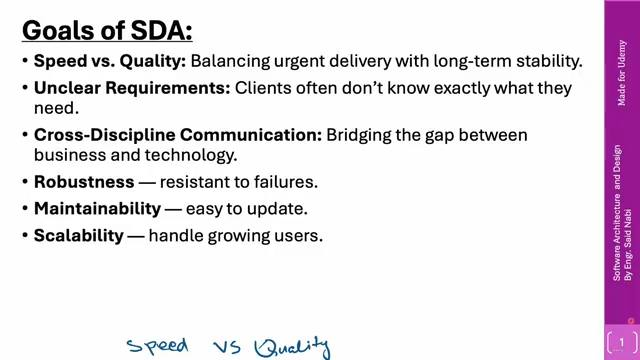
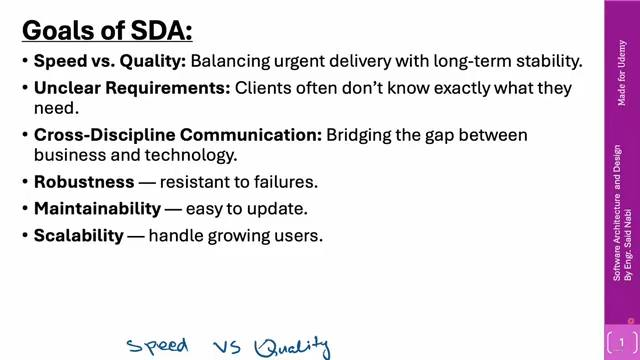
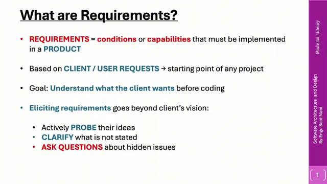
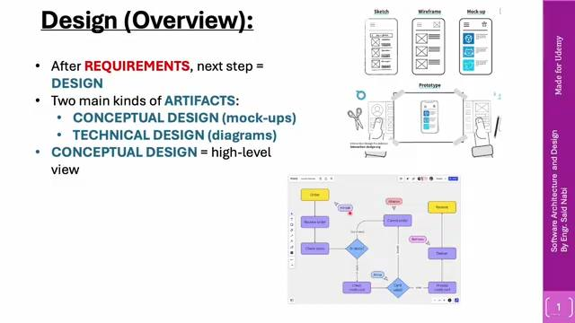
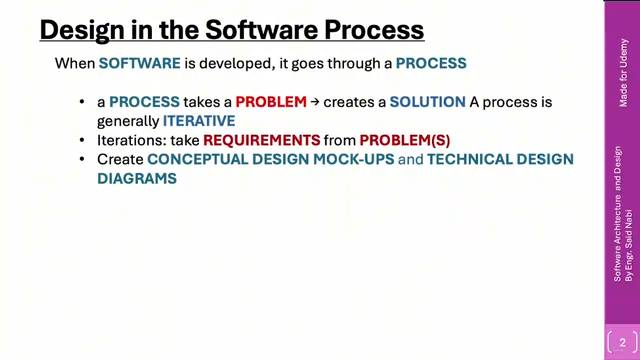
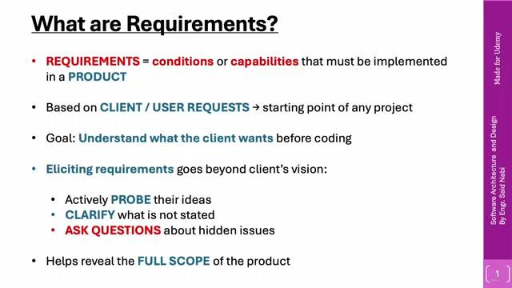

# Software Architecture Scalable（P008–P012）复现文档

> **读者须知**：P008–P012 是纯讲解课，逐字稿里没有一行可执行代码、没有终端命令、没有依赖版本。所以这份文档的“复现”不是跑起一个服务，而是**把讲师的设计推导链落成一套可以直接填写、评审、交给实现的设计工件**。文中所有表名、字段名、目录名、估算系数，凡是课里没出现的，我都会明确标注“课里没讲，这是我为了可复现补的”。凡是逐字稿没说的地方，我写“课里没讲”，不替讲师补。

---

## 1. 这一节做什么

P008–P012 这五讲，讲的是**写第一行代码之前的五件事**：

1. **P008 定目标**：速度与质量、需求不清、业务与技术沟通、鲁棒性、可维护性、可扩展性，最后落到时间/成本/质量三角。
2. **P009 拆对象**：面向对象建模，把大问题拆成对象，对象有属性、有职责，对象可以是人、地点、物，也可以是无形的账户。
3. **P010 走过程**：软件不是随机敲代码，而是“问题→需求→概念设计→技术设计→实现→测试”的循环；设计不是装饰。
4. **P011 挖需求**：客户说的不等于客户要的；要把“要快、要简单、要安全”逼成可设计、可测试的条件，并在需求阶段就把取舍摆上桌。
5. **P012 做设计**：概念设计（高层、mockup、CRC 卡）与技术设计（类图、包图、部署图、活动图、时序图）分工明确，设计的目标是减少不确定性，让需求平滑过渡到实现。

这一节最终要交付的，不是 `npm run dev`，而是下面这套文件（目录名课里没规定，是我为了让你能照着做而定的）：

```
design/
  00-scope.md            这一版做什么、不做什么
  01-requirements.md     需求卡
  02-crc.md              对象-职责-协作者卡
  03-class-diagram.mmd   类图（示意）
  04-sequence.mmd        时序图（示意）
  05-deployment.mmd      部署图（示意）
  06-capacity.md         容量估算（含算式与假设）
  07-tradeoffs.md        取舍表
src/
  domain/
    types.ts             对象落成的类型草案（仅类型检查）
tsconfig.json
```

**为什么前端转 AI 应用工程师要读这五讲**：AI 应用最常见的翻车方式，是先接模型 API、先写 prompt、先搭页面，最后才发现“哪些数据不能让模型看”“两个人同时提交怎么办”“模型超时了页面显示什么”全没定义。这五讲逼你在写第一行请求之前，先把“必须做”和“**不得做**”写下来。课里没有讲任何模型、向量库、Agent 框架，这一节也不会替你编。





---

## 2. 讲师原话（带「—— pNNN [MM:SS]」）

下面按主题分组引用，不按页顺序流水账。

### 2.1 架构的目标：不是二选一，是为变化而建

> “目标不是在速度和重量之间二选一，而是设计出今天能快速交付、明天又不会塌的系统。好的架构让系统能够改变，而不是逼我们整体重写。”—— p008 [00:29]

> “我们不为确定性而构建，我们为变化而构建。”—— p008 [01:25]

> “失败不是例外，而是预期。网络会失败，服务器会崩，数据库可能不可用，用户行为不可预测，外部服务可能不响应。健壮的架构假设这些事情会发生，并据此设计系统。”—— p008 [02:23]

> “可维护性，是一个软件系统能够被容易理解、修改和扩展的能力。软件真正的成本不只是构建它，而是改变它。”—— p008 [02:52]

> “也许暂时只有 10 个用户，但后面可能变成 1,000，再变成 100,000，最终到几百万。无论 100 个用户还是 1000 万用户，系统都应被设计成能承受预期负载而不失败。”—— p008 [03:21] / [04:14]

> “我们并不总是要在第一天就为 1000 万用户构建系统，那通常不必要而且昂贵。重要的是选择一种能随着系统成长而演进的架构。”—— p008 [04:14]

> “我们始终在平衡三个主要约束：时间、成本、质量。好的软件架构帮我们找到三者之间的正确平衡，而不是只优化其中一个。”—— p008 [05:09]

### 2.2 面向对象建模：先理解真实世界，再写代码

> “这项技术就是把更大的问题拆成更小的概念，这些更小的概念就叫对象。”—— p009 [00:57]

> “很多人以为面向对象建模只是程序员的事，其实不是。它是一种思维方式。你把大问题拆成小部分时，你已经在用面向对象的思维了。”—— p009 [01:26]

> “不要从代码开始想，先从理解真实世界开始。问自己：哪些是重要的东西？这些就是你的对象。再问：这些对象有哪些信息？这些就是属性。”—— p009 [06:51]

> “如果你识别出的对象没有职责，那这个对象就没有价值。对象有行为或职责。”—— p009 [07:46]

> “对象给你带来的第一个好处是组织性。你要改某个对象的行为，不必碰其他所有对象。”—— p009 [08:43]

### 2.3 过程：设计不是装饰

> “软件不是随机敲代码。软件是遵循一个过程构建出来的，过程就是从问题走到解决方案的一组步骤。”—— p010 [00:00]

> “在概念设计中，我们主要理解和澄清系统的概念。可以用 CRC 卡识别类、它们的职责，以及它们与其他类的关系。”—— p010 [02:14]

> “在技术设计中，我们开始用图和其他技术产物更精确地表示解决方案。例如 UML 图，比如 PLAS 图、活动图、状态机图。”—— p010 [02:42]（逐字稿此处为 “PLAS diagrams”，课里没有进一步解释，建议按原话保留，不要自行替换成某个具体图名）

> “编码高度依赖假设。每一行代码都基于某个假设：这是用户想要的、系统应该这样表现、数据应该这样流动、组件应该这样通信。一旦开始编码，改这些假设会变得昂贵而痛苦。”—— p010 [06:01] / [06:30]

> “设计不是装饰。设计是关于定义和评估一个解决方案。有时包括探索备选方案、比较不同做法、识别取舍，然后选择最安全、最合适的路径。”—— p010 [08:51]

> “很多学生以为收集完需求就该立刻写代码，但不是这样。你需要在实现之前先设计好解决方案。”—— p010 [04:36]

### 2.4 需求：把模糊词逼成可测试的条件

> “需求是产品必须满足的条件、能力或需要。它们定义产品必须做什么，有时也定义它**不得做什么**。”—— p011 [00:00]

> “需求工程不只是听客户说、把话记下来。它意味着 probing 客户的想法，澄清说出来的和没说的，追问他们可能没考虑到的隐藏问题。”—— p011 [00:55]

> “比如：用户取消会怎样？谁有权看这份数据？两个用户同时做这个操作会怎样？网络断了会怎样？用户输入非法信息会怎样？”—— p011 [01:22]

> “不要只说系统要快，而要问：多快？哪个操作？多少用户？可接受的响应时间是多少？这样我们才有东西可以设计和测试。”—— p011 [02:19]

> “没有完美的系统，只有选得好的取舍。”—— p011 [04:10]

> “清晰的需求带来清晰的取舍，清晰的取舍带来坚实的基础，坚实的基础带来好的设计，好的设计带来成功的软件。”—— p011 [05:59]

### 2.5 设计：概念与技术两层，目标是减少不确定性

> “设计阶段有两类主要产物。第一类是概念设计，我们创建高层表示或 mockup。第二类是技术设计，我们创建更详细的技术图，比如类图、包图、部署图、活动图、时序图。”—— p012 [00:29]

> “概念设计要问：系统的主要部分是什么？重要的对象或概念是什么？它们有什么职责？这些概念之间如何关联？”—— p012 [00:57]

> “技术设计要问：会有多少个类？每个类应包含哪些属性？每个类应提供哪些操作或方法？类之间如何关联？不同组件如何通信？这些组件部署在哪里？”—— p012 [01:51]

> “需求告诉我们系统要达成什么，设计告诉我们如何组织结构去达成，实现把设计变成可工作的软件。”—— p012 [03:45]

> “设计的真正目标不是画图，而是减少不确定性、澄清解决方案，让从需求到实现的过渡尽可能平滑。”—— p012 [04:08]

---

## 3. 从零复现

### 3.1 准备：没有依赖，先建空文件

这一节**没有 `npm install`，没有 Docker，没有数据库连接串**——课里没讲这些。你只需要一个编辑器和一个终端。下面命令是我为了让你有文件可填而定的，不是讲师给的：

```bash
mkdir -p design src/domain
touch design/00-scope.md design/01-requirements.md design/02-crc.md \
      design/03-class-diagram.mmd design/04-sequence.mmd design/05-deployment.mmd \
      design/06-capacity.md design/07-tradeoffs.md src/domain/types.ts
```

示例项目我用**校园课程管理系统**，因为这是讲师在 P009 [03:09] 亲口举的例子（student、teacher、course、classroom）。课里没有给这个系统的具体需求，下面所有需求条目都是我为了让流程能走通而设定的示例，必须替换成你自己的项目。

### 3.2 第一步：把模糊需求写成需求卡（P011）

打开 `design/01-requirements.md`，每行需求填七个字段。字段名里“必须做 / 不得做”来自讲师 P011 [00:00] 的原话，“约束”对应 constraints，“待确认问题”对应讲师 [01:22] 的那串追问。**CRC 卡的三字段格式课里没规定，是我按讲师说的“classes, responsibilities, collaborators”落成的。**

填写规则只有一条：**凡是写不出“不得做”的需求，都还没想清楚。** 写不出就把它放进“待确认问题”，不要硬编。

示例（完整表格见第 4 节）：

| 字段 | 示例内容 |
|---|---|
| ID | R5 |
| 一句话陈述 | 学生提交课程报名 |
| 必须做 | 名额未满时接受报名并返回确认结果 |
| 不得做 | 同一学生同一课程不得重复报名；名额已满不得接受 |
| 约束 | 必须能回答“两个用户同时抢最后一个名额”时谁成功 |
| 优先级 | 高 |
| 待确认问题 | 名额满后是否允许候补？取消后名额是否立即释放？ |
| 来源 | 示例设定，课里没有这个具体需求 |

完成标准：每条需求都有“不得做”，且至少有一条待确认问题。



### 3.3 第二步：识别对象、属性、职责、协作者（P009 + P012）

打开 `design/02-crc.md`，一张卡一个对象，三栏：

```
对象名：
  职责（这个对象能做什么、必须保证什么）：
  协作者（它要和谁打交道才能完成职责）：
  属性（它自己存了哪些信息）：
```

讲师 P009 [07:46] 说得很硬：**没有职责的对象没有价值**。所以每张卡至少写一条职责，写不出来就说明这个“对象”其实只是别的东西的一个属性。

示例：`Course` 的职责是“维护名额、判断是否可报名、关闭报名”，协作者是 `Enrollment` 和 `Teacher`；`Enrollment` 的职责是“记录报名状态、校验重复”，协作者是 `Student` 和 `Course`。属性和职责不要混：`capacity` 是属性，“判断名额是否已满”是职责。

完成标准：每个对象至少一条职责；每个协作者都能在另一张卡里找到；没有孤立对象。



### 3.4 第三步：画技术设计图（P010 + P012）

打开三个 `.mmd` 文件。课里没有指定画图工具，mermaid 是我为了让图能存进 Git、能 diff 而选的，**课里没讲 mermaid**。你换成纸笔、白板、UML 工具都可以。

- `03-class-diagram.mmd`：回答 P012 [01:51] 的问题——多少个类、每类有哪些属性、哪些方法、类之间什么关系。
- `04-sequence.mmd`：回答“组件如何通信”，只画一条最关键的跨对象交互，比如“学生提交报名→Course 校验名额→Enrollment 落状态”。
- `05-deployment.mmd`：回答“组件部署在哪里”，把浏览器、应用服务、数据库三个框画出来即可；课里没讲具体云产品，不要填产品名。

完成标准：类图里的类与 CRC 卡一一对应；时序图覆盖 R5 的并发问题；部署图至少标出“运行环境”而不是只画逻辑框。



### 3.5 第四步：做容量估算（P008 的增长问题 + 我补的算式）

讲师在 P008 [03:21]–[04:14] 只给了增长叙事：10 → 1,000 → 100,000 → 几百万，并明确说“不必第一天就为 1000 万构建”。**课里没有给任何估算公式或系数。** 下面算式是我补的，系数是示例值，必须用你自己的数据替换。

打开 `design/06-capacity.md`，写三段：

1. **假设**（每个数字标来源）：
   - 注册学生 5,000（示例）
   - 日活比例 40% → DAU 2,000（示例系数，课里没给）
   - 人均每日请求 20 次（示例）
   - 峰值系数 5（示例，指峰值小时是平均小时的倍数）
2. **算式**：
   - 平均 QPS = DAU × 人均请求 / 86,400
   - 峰值 QPS = 平均 QPS × 峰值系数
   - 代入：2,000 × 20 / 86,400 ≈ 0.46；0.46 × 5 ≈ **2.3 QPS**
3. **增长推演**（对应讲师说的百万级）：
   - 若 DAU = 1,000,000，同样 20 次/人/天、峰值系数 5：
   - 平均 QPS = 1,000,000 × 20 / 86,400 ≈ 231.5
   - 峰值 QPS ≈ **1,157 QPS**

结论要写出来：**2.3 QPS 不需要分库分表；1,157 QPS 才需要开始考虑缓存、读写分离或水平扩展。** 这就是讲师“不要第一天为 1000 万构建”的可计算版本。

完成标准：每个系数都有“来源”标注；算出的峰值 QPS 能对应到一个架构决策（做/不做某件事）。

### 3.6 第五步：写取舍表（P008 三角 + P011 trade-off）

打开 `design/07-tradeoffs.md`，每条决策六列：决策、备选、选择理由、**放弃了什么**、触发重审的信号、对应哪条需求。

讲师 P011 [04:10] 说“没有完美系统，只有选得好的取舍”，P008 [05:09] 说时间/成本/质量要平衡。所以“放弃了什么”这一列不能空——空着就说明你在假装没有代价。

完成标准：每条决策都有“放弃”列；至少一条决策的触发信号是“DAU 超过某个阈值”。



### 3.7 第六步：把对象落成类型草案（示意，课里没有代码）

打开 `src/domain/types.ts`，只写类型，不写实现。这一步的作用是让 CRC 卡里的属性有地方落，**不是**让讲师背锅——课里从头到尾没有 TypeScript，也没有任何代码。字段名见第 4 节代码块。

完成标准：`npx tsc --noEmit` 通过；每个 interface 都能在 CRC 卡里找到同名对象。

---

## 4. 完整代码

> **这一讲没有代码。** 按纯讲解课的规则，本节把讲师的方法落成可直接填写的设计工件。末尾附一段 TypeScript 类型草案和 `tsconfig.json`，仅用于类型检查，**课里没有代码，以下为示意**；字段名是我按 CRC 卡设计的，不是讲师给的。

### 4.1 需求卡（示例项目：校园课程管理系统）

| ID | 陈述 | 必须做 | 不得做 | 约束 | 优先级 | 待确认问题 |
|---|---|---|---|---|---|---|
| R1 | 学生查看可选课程 | 列出开放报名的课程及剩余名额 | 不得显示已关闭课程 | 只对已登录学生可见 | 高 | 未登录能否浏览课程标题？ |
| R2 | 学生提交报名 | 名额未满时接受并返回确认 | 同一学生同一课程不得重复报名；名额满不得接受 | 要能处理两人同时抢最后一个名额 | 高 | 满员后是否允许候补？ |
| R3 | 教师查看报名名单 | 列出某课程已确认学生 | 不得向学生暴露其他学生信息 | 仅该课程教师可见 | 中 | 助教是否可见？ |
| R4 | 管理员关闭课程报名 | 关闭后拒绝新报名 | 不得影响已确认报名 | 关闭操作要可追溯 | 中 | 关闭后是否允许取消？ |
| R5 | 报名冲突给出明确结果 | 成功/失败二选一，不静默 | 不得出现“扣了名额但没记录” | 要能回答 P011 的“两人同时操作” | 高 | 失败时是否提示剩余名额？ |
| R6 | 数据库不可用时不得假成功 | 返回明确失败 | 不得在未落库时显示报名成功 | 对应 P008 的“数据库可能不可用” | 高 | 失败后是否允许重试？ |

> 以上需求内容为本文示例，课里没有这个具体项目；字段设计参考了 P011 的“必须做/不得做/约束/追问”。

### 4.2 CRC 卡（对象-职责-协作者）

| 对象 | 职责 | 协作者 | 主要属性 |
|---|---|---|---|
| Student | 提交报名、取消报名、查看自己的报名 | Course、Enrollment | id、name、role |
| Course | 维护名额、判断是否可报名、关闭报名 | Enrollment、Teacher | id、title、capacity、status |
| Teacher | 查看本课程名单 | Course | id、name |
| Enrollment | 记录报名状态、校验重复 | Student、Course | id、studentId、courseId、status |
| Admin | 关闭课程报名 | Course | id、name |

> 表头“对象/职责/协作者/属性”来自 P009 与 P012 的原话；具体条目是示例。

### 4.3 设计决策表

| 决策 | 备选 | 选择理由 | 放弃了什么 | 触发重审的信号 |
|---|---|---|---|---|
| D1 先用 CRC 再做类图 | 直接画类图 | P010/P012 明确先概念后技术，先想职责再想方法签名 | 一开始就定方法参数的自由 | R5 的并发问题变化时 |
| D2 报名状态用 `pending/confirmed/cancelled` | 布尔 `isEnrolled` | P011 追问了“用户取消会怎样”，布尔表达不了取消与候补 | 更少的字段、更简单的查询 | 出现候补队列时 |
| D3 名额判断放在 Course | 放在 Enrollment 或数据库触发器 | 职责单一，Course 自己维护 capacity | 数据库层强约束的“绝对防重” | 并发冲突频繁、应用层校验不够时 |
| D4 技术设计先只画类图+时序图+部署图 | 把包图、活动图、状态机图全画 | P012 列出的图里这三张覆盖结构/交互/部署，先够用 | 包图和活动图带来的全局视角 | 模块数量增多、部署环境变复杂时 |
| D5 容量先按 5,000 注册估算 | 直接按 100 万设计 | P008 明确说不必第一天为 1000 万构建 | 提前分库分表带来的“未来安全感” | DAU 超过估算阈值时 |
| D6 数据库失败时明确失败 | 先返回成功、后台补录 | P008 的 robustness：失败要优雅，不能假成功 | “用户体验上的顺滑” | 补录机制成为核心功能时 |

### 4.4 容量估算表

| 项 | 数值 | 来源 |
|---|---|---|
| 注册学生 | 5,000 | 示例设定 |
| 日活比例 | 40% | 课里没给，示例系数 |
| DAU | 2,000 | 5,000 × 40% |
| 人均每日请求 | 20 | 课里没给，示例 |
| 平均 QPS | 0.46 | 2,000 × 20

## 5. 逐行解释

> 本节按第 4 节的文件顺序，逐个文件、逐段解释“为什么这么写、不这么写会怎样”。凡是逐字稿没有依据的设计选择，都标注“课里没讲，这是我补的”。

### 5.1 `design/01-requirements.md`（需求卡）

**为什么是七列（ID / 陈述 / 必须做 / 不得做 / 约束 / 优先级 / 待确认问题）。**
- “必须做 / 不得做”直接来自 P011 [00:00]：“they define what the product must do and sometimes what it must not do”。不写“不得做”列，需求就只剩正向功能，P011 [01:22] 那串追问（取消、权限、并发、断网、非法输入）就没有落点，后面 CRC 卡和时序图会缺输入。
- “约束”列对应 P011 [02:19] 把“要快”逼成“多快、哪个操作、多少用户、可接受响应时间”。不写这一列，需求无法被测试，P010 [04:06] 的测试阶段就没有判定标准。
- “待确认问题”列对应 P011 [01:22] 的“probe their ideas / clarify what is stated and what is not stated”。不写这一列，等于假装需求已经完整，违反 P010 [06:01] “even imperfect clarity is better than blind coding”——不完美可以，假装完美不行。
- “优先级”列对应 P011 [04:10] 的取舍：“What is the highest priority? What can be delayed?”。没有优先级，第 4.3 节的决策表里“放弃了什么”就无从判断。
- “来源”列（第 3.2 节示例里有、4.1 表里省略了）是我补的，课里没讲。作用是防止把示例需求误当成讲师原话。

**为什么 R2 和 R5 要分开写。**
R2 是“提交报名”这个功能，R5 是“冲突时给出明确结果”这个质量要求。P011 [01:22] 明确把“两个用户同时操作会怎样”列为必须追问的隐藏问题，它不是一个功能，而是横切多个功能的条件。合并成一条会让“不得做”列塞进两种性质的内容，评审时容易漏掉并发这一条。

**为什么 R6 写成“数据库不可用时不得假成功”。**
对应 P008 [02:23]：“Databases can become unavailable… It should fail gracefully rather than catastrophically.”。不写这条，“优雅失败”就只是口号；写了这条，第 4.3 节 D6 才有需求依据。

**不这么写会怎样**：如果需求卡只有“陈述 + 优先级”两列，它就是一份功能清单，P011 整节课的“probing / 追问 / 取舍”全部丢失，后面的 CRC 卡只能凭想象填。

### 5.2 `design/02-crc.md`（CRC 卡）

**为什么每张卡必须有“职责”栏，且职责写成动词短语。**
P009 [07:46] 原话：“If you identify objects, which has no responsibilities, so that object is of no value.”。所以“职责”不是可选项。写成动词短语（“维护名额”“校验重复”）而不是名词（“名额管理”），是因为 P009 [08:14] 把职责等同于 behaviors：“A person can sit, can type… a device can turn on, turn off, display an image.”。写成名词会让职责和属性混淆。

**为什么“属性”和“职责”分两栏，且 `capacity` 放属性、“判断名额是否已满”放职责。**
P009 [04:31]：“objects hold specific details which are called attributes”，P009 [07:46] 讲职责。两者是不同维度。混在一栏的后果：类图阶段会把“判断名额”画成一个字段，时序图阶段就找不到“谁来做这个判断”，P012 [01:51] 的“每个类应提供哪些操作”就答不出来。

**为什么“协作者”栏要求每个名字都能在另一张卡里找到。**
P012 [01:25]：“how are these concepts related to each other?”。协作者指向不存在的对象，说明要么漏了一张卡，要么这个关系是臆想的。这是最低成本的一致性检查。

**为什么 `Admin` 只有一条职责。**
不是所有对象都要很重。P009 [07:46] 的要求是“有职责”，不是“职责多”。但反过来，如果一个对象连一条职责都写不出（比如单独建一个 `Capacity` 对象只存一个数字），按 P009 的标准它就该被降级为 `Course` 的属性。第 4.2 节没有建 `Capacity` 对象，就是这个原因。

**课里没讲的部分**：CRC 卡的三栏具体措辞（responsibilities / collaborators / attributes）在 P010 [02:14] 和 P012 [01:25] 只提到“classes, their responsibilities and their collaborators”，**attributes 这一栏是我按 P009 的属性讲解补的**，课里没把属性列进 CRC 卡。

### 5.3 `design/03-class-diagram.mmd` / `04-sequence.mmd` / `05-deployment.mmd`

**为什么是三张图，不是五张。**
P012 [00:29] 列了五类技术图（class / package / deployment / activity / sequence），P010 [02:42] 又提到 activity、state machine。第 4.3 节 D4 只选三张，理由是这三张分别回答 P012 [01:51] 的三个问题：类图答“多少类、什么属性方法、什么关系”，时序图答“组件如何通信”，部署图答“部署在哪里”。包图和活动图回答的是“模块怎么分组”“流程怎么走”，在对象还没稳定时画它们，改起来比类图更贵。**这个取舍是我做的，课里没讲该画几张。**

**类图为什么必须和 CRC 卡一一对应。**
P012 [03:16]：“We start with the requirements. We analyze and understand those requirements. Then we represent the solution through conceptual and technical design.”。技术设计是概念设计的细化，不是另起一套。类图里冒出一个 CRC 卡没有的类，说明概念阶段漏了；CRC 卡里的类在类图里消失，说明技术阶段偷偷砍了职责。两种都是 P012 [04:08] 说的“不确定性”没被消除。

**时序图为什么只画一条交互（R5 并发）。**
P012 [02:18]：“a sequence diagram to show how different objects or components interact over time”。画全部交互在文档阶段是浪费；画最关键的那条（两人同时抢最后一个名额）才能验证 R2/R5 的“不得做”是否真的可实现。**“只画一条”是我补的策略，课里没讲。**

**部署图为什么只画浏览器/应用服务/数据库三个框，不填产品名。**
P012 [02:46]：“a deployment diagram to show how the software components are mapped to the physical or execution environment”。课里从头到尾没有提任何云产品、容器、数据库品牌。填产品名等于编造。三个框足以回答“组件部署在哪里”这个层级的问题。

**为什么用 mermaid。**
课里没讲 mermaid，也没讲任何画图工具。选它的唯一理由是可存进 Git、可 diff。**这是补充，不是讲师要求。**

### 5.4 `design/06-capacity.md`（容量估算）

**为什么先写“假设”再写“算式”。**
P008 [03:21]–[04:14] 只给了增长叙事（10 → 1,000 → 100,000 → 几百万）和一句“不必第一天就为 1000 万构建”。**课里没有任何公式、任何系数。** 所以必须先声明假设，再算。不声明假设直接给 QPS 数字，读者无法判断这个数字能不能用，也无法在假设变化时重算。

**为什么每个系数都标“来源”。**
同上。标了“课里没给，示例系数”，读者才知道 40% 日活、20 次/人/天、峰值系数 5 都是可替换的。不标来源，这些数字会被误当成讲师给的行业标准。

**为什么算式是 `DAU × 人均请求 / 86,400`。**
86,400 是一天的秒数，把“每天多少请求”换成“每秒多少请求”。这是通用换算，**课里没讲**。峰值系数乘在平均 QPS 上，是因为 P008 [03:50] 说“If users grow, traffic grows”，流量不是均匀的；**峰值系数这个概念课里也没讲**。

**为什么结论必须落到“做/不做某个架构决策”。**
P008 [04:14]：“The important thing is to choose an architecture that can evolve as the system grows.”。算出 2.3 QPS 却不说“所以不需要分库分表”，这个数字就没有指导意义。算出 1,157 QPS 却不说“所以要考虑缓存/读写分离/水平扩展”，就浪费了百万级推演。**把 QPS 映射到具体架构动作是我补的，课里只讲了“要可扩展”，没讲阈值。**

**不这么写会怎样**：只写“系统要能扩展到百万用户”，就是 P011 [02:19] 批评的“系统要快”式模糊需求，无法设计也无法测试。

### 5.5 `design/07-tradeoffs.md`（取舍表）

**为什么“放弃了什么”列不能空。**
P011 [04:10]：“There is no perfect system. There are only well-chosen trade-offs.”。空着这一列等于宣称这个决策没有代价，与讲师原话直接矛盾。P011 [03:40] 还具体说了代价形态：“if performance is extremely important, we may have to sacrifice or postpone some features”。

**为什么有“触发重审的信号”列。**
P008 [01:25]：“we don't build for certainty, we build for change.”。决策是当时假设下的最优解，假设变了决策就该重审。没有这一列，决策表会变成一次性文档，而不是活的东西。**这一列是我补的，课里没讲“重审信号”这个词。**

**为什么 D5 的触发信号是“DAU 超过估算阈值”。**
把 5.4 的容量估算和 5.5 的决策表挂钩。P008 [04:43]：“Architecture prepares the system not just for what it is today but also for what it may become tomorrow.”。没有这个挂钩，“为明天准备”就无从触发。

**为什么 D2 用三态 `pending/confirmed/cancelled` 而不是布尔。**
P011 [01:22] 追问“what happens if the user cancels?”。布尔 `isEnrolled` 表达不了“取消”和“候补”的区别。这是把 P011 的追问直接落成字段设计。**具体三个状态名是我补的，课里没讲状态机。**

### 5.6 `src/domain/types.ts` + `tsconfig.json`

**为什么只有类型、没有实现。**
P010 [04:36]：“You need to properly design the solution before you start implementing it.”。这一节是设计课，写实现就越界了。类型草案的唯一作用是让 CRC 卡的属性有地方落、让 `npx tsc --noEmit` 能做一次机械一致性检查。

**为什么每个 interface 必须能在 CRC 卡里找到同名对象。**
同 5.3 类图的理由：技术产物必须能追溯到概念产物。多一个 interface 就是多一个没经过职责论证的对象。

**课里没讲的部分**：P008–P012 逐字稿里**没有出现 TypeScript、没有出现任何代码、没有出现 `tsc`**。整个 `src/domain/types.ts` 和 `tsconfig.json` 是我为了让“属性有地方落”而补的示意，不是讲师内容。字段名（`studentId`、`courseId`、`status`）也是我按 CRC 卡设计的。

**不这么写会怎样**：如果连类型草案都不写，CRC 卡的“属性”栏就永远停留在自然语言，无法被工具检查，也无法在实现阶段直接复用。

## 6. 复现检查清单

> 逐条跑完、逐条确认。每条都写清“怎么验证 / 应该看到什么”。没有可执行代码，所以“验证”以人工核对和 `tsc` 为主。

### 6.1 文件与结构

- [ ] **目录和空文件都建出来了**：在仓库根目录执行 `ls design src/domain`，应看到 `design/` 下 8 个 `.md`/`.mmd` 文件、`src/domain/` 下有 `types.ts`；缺任何一个说明 3.1 的 `touch` 没跑全。
- [ ] **没有多余依赖**：检查仓库根目录没有 `package.json` 里的运行时依赖、没有 `Dockerfile`、没有数据库连接串。应该看到的是一个纯文档 + 一个 `tsconfig.json`。看到 `npm install` 痕迹说明你误加了课里没有的东西。

### 6.2 需求卡（`01-requirements.md`）

- [ ] **每条需求都有“不得做”**：逐行扫“不得做”列，应无空单元格。有空单元格的需求，按 3.2 的规则应移入“待确认问题”，不应留在表里。
- [ ] **至少有一条待确认问题**：`grep -c '？' design/01-requirements.md` 应 ≥ 1。0 条说明你在假装需求已完整，违反 P010 [06:01]。
- [ ] **R2 和 R5 是两条独立需求**：表里应能分别找到“提交报名”和“冲突给出明确结果”。合并成一条说明并发问题被塞进功能需求，评审时会漏。
- [ ] **R6 的“不得做”明确写了“不得假成功”**：找到 R6 行，确认“不得做”列含“未落库时不得显示成功”类表述。没有则 P008 [02:23] 的 robustness 没有落点。

### 6.3 CRC 卡（`02-crc.md`）

- [ ] **每个对象至少一条职责**：逐卡检查“职责”栏非空。空职责的对象按 P009 [07:46] 应删除或降级为属性。
- [ ] **职责是动词短语**：抽查 3 张卡，职责应以动词开头（“维护”“校验”“记录”“关闭”）。出现纯名词（“名额管理”）说明职责和属性混了。
- [ ] **每个协作者都能在另一张卡里找到**：把所有“协作者”栏的名字列出来，逐个在“对象”列里搜。搜不到的名字说明漏卡或臆想关系。
- [ ] **没有孤立对象**：每个对象至少出现在另一个对象的“协作者”栏里，或自己至少有一个协作者。完全孤立的卡说明它和系统没关系。
- [ ] **`capacity` 在属性栏、不在职责栏**：找到 `Course` 卡，确认 `capacity` 在“属性”，判断名额的逻辑在“职责”。反了说明 5.2 的区分没做到。

### 6.4 技术设计图（`03/04/05-*.mmd`）

- [ ] **类图的类与 CRC 卡一一对应**：把类图里的类名和 CRC 卡的“对象”列做集合比较，应完全相等。多一个或少一个都要回去改其中一边。
- [ ] **时序图覆盖 R5 的并发场景**：打开 `04-sequence.mmd`，应能看到“两个请求先后到达 → Course 校验名额 → 一个成功一个失败”的交互。只画了单请求说明并发没覆盖。
- [ ] **部署图至少标出运行环境**：打开 `05-deployment.mmd`，应看到浏览器 / 应用服务 / 数据库三个框，且至少一个框标注了“运行环境”而非纯逻辑名。全是逻辑框说明 P012 [02:46] 的“mapped to the physical or execution environment”没做到。
- [ ] **部署图里没有具体产品名**：搜 `05-deployment.mmd`，不应出现 AWS / Azure / MySQL / Redis 等品牌名。出现说明你填了课里没讲的东西。

### 6.5 容量估算（`06-capacity.md`）

- [ ] **每个系数都有“来源”标注**：逐行扫“来源”列，应无空单元格；课里没给的系数应明确写“课里没给，示例”。有裸数字说明 5.4 的假设声明没做到。
- [ ] **算式可复算**：拿计算器按 `DAU × 人均请求 / 86,400` 和 `× 峰值系数` 重算一遍，结果应与文档里的 0.46 和 2.3 一致（允许四舍五入误差）。对不上说明算式或数字抄错了。
- [ ] **百万级推演存在且结果正确**：文档里应有 DAU = 1,000,000 的推演，重算应得约 231.5 平均 QPS、约 1,157 峰值 QPS。
- [ ] **结论落到具体架构动作**：文档末尾应有一句“X QPS 不需要做 Y；Z QPS 才需要做 W”形式的结论。只有数字没有结论，说明 5.4 最后一步没做。

### 6.6 取舍表（`07-tradeoffs.md`）

- [ ] **每条决策的“放弃了什么”非空**：逐行扫该列，应无空单元格。空着违反 P011 [04:10]。
- [ ] **至少一条触发信号是“DAU 超过阈值”**：搜“DAU”，应至少命中一条决策的“触发重审的信号”列。0 条说明容量估算和决策表没挂钩。
- [ ] **每条决策能对应到一条需求**：抽查 D2 和 D6，D2 应能对应到 R2/R5（取消/并发），D6 应能对应到 R6（不得假成功）。对不上说明决策是凭空加的。

### 6.7 类型草案（`src/domain/types.ts`）

- [ ] **`npx tsc --noEmit` 通过**：在仓库根目录执行，应无输出、退出码 0。有报错说明类型草案本身不自洽。
- [ ] **每个 interface 都能在 CRC 卡里找到同名对象**：把 `types.ts` 里的 interface 名和 CRC 卡“对象”列做集合比较，应完全相等。多一个说明你加了没经过职责论证的对象。
- [ ] **字段名与 CRC 卡“属性”栏一致**：抽查 `Course` 和 `Enrollment`，`types.ts` 里的字段应能在对应 CRC 卡的“属性”栏找到。对不上说明两处各写各的。

## 7. 课里没讲但你会撞上的

> 只列复现这一节时真实可能遇到的问题。凡是逐字稿没有依据的，都在“原因”或“怎么办”里明确标注“课里没讲，补充”。

| 现象 | 原因 | 怎么办 |
|---|---|---|
| 需求卡填到一半卡住，写不出“不得做” | 需求本身还没想清楚；P011 [01:22] 的追问还没问完 | 把这条需求整行移入“待确认问题”，不要硬编“不得做”。课里没讲怎么处理写不出的情况，这是补充做法 |
| CRC 卡里出现一个对象，只有属性没有职责，删了又怕漏 | 这个“对象”很可能只是别的东西的属性（如单独的 `Capacity`） | 按 P009 [07:46] 的标准降级为属性，合并进持有它的对象。课里没讲降级操作，这是补充 |
| 类图画完发现和 CRC 卡对不上，不知道改哪边 | 概念设计和技术设计脱节；P012 [03:16] 要求的是“细化”不是“另起” | 以 CRC 卡为准改类图；如果类图里多出的类确实必要，先回 CRC 卡补职责再画。课里没讲冲突时以谁为准，这是补充 |
| 容量估算算出的 QPS 低得离谱（如 0.46），怀疑算错 | 系数是示例值（40% 日活、20 次/人/天），不是你的真实数据；课里没给任何系数 | 换成你自己的注册数、日活、人均请求重算；系数来源必须标注。课里没讲怎么取系数，这是补充 |
| 百万级推演算出 1,157 QPS，但不知道这个数算大还是算小 | 课里只讲了“要可扩展”，没给任何 QPS 阈值或架构对应关系 | 把结论写成“这个量级需要/不需要做某动作”，并标注“阈值是补充，课里没讲”；不要假装这是讲师给的行业标准 |
| 取舍表“放弃了什么”列写不出来 | 这个决策可能没有真实代价，或者你还没想清楚备选 | 写不出就说明备选没列全；补一个真实备选再比较。课里没讲怎么列备选，这是补充 |
| `npx tsc --noEmit` 报错说找不到 `tsconfig.json` | 3.1 只 `touch` 了 `types.ts`，没建 `tsconfig.json`；课里没讲 TypeScript 配置 | 补一个最小 `tsconfig.json`（`strict: true`、`noEmit: true`、`include: ["src"]`）。课里没讲，这是补充 |
| mermaid 图在编辑器里不渲染 | 课里没讲 mermaid，也没讲任何画图工具；你的编辑器可能没装插件 | 换成纸笔/白板/UML 工具，或装 mermaid 预览插件。工具选择课里没讲，这是补充 |
| 部署图不知道画几个框、要不要画 CDN/缓存 | P012 [02:46] 只说“mapped to the physical or execution environment”，没给粒度 | 先画浏览器/应用服务/数据库三个框，够回答“部署在哪里”即可；加框要有需求依据。粒度课里没讲，这是补充 |
| 把示例项目（校园课程管理）的需求当成通用模板套到自己的项目 | 第 4.1 节明确写了“以上需求内容为本文示例，课里没有这个具体项目” | 整表替换成你自己的项目；只保留七列结构，不保留示例条目。课里没讲任何具体项目需求，这是补充 |
| 评审时有人问“这些图用什么工具画的、能不能导入设计软件” | 课里没讲工具链，mermaid 是本文为可 diff 选的 | 明确回答“工具是补充选择，课里没讲”；图的内容（类/职责/交互）才是讲师要求的部分 |
