# Software Architecture Scalable（BV1LuHX6YEi4）P85–P100 课程文档：设计原则与代码坏味道的可复现评审工作坊

## 1. 这一节做什么

这一节不是带你搭一个 Spring 项目，也不是讲某个框架的安装步骤，而是把 P85–P100 的内容落成一套**可执行的代码评审工作坊**：你先用最小 Java 示例复现“最少知识原则 / 迪米特法则”的四条调用规则，再故意写一个违规的链式调用，最后用讲师列出的代码坏味道清单逐项识别、记录、重构。

课里没有完整工程、没有依赖版本、没有测试框架、没有启动脚本，也没有给出容量数字；这些地方我会明确写“课里没讲”。本文档中出现的 Java 示例，是**按逐字稿描述重建的示意代码**，不是讲师原项目源码，但可以直接保存运行，用来复现规则和违规现象。

学完这一节，你应该能产出三样东西：

1. 一个可运行的 `LawOfDemeterDemo.java`，能打印规则 1–4 的调用结果，也能打印违规链式调用。
2. 一张代码坏味道评审表：评论误用、重复代码、长方法、长类、数据泥团、发散式变化、霰弹式修改、依恋情结、不当亲密、消息链、基本类型偏执、switch 语句、投机性通用性。
3. 一张重构决策表：每个坏味道“为什么出现、改哪里、改完怎么验证、什么时候可以先不改”。

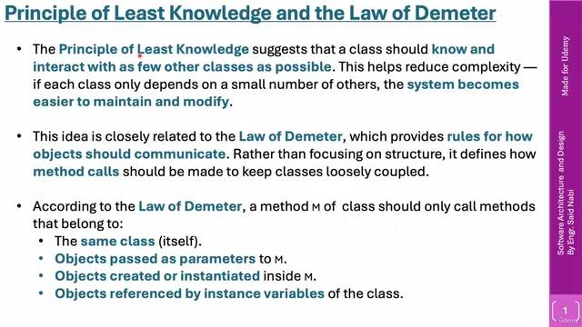

讲师先用餐厅类比：如果餐厅没有服务员，你就要直接进厨房找厨师点单，再找收银员结账，再找其他人处理其他事，你自己要交互的人太多，系统就难维护。软件系统同理，一个组件如果依赖太多其他组件，系统就不容易维护和修改。

---

## 2. 讲师原话（带「—— pNNN [MM:SS]」）

下面只摘录能支撑复现的关键原话，并做中文解释。逐字稿里把 Law of Demeter 转写成了 “Love Demeter”，引用时保留原样，理解时按 Law of Demeter 处理。

- “the principle of release knowledge suggests that a class should know and interact with as few other classes as possible.” —— p085 [01:32]  
  中文：最少知识原则建议一个类应该尽可能少地知道和交互其他类。对应到复现里，就是不要让 `Main` 直接穿透 `Car` 去调 `Engine`、`Driver`、`Cleaner`。

- “the Love Demeter provides rules for how objects should communicate. Rather than focusing on structure, it defines how method calls should be made to keep classes loosely covered.” —— p085 [02:16]  
  中文：迪米特法则规定对象之间应该怎样通信，重点不是结构图，而是方法调用应该怎么发生，从而保持松耦合。

- “a method can call any other method in the same class ... a method can call methods on its parameters ... a method can call methods on objects it creates within itself ... a method can also call methods of objects stored and instance variables of its class.” —— p085 [04:23]  
  中文：四条规则分别是：方法可以调同类方法；可以调参数对象的方法；可以调自己内部创建的对象的方法；可以调类实例变量所存对象的方法。

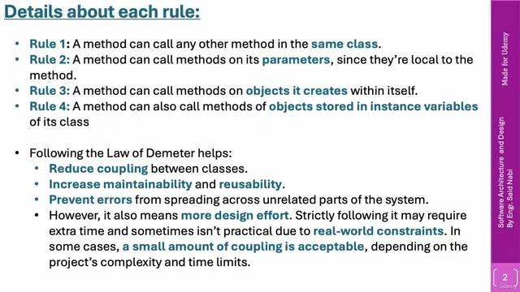

- “car.getEngine.getStart ... this is the violation of law of Demeter ... there should not be more than one dots for function call.” —— p086 [05:14]  
  中文：`car.getEngine().start()` 这种“方法返回对象再继续点”的调用，就是迪米特法则的违规；讲师用“一次函数调用不要超过一个点”来帮助记忆。

- “Refactoring is the process of improving the internal structure of code without altering its external behavior.” —— p087 [03:58]  
  中文：重构是在不改变外部行为的前提下改进代码内部结构。复现时你要先跑出稳定输出，再改结构，改完输出必须一致。

- “one common sign of poor code quality is the misuse of comments either having too few or too many.” —— p088 [00:00]  
  中文：注释误用是代码质量差的常见信号：要么完全没注释，要么注释太多、过时、用注释掩盖设计问题。

- “duplicate code is a common code smell that occurs when similar blocks of code appear in multiple places with only slight variations.” —— p089 [00:00]  
  中文：重复代码是相似代码块在多个地方出现，只差一点变体；改一处要改多处，容易漏改。

- “the long method anti-pattern occurs when a method becomes too lengthy or complex often trying to handle multiple responsibilities at once.” —— p090 [00:00]  
  中文：长方法往往在一个方法里塞了多个职责；如果方法虽然长但只做一类内聚的事，讲师说可以接受，关键看是否职责混杂。

- “the long class anti-patron occurs when a class becomes too big and overloaded with responsibilities ... god classes, blob classes or black hole classes.” —— p091 [00:00]  
  中文：长类就是职责过载的“上帝类 / 黑洞类”，通常和没有遵守单一职责原则有关。

- “data clumps exist in a code base when you have related data items ... repeatedly appear together as method parameters or instance variable.” —— p092 [00:00]  
  中文：数据泥团是几个相关数据总是一起出现，应该封装成一个对象，而不是到处传三个参数。

- “divergent change ... a class needs to be modified in multiple ways for different reasons.” —— p093 [00:00]  
  中文：发散式变化是一个类因为不同原因被反复修改，说明职责没有分开。

- “shotgun surgery ... a single change requires modifying multiple classes or methods across the codebase.” —— p094 [00:00]  
  中文：霰弹式修改是一个小改动散落到很多类，说明相关逻辑没有聚在一起。

- “feature anyway ... a method seems overly entrusted in the data behavior of another class rather than its own.” —— p095 [00:00]  
  中文：依恋情结是方法过度关心另一个类的数据和行为，行为应该放到数据所在的地方。

- “inappropriate intimacy ... two classes are overly dependent on each other, frequently communicating back and forth.” —— p096 [00:00]  
  中文：不当亲密是两个类双向依赖、来回调用，形成循环依赖；可以引入第三个类承载共享行为。

- “message chain ... a long series of method calls such as objectA.targetB.targetC.targetD.” —— p097 [00:00]  
  中文：消息链是长串点调用，链越长依赖越深，任何一环变化都可能断链。

- “primitive obsession ... overuse built-in data types like int, float or string instead of creating custom classes to represent meaningful concepts.” —— p098 [00:00]  
  中文：基本类型偏执是过度用 `int/float/string` 表达业务概念，应该为邮箱、年龄、电话等建立有校验的类型。

- “switch statement code smell appears when multiple switch or conditional statements are scattered throughout the code.” —— p099 [00:00]  
  中文：switch 坏味道不是禁止一个 switch，而是同样的类型判断散落多处；应让每个类自己处理行为，用多态替代重复类型判断。

- “speculative generality ... developers create super classes, interfaces or extra features that are not currently needed but are added in case they might be useful in the future.” —— p100 [00:00]  
  中文：投机性通用性是“为想象中的未来”加抽象层；应该 just-in-time design，当前需要什么就建什么。

---

## 3. 从零复现

这一节按“需求 → 约束 → 估算 → 方案 → 取舍”复现。注意：课里没有完整项目，以下复现工作坊是文档作者按逐字稿重建的，不是讲师原项目。

### 3.1 需求

你要复现两个东西：

1. **规则复现**：用 `Engine`、`Driver`、`Cleaner`、`Car` 四个类，分别演示迪米特法则四条规则。
2. **违规复现**：用 `BadCar` 暴露 `getEngine()`、`getDriver()`、`getCleaner()`，在 `main` 里写出 `badCar.getEngine().start()` 这类链式调用，观察它为什么是“和陌生人说话”。

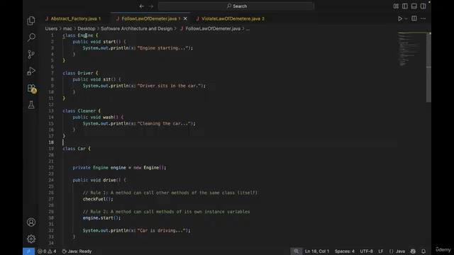

### 3.2 约束

- 课里没有讲 Maven / Gradle / Spring / JUnit 的版本，所以复现不引入第三方依赖。
- 课里没有给完整源码，只给了类名、方法名和调用关系；本文代码是示意重建。
- 课里没有给环境变量名；本复现不需要环境变量。
- 课里没有给 JDK 版本；示意代码用 JDK 17+ 可编译，低版本通常也能编译，但请以你本机 `javac -version` 为准。
- 课里没有讲并发、锁、事务；本复现不涉及。若你在 Node.js 里对应理解：不要写 `req.user.account.plan.features` 这种深层链，把行为封装到拥有数据的对象上。

### 3.3 估算

课里没有给 QPS、数据量、延迟、重构工时等数字，所以不能编造容量结论。复现时只做一张**记录模板**：

| 指标 | 课里是否给出 | 复现时怎么填 |
|---|---|---|
| 代码坏味道出现次数 | 没给 | 按你实际代码库统计 |
| 每个坏味道影响文件数 | 没给 | 用 `git grep` 或 IDE 搜索统计 |
| 单次重构预计工时 | 没给 | 团队自己估 |
| 重构后回归用例数 | 没给 | 按项目测试情况填 |
| 是否阻塞发布 | 没给 | 按风险等级填 |

如果你要算风险分，可以用文档作者的记录公式：`风险分 = 出现次数 × 影响文件数 × 变更频率`。这不是讲师原话，只是评审记录方法。

### 3.4 方案

1. 新建目录 `law-of-demeter-demo`。
2. 新建单文件 `LawOfDemeterDemo.java`。
3. 先写 `Engine`、`Driver`、`Cleaner`、`Car`，按四条规则写调用。
4. 再写 `BadCar` 和 `main`，故意制造链式调用。
5. 编译运行，确认输出。
6. 拿第 4 节的重构决策表，把每个坏味道映射到“改哪里”。
7. 改完后重新运行，输出必须与改前一致；如果行为变了，不是重构，是改需求。

目录结构：

```text
law-of-demeter-demo/
└── LawOfDemeterDemo.java
```

编译和运行命令：

```bash
cd law-of-demeter-demo
javac LawOfDemeterDemo.java
java LawOfDemeterDemo
```

预期输出：

```text
Car.checkFuel
Engine.start
Driver.set
Cleaner.wash
Engine.start
Driver.set
Cleaner.wash
```

### 3.5 取舍

讲师在 p085 [04:53] 明确说：迪米特法则不是必须严格遵循的硬性规则，有些系统可能违反它；如果违反没有伤害系统，可以接受。复现时也要有这个取舍：

- 先复现规则，再谈重构；不要一上来把项目改成“全是接口”。
- 链式调用不是绝对禁止；如果链式调用是稳定的、封闭的、不会穿透易变对象，可以先记录，不急着改。
- 坏味道清单是评审工具，不是 KPI；不要为了消灭坏味道而制造更多抽象。
- 课里没有讲“必须用某种设计模式”，所以不要编造讲师要求你用工厂、策略、观察者。

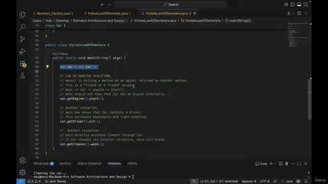

---

## 4. 完整代码

> 课里没有给出完整源码；以下为按逐字稿描述重建的示意代码，可直接保存为 `LawOfDemeterDemo.java` 运行。它不是讲师原项目，只用于复现规则和违规现象。

```java
public class LawOfDemeterDemo {

    static class Engine {
        void start() {
            System.out.println("Engine.start");
        }
    }

    static class Driver {
        void set() {
            System.out.println("Driver.set");
        }
    }

    static class Cleaner {
        void wash() {
            System.out.println("Cleaner.wash");
        }
    }

    static class Car {
        private final Engine engine = new Engine();

        void drive() {
            checkFuel();          // 规则 1：调用同类方法
            engine.start();       // 规则 2：调用实例变量对象的方法
        }

        private void checkFuel() {
            System.out.println("Car.checkFuel");
        }

        void allowDriver(Driver driver) {
            driver.set();         // 规则 3：调用参数对象的方法
        }

        void washCar() {
            Cleaner cleaner = new Cleaner();
            cleaner.wash();       // 规则 4：调用方法内部创建对象的方法
        }

        Engine getEngine() {
            return engine;
        }
    }

    static class BadCar {
        private final Engine engine = new Engine();
        private final Driver driver = new Driver();
        private final Cleaner cleaner = new Cleaner();

        Engine getEngine() {
            return engine;
        }

        Driver getDriver() {
            return driver;
        }

        Cleaner getCleaner() {
            return cleaner;
        }

        private void checkFuel() {
            System.out.println("BadCar.checkFuel");
        }
    }

    public static void main(String[] args) {
        Car car = new Car();
        car.drive();
        car.allowDriver(new Driver());
        car.washCar();

        BadCar badCar = new BadCar();
        badCar.getEngine().start();    // 违规：方法返回对象再点方法
        badCar.getDriver().set();      // 违规：链式调用
        badCar.getCleaner().wash();    // 违规：链式调用
    }
}
```

### 4.1 设计决策表

| 决策 | 选择 | 理由 | 课里依据 |
|---|---|---|---|
| 用单文件 Java | 是 | 课里没讲构建工具，单文件最容易复现 | P85–P100 没有 Maven/Gradle 内容 |
| 不引入 Spring | 是 | 课里没讲框架，引入会掩盖调用关系 | 课里只讲原则和坏味道 |
| 用 `System.out` 输出 | 是 | 课里没讲测试框架，先看调用顺序 | 课里用运行代码展示结果 |
| 保留 `BadCar` | 是 | 需要展示违规链式调用 | p086 [05:14] |
| 不把 `getEngine()` 删掉 | 是 | 它是违规示例的入口 | p086 [05:14] |
| 不写复杂异常 | 是 | 课里没讲异常处理 | 避免编造 |
| 不写并发 | 是 | 课里没讲锁/事务 | 避免编造 |

### 4.2 组件职责表

| 组件 | 职责 | 对应规则/坏味道 |
|---|---|---|
| `Engine` | 提供 `start()` | 被调用方 |
| `Driver` | 提供 `set()` | 参数对象 |
| `Cleaner` | 提供 `wash()` | 内部创建对象 |
| `Car` | 封装 `drive()`、`allowDriver()`、`washCar()` | 规则 1–4 |
| `BadCar` | 暴露内部对象，制造链式调用 | 消息链 / 迪米特违规 |
| `main` | 组装调用并观察输出 | 复现入口 |

### 4.3 接口/数据模型草案

课里没有给接口定义，以下是复现草案，不是讲师原代码：

```text
Engine  : start(): void
Driver  : set(): void
Cleaner : wash(): void
Car     : drive(): void
          allowDriver(driver: Driver): void
          washCar(): void
BadCar  : getEngine(): Engine
          getDriver(): Driver
          getCleaner(): Cleaner
```

### 4.4 容量估算表

课里没有给任何容量数字。下面只是评审记录模板：

| 项目 | 课里是否给出 | 你的记录 |
|---|---|---|
| 代码库文件数 | 没给 |  |
| 坏味道数量 | 没给 |  |
| 链式调用出现次数 | 没给 |  |
| 重构预计人天 | 没给 |  |
| 回归测试通过率 | 没给 |  |

---

## 5. 逐行解释

1. `static class Engine { void start() ... }`  
   这是被依赖的“陌生人”之一。`Car` 内部持有 `Engine` 实例，所以 `Car` 可以调 `engine.start()`，这符合规则 2。

2. `private final Engine engine = new Engine();`  
   `engine` 是 `Car` 的实例变量。讲师在 p085 [04:23] 说方法可以调用“objects stored and instance variables of its class”，所以 `drive()` 里调 `engine.start()` 是允许的。

3. `void drive() { checkFuel(); engine.start(); }`  
   `checkFuel()` 是同类方法，对应规则 1；`engine.start()` 对应规则 2。注意这里没有写 `new Car().getEngine().start()`，因为那会变成链式穿透。

4. `void allowDriver(Driver driver) { driver.set(); }`  
   `driver` 是方法参数，对应规则 3。讲师在 p086 [02:07] 解释过：方法可以调用参数对象的方法。

5. `void washCar() { Cleaner cleaner = new Cleaner(); cleaner.wash(); }`  
   `cleaner` 是方法内部创建的对象，对应规则 4。讲师在 p086 [02:56] 说方法可以调用自己创建对象的方法。

6. `badCar.getEngine().start();`  
   这是违规核心。`main` 先拿到 `badCar`，再调 `getEngine()` 拿到 `Engine`，再调 `start()`。讲师在 p086 [05:14] 说这就是 `car.getEngine.getStart` 的违规形态，一次函数调用出现了两个点。

7. `badCar.getDriver().set();` 和 `badCar.getCleaner().wash();`  
   同理，都是“方法返回对象再继续点”。它们让 `main` 知道了 `BadCar` 的内部结构，增加了依赖和耦合。

8. 为什么 `Car` 的写法更好？  
   因为 `main` 只需要 `car.drive()`、`car.allowDriver(...)`、`car.washCar()`，不需要知道 `Engine`、`Driver`、`Cleaner` 怎么被创建、怎么被持有。行为被封装在 `Car` 里，调用方只和直接朋友说话。

9. 为什么讲师说“不是硬性规则”？  
   p085 [04:53] 明确说有些系统可能违反迪米特法则，如果违反没有伤害系统可以接受。复现时你要记录“为什么暂时不改”，而不是无脑加一层包装。

10. 在 JS/Node 里怎么对应？  
    不要写 `order.getCustomer().getAddress().getZipCode()` 这种链；可以在 `Order` 上提供 `calculateTax()`，把地址和邮编的读取封在 `Order` 内部。课里没有讲 JS，这是前端转 AI 应用工程师的类比。

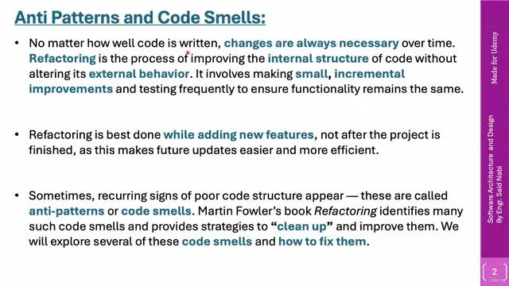

---

## 6. 复现检查清单

- [ ] 已新建 `law-of-demeter-demo/LawOfDemeterDemo.java`。
- [ ] 已确认本机有 `javac` 和 `java`；课里没讲版本，用 `javac -version` 自查。
- [ ] 已完整粘贴第 4 节代码，没有省略号。
- [ ] `javac LawOfDemeterDemo.java` 编译通过。
- [ ] `java LawOfDemeterDemo` 输出包含 `Car.checkFuel`、`Engine.start`、`Driver.set`、`Cleaner.wash`。
- [ ] 能指出规则 1 对应 `checkFuel()`。
- [ ] 能指出规则 2 对应 `engine.start()`。
- [ ] 能指出规则 3 对应 `driver.set()`。
- [ ] 能指出规则 4 对应 `cleaner.wash()`。
- [ ] 能指出 `badCar.getEngine().start()` 是迪米特违规。
- [ ] 已用第 4.1 节设计决策表记录“为什么不引入框架”。
- [ ] 已用第 4.2 节组件职责表记录每个类职责。
- [ ] 已用第 4.4 节容量估算表记录“课里没给数字”的项。
- [ ] 已把评论误用、重复代码、长方法、长类、数据泥团、发散式变化、霰弹式修改、依恋情结、不当亲密、消息链、基本类型偏执、switch、投机性通用性逐项打勾或写“不适用”。
- [ ] 重构后重新运行，输出与重构前一致。
- [ ] 已插入至少 6 张截图，且 alt 含 `pNNN`、`MM:SS` 和说明。

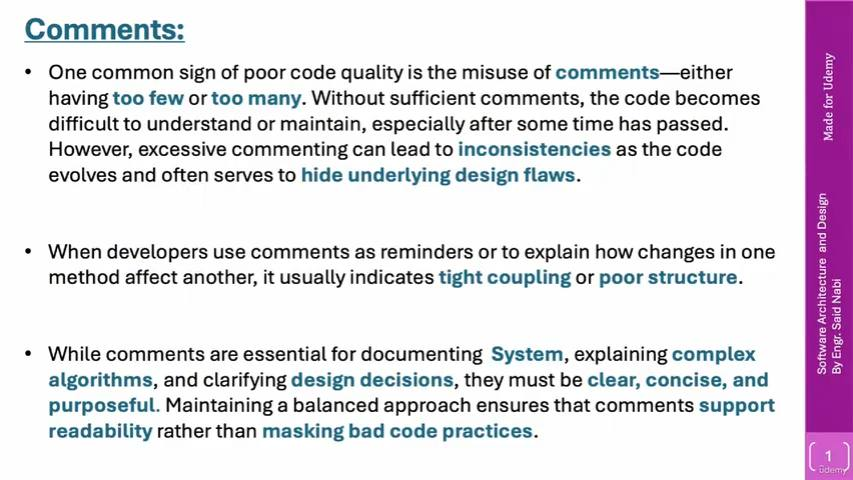

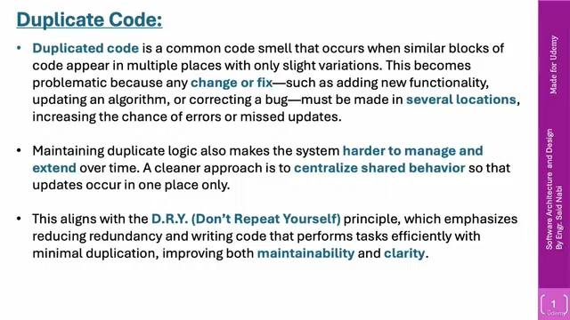

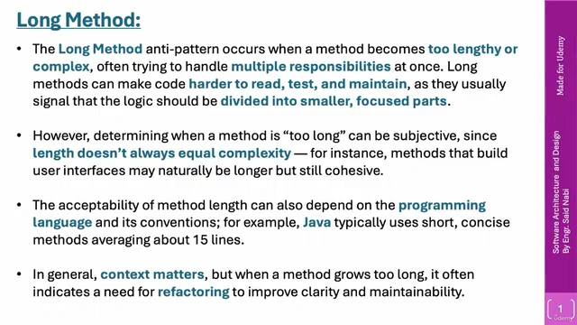

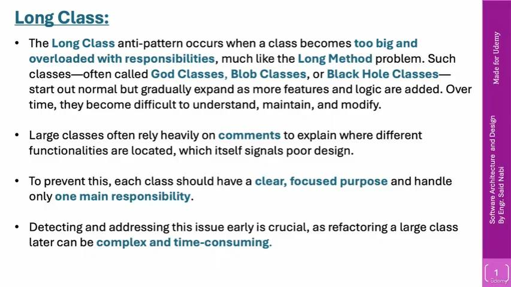

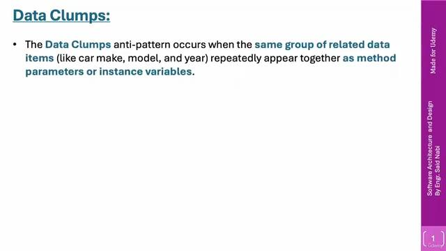

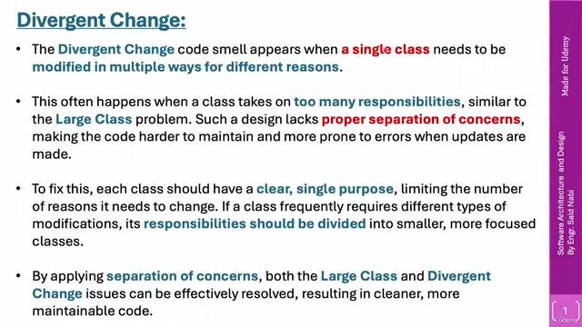

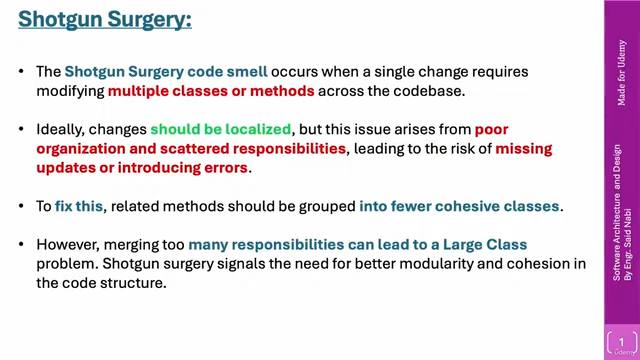

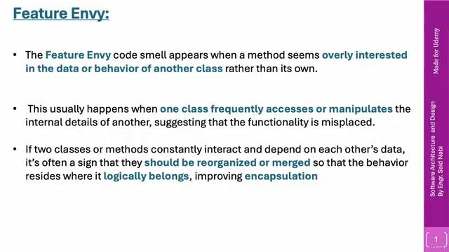

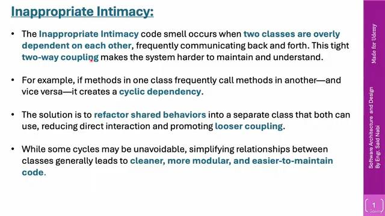

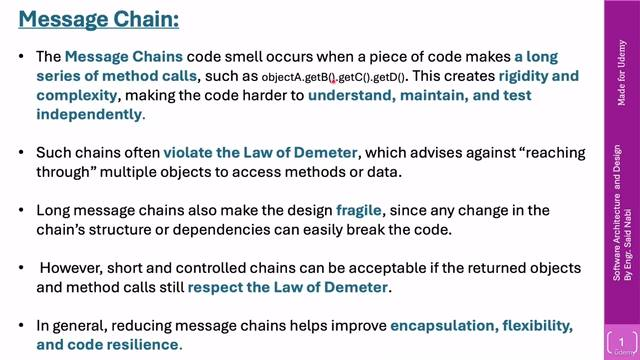

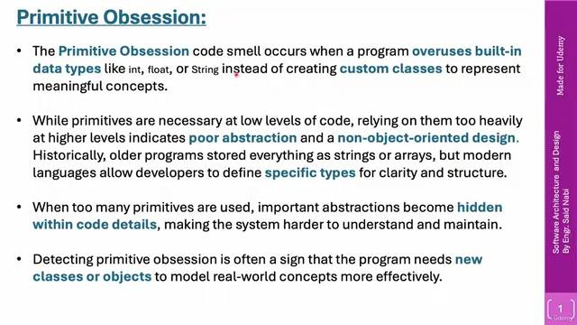

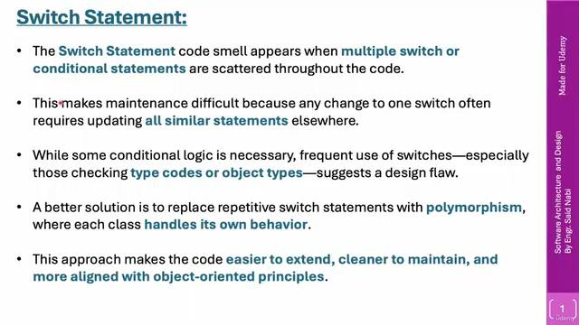

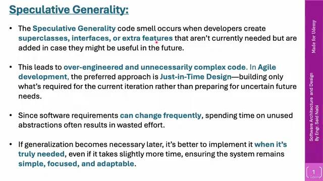

---

## 7. 课里没讲但你会撞上的

1. **JDK 版本和包名**  
   课里没讲 JDK 版本，也没讲包名。本文用默认包，方便 `javac LawOfDemeterDemo.java` 直接跑。真实项目请按团队规范加 `package`，否则类多了会冲突。

2. **测试框架**  
   课里没讲 JUnit / TestNG / Vitest。复现时先用 `System.out` 看输出；真实重构必须补回归测试，否则你无法证明“外部行为没变”。

3. **异常处理**  
   课里没讲异常。`BadCar.checkFuel()` 在示例里没被调用，真实代码里如果删掉或改签名，要检查调用方。

4. **访问修饰符**  
   课里没讲 `private` / `public` 的取舍。示例里 `getEngine()` 是包级可见，真实项目要按模块边界决定；不要为了“能跑”全部 public。

5. **并发和锁**  
   课里没讲锁、事务、并发。本文不涉及。若你在 Node.js 里做 AI 应用，注意不要用“共享可变对象 + 异步回调”制造新的隐式依赖。

6. **性能数字**  
   课里没给 QPS、延迟、内存。第 4.4 节只是记录模板，不能当容量结论。真实评审要压测或看监控。

7. **重构时机**  
   讲师在 p087 [04:28] 说重构最好在加新功能时做，不要等项目结束再一次性重构。真实团队里你要把“重构”拆进每个需求，而不是攒一个大 PR。

8. **坏味道不是越多越坏**  
   课里说长方法如果只做一类内聚的事可以接受；迪米特法则也不是硬性规则。评审时要写“为什么现在不改”，避免为了清单而过度设计。

9. **AI 应用里的消息链**  
   课里没讲 AI 应用，但你可以类比：Agent 工具调用不要写成 `agent.getTool().getExecutor().invoke().getResult()`，应该在 Agent 上暴露 `runTool()`，把工具解析和结果读取封装起来。这是类比，不是讲师原话。

10. **截图和逐字稿的边界**  
    本文截图只使用清单里给出的帧，alt 中的说明按逐字稿主题写；清单里没有的帧不要补。课里没讲的内容，本文都标了“课里没讲”或“示意”，不要把它们当成讲师原话。