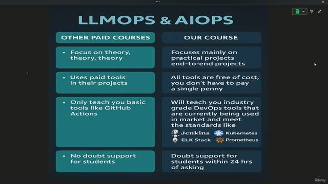
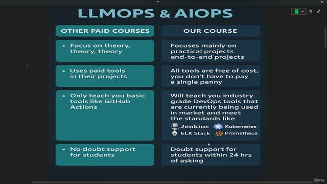
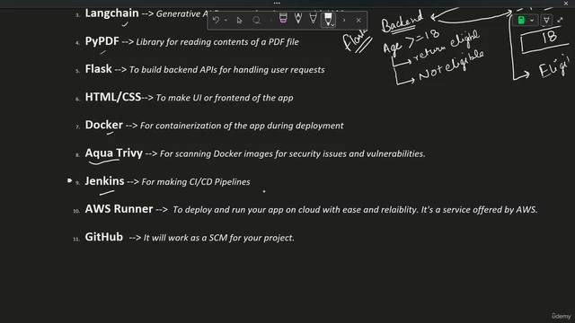
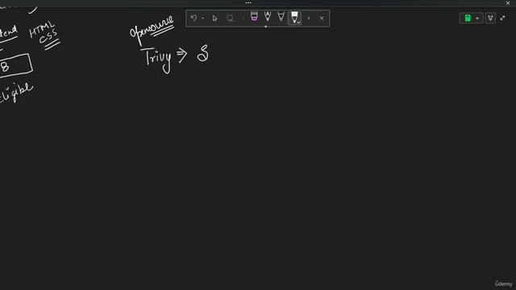
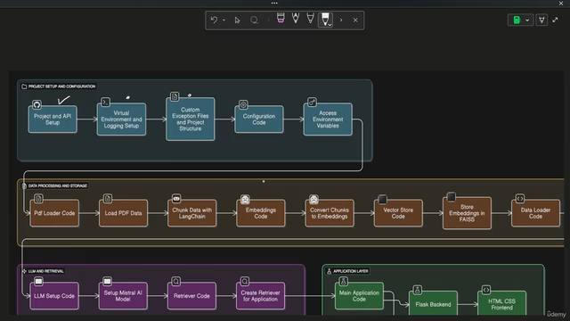
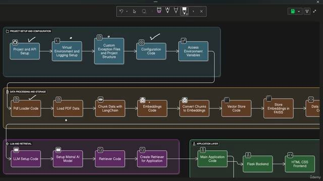
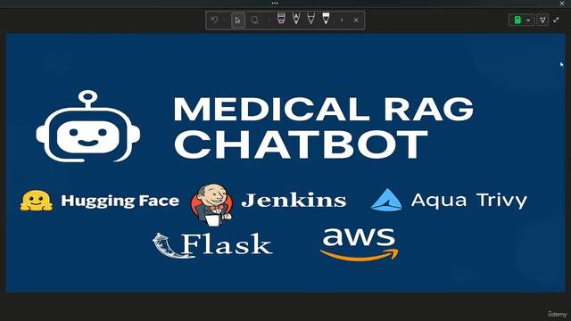
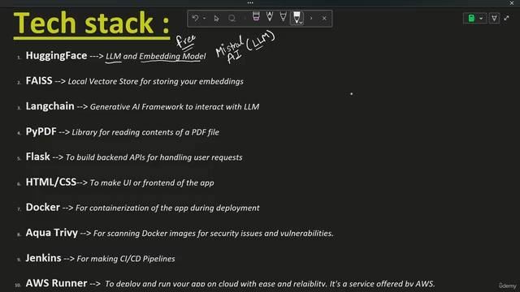

# LLMOps & AIOps Bootcamp（BV1gXR4BPERd）P1–P2：课程地图与 Medical RAG Chatbot 的项目冷启动

> **先说明这两讲的性质**：P1 是课程导览（8 个项目 + 技术栈选型理由），P2 是第一个项目 Medical RAG Chatbot 的技术栈剖析与端到端工作流。**这两讲里没有出现任何可执行的项目代码**，讲师讲的是「用什么工具、为什么用、按什么顺序做」。
> 所以本文档按「纯讲解课」的写法处理：第 3 节把讲师的推导过程还原成可执行的步骤，第 4 节把讲师口述的方案落成可直接落地的目录结构、职责表、变量表、估算表和一份能保存运行的**示意骨架**（明确标注哪些是课里没有的）。真正的业务代码从后续 P3 才开始。

---

## 1. 这一节做什么

P1 和 P2 组合起来，回答的是三个问题：

1. **这门课要做哪 8 个项目，每个项目用什么工具链**（P1）。
2. **为什么选这些工具**——不是说「Jenkins 是 CI 工具」这种定义，而是讲师反复强调的取舍：为什么用 Jenkins 不用 GitHub Actions、为什么全部用免费额度、为什么用 FAISS 而不是别的向量库（P1 + P2）。
3. **第一个项目 Medical RAG Chatbot 从零到上线，一共分几步、每一步产出什么文件**（P2，这是最有价值的一讲）。

对读者的实际产出是：**在写第一行业务代码之前，把脚手架搭完**——项目目录建好、Hugging Face 账号和 access token 拿到、`.env` 写好、`requirements.txt` 和 `setup.py` 建好、GitHub 仓库建好、Dockerfile 写好、Jenkins 和 Trivy 的概念位置搞清楚。这些是 P2 明确列在「项目与 API 设置」里的内容，也是后面每一讲都要依赖的地基。

---

## 2. 讲师原话

下面按主题摘述，保留讲师用的英文工具名。

**关于课程定位与「不花钱」原则**

- 「其他课程是 theory, theory and theory。我们不这么干，我们只做实战项目，而且是 **production grade** 的项目。」—— p001 [00:00]
- 「我们不用任何付费工具、不用任何付费 API，所有东西都免费。云方面，AWS 给大约一年免费试用，GCP 给大约 **300 美元** 的 credits。」—— p001 [00:29]
- 「LLM API 我们用 **Groq** 和 **Gemini**，都是免费 API，有额度上限但能用。」—— p001 [00:58]
- 「开源工具方面用 **Jenkins、Kubernetes、Prometheus、Grafana、ELK stack**，全都是免费的。」—— p001 [00:58]
- 「在 Q&A 区提问，我会在 **24 小时内**回复，最多不超过 **48 小时**。」—— p001 [02:26]

**关于为什么用 Jenkins 而不是 GitHub Actions**

- 「一门课讲 CI/CD 部署，别的课会讲 GitHub Actions。但 GitHub Actions 不会用在生产级项目里。做公司级项目，你会坚持用 **Jenkins**。Jenkins 是被 **5000 多家大公司**使用的最有名的 CI/CD 工具。」—— p001 [01:28]
- 「Jenkins 需要自己装在虚拟机或你的 PC 上；而 **GitLab CI/CD** 和 **CircleCI** 是云端 CI/CD 工具，不用装在本地，走云控制台就行。」—— p001 [10:00]

**8 个项目与各自的技术栈（P1 全程）**

- 项目一 **Medical RAG Chatbot**：Jenkins、**Aqua Trivy**、AWS、**Flask**、**Hugging Face**（里面用 **Mistral AI**）。—— p001 [03:24]
- 项目二 **Multi AI Agent**：**Groq**（LLM）+ **Tavily**（在线搜索），**SonarQube**（代码质量检查）、Jenkins、**FastAPI**、AWS，框架是 **LangChain + LangGraph**。—— p001 [03:53]
- 项目三 **AI Anime Recommender**：**Grafana Cloud** 监控 K8s 集群、**GCP**、**minikube**、Hugging Face、Docker、**ChromaDB** 存向量。—— p001 [04:50]
- 项目四 **Flipkart Product Recommender**：**Grafana + Prometheus**（Prometheus 采指标，Grafana 画看板）、LangChain、Groq、Hugging Face、Flask、GCP、**AstraDB**（在线向量库，对比上一项的 Chroma 是本地离线向量库）、HTML/CSS、Docker。—— p001 [05:18] 起
- 项目五 **AI Travel Planner**：Groq、minikube、**Streamlit**、Docker，重点是 **ELK**——Elasticsearch、Logstash、Kibana 加 **Filebeat**（也叫 Elastic Beats），作用是从 K8s 集群各节点抓日志，在 Kibana 里可视化。—— p001 [06:40]
- 项目六 **Study Buddy AI**：讲师称这是「所有项目里最进阶的一个」。minikube、**Jenkins 负责 CI、Argo CD 负责 CD**，是 **GitOps** 项目；Groq、**Docker Hub** 存镜像、Streamlit、GCP。—— p001 [07:38]
- 项目七 **AI Celebrity Detector & QA**：Kubernetes、Flask、HTML/CSS、Groq、**vision transformer**（讲师说的是 **Llama 4** 模型）、**OpenCV**、GCP，CI/CD 用 **CircleCI**。—— p001 [08:33]
- 项目八 **AI Music Composer**：GCP、Kubernetes 集群、Groq 生成音符、Streamlit、**music21** 库处理乐理、LangChain，CI/CD 用 **GitLab CI/CD**。—— p001 [09:02]

**P2：项目一的技术栈逐项解释**

- 「Hugging Face 我们用来做**两件事**：当 LLM 用，也当 embedding model 用。」—— p002 [01:10]
- 「Mistral AI 是开源平台，免费。它由一家**法国创业公司**开发，我们可以自由使用。」—— p002 [01:39]
- 「embedding 模型我记得用的是 **Al Mini L4**，这是它 embedding 模型的名字。」—— p002 [02:27]
- 「我们会有一个 PDF 作为数据源，那是我们的**医学百科**。流程是：提取 PDF 内容 → 转成 documents → 转成 embeddings → 存进 vector store。」—— p002 [02:27]–[03:24]
- 「FAISS，全称是 **Facebook AI Similarity Search**，是 Meta（Facebook 母公司）开发的，是一个本地向量库，你就把 embeddings 存在这儿。」—— p002 [03:54]
- 「你需要一个生成式 AI 框架来跟模型交互，这个框架就是 **LangChain**。读 PDF 内容需要 **PyPDF** 库。」—— p002 [04:52]
- 「**Flask** 处理后端操作，**HTML/CSS** 做前端 UI。前端把用户请求发给后端，后端把答案返回前端。」—— p002 [05:50]
- 「**Trivy**（讲师也叫它 aqua-trivy）是开源安全扫描器，它扫描你的 **Docker 镜像**，检测 **vulnerability**。vulnerability 就是容器里能被黑客利用来做未授权访问或数据泄漏的弱点/缺陷。」—— p002 [08:42]
- 「举个例子：你的应用里 Flask 是 **2.0.1** 版本，这个版本有安全 bug；后来 Flask 发了 **2.1.0** 修掉了。Trivy 扫镜像时会去找 `requirements.txt`，发现你还在用旧版本，就给你警告并建议升级到新版本。」—— p002 [11:08]
- 「Jenkins 做 CI/CD：从 **GitHub** 拉代码 → 用 Dockerfile 构建镜像 → **扫描镜像** → 推到 **AWS ECR**（Elastic Container Registry）→ 部署到 **AWS Runner**。全部在点一次 build 按钮后一次跑完。」—— p002 [13:24]、[22:49]、[23:47]
- 「**Flask 一般跑在 5000 端口**，这个要在 Dockerfile 里定义好。」—— p002 [21:22]
- 「temperature 范围 **0 到 1**，0 最不创意，1 最创意。别设太高，想要稳定结果就设在 **0.3 到 0.67** 之间；设太高会生成很怪的结果，设太低会生成很少甚至没有结果。」—— p002 [19:00]

> 
>
> 

---

## 3. 从零复现

这一节把 P2 里讲师讲的「工作流」按可执行顺序重排成步骤。**每一步都标了「课里怎么说的」和「你现在要做什么」**。

### 3.0 需求：先想清楚「什么东西要被做出来」

讲师在 P2 开头给的定性是：做一个 **medical RAG chatbot**，用户提问医学问题，系统从一本**医学百科 PDF** 里检索相关内容，再交给 LLM 组织成答案。—— p002 [00:15]–[02:56]

需求拆成四条：

| 编号 | 需求 | 依据 |
|---|---|---|
| R1 | 知识来自**本地 PDF**，不是模型内置知识 | p002 [02:27] |
| R2 | 回答要通过**检索 + 生成**两段完成（RAG） | p002 [19:28] |
| R3 | 系统要有**网页界面**能对话 | p002 [05:50] |
| R4 | 要能**一键部署**到云上，且镜像上线前过安全扫描 | p002 [13:24]–[23:47] |

### 3.1 约束推演：为什么这套技术栈「只能是这套」

讲师没说「因为预算为零所以选这些」，但他的推导链是清楚的，我把它显式写出来：

1. **约束 A：零成本。** → 云只能用免费额度（AWS 免费试用约一年 / GCP 约 300 美元），LLM 只能用有免费额度的 API（Hugging Face 上的 Mistral AI），向量库只能用本地的（FAISS），不能用托管的付费向量数据库。—— p001 [00:29]、p002 [03:54]
2. **约束 B：要「生产级」而不是玩具。** → CI/CD 必须用企业里真在用的 Jenkins（讲师原话：5000+ 公司），而不是 GitHub Actions。—— p001 [01:28]
3. **约束 C：要和真实的容器上线流程一致。** → 必须有 Dockerfile、必须过安全扫描（Trivy）、镜像必须进镜像仓库（AWS ECR）、必须由云托管服务跑起来（讲师称之为 AWS Runner）。—— p002 [07:17]、[13:24]
4. **约束 D：前端转过来的人要能跟得上。** → 后端选 Flask（Python 里最轻的 Web 框架），前端就用 HTML/CSS，不引入 React/Vue 这类额外构建链。—— p002 [05:50]

### 3.2 方案一：RAG 数据流的五段式（讲师在 P2 反复画的时间线）

讲师在 [02:27]–[03:24] 讲了一遍，在 [16:39]–[18:06] 又按「文件」讲了一遍。合并成一条流水线：

```
PDF 文件（data/ 目录）
   ↓  ① PyPDF 读取内容
原始文本
   ↓  ② LangChain 切分成 chunks / documents
chunks
   ↓  ③ Hugging Face embedding 模型把 chunk 转成向量
embeddings
   ↓  ④ FAISS 存向量
向量库（磁盘上的一组 index 文件）
   ↓  ⑤ 用户提问 → retriever 从向量库取相关片段 → 连同问题一起给 LLM
答案
```

讲师的原话是：「docs 先转成 chunks，chunks 转成 embeddings，embeddings 存进 vector store」。—— p002 [17:06]

**关键一步被讲师单独拎出来了**：①②③④ 会在 **data loader** 这一个环节里被合并成一个动作。原话：「你可以把这三件事合成一个，那就是你的 data loader code」。—— p002 [18:06]

### 3.3 方案二：CI/CD 流水线的五段式

讲师在 [13:24] 和 [21:52]–[23:47] 讲了两遍，这里按「一次 build 按钮按下之后发生什么」排列：

```
你 push 代码到 GitHub
   ↓  ① Jenkins 从 GitHub 拉代码（checkout）
   ↓  ② Jenkins 用仓库里的 Dockerfile 构建 Docker 镜像
   ↓  ③ Trivy 扫描这个镜像，看有没有已知漏洞
   ↓  ④ 镜像推到 AWS ECR（Elastic Container Registry）
   ↓  ⑤ ECR 的镜像被部署到 AWS Runner，应用跑起来
浏览器访问应用
```

讲师特别强调最后一句：「**全部在点一次 build 按钮后一次跑完**」。—— p002 [23:47]

> 
>
> 

### 3.4 落地动作：你现在就照着做的 9 步

**Step 1｜建项目骨架目录**（课里说「要定义很多文件夹，里面定义各种文件」，具体文件夹名课里没逐个念，下面是按讲师列出的文件职责推导的）：见第 4.3 节。

**Step 2｜建虚拟环境**。讲师明确说「首先要创建一个 **virtual environment**」。—— p002 [15:21]

```bash
python3 -m venv .venv
source .venv/bin/activate        # Windows: .venv\Scripts\activate
```
> 前端类比：`venv` 相当于 Node 的 `nvm` 切出来的独立 Node 版本 + 独立 `node_modules`，`requirements.txt` 相当于 `package.json`。

**Step 3｜建 `setup.py` 和 `requirements.txt`**。讲师点名要这两个文件。—— p002 [15:15]

**Step 4｜建 `.env` 并把 Hugging Face token 写进去**。讲师原话：「创建你的 **environment file** 来存 API key 和所有东西，我们用的是 Hugging Face API，所以它存在环境变量里」。—— p002 [15:15]

**Step 5｜去 Hugging Face 注册账号、建 access token**。讲师原话：「去 Hugging Face 创建一个账号，登录，创建一个 **access token**，把这个 token 放进你的环境变量里」。—— p002 [15:41]

**Step 6｜写配置代码，声明用哪个 LLM、哪个 embedding 模型**。讲师原话：「你会在**配置代码**里访问所有环境变量；并且要告诉 Hugging Face API：LLM 我要用 Mistral AI 这个版本，embedding 我要用这个特定的 embedding 模型」。—— p002 [15:41]–[16:10]

**Step 7｜把医学百科 PDF 放进 `data/` 目录**。讲师原话：「你的 PDF 会存在某个 **data folder** 里」。—— p002 [16:39]

**Step 8｜写前端 HTML/CSS + 后端 Flask，本地先跑通**。讲师说 Flask 跑在 5000 端口。—— p002 [21:22]

**Step 9｜建 GitHub 仓库，把代码推上去**。讲师原话：「GitHub 在这个项目里充当你的 **SCM**，也就是源码管理，所有代码都存在 GitHub 上，好让你能追踪代码的每一次变化」。—— p002 [14:23]

**Step 10｜写 Dockerfile**（内容见第 4.8 节示意），然后配 Jenkins 流水线。

> 
>
> 

### 3.5 取舍：讲师做的四个选择，以及他给的理由

| 选择 | 被放弃的选项 | 讲师给的理由 | 出处 |
|---|---|---|---|
| Jenkins | GitHub Actions | GitHub Actions 不用于生产级项目；Jenkins 是 5000+ 大公司在用的工具 | p001 [01:28] |
| FAISS | 托管向量库 | 本地、免费；讲师对比说 ChromaDB 是离线库，AstraDB 才是在线库 | p002 [03:54]、p001 [06:13] |
| AWS ECR | Docker Hub | 项目一用 ECR，因为镜像本来就要进 AWS 生态；项目六才用 Docker Hub | p002 [22:49]、p001 [08:06] |
| Flask | FastAPI | 项目一用 Flask，项目二才换成 FastAPI——按项目递进安排 | p001 [03:24]、p001 [03:53] |

---

## 4. 完整代码

> **重要声明**：P1、P2 两讲里讲师**没有展示任何代码或命令**。本节里的所有内容是「把讲师口述的方案落成可执行的产物」，其中目录名、变量名、版本号、代码均为本文档推导，**已逐处标注哪些课里讲了、哪些没有**。真正属于讲师的只有「有哪些文件、文件负责什么、跑在哪个端口、流水线有哪几段」。

### 4.1 设计决策表

| 决策点 | 讲师结论 | 依据强度 | 出处 |
|---|---|---|---|
| LLM 提供商 | Hugging Face（内含 Mistral AI） | 讲师明说 | p002 [01:39] |
| Embedding 提供商 | Hugging Face（同一个 token） | 讲师明说 | p002 [01:10] |
| Embedding 模型名 | 讲师口述为「Al, Mini, L4」 | 讲师口述、转写可能不准 | p002 [02:27] |
| 向量库 | FAISS（本地） | 讲师明说 | p002 [03:54] |
| RAG 编排框架 | LangChain | 讲师明说 | p002 [04:52] |
| PDF 解析 | PyPDF | 讲师明说 | p002 [04:52] |
| 后端 | Flask，端口 5000 | 讲师明说 | p002 [21:22] |
| 前端 | HTML + CSS | 讲师明说 | p002 [05:50] |
| 安全扫描 | Trivy（Aqua Trivy）扫镜像 | 讲师明说 | p002 [08:42] |
| 镜像仓库 | AWS ECR | 讲师明说 | p002 [22:49] |
| 运行环境 | AWS Runner（讲师原话） | 讲师口述，服务全名未念全 | p002 [13:54] |
| CI/CD | Jenkins | 讲师明说 | p002 [13:24] |
| SCM | GitHub | 讲师明说 | p002 [14:23] |
| temperature | 0.3 – 0.67 | 讲师明说 | p002 [19:00] |
| 日志 / 自定义异常 | 必须有（生产级项目要求） | 讲师明说，但没给实现 | p002 [15:15] |
| chunk 大小 / 重叠 | **课里没给数字** | — | — |
| Python 版本 | **课里没讲** | — | — |
| 依赖版本号 | **课里没讲** | — | — |
| 环境变量名 | **课里没讲**（只说「存在 env 文件里」） | — | — |

### 4.2 组件职责表

| 组件 | 负责什么 | 不负责什么 |
|---|---|---|
| PyPDF | 打开 `data/*.pdf`，吐出纯文本 | 不做切分、不做清洗 |
| LangChain | 把长文本切成 chunk；把 retriever 和 LLM 串成一条链 | 不负责存向量 |
| Hugging Face embedding 模型 | 文本 → 向量 | 不生成自然语言 |
| FAISS | 存向量、按相似度检索 top-k | 不生成自然语言 |
| Hugging Face 上的 Mistral AI | 拿问题 + 检索片段 → 生成答案 | 不存知识 |
| Flask | 收 HTTP 请求、调 retriever + LLM、返回答案 | 不渲染页面（模板由 HTML/CSS 提供） |
| HTML/CSS | 输入框、对话气泡、样式 | 不含业务逻辑 |
| Dockerfile | 把以上一切打成一个可运行镜像，暴露 5000 端口 | 不做安全判断 |
| Trivy | 扫镜像里的已知漏洞 | 不修漏洞，只报 |
| Jenkins | 按顺序执行：checkout → build → scan → push → deploy | 不写业务代码 |
| AWS ECR | 存镜像 | 不跑镜像 |
| AWS Runner | 跑镜像、对外提供访问 | 不构建镜像 |

> 
>
> 

### 4.3 目录结构与文件职责

> 目录名是本文档推导的（讲师只说「定义很多文件夹、里面放各种文件」）。文件名里 `setup.py`、`requirements.txt`、`.env`、Dockerfile 是讲师点名的。

```
medical-rag-chatbot/
├── .env                      # 讲师点名：存 Hugging Face API key
├── .gitignore
├── Dockerfile                # 讲师点名：容器配置
├── Jenkinsfile               # 讲师讲流水线，但没给文件名（本文档推导）
├── requirements.txt          # 讲师点名
├── setup.py                  # 讲师点名
├── app.py                    # 讲师点名：主应用入口（"python app.py"）
├── config/
│   └── config.py             # 讲师点名：读环境变量、声明 LLM 与 embedding 模型
├── src/
│   ├── __init__.py
│   ├── logger.py             # 讲师点名：logging setup
│   ├── exception.py          # 讲师点名：custom exception
│   ├── data_loader.py        # 讲师点名：合并 PDF loader + embedding + vector store
│   ├── pdf_loader.py         # 讲师点名：读 data/ 下 PDF 并切块
│   ├── embedding.py          # 讲师点名：chunk → 向量
│   ├── vector_store.py       # 讲师点名：向量入库（FAISS）
│   ├── llm_setup.py          # 讲师点名：接 Hugging Face 上的 Mistral AI
│   └── retriever.py          # 讲师点名：问题 → 相关片段
├── templates/
│   └── index.html            # 讲师点名：前端 HTML
├── static/
│   └── style.css             # 讲师点名：前端 CSS
├── data/
│   └── medical_encyclopedia.pdf   # 讲师点名：数据源 PDF 放 data folder
└── vectorstore/              # 课里没讲持久化路径，这是本文档加的
```

### 4.4 `.env` 变量表

| 变量名 | 值 | 课里讲了吗 |
|---|---|---|
| `HUGGINGFACEHUB_API_TOKEN` | 你在 Hugging Face 建的 access token | 值来源讲师明说；**变量名课里没讲**，这是本文档按 Hugging Face 官方常见写法定的 |
| `LLM_REPO_ID` | 你要用的 Mistral AI 模型 ID | 讲师说要「指定用哪个 LLM 版本」，但**具体 ID 课里没念** |
| `EMBEDDING_REPO_ID` | 你要用的 embedding 模型 ID | 同上，**课里没念完整名字** |
| `TEMPERATURE` | `0.5` | 区间讲师明说 0.3–0.67，具体值本文档取中位 |

```bash
# .env（不要提交到 GitHub，写进 .gitignore）
HUGGINGFACEHUB_API_TOKEN=hf_xxxxxxxxxxxxxxxxxxxxxxxxxxxx
LLM_REPO_ID=<你在 Hugging Face 上选的 Mistral 模型 ID>
EMBEDDING_REPO_ID=<你在 Hugging Face 上选的 embedding 模型 ID>
TEMPERATURE=0.5
```

### 4.5 `requirements.txt` 草案

> **课里没给任何版本号。** 下面只列这两讲涉及到的库；具体版本请在装完后用 `pip freeze > requirements.txt` 固化，不要照抄别人的版本。

```
flask
python-dotenv
langchain
langchain-community
langchain-huggingface
huggingface_hub
faiss-cpu
pypdf
```

### 4.6 接口草案与数据模型草案

**HTTP 接口**（讲师只说了「前端发请求，后端回答案」，具体路径、方法课里没讲，以下是本文档推导）

| 方法 | 路径 | 请求体 | 响应 | 状态码 |
|---|---|---|---|---|
| `GET` | `/` | — | `index.html` | 200 |
| `POST` | `/ask` | `{"question": "咳嗽三天了怎么办"}` | `{"answer": "...", "sources": ["..."]}` | 200 |
| `POST` | `/ask` | `question` 为空 | `{"error": "question required"}` | 400 |

**数据模型**（示意，课里没给 schema）

```
Chunk
├── page_content : string      # 从 PDF 切出来的文本片段
└── metadata     : object
    ├── source   : string      # PDF 文件名
    └── page     : number      # 页码

VectorRecord
├── id         : string
├── embedding  : float[]       # 长度 = embedding 模型输出维度（以模型卡为准）
└── chunk      : Chunk
```

### 4.7 容量估算表（**课里没讲，以下是本文档的演算示例**）

讲师没给任何数量级，但你要跑起来就必须先知道内存和磁盘够不够。下面用一组假设演算，你自己换成真实 PDF 的数字重算：

**假设**：医学百科 PDF 共 500 页，每页约 500 个英文单词。

- 总词数 = 500 × 500 = **250,000 词**
- 粗略按 1 词 ≈ 4 字符 → 总字符 ≈ **1,000,000 字符**
- 切块参数取 chunk = 1000 字符、overlap = 200 字符（**课里没给，这是常见默认值**）
- 每块净前进 = 1000 − 200 = 800 字符
- 块数 ≈ 1,000,000 ÷ 800 ≈ **1250 块**
- 假设 embedding 维度 384、float32（**维度以模型卡为准，此处仅用于演算**）
  - 单向量字节数 = 384 × 4 B = **1536 B ≈ 1.5 KB**
  - 向量总量 = 1250 × 1.5 KB ≈ **1.9 MB**
  - 加上 FAISS 索引结构开销，按 2~3 倍估 → **4–6 MB**
- 结论：这份数据量下，FAISS 完全可以放内存，镜像里也不至于因为向量文件变臃肿。**真正让镜像变大的是 Python 依赖，不是向量库。**

> 说明：讲师的 PDF 实际页数、切块参数、embedding 维度全部没有出现在逐字稿里，上面的数字是可复算的示例，不是讲师给的数据。

### 4.8 示意骨架代码（**课里没有代码，以下为示意**）

这一节的四个文件可以直接保存运行，用来验证「Flask 5000 端口 + Dockerfile + Jenkins 流水线」这条主干是通的。业务逻辑（PDF 解析、FAISS、LLM）等后续讲次替换掉 `src/` 里的空壳。

**`app.py`**

```python
import os
from flask import Flask, render_template, request, jsonify
from dotenv import load_dotenv

load_dotenv()

from src.logger import get_logger
from src.exception import RAGException

logger = get_logger(__name__)
app = Flask(__name__)

PORT = int(os.getenv("PORT", "5000"))


@app.get("/")
def index():
    return render_template("index.html")


@app.post("/ask")
def ask():
    payload = request.get_json(silent=True) or {}
    question = (payload.get("question") or "").strip()

    if not question:
        return jsonify({"error": "question required"}), 400

    try:
        # 课里没给实现，这里先返回占位，等 src/retriever.py 写好再接上
        answer = f"[placeholder] 收到问题：{question}"
        return jsonify({"answer": answer, "sources": []})
    except Exception as exc:
        logger.exception("ask failed")
        raise RAGException("ask pipeline failed", exc)


if __name__ == "__main__":
    logger.info("starting on port %s", PORT)
    app.run(host="0.0.0.0", port=PORT)
```

**`src/logger.py`**（讲师明确要求「logging setup」，实现课里没给）

```python
import logging
import sys


def get_logger(name: str) -> logging.Logger:
    logger = logging.getLogger(name)
    if logger.handlers:
        return logger
    logger.setLevel(logging.INFO)
    handler = logging.StreamHandler(sys.stdout)
    handler.setFormatter(
        logging.Formatter("%(asctime)s | %(levelname)s | %(name)s | %(message)s")
    )
    logger.addHandler(handler)
    return logger
```

**`src/exception.py`**（讲师明确要求「custom exception setup」，实现课里没给）

```python
class RAGException(Exception):
    def __init__(self, message: str, original: Exception | None = None):
        self.message = message
        self.original = original
        super().__init__(self._compose())

    def _compose(self) -> str:
        if self.original is None:
            return self.message
        return f"{self.message} | cause={type(self.original).__name__}: {self.original}"
```

**`Dockerfile`**（讲师点名要 Dockerfile、点名 5000 端口）

```dockerfile
FROM python:3.11-slim

WORKDIR /app

COPY requirements.txt .
RUN pip install --no-cache-dir -r requirements.txt

COPY . .

EXPOSE 5000

CMD ["python", "app.py"]
```

**`templates/index.html`**（讲师点名 HTML/CSS 做前端）

```html
<!DOCTYPE html>
<html lang="zh">
<head>
  <meta charset="utf-8" />
  <title>Medical RAG Chatbot</title>
  <link rel="stylesheet" href="{{ url_for('static', filename='style.css') }}" />
</head>
<body>
  <main>
    <h1>Medical RAG Chatbot</h1>
    <form id="ask-form">
      <textarea id="question" rows="3" placeholder="请输入你的医学问题"></textarea>
      <button type="submit">提问</button>
    </form>
    <pre id="answer"></pre>
  </main>
  <script>
    document.getElementById("ask-form").addEventListener("submit", async (e) => {
      e.preventDefault();
      const question = document.getElementById("question").value;
      const res = await fetch("/ask", {
        method: "POST",
        headers: { "Content-Type": "application/json" },
        body: JSON.stringify({ question }),
      });
      const data = await res.json();
      document.getElementById("answer").textContent = data.answer || data.error;
    });
  </script>
</body>
</html>
```

**`Jenkinsfile`**（讲师讲了五段流水线，文件写法课里没给，以下是示意）

```groovy
pipeline {
    agent any

    environment {
        IMAGE_NAME = "medical-rag-chatbot"
        AWS_REGION = "us-east-1"
        ECR_REPO   = "<你的 AWS 账号ID>.dkr.ecr.us-east-1.amazonaws.com/medical-rag-chatbot"
    }

    stages {
        stage('Checkout') {
            steps {
                git branch: 'main', url: '<你的 GitHub 仓库地址>'
            }
        }
        stage('Build Image') {
            steps {
                sh 'docker build -t $IMAGE_NAME:$BUILD_NUMBER .'
            }
        }
        stage('Scan with Trivy') {
            steps {
                sh 'trivy image --exit-code 1 --severity HIGH,CRITICAL $IMAGE_NAME:$BUILD_NUMBER'
            }
        }
        stage('Push to ECR') {
            steps {
                sh 'docker tag $IMAGE_NAME:$BUILD_NUMBER $ECR_REPO:$BUILD_NUMBER'
                sh 'docker push $ECR_REPO:$BUILD_NUMBER'
            }
        }
        stage('Deploy') {
            steps {
                sh 'echo "在 AWS 控制台里把 ECR 新镜像部署到 Runner 服务"'
            }
        }
    }
}
```

---

## 5. 逐行解释

**① 为什么 embedding 和 LLM 共用同一个 Hugging Face token？**
讲师说的是「Hugging Face 我们用两件事：LLM 和 embedding model，用同一个 access token 访问」—— p002 [01:10]、[02:06]。这意味着 `.env` 里只需要一个 token 变量，不用维护两套凭据。好处是配置简单；代价是 token 一旦泄漏，两个能力同时暴露，所以 `.env` 必须进 `.gitignore`。

**② 为什么必须「PDF → 文本 → chunk → embedding → 向量库」不能跳步？**
讲师给的理由是「你不能直接把 documents 存进 vector store，必须先转成 embeddings」—— p002 [02:56]。这句是整个 RAG 的核心约束：FAISS 这类库索引的是**浮点向量**，不是字符串。所以 PyPDF 负责「文件→字符串」，LangChain 负责「长字符串→短块」，embedding 模型负责「短块→向量」，三段各司其职，缺一段就跑不通。

**③ 为什么选 FAISS 而不是 Chroma？**
讲师在 P2 说 FAISS「是 Meta 开发的本地向量库」—— p002 [03:54]；在 P1 讲项目三时说用 ChromaDB，讲项目四时说「Chroma 是离线向量库，AstraDB 是在线向量库」—— p001 [06:13]。放在一起看，他的分类维度是**本地 vs 托管**，不是「好 vs 坏」。项目一选 FAISS 是为了零成本零运维；如果你以后要做多实例部署（多个 Flask 副本共享同一份索引），就得换成在线向量库，因为每台机器自己存一份 FAISS 会各查各的。

**④ 为什么 Trivy 卡在 build 之后、push 之前？**
看讲师画的顺序：checkout → **build image** → **scan** → push ECR → deploy—— p002 [22:20]–[23:18]。把扫描放在 push 之前，是为了让带高危漏洞的镜像根本进不了仓库，而不是进了仓库再补救。这不是讲师解释的，是流水线顺序本身表达出来的意图。

**⑤ 为什么 Trivy 能从镜像里看到 Flask 版本？**
讲师讲得很具体：扫描时会去找 `requirements.txt`，看到你还在用有 bug 的旧版本就告警并建议升级—— p002 [12:01]。原因是 `Dockerfile` 里 `COPY requirements.txt .` 把依赖清单打进了镜像层，Trivy 读这个清单去比对漏洞库。所以**依赖必须声明在 `requirements.txt` 里**，靠 `pip install` 临时装是不行的，扫描器看不见。

**⑥ 为什么 Dockerfile 里要 `EXPOSE 5000`？**
讲师说「Flask 一般跑在 5000 端口，这要在 Dockerfile 里定义」—— p002 [21:22]。`EXPOSE` 本身只是元数据，真正让容器可从外部访问的是云平台把端口映射出去；但写出来能让部署方知道该映射哪个端口，也是给 Trivy、Jenkins 和你未来的自己看的文档。

**⑦ 为什么 temperature 建议 0.3–0.67？**
讲师原话：「别设太高，想要稳定结果就 0.3 到 0.67；设太高会生成很怪的结果，设太低会生成很少甚至没有结果」—— p002 [19:00]。医学问答场景要的是**可复现、不发挥**，所以取区间偏下更稳。注意这是讲师给的经验区间，不是官方文档值。

**⑧ 为什么项目一用 ECR 而项目六用 Docker Hub？**
讲师在 P2 项目一说「推到 AWS ECR」，在 P1 项目六说「Docker 镜像放 Docker Hub」—— p002 [22:49]、p001 [08:06]。差别在于部署目标：项目一部署在 AWS 上，走 ECR 是同云内部拉取，省鉴权配置；项目六部署在 GCP 上，用公共的 Docker Hub 更省事。**镜像仓库要跟着部署平台选**，不是固定套路。

**⑨ `if __name__ == "__main__"` 这两行在 Node 里对应什么？**
对应 `package.json` 里的 `"main"` 加 `node app.js`。Flask 的 `app.run(host="0.0.0.0")` 里 `0.0.0.0` 必须写，写 `127.0.0.1` 在容器里外部访问不到——这一条课里没讲，但你部署时一定会撞上。

**⑩ 为什么第 4.7 节的估算要算「镜像大小」这件事？**
因为 P2 的流水线里有 Trivy 扫描和 ECR 推送两段，两者都和镜像体积正相关。讲师没给容量数据，但你能从上表看出：**500 页 PDF 的向量只占 4–6 MB，真正撑大镜像的是 Python 依赖**。所以在 `Dockerfile` 里写 `--no-cache-dir`、用 `slim` 基础镜像，收益远大于去优化向量库。

---

## 6. 复现检查清单

| # | 检查项 | 判定标准 | 讲师是否讲过 |
|---|---|---|---|
| 1 | 虚拟环境 | `which python` 指向 `.venv/bin/python` | ✅ p002 [15:21] |
| 2 | `.env` 存在且不进 git | `git status` 里看不到 `.env` | ✅ 方向讲了，`.gitignore` 没讲 |
| 3 | Hugging Face token 可用 | 用 token 调一次模型能返回结果 | ✅ p002 [15:41] |
| 4 | `setup.py` + `requirements.txt` 存在 | 目录里有这两个文件 | ✅ p002 [15:15] |
| 5 | `data/` 下有医学百科 PDF | 文件存在且能被 PyPDF 打开 | ✅ p002 [16:39] |
| 6 | 日志与自定义异常 | `src/logger.py`、`src/exception.py` 存在 | ✅ 要求提了，实现没讲 |
| 7 | 配置代码能读到环境变量 | 打印出模型 ID 和 temperature | ✅ p002 [16:10] |
| 8 | 前端页面能打开 | 浏览器访问 `localhost:5000` 有输入框 | ✅ p002 [05:50] |
| 9 | 后端能收请求 | `curl -X POST /ask` 返回 JSON | ✅ 讲了两端交互，路径没讲 |