# LLMOps & AIOps Bootcamp P12–P15 复现文档：Git 版本控制 → 业务 Dockerfile → Jenkins(DinD) → GitHub 集成 → 构建/扫描/推送 ECR

> 本文覆盖 P12–P15 四集。读完后你应该得到：一个推到 GitHub 的 RAG Medical 项目仓库、一个能构建业务镜像的 Dockerfile、一个跑在本机 8080 端口的 Jenkins DinD 容器、一条从 GitHub 拉代码并在 Jenkins 里构建、Trivy 扫描、推送到 AWS ECR 的流水线。

---

## 1. 这一节做什么

这四集的目标不是讲概念，而是把「本地能跑的 RAG 项目」变成「有版本、有镜像、有流水线、有镜像仓库」的可交付物。整条链路是：

```
本地项目
  ├─ git init / .gitignore / commit / push  ──►  GitHub 仓库
  ├─ Dockerfile（python:3.10）             ──►  业务镜像 rag-medical:latest
  └─ custom-jenkins/Dockerfile             ──►  Jenkins DinD 容器（:8080）
                                                    │
GitHub ──► Jenkins Pipeline（Jenkinsfile）──────────┤
                                                    ├─ stage 1：checkout 源码到 workspace
                                                    └─ stage 2：docker build → trivy image → docker push
                                                                                        │
                                                                                        ▼
                                                                              AWS ECR  myrepo:latest
```

四集的分工非常清楚：P12 解决「代码怎么进仓库、镜像怎么定义」；P13 解决「CI 工具本身怎么跑起来」，而且是用 Docker-in-Docker 的方式跑 Jenkins；P14 解决「Jenkins 凭什么有权限读你的私有/公开仓库」；P15 解决「流水线里真正干活的那一段」——构建、漏洞扫描、推送镜像仓库。P15 结尾时讲师在 ECR 里看到了约 3.4 GB 的 `latest` 镜像，说明链路已经闭合。

最终目录结构（在项目根目录下）：

```
rag-medical/
├── .gitignore
├── .env                     # 不进 Git
├── Dockerfile               # 业务镜像
├── Jenkinsfile              # 流水线定义
├── requirements.txt         # 沿用你 P1–P11 的产物
├── app/
│   └── application.py       # 课里只说它跑在 5000 端口
├── components/              # 课里提到这里有 cache 文件
├── custom-jenkins/
│   ├── Dockerfile
│   └── entrypoint.sh
└── venv/                    # 不进 Git
```

需要提前说明的一点：这四集的逐字稿里，讲师大量使用「just copy this command」「copy this command one by one」，命令原文并没有被逐字念出来，而是显示在屏幕和配套文档里。本文会把每条命令补全成可直接执行的版本，并在涉及「逐字稿没有念出原文」的地方明确标注来源，避免你把补全内容误当成讲师原话。

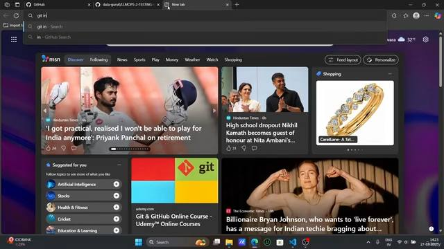

---

## 2. 讲师原话（带「—— pNNN [MM:SS]」）

**关于为什么要版本控制、以及 .gitignore 里放什么：**

> 「whatever inside venv we don't want to push because they are very big in size around one to two GB」—— p012 [02:24]

> 「the most important thing most and most important dot env okay you don't upload your env file to your github」—— p012 [02:51]

**关于 GitHub 建仓时不要勾 README：**

> 「why i'm saying keep it untick because if you pick this you will not get the commands」—— p012 [00:57]

**关于 Dockerfile 的结构：**

> 「first of all we are using python 3.10 image okay then there are some essential environment variables okay these are must for your production grid projects then we are creating a work directory of app」—— p012 [05:14]

> 「we install hyphenifullstop to install all the packages, install all the dependencies... what's the use of this no catch dir? So basically it will give you previous catch files... it will ignore these catch files and build the dependencies from scratch」—— p012 [06:09]

> 「expose the flash port... on which port your flashcap is running you can see on the application.py your flashcap is running on 5000 port so make sure you include that port」—— p012 [07:05]

**关于 Jenkins 为什么用 DinD、以及 root 与普通用户的区别：**

> 「we will be using Docker and we will be using Docker inside Docker. So we will be using a DIND mode」—— p013 [00:00]

> 「basically root means you have special access. You can install anything inside that container... but if you are inside this normal user that is your Jenkins user then you have limited permissions」—— p013 [01:14]

**关于容器里装完东西必须重启：**

> 「whenever you make changes on your docker container... make sure you always restart」—— p013 [10:29]

**关于 access token 的定位：**

> 「access token is a login permission... it will basically give Jenkins partial access we are not giving full access」—— p014 [00:57]

**关于 P15 三个阶段的分工：**

> 「build basically we will be building our docker image using docker then we will be scanning it for vulnerabilities whether we have any security issues using our preview and then we will be pushing it to our ECR」—— p015 [00:00]

**关于 DinD 的 daemon 报错是预期内的：**

> 「I was expecting this error... basically it is a diamond error. It is common. It is common. Don't worry」—— p015 [12:23]

**关于 Trivy 装完的验证：**

> 「you can see it is showing us the version 0.62.1 so it has successfully installed privy」—— p015 [02:21]

---

## 3. 从零复现

下面按「做到哪一步、验证什么」来排，不按集数排。每一步末尾都有一个可观测的成功信号，看不到这个信号就不要往下走。

### 3.0 前置条件（P13 明确列出的四条）

- Docker Desktop 已安装并**在后台运行**（讲师特意切到 Docker Desktop 确认绿点）。
- 代码已经用 GitHub 做过版本控制。
- 项目的 Dockerfile 已创建。
- Jenkins 的 Dockerfile 已创建。

另外本机需要 Git CLI。讲师的做法是浏览器搜 `git install`，进第一个链接按操作系统下载安装，然后在终端里执行：

```bash
git --version
```

能打印版本号即成功。课里没讲具体版本号，按官网最新稳定版安装即可。

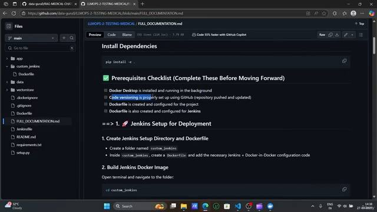

### 3.1 建 GitHub 仓库并初始化本地仓库

打开 GitHub → New repository，名字用 `rag-medical`（讲师口述像是 “rag medical shed”，按你的项目名替换即可），**Public**，**不要勾 Add a README file**。

不勾 README 的原因讲师讲得很直白：勾了之后 GitHub 就不会把「推送已有仓库」的那几条命令显示给你，你得自己去别处找。

建完之后页面会给出一段命令。回到 VS Code，新开一个 **cmd** 终端（讲师特意强调 terminal 要是 cmd），确认虚拟环境已激活，然后依次执行：

```bash
git init
```

这一步会在项目根目录生成 `.git/`。接着**先不要 add**，先去写 `.gitignore`（见第 4 章文件一）。写完再继续：

```bash
git branch -M main
git remote add origin https://github.com/<你的用户名>/rag-medical.git
git add .
git commit -m "initial commit"
git push origin main
```

`git add .` 只会加 `.gitignore` 允许的文件。讲师这边推了大约 20 MB，如果你推上去的体积是几百 MB 甚至上 GB，八成是 `venv/` 没被忽略。

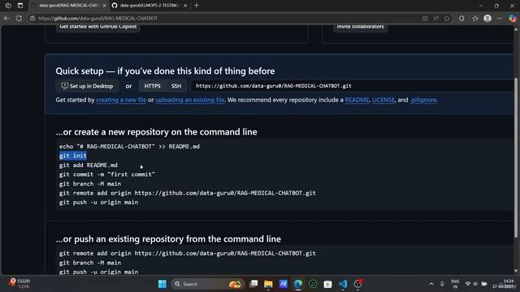

### 3.2 写业务 Dockerfile 并本地构建

在项目根目录新建文件，文件名就叫 `Dockerfile`（无扩展名），内容见第 4 章文件二。

然后在根目录构建：

```bash
docker build -t rag-medical:latest .
```

成功信号：命令行最后出现 `naming to docker.io/library/rag-medical:latest` 之类的输出，`docker images` 里能看到这个 tag。

讲师在讲 `--no-cache-dir` 时切到了 `components/` 目录，指出里面已经有 cache 文件生成，所以要用这个参数在镜像构建时丢掉本地缓存、从零装依赖。

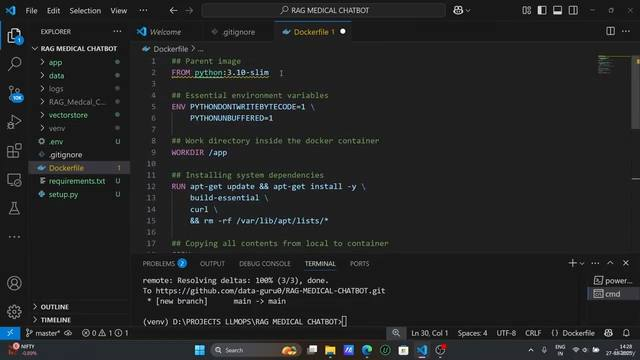

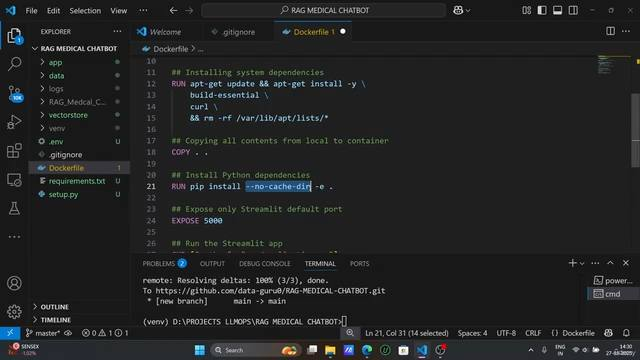

### 3.3 写 Jenkins 的 DinD Dockerfile

在项目根目录建 `custom-jenkins/` 目录，里面放 `Dockerfile` 和 `entrypoint.sh`（内容见第 4 章文件三、文件四）。

```bash
cd custom-jenkins
docker build -t custom-jenkins:lts .
```

Jenkins 镜像本身就有三四百 MB，加上 apt 装 docker.io，第一次构建几分钟很正常。讲师当时等了大约五分钟。

### 3.4 启动 Jenkins 容器

```bash
docker run -d --name jenkins-dind \
  --privileged \
  -p 8080:8080 \
  -p 50000:50000 \
  -v jenkins_home:/var/jenkins_home \
  custom-jenkins:lts
```

成功信号：命令返回一串字母数字组成的容器 ID；Docker Desktop 里能看到名为 `jenkins-dind` 的容器亮绿灯，端口 8080。

> 说明：逐字稿里讲师只说了「copy this whole command at once」，没有逐字念出参数。`--privileged` 在 DinD 模式下是必须的，否则容器内的 dockerd 起不来——这一点从 P15 容器内能执行 `docker build` 可以反推出来。

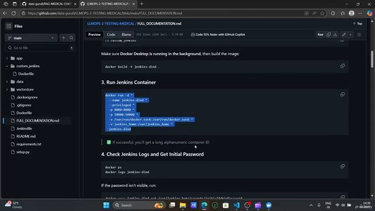

### 3.5 解锁 Jenkins 并建管理员

浏览器打开 `http://localhost:8080`，会要求输入初始密码。取密码有两种方式，讲师说第一种有时只能成功一次，第二种是等价的备选：

```bash
docker logs jenkins-dind
```

```bash
docker exec jenkins-dind cat /var/jenkins_home/secrets/initialAdminPassword
```

拿到密码 → Continue → **Install suggested plugins** → 等插件装完 → 创建管理员用户（讲师用 `admin`，要求记住用户名密码）→ Save and Continue → Save and Finish → Start using Jenkins。

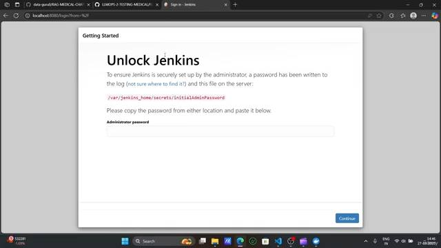

### 3.6 在 Jenkins 容器内装 Python、Trivy、AWS CLI

这是 P13 尾巴和 P15 开头连起来的一段。所有命令都要先在宿主机执行 `docker exec` 进容器：

```bash
docker exec -it jenkins-dind bash
```

容器内依次执行：

```bash
apt-get update
apt-get install -y python3 python3-pip curl unzip wget gnupg lsb-release apt-transport-https
```

装完验证：

```bash
python3 --version      # 讲师机器上是 3.11.2
```

此时 `python` 这个命令还不存在，要做一个软链，讲师用的就是 `ln`：

```bash
ln -sf /usr/bin/python3 /usr/local/bin/python
python --version       # 应输出与 python3 --version 相同
```

接着装 Trivy（讲师验证到的版本是 `0.62.1`）：

```bash
wget -qO - https://aquasecurity.github.io/trivy-repo/deb/public.key \
  | gpg --dearmor | tee /usr/share/keyrings/trivy.gpg > /dev/null
echo "deb [signed-by=/usr/share/keyrings/trivy.gpg] https://aquasecurity.github.io/trivy-repo/deb $(lsb_release -sc) main" \
  | tee -a /etc/apt/sources.list.d/trivy.list
apt-get update
apt-get install -y trivy
trivy --version
```

再装 AWS CLI v2：

```bash
curl "https://awscli.amazonaws.com/awscli-exe-linux-x86_64.zip" -o "awscliv2.zip"
unzip awscliv2.zip
./aws/install
aws --version
```

> 说明：逐字稿对这三段只说了「copy this command one by one」，命令原文未被念出。上面给的是各工具官方安装方式的等价补全，版本号以你实际输出为准；讲师机器上 Trivy 显示的是 0.62.1。

装完**退出容器并重启**：

```bash
exit
docker restart jenkins-dind
```

讲师反复强调这条规则：只要在容器里装了东西，就必须重启，否则 Jenkins 里可能读不到新装的二进制。

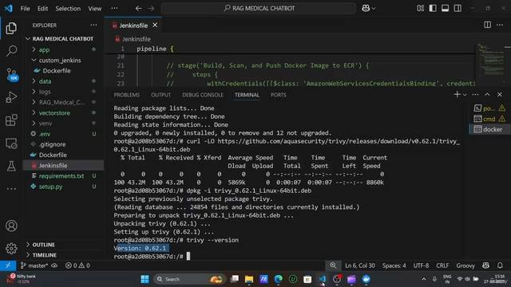

### 3.7 在 Jenkins 里装 AWS 相关插件

Jenkins 首页 → Manage Jenkins → Plugins → Available plugins，搜索 `aws`，勾选：

- **AWS Credentials**
- 讲师说的第二个是「AWS SDK」（在可用插件列表里搜 aws 会出现，名称以你看到的为准）

Install，装完再 `docker restart jenkins-dind` 一次。

### 3.8 生成 GitHub Personal Access Token

GitHub → 右上头像 → Settings → Developer settings → Personal access tokens → **Tokens (classic)** → Generate new token (classic)。输入 GitHub 密码确认，Note 填 `rag`，Expiration 自选，权限只勾两项：

- `repo`
- `admin:repo_hook`

讲师对这两个权限的解释是：access token 相当于「登录许可」，Jenkins 需要它来读你仓库里的 app 文件、data 文件、vector store、Dockerfile、requirements 等，但**只给部分权限，不给全量**。

生成后**这个页面别关**，token 只显示一次。

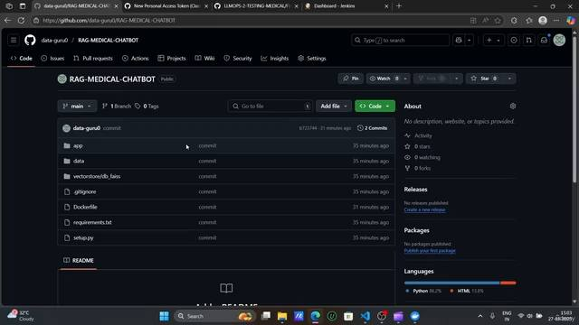

### 3.9 把 GitHub 凭证放进 Jenkins

Manage Jenkins → Credentials → System → Global credentials (unrestricted) → Add Credentials：

- Kind：`Username with password`
- Username：你的 GitHub 用户名
- Password：刚才的 token
- ID：`github-token`
- Description：`github-token`

Create。

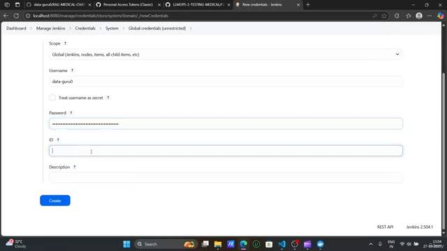

### 3.10 新建 Pipeline 并接上 GitHub

Jenkins 首页 → New Item → 名字 `rag-chatbot-medical` → 选 **Pipeline** → OK。滚到 Pipeline 段：

- Definition：`Pipeline script from SCM`
- SCM：`Git`
- Repository URL：`https://github.com/<你的用户名>/rag-medical.git`
- Credentials：`github-token`
- Branch Specifier：把默认的 `*/master` 改成 `*/main`
- Script Path：`Jenkinsfile`（默认值）

Apply → Save。

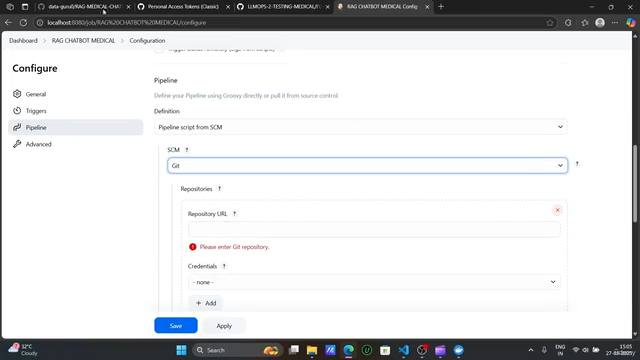

### 3.11 先跑通只有 checkout 的 Jenkinsfile

在第 4 章文件五里，把 `Build Scan and Push` 这个 stage **先整段注释掉**（讲师是选中后按 `Ctrl + /`），只留 `GitHub Repo` 这一段，然后推到 GitHub：

```bash
git add .
git commit -m "add jenkinsfile checkout stage"
git push origin main
```

回到 Jenkins，打开 `rag-chatbot-medical` → Build Now。进 Console Output 看：能看到它拉取 Jenkinsfile、用 github-token 检出代码，最后 `Finished: SUCCESS`。

这一步的验收物是 **workspace**：点构建号 → Workspace，应该能看到你仓库里的所有文件。讲师就是靠这个确认「GitHub 已经集成到 Jenkins」。

### 3.12 建 AWS IAM 用户和 ECR 仓库

AWS 控制台搜 `IAM` → Users → Create user，名字 `rag-medical` → Next → Attach policies directly → 搜 `AmazonEC2ContainerRegistryFullAccess` → 勾选 → Next → Create user。

打开这个用户 → Security credentials → Create access key → 选 **Command Line Interface (CLI)** → 确认 → 拿到 **Access key** 和 **Secret access key**（只显示一次）。

再搜 `ECR` → Create repository，名字 `myrepo`，其余保持默认（Mutable），Create。建完记下 **Repository URI**。

### 3.13 把 AWS 凭证放进 Jenkins

和 3.9 同一个入口，但 Kind 这次选 **AWS Credentials**（这是 3.7 装的插件提供的）：

- ID：`aws-token`
- Description：`aws-token`
- Access Key ID / Secret Access Key：粘贴 3.12 拿到的两个值

Create。

### 3.14 打开 Build Scan and Push stage

回到 Jenkinsfile，取消 `environment` 和 `Build Scan and Push` 的注释，按你自己的环境改这几个值：

| 变量 | 课里讲师填的值 | 说明 |
|---|---|---|
| `AWS_REGION` | `us-east-1` | 看 AWS 控制台右上角 |
| `ECR_REPO_NAME` | `myrepo` | 3.12 建的仓库名 |
| `IMAGE_TAG` | `latest` | 保持不变 |
| `SERVICE_NAME` | 保持原样 | 讲师说这是给下一个 stage（部署）用的 |
| `credentialsId` | `aws-token` | 必须和 3.13 的 ID 完全一致 |

推代码：

```bash
git add .
git commit -m "enable build scan push stage"
git push origin main
```

再 Build Now。

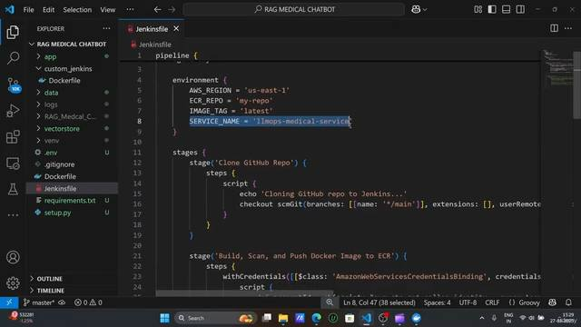

### 3.15 处理 DinD 的 daemon 报错

第一次跑到 `aws ecr get-login-password | docker login` 附近，很可能在 Console Output 里看到 Docker daemon 连接失败。讲师原话是「I was expecting this error」。修法是在宿主机上依次执行：

```bash
docker exec -it jenkins-dind bash
usermod -aG docker jenkins
chmod 666 /var/run/docker.sock
exit
docker restart jenkins-dind
```

再进容器验证 `jenkins` 用户确实在 docker 组里：

```bash
docker exec -it jenkins-dind bash
groups jenkins      # 输出里应同时出现 jenkins 和 docker
exit
```

> 说明：逐字稿只说了「copy these commands one by one」和「so it is showing us docker and jenkins so it means it is good」，命令原文没有念出。上面是按「能看到 docker 与 jenkins 两个组名」这个验收信号反推的等价修复。

重启后重新 Build。这次应该一路走到 `Finished: SUCCESS`。

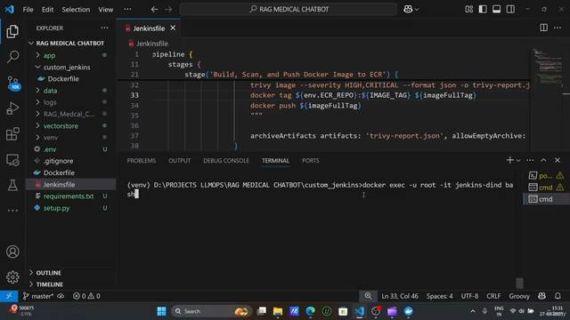

### 3.16 最终验收

- Jenkins 构建页出现绿色对勾。
- 构建号 → Workspace 里多出 `trivy-report.txt`，报告里能看到 high severity 的漏洞条目。
- AWS ECR → `myrepo` 仓库里出现 `latest` 镜像，讲师那边约 3.4 GB。

讲师最后还顺带提了一句：接下来会把镜像从 ECR 推到部署阶段，那是下一集的事，本篇不涉及。

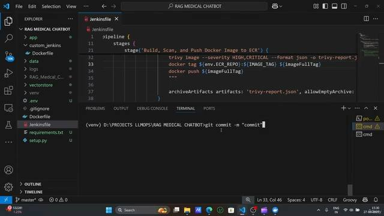

---

## 4. 完整代码

### 文件一：`/.gitignore`

```gitignore
# 虚拟环境，讲师说约 1–2 GB，绝对不推
venv/

# 日志，推不推都行
logs/

# setup.py 运行后生成的 egg-info 目录
*.egg-info/

# 环境变量，绝对不能推
.env

# Python 缓存（讲师在 components/ 下演示过 cache 文件）
__pycache__/
*.pyc

# Trivy 扫描产物
trivy-report.txt
```

### 文件二：`/Dockerfile`（业务镜像）

```dockerfile
FROM python:3.10

ENV PYTHONDONTWRITEBYTECODE=1 \
    PYTHONUNBUFFERED=1 \
    PIP_NO_CACHE_DIR=1 \
    LANG=C.UTF-8

WORKDIR /app

RUN apt-get update && apt-get install -y --no-install-recommends \
        curl \
        build-essential \
    && rm -rf /var/lib/apt/lists/*

COPY . /app

RUN pip install --no-cache-dir -r requirements.txt

EXPOSE 5000

CMD ["python", "app/application.py"]
```

> 逐字稿确认过的点：基础镜像 `python:3.10`；有 EXPOSE，讲师说他的 Flask 应用跑在 **5000** 端口，如果你项目实际是 8000 就改成 8000；启动命令是 `python app/application.py`；`--no-cache-dir` 是讲师专门解释过的。
> 逐字稿**没有**逐条念出 ENV 的具体变量名，只说是「some essential environment variables，must for your production grade projects」。上面四个是可运行的最小集合，仓库原文请以你从讲师给的资源链接里拿到的 Dockerfile 为准。
> `requirements.txt` 的内容课里没讲，直接用你 P1–P11 生成的那一份。

### 文件三：`/custom-jenkins/Dockerfile`

```dockerfile
FROM jenkins/jenkins:lts-jdk17

USER root

RUN apt-get update && apt-get install -y --no-install-recommends \
        ca-certificates \
        curl \
        gnupg \
        lsb-release \
        unzip \
        wget \
        docker.io \
    && rm -rf /var/lib/apt/lists/*

COPY entrypoint.sh /usr/local/bin/dind-entrypoint.sh
RUN chmod +x /usr/local/bin/dind-entrypoint.sh

EXPOSE 8080
EXPOSE 50000

ENTRYPOINT ["/usr/local/bin/dind-entrypoint.sh"]
CMD ["jenkins"]
```

> 讲师对这一段的原话是：用 Jenkins 镜像，然后切到 root 用户，因为 root 才能往容器里装东西；普通 jenkins 用户权限受限。`jenkins/jenkins` 的具体 tag 逐字稿没念，用 `lts-jdk17` 或 `lts` 都可以。

### 文件四：`/custom-jenkins/entrypoint.sh`

```bash
#!/usr/bin/env bash
set -e

# DinD 模式：先在容器内拉起 dockerd，再交给 Jenkins 官方启动脚本
if ! docker info >/dev/null 2>&1; then
  echo "[dind] starting dockerd..."
  dockerd >/var/log/dockerd.log 2>&1 &
  for i in $(seq 1 30); do
    if docker info >/dev/null 2>&1; then
      echo "[dind] dockerd is ready"
      break
    fi
    sleep 1
  done
fi

exec /usr/local/bin/jenkins.sh "$@"
```

> 这个文件是为了让 `--privileged` 启动的容器里真的有一个可用的 Docker daemon。讲师在 P15 容器内直接跑 `docker build` 能成功，说明他的镜像里做了等价的初始化；但逐字稿没有给出这段脚本原文。

### 文件五：`/Jenkinsfile`

```groovy
pipeline {
    agent any

    environment {
        AWS_REGION     = 'us-east-1'
        ECR_REPO_NAME  = 'myrepo'
        IMAGE_TAG      = 'latest'
        SERVICE_NAME   = 'rag-medical-service'
    }

    stages {

        stage('GitHub Repo') {
            steps {
                checkout scm
                sh 'ls -la'
            }
        }

        stage('Build Scan and Push') {
            steps {
                withCredentials([[
                    $class: 'AmazonWebServicesCredentialsBinding',
                    credentialsId: 'aws-token',
                    accessKeyVariable: 'AWS_ACCESS_KEY_ID',
                    secretKeyVariable: 'AWS_SECRET_ACCESS_KEY'
                ]]) {
                    sh '''
                        set -e

                        aws --version
                        docker --version

                        ACCOUNT_ID=$(aws sts get-caller-identity --query Account --output text)
                        REGISTRY="${ACCOUNT_ID}.dkr.ecr.${AWS_REGION}.amazonaws.com"
                        IMAGE_URI="${REGISTRY}/${ECR_REPO_NAME}:${IMAGE_TAG}"

                        aws ecr get-login-password --region "${AWS_REGION}" \
                          | docker login --username AWS --password-stdin "${REGISTRY}"

                        docker build -t "${IMAGE_URI}" .

                        trivy image \
                          --severity HIGH,CRITICAL \
                          --format table \
                          -o trivy-report.txt \
                          "${IMAGE_URI}"

                        docker push "${IMAGE_URI}"
                    '''
                }
            }
        }
    }
}
```

> 与讲师版本的对应关系：`GitHub Repo` 这一段讲师是用 Jenkins 的 **Pipeline Syntax** 生成器生成 checkout 片段再粘进去的，`checkout scm` 效果等价。`environment` 里前四个变量是讲师在 P15 逐条改过的（region、repo 名、tag、service name）。`credentialsId: 'aws-token'` 就是讲师反复强调「你凭证 ID 叫什么这里就写什么」的那一项。Trivy 的具体参数（严重级别、输出文件）逐字稿没有念出，按「workspace 里出现 trivy report」这个结果反推。

---

## 5. 逐行解释

**`.gitignore` 里的 `venv/` 和 `.env`**

这两条是讲师讲得最重的。`venv/` 是本地虚拟环境，1–2 GB，推上去除了拖慢 clone 没有任何意义，而且里面的二进制路径是绑定本机的，别人拉下来也用不了。`.env` 里是 API Key、数据库密码这类东西，讲师说 GitHub 检测到你推 `.env` 会弹警告，但警告不等于拦截，推上去就是公开泄露。`*.egg-info/` 是跑过 `setup.py` 之后生成的元数据目录，属于构建产物，不该进版本库。

**`FROM python:3.10`**

没有用 `-slim`，因为课程里项目要装向量库、可能带编译依赖，slim 版本缺的东西更多。代价是镜像更大——最后 ECR 里 3.4 GB 的镜像，基础层就占了不少。

**`ENV PYTHONUNBUFFERED=1`**

Python 默认对 stdout 做缓冲，容器里日志会憋着不输出，你 `docker logs` 看不到实时内容。设为 1 之后日志立刻刷出。这一条在本地开发时感觉不到，一上容器就是刚需。

**`WORKDIR /app` + `COPY . /app`**

讲师的原话是「it will be copying all the things from here and pasting it inside app directly」。注意这行的位置：它在 `pip install` **之前**。这意味着你改一次 `application.py`，后面 `pip install` 那一层的缓存就失效，要重新装一遍所有依赖，构建会慢很多。想优化的话应该先 `COPY requirements.txt .` 再 `RUN pip install`，最后 `COPY . .`——但这不是课里讲的，课里就是先全量 COPY。

**`RUN pip install --no-cache-dir -r requirements.txt`**

`--no-cache-dir` 是讲师专门停下来解释的一句。pip 默认会把下载的 wheel 缓存到 `~/.cache/pip`，这些缓存会原样留在镜像层里，白白撑大镜像。加了这个参数就不写缓存。讲师切到 `components/` 目录展示那些已经生成的 cache 文件，就是在说明「本地已经有缓存了，镜像里不要带进去」。

**`EXPOSE 5000`**

`EXPOSE` 本身**不会**把端口映射到宿主机，它只是元数据 + 文档作用，真正的映射靠 `docker run -p`。讲师说「on which port your flask app is running, make sure you include that port」，这里的 5000 必须和 `application.py` 里 `app.run(port=5000)` 一致，否则 `-p 5000:5000` 会打到一个没人监听的端口上。

**`CMD ["python", "app/application.py"]`**

exec form（JSON 数组），进程 PID 1 就是 python，`docker stop` 能收到 SIGTERM 正常退出。如果写成 shell form `CMD python app/application.py`，PID 1 是 `/bin/sh -c`，信号传不到 python，停容器要等 10 秒超时才被 SIGKILL。

**Jenkins Dockerfile 里的 `USER root`**

讲师用「root 有特殊权限、可以装任何东西；jenkins 用户权限受限」来解释这一行。因为后面要 `apt-get install docker.io`，非 root 装不了。代价是容器里的 Jenkins 进程以 root 跑，安全性差一些——生产环境一般会在最后再 `USER jenkins` 切回来。课里没有切回去。

**`docker run --privileged`**

这是 DinD 能不能跑起来的分水岭。没有 `--privileged`，容器内的 dockerd 无法创建 cgroup、无法挂载 overlay 文件系统，`docker info` 直接报错。它给容器几乎等同于宿主机 root 的能力，所以在共享机器上是危险操作，本机学习无所谓。

**`-v jenkins_home:/var/jenkins_home`**

把 Jenkins 的全部状态（任务配置、插件、构建历史、凭证）放到 named volume 里。不加这个，容器一删，你之前配的 pipeline 和 token 全没了。

**`usermod -aG docker jenkins` + `chmod 666 /var/run/docker.sock`**

Jenkins 的构建是以 `jenkins` 用户身份跑的，但 `/var/run/docker.sock` 默认属于 `root:docker`、权限 `660`。`jenkins` 用户既不是 root 也不在 docker 组里，所以 `docker` 命令会报 permission denied。加组解决「组」的问题，`chmod 666` 是兜底（更规范的做法是只加组，不改 socket 权限）。讲师说的「看到 docker 和 jenkins 就说明好了」，指的就是 `groups jenkins` 的输出。

**`withCredentials([[$class: 'AmazonWebServicesCredentialsBinding', ...]])`**

这一层的作用是把 Jenkins 里存的 AWS 凭证，在 `sh` 执行期间注入成环境变量 `AWS_ACCESS_KEY_ID` / `AWS_SECRET_ACCESS_KEY`，命令结束自动清掉。**不要**把 access key 明文写进 Jenkinsfile，那等于把密钥提交到 Git。这跟前端项目里把密钥放 GitHub Secrets、在 Actions 里用 `${{ secrets.XXX }}` 是同一个思路。

**`aws ecr get-login-password | docker login --password-stdin`**

不要用老的 `aws ecr get-login`（已废弃，会把密码写在进程参数里）。`--password-stdin` 从标准输入读密码，不会出现在 `ps` 输出里。

**`trivy image --severity HIGH,CRITICAL -o trivy-report.txt`**

扫描本地已构建的镜像，只看高危和严重两级，结果写成表格文件放到 workspace。讲师验收的方式就是去 Workspace 点开这份报告，看到「there are some vulnerabilities that is of high severity」。注意 Trivy 默认退出码不会因为发现漏洞而失败，除非你加 `--exit-code 1`；课里没加，所以扫出高危流水线依然绿。

**`docker push "${IMAGE_URI}"`**

push 的 tag 必须是 `<registry>/<repo>:<tag>` 的完整形式，本地短名 `rag-medical:latest` 是推不到 ECR 的——这也是为什么 `docker build` 时就直接打了 ECR URI 的 tag。

---

## 6. 复现检查清单

| # | 检查项 | 验收命令 / 位置 | 期望结果 |
|---|---|---|---|
| 1 | Git CLI 已安装 | `git --version` | 打印版本号 |
| 2 | `.gitignore` 生效 | `git status` | `venv/`、`.env` 不出现在待提交列表 |
| 3 | 代码已推 GitHub | 刷新仓库页面 | 能看到 `Dockerfile`、`Jenkinsfile`、`custom-jenkins/` |
| 4 | 业务镜像可构建 | `docker build -t rag-medical:latest .` | 最后出现 `naming to ... rag-medical:latest` |
| 5 | Jenkins 镜像可构建 | `docker images` | 有 `custom-jenkins` 且 tag 为 `lts` |
| 6 | Jenkins 容器在跑 | Docker Desktop | `jenkins-dind` 绿灯，端口 8080 |
| 7 | Jenkins 可访问 | `http://localhost:8080` | 解锁页或登录页 |
| 8 | 容器内有 python | `docker exec jenkins-dind python --version` | 版本号（讲师机器 3.11.2） |
| 9 | 容器内有 trivy | `docker exec jenkins-dind trivy --version` | 版本号（讲师机器 0.62.1） |
| 10 | 容器内有 aws cli | `docker exec jenkins-dind aws --version` | 版权行 + 版本号 |
| 11 | 容器内有 docker | `docker exec jenkins-dind docker info` | 能打印 Server 信息，不报 Cannot connect |
| 12 | GitHub 凭证已建 | Jenkins → Credentials → Global | 有 ID 为 `github-token` 的条目 |
| 13 | AWS 凭证已建 | 同上 | 有 ID 为 `aws-token` 的 AWS Credentials 条目 |
| 14 | Pipeline 指向 main | 任务配置 → Pipeline | Branch 为 `*/main`，Script Path 为 `Jenkinsfile` |
| 15 | checkout 阶段成功 | 构建 Console Output | `Finished: SUCCESS`，Workspace 里有源码 |
| 16 | 扫描报告生成 | 构建 → Workspace | 存在 `trivy-report.txt` |
| 17 | 镜像已进 ECR | AWS ECR → myrepo | 有 `latest` 镜像，大小量级 GB |

---

## 7. 课里没讲但你会撞上的

**1）`.dockerignore` 课里完全没提。**
`.gitignore` 只影响 Git，不影响 `docker build`。而你的 Dockerfile 里是 `COPY . /app`，如果本地存在 `venv/`（1–2 GB），它会被原封不动 COPY 进镜像。你会在 `docker build` 的 `Sending build context to Docker daemon` 那一行看到几百 MB 甚至 GB 级的上下文，构建慢得离谱，镜像也大得离谱。解法是在根目录加 `.dockerignore`，内容至少包含 `venv/`、`.git/`、`__pycache__/`、`.env`、`*.log`。课里没讲这个文件。

**2）Trivy 扫 3.4 GB 镜像可能把 Jenkins 容器打爆。**
Jenkins 容器默认内存有限（Docker Desktop 默认给 VM 的总内存也就几 GB），Trivy 解压镜像层做分析时内存峰值不低。如果你看到构建在 `trivy image` 那一步突然 `Killed` 或者 daemon 失联，先给容器加内存：`docker run` 时加 `-m 4g`，或者在 Docker Desktop 的 Resources 里调大。另外 Trivy 的漏洞库首次下载要几百 MB，网络差会卡很久，可以先手动 `docker exec jenkins-dind trivy image --download-db-only` 预拉一次。

**3）`python:3.10` 非 slim 镜像本身就很大。**
如果你把基础镜像换成 `python:3.10-slim`，某些需要编译的依赖会失败，因为缺 gcc。课里的 Dockerfile 装了 `build-essential`，所以非 slim 版其实有点冗余；但你要换成 slim 的话，`build-essential` 就必须保留，而且装完最好 `apt-get purge` 掉，不然镜像还是大。

**4）ECR 的 region 必须和仓库所在 region 一致。**
`aws ecr get-login-password --region us-east-1` 里的 region 如果和你建仓库的 region 不一样，login 会成功但 push 时报 `repository does not exist`。讲师特意让学员去 AWS 控制台右上角看自己的 region，就是防这个。

**5）`credentialsId` 一个字符对不上就前功尽弃。**
Jenkins 里凭证的 ID 是 `aws-token`，Jenkinsfile 里也必须写 `aws-token`；写成 `AWS-token`、`aws_token` 都会在 `withCredentials` 那一步报 `Could not find credentials entry with ID`。这个错误信息还算清楚，但第一次见容易懵。同理 `github-token`。

**6）GitHub 单文件 100 MB 硬限制。**
RAG 项目的 `vector_store/` 里如果是单个大文件（比如几 GB 的 FAISS index），`git push` 会直接被拒，报 `this exceeds GitHub's file size limit of 100.00 MB`。课里讲师说的 `.gitignore` 只列了 venv / logs / egg-info / .env，没有提 vector store。你如果撞上，要么把 vector store