# LLMOps & AIOps Bootcamp（BV1gXR4BPERd）P16–P18 部署、清理与下一个项目的架构设计

> 适用对象：已经把 RAG 医疗问答应用（FastAPI 后端 + Streamlit/模板前端 + Dockerfile）跑到「镜像已推上 AWS ECR」这一步的人。
> 本文覆盖三集：**P016 把镜像部署到 AWS App Runner 并接进 Jenkins 自动部署**、**P017 全量清理避免持续扣费**、**P018 下一个多 AI Agent 项目的架构设计（还没有代码）**。

---

## 1. 这一节做什么

这一段课程解决的是一个很具体的问题：**镜像已经在 ECR 里了，怎么让它变成一个能被人访问的网址，而且以后改代码不用再手点一次部署。**

P016 之前你的状态是：GitHub 上有仓库，Jenkins 里有一条流水线能 checkout 代码、build 镜像、push 到 ECR，Dockerfile 里 `EXPOSE 5000`，本地 Docker 能跑起来。P016 之后你的状态是：App Runner 上有一个长期跑着的服务，给你一个域名，浏览器打开就能问医疗问题；改了 `templates/index.html` 的标题，`git push` + Jenkins 点一次 Build，等十几分钟，刷新同一个域名就能看到改动。

P017 是配套动作。App Runner 是按「vCPU × 内存 × 运行时长」计费的，讲师在课里口述这个规格大约 **0.05 美元/小时**（原话见下方引用，这不是官方计价表，请以你控制台当天的价格为准）。一个 2 vCPU / 4 GB 的实例挂着不删，一个月下来不是小数目。所以 P017 把 App Runner 服务、ECR 仓库、本地 Docker 的容器/镜像/卷、以及 IAM 用户按**正确顺序**删干净——顺序错了会删不掉，这是这一集最容易被忽略的知识点。

P018 换了一个新项目，是**纯架构讲解**，一行代码都没写。它讲的是下一个项目要做成什么样：用户先选 Agent 类型（金融 / 医疗 / 学习），再输入问题，后端根据类型路由到不同的 Agent 去回答。然后讲师把用到的每一个组件为什么在这个位置上，讲了一遍。这一集的价值不在敲键盘，在于**你以后自己搭一个 multi-agent 项目时，选型和流水线的骨架可以直接照抄**。

在 JS/Node 里对应什么：这一段整体的形状，跟你用 GitHub Actions 把 Next.js 应用 build 成镜像推到 GHCR、再用某个托管平台跑起来、最后在 workflow 最后一步调一个 deploy API，是完全同构的。区别只是 AWS 把「构建」「存储镜像」「运行容器」「负载均衡」拆成了四个独立服务，每个都要单独授权、单独计费、单独删除。

---

## 2. 讲师原话（带「—— pNNN [MM:SS]」）

关于这一集在整个课程里的位置：

> "所以这是你 CICD 部署的最后阶段。在本视频中，我们将把应用从 ECR 部署到 AWS App Runner。"
> —— p016 [00:00]

关于为什么要给 IAM 用户加权限：

> "进入 IAM，找到你的 rag medical 用户，点击添加权限……直接附加策略，搜索 AWS App Runner……你会看到 AWS App Runner 完全访问权限，我们需要授予 AWS App Runner 完全访问权限。"
> —— p016 [00:29]

关于 App Runner 服务的来源配置：

> "仓库类型选择容器注册表，因为我们要从容器注册表部署，提供商选择 ECR，Amazon ECR 就是我们的提供商……然后你需要填写容器镜像 URI，点击浏览……选择镜像仓库 MyRepo，标签 latest。"
> —— p016 [01:29]

关于服务名要和 Jenkinsfile 对齐——这是最容易出错的一处：

> "我在这里填了服务名称，你在这里填什么服务名称……你填了什么，就从这里复制，把同样的服务名称粘贴到这里。"
> —— p016 [02:03]

关于运行规格：

> "虚拟 CPU 我们保持两个 CPU，这样处理更快，我认为 4GB 虚拟内存足够运行我们的应用。"
> —— p016 [02:52]

关于端口必须和 Dockerfile 一致：

> "你的 Flask 应用运行的端口是 5000……所以确保填写 5000 端口，你可以在 application.py 里看到，这是你的应用，你也可以检查 Dockerfile……Dockerfile 里给了什么端口，就确保这里也用同样的端口。"
> —— p016 [03:41]

关于「手动部署」和「自动部署」的关系，这是整集的核心洞察：

> "AWS App Runner 开始部署。这个开始部署会做什么？它基本上会自动点击这个按钮。我们不需要单独点击这个部署按钮。"
> —— p016 [08:35]

> "它会用最新镜像更新，自动用最新镜像更新，所以我们 Jenkinsfile 的主要目标就是点击这个部署按钮，而我们是用一条命令来点击这个部署按钮的。"
> —— p016 [09:01]

关于清理为什么要按顺序：

> "进入你的 ECR 仓库……首先你不能直接删除它，首先必须清空它……所有镜像删除之后，现在你可以删除这个仓库了，因为只有仓库为空时你才能删除它。"
> —— p017 [00:28]

> "你需要停用访问密钥，所以我先停用我的访问密钥，然后输入确认，再删除我的用户。"
> —— p017 [02:25]

关于 P018 这个项目的输入形态：

> "首先你需要说明想要什么类型的代理，你想要金融代理、医疗代理、学习相关的代理，还是其他类型。然后你需要输入你的问题，也就是你想问什么问题。"
> —— p018 [00:59]

关于为什么要加联网检索：

> "如果你看过 ChatGPT 模型，它们训练数据只到 2021 年，但假设你想获取最新新闻，而最新新闻只能在互联网上找到，对吧。"
> —— p018 [01:57]

> "对于 Groq LLM，知识截止年份是 2021 年，因为它训练到 2021 年，所以它会给出 2021 年的股票情况……但这些不对，因为中间有四年差距，四年里股票会大幅波动。"
> —— p018 [04:15]

关于 LangChain 和 LangGraph 的分工：

> "基本上 LangChain 是你的生成式 AI 框架，而 LangGraph 是你的代理 AI 框架。"
> —— p018 [02:52]

关于 SonarQube 检查什么：

> "如果要把它分成三部分，可以说代码质量主要涉及：首先是缺陷……其次是代码异味。代码异味也被称为……不良编码实践……第三……就是代码重复。"
> —— p018 [08:30]

关于 dead code 的定义：

> "每当用户传入第一个词时，第一个注释就会……在这个项目的生命周期中，规划语句的第三部分永远不会被执行。所以这会正常工作……这意味着它永远不会运行，所以这是一种被称为死代码缺陷的缺陷类型。"
> —— p018 [16:09]

关于流水线的六段结构：

> "第一阶段是 Jenkins 设置。然后做 GitHub 集成……现在你有了代码。现在你需要分析代码……我们用 SonarQ 做代码质量扫描……你可以构建 Docker 镜像……然后把镜像推送到 Elastic Container Registry……用那个镜像，我们将用它在 AWS Fargate 上部署我们的镜像。"
> —— p018 [21:47]

关于留给你自己的挑战：

> "我在项目最后还给你留了一个挑战：你需要集成负载均衡器……每次你向 AWS 目标推送内容时，应用 URL 每次都会变……但如果你在 AWS 目标前使用了负载均衡，URL 就会保持不变。"
> —— p018 [24:41]

---

## 3. 从零复现

### 3.0 动手前的状态确认

先把这几样东西确认在手上，缺一样后面都会卡：

1. **AWS 账号里已有一个 IAM 用户**。讲师在课上用的是他前几集建的那个（他称之为 "RAG 医疗用户"）。
2. **ECR 里有一个仓库，名字是 `MyRepo`，里面有一个 `latest` tag 的镜像**。这是 P016 之前 Jenkins 流水线 push 上去的。
3. **Dockerfile 里暴露的端口是 5000**。讲师在 [03:52] 明确让你去 Dockerfile 里核对这个数字。
4. **项目根目录下有一个 `.env`（或等价的环境变量文件）**，里面至少有 `HF_TOKEN`。
5. **Jenkinsfile 存在，并且最后一阶段已经写好但被注释掉**。讲师在 [02:03] 说 "现在把这里取消注释，也把你最后一个阶段取消注释。"。

### 3.1 给 IAM 用户补 App Runner 权限

AWS 的权限模型是白名单制：没显式授权的能力一律 403。你前一集为了 push 镜像给过 ECR 权限，但 App Runner 是另一个服务，得单独给。

操作路径（讲师是走控制台 UI 的，没写 JSON）：

1. 打开 IAM 控制台 → 左侧 **Users** → 点你那个用户
2. **Add permissions** → 选 **Attach policies directly**
3. 搜索框输入 `AppRunner`，勾选 **AWSAppRunnerFullAccess**
4. **Next** → **Add permissions**

讲师在 [00:59] 加完之后确认了三件事同时存在："ECR 权限、容器注册表权限、App Runner 权限"。你也应该在用户的 Permissions 列表里看到这三类。

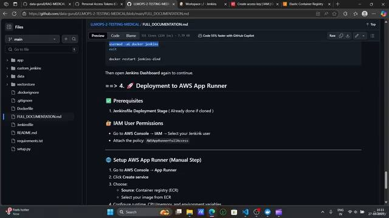

> 在 JS/Node 里对应什么：这一步等价于给你的 Node 服务换一个 scope 更大的 API token。没换之前，SDK 调用会直接返回 403，报错信息里通常只有一句 `not authorized to perform: apprunner:CreateService`，不会告诉你「去 IAM 加权限」。

### 3.2 创建 App Runner 服务（第一次，来源是 ECR 镜像）

打开 App Runner 控制台 → **Create an app runner service**。逐项填：

| 配置项 | 讲师选的值 | 说明 |
|---|---|---|
| Repository type | **Container registry** | 因为镜像在容器仓库里，不是源码仓库 |
| Provider | **Amazon ECR** | [01:29] |
| Container image URI | 点 **Browse** → 选 `MyRepo` → tag `latest` | 讲师原话 |
| Deployment trigger | **Manual** | 讲师说 "把它设为仅手动触发……你也可以保留自动触发，没问题。"，见下方说明 |
| Service role | **Create new role**（让他自动建） | [01:29] |

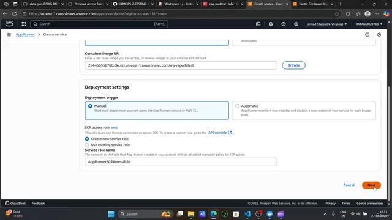

**关于 Manual 和 Automatic 的选择**，这里要说清楚，因为后面 Jenkins 那一步的写法取决于它：

- 选 **Automatic**：ECR 里 `latest` 被覆盖的那一刻，App Runner 自己就开始重新部署，Jenkins 不需要做任何额外动作。
- 选 **Manual**（讲师选的）：ECR 更新了它也不动，必须有人点一下 Deploy 按钮，或者有人调一次 `start-deployment`。

讲师选 Manual，是为了把「什么时候上线」这个决定权留在 Jenkins 流水线里——流水线跑绿了才部署，跑挂了就不部署。这就是下一节要接的那根线。

### 3.3 填服务名、规格、环境变量、端口

**服务名**：讲师在 [02:03] 说得很直接——你在控制台填什么名字，Jenkinsfile 里的 `SERVICE_NAME` 就必须是什么。两边名字不一致，部署阶段会报「找不到服务」。本文用 `<你的服务名>` 占位，请替换成你自己的。

**规格**：

- Virtual CPU：**2**
- Virtual Memory：**4 GB**

讲师的理由是 CPU 2 核「so that we get faster processing」，内存 4 GB「is enough to run our app」。注意这是针对这个 RAG 应用的规格，不是通用推荐值。

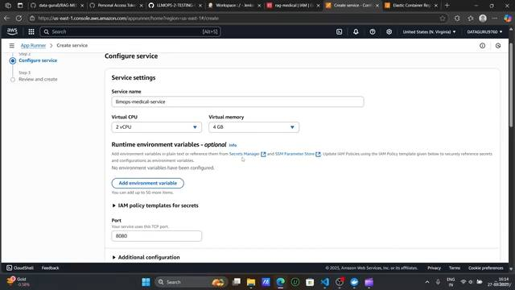

**环境变量**：这是整个流程里最容易漏的一步。容器里的应用读不到 `.env`，必须把变量注入到运行环境里。

讲师的做法是打开 VS Code 里的环境变量文件，一条一条照抄进控制台的 Name / Value 两个框，并且特意提醒 **"不要复制引号。"**——只复制引号里的内容。

课里明确提到的变量：

| 变量名 | 值来源 | 备注 |
|---|---|---|
| `HF_TOKEN` | 你 `.env` 里的 Hugging Face token | 讲师原话 "首先，我们有一个 HF 令牌。" |
| 第二个变量 | 讲师在 [03:24] 只说 "再加一个环境变量，直接把它复制粘贴到这里。"，**没有念出变量名** | 请以你自己项目的 `.env` 为准，课里没讲是哪一个 |

**端口**：填 **5000**。

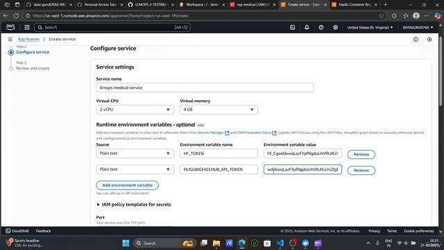

这个 5000 不是随便填的。讲师在 [03:52] 让你去翻 Dockerfile 确认——Dockerfile 里 `EXPOSE 5000`，App Runner 这里就必须是 5000。填错的表现很典型：服务状态是 Running，健康检查却一直失败，域名打开是 502 或超时。

### 3.4 网络配置

**Networking** 这一页保持默认：

- **Public endpoint**（不是 VPC connector）
- **Public access**（不是 Private）

讲师在 [04:20] 说 "确保它是公共端点，并且允许公共访问……默认情况下本来就是这样。"。所以这一页你不用改，确认一下就行。

如果选了 VPC connector，你需要额外的 VPC、子网、安全组配置，课堂里没有讲这部分。

### 3.5 创建并等待

点 **Next** 一路到 **Review and create**，核对一遍权限和配置，点 **Create & deploy**。

讲师在 [04:43] 说这个过程 "大约需要 5 到 10 分钟。"，后面又补了一句「十几分钟也有可能」。实际等待时间取决于镜像大小和冷启动。等的时候别刷新页面太频繁。

部署完成后，控制台会给你一个 **默认域名**（长这样：`xxxxxxxx.us-east-1.awsapprunner.com`）。

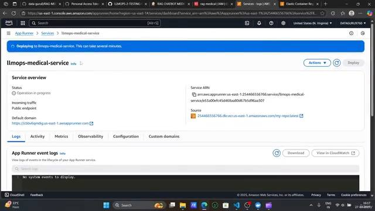

打开这个域名，问一句医疗问题（讲师问的是 "癌症能这样治愈吗？"，回答是 "不，癌症并非总是可治愈的。"），确认应用真的在跑。

### 3.6 把「手动部署」接进 Jenkins

到这里，你有一个能访问的应用，但它是**手动部署**出来的。你改一行前端代码，push 上去，Jenkins 流水线会重新 build 镜像并 push 到 ECR——但 App Runner 不会动，因为它还在用旧的镜像。

讲师在 [07:08] 现场演示了这个问题：他改 `templates/index.html` 里的 `<h1>` 为 `new change`，刷新域名，**标题没变**。原话是 "不是的，因为它用的是之前的 Docker 镜像。"。

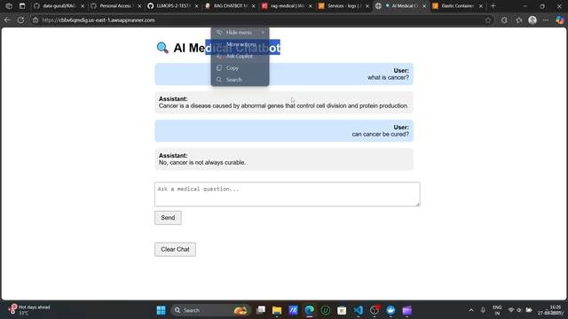

解决方式是三步：

**第一步：取消 Jenkinsfile 最后一阶段的注释。** 讲师在 [02:03] 就说过了 "现在把这里取消注释，也把你最后一个阶段取消注释。"。

**第二步：核对凭据 ID。** 讲师在 [05:12] 说 "确保凭证只能使用 AWS 令牌；无论你在上一阶段填了什么，都要确保这里保持一致。"——也就是说这一阶段用的凭据，必须和流水线里 push 镜像那一阶段用的是同一个。课里没有展示这个凭据 ID 的具体字符串，请以你 Jenkins 的 Credentials 列表为准。

**第三步：把服务名对齐。** 流水线里有一个服务名变量，值必须和控制台里填的完全一致。

核心就一行命令（讲师在 [08:35] 念到的）：

```bash
aws apprunner start-deployment --service-arn <你的服务 ARN>
```

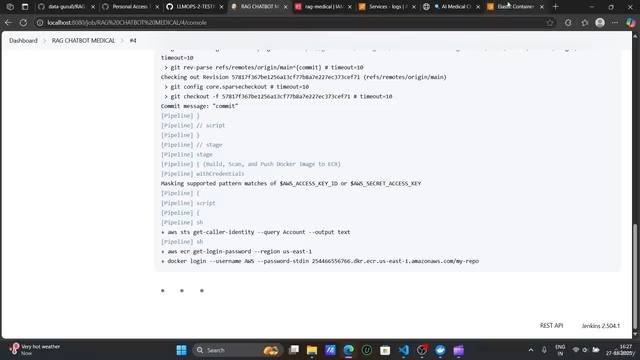

讲师把这个命令的作用解释得很清楚：它就是「帮你点一下控制台那个 Deploy 按钮」。换句话说，App Runner 那边设成 Manual 不是不能自动，只是**触发源从 ECR 换成了 Jenkins**。

> ⚠️ 关于参数：讲师只念了子命令 `aws apprunner start-deployment`，**没有在镜头里展开完整参数**。该子命令需要一个能定位服务的参数，具体写法请用 `aws apprunner start-deployment help` 的输出为准，不要凭印象手写。

### 3.7 跑一遍完整流水线验证

1. `git add . && git commit -m "test auto deploy" && git push`
2. 打开 Jenkins 仪表盘 → 你的 pipeline → **Build Now**
3. 等流水线跑绿。讲师说这一轮 "大约还需要 10 到 15 分钟，或者 20 分钟。"，因为他只改了前端但流水线会重新走 build + scan + push 全流程。

流水线跑绿之后有一个细节值得注意：讲师在 [09:31] 说他一看到 Jenkins 的绿色对勾，就切到 App Runner 控制台，发现服务**已经自己进入 deploying 状态**了——他没点任何按钮。再等 5–10 分钟，刷新那个域名，标题变成了 `new change`。

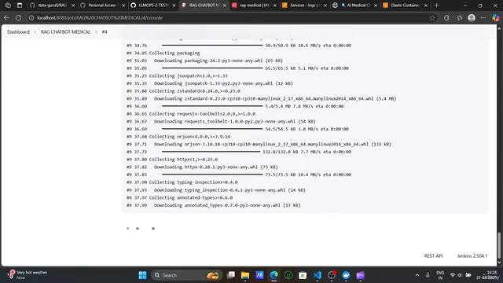

到这里，整个 CI/CD 闭环才算真的完成：**一次 `git push` + 一次 Build Now = 线上更新。**

### 3.8 清理（P017）

清理的顺序不能乱，讲师是按「先停计费、再清存储、再清本地、最后清账号」排的。

**① 删 App Runner 服务（停掉最大的一笔计费）**

App Runner 控制台 → Services → 点进你的服务 → **Actions** → **Delete** → 在弹窗里手动输入 `delete` 确认。

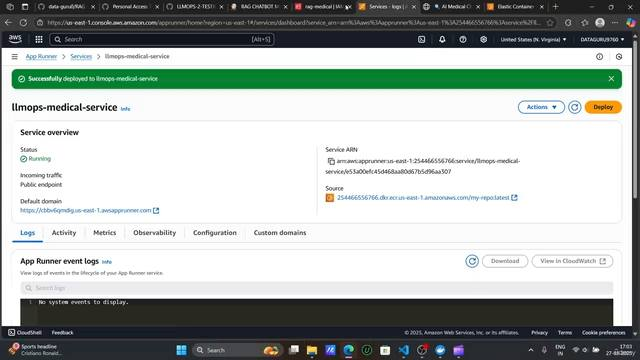

**② 删 ECR 仓库（两步，不能跳）**

这一步的关键是：**仓库里有镜像时删不掉仓库，必须先清空。**

1. 打开 ECR → 点进 `MyRepo`
2. 选中所有 image → **Delete** → 输入 `delete` 确认
3. 镜像全空之后，再回到仓库列表 → 选中 `MyRepo` → **Delete**

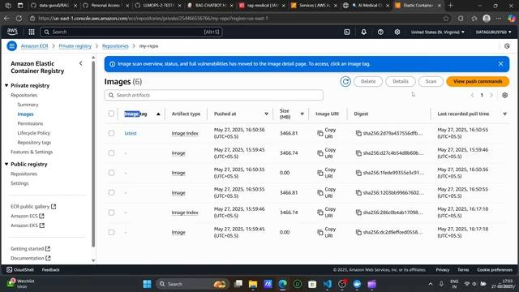

**③ 清本地 Docker（磁盘空间）**

打开 Docker Desktop，按顺序清：

| 清理对象 | 讲师观察到的量 | 位置 |
|---|---|---|
| Containers | — | Docker Desktop → Containers |
| Images | 约 14 GB | Docker Desktop → Images |
| Volumes | 约 1.7 GB | Docker Desktop → Volumes |
| Builds（build cache） | — | Docker Desktop → Builds |

那个 1.7 GB 的 volume 值得单独说一下：讲师解释它是 **Jenkins 容器里的卷**——你之前在 Jenkins 容器里装的 Maven、各种 CLI 之类的东西，全都落在里面。删掉容器不会自动删卷，卷是独立生命周期，所以要手动清。

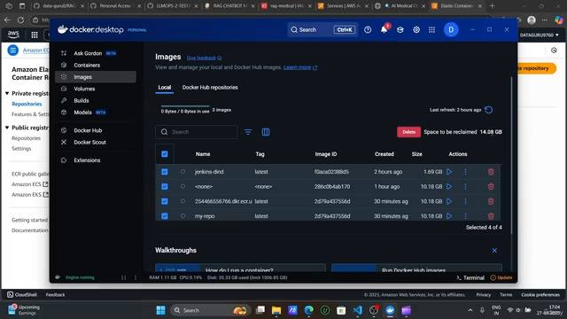

讲师还建议顺手删掉 build cache："如果愿意，你也可以删除这些构建，这样它们就不会在以后的项目里引发错误。"。缓存留着有时会和下一个项目打架。

**④ 删 IAM 用户（安全收尾）**

顺序同样是硬的：**不能直接删用户，得先停用（deactivate）它的 access key。**

1. IAM → Users → 点你的用户
2. **Security credentials** 标签 → 找到 Access keys → **Deactivate**
3. 回到 Users 列表 → 删用户 → 输入确认文本

讲师在 [02:25] 现场遇到了这个问题（"我没能删除。"），处理方式就是先停用 key 再删。这就是下面第 7 节要展开的那个坑。

---

### 3.9 P018 的架构推导：按步骤复现讲师的思考过程

P018 **没有任何代码**，是纯设计课。所以这一节按「需求 → 约束 → 选型 → 取舍」的顺序复现。

**Step 1｜需求**

用户打开页面，做两件事：选 Agent 类型（金融 / 医疗 / 学习），输入问题。系统按类型路由到对应 Agent，返回答案。这就是全部需求，没有多轮对话、没有会话持久化、没有用户体系——课里都没提。

**Step 2｜约束（这一集最关键的推理）**

讲师在 [04:15] 给了一个非常具体的约束推演：

> LLM 的训练数据有个截止日期（他拿 ChatGPT 举例说是 2021）。你问它「今年（2025）的 top stocks 是什么」，它只能给你 2021 年的答案——中间差四年，股票早就翻天覆地了。

这个约束直接决定了架构里必须多一个组件：**一个能上网查最新信息的检索工具**。LLM 负责「理解和组织语言」，检索工具负责「提供新鲜事实」，两者串起来答案才是对的。

**Step 3｜选型（每个组件为什么在这个位置）**

讲师列出的组件和它们的职责，可以整理成一张表（见第 4 节）。这里先说选型逻辑：

- **LLM**：讲师用的是 Groq 提供的服务，课里说它是免费的，模型池里有 Llama 系列和 Jama 系列，他选了 **Llama 3**。
- **联网检索**：逐字稿里这个工具名出现了好几种转写（heavily / table / tabby），**具体是哪家 SDK，请以你仓库的 `requirements.txt` 为准**，课里没有把包名念清楚。它的职责是明确的：给 LLM 喂最新数据。
- **后端**：FastAPI，负责接住用户请求、调度 Agent、返回结果。
- **前端**：Streamlit，负责渲染表单和展示结果。
- **Agent 编排**：LangGraph。讲师强调 "LangGraph 构建在 LangChain 之上。"，LangChain 是生成式 AI 框架，LangGraph 是 Agent 框架。选 LangGraph 而不是纯 LangChain，是因为要做**按类型路由**这种带分支的工作流。
- **容器化**：Docker。讲师说它是 "任何生产级项目的关键组成部分。"，用来把应用打成可在任意平台跑的镜像。
- **CI/CD**：Jenkins。
- **代码质量**：SonarQube。讲师称它是这个项目的「MVP」（最有价值的部分），下面单独展开。

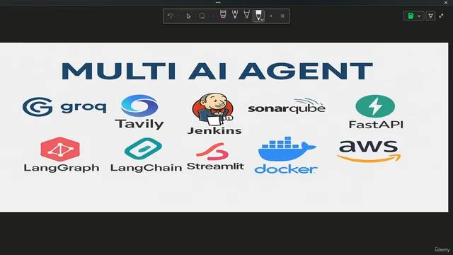

**Step 4｜SonarQube 的三维检查模型（讲师花最多时间展开的部分）**

讲师在 [08:30] 把 code quality 拆成三块：

| 维度 | 讲师的定义 | 讲师给的例子 |
|---|---|---|
| **Bugs** | 能跑但行为不对的代码 | dead code（见下） |
| **Code Smells** | 也叫 bad practices，坏习惯 | 300–400 行的超长函数；字符串引号风格不统一 |
| **Code Duplication** | 同一段逻辑在多个文件里重复 | 三个文件里各写了一遍 `function 1` |

**重复代码的例子**（[09:27]–[10:51]）：讲师假设你有一个 `app.py`、一个 `main.py`、一个 `test.py`，每个文件里都写了一个内容一样的 `function 1`。正确做法是把 `function 1` 提取到一个公共模块，三个文件都 import 它。SonarQube 扫到这种重复会告警。

**超长函数的例子**（[11:21]–[12:17]）：一个 300 行的函数应该拆成三个 100 行的。理由是**可读性和可维护性**——出了 bug 你要在 800 行里找人，和在一堆 100 行的函数里找人，成本差一个量级。

**Dead code 的例子**（[13:46]–[16:38]）：这是讲师讲得最细的一个。他口述了这样一段逻辑：

```python
if message == "hi":
    print("hi")
elif message == "hello":
    print("hello")
elif message == "hi":          # 永远走不到
    print("hi second time")
```

第三个分支永远不会执行，因为 `message == "hi"` 在第一分支就被截走了。讲师特意强调：**这不是重复代码**，因为两个分支里的 print 内容不一样。它属于另一类问题——**死代码**。SonarQube 能扫出这种分支。

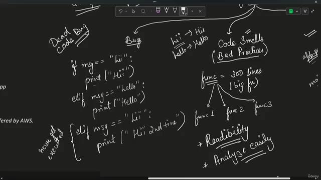

**Step 5｜流水线的六个阶段（讲师反复讲了两遍，说明他觉得这块最容易懵）**

讲师在 [21:47]–[27:59] 把 Jenkins 流水线拆成了固定的六段，并且用「把菜谱存进菜谱箱」的比喻解释了 SCM 的作用（他说 GitHub 是 "STM"——语音转写，指的是 SCM，Source Code Management，就是存代码、记录每次改动的地方）。

这六段我整理成了表，见第 4 节。

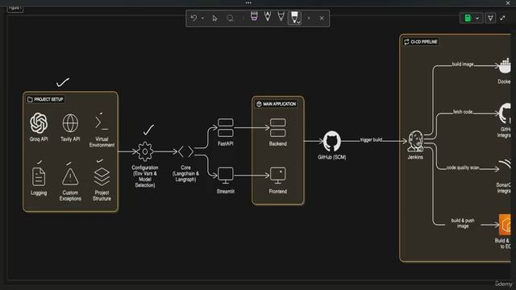

**Step 6｜讲师留给你的挑战**

P018 结尾给了一个课后任务：**给 ECS Fargate 挂一个 ALB（负载均衡器），拿到静态 URL。**

背景是这样：Fargate 每次部署会给你一个新的动态 URL，URL 一变，你之前分享出去的链接就废了。挂上 ALB 之后，ALB 的域名固定不变，后面的任务怎么换都不影响外部访问。讲师的原话是 "这个负载均衡器对你来说简直是小菜一碟。"，暗示不难，但**课里没有演示具体怎么配**——这是作业。

---

## 4. 完整代码

> 本节分两部分。**4.1–4.3 是 P016/P017 的产物**（配置、命令、参数表）。**4.4–4.5 是 P018 的设计产物**——P018 课堂里**一行代码都没写**，所以这里给的是设计决策表和职责表，不是实现。

### 4.1 Jenkinsfile 部署阶段（还原版）

> ⚠️ 说明：完整的 Jenkinsfile 讲师是从他提供的 GitHub 仓库里直接拿的，**课里只展示了最后一阶段的片段，没有逐行展示全文**。下面是按 P016 中讲师明确提到的要素（同一套凭据、服务名变量、`start-deployment` 命令）**还原的最小可用版本**，不是讲师原文件的逐字复制。

```groovy
pipeline {
    agent any

    environment {
        // 课里没给具体值，请替换成你自己的
        AWS_REGION     = 'us-east-1'
        ECR_REPO       = 'MyRepo'
        IMAGE_TAG      = 'latest'
        // 必须和 App Runner 控制台里填的服务名完全一致（讲师 [02:03] 强调）
        APP_RUNNER_SERVICE = '<你的服务名>'
    }

    stages {

        // ── 前两个阶段是 P016 之前就有的，这里只保留结构示意 ──
        stage('Checkout from GitHub') {
            steps {
                git branch: 'main', url: '<你的仓库地址>'
            }
        }

        stage('SonarQube Scan') {
            steps {
                // 具体 scanner 调用方式课里没讲，请以你的 Jenkins 配置为准
                echo 'SonarQube scan stage'
            }
        }

        stage('Build Docker Image') {
            steps {
                sh 'docker build -t $ECR_REPO:$IMAGE_TAG .'
            }
        }

        stage('Push to ECR') {
            steps {
                withCredentials([string(credentialsId: '<你的 AWS 凭据 ID>', variable: 'AWS_TOKEN')]) {
                    sh '''
                        aws ecr get-login-password --region $AWS_REGION \
                          | docker login --username AWS --password-stdin <你的账号ID>.dkr.ecr.$AWS_REGION.amazonaws.com
                        docker tag $ECR_REPO:$IMAGE_TAG <你的账号ID>.dkr.ecr.$AWS_REGION.amazonaws.com/$ECR_REPO:$IMAGE_TAG
                        docker push <你的账号ID>.dkr.ecr.$AWS_REGION.amazonaws.com/$ECR_REPO:$IMAGE_TAG
                    '''
                }
            }
        }

        // ── 这就是 P016 这一集要 uncomment 的最后一阶段 ──
        stage('Deploy to AWS App Runner') {
            steps {
                // 讲师 [05:12]：凭据必须和上一阶段用的是同一个
                withCredentials([string(credentialsId: '<你的 AWS 凭据 ID>', variable: 'AWS_TOKEN')]) {
                    sh '''
                        aws apprunner start-deployment \
                          --service-arn <你的服务 ARN> \
                          --region $AWS_REGION
                    '''
                }
            }
        }
    }

    post {
        success { echo 'Deployed. App Runner is now rolling out the latest image.' }
        failure { echo 'Pipeline failed. App Runner was NOT triggered.' }
    }
}
```

### 4.2 App Runner 服务参数清单

这是你在控制台填的内容，建议抄成一张表存进项目 README，下次重建时照填：

| 参数 | 值 |
|---|---|
| Repository type | Container registry |
| Provider | Amazon ECR |
| Image URI | `<账号ID>.dkr.ecr.<region>.amazonaws.com/MyRepo:latest` |
| Deployment trigger | Manual（P016 的选择） |
| Service role | Create new role |
| Service name | `<你的服务名>` ← 必须与 Jenkinsfile 中一致 |
| Virtual CPU | 2 vCPU |
| Virtual Memory | 4 GB |
| Environment variable 1 | `HF_TOKEN=<你的 token>`（不要带引号） |
| Environment variable 2 | 课里没念出名字，按你的 `.env` 补 |
| Port | 5000 |
| Networking | Public endpoint / Public access |

### 4.3 环境变量注入（本地开发 vs 线上运行）

```bash
# 本地开发（Docker 跑）：用 --env-file 一次性注入
docker run --env-file .env -p 5000:5000 MyRepo:latest

# 线上运行（App Runner）：没有 --env-file 这回事，
# 必须逐条填进控制台的 Environment variables 区。
# 这就是为什么 3.3 那一步不能跳过。
```

### 4.4 P018 组件职责表（讲师给的选型，落成决策表）

| 组件 | 在架构中的位置 | 职责 | 讲师给的理由 |
|---|---|---|---|
| LLM（Groq 提供，选用 Llama 3） | 推理层 | 理解问题、组织答案 | 课程说它免费，模型池有 Llama / Jama 系列 |
| 联网检索工具 | 数据层 | 提供训练截止之后的新信息 | LLM 训练数据停在 2021，不查网就会答错 2025 年的问题 |
| LangChain | 框架层 | 与 LLM 交互的基础设施 | 生成式 AI 框架 |
| LangGraph | 编排层 | 把「选 Agent 类型 → 路由 → 回答」串成工作流 | 构建在 LangChain 之上，是 Agentic AI 框架 |
| FastAPI | 后端 | 接住用户请求，调度 Agent，返回结果 | 演示里用户输入先到后端 |
| Streamlit | 前端 | 渲染表单、展示答案 | 演示里的输入输出界面 |
| Docker | 交付层 | 把整个应用打成镜像 | "任何生产级项目的关键组成部分。" |
| Jenkins | CI/CD | 自动化构建、扫描、推送、部署 | 一键触发全流程 |
| SonarQube | 质量门 | 检查 bugs / code smells / duplication | 讲师称之为这个项目的 MVP |
| ECR | 镜像仓库 | 存 Docker 镜像 | 讲师比喻为「AWS 版的 Docker Hub」 |
| ECS Fargate | 运行平台 | 跑容器 | 每次部署给动态 URL |

### 4.5 P018 的流水线六阶段（讲师口述结构）

| 阶段 | 做什么 | 输入 | 输出 |
|---|---|---|---|
| 1. Jenkins Setup | 安装并配置 Jenkins，能打开仪表盘 | 一台装了 Docker 的机器 | 可访问的 Jenkins |
| 2. GitHub Integration | 把 GitHub 仓库接到 Jenkins，checkout 代码 | GitHub repo | 代码进 Jenkins workspace |
| 3. SonarQube Scan | 扫 workspace 里的代码，看质量 | workspace 里的代码 | SonarQube 仪表盘报告 |
| 4. Build Docker Image | 用 Dockerfile 打镜像 | 代码 + Dockerfile | 本地镜像 |
| 5. Push to ECR | 把镜像推到 ECR | 本地镜像 | ECR 里的 `MyRepo:latest` |
| 6. Deploy | 用 ECR 里的镜像部署到 Fargate | ECR 镜像 | 一个运行中的应用 + URL |

> **讲师在这里埋了个伏笔**：Fargate 给的 URL 是动态的，每次部署都变。挂 ALB 才能拿到静态 URL——这是你的作业。

### 4.6 SonarQube 检查维度表

| 维度 | 讲师定义 | 反例 |
|---|---|---|
| Bugs | 能跑但行为错误的代码 | `elif message == "hi"` 分支永远不执行（dead code） |
| Code Smells | Bad practices | 单个函数 300–800 行；引号风格不统一 |
| Code Duplication | 相同逻辑散落多处 | `app.py` / `main.py` / `test.py` 各写一遍 `function 1` |

### 4.7 dead code 示意（课里没有代码，以下为按讲师口述还原）

> 讲师在 [13:46]–[16:38] 是**口头描述**这段 if/elif 逻辑的，白板上没有贴出可运行的代码。下面按他的口述还原成 Python，仅用于说明判定逻辑。

```python
def handle_message(message: str) -> None:
    if message == "hi":
        print("hi")
    elif message == "hello":
        print("hello")
    elif message == "hi":        # SonarQube 会标记为 dead code
        print("hi second time")  # 永远执行不到
```

**为什么第三个分支是死代码**：Python 的 `if/elif` 是自上而下短路求值。`message == "hi"` 在第一分支就匹配并被截走，控制流根本到不了第三个分支。SonarQube 静态分析时能发现「这个条件与前面的条件重复，且位于不可达位置」。

> 在 JS/Node 里对应什么：这就是 ESLint 的 `no-unreachable` 规则和 SonarQube 的 duplication 检查合起来会报的一类问题。你写 `switch (x) { case 'a': ...; case 'a': ... }` 也是一模一样的情况。

---

## 5. 逐行解释

**`aws apprunner start-deployment --service-arn <...>`**
这一行等价于控制台上的 Deploy 按钮。它的语义是「用这个服务配置里当前指向的那个镜像，重新拉起一次」。因为服务的镜像来源是 `MyRepo:latest`，而 Jenkins 前一个阶段刚刚覆盖了 ECR 里的 `latest`，所以这一行执行完，App Runner 拉到的就是刚 build 出来的新镜像。这就是整个「自动部署」的全部机制——**没有魔法，就是「覆盖 latest」+「触发重拉」两件事**。

**为什么 Deployment trigger 选 Manual 而不是 Automatic**
选 Automatic 的话，ECR 一被覆盖 App Runner 就自动重部署，Jenkins 完全不用管。讲师选 Manual 的理由在 [08:33] 说得很明确：把控制点收进 Jenkins 流水线。这在工程上的区别是：Automatic 模式你必须自己配好 ECR EventBridge 通知或 App Runner 的自动部署设置，还可能出现「镜像推上去了但流水线后面挂了」这种半成品状态；Manual 模式下，Jenkins 跑到最后一步才触发，前面任何一步挂了都不会上线。

**为什么 IAM 权限要单独加而不是复用 ECR 的**
AWS 的 IAM policy 是按服务维度隔离的。`AWSAppRunnerFullAccess` 管的是 `apprunner:*` 这一组 API，`AmazonEC2ContainerRegistryFullAccess` 管的是 `ecr:*`，两者不重叠。你在 ECR 有权限不代表你能建 App Runner 服务。

**为什么端口必须和 Dockerfile 一致**
Dockerfile 里的 `EXPOSE 5000` 只是声明「容器里的应用监听 5000」，它本身不改变任何东西——真正决定监听端口的是应用代码（`uvicorn.run(..., port=5000)` 之类）。App Runner 需要知道"往哪个端口发流量"，这个值在控制台填。填错了，容器的网络完全正常，但 App Runner 的健康检查打不进去，服务会一直卡在 unhealthy。

**为什么 ECR 仓库要先清空才能删**
ECR 的删除 API 对非空仓库默认拒绝，这是防止误删的保护。你可以在控制台里选「强制删除（force delete）」，但讲师走的是老老实实的两步流程：先全选镜像删掉，再删仓库。两种方式结果一样，前者更容易理解发生了什么。

**为什么删 IAM 用户前要先 deactivate access key**
AWS 不允许删除「还持有活跃访问凭据」的 IAM 用户。这是安全设计——如果用户还能拿这把 key 调 API，删用户等于让它带着一把有效的钥匙消失。所以必须先 Deactivate（停用），再 Delete（删除）。讲师在 [02:25] 现场撞了一下这个问题，就是没提前做这一步。

**为什么 P018 一定要加联网检索**
这一行是整个 P018 架构里最关键的一个决策。讲师在 [04:15] 的推演是：LLM 的训练数据有截止日期，超出这个日期的信息它一概不知道，只会用旧数据「编」一个看起来合理的答案。加联网检索之后，流程变成「先查最新事实 → 再让 LLM 基于事实组织语言」。这就是 RAG 的简化版思路，只不过这里的知识库是整个互联网而不是你的文档。

**为什么用 LangGraph 而不是只用 LangChain**
因为需求里有一个显式的**分支**：根据用户选的 Agent 类型，走不同的处理路径。LangChain 的链式结构适合「A → B → C」的线性流程，处理分支和状态机就吃力。LangGraph 用图结构表达节点和边，天然支持条件路由，这正是 multi-agent 场景需要的。

**为什么讲师把 SonarQube 叫做 MVP**
因为在 CI/CD 里，SonarQube 是唯一一个「在镜像被 build 出来之前」就能拦住问题的关卡。bugs 和 dead code 一旦进了镜像推到 ECR，再发现就得重新走一遍全流程。把它放在 Build 之前（流水线第 3 阶段），能在最便宜的位置拦住最贵的问题。

---

## 6. 复现检查清单

动手前：

- [ ] IAM 用户已有 ECR 相关权限（前几集配的）
- [ ] ECR 里有 `MyRepo` 仓库，且有 `latest` 标签的镜像
- [ ] Dockerfile 里 `EXPOSE` 的端口是 5000，且和本地能跑通的端口一致
- [ ] `.env` 里有 `HF_TOKEN` 等变量，且值不带引号
- [ ] Jenkinsfile 最后一阶段已取消注释
- [ ] Jenkins 的凭据列表里有那个 AWS 凭据 ID

创建 App Runner 时：

- [ ] 加了 `AWSAppRunnerFullAccess` 策略，用户权限列表里能看到 ECR + App Runner 两类
- [ ] 来源选的是 Container registry → Amazon ECR
- [ ] 镜像 URI 指向 `MyRepo:latest`
- [ ] 服务名记下来了，准备往 Jenkinsfile 里填
- [ ] vCPU = 2，内存 = 4 GB
- [ ] 所有环境变量逐条填好，没有残留引号
- [ ] 端口 = 5000
- [ ] 网络是 Public endpoint + Public access

验证自动部署时：

- [ ] 第一次部署完成，默认域名能打开，能正常回答问题
- [ ] 改了 `index.html` 的 `<h1>` 并 push，**先确认不跑流水线时页面没变**（这一步是在验证"旧镜像还在用"）
- [ ] 跑 Jenkins pipeline，看到绿色对勾
- [ ] 切到 App Runner 控制台，确认服务**自己**进入 deploying（没手动点按钮）
- [ ] 等 5–10 分钟后刷新域名，新标题出现

清理时（**顺序不能乱**）：

- [ ] App Runner 服务已删除（输入 `delete` 确认）
- [ ] ECR 仓库里的镜像已全部删除
- [ ] ECR 仓库本身已删除
- [ ] Docker Desktop 里 containers 已清
- [ ] Docker Desktop 里 images 已清（预计释放十几 GB）
- [ ] Docker Desktop 里 volumes 已清（Jenkins 那个卷，约 1.7 GB）
- [ ] Docker Desktop 里 builds 缓存已清
- [ ] IAM 用户的 Access key 已 **Deactivate**
- [ ] IAM 用户已 **Delete**

---

## 7. 课里没讲但你会撞上的

**① `AWSAppRunnerFullAccess` 不是最小权限。**
讲师直接给了 Full Access，课程语境下没问题。但真实项目里这个策略是过宽的——它能创建、删除任何 App Runner 服务。生产环境应该用自定义策略，只允许 `apprunner:StartDeployment`、`apprunner:DescribeService` 这几条。课里没讲怎么收窄。

**② `start-deployment` 是异步的，它不等部署完成。**
命令返回成功只代表「触发成功」，不代表「部署成功」。Jenkins 会显示绿色对勾，但 App Runner 那边可能还在 rolling out，甚至过几分钟才失败。讲师在 [09:31] 也是这么处理的——他跑完流水线后切到控制台**继续等**，等了好几轮。如果你要严格的"部署成功才算成功"，得额外写轮询逻辑去查服务状态。课里没讲怎么写这个轮询。

**③ 服务名不一致的错误信息不好懂。**
如果 Jenkinsfile 里的服务名和控制台填的对不上，`start-deployment` 会返回找不到资源的错误，但错误信息通常只报 ARN 或 Name 不存在，不会告诉你"去检查 Jenkinsfile"。这是最容易回头改两遍的地方。建议在 Jenkinsfile 里把服务名定义成 `environment`