# LLMOps & AIOps Bootcamp：多 AI Agent 项目从零搭建（P19–P22）

> 覆盖范围：P19 项目结构与 WSL/Docker 环境、P20 配置层、P21 Agent 核心逻辑、P22 FastAPI 后端。
> 读完并照做，你会得到一个可以用 `curl` 调通的 `/chat` 接口：它接收「模型名 + 系统提示词 + 消息列表 + 是否联网搜索」，调用 Groq 上的 Llama 模型，按需挂载 Tavily 搜索工具，返回最后一条 AI 回复。

---

## 1. 这一节做什么

这四集不是讲概念，是**搭骨架**。讲师从一个空文件夹开始，一路做到「后端 API 能跑」为止。最终产物是一个 Python 项目 `multi-ai-agent`，包含：

| 层 | 目录/文件 | 作用 |
|---|---|---|
| 配置 | `.env`、`app/config/settings.py` | 存放并加载 `GROQ_API_KEY`、`TAVILY_API_KEY`，声明允许使用的模型白名单 |
| 公共 | `app/common/logger.py`、`app/common/custom_exception.py` | 日志与自定义异常 |
| 核心 | `app/core/aiagent.py` | 用 LangGraph 的 `create_react_agent` 组装 Agent，输出最后一条 AI 消息 |
| 后端 | `app/backend/api.py` | FastAPI 的 `/chat` POST 端点，做参数校验、模型白名单校验、异常兜底 |
| 入口 | `app/main.py` | 本节只创建空文件，讲师说后续把前后端「连进来」 |
| 前端 | `app/frontend/` | **本节完全为空**，Streamlit 代码在后续集数才写 |

最终目录结构（本文档实际使用的版本）：

```
multi-ai-agent/
├── .env
├── requirements.txt
├── setup.py
├── app/
│   ├── __init__.py
│   ├── main.py
│   ├── backend/
│   │   ├── __init__.py
│   │   └── api.py
│   ├── frontend/              # 本节为空
│   ├── common/
│   │   ├── __init__.py
│   │   ├── logger.py
│   │   └── custom_exception.py
│   ├── core/
│   │   ├── __init__.py
│   │   └── aiagent.py
│   └── config/
│       ├── __init__.py
│       └── settings.py
└── logs/                      # 运行时由 logger.py 自动创建
```

讲师对整体节奏的原话：

> "这是你的项目搭建视频。这个视频非常重要，它讲的是如何搭建项目结构、API 结构和 WSL 结构。"
> —— p019 [00:00]

> "那么基本上你已经完成了这些：搭建了项目结构、虚拟环境、日志、自定义异常文件、API 配置和 WSL 配置。"
> —— p019 [20:25]

也就是说：**P19 解决“东西放哪、环境怎么装”，P20 解决“密钥怎么读”，P21 解决“Agent 怎么造”，P22 解决“怎么对外提供服务”**。四集是一条直线，中间没有分支。

---

## 2. 讲师原话

按主题归类，不按集数顺序罗列。

### 2.1 为什么要有虚拟环境和 `__init__.py`

> "你需要写 python -m venv venv，基本上它会创建一个虚拟环境……现在你需要激活我们的虚拟环境……写 VENV，然后一个反斜杠，然后 scripts，再一个反斜杠，然后 activate。现在你会看到括号里出现一个 VENV。"
> —— p019 [00:58] / [01:53]

> "每次你创建一个 init 文件，你都必须运行 pip install -e . 这个命令。基本上 pip install -e . 会把你的项目目录识别为一个包。"
> —— p019 [10:31]

> "假设你想导入这个 logger……在 frontend 目录里面，如果你没有运行过 pip install -e . 这个命令，你就无法导入。"
> —— p019 [10:59]–[11:23]

这是本节最容易被跳过、但最容易翻车的一条规则：**每新建一个 `__init__.py`，就要重新执行一次 `pip install -e .`**。

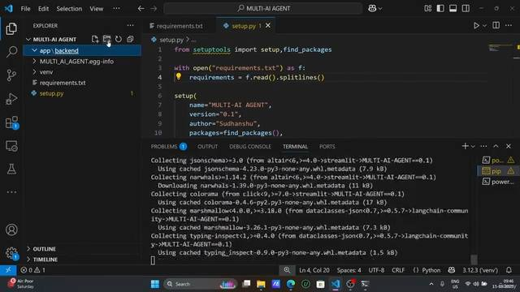

### 2.2 依赖清单与可编辑安装

> "我们需要 LangChain Groq……然后需要 LangChain Community 库……然后需要 python-dotenv……然后需要 Uvicorn……然后需要 FastAPI……然后需要一个叫 Pydantic 的库，然后需要 Streamlit……然后需要 LangGraph 来创建智能体。"
> —— p019 [02:22]–[03:49]

> "直接写 pip install -e . 就行，基本上它会安装所有依赖。这段代码会触发你的 setup.py，而 setup.py 里面的代码会触发 requirement.txt 的安装。"
> —— p019 [04:46]–[05:13]

（讲师口音把 `uvicorn` 念成 “uvcon”、把 `pydantic` 念成 “pydentic”、把 `-e .` 念成 “hyphen if will stop”，按包名理解即可。）

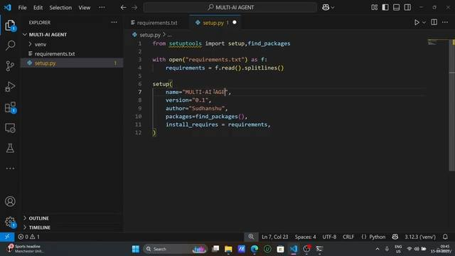

### 2.3 两个 API Key 的用途分工

> "我们需要两个 API。首先需要 grok API key……然后需要 tabily API key……grok API 基本上是用于你的 LLM，而 Tavily API 基本上是用于你的搜索，也就是在线搜索。"
> —— p019 [11:52]–[14:15]

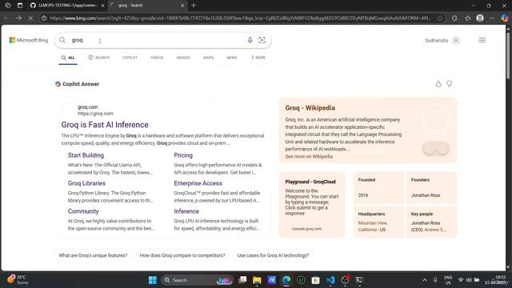

### 2.4 为什么非要 WSL

> "什么是 WSL，也就是你的 Windows Subsystem Linux？我们为什么用 WSL？因为当你做生产级项目的时候……你会在 Linux 环境里做这些项目，而不是在 Windows 环境里。所以 WSL 让你在 Windows 系统里有一种 Linux 的感觉。"
> —— p019 [14:43]–[15:09]

> "我们需要带 Docker engine 的 WSL，这样你就可以创建 Docker 应用，并且可以在项目开始之前就创建好 Jenkins pipeline。"
> —— p019 [15:09]

> "直接在 Ubuntu 终端里运行 docker version。你会看到客户端是 Docker Engine - Community……Docker Engine 已安装，服务端的 Docker Engine 也已安装……所以基本上 Docker Engine 包含两部分：客户端和服务端。"
> —— p019 [18:58]–[19:55]

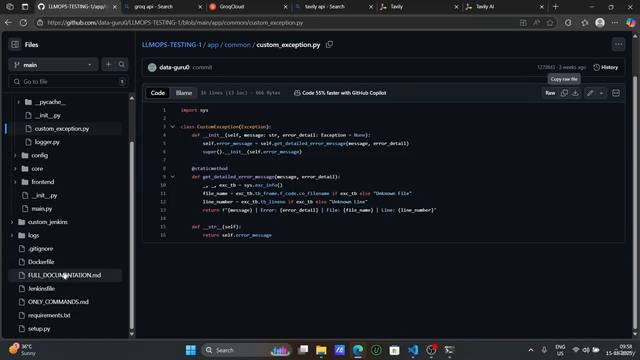

### 2.5 配置层：白名单思想

> "确保你在这里写的内容要和 .ENV 文件里的内容一致。所以这个应该等于这个。好，你的名称应该匹配，不能有任何拼写错误。"
> —— p020 [01:25]–[01:55]

> "我们会让用户有权选择他们想用哪个模型……但暂时先保持这样。"
> —— p020 [04:21]–[04:50]

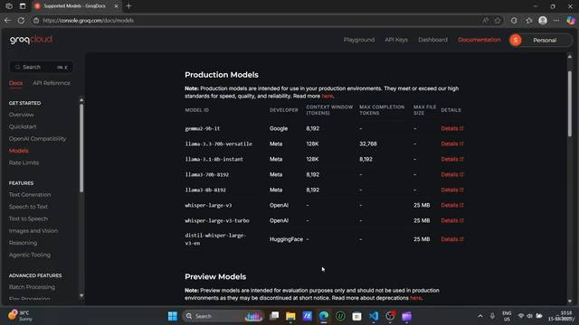

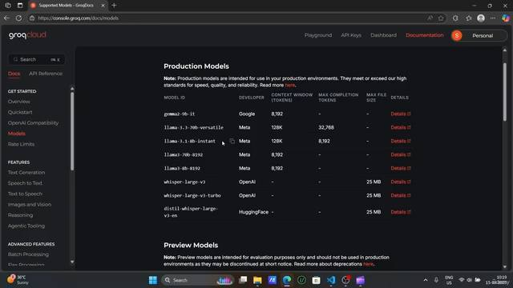

### 2.6 Agent 核心：搜索是一个开关

> "如果用户允许网页搜索……我们就把 Tavily 搜索加到我们的 LLM 里，否则不加。如果加了 Tavily 搜索，我们只取前两条结果。MaxResult 等于 2。"
> —— p021 [07:13]–[07:42]

> "我只想要最新的回复，因为最新的回复会是关于该查询的最新答案……返回 ai_messages，我写负一。"
> —— p021 [13:18]–[13:47]

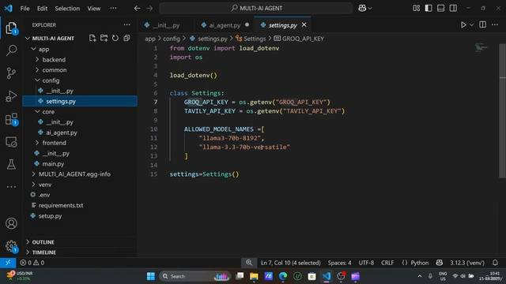

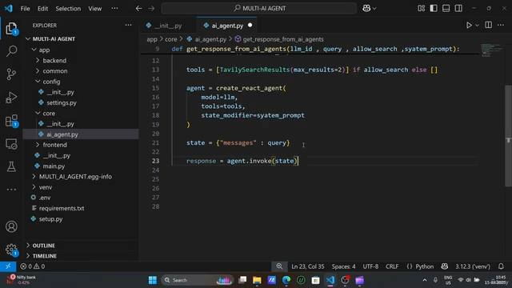

### 2.7 后端：校验 → 白名单 → try/except

> "它用于校验传入数据的结构……model name 应该始终是字符串……messages 应该是一个列表……allow search 应该是一个布尔值。"
> —— p022 [01:55]–[06:43]

> "如果请求的 model name 不在允许的模型名称里……抛出 HTTP 异常……状态码 400……detail 写 invalid model name。"
> —— p022 [09:37]–[10:36]

> "假设我们在这里遇到一些错误……我们会抛出 HTTP 异常，状态码给 500。"
> —— p022 [14:27]–[15:25]

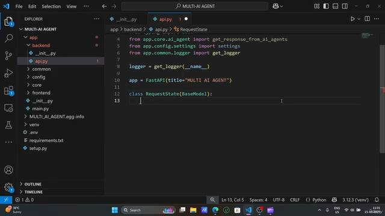

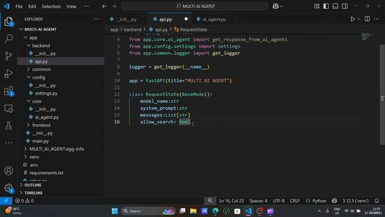

---

## 3. 从零复现

下面每一步都给出**可直接粘贴的命令**。Windows 环境为准（讲师全程 Windows + PowerShell/CMD）。

### 步骤 0：创建项目根目录并打开编辑器

```powershell
cd C:\
mkdir multi-ai-agent
cd multi-ai-agent
code .
```

`code .` 会唤起 VS Code（讲师原话：`"你将编写代码，就是这样。所以这段代码的作用基本上就是触发你的 VS Code。"` —— p019 [00:29]）。

### 步骤 1：创建并激活虚拟环境

在 VS Code 里 `Terminal → New Terminal`，**终端类型选 Command Prompt**（讲师特别强调 `"确保当前用的是命令提示符，对吧。"` —— p019 [00:58]）。

```bat
python -m venv venv
venv\Scripts\activate
```

成功后提示符前会出现 `(venv)`。

> 如果你用的是 PowerShell 而不是 CMD，激活命令是 `.\venv\Scripts\Activate.ps1`；若报「禁止运行脚本」，先执行 `Set-ExecutionPolicy -Scope CurrentUser RemoteSigned`。这条课里没讲，见第 7 节。

### 步骤 2：写 `requirements.txt`

在项目根目录新建 `requirements.txt`，内容见第 4 节。八个包，缺一不可。

### 步骤 3：写 `setup.py`

讲师原话是 `"我已经为 setup.py 的代码单独做了一个视频，所以现在直接复制粘贴代码。"`（p019 [03:49]）。**本节没有展示 setup.py 的内容**，第 4 节给出的是可工作的等价实现，并已标注。

### 步骤 4：执行可编辑安装

```bat
pip install -e .
```

这一步会读取 `setup.py` 里的 `install_requires`，进而安装 `requirements.txt` 中全部依赖。看到一长串 `Collecting ...` 就是正常在跑。

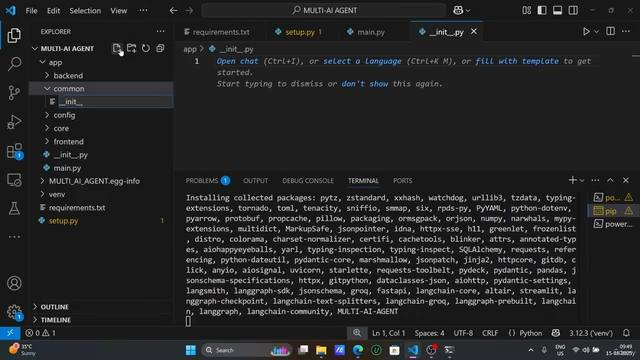

### 步骤 5：建目录与 `__init__.py`

```bat
mkdir app
mkdir app\backend
mkdir app\frontend
mkdir app\common
mkdir app\core
mkdir app\config
```

然后在 VS Code 里手动新建这些空文件（Windows 命令行建以点开头的文件名很别扭，直接用编辑器新建更快）：

```
app\__init__.py
app\backend\__init__.py
app\common\__init__.py
app\core\__init__.py
app\config\__init__.py
app\main.py
```

**建完立刻回到终端，重新执行一次：**

```bat
pip install -e .
```

### 步骤 6：写 common 层

新建 `app\common\logger.py` 与 `app\common\custom_exception.py`，内容见第 4 节。讲师对这两个文件是直接复制粘贴的（`"前面的模块里我已经讲过这段代码，所以现在直接复制粘贴。"` —— p019 [09:02]），**本节没有逐行讲解**。

### 步骤 7：申请两个 API Key 并写入 `.env`

1. 浏览器打开 Groq 控制台，注册/登录 → API Keys → Create API Key → 命名（讲师命名为 `LLMOps`）→ 复制。
2. 浏览器打开 `tavily.com`，登录 → Overview 页 → 复制默认 API Key。

在项目根目录新建 `.env`：

```dotenv
GROQ_API_KEY=粘贴你的groq key
TAVILY_API_KEY=粘贴你的tavily key
```

注意：**`.env` 必须在项目根目录**，因为 `load_dotenv()` 默认从当前工作目录向上找。变量名必须与 `settings.py` 里 `os.getenv("...")` 的字符串完全一致，大小写都不能差。

### 步骤 8：写 `settings.py`

见第 4 节。写完后把 `allowed_model_names` 里的模型 ID 去 Groq 控制台核对一遍——课程录制时的模型 ID 可能已经下线，见第 7 节。

### 步骤 9：写 `aiagent.py`

见第 4 节。注意 `state_modifier=system_prompt` 这个参数名，新版 langgraph 已改名，见第 7 节。

### 步骤 10：写 `api.py` 并启动

```bat
python -m uvicorn app.backend.api:app --reload
```

看到 `Uvicorn running on http://127.0.0.1:8000` 即成功。**讲师在本节没有给出启动命令**，这条是 uvicorn 的标准写法。

### 步骤 11：调通接口

另开一个终端：

```bat
curl -X POST http://127.0.0.1:8000/chat ^
  -H "Content-Type: application/json" ^
  -d "{\"model_name\":\"llama3-70b-8192\",\"system_prompt\":\"You are a helpful assistant.\",\"messages\":[\"What is LLMOps?\"],\"allow_search\":false}"
```

（CMD 的续行符是 `^`，PowerShell 用反引号，Git Bash/macOS 用 `\`。）

预期返回形如：

```json
{"response": "LLMOps 是 ..."}
```

**讲师在本节没有演示接口调用**，上面的请求体是严格按 `RequestState` 的四个字段构造的。

### 步骤 12：WSL + Docker（可选但建议）

讲师明确说这一步是为后面的 Docker 化与 Jenkins 流水线做准备：

```powershell
# 以管理员身份打开 PowerShell
wsl --install
wsl --update
```

然后打开 Microsoft Store，搜索并安装 **Ubuntu 22.04**（讲师原话：`"我告诉你，这个是最好的。"` —— p019 [17:03]），首次启动按提示设置用户名密码。

进入 Ubuntu 终端后，按 Docker 官方文档「Install Docker Engine on Ubuntu」逐条执行。**讲师在这一段只说“run these command one by one”，没有逐条念出命令内容**，所以具体命令请以 Docker 官网为准，不要照抄本文。

验证：

```bash
docker --version
```

讲师描述的预期输出特征是：同时出现 **client** 与 **server** 两段（`"Docker 引擎由客户端和服务端两部分组成。"` —— p019 [19:27]）。

---

## 4. 完整代码

> 标注说明：
> - 【讲师原样】= 逐字稿里逐字写出的代码，变量名与结构保持一致。
> - 【等价补充】= 讲师明说「复制自 GitHub / 另有独立视频」，本节未展示内容，下面是可运行的最小实现，**不是讲师原代码**。

### 4.1 `requirements.txt`【讲师原样，未锁版本】

```text
langchain-groq
langchain-community
python-dotenv
uvicorn
fastapi
pydantic
streamlit
langgraph
```

课里**没有给出版本号**。若要锁版本，装完后执行 `pip freeze > requirements.lock.txt`。

### 4.2 `setup.py`【等价补充】

```python
from setuptools import setup, find_packages


def read_requirements():
    with open("requirements.txt", "r", encoding="utf-8") as f:
        return [
            line.strip()
            for line in f
            if line.strip() and not line.startswith("#")
        ]


setup(
    name="multi_ai_agent",
    version="0.0.1",
    packages=find_packages(),
    install_requires=read_requirements(),
)
```

讲师说 `name` 可以随便取：`"只需改一下项目的文件名，明白吗？你直接写成 multi ai agent project 就行，想怎么命名都可以。"`（p019 [04:17]）。

### 4.3 `.env`【讲师原样】

```dotenv
GROQ_API_KEY=your_groq_api_key_here
TAVILY_API_KEY=your_tavily_api_key_here
```

### 4.4 `app/__init__.py` / 各子包 `__init__.py`【讲师原样：空文件】

```python
# 空文件即可。作用是让 Python 把这个目录当成包。
```

需要在以下位置各放一个：`app/`、`app/backend/`、`app/common/`、`app/core/`、`app/config/`。

### 4.5 `app/config/settings.py`【讲师原样】

```python
from dotenv import load_dotenv
import os

load_dotenv()


class Settings:
    GROQ_API_KEY = os.getenv("GROQ_API_KEY")
    TAVILY_API_KEY = os.getenv("TAVILY_API_KEY")

    allowed_model_names = [
        "llama3-70b-8192",
        "llama-3.3-70b-versatile",
    ]


settings = Settings()
```

> 模型 ID 说明：讲师口述的是「llama 3 70b 8192」和「versatile 版本」（p020 [03:24]–[03:52]），本文按 Groq 控制台常见写法填入。**请以你账号里实际可用的模型 ID 为准**，课程录制时的 ID 可能已下线。

### 4.6 `app/common/logger.py`【等价补充】

```python
import logging
import os
from logging.handlers import RotatingFileHandler

LOG_DIR = "logs"
os.makedirs(LOG_DIR, exist_ok=True)


def get_logger(name: str) -> logging.Logger:
    logger = logging.getLogger(name)
    if logger.handlers:
        return logger

    logger.setLevel(logging.INFO)
    formatter = logging.Formatter(
        "%(asctime)s - %(levelname)s - %(name)s - %(message)s"
    )

    file_handler = RotatingFileHandler(
        os.path.join(LOG_DIR, "app.log"),
        maxBytes=5_000_000,
        backupCount=3,
        encoding="utf-8",
    )
    file_handler.setFormatter(formatter)

    console_handler = logging.StreamHandler()
    console_handler.setFormatter(formatter)

    logger.addHandler(file_handler)
    logger.addHandler(console_handler)
    logger.propagate = False
    return logger
```

### 4.7 `app/common/custom_exception.py`【等价补充】

```python
class CustomException(Exception):
    def __init__(self, message: str, error_detail: Exception = None):
        self.message = message
        self.error_detail = error_detail
        super().__init__(self.message)

    def __str__(self):
        if self.error_detail:
            return f"{self.message} | {self.error_detail}"
        return self.message
```

### 4.8 `app/core/aiagent.py`【讲师原样】

```python
from langchain_groq import ChatGroq
from langchain_community.tools.tavily_search import TavilySearchResults
from langgraph.prebuilt import create_react_agent
from langchain_core.messages import AIMessage

from app.config.settings import settings


def get_response_from_ai_agents(
    llm_id: str,
    query: list[str],
    allow_search: bool,
    system_prompt: str,
) -> str:
    llm = ChatGroq(model=llm_id)

    tools = [TavilySearchResults(max_results=2)] if allow_search else []

    agent = create_react_agent(
        model=llm,
        tools=tools,
        state_modifier=system_prompt,
    )

    state = {"messages": query}

    response = agent.invoke(state)
    messages = response.get("messages")

    ai_messages = [
        message.content
        for message in messages
        if isinstance(message, AIMessage)
    ]

    return ai_messages[-1]
```

讲师在 p021 结尾自己发现了一处笔误：`"我觉得这里我弄错了。这是 system……这里其实有个小拼写错误。"`（p021 [14:45]）。落笔时请确认 `system_prompt` 这个变量名在函数签名、`state_modifier=` 两处拼写完全一致。

### 4.9 `app/backend/api.py`【讲师原样】

```python
from fastapi import FastAPI, HTTPException
from pydantic import BaseModel
from typing import List

from app.core.aiagent import get_response_from_ai_agents
from app.config.settings import settings
from app.common.logger import get_logger
from app.common.custom_exception import CustomException

logger = get_logger(__name__)

app = FastAPI(title="Multi AI Agent")


class RequestState(BaseModel):
    model_name: str
    system_prompt: str
    messages: List[str]
    allow_search: bool


@app.post("/chat")
def chat_endpoint(request: RequestState) -> dict:
    logger.info(f"Received request for model: {request.model_name}")

    if request.model_name not in settings.allowed_model_names:
        logger.warning("Invalid model name")
        raise HTTPException(status_code=400, detail="Invalid model name")

    try:
        response = get_response_from_ai_agents(
            request.model_name,
            request.messages,
            request.allow_search,
            request.system_prompt,
        )
        logger.info(
            f"Successfully got response from AI agent: {request.model_name}"
        )
        return {"response": response}
    except Exception as e:
        logger.error(f"Some error occurred during response generation: {e}")
        raise HTTPException(
            status_code=500,
            detail=str(CustomException("Failed to get AI response", e)),
        )
```

### 4.10 `app/main.py`【讲师原样：本节为空】

```python
# 本节只创建文件，内容留到后续集数把前后端接进来。
```

---

## 5. 逐行解释

### 5.1 `settings.py` 的三行核心

```python
load_dotenv()
```

从当前工作目录往上找 `.env`，把里面的键值对塞进 `os.environ`。**这一步是「读文件」，不是「返回字典」**，所以后面才能用 `os.getenv` 取到。在 Node 里对应 `require('dotenv').config()`。

```python
GROQ_API_KEY = os.getenv("GROQ_API_KEY")
```

`os.getenv` 取不到时返回 `None`，而且**不会报错**。这就是为什么讲师反复强调「名字必须和 `.env` 里一模一样」——拼错了不会崩，只会在调模型时收到 401。建议你自己加一句 `assert` 提前炸掉，见第 7 节。

```python
allowed_model_names = [...]
```

白名单是写死在代码里的，不是从 `.env` 读的。讲师的设计意图是「只让用户在这两个里选」（p020 [04:21]）。这带来一个运维问题：换模型要改代码、重新部署。生产里更常见的做法是挪到环境变量或配置中心——**课里没讲这一层**。

`settings = Settings()` 放在模块底部，意味着**任何 `import settings` 的模块，一导入就完成了 `.env` 加载**。这是本节最隐晦的一处设计，见 5.3。

### 5.2 `tools` 那一行的三元表达式

```python
tools = [TavilySearchResults(max_results=2)] if allow_search else []
```

讲师说这里用了列表推导（`"我使用的是列表推导式。"` —— p021 [06:44]），严格说这是**条件表达式包一个单元素列表**，不是列表推导。效果一样：`allow_search=True` 得到一个装了一个工具的列表，`False` 得到空列表。

为什么空列表能「关掉搜索」？因为 `create_react_agent` 拿到的工具列表为空时，模型没有可调用的函数，只能凭自身知识回答。这是 LangGraph 的约定行为，**课里没解释机制，只说了现象**。

### 5.3 `from app.config.settings import settings` 但函数里没用它

`aiagent.py` 导入了 `settings`，但函数体里一次都没引用。看着像冗余，实际是**靠导入副作用**：导入 `settings` 模块 → 执行 `load_dotenv()` → `GROQ_API_KEY`、`TAVILY_API_KEY` 进入进程环境变量 → 后面 `ChatGroq(...)` 和 `TavilySearchResults(...)` 各自从环境变量里读 key。

**这是推断，课里没讲。** 验证方法：把这一行注释掉再跑一次，如果报缺少 API key，就说明推断成立。

如果你不喜欢这种隐式依赖，可以显式传：

```python
llm = ChatGroq(model=llm_id, api_key=settings.GROQ_API_KEY)
```

但这属于改造，不是讲师写法。

### 5.4 `create_react_agent` 的三个参数

```python
agent = create_react_agent(
    model=llm,                  # 用哪个 LLM
    tools=tools,                # 能用哪些工具（空列表 = 不能用）
    state_modifier=system_prompt,  # 系统提示词，控制 AI 的行为边界
)
```

讲师对 `system_prompt` 的解释很直白：

> "假设你告诉你的 agent 扮演财务顾问，那么它就会扮演财务顾问……如果你想让它扮演法律顾问，那么它就会扮演法律顾问。"
> —— p022 [12:02]–[12:31]

`state_modifier` 的作用是在每次把对话状态交给模型之前，把这段系统提示插进去。

**`state_modifier` 这个参数名在新版 langgraph 里已改为 `prompt`**，照抄会直接 `TypeError`。处理方式见第 7 节。

### 5.5 `state = {"messages": query}` 与 `agent.invoke(state)`

```python
state = {"messages": query}
response = agent.invoke(state)
```

`query` 是 `list[str]`（从 Pydantic 的 `messages: List[str]` 一路传下来）。LangGraph 的约定是状态字典里必须有一个 `messages` 键。

`invoke` 是**同步阻塞**调用：进去之后模型思考、可能调 Tavily 搜索、再思考，全部跑完才返回。讲师的原话是 `"它会结合当前财务状况运行你的 AI 智能体，智能体会读取所有消息并思考流程。"`（p021 [10:03]，`financial` 应是 `conversational` 的口误）。

**注意**：`messages` 里放纯字符串，在新版 langgraph 里可能被拒绝，需要换成 `HumanMessage(content=...)`。见第 7 节。

### 5.6 三层过滤：从 response 到最后一个字符串

```python
messages = response.get("messages")                      # 第 1 层：只取 messages
ai_messages = [
    message.content
    for message in messages
    if isinstance(message, AIMessage)                    # 第 2 层：只留 AI 说的
]
return ai_messages[-1]                                   # 第 3 层：只留最后一条
```

- **第 1 层**：`response` 里除了 `messages` 还有别的键，讲师说 `"响应里会有太多内容，但我只想要消息。"`（p021 [10:55]）。`response` 的具体键名以你实际打印为准，课里只明确提到了 `messages`。
- **第 2 层**：`messages` 里混着用户消息和 AI 消息，靠 `isinstance(msg, AIMessage)` 区分。讲师原话：`"当你的 LLMs 生成回复时，会设置实例值……我只获取那些属于 AI 消息的实例。"`（p021 [12:51]）。
- **第 3 层**：`[-1]` 取列表最后一个元素。讲师说 `"-1 表示从末尾取最新的那个。"`（p021 [13:47]）。

**副作用**：如果这一轮 Agent 走了「先调工具、再回答」的流程，`ai_messages` 里可能包含「我要去搜索一下」这类工具调用前的中间消息。取 `[-1]` 拿到的是最终回答，通常没问题；但如果模型最后一条是空 content，就会返回空串。这个坑课里没提。

在 JS 里对应：

```js
const aiMessages = messages.filter(m => m._getType?.() === 'ai').map(m => m.content);
return aiMessages.at(-1);
```

### 5.7 `RequestState`：Pydantic 就是运行时的 zod

```python
class RequestState(BaseModel):
    model_name: str
    system_prompt: str
    messages: List[str]
    allow_search: bool
```

四个字段，四种类型。FastAPI 会在请求进来时自动校验：

- `model_name` 传数字 → 422，不会进到你的函数体
- `messages` 传字符串而不是数组 → 422
- `allow_search` 传 `"yes"` → 422（Pydantic 的布尔解析只认 `true/false/1/0` 等有限形式）

讲师的原话是 `"如果有人用数值来写系统提示词，就应该报错。"`（p022 [04:46]）。这就是**在边界上做校验**，别等到调模型时才炸。

前端背景对照：这等价于 `z.object({ model_name: z.string(), messages: z.array(z.string()), allow_search: z.boolean() })`，只不过 zod 要你手动 `safeParse`，Pydantic 由框架自动执行。

### 5.8 白名单校验为什么放在 try 外面

```python
if request.model_name not in settings.allowed_model_names:
    raise HTTPException(status_code=400, detail="Invalid model name")
```

放在 `try` 之前，是因为这是**参数错误（400）**，不是**服务端错误（500）**。如果放进 `try`，会被下面的 `except` 捕获并转成 500，语义就错了。这是一个很容易写错、但讲师没解释原因的地方。

### 5.9 500 分支里为什么要 `str(CustomException(...))`

```python
detail=str(CustomException("Failed to get AI response", e))
```

`CustomException` 继承自 `Exception`，`str()` 会调用它的 `__str__`，把「人话消息 + 原始异常」拼成一条字符串。因为 `HTTPException` 的 `detail` 必须是可 JSON 序列化的，直接塞异常对象会序列化失败。讲师只说 `"它还会向我们显示自定义异常的详细信息。"`（p022 [19:17]），没解释这层。

**注意**：如果 `error_detail` 是 `None`，`__str__` 只返回 `message`，不会报错——这是 4.7 里加了 `if self.error_detail` 判断的原因。

### 5.10 `def` 而不是 `async def`

讲师用的是同步 `def chat_endpoint`。FastAPI 会把同步端点丢到线程池执行，不会阻塞事件循环。但如果并发请求变多，线程池会成为瓶颈。生产里更常见的是 `async def` + 异步客户端。**课里没讨论这一点**——这是本节的已知简化。

---

## 6. 复现检查清单

按顺序勾，任何一项不通过就别往下走。

**环境层**

- [ ] `python --version` 能输出版本号
- [ ] 终端提示符前有 `(venv)`
- [ ] `pip install -e .` 无红色报错
- [ ] `pip list | findstr langgraph` 能看到 langgraph
- [ ] 五个 `__init__.py` 都在位，且**最后一次 `pip install -e .` 是在所有 `__init__.py` 建完之后执行的**

**配置层**

- [ ] `.env` 在项目根目录，不在 `app/` 里
- [ ] `.env` 里的键名与 `settings.py` 中 `os.getenv("...")` 的字符串逐字符一致
- [ ] 执行 `python -c "from app.config.settings import settings; print(bool(settings.GROQ_API_KEY), bool(settings.TAVILY_API_KEY))"` 输出 `True True`
- [ ] `allowed_model_names` 里的模型 ID 在 Groq 控制台能查到

**核心层**

- [ ] `python -c "from app.core.aiagent import get_response_from_ai_agents"` 不报错
- [ ] `system_prompt` 在函数签名和 `state_modifier=` 两处拼写一致（讲师自己踩过）
- [ ] `create_react_agent` 的参数名与你安装的 langgraph 版本匹配
- [ ] 单独跑一次 `get_response_from_ai_agents("你的模型ID", ["你好"], False, "You are helpful.")` 能返回字符串

**后端层**

- [ ] `python -m uvicorn app.backend.api:app --reload` 启动无异常
- [ ] 浏览器打开 `http://127.0.0.1:8000/docs` 能看到 `/chat` 端点
- [ ] 用允许的模型名请求 → 返回 `{"response": "..."}`
- [ ] 用不允许的模型名（比如 `"gemini"`）请求 → 返回 `400`，detail 是 `Invalid model name`
- [ ] 把 `.env` 里的 key 故意改错一位 → 返回 `500`，detail 里能看到 `Failed to get AI response`
- [ ] `logs/app.log` 里能搜到 `Received request for model` 和 `Successfully got response from AI agent`

**WSL/Docker（可选）**

- [ ] `wsl -l -v` 能看到 Ubuntu 22.04
- [ ] Ubuntu 里 `docker --version` 同时显示 client 和 server 信息
- [ ] Ubuntu 里 `docker run hello-world` 能跑通

---

## 7. 课里没讲但你会撞上的

这一节全是「按逐字稿做会卡住」的地方，按碰到概率排序。

### 7.1 `setup.py` 的具体内容没讲

讲师在 P19 明说这个文件另有独立视频，本节只是复制粘贴。如果你手上没有那个视频，`pip install -e .` 会因为找不到 `setup.py` 直接失败。4.2 给的是等价实现，能正常完成「读 requirements → 安装 → 把项目注册成可编辑包」这条链路。

### 7.2 `logger.py` 和 `custom_exception.py` 没逐行讲

P19 里讲师是直接打开 GitHub 复制的（`"直接去我提到的 GitHub 目录，搜索 logger.py，然后把它复制过来。"` —— p019 [09:02]）。所以本文 4.6 / 4.7 是自写的可运行版本，**接口签名保持兼容**：`get_logger(name)` 和 `CustomException(message, error_detail)`，`api.py` 里的调用不用改。

### 7.3 模型 ID 大概率已经失效

`llama3-70b-8192` 这类 ID 会随 Groq 的模型迭代下线。症状是启动不报错、一调就 `404 model_not_found`。处理办法：去 Groq 控制台的 Models 页复制当前可用的 ID，替换 `allowed_model_names` 里的字符串。**这是运维常态，不是你的代码写错了。**

### 7.4 `state_modifier` 参数已改名

langgraph 较新版本把 `create_react_agent` 的 `state_modifier` 改成了 `prompt`。症状：`TypeError: create_react_agent() got an unexpected keyword argument 'state_modifier'`。

两种修法，任选其一：

```python
# 修法 A：改参数名
agent = create_react_agent(model=llm, tools=tools, prompt=system_prompt)
```

```bash
# 修法 B：降级到讲师录制时的版本区间
pip install "langgraph<0.3"
```

### 7.5 `messages` 传纯字符串可能被拒

`state = {"messages": query}` 里 `query` 是 `list[str]`。新版 langgraph 对消息类型检查更严，可能报「expected BaseMessage」。修法：

```python
from langchain_core.messages import HumanMessage

state = {"messages": [HumanMessage(content=q) for q in query]}
```

这属于改造，不是讲师原写法。先用原写法跑，报错再换。

### 7.6 `TavilySearchResults` 已标记弃用

新版 `langchain-community` 会打 `DeprecationWarning`，推荐用 `langchain_tavily` 包里的 `TavilySearch`。警告不影响运行，但日志会很吵。想清掉就换包，参数名也可能从 `max_results` 变，**请以新包文档为准**。

### 7.7 `.env` 位置与读取时机

`load_dotenv()` 默认从**当前工作目录**向上找 `.env`。如果你不在项目根目录启动 uvicorn（比如 `cd app` 再启动），就会读不到 key，表现为 401。统一在项目根目录启动。

另一个坑：`os.getenv` 取不到返回 `None` 不报错。建议在 `settings.py` 末尾加一道保险：

```python
assert settings.GROQ_API_KEY, "GROQ_API_KEY 未加载，检查 .env 位置和变量名"
assert settings.TAVILY_API_KEY, "TAVILY_API_KEY 未加载"
```

这几行课里没有，属于自加。

### 7.8 PowerShell 激活脚本被拦截

CMD 下 `venv\Scripts\activate` 没问题；PowerShell 下要执行 `.\venv\Scripts\Activate.ps1`，首次可能报「禁止运行脚本」。解决：

```powershell
Set-ExecutionPolicy -Scope CurrentUser RemoteSigned
```

课里只演示了 CMD，没提这个。

### 7.9 启动命令没给

P22 写完 `api.py` 就结束了，没有演示怎么把服务跑起来。标准写法是：

```bash
python -m uvicorn app.backend.api:app --reload --port 8000
```

`app.backend.api` 是模块路径，`app` 是 FastAPI 实例名，两个 `app` 不是一回事，别搞混。

### 7.10 前端完全没写

`app/frontend/` 在本节是空目录。讲师明确说 `"接下来我们继续推进时，会先写后端代码，再写前端代码。"`（p019 [08:06]）。所以 Streamlit UI、模型下拉框、搜索开关这些，本节都还没有。

### 7.11 `app/main.py` 是空壳

`main.py` 被创建了，但内容是空的。讲师说 `"你要在这个 main.py 里把前端、后端以及其他所有内容连接起来。"`（p019 [07:38]），具体怎么连没讲。目前启动服务靠的是 uvicorn 直接指向 `app.backend.api:app`，`main.py` 没参与。

### 7.12 没有 CORS、没有 `.gitignore`、没有测试

三个工程化缺口，课里一个都没提：

- 前端（Streamlit 或其他）跨域调 `/chat` 时会被浏览器拦，需要 `CORSMiddleware`
- `.env` 和 `venv/` 必须进 `.gitignore`，否则 key 会进版本库
- 整个项目零测试，`pytest` 一个用例都没有

这些属于「课程范围之外」，但真上线前必须补。

### 7.13 Docker 安装命令没有逐条念

P19 讲 WSL + Docker 那一段，讲师说的是 `"just run these command one by one inside your Ubuntu