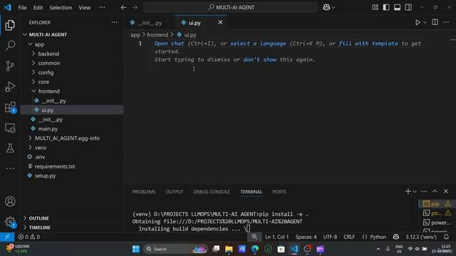
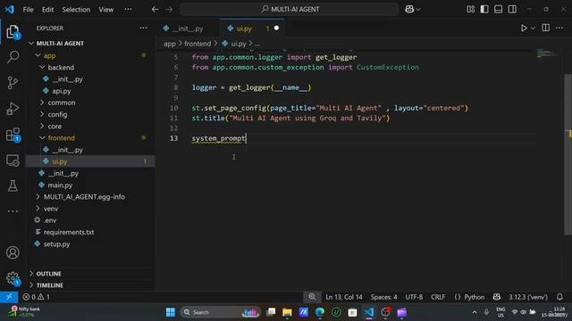
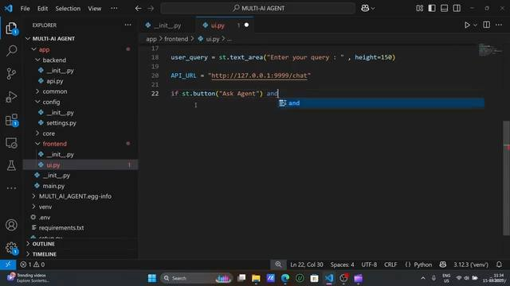
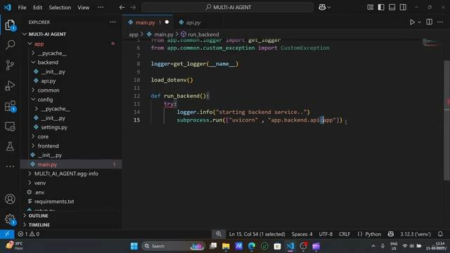
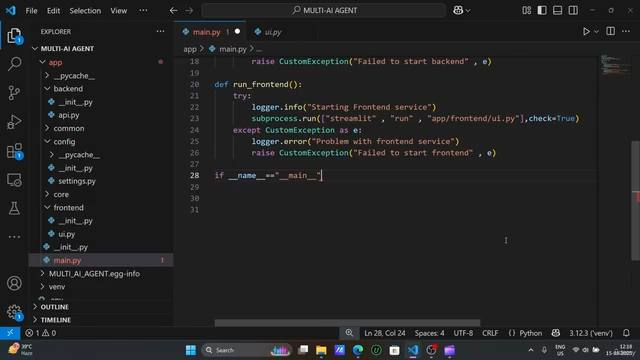
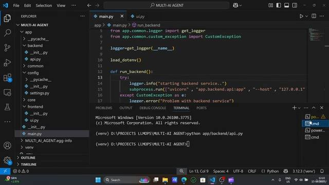
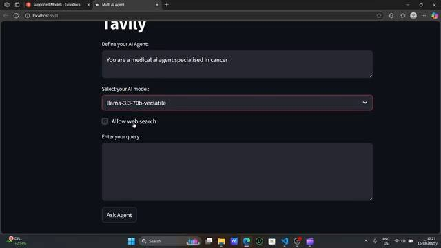
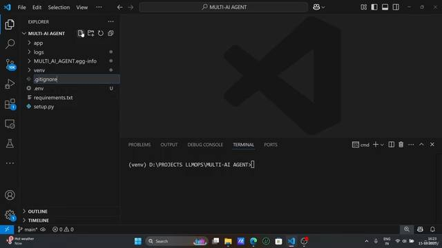
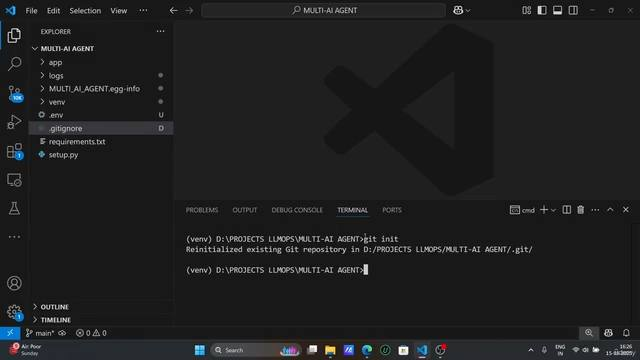

# LLMOps & AIOps Bootcamp：前后端联调、一键启动与代码版本化（P23–P25）

> 适用读者：前端转 AI 应用工程师。本文档覆盖 P23（写 Streamlit 前端 UI）、P24（用 `main.py` 同时拉起 FastAPI 后端与 Streamlit 前端并跑通）、P25（`.gitignore` + GitHub 代码版本化）。
> 说明：课程里后端（FastAPI + Groq + Tavily）在 P23 之前已经写好，本文档只复现 P23–P25 的内容；凡涉及后端内部实现而逐字稿没讲的，会明确标注「课里没讲」。

---

## 1. 这一节做什么

这三节课把「一个能跑的多 AI Agent 应用」从「只有后端 API」推进到「浏览器里能对话的完整产品」，并把它推到 GitHub：

1. **P23：写前端**。在 `app/frontend/` 下新建 `__init__.py` 和 `ui.py`，用 Streamlit 做界面：系统提示词输入框、模型下拉框、是否允许联网搜索的复选框、用户问题输入框、一个「Ask Agent」按钮。点按钮后，用 `requests.post` 把四个字段打包成 JSON 发给后端 `http://127.0.0.1:9999/chat`，拿到 200 就把返回内容渲染出来，否则报错。
2. **P24：写启动器**。在 `app/main.py` 里用 `subprocess` 分别启动 `uvicorn`（后端，端口 9999）和 `streamlit run`（前端，端口 8501），用 `threading.Thread` 让后端在后台线程跑，`time.sleep(2)` 保证后端先起来，再启动前端。最后 `python app/main.py` 一条命令跑通全栈，并在浏览器里实测「医疗 Agent 拒绝回答股票问题」的效果。
3. **P25：代码版本化**。在根目录写 `.gitignore`（排除 `venv/`、项目管理文件、`logs`、`.env`），在 GitHub 建仓库（不加 README），装 Git CLI，然后 `git init` → `git branch -M main` → `git remote add origin ...` → `git add .` → `git commit -m ...` → `git push -u origin main`。

一句话总结这三节的产出：**一个 `python app/main.py` 就能启动、浏览器里能对话、代码已上 GitHub 的最小可用 LLMOps 应用骨架。**

---

## 2. 讲师原话（带出处）

> "在前端，你会创建一个 ui.py 文件，基本上所有用户界面都会在这个文件里完成。"
> —— p023 [00:27]

> "这个请求模块用于发送 HTTP POST 请求。在后端，我们已经创建了对应的 HTTP POST 请求处理逻辑。"
> —— p023 [00:57]

> "系统提示词由用户提供……系统提示词会定义人工智能的行为。"
> —— p023 [03:54]

> "假设你问它：“你能帮我做作业吗？”它就会表示：“你知道，我不能这么做，因为你要求我以医疗智能体的身份行事。”……所以不要把系统提示词和用户查询混淆。"
> —— p023 [08:11]

> "务必确保这些拼写与你在后端定义的一致……否则就会报错。你们中有很多人可能会遇到这些错误。"
> —— p023 [11:03]

> "如果 response.status code 等于 200，那么 200 表示成功消息。"
> —— p023 [13:28]

> "基本上，人工智能智能体返回的响应格式非常不规范……只要出现这种带斜杠的标签，我们就会把它替换成 br 标签……换行标签的意思是……它会生成一个新行。"
> —— p023 [16:21]–[17:17]

> "当你在生产级环境中运行这个项目时，你触发的是 main.py，而不是 settings.py 文件。明白吗？所以每次运行 main.py 文件时，你都必须加载所有环境变量。"
> —— p024 [01:56]

> "多线程的含义是，因为我们必须同时运行后端和前端……我们会为后端创建一个单独的线程，这样即使前端停止，后端也会继续运行，不受影响。"
> —— p024 [09:05]

> "那么，我为什么要设置这个时间呢？是为了让后端先于前端启动。"
> —— p024 [10:00]

> "你只需要运行 main.py，不需要分别运行前端和后端；main.py 是后端与前端的组合。"
> —— p024 [11:55]

> "你可以看到，Streamlit 正运行在默认端口 8501 上，而 FastAPI 正运行在 9999 端口上。所以基本上会占用两个端口。一定要记住它们：8501、9999。"
> —— p024 [16:48]

> "在 .gitignore 中，你会列出所有不想推送到 GitHub 的文件和文件夹……最重要的是 .env 文件……因为它包含你的个人信息和 Grok API 令牌，不要把它推送到 GitHub。"
> —— p025 [00:29]–[01:26]

> "不要添加 README 文件……为什么？因为如果你添加了 README 文件，你就得不到这个东西，而它很重要。"
> —— p025 [02:22]

---

## 3. 从零复现

### 3.0 前置条件（P23 之前已完成的部分）

按逐字稿，P23 开始时项目里已经有：

- 一个 `app/` 目录，里面有 `backend/`（FastAPI，暴露 `/chat` 的 POST 接口）、`config/settings.py`（含 `settings.allowed_model_names`）、`common/logger.py`（`getLogger`）、`common/custom_exception.py`（`CustomException`）。
- 一个 `.env`，里面放 Groq API Key 和 Tavily API Key（逐字稿里叫「grok api」「tabulator」，即 Groq 与 Tavily）。
- 一个已激活的虚拟环境（P25 里叫 `venv/`）。

**这些文件的具体内容课里没讲**（属于 P23 之前的视频）。如果你手上没有这套后端，本文档第 7 节会说明你会撞上什么。

### 3.1 目录结构（P23–P25 结束时的样子）

```
multi-ai-agent/                ← 仓库根目录
├── .env                       ← 不提交（P25）
├── .gitignore                 ← P25 新建
├── requirements.txt           ← 课里提到存在，内容课里没讲
├── setup.py                   ← 课里提到存在，内容课里没讲
├── venv/                      ← 不提交（P25）
├── logs/                      ← 可选不提交（P25）
└── app/
    ├── __init__.py            ← 课里没讲，但 Python 包需要（见第 7 节）
    ├── main.py                ← P24 新建：一键启动器
    ├── backend/
    │   ├── __init__.py
    │   └── api.py             ← 课里没讲内容；P24 只用到 "api:app" 这个入口
    ├── config/
    │   ├── __init__.py
    │   └── settings.py        ← 课里没讲内容；P23 只用到 settings.allowed_model_names
    ├── common/
    │   ├── __init__.py
    │   ├── logger.py          ← 课里没讲内容；P23/P24 只用到 getLogger
    │   └── custom_exception.py← 课里没讲内容；P23/P24 只用到 CustomException
    └── frontend/
        ├── __init__.py        ← P23 新建（空文件）
        └── ui.py              ← P23 新建：Streamlit 界面
```

### 3.2 步骤一：建前端包并安装依赖（P23 开头）

1. 在 `app/frontend/` 下新建空文件 `__init__.py`。
2. 打开终端（讲师用的是 cmd），在项目根目录执行：

```bash
pip install -e .
```

讲师原话是「just run that pip install hyphen e full stop」，即 `pip install -e .`，作用是按 `setup.py` 把本项目以可编辑模式装进当前虚拟环境，这样 `from app.config.settings import settings` 这类导入才能生效。**每次新建 `__init__.py` 后都要跑一次这条命令**（讲师原话：「every time you create one init file make sure you run that command」）。



### 3.3 步骤二：写 `app/frontend/ui.py`（P23 主体）

按讲师顺序，这个文件从上到下依次是：

1. `import streamlit as st`、`import requests`；
2. 从项目里导入 `settings`、`getLogger`、`CustomException`；
3. `logger = getLogger(__name__)`；
4. `st.set_page_config(page_title="Multi AI Agent", layout="centered")`；
5. `st.title("Multi AI Agent using Groq and Tavily")`；
6. 四个输入控件：`st.text_area`（系统提示词，height=70）、`st.selectbox`（模型，选项来自 `settings.allowed_model_names`）、`st.checkbox`（是否允许联网搜索）、`st.text_area`（用户问题，height=150）；
7. 硬编码 `API_URL = "http://127.0.0.1:9999/chat"`；
8. `if st.button("Ask Agent") and user_query.strip():` 里组装 `payload` 字典，`requests.post(API_URL, json=payload)`；
9. `response.status_code == 200` 时取 `response.json().get("response", "")`，用 `st.subheader` + `st.markdown(..., unsafe_allow_html=True)` 渲染，并把换行替换成 `<br>`；
10. 非 200 时 `logger.error` + `st.error("Backend error")`；
11. 外层 `try/except Exception as e` 捕获网络异常，`logger.error` + `st.error("无法与后端通信")`。





**关键约束（讲师反复强调）**：`payload` 里的四个 key 必须和后端 Pydantic 模型的字段名**逐字符一致**。逐字稿里讲师念出来的四个 key 是 `model_name`、`system_prompt`、`messages`、`allow_web_search`（讲师口音把 `allow` 念成「a law」，把 `messages` 念成「messages」，把 `model_name` 念成「model name」）。**这四个 key 的确切拼写请以你后端 `api.py` 里的请求模型为准**——逐字稿只保证「拼写要一样」，没有逐字念出下划线。

### 3.4 步骤三：写 `app/main.py`（P24）

1. 导入：`subprocess`、`threading`、`time`（都是标准库）、`from dotenv import load_dotenv`、`from app.common.logger import getLogger`、`from app.common.custom_exception import CustomException`。
2. `logger = getLogger(__name__)`。
3. `load_dotenv()` —— 讲师解释：生产环境跑的是 `main.py` 而不是 `settings.py`，所以入口文件必须自己加载一次环境变量。
4. `run_backend()`：`subprocess.run(["uvicorn", "app.backend.api:app", "--host", "127.0.0.1", "--port", "9999"], check=True)`，包在 `try/except CustomException` 里。
5. `run_frontend()`：`subprocess.run(["streamlit", "run", "app/frontend/ui.py"], check=True)`，同样包 `try/except`。
6. `if __name__ == "__main__":` 里：`threading.Thread(target=run_backend).start()` → `time.sleep(2)` → `run_frontend()`，整体包 `try/except CustomException`。





### 3.5 步骤四：一条命令跑通（P24 结尾）

在项目根目录（**不是** `app/` 里）打开 cmd 终端：

```bash
python app/main.py
```

讲师原话：「you have to run only this main dot py you don't have to run front end and back end separately」。跑起来后：

- Streamlit 自动在浏览器打开，默认端口 **8501**；
- FastAPI 在 **9999** 端口；
- 两个端口同时被占用，这是预期行为。

实测（讲师演示）：系统提示词填「You are a medical AI agent specialized in cancer」，选一个模型，勾选允许联网搜索，问「can cancer be cured」，Agent 返回「Unfortunately, there is no universal cure for cancer...」；再问「can you give me best stocks to purchase」，Agent 只给医疗板块的股票——证明系统提示词确实在约束行为。





### 3.6 步骤五：`.gitignore` + 推 GitHub（P25）

1. 在**仓库根目录**新建 `.gitignore`，写入四类内容（见第 4 节完整文件）。
2. 去 GitHub 网页建仓库，名字 `multi-ai-agent-project`，**不要勾选 Add a README file**（讲师原话：勾了就拿不到后面那几条命令提示）。
3. 下载安装 Git CLI（Windows 搜「git download」装第一个）。
4. 在 VS Code 里开一个 **cmd** 终端（不是 PowerShell），依次执行 GitHub 页面上给的三条命令 + 三条提交命令：

```bash
git init
git branch -M main
git remote add origin https://github.com/<你的用户名>/multi-ai-agent-project.git
git add .
git commit -m "commit"
git push -u origin main
```

5. 如果 `git remote add origin` 报「remote origin already exists」，先执行 `git remote remove origin` 再重加（讲师现场就遇到了这个）。
6. 刷新 GitHub 页面，确认 `app/`、`.gitignore`、`requirements.txt`、`setup.py` 都在，而 `venv/`、`.env`、`logs/` 不在。





---

## 4. 完整代码

> 下面三个文件是 P23–P25 新建/修改的全部产物，可直接保存运行。
> `app/backend/api.py`、`app/config/settings.py`、`app/common/logger.py`、`app/common/custom_exception.py`、`setup.py`、`requirements.txt`、`.env` 的内容**课里没讲**，本文档不编造；第 7 节给出你需要自己补齐的最小契约。

### 4.1 `app/frontend/__init__.py`

```python
# 空文件。P23 要求新建它，然后回根目录跑一次 `pip install -e .`
```

### 4.2 `app/frontend/ui.py`

```python
import streamlit as st
import requests

from app.config.settings import settings
from app.common.logger import getLogger
from app.common.custom_exception import CustomException

logger = getLogger(__name__)

# ---------- 页面基础配置 ----------
st.set_page_config(
    page_title="Multi AI Agent",
    layout="centered",
)

st.title("Multi AI Agent using Groq and Tavily")

# ---------- 四个输入控件 ----------
system_prompt = st.text_area(
    "Define your AI Agent:",
    height=70,
    placeholder="You are a medical AI agent specialized in cancer...",
)

selected_model = st.selectbox(
    "Select your AI model",
    settings.allowed_model_names,
)

allow_web_search = st.checkbox("Allow Web Search")

user_query = st.text_area(
    "Enter your query",
    height=150,
    placeholder="Ask anything from your AI agent...",
)

# ---------- 后端地址（必须和 main.py 里 uvicorn 的 host/port 一致） ----------
API_URL = "http://127.0.0.1:9999/chat"

# ---------- 点击按钮 -> 组装 payload -> POST ----------
if st.button("Ask Agent") and user_query.strip():
    payload = {
        "model_name": selected_model,
        "system_prompt": system_prompt,
        "messages": user_query,
        "allow_web_search": allow_web_search,
    }

    try:
        logger.info("Sending request to backend")
        response = requests.post(API_URL, json=payload)

        if response.status_code == 200:
            agent_response = response.json().get("response", "")
            logger.info("Successfully received response from backend")

            st.subheader("Agent Response")
            st.markdown(
                agent_response.replace("\n", "<br>"),
                unsafe_allow_html=True,
            )
        else:
            logger.error(f"Backend returned status code {response.status_code}")
            st.error("Backend error")

    except Exception as e:
        logger.error(f"Error occurred while sending request to backend: {e}")
        st.error("Failed to communicate with backend")
```

### 4.3 `app/main.py`

```python
import subprocess
import threading
import time

from dotenv import load_dotenv

from app.common.logger import getLogger
from app.common.custom_exception import CustomException

logger = getLogger(__name__)

# 生产环境跑的是 main.py，不是 settings.py，所以入口处必须自己加载一次 .env
load_dotenv()


def run_backend():
    try:
        logger.info("Starting backend service")
        subprocess.run(
            [
                "uvicorn",
                "app.backend.api:app",
                "--host", "127.0.0.1",
                "--port", "9999",
            ],
            check=True,
        )
    except CustomException as e:
        logger.error(f"Problem with backend service: {e}")
        raise CustomException("Failed to start backend", e)


def run_frontend():
    try:
        logger.info("Starting frontend service")
        subprocess.run(
            [
                "streamlit",
                "run",
                "app/frontend/ui.py",
            ],
            check=True,
        )
    except CustomException as e:
        logger.error(f"Problem with frontend service: {e}")
        raise CustomException("Failed to start frontend", e)


if __name__ == "__main__":
    try:
        # 后端放后台线程，前端放主线程
        threading.Thread(target=run_backend).start()
        # 给后端 2 秒先起来，避免前端一上来就请求 9999 失败
        time.sleep(2)
        run_frontend()
    except CustomException as e:
        logger.exception("Custom exception occurred")
        print(str(e))
```

### 4.4 `.gitignore`（仓库根目录）

```gitignore
# 虚拟环境：体积 1~1.5 GB，GitHub 单文件/仓库有大小限制
venv/

# 项目管理文件（讲师原话「project management details」，具体文件名课里没讲，
# 按你实际用的工具填，例如 .idea/ 或 .vscode/）
.idea/
.vscode/

# 日志：可选，想留就注释掉
logs/

# 最重要：API Key 不能上 GitHub
.env
```

> 注意：讲师在 P25 里说「copy the relative path and paste it here」来加「项目管理文件」，但**没有念出具体文件名**。上面 `.idea/`、`.vscode/` 是常见候选，请按你项目里实际存在的目录填，不要照抄。

---

## 5. 逐行解释

### 5.1 `ui.py`

- **`import streamlit as st`**：Streamlit 是「脚本即 UI」的框架——你写 Python，它把每次控件调用渲染成网页元素，脚本从上到下重跑一遍就是一次页面刷新。对前端出身的读者：可以把它理解成「没有虚拟 DOM、没有组件状态，每次交互整页重渲染」的极简 React。
- **`import requests`**：讲师原话「this request module is used to send the HTTP post request」。前端出身的读者直接对应 `fetch()`，只是同步阻塞。
- **`from app.config.settings import settings`**：`settings.allowed_model_names` 是后端配置里的模型白名单，前端下拉框直接复用它，避免前后端模型列表不一致。**这个属性名是逐字稿里念出来的**（「settings dot allowed model names」）。
- **`logger = getLogger(__name__)`**：`__name__` 是 Python 的模块名魔法变量，等价于 JS 里 `import.meta.url` 那种「当前模块标识」，用来给日志打 tag。
- **`st.set_page_config(page_title=..., layout="centered")`**：`layout="centered"` 让所有控件居中，讲师原话「so that our all the UI will be centered」。
- **`st.text_area("Define your AI Agent:", height=70)`**：系统提示词。讲师花了整整 1 分钟解释它和用户问题的区别：**系统提示词定义 Agent 的人格/边界，用户问题是这一次的具体提问**。他举的例子是：设成医疗 Agent 后问「can you do my homework」，Agent 会拒绝。
- **`st.selectbox("Select your AI model", settings.allowed_model_names)`**：第二个参数直接传列表，Streamlit 自动渲染成下拉框。讲师演示时列表里有 Llama 70B、Llama 70B Versatile、Mistral、DeepSeek R1 等（「Mistral Sabha 24 billion」「DeepSeek R1」），**具体列表以你 `settings.py` 为准**。
- **`st.checkbox("Allow Web Search")`**：布尔值，决定后端要不要调 Tavily。讲师口音念成「tabuli / tabulator」，指的就是 Tavily。
- **`st.text_area("Enter your query", height=150)`**：用户问题框，比系统提示词框高，因为问题通常更长。
- **`API_URL = "http://127.0.0.1:9999/chat"`**：讲师原话「since it is working at a chat endpoint ... So you have to change this area according to your backend」。**这个 URL 必须和 `main.py` 里 uvicorn 的 `--host`/`--port` 以及后端路由前缀三者对齐**，否则 404。
- **`if st.button("Ask Agent") and user_query.strip():`**：`strip()` 去掉首尾空白，讲师原话「so that we can avoid our extra white spaces」。空问题不触发请求。
- **`payload = {...}` 四个 key**：这是全篇最容易翻车的地方。讲师原话「make sure these spellings are same as what you defined inside your backend ... Otherwise, there will be error」。**逐字稿只念了发音，没念下划线**，所以四个 key 的确切拼写请打开你的 `app/backend/api.py`，看 Pydantic 请求模型的字段名，逐字符抄过来。
- **`requests.post(API_URL, json=payload)`**：讲师原话「you have to pass two things ... where you have to send the data? What is the data?」。`json=` 会自动序列化并设置 `Content-Type: application/json`。
- **`if response.status_code == 200:`**：讲师原话「200 means a success message」。前端出身对应 `res.ok`。
- **`response.json().get("response", "")`**：从后端返回的 JSON 里取 `response` 字段。**这个字段名是逐字稿里念出来的**（「response.json.get response」）。第二个参数 `""` 是默认值，字段缺失时返回空串而不是 `None`。
- **`agent_response.replace("\n", "<br>")` + `unsafe_allow_html=True`**：讲师原话「the AI agent returns the response in a very unmannered way ... whenever there is a this tag slash and tag, we are replacing it with DR tag」。LLM 返回的换行在 Markdown 里不一定生效，替换成 HTML `<br>` 强制换行；`unsafe_allow_html=True` 是 Streamlit 允许渲染 HTML 的开关，**这也意味着如果 LLM 输出里带恶意 HTML 会被执行**——讲师没提这个安全风险，属于第 7 节内容。
- **`else: st.error("Backend error")`**：非 200（404/500 等）统一提示。
- **`except Exception as e:`**：捕获网络层异常（后端没起来、连接被拒）。讲师原话「fail to communicate with backend」。

### 5.2 `main.py`

- **`import subprocess`**：Python 标准库，用来「在 Python 里执行一条 shell 命令」。前端出身对应 Node 的 `child_process.spawn`。
- **`import threading`**：标准库线程。**在 JS/Node 里没有真正的多线程（Worker Threads 除外），对应的是「起一个不 await 的异步任务」**——但 Python 这里是真线程。
- **`import time`**：只用来 `sleep`。
- **`from dotenv import load_dotenv`**：读 `.env` 文件注入 `os.environ`。讲师解释得很清楚：`settings.py` 里虽然也 load 过一次，但**生产环境入口是 `main.py`**，所以入口必须自己再 load 一次，否则 `subprocess` 拉起的子进程拿不到环境变量。
- **`subprocess.run([...], check=True)`**：列表形式传参（不经过 shell，避免注入）；`check=True` 表示子进程返回非 0 就抛 `CalledProcessError`。讲师原话「after this square bracket you will just write comma check equal to」。
- **`"app.backend.api:app"`**：uvicorn 的「模块:变量」语法，意思是「导入 `app/backend/api.py`，取里面名为 `app` 的 FastAPI 实例」。**这个 `app` 变量名是逐字稿里念出来的**（「api app ... there will be a colon right colon app」）。
- **`"--host", "127.0.0.1", "--port", "9999"`**：讲师特意让学员回 `ui.py` 里复制 host，保证两边一致。
- **`"streamlit", "run", "app/frontend/ui.py"`**：Streamlit CLI 的标准用法，路径是相对**仓库根目录**的。
- **`threading.Thread(target=run_backend).start()`**：讲师原话「we will create a separate trend for backend so that backend will run even if frontend gets stopped it will not affect backend」。注意：这里**没有** `join()`，所以后端线程是 daemon 式的后台跑法；主线程跑 `run_frontend()` 阻塞住，前端一停，整个进程退出，后端线程也跟着没。
- **`time.sleep(2)`**：讲师原话「so that backend will get started before frontend ... we don't cause any errors」。**这是一个经验值，不是保证**——机器慢的时候 2 秒可能不够，见第 7 节。
- **`if __name__ == "__main__":`**：Python 惯用法，只有 `python app/main.py` 直接运行时才执行，被 import 时不执行。前端出身对应 ESM 里「判断是不是入口模块」。
- **`except CustomException as e: logger.exception(...)`**：`logger.exception` 会额外打印堆栈，比 `logger.error` 信息更全。

### 5.3 `.gitignore`

- **`venv/`**：讲师原话「virtual environment files are too big ... around 1 gb 1.5 gb」，GitHub 仓库有大小限制（讲师说「50 to 100 mb」，**具体数字以 GitHub 官方为准**）。
- **项目管理文件**：讲师原话「project management details ... copy the relative path and paste it here」，**没念具体文件名**。
- **`logs/`**：讲师原话「optional things ... if you want to push the logs you can push if you don't want to push don't push」。
- **`.env`**：讲师原话「the most important thing ... this contain your personal information your grok api tabulator you don't push this to a github」。**这是全篇唯一有真实安全后果的一条**：`.env` 一旦推上去，Groq/Tavily 的 Key 就泄露了，必须去控制台吊销重发。

---

## 6. 复现检查清单

按顺序打勾，任何一项不过就别往下走：

**P23 前端**
- [ ] `app/frontend/__init__.py` 存在（空文件即可）
- [ ] 在仓库根目录跑过 `pip install -e .` 且无报错
- [ ] `python -c "from app.config.settings import settings; print(settings.allowed_model_names)"` 能打印出模型列表
- [ ] `python -c "from app.common.logger import getLogger; from app.common.custom_exception import CustomException; print('ok')"` 输出 `ok`
- [ ] `ui.py` 里 `payload` 的四个 key 与 `app/backend/api.py` 请求模型字段名**逐字符一致**（用 diff 工具对一遍）
- [ ] `API_URL` 的 host/port 与 `main.py` 里 uvicorn 的 `--host`/`--port` 一致
- [ ] `response.json().get("response", "")` 里的 `"response"` 与后端返回体字段名一致

**P24 一键启动**
- [ ] `python app/main.py` 后终端先出现「Starting backend service」再出现「Starting frontend service」
- [ ] 浏览器自动打开 `http://localhost:8501`
- [ ] `http://127.0.0.1:9999/docs` 能打开 FastAPI 自动文档（说明后端起来了）
- [ ] 页面四个控件都渲染出来：系统提示词框、模型下拉、Web Search 复选框、问题框
- [ ] 填「You are a medical AI agent specialized in cancer」+ 问「can cancer be cured」→ 有回答
- [ ] 同一会话里问「can you give me best stocks to purchase」→ 回答被限制在医疗板块（证明系统提示词生效）
- [ ] 关掉 Streamlit 标签页后，终端里 uvicorn 进程也随之退出（因为主线程是前端）

**P25 版本化**
- [ ] 根目录 `.gitignore` 存在且包含 `venv/`、`.env`、`logs/`
- [ ] `git status` 输出里**看不到** `.env`、`venv/`、`logs/`
- [ ] GitHub 仓库页面上能看到 `app/`、`.gitignore`、`requirements.txt`、`setup.py`
- [ ] GitHub 仓库页面上**看不到** `.env`
- [ ] 如果曾经误推过 `.env`：立刻去 Groq / Tavily 控制台吊销旧 Key 并换新

---

## 7. 课里没讲但你会撞上的

这一节全部是「逐字稿没提、但你照着做一定会遇到」的坑，按出现概率排序。

1. **`app/__init__.py` 缺失导致 `from app.config...` 导入失败**。P23 只让你在 `frontend/` 下建 `__init__.py`，但 `app/`、`app/config/`、`app/common/`、`app/backend/` 也必须是包。如果 `pip install -e .` 后仍报 `ModuleNotFoundError: No module named 'app'`，检查这几层 `__init__.py` 是否都在。**课里没讲**。

2. **`pip install -e .` 依赖 `setup.py`，而 `setup.py` 内容课里没讲**。P25 提到仓库里有 `setup.py`，但 P23 没展示它的内容。你需要一个至少包含 `name`、`packages=find_packages()`、`install_requires` 的最小 `setup.py`，否则 `-e .` 会失败。**课里没讲**。

3. **`requirements.txt` 内容课里没讲**。从 P23–P24 用到的 import 反推，至少需要 `streamlit`、`requests`、`fastapi`、`uvicorn`、`python-dotenv`、`groq`、`tavily-python`（后两个是后端用的，课里没展示 import）。**版本号课里完全没提**，建议锁 `streamlit>=1.30`、`fastapi>=0.110`、`uvicorn>=0.29`，其余按你后端实际。

4. **`time.sleep(2)` 不够**。讲师说「2 millisecond gap」（口误，实际是 2 秒），但冷启动 uvicorn + 加载模型列表可能超过 2 秒，前端第一次点按钮会 `Connection refused`。**课里没讲重试机制**。最小改法：在 `ui.py` 的 `requests.post` 外面套 3 次重试，或把 `sleep` 调到 5。

5. **`threading.Thread` 没设 `daemon=True`**。当前写法下，前端 `run_frontend()` 返回后主线程结束，Python 会等非 daemon 线程——但 uvicorn 是阻塞的，实际上会卡住。讲师没讨论进程退出行为。**课里没讲**。如果你发现 Ctrl+C 后终端不退出，需要手动 kill 9999 端口进程。

6. **`unsafe_allow_html=True` 的 XSS 风险**。讲师只说了「because we are using html so we have to set it true」，**没提安全**。LLM 输出如果包含 `<script>` 或 ``，会被浏览器执行。生产环境应改用 `st.markdown(agent_response)`（不传 `unsafe_allow_html`），或先做 HTML 转义再替换 `\n`。

7. **`payload` 字段名对不上**。这是讲师唯一反复警告的坑（p023 [11:03]），但**逐字稿没念出下划线**。四个 key 的确切拼写必须以你 `app/backend/api.py` 里的 Pydantic 模型为准。典型报错是 FastAPI 返回 422 `Unprocessable Entity`，前端只会显示「Backend error」，看不出是哪个字段错了——建议临时在 `else` 分支里 `st.error(response.text)` 把后端错误详情打出来。

8. **`response.json().get("response", "")` 的 `"response"` 字段名**。逐字稿念了「response.json.get response」，但后端返回体到底是不是 `{"response": "..."}` 这个形状，**课里没展示后端代码**。如果后端返回的是 `{"answer": ...}` 或 `{"data": {...}}`，这里会永远拿到空串，页面显示空白但不报错——最难查的一类 bug。

9. **CORS**。前端 8501、后端 9999，浏览器同源策略下这是跨域。但**因为请求是 Streamlit 的 Python 进程发出的（服务端请求），不是浏览器发的**，所以不触发 CORS。讲师没解释这一点，但如果你以后改成浏览器直连 9999，就必须在后端加 `CORSMiddleware`。**课里没讲**。

10. **`.env` 泄露后的补救**。P25 只说了「不要推」，**没说推了怎么办**。如果已经推上去：① 立刻去 Groq / Tavily 控制台吊销 Key 并生成新 Key；② `git rm --cached .env` 后重新 commit；③ 注意 Git 历史里仍有旧 Key，需要 `git filter-repo` 或直接删仓库重建。

11. **Git 默认分支名**。P25 用 `git branch -M main` 强制改名，是因为老版本 Git 默认 `master`。如果你装的是新 Git（2.28+），`git init` 默认就是 `main`，这条命令是幂等的，不会报错。**课里没讲版本差异**。

12. **Windows 终端选择**。P24 讲师特意强调「make sure it is a cmd terminal」，因为 PowerShell 下 `subprocess.run` 传列表参数的行为、以及 `streamlit` 命令的解析可能不同。如果你在 PowerShell 里跑 `python app/main.py` 报「streamlit 不是内部或外部命令」，换成 cmd 或确认 `venv/Scripts` 在 PATH 里。**课里没讲原因**。

13. **模型列表与速率限制**。P24 结尾讲师提到「there are rate limits ... for development purpose that's good ... if you want a more production grade models then you have to offer GROC premium」。**具体限额数字课里没讲**，以 Groq 控制台为准。开发时如果频繁 429，换模型或加退避重试。

---

**参考帧索引**（本文档引用的截图，按出现顺序）：
p023_0046s、p023_0231s、p023_0601s、p024_0231s、p024_0545s、p024_0744s、p024_0799s、p025_0033s、p025_0209s。